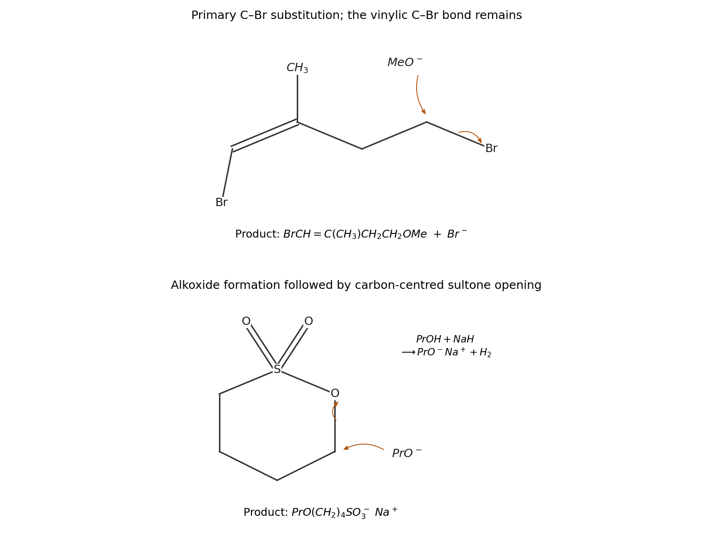

<h1 id="3/b/solution">Solution</h1>

↑ **Parent:** [B](../b.md)

**The first product is $\mathrm{BrCH=C(CH_3)CH_2CH_2OCH_3}$, with the original [alkene](../../../../../alkene.md) geometry retained.** [methoxide](../../../../../methoxide.md) attacks the primary saturated [carbon](../../../../../carbon.md) bearing [bromine](../../../../../bromine.md) from the backside. Its [oxygen](../../../../../oxygen.md) [lone pair](../../../../../lone-pair.md) forms the new C–O bond as the C–Br bonding pair leaves with [bromide](../../../../../bromide.md). The other [bromine](../../../../../bromine.md) is vinylic, directly bonded to an sp$^2$ [carbon](../../../../../carbon.md): ordinary [SN2 reaction](../../../../../sn2-reaction.md) is unfavourable there, and ionization would require an unstable vinyl cation. Thus the primary alkyl [bromide](../../../../../bromide.md) is replaced selectively, rather than replacing the [vinylic halide](../../../../../vinylic-halide.md) or moving the double bond. There is no observable inversion label at the attacked [carbon](../../../../../carbon.md) because it is a methylene.

**The second product is [sodium 4-propoxybutane-1-sulfonate](../../../../../sodium-4-propoxybutane-1-sulfonate.md), $\mathrm{Na^+\,{}^-O_3S(CH_2)_4OCH_2CH_2CH_3}$.** [sodium hydride](../../../../../sodium-hydride.md) first removes the [alcohol](../../../../../alcohol.md) [proton](../../../../../proton.md), giving [propoxide](../../../../../propoxide.md) and [hydrogen](../../../../../hydrogen.md). The [propoxide](../../../../../propoxide.md) [oxygen](../../../../../oxygen.md) then attacks the primary ring [carbon](../../../../../carbon.md) bonded to the ring [oxygen](../../../../../oxygen.md); simultaneous cleavage of that carbon–oxygen bond opens the [sultone](../../../../../sultone.md). The departing ring [oxygen](../../../../../oxygen.md) remains attached to [sulfur](../../../../../sulfur.md) as part of the resonance-stabilized [sulfonate](../../../../../sulfonate.md) anion. The [carbon](../../../../../carbon.md) attached directly to [sulfur](../../../../../sulfur.md) is not the substitution site, because cleavage there would not expel the same stable [sulfonate](../../../../../sulfonate.md) [leaving group](../../../../../leaving-group.md). This is carbon-centred ring opening of a cyclic [sulfonate ester](../../../../../sulfonate-ester.md), not addition across an S=O bond.

**[Figure 9](#3/b/image-original-electron-pair-arrows-for-selective-primary-carbon-substitution-and-propoxide-opening-of-the-four-carbon-sultone). Original electron-pair arrows for selective primary-carbon substitution and propoxide opening of the four-carbon sultone**.

## ↑ Ancestors (13)

1. [B](../b.md)
2. [3](../../3.md)
3. [Paper 1](../../../paper-1-split.md)
4. [2023](../../../split.md)
5. [Past exam of the chemistry course of the year 1 of the natural sciences course of the University of Cambridge](../../../../split.md)
6. [Chemistry course of the year 1 of the natural sciences course of the University of Cambridge](../../../../../chemistry-course-of-the-year-1-of-the-natural-sciences-course-of-the-university-of-cambridge.md)
7. [Year 1 of the natural sciences course of the University of Cambridge](../../../../../year-1-of-the-natural-sciences-course-of-the-university-of-cambridge.md)
8. [Year of the natural sciences course of the University of Cambridge](../../../../../year-of-the-natural-sciences-course-of-the-university-of-cambridge.md)
9. [Natural sciences course of the University of Cambridge](../../../../../natural-sciences-course-of-the-university-of-cambridge.md)
10. [Course of the University of Cambridge](../../../../../course-of-the-university-of-cambridge.md)
11. [University of Cambridge](../../../../../university-of-cambridge-split.md)
12. [List of universities](../../../../../list-of-universities.md)
13. [Codex Wiki](../../../../../split.md)
