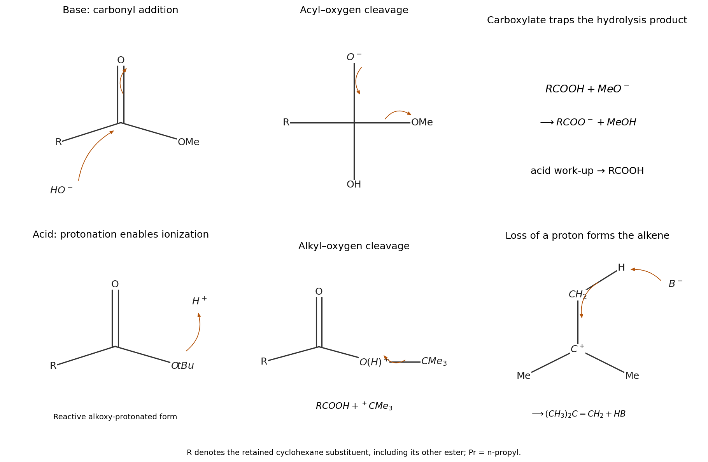

<h1 id="3/c/solution">Solution</h1>

↑ **Parent:** [C](../c.md)

**Aqueous base selectively converts the [methyl ester](../../../../../methyl-ester.md) to a [carboxylate](../../../../../carboxylate.md), and brief acidification gives the corresponding monoacid while retaining the [tert-Butyl ester](../../../../../tert-butyl-ester.md).** At the methyl-ester end, a hydroxide [lone pair](../../../../../lone-pair.md) attacks the acyl [carbon](../../../../../carbon.md) and the [carbonyl](../../../../../carbonyl-group.md) pi pair moves to [oxygen](../../../../../oxygen.md). The tetrahedral intermediate collapses as the [oxygen](../../../../../oxygen.md) anion reforms C=O and the acyl C–OMe bond breaks to [methoxide](../../../../../methoxide.md). [proton transfer](../../../../../proton-transfer.md) then gives the [carboxylate](../../../../../carboxylate.md) and [methanol](../../../../../methanol.md). [carboxylate](../../../../../carboxylate.md) formation makes the net [saponification](../../../../../saponification.md) effectively irreversible under the basic conditions; [protonation](../../../../../protonation.md) protonates that [carboxylate](../../../../../carboxylate.md).

The [tert-Butyl ester](../../../../../tert-butyl-ester.md) reacts more slowly under these conditions because its bulky alkoxy group hinders acyl attack, and [tert-butoxide](../../../../../tert-butoxide.md) is a stronger base and poorer [leaving group](../../../../../leaving-group.md) than [methoxide](../../../../../methoxide.md). The [selectivity](../../../../../selectivity.md) is kinetic, not an assertion that tert-butyl [esters](../../../../../ester.md) can never undergo base hydrolysis. The work-up should be sufficiently mild and brief to avoid the separate acid-labile pathway.

**Anhydrous [trifluoroacetic acid](../../../../../trifluoroacetic-acid.md) instead removes the tert-butyl group, leaving the [methyl ester](../../../../../methyl-ester.md).** [protonation](../../../../../protonation.md) activates the [ester](../../../../../ester.md); in a useful reactive [protonation](../../../../../protonation.md) form the alkoxy [oxygen](../../../../../oxygen.md) bears the [proton](../../../../../proton.md). The O–C(tert-butyl) bond then cleaves with its electron pair going to [oxygen](../../../../../oxygen.md), producing the [carboxylic acid](../../../../../carboxylic-acid.md) and a tert-butyl-cation-like fragment. Loss of a methyl [proton](../../../../../proton.md) gives 2-methylpropene and regenerates the acid catalyst. Carbonyl-oxygen [protonation](../../../../../protonation.md) and charge delocalization can precede cleavage; drawing alkoxy-oxygen [protonation](../../../../../protonation.md) is a transparent way of tracking the bonds broken. The key distinction is **alkyl–oxygen cleavage** here versus **acyl–oxygen cleavage** in the base reaction. Methyl-cation formation is strongly unfavourable, and without water ordinary acid-catalysed methyl-ester hydrolysis is not available. No water is required to account for the tert-butyl deprotection or its [alkene](../../../../../alkene.md) by-product.

**[Figure 10](#3/c/image-original-mechanisms-contrasting-tetrahedral-acyl-substitution-with-acid-promoted-tert-butyl-alkyl-oxygen-cleavage). Original mechanisms contrasting tetrahedral acyl substitution with acid-promoted tert-butyl alkyl–oxygen cleavage**.

## ↑ Ancestors (13)

1. [C](../c.md)
2. [3](../../3.md)
3. [Paper 1](../../../paper-1-split.md)
4. [2023](../../../split.md)
5. [Past exam of the chemistry course of the year 1 of the natural sciences course of the University of Cambridge](../../../../split.md)
6. [Chemistry course of the year 1 of the natural sciences course of the University of Cambridge](../../../../../chemistry-course-of-the-year-1-of-the-natural-sciences-course-of-the-university-of-cambridge.md)
7. [Year 1 of the natural sciences course of the University of Cambridge](../../../../../year-1-of-the-natural-sciences-course-of-the-university-of-cambridge.md)
8. [Year of the natural sciences course of the University of Cambridge](../../../../../year-of-the-natural-sciences-course-of-the-university-of-cambridge.md)
9. [Natural sciences course of the University of Cambridge](../../../../../natural-sciences-course-of-the-university-of-cambridge.md)
10. [Course of the University of Cambridge](../../../../../course-of-the-university-of-cambridge.md)
11. [University of Cambridge](../../../../../university-of-cambridge-split.md)
12. [List of universities](../../../../../list-of-universities.md)
13. [Codex Wiki](../../../../../split.md)
