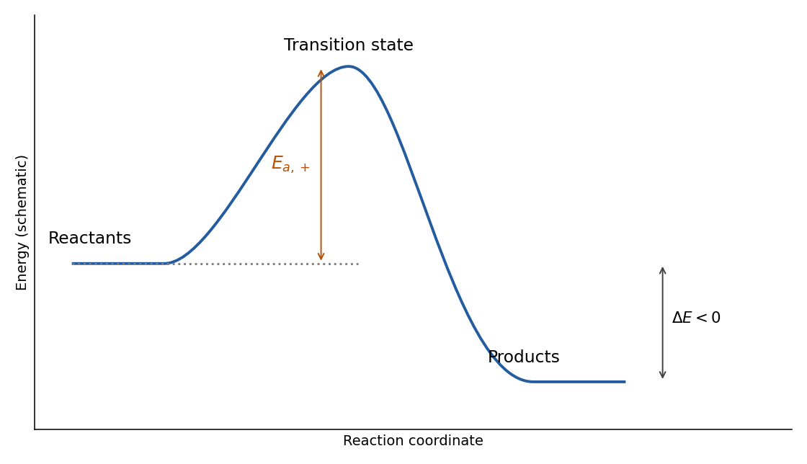

<h1 id="5/a/i/solution">Solution</h1>

↑ **Parent:** [I](../i.md)

**The products lie below the reactants, while the [transition state](../../../../../../transition-state.md) lies above both.** On an energy-versus-reaction-coordinate plot, the forward [activation energy](../../../../../../activation-energy.md) is the vertical separation $E_{\rm TS}-E_{\rm R}$, not the difference between product and reactant energies. For an exothermic elementary path, $\Delta E=E_{\rm P}-E_{\rm R}<0$, and the reverse barrier is $E_{a,-}=E_{a,+}-\Delta E>E_{a,+}$.

**[Figure 11](#5/a/i/image-original-schematic-exothermic-energy-profile-with-reactant-product-transition-state-and-forward-barrier-labels). Original schematic exothermic energy profile with reactant, product, transition-state and forward-barrier labels**.

## ↑ Ancestors (14)

1. [I](../i.md)
2. [A](../../a.md)
3. [5](../../../5.md)
4. [Paper 1](../../../../paper-1-split.md)
5. [2023](../../../../split.md)
6. [Past exam of the chemistry course of the year 1 of the natural sciences course of the University of Cambridge](../../../../../split.md)
7. [Chemistry course of the year 1 of the natural sciences course of the University of Cambridge](../../../../../../chemistry-course-of-the-year-1-of-the-natural-sciences-course-of-the-university-of-cambridge.md)
8. [Year 1 of the natural sciences course of the University of Cambridge](../../../../../../year-1-of-the-natural-sciences-course-of-the-university-of-cambridge.md)
9. [Year of the natural sciences course of the University of Cambridge](../../../../../../year-of-the-natural-sciences-course-of-the-university-of-cambridge.md)
10. [Natural sciences course of the University of Cambridge](../../../../../../natural-sciences-course-of-the-university-of-cambridge.md)
11. [Course of the University of Cambridge](../../../../../../course-of-the-university-of-cambridge.md)
12. [University of Cambridge](../../../../../../university-of-cambridge-split.md)
13. [List of universities](../../../../../../list-of-universities.md)
14. [Codex Wiki](../../../../../../split.md)
