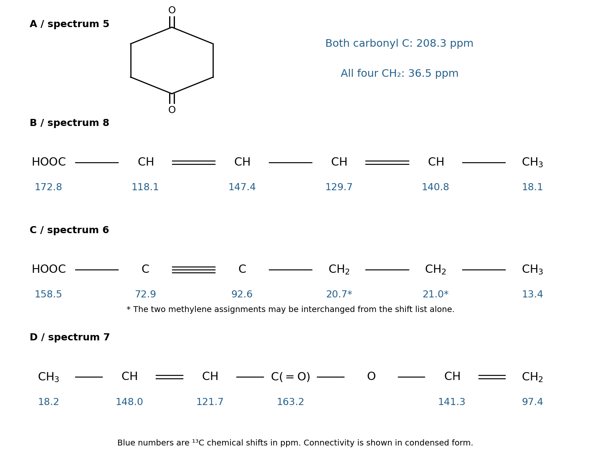

<h1 id="1/b/solution">Solution</h1>

↑ **Parent:** [B](../b.md)

**The carbon spectra are A → 5, B → 8, C → 6, and D → 7.** Number each acyclic acid or ester chain from its carbonyl carbon. The assignments below account for every [carbon-13 NMR](../../../../../carbon-13-nmr.md) environment.

For A, both [ketone](../../../../../ketone.md) carbonyl carbons have $\delta=208.3$ ppm and all four methylene carbons have $\delta=36.5$ ppm. Molecular symmetry and rapid conformational averaging explain why six carbons give only two resonances.

For B, written $\mathrm{HOOC-CH=CH-CH=CH-CH_3}$, assign $\delta(\mathrm C_1)=172.8$, $\delta(\mathrm C_2)=118.1$, $\delta(\mathrm C_3)=147.4$, $\delta(\mathrm C_4)=129.7$, $\delta(\mathrm C_5)=140.8$, and $\delta(\mathrm C_6)=18.1$ ppm. The alternation among vinylic [chemical shifts](../../../../../chemical-shift.md) reflects polarization of the conjugated chain, especially the deshielded carbon beta to the carboxyl group.

For C, written $\mathrm{HOOC-C\equiv C-CH_2-CH_2-CH_3}$, assign the carbonyl at $158.5$, the adjacent sp carbon at $72.9$, the other sp carbon at $92.6$, and the terminal methyl at $13.4$ ppm. The two methylene resonances are $20.7$ and $21.0$ ppm. A plausible assignment is $\mathrm C_4=20.7$ and $\mathrm C_5=21.0$ ppm, but **their ordering is tentative from the supplied shift list alone**; a correlation experiment would resolve it.

For D, written $\mathrm{CH_3CH=CHC(=O)OCH=CH_2}$, the carbonyl is at $163.2$ ppm. The crotonyl beta-CH, alpha-CH and methyl carbons are at $148.0$, $121.7$ and $18.2$ ppm, respectively. The O-bound vinyl CH is at $141.3$ ppm and its terminal $\mathrm{CH_2}$ is at $97.4$ ppm. The two sides of the [ester](../../../../../ester.md) oxygen therefore produce quite different vinylic environments.

**[Figure 1](#1/b/image-original-structural-maps-of-all-supplied-carbon-13-nmr-assignments). Original structural maps of all supplied carbon-13 NMR assignments**.

## ↑ Ancestors (13)

1. [B](../b.md)
2. [1](../../1.md)
3. [Paper 1](../../../paper-1-split.md)
4. [2024](../../../split.md)
5. [Past exam of the chemistry course of the year 1 of the natural sciences course of the University of Cambridge](../../../../split.md)
6. [Chemistry course of the year 1 of the natural sciences course of the University of Cambridge](../../../../../chemistry-course-of-the-year-1-of-the-natural-sciences-course-of-the-university-of-cambridge.md)
7. [Year 1 of the natural sciences course of the University of Cambridge](../../../../../year-1-of-the-natural-sciences-course-of-the-university-of-cambridge.md)
8. [Year of the natural sciences course of the University of Cambridge](../../../../../year-of-the-natural-sciences-course-of-the-university-of-cambridge.md)
9. [Natural sciences course of the University of Cambridge](../../../../../natural-sciences-course-of-the-university-of-cambridge.md)
10. [Course of the University of Cambridge](../../../../../course-of-the-university-of-cambridge.md)
11. [University of Cambridge](../../../../../university-of-cambridge-split.md)
12. [List of universities](../../../../../list-of-universities.md)
13. [Codex Wiki](../../../../../split.md)
