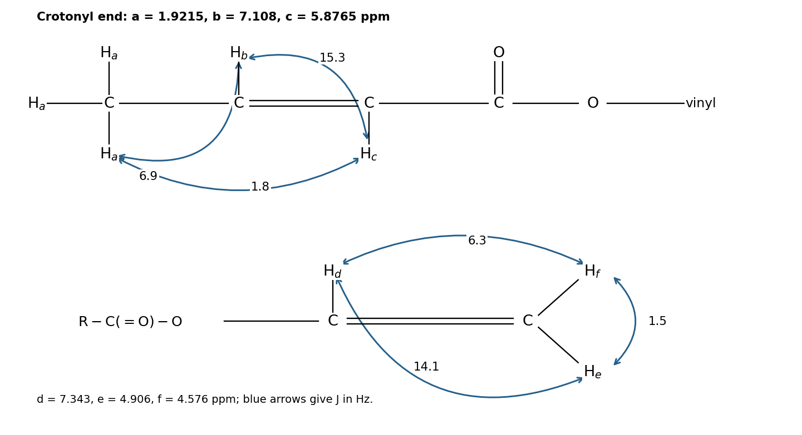

<h1 id="1/c/i/solution">Solution</h1>

↑ **Parent:** [I](../i.md)

Use the proton labels in the original drawing below. Let $a$ denote the three methyl hydrogens, $b$ the crotonyl beta-CH, $c$ the crotonyl alpha-CH, $d$ the O-bound vinyl CH, and $e,f$ the terminal vinyl hydrogens trans and cis to $d$, respectively.

$$
\begin{array}{c|r|c|l}
\text{protons}&\delta/\mathrm{ppm}&\text{integral}&\text{multiplicity}\\\hline
a&1.9215&3&\text{doublet of doublets}\\
b&7.108&1&\text{doublet of quartets}\\
c&5.8765&1&\text{doublet of quartets}\\
d&7.343&1&\text{doublet of doublets}\\
e&4.906&1&\text{doublet of doublets}\\
f&4.576&1&\text{doublet of doublets}
\end{array}
$$

**The integrals sum to eight hydrogens.** Multiplet centres give the [chemical shifts](../../../../../../chemical-shift.md); a peak label at one edge of a multiplet is not its centre. The terminal vinyl hydrogens are chemically nonequivalent because one is cis and the other trans to the O-bound vinyl hydrogen. Each crotonyl CH couples to the other and to the methyl group; the resolved long-range interaction makes the methyl a doublet of doublets rather than a simple doublet.

**[Figure 2](#1/c/i/image-original-structure-showing-all-eight-hydrogens-their-environments-and-calculated-nmr-coupling-constants). Original structure showing all eight hydrogens, their environments and calculated NMR coupling constants**.

## ↑ Ancestors (14)

1. [I](../i.md)
2. [C](../../c.md)
3. [1](../../../1.md)
4. [Paper 1](../../../../paper-1-split.md)
5. [2024](../../../../split.md)
6. [Past exam of the chemistry course of the year 1 of the natural sciences course of the University of Cambridge](../../../../../split.md)
7. [Chemistry course of the year 1 of the natural sciences course of the University of Cambridge](../../../../../../chemistry-course-of-the-year-1-of-the-natural-sciences-course-of-the-university-of-cambridge.md)
8. [Year 1 of the natural sciences course of the University of Cambridge](../../../../../../year-1-of-the-natural-sciences-course-of-the-university-of-cambridge.md)
9. [Year of the natural sciences course of the University of Cambridge](../../../../../../year-of-the-natural-sciences-course-of-the-university-of-cambridge.md)
10. [Natural sciences course of the University of Cambridge](../../../../../../natural-sciences-course-of-the-university-of-cambridge.md)
11. [Course of the University of Cambridge](../../../../../../course-of-the-university-of-cambridge.md)
12. [University of Cambridge](../../../../../../university-of-cambridge-split.md)
13. [List of universities](../../../../../../list-of-universities.md)
14. [Codex Wiki](../../../../../../split.md)
