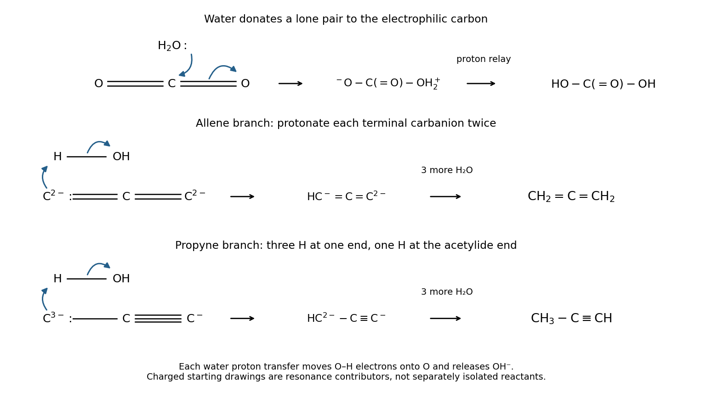

<h1 id="2/c/solution">Solution</h1>

↑ **Parent:** [C](../c.md)

**The product is [carbonic acid](../../../../../carbonic-acid.md), $\mathrm{HO-C(=O)-OH}$.** The oxygen [lone pair](../../../../../lone-pair.md) [Homo](../../../../../homo.md) of water donates into the carbon-centred component of the carbon dioxide $\pi^*$ [LUMO](../../../../../lowest-unoccupied-molecular-orbital.md). Draw an [electron-pair arrow](../../../../../electron-pair-arrow.md) from the water oxygen to carbon and a second from one C=O pi bond onto its oxygen:

$$
\mathrm{CO_2+H_2O\longrightarrow\ ^-O-C(=O)-OH_2^+\longrightarrow HO-C(=O)-OH}.
$$

The first step bends the original linear electrophile and gives carbon three oxygen neighbours; carbon is approximately trigonal planar in the resulting carbonate framework. Proton transfer from the oxonium oxygen to the negatively charged oxygen produces the neutral acid. In real water, solvent molecules relay that proton rather than requiring a strained isolated intramolecular transfer. The forward mechanism does not assert that most dissolved carbon dioxide is present as carbonic acid at equilibrium.

**[Figure 3](#2/c/image-original-electron-pair-arrows-for-carbon-dioxide-hydration-and-protonation-routes-from-the-tricarbide-ion). Original electron-pair arrows for carbon dioxide hydration and protonation routes from the tricarbide ion**.

## ↑ Ancestors (13)

1. [C](../c.md)
2. [2](../../2.md)
3. [Paper 1](../../../paper-1-split.md)
4. [2024](../../../split.md)
5. [Past exam of the chemistry course of the year 1 of the natural sciences course of the University of Cambridge](../../../../split.md)
6. [Chemistry course of the year 1 of the natural sciences course of the University of Cambridge](../../../../../chemistry-course-of-the-year-1-of-the-natural-sciences-course-of-the-university-of-cambridge.md)
7. [Year 1 of the natural sciences course of the University of Cambridge](../../../../../year-1-of-the-natural-sciences-course-of-the-university-of-cambridge.md)
8. [Year of the natural sciences course of the University of Cambridge](../../../../../year-of-the-natural-sciences-course-of-the-university-of-cambridge.md)
9. [Natural sciences course of the University of Cambridge](../../../../../natural-sciences-course-of-the-university-of-cambridge.md)
10. [Course of the University of Cambridge](../../../../../course-of-the-university-of-cambridge.md)
11. [University of Cambridge](../../../../../university-of-cambridge-split.md)
12. [List of universities](../../../../../list-of-universities.md)
13. [Codex Wiki](../../../../../split.md)
