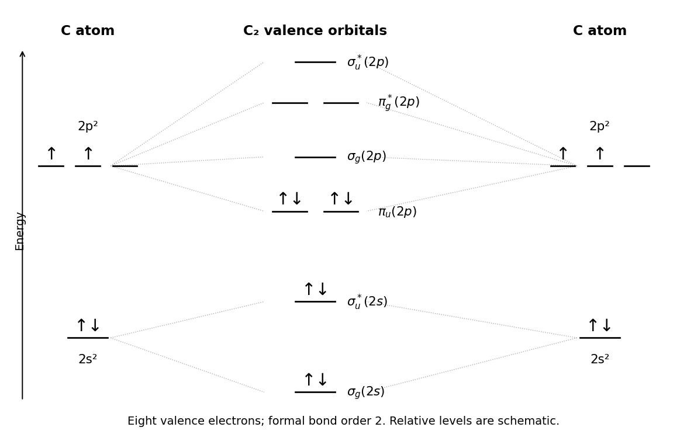

<h1 id="2/d/solution">Solution</h1>

↑ **Parent:** [D](../d.md)

**The elementary valence-MO model gives $\boxed{\text{bond order}(\mathrm C_2)=2}$.** Each carbon supplies four $n=2$ valence electrons, so fill eight electrons in the ordering appropriate to the lighter second-row diatomics:

$$
(\sigma_g2s)^2(\sigma_u^*2s)^2(\pi_u2p)^4(\sigma_g2p)^0(\pi_g^*2p)^0(\sigma_u^*2p)^0.
$$

The two $\pi_u$ orbitals are degenerate, as are the two $\pi_g^*$ orbitals. The $2s$ bonding and antibonding occupations cancel; four net p-bonding electrons remain, giving $(6-2)/2=2$. Mixing between sigma orbitals of compatible symmetry places the occupied $\pi_u$ pair below the empty p-derived $\sigma_g$ orbital in this diagram. All occupied orbitals are paired.

**[Figure 4](#2/d/image-original-valence-molecular-orbital-energy-diagram-for-carbon-dimer-with-atomic-inputs-and-symmetry-labels). Original valence molecular orbital energy diagram for carbon dimer, with atomic inputs and symmetry labels**.

The omitted $1s$ orbitals form filled $\sigma_g1s$ and $\sigma_u^*1s$ levels. Their contributions to the formal bond order cancel, and their low energies and small spatial extent make them largely core-like. Omitting them simplifies this valence diagram without claiming they do not exist or have exactly no effect on molecular energies.

## ↑ Ancestors (13)

1. [D](../d.md)
2. [2](../../2.md)
3. [Paper 1](../../../paper-1-split.md)
4. [2024](../../../split.md)
5. [Past exam of the chemistry course of the year 1 of the natural sciences course of the University of Cambridge](../../../../split.md)
6. [Chemistry course of the year 1 of the natural sciences course of the University of Cambridge](../../../../../chemistry-course-of-the-year-1-of-the-natural-sciences-course-of-the-university-of-cambridge.md)
7. [Year 1 of the natural sciences course of the University of Cambridge](../../../../../year-1-of-the-natural-sciences-course-of-the-university-of-cambridge.md)
8. [Year of the natural sciences course of the University of Cambridge](../../../../../year-of-the-natural-sciences-course-of-the-university-of-cambridge.md)
9. [Natural sciences course of the University of Cambridge](../../../../../natural-sciences-course-of-the-university-of-cambridge.md)
10. [Course of the University of Cambridge](../../../../../course-of-the-university-of-cambridge.md)
11. [University of Cambridge](../../../../../university-of-cambridge-split.md)
12. [List of universities](../../../../../list-of-universities.md)
13. [Codex Wiki](../../../../../split.md)
