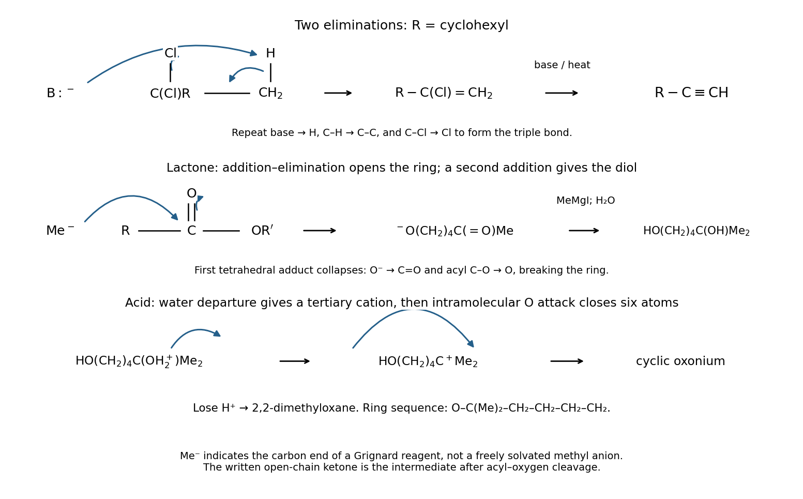

<h1 id="3/b/solution">Solution</h1>

↑ **Parent:** [B](../b.md)

**The first transformation is two successive dehydrohalogenations; the second opens the lactone by two methyl additions and then closes a six-membered cyclic ether.** Both schemes must be accounted for within this part.

For the dichloride, write $R=\mathrm{cyclohexyl}$. In the product-forming path, [tert-butoxide](../../../../../tert-butoxide.md) removes a hydrogen from the methyl group of $\mathrm{R-CCl_2-CH_3}$. Draw arrows from the base lone pair to H, from C–H into the C–C bond, and from C–Cl to Cl. This [E2 elimination](../../../../../e2-elimination.md) gives $\mathrm{R-C(Cl)=CH_2}$. A second base-induced elimination removes a vinyl hydrogen and the remaining chloride, forming $\mathrm{R-C\equiv CH}$. The second elimination is more demanding because a vinylic bond is involved, consistent with the strong-base, heated conditions. This route explains the displayed product without asserting that no other elimination regioisomer can ever form.

For the lactone, a methyl equivalent from [methylmagnesium iodide](../../../../../methylmagnesium-iodide.md) attacks the ester carbonyl carbon, with its pi pair moving to oxygen. Collapse of the tetrahedral intermediate reforms C=O and cleaves the acyl–oxygen bond, opening the ring to the magnesium alkoxide corresponding to $\mathrm{HO(CH_2)_4C(=O)CH_3}$. The newly formed [ketone](../../../../../ketone.md) is more susceptible to a second methyl addition; its pi pair again moves to oxygen. After water workup, the product is the diol $\mathrm{HO(CH_2)_4C(OH)(CH_3)_2}$.

Under acid and heat, protonate its tertiary OH, then move the C–O pair onto oxygen as water leaves. The resulting $\mathrm{HO(CH_2)_4C^+(CH_3)_2}$ is trapped intramolecularly by the remaining primary-alcohol oxygen. Its lone pair forms the closing O–C bond, producing a six-membered cyclic oxonium ion. Deprotonation yields **2,2-dimethyloxane**, also called 2,2-dimethyltetrahydropyran. Ring closure retains four chain methylenes; it does not form a five-membered ring. The two methyl groups both derive from the two equivalents of Grignard reagent.

**[Figure 5](#3/b/image-original-electron-flow-schemes-for-double-elimination-lactone-addition-and-acid-induced-ether-formation). Original electron-flow schemes for double elimination, lactone addition and acid-induced ether formation**.

## ↑ Ancestors (13)

1. [B](../b.md)
2. [3](../../3.md)
3. [Paper 1](../../../paper-1-split.md)
4. [2024](../../../split.md)
5. [Past exam of the chemistry course of the year 1 of the natural sciences course of the University of Cambridge](../../../../split.md)
6. [Chemistry course of the year 1 of the natural sciences course of the University of Cambridge](../../../../../chemistry-course-of-the-year-1-of-the-natural-sciences-course-of-the-university-of-cambridge.md)
7. [Year 1 of the natural sciences course of the University of Cambridge](../../../../../year-1-of-the-natural-sciences-course-of-the-university-of-cambridge.md)
8. [Year of the natural sciences course of the University of Cambridge](../../../../../year-of-the-natural-sciences-course-of-the-university-of-cambridge.md)
9. [Natural sciences course of the University of Cambridge](../../../../../natural-sciences-course-of-the-university-of-cambridge.md)
10. [Course of the University of Cambridge](../../../../../course-of-the-university-of-cambridge.md)
11. [University of Cambridge](../../../../../university-of-cambridge-split.md)
12. [List of universities](../../../../../list-of-universities.md)
13. [Codex Wiki](../../../../../split.md)
