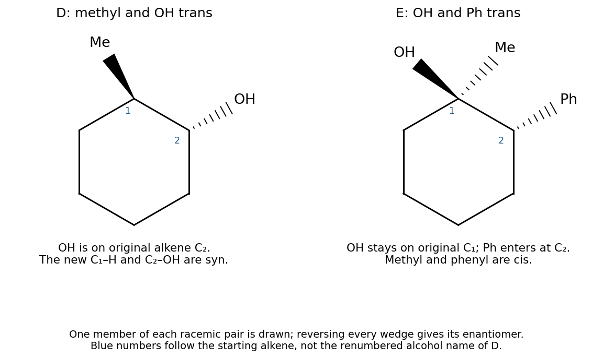

<h1 id="3/c/iii/solution">Solution</h1>

↑ **Parent:** [Iii](../iii.md)

**D is racemic trans-2-methylcyclohexan-1-ol. E is racemic 1-methyl-2-phenylcyclohexan-1-ol with OH and Ph trans, and Me and Ph cis.** Number the starting alkene carbon carrying methyl as $\mathrm C_1$ and its partner as $\mathrm C_2$ in the reaction explanation below; the product name of D renumbers the OH-bearing carbon as 1.

For D, [hydroboration](../../../../../../hydroboration.md) proceeds through a concerted four-centre transition state: the alkene pi pair donates to boron while B–H supplies the new C–H bond. Boron attaches mainly to less substituted $\mathrm C_2$ and hydrogen to $\mathrm C_1$, on the same face. Under peroxide/base conditions, hydroperoxide attacks B; migration of the C–B bond to the adjacent oxygen, with O–O cleavage, replaces C–B by C–O with retention at carbon. Hydrolysis/proton transfer releases the alcohol. Thus the newly added H and OH are syn, making the pre-existing methyl and OH trans. Attack on either alkene face gives the enantiomeric pair.

For E, the peracid transfers its terminal oxygen across the alkene in concerted [epoxidation](../../../../../../epoxidation.md), through cyclic electron flow that also breaks O–O and transfers the acidic proton to the peracid carbonyl oxygen. The resulting [epoxide](../../../../../../epoxide.md) retains the relative configuration of the alkene substituents. The phenyl equivalent from [phenylmagnesium bromide](../../../../../../phenylmagnesium-bromide.md) then attacks less substituted $\mathrm C_2$ from the face opposite the epoxide oxygen. Its C–O bond breaks onto oxygen, an SN2-like ring opening; the oxygen stays attached to $\mathrm C_1$. Water workup protonates that alkoxide. Consequently OH at $\mathrm C_1$ and Ph at $\mathrm C_2$ are anti, while the methyl at $\mathrm C_1$ lies on the same relative face as Ph.

**[Figure 6](#3/c/iii/image-original-product-structures-showing-the-relative-stereochemistry-of-hydroboration-oxidation-and-epoxide-opening). Original product structures showing the relative stereochemistry of hydroboration–oxidation and epoxide opening**.

## ↑ Ancestors (14)

1. [Iii](../iii.md)
2. [C](../../c.md)
3. [3](../../../3.md)
4. [Paper 1](../../../../paper-1-split.md)
5. [2024](../../../../split.md)
6. [Past exam of the chemistry course of the year 1 of the natural sciences course of the University of Cambridge](../../../../../split.md)
7. [Chemistry course of the year 1 of the natural sciences course of the University of Cambridge](../../../../../../chemistry-course-of-the-year-1-of-the-natural-sciences-course-of-the-university-of-cambridge.md)
8. [Year 1 of the natural sciences course of the University of Cambridge](../../../../../../year-1-of-the-natural-sciences-course-of-the-university-of-cambridge.md)
9. [Year of the natural sciences course of the University of Cambridge](../../../../../../year-of-the-natural-sciences-course-of-the-university-of-cambridge.md)
10. [Natural sciences course of the University of Cambridge](../../../../../../natural-sciences-course-of-the-university-of-cambridge.md)
11. [Course of the University of Cambridge](../../../../../../course-of-the-university-of-cambridge.md)
12. [University of Cambridge](../../../../../../university-of-cambridge-split.md)
13. [List of universities](../../../../../../list-of-universities.md)
14. [Codex Wiki](../../../../../../split.md)
