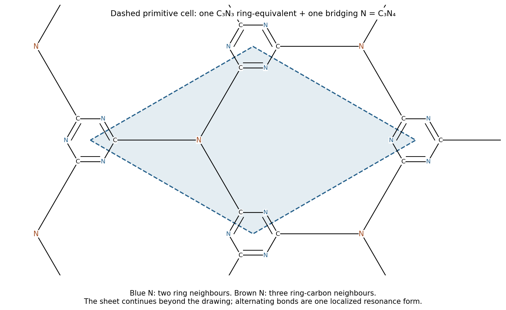

<h1 id="6/f/solution">Solution</h1>

↑ **Parent:** [F](../f.md)

**One possible idealized sheet is a network of alternating C/N triazine rings joined through three-coordinate nitrogen bridges.** Every carbon has three sigma neighbours and participates in a conjugated pi framework. Each ring nitrogen has two ring neighbours and a lone pair; each bridging nitrogen joins three ring carbons.

**[Figure 7](#6/f/image-original-idealized-triazine-based-mathrm-c-3n-4-sheet-and-a-repeating-primitive-cell). Original idealized triazine-based $\mathrm{C_3N_4}$ sheet and a repeating primitive cell**.

Each triazine ring contributes $\mathrm{C_3N_3}$ and has three outward carbon links. A bridging N is shared among three rings, so each ring effectively contributes three thirds of a bridging N: one additional N. The repeat composition is therefore $\mathrm{C_3N_4}$. The highlighted primitive cell contains one ring-equivalent and one bridging nitrogen; the drawn bond alternation is one localized resonance representation.

This is a possible structure, not a unique identification from the empirical formula. Primary synthesis and structural work established triazine-based graphitic carbon nitride as one realizable network. Other commonly prepared carbon nitrides contain heptazine motifs, incomplete condensation and hydrogen, so the name alone should not be treated as an exact structural determination of this decomposition product.[2014, structural model, electron microscopy and diffraction](../../../../../triazine-based-graphitic-carbon-nitride-a-two-dimensional-semiconductor-by-gerardo-algara-siller-and-others.md)

## ↑ Ancestors (13)

1. [F](../f.md)
2. [6](../../6.md)
3. [Paper 1](../../../paper-1-split.md)
4. [2024](../../../split.md)
5. [Past exam of the chemistry course of the year 1 of the natural sciences course of the University of Cambridge](../../../../split.md)
6. [Chemistry course of the year 1 of the natural sciences course of the University of Cambridge](../../../../../chemistry-course-of-the-year-1-of-the-natural-sciences-course-of-the-university-of-cambridge.md)
7. [Year 1 of the natural sciences course of the University of Cambridge](../../../../../year-1-of-the-natural-sciences-course-of-the-university-of-cambridge.md)
8. [Year of the natural sciences course of the University of Cambridge](../../../../../year-of-the-natural-sciences-course-of-the-university-of-cambridge.md)
9. [Natural sciences course of the University of Cambridge](../../../../../natural-sciences-course-of-the-university-of-cambridge.md)
10. [Course of the University of Cambridge](../../../../../course-of-the-university-of-cambridge.md)
11. [University of Cambridge](../../../../../university-of-cambridge-split.md)
12. [List of universities](../../../../../list-of-universities.md)
13. [Codex Wiki](../../../../../split.md)
