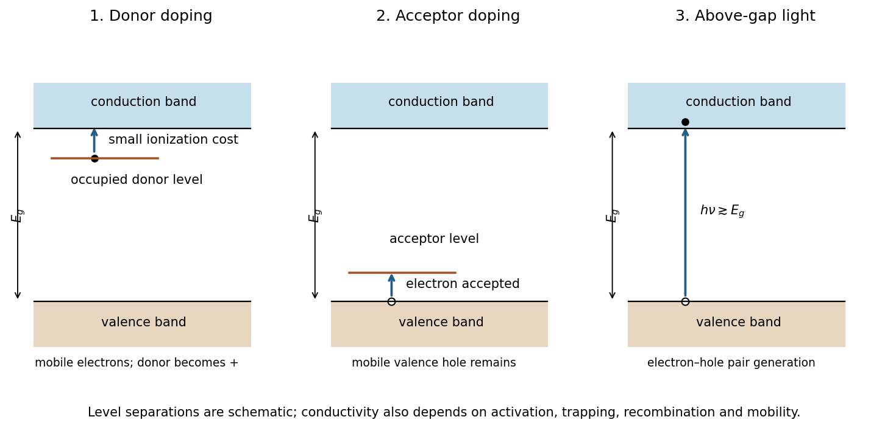

<h1 id="6/g/solution">Solution</h1>

↑ **Parent:** [G](../g.md)

**Three routes are donor doping, acceptor doping and above-gap illumination.** All increase mobile carrier populations if the added states or excitations are effective rather than strongly trapped.

**[Figure 8](#6/g/image-original-band-diagrams-for-donor-doping-acceptor-doping-and-photogeneration-in-a-gapped-material). Original band diagrams for donor doping, acceptor doping and photogeneration in a gapped material**.

An appropriate [donor impurity](../../../../../donor-impurity.md) provides an occupied level just below the [conduction band](../../../../../conduction-band.md). Thermal ionization requires the smaller donor binding energy rather than the full host gap, supplying mobile electrons and [n-type semiconductor](../../../../../n-type-semiconductor.md) behaviour. An appropriate [acceptor impurity](../../../../../acceptor-impurity.md) creates an available level just above the [valence band](../../../../../valence-band.md); accepting a valence electron leaves a mobile hole, giving [p-type semiconductor](../../../../../p-type-semiconductor.md) behaviour. Doping concentrations and compensation must permit useful carriers; an arbitrary impurity need not be an effective dopant.

For [photoconductivity](../../../../../photoconductivity.md), absorbed photons with $h\nu\gtrsim E_g$ can excite valence electrons into the conduction band, producing electron–hole pairs. For the stated $2.7\,\mathrm{eV}$ gap, the nominal threshold is about $1240/2.7\simeq459$ nm. Optical selection rules and absorption strength can shift the practical onset. The conductivity increase persists only while generation maintains carriers against recombination and trapping; it is not necessarily a permanent change to the material.

In each case, $\sigma=e(n\mu_n+p\mu_p)$ connects increased carrier density to conductivity. Defect-induced reductions in mobility can offset some of the gain, so the diagrams specify mechanisms rather than guarantee a numerical improvement for an unspecified preparation.

## ↑ Ancestors (13)

1. [G](../g.md)
2. [6](../../6.md)
3. [Paper 1](../../../paper-1-split.md)
4. [2024](../../../split.md)
5. [Past exam of the chemistry course of the year 1 of the natural sciences course of the University of Cambridge](../../../../split.md)
6. [Chemistry course of the year 1 of the natural sciences course of the University of Cambridge](../../../../../chemistry-course-of-the-year-1-of-the-natural-sciences-course-of-the-university-of-cambridge.md)
7. [Year 1 of the natural sciences course of the University of Cambridge](../../../../../year-1-of-the-natural-sciences-course-of-the-university-of-cambridge.md)
8. [Year of the natural sciences course of the University of Cambridge](../../../../../year-of-the-natural-sciences-course-of-the-university-of-cambridge.md)
9. [Natural sciences course of the University of Cambridge](../../../../../natural-sciences-course-of-the-university-of-cambridge.md)
10. [Course of the University of Cambridge](../../../../../course-of-the-university-of-cambridge.md)
11. [University of Cambridge](../../../../../university-of-cambridge-split.md)
12. [List of universities](../../../../../list-of-universities.md)
13. [Codex Wiki](../../../../../split.md)
