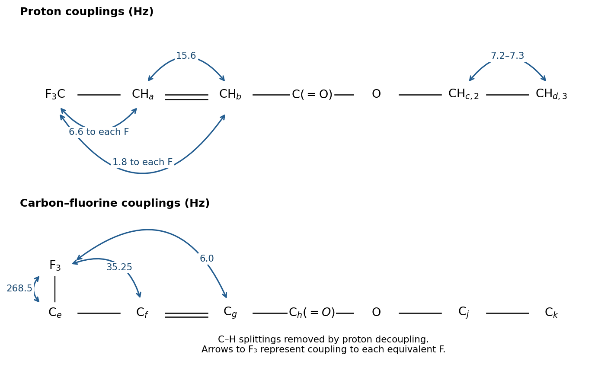
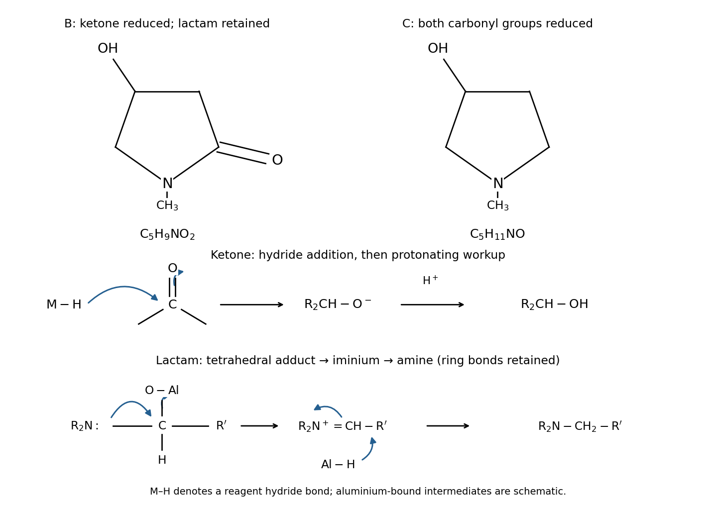
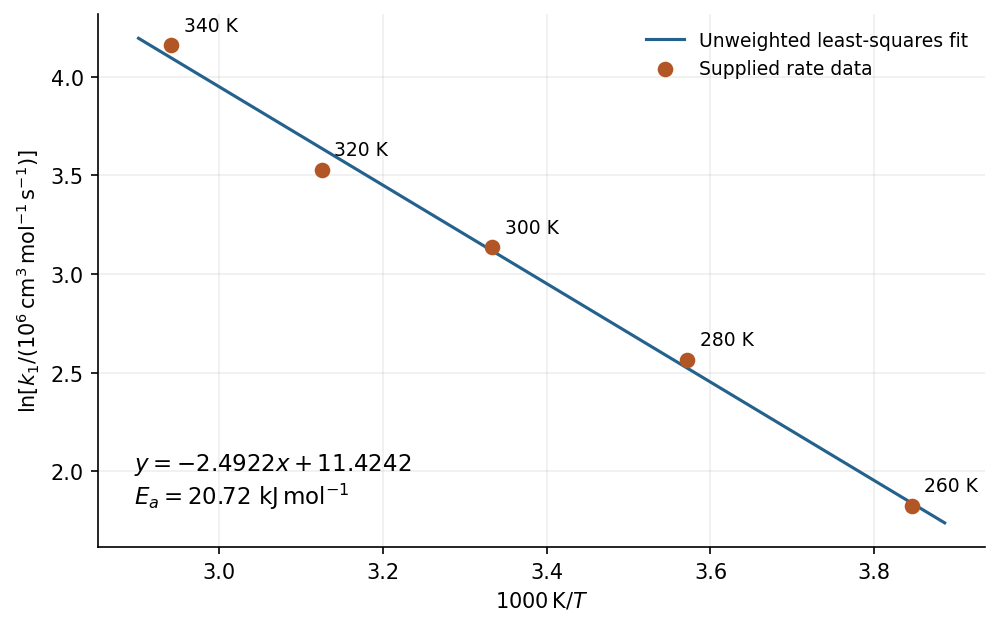

# 2025

↑ **Parent:** [Past exam of the chemistry course of the year 1 of the natural sciences course of the University of Cambridge](../past-exam-of-the-chemistry-course-of-the-year-1-of-the-natural-sciences-course-of-the-university-of-cambridge.md)

[Original paper, released PDF pages 55–67](https://www.whatdotheyknow.com/request/request_for_nst_past_papers/response/3572306/attach/4/FOI%202026%20862%20Stack%20materials.pdf?cookie_passthrough=1#page=55)

**Table of contents**

- [1](#1)
  - [a](#1/a)
    - [Solution](#1/a/solution)
  - [b](#1/b)
    - [i](#1/b/i)
      - [Solution](#1/b/i/solution)
    - [ii](#1/b/ii)
      - [Solution](#1/b/ii/solution)
  - [c](#1/c)
    - [i](#1/c/i)
      - [Solution](#1/c/i/solution)
    - [ii](#1/c/ii)
      - [Solution](#1/c/ii/solution)
  - [d](#1/d)
    - [Solution](#1/d/solution)
- [2](#2)
  - [a](#2/a)
    - [i](#2/a/i)
      - [Solution](#2/a/i/solution)
    - [ii](#2/a/ii)
      - [Solution](#2/a/ii/solution)
    - [iii](#2/a/iii)
      - [Solution](#2/a/iii/solution)
  - [b](#2/b)
    - [i](#2/b/i)
      - [Solution](#2/b/i/solution)
    - [ii](#2/b/ii)
      - [Solution](#2/b/ii/solution)
  - [c](#2/c)
    - [i](#2/c/i)
      - [Solution](#2/c/i/solution)
    - [ii](#2/c/ii)
      - [Solution](#2/c/ii/solution)
    - [iii](#2/c/iii)
      - [Solution](#2/c/iii/solution)
- [3](#3)
  - [a](#3/a)
    - [i](#3/a/i)
      - [Solution](#3/a/i/solution)
    - [ii](#3/a/ii)
      - [Solution](#3/a/ii/solution)
  - [b](#3/b)
    - [i](#3/b/i)
      - [Solution](#3/b/i/solution)
    - [ii](#3/b/ii)
      - [Solution](#3/b/ii/solution)
  - [c](#3/c)
    - [i](#3/c/i)
      - [Solution](#3/c/i/solution)
    - [ii](#3/c/ii)
      - [Solution](#3/c/ii/solution)
- [4](#4)
  - [a](#4/a)
    - [i](#4/a/i)
      - [Solution](#4/a/i/solution)
    - [ii](#4/a/ii)
      - [Solution](#4/a/ii/solution)
    - [iii](#4/a/iii)
      - [Solution](#4/a/iii/solution)
  - [b](#4/b)
    - [i](#4/b/i)
      - [Solution](#4/b/i/solution)
    - [ii](#4/b/ii)
      - [Solution](#4/b/ii/solution)
    - [iii](#4/b/iii)
      - [Solution](#4/b/iii/solution)
    - [iv](#4/b/iv)
      - [Solution](#4/b/iv/solution)
    - [v](#4/b/v)
      - [Solution](#4/b/v/solution)
- [5](#5)
  - [a](#5/a)
    - [Solution](#5/a/solution)
  - [b](#5/b)
    - [Solution](#5/b/solution)
  - [c](#5/c)
    - [Solution](#5/c/solution)
  - [d](#5/d)
    - [Solution](#5/d/solution)
  - [e](#5/e)
    - [Solution](#5/e/solution)
  - [f](#5/f)
    - [Solution](#5/f/solution)
  - [g](#5/g)
    - [Solution](#5/g/solution)
- [6](#6)
  - [a](#6/a)
    - [i](#6/a/i)
      - [Solution](#6/a/i/solution)
    - [ii](#6/a/ii)
      - [Solution](#6/a/ii/solution)
    - [iii](#6/a/iii)
      - [Solution](#6/a/iii/solution)
    - [iv](#6/a/iv)
      - [Solution](#6/a/iv/solution)
  - [b](#6/b)
    - [i](#6/b/i)
      - [Solution](#6/b/i/solution)
    - [ii](#6/b/ii)
      - [Solution](#6/b/ii/solution)
    - [iii](#6/b/iii)
      - [Solution](#6/b/iii/solution)

## 1

↑ **Parent:** [2025](2025.md)

<h3 id="1/a">a</h3>

↑ **Parent:** [1](#1)

<h4 id="1/a/solution">Solution</h4>

↑ **Parent:** [A](#1/a)

**The diagnostic [infrared spectroscopy](../chemistry.md#infrared-spectroscopy) absorptions are the conjugated [ester](../chemical-substance.md#ester) carbonyl near $1720\,\mathrm{cm^{-1}}$ and the [alkene](../chemical-substance.md#alkene) stretch near $1650\,\mathrm{cm^{-1}}$.** Reasonable approximate ranges are $1715$–$1730$ and $1620$–$1660\,\mathrm{cm^{-1}}$, respectively. [Conjugated system](../chemical-bond.md#conjugated-system) lowers the carbonyl stretching [spectroscopic wavenumber](../wave-equation.md#spectroscopic-wavenumber) relative to an unconjugated [ester](../chemical-substance.md#ester).

The [ester](../chemical-substance.md#ester) C–O stretches and strong C–F stretches lie mainly in the $1000$–$1300\,\mathrm{cm^{-1}}$ region. Vinylic C–H stretching is just above $3000\,\mathrm{cm^{-1}}$, and saturated C–H stretching is about $2850$–$3000\,\mathrm{cm^{-1}}$. There is no [hydroxy group](../chemistry.md#hydroxy-group) to give a broad O–H band.

<h3 id="1/b">b</h3>

↑ **Parent:** [1](#1)

<h4 id="1/b/i">i</h4>

↑ **Parent:** [B](#1/b)

<h5 id="1/b/i/solution">Solution</h5>

↑ **Parent:** [I](#1/b/i)

**The assignments are $\mathrm H_a$: $6.787$ ppm, $1$H, doublet of quartets; $\mathrm H_b$: $6.496$ ppm, $1$H, doublet of quartets; $\mathrm H_c$: $4.281$ ppm, $2$H, quartet; $\mathrm H_d$: $1.331$ ppm, $3$H, triplet.** The [chemical shift](../nuclear-magnetic-resonance.md#chemical-shift) of a multiplet is its centre, rather than its most downfield line.

Each vinylic [proton](../physics.md#proton) has [scalar spin-spin coupling](../nuclear-magnetic-resonance.md#scalar-spin-spin-coupling) to the other vinylic [proton](../physics.md#proton) and to three equivalent spin-$\tfrac12$ [fluorine](../chemical-substance.md#fluorine) nuclei. The first interaction produces a doublet, and the second a $1:3:3:1$ quartet: eight lines overall, partly interleaved for $\mathrm H_a$. The two [chemical shifts](../nuclear-magnetic-resonance.md#chemical-shift) differ because the vinylic sites have different substituents.

The ethoxy $\mathrm{OCH_2}$ [protons](../physics.md#proton) are deshielded by [oxygen](../chemical-substance.md#oxygen) and split into a $1:3:3:1$ quartet by the three methyl [protons](../physics.md#proton). The methyl [protons](../physics.md#proton) are split into a $1:2:1$ triplet by the two equivalent methylene [protons](../physics.md#proton). The relative [NMR signal integrals](../nuclear-magnetic-resonance.md#nmr-signal-integral) are $1:1:2:3$.

<h4 id="1/b/ii">ii</h4>

↑ **Parent:** [B](#1/b)

<h5 id="1/b/ii/solution">Solution</h5>

↑ **Parent:** [Ii](#1/b/ii)

Use the [NMR coupling constant](../nuclear-magnetic-resonance.md#nmr-coupling-constant) conversion $J/\mathrm{Hz}=(\Delta\delta/\mathrm{ppm})(\nu_0/\mathrm{MHz})$. At $300\,\mathrm{MHz}$, separating the overlapping quartets gives

$$
\begin{aligned}
{}^3J_{\mathrm H_a\mathrm H_b}&=(6.780-6.728)\,300=\boxed{15.6\,\mathrm{Hz}},\\
{}^3J_{\mathrm H_a\mathrm F}&=(6.750-6.728)\,300=\boxed{6.6\,\mathrm{Hz}},\\
{}^4J_{\mathrm H_b\mathrm F}&=(6.467-6.461)\,300=\boxed{1.8\,\mathrm{Hz}},\\
{}^3J_{\mathrm H_c\mathrm H_d}&=(1.355-1.331)\,300=\boxed{7.2\,\mathrm{Hz}}.
\end{aligned}
$$

The $\mathrm H_b$ doublet separation independently gives $(6.513-6.461)300=15.6\,\mathrm{Hz}$. For $\mathrm H_a$, the two quartets are $\{6.728,6.750,6.772,6.794\}$ and $\{6.780,6.802,6.824,6.846\}$ ppm; simply taking adjacent lines in their combined ordering would mix different [scalar spin-spin couplings](../nuclear-magnetic-resonance.md#scalar-spin-spin-coupling).

The methylene quartet gives an average adjacent spacing $(4.317-4.244)/3=0.02433$ ppm, or $7.3\,\mathrm{Hz}$. Thus its printed rounded positions agree with the methyl-derived value to about $0.1\,\mathrm{Hz}$; quote the ethyl [NMR coupling constant](../nuclear-magnetic-resonance.md#nmr-coupling-constant) as approximately $7.2$–$7.3\,\mathrm{Hz}$. The large vinylic value supports the trans arrangement. The arrows below join the interacting nuclei; each arrow to $\mathrm F_3$ represents the same interaction with each equivalent [fluorine](../chemical-substance.md#fluorine) nucleus.

**[Figure 1](#1/b/ii/image-calculated-scalar-spin-spin-couplings-for-the-vinylic-ethyl-and-trifluoromethyl-sites). Calculated scalar spin-spin couplings for the vinylic, ethyl and trifluoromethyl sites**.

<h3 id="1/c">c</h3>

↑ **Parent:** [1](#1)

<h4 id="1/c/i">i</h4>

↑ **Parent:** [C](#1/c)

<h5 id="1/c/i/solution">Solution</h5>

↑ **Parent:** [I](#1/c/i)

**The six carbon environments are assigned as follows**, with [chemical shifts](../nuclear-magnetic-resonance.md#chemical-shift) at the centres of the [fluorine](../chemical-substance.md#fluorine)-split multiplets:

$$
\begin{array}{c|r|l}
\text{label}&\delta/\mathrm{ppm}&\text{multiplicity}\\\hline
\mathrm C_e\ (\mathrm{CF_3})&122.11&\text{quartet}\\
\mathrm C_f\ (\mathrm{CF_3CH{=}})&131.335&\text{quartet}\\
\mathrm C_g\ (\mathrm{{=}CHCO_2})&128.97&\text{quartet}\\
\mathrm C_h\ (\mathrm{C{=}O})&163.9&\text{singlet}\\
\mathrm C_j\ (\mathrm{OCH_2})&61.7&\text{singlet}\\
\mathrm C_k\ (\mathrm{CH_3})&14.1&\text{singlet}
\end{array}
$$

The supplied [carbon-13](../chemical-substance.md#carbon-13) spectrum is interpreted as [proton-decoupled NMR](../nuclear-magnetic-resonance.md#proton-decoupled-nmr), as indicated by its unsplit ethoxy signals. [Proton decoupling](../nuclear-magnetic-resonance.md#proton-decoupling) removes C–H splitting but leaves C–F [scalar spin-spin coupling](../nuclear-magnetic-resonance.md#scalar-spin-spin-coupling). Three equivalent spin-$\tfrac12$ [fluorine](../chemical-substance.md#fluorine) nuclei give each resolved quartet its $1:3:3:1$ intensity pattern. The carbonyl's much smaller four-bond C–F interaction is unresolved in the plotted spectrum; “singlet” describes what is observed, rather than proving an exactly zero interaction.

The wide quartet is centred at $(127.48+116.74)/2=122.11$ ppm. The other two centres are $(132.04+130.63)/2=131.335$ and $(129.09+128.85)/2=128.97$ ppm. The signal near $77$ ppm is the [deuterated chloroform](../chemical-substance.md#deuterated-chloroform) [solvent](../mixture.md#solvent), not another carbon of the analyte. The structure labels skip $\mathrm C_i$: the ethoxy methylene is $\mathrm C_j$.

<h4 id="1/c/ii">ii</h4>

↑ **Parent:** [C](#1/c)

<h5 id="1/c/ii/solution">Solution</h5>

↑ **Parent:** [Ii](#1/c/ii)

At a [carbon-13](../chemical-substance.md#carbon-13) resonance [frequency](../wave.md#frequency) of $75\,\mathrm{MHz}$, the three resolved [NMR coupling constants](../nuclear-magnetic-resonance.md#nmr-coupling-constant) are

$$
\begin{aligned}
{}^1J_{\mathrm C_e\mathrm F}&=(127.48-123.90)75=\boxed{268.5\,\mathrm{Hz}},\\
{}^2J_{\mathrm C_f\mathrm F}&=(132.04-131.57)75=\boxed{35.25\,\mathrm{Hz}},\\
{}^3J_{\mathrm C_g\mathrm F}&=(129.09-129.01)75=\boxed{6.0\,\mathrm{Hz}}.
\end{aligned}
$$

Each is the spacing of adjacent lines within its own quartet. The lower panel of the original coupling diagram in 1(b)(ii) marks the corresponding carbon–[fluorine](../chemical-substance.md#fluorine) interactions. The bond superscripts count bonds along the connecting path; they are not additional numerical factors multiplying $J$.

<h3 id="1/d">d</h3>

↑ **Parent:** [1](#1)

<h4 id="1/d/solution">Solution</h4>

↑ **Parent:** [D](#1/d)

**One [fluorine-19 NMR](../nuclear-magnetic-resonance.md#fluorine-19-nmr) resonance, integrating to three equivalent [fluorine](../chemical-substance.md#fluorine) nuclei, appears as a doublet of doublets with $J=6.6$ and $1.8\,\mathrm{Hz}$.** This predicts four principal lines of equal intensity, from coupling to $\mathrm H_a$ and $\mathrm H_b$, respectively. Relative to the unknown resonance centre, their offsets are $\pm4.2$ and $\pm2.4\,\mathrm{Hz}$.

Equivalent [fluorine](../chemical-substance.md#fluorine) nuclei do not split one another. This prediction assumes ordinary [proton](../physics.md#proton)-coupled acquisition; [proton decoupling](../nuclear-magnetic-resonance.md#proton-decoupling) would collapse these four principal lines to a singlet. The proton and carbon spectra do not determine the numerical [fluorine](../chemical-substance.md#fluorine) [chemical shift](../nuclear-magnetic-resonance.md#chemical-shift). Weak natural-abundance [carbon-13](../chemical-substance.md#carbon-13) satellites could accompany the principal pattern.

## 2

↑ **Parent:** [2025](2025.md)

<h3 id="2/a">a</h3>

↑ **Parent:** [2](#2)

<h4 id="2/a/i">i</h4>

↑ **Parent:** [A](#2/a)

<h5 id="2/a/i/solution">Solution</h5>

↑ **Parent:** [I](#2/a/i)

For a [hydrogen-like ion](../atomic-physics.md#hydrogen-like-ion), the [Coulomb potential](../electrostatics.md#coulomb-potential-energy) is stronger by the nuclear [atomic number](../chemical-substance.md#atomic-number) $Z$, and the [energy levels](../quantum-mechanics.md#energy-level) scale as $Z^2$:

$$
\boxed{E_n=-\frac{Z^2R_H}{n^2},\qquad n=1,2,\ldots.}
$$

Here $Z$ is the number of [protons](../physics.md#proton) in the [atomic nucleus](../atomic-nucleus.md); the ion has exactly one [electron](../physics.md#electron), so its net [electric charge](../electric-charge.md) is $(Z-1)e$. The zero of [energy](../energy.md) is a separated stationary [electron](../physics.md#electron) and [atomic nucleus](../atomic-nucleus.md) at infinite distance. This is the nonrelativistic hydrogenic approximation using the supplied $R_H$; a more precise isotope-specific result also corrects the [reduced mass](../classical-mechanics.md#reduced-mass).

<h4 id="2/a/ii">ii</h4>

↑ **Parent:** [A](#2/a)

<h5 id="2/a/ii/solution">Solution</h5>

↑ **Parent:** [Ii](#2/a/ii)

**The lowest two [energy levels](../quantum-mechanics.md#energy-level) have $n=1$ and $n=2$.** For [carbon](../chemical-substance.md#carbon), $Z=6$, even though the ion's net charge is $5+$:

$$
\boxed{E_1=-36(2.180\times10^{-18})=-7.848\times10^{-17}\,\mathrm J,\qquad E_2=\frac{E_1}{4}=-1.962\times10^{-17}\,\mathrm J.}
$$

Increasing $n$ raises the [energy](../energy.md) toward zero; the most negative value is the [ground-state energy](../quantum-mechanics.md#ground-state-energy).

<h4 id="2/a/iii">iii</h4>

↑ **Parent:** [A](#2/a)

<h5 id="2/a/iii/solution">Solution</h5>

↑ **Parent:** [Iii](#2/a/iii)

An emitted [photon](../quantum-mechanics.md#photon) has positive [energy](../energy.md)

$$
E_\gamma=\frac{hc}{\lambda}
=\frac{(6.626\times10^{-34})(2.998\times10^8)}{18.2\times10^{-9}}
=1.09147\times10^{-17}\,\mathrm J.
$$

For [spontaneous emission](../atomic-physics.md#spontaneous-emission) into $n_f=2$, the [conservation of energy](../mathematical-physics.md#conservation-of-energy) equation is

$$
E_\gamma=E_{n_i}-E_2=36R_H\left(\frac14-\frac1{n_i^2}\right).
$$

Consequently

$$
\frac1{n_i^2}=\frac14-\frac{1.09147\times10^{-17}}{7.848\times10^{-17}}=0.110924,
\qquad n_i=3.0025.
$$

The [principal quantum number](../mathematical-physics.md#principal-quantum-number) must be an integer, so **the transition is $\boxed{n_i=3\longrightarrow n_f=2}$.** Its calculated [wavelength](../wave-equation.md#wavelength) is approximately $18.22\,\mathrm{nm}$, agreeing with the rounded observation.

<h3 id="2/b">b</h3>

↑ **Parent:** [2](#2)

<h4 id="2/b/i">i</h4>

↑ **Parent:** [B](#2/b)

<h5 id="2/b/i/solution">Solution</h5>

↑ **Parent:** [I](#2/b/i)

**End-on overlap produces $\sigma$ and $\sigma^*$ [molecular orbitals](../chemistry.md#molecular-orbital); side-on overlap produces $\pi$ and $\pi^*$ [molecular orbitals](../chemistry.md#molecular-orbital).** Matching signs of the facing [atomic orbital](../chemistry.md#atomic-orbital) lobes give constructive [interference](../physical-optics.md#interference-wave-propagation) and a [bonding molecular orbital](../chemistry.md#bonding-orbital). Opposite signs give destructive [interference](../physical-optics.md#interference-wave-propagation) and an additional nodal plane between the [atomic nuclei](../atomic-nucleus.md) in the [antibonding molecular orbital](../chemistry.md#antibonding-orbital).

**[Figure 2](#2/b/i/image-original-signed-combinations-of-p-atomic-orbitals-for-four-p-derived-molecular-orbitals). Original signed combinations of p atomic orbitals for four p-derived molecular orbitals**.

Take the internuclear direction as $x$, and define both atomic $p_x$ functions as positive on their own right-hand side. Up to [wavefunction normalization](../wave-function.md#wavefunction-normalization), the combinations are

$$
\begin{array}{c|c}
\sigma&p_{x,A}-p_{x,B}\\
\sigma^*&p_{x,A}+p_{x,B}\\
\pi&p_{y,A}+p_{y,B}\\
\pi^*&p_{y,A}-p_{y,B}
\end{array}
$$

The minus sign in the bonding $p_x$ combination follows from this common-axis [quantum phase](../quantum-system.md#quantum-phase) convention: the facing lobes of the two unmodified $p_x$ functions have opposite signs. It does not make that combination antibonding. Every $\pi$ [molecular orbital](../chemistry.md#molecular-orbital) also has a nodal plane containing the internuclear axis; the additional midpoint node distinguishes $\pi^*$ from $\pi$.

<h4 id="2/b/ii">ii</h4>

↑ **Parent:** [B](#2/b)

<h5 id="2/b/ii/solution">Solution</h5>

↑ **Parent:** [Ii](#2/b/ii)

**The labels apply when the [molecule](../molecule.md) has an [inversion centre](../physics.md#inversion-centre)**, as a homonuclear diatomic [molecule](../molecule.md) does. The label $g$ means $\psi(-\mathbf r)=\psi(\mathbf r)$, and $u$ means $\psi(-\mathbf r)=-\psi(\mathbf r)$, with the origin at that centre. In a heteronuclear diatomic [molecule](../molecule.md), inversion exchanges different [atomic nuclei](../atomic-nucleus.md) and these are generally not valid symmetry labels.

For the p-derived combinations above,

$$
\boxed{\sigma_g,\qquad\sigma_u^*,\qquad\pi_u,\qquad\pi_g^*.}
$$

Inversion both exchanges the two centres and changes the sign of each individual p [atomic orbital](../chemistry.md#atomic-orbital). Applying both operations to each sum or difference gives these labels. The star denotes [antibonding molecular orbitals](../chemistry.md#antibonding-orbital), independently of [parity](../quantum-mechanics.md#parity): a bonding [molecular orbital](../chemistry.md#molecular-orbital) need not always be $g$.

<h3 id="2/c">c</h3>

↑ **Parent:** [2](#2)

<h4 id="2/c/i">i</h4>

↑ **Parent:** [C](#2/c)

<h5 id="2/c/i/solution">Solution</h5>

↑ **Parent:** [I](#2/c/i)

One consistent localized [orbital hybridization](../chemistry.md#orbital-hybridization) description uses the [Lewis structures](../covalent-bond.md#lewis-structure)

$$
\mathrm{H_3C-N^+\equiv N},\qquad
\mathrm{H_2C=N^+=N^-}\ \leftrightarrow\ \mathrm{H_2C^--N^+\equiv N}.
$$

**For [methyldiazonium](../chemical-substance.md#methyldiazonium), take C as $sp^3$ and both N atoms as $sp$. For [diazomethane](../chemical-substance.md#diazomethane), the double-bond [resonance contributor](../covalent-bond.md#resonance-structure) suggests C as $sp^2$, central N as $sp$, and terminal N as $sp^2$.** The central N uses two opposite $sp$ hybrids for the linear C–N–N [sigma bond](../covalent-bond.md#sigma-bond) framework. In the localized double-bond picture, terminal N uses one $sp^2$ hybrid for its [sigma bond](../covalent-bond.md#sigma-bond), two for [lone pairs](../covalent-bond.md#lone-pair), and its remaining p [atomic orbital](../chemistry.md#atomic-orbital) for a [pi bond](../covalent-bond.md#pi-bond).

These labels specify an approximate bonding construction, not uniquely measurable atomic properties. An alternative representation takes terminal N as $sp$, with one $sp$ [lone pair](../covalent-bond.md#lone-pair) and one p [lone pair](../covalent-bond.md#lone-pair); the latter can participate in the delocalized C–N–N $\pi$ system. It describes the same [resonance](../dynamical-systems.md#resonance) more explicitly. Neither construction requires an unpaired [electron](../physics.md#electron) or a bent central N.

<h4 id="2/c/ii">ii</h4>

↑ **Parent:** [C](#2/c)

<h5 id="2/c/ii/solution">Solution</h5>

↑ **Parent:** [Ii](#2/c/ii)

**There are $\boxed{4+2(1)+2(5)=16}$ [valence electrons](../chemical-bond.md#valence-electron), all paired, so [diazomethane](../chemical-substance.md#diazomethane) exhibits [diamagnetism](../electromagnetism.md#diamagnetism).** A localized orbital occupancy consistent with the double-bond construction in 2(c)(i) is

$$
\begin{array}{l|r|l}
\text{occupied orbitals}&\text{electrons}&\text{atomic-orbital ingredients}\\\hline
2\ \mathrm{C-H}\ \sigma&4&\mathrm C(sp^2)+\mathrm H(1s)\\
\mathrm{C-N}\ \sigma&2&\mathrm C(sp^2)+\mathrm N_c(sp)\\
\mathrm{N-N}\ \sigma&2&\mathrm N_c(sp)+\mathrm N_t(sp^2)\\
\mathrm{C-N}\ \pi&2&\mathrm C(2p)+\mathrm N_c(2p)\\
\mathrm{N-N}\ \pi&2&\mathrm N_c(2p_\perp)+\mathrm N_t(2p)\\
2\ \mathrm N_t\text{ lone pairs}&4&2\ \mathrm N_t(sp^2)
\end{array}
$$

Here $c,t$ mean central and terminal. Each listed occupied spatial orbital contains two [electrons](../physics.md#electron) of opposite [spin](../angular-momentum-operator.md#spin). The central N's two p [atomic orbitals](../chemistry.md#atomic-orbital) are perpendicular, so they can support the two perpendicular [pi bonds](../covalent-bond.md#pi-bond). No central-N [lone pair](../covalent-bond.md#lone-pair) is left over: its positive [formal charge](../covalent-bond.md#formal-charge) accompanies four bonding pairs in this [Lewis structure](../covalent-bond.md#lewis-structure).

Allowing [resonance](../dynamical-systems.md#resonance) mixes a terminal-N [lone pair](../covalent-bond.md#lone-pair) into the C–N–N $\pi$ orbitals. In the alternative terminal-$sp$ basis, the same electron count is four occupied $\sigma$ orbitals ($8$ electrons), one terminal-$sp$ [lone pair](../covalent-bond.md#lone-pair) ($2$), one perpendicular N–N $\pi$ orbital ($2$), and two occupied orbitals of a three-centre C–N–N $\pi$ system ($4$). The $16$-electron count and the paired ground state survive this change of description; the localized picture does not assert two perfectly isolated double bonds.

<h4 id="2/c/iii">iii</h4>

↑ **Parent:** [C](#2/c)

<h5 id="2/c/iii/solution">Solution</h5>

↑ **Parent:** [Iii](#2/c/iii)

**On carbon [protonation](../chemical-reaction.md#protonation), the C–N [bond length](../chemical-bond.md#bond-length) increases and the N–N [bond length](../chemical-bond.md#bond-length) decreases.** Forming the fourth C [sigma bond](../covalent-bond.md#sigma-bond) changes the carbon from approximately planar $sp^2$ to tetrahedral $sp^3$, removing its effective C–N [pi bonding](../covalent-bond.md#pi-bond). The product is described by $\mathrm{H_3C-N^+\equiv N}$: C–N becomes predominantly single and N–N predominantly triple. The [resonance](../dynamical-systems.md#resonance) of the unprotonated species makes its actual [bond orders](../chemistry.md#bond-order) intermediate rather than exact integers.

## 3

↑ **Parent:** [2025](2025.md)

<h3 id="3/a">a</h3>

↑ **Parent:** [3](#3)

<h4 id="3/a/i">i</h4>

↑ **Parent:** [A](#3/a)

<h5 id="3/a/i/solution">Solution</h5>

↑ **Parent:** [I](#3/a/i)

**The products are [hexanenitrile](../chemical-substance.md#hexanenitrile), $\mathrm{CH_3(CH_2)_4C\equiv N}$, and [ethyl triphenylmethyl ether](../chemical-substance.md#ethyl-triphenylmethyl-ether), $\mathrm{Ph_3C-O-CH_2CH_3}$.** The nitrile carbon comes from [cyanide](../chemical-substance.md#cyanide), so replacing chloride in the five-carbon chain gives a six-carbon product.

For the primary chloride, the carbon-end [lone pair](../covalent-bond.md#lone-pair) of $\mathrm{CN^-}$ attacks the carbon carrying Cl from the back side while the C–Cl bond pair moves onto Cl. The single concerted [nucleophilic substitution](../chemical-reaction.md#nucleophilic-substitution) step forms the C–C bond and releases $\mathrm{Cl^-}$. Attack through the carbon end gives the nitrile, not an isocyanide.

For the triphenylmethyl chloride, the C–Cl bond first undergoes [heterolysis](../chemical-bond.md#heterolysis) to $\mathrm{Ph_3C^+}$ and $\mathrm{Cl^-}$. An [ethanol](../biology.md#ethanol) [oxygen](../chemical-substance.md#oxygen) [lone pair](../covalent-bond.md#lone-pair) then attacks the [carbocation](../chemical-substance.md#carbocation), giving $\mathrm{Ph_3C-O^+(H)Et}$. Finally [pyridine](../chemical-substance.md#pyridine) accepts that O–H [proton](../physics.md#proton), with the O–H bond pair returning to [oxygen](../chemical-substance.md#oxygen), giving the neutral [ether](../chemical-substance.md#ether) and pyridinium chloride.

**[Figure 3](#3/a/i/image-original-electron-pair-arrow-schemes-for-cyanide-substitution-and-triphenylmethyl-ether-formation). Original electron-pair arrow schemes for cyanide substitution and triphenylmethyl ether formation**.

<h4 id="3/a/ii">ii</h4>

↑ **Parent:** [A](#3/a)

<h5 id="3/a/ii/solution">Solution</h5>

↑ **Parent:** [Ii](#3/a/ii)

**The primary chloride undergoes an [SN2 reaction](../chemical-reaction.md#sn2-reaction); the triphenylmethyl chloride undergoes an [SN1 reaction](../chemical-reaction.md#sn1-reaction).** The primary site is accessible to back-side attack, whereas three phenyl groups make back-side attack at the triphenylmethyl site extremely hindered and stabilize its [carbocation](../chemical-substance.md#carbocation) through [resonance](../dynamical-systems.md#resonance).

For the [SN2 reaction](../chemical-reaction.md#sn2-reaction), a suitable [transition state](../chemical-kinetics.md#transition-state) is

$$
\left[\mathrm{N\equiv C\;\cdots\;CH_2(CH_2)_3CH_3\;\cdots\;Cl}\right]^{\ddagger-},
\qquad \boxed{v=k_2[\mathrm{CH_3(CH_2)_4Cl}][\mathrm{CN^-}]}.
$$

The entering C and leaving Cl lie on opposite sides of the reacting carbon, with partial C–C and C–Cl bonds. The total charge is $-1$. This [transition state](../chemical-kinetics.md#transition-state) is not a discrete [reaction intermediate](../chemical-kinetics.md#reaction-intermediate).

For the [SN1 reaction](../chemical-reaction.md#sn1-reaction), the approximately planar $\mathrm{Ph_3C^+}$ [carbocation](../chemical-substance.md#carbocation) is a genuine [reaction intermediate](../chemical-kinetics.md#reaction-intermediate). Assuming its formation by C–Cl [heterolysis](../chemical-bond.md#heterolysis) is rate determining and trapping is rapid,

$$
\boxed{v=k_1[\mathrm{Ph_3CCl}]}.
$$

Thus the limiting [rate law](../chemical-kinetics.md#rate-law) is independent of [ethanol](../biology.md#ethanol) [concentration](../mathematical-physics.md#concentration). The successive attack and [proton transfer](../acid-base-chemistry.md#proton-transfer) occur after the slow ionization; a cation-stabilizing environment and efficient trapping underpin this idealized [SN1](../chemical-reaction.md#sn1-reaction) description.

<h3 id="3/b">b</h3>

↑ **Parent:** [3](#3)

<h4 id="3/b/i">i</h4>

↑ **Parent:** [B](#3/b)

<h5 id="3/b/i/solution">Solution</h5>

↑ **Parent:** [I](#3/b/i)

**B is 4-hydroxy-1-methylpyrrolidin-2-one; C is 1-methylpyrrolidin-3-ol.** Their ring connectivities are shown below. Each ring remains five membered; the attached N-methyl group is retained.

**[Figure 4](#3/b/i/image-original-cyclic-product-structures-and-hydride-electron-pair-arrows-for-ketone-and-lactam-reduction). Original cyclic product structures and hydride electron-pair arrows for ketone and lactam reduction**.

For B, a B–H bond of [sodium borohydride](../chemical-substance.md#sodium-borohydride) supplies a [hydride](../chemical-substance.md#hydride) equivalent to the [ketone](../chemical-substance.md#ketone) carbonyl carbon, and the carbonyl $\pi$ pair moves to [oxygen](../chemical-substance.md#oxygen). This gives an [alkoxide](../mathematical-biology.md#alkoxide), whose [protonation](../chemical-reaction.md#protonation) during the reaction or workup gives the secondary [alcohol](../chemical-substance.md#alcohol). The [lactam](../chemical-substance.md#lactam) carbonyl remains. Converting one $\mathrm{C{=}O}$ to $\mathrm{CH(OH)}$ adds two H atoms and gives $\mathrm{C_5H_9NO_2}$.

For C, [lithium aluminium hydride](../chemical-substance.md#lithium-aluminium-hydride) reduces that [ketone](../chemical-substance.md#ketone) in the same net way and also reduces the [lactam](../chemical-substance.md#lactam). Coordination of the amide [oxygen](../chemical-substance.md#oxygen) to [aluminium](../chemical-substance.md#aluminium) assists [hydride](../chemical-substance.md#hydride) attack at its carbonyl carbon, giving a tetrahedral intermediate. The N [lone pair](../covalent-bond.md#lone-pair) then forms a C=N bond while the C–O bond breaks to an aluminium-bound oxygen group. A resulting [iminium ion](../chemical-substance.md#iminium) accepts a second [hydride](../chemical-substance.md#hydride) at carbon, yielding the cyclic tertiary [amine](../chemical-substance.md#amine). Aqueous workup protonates the ketone-derived [alkoxide](../mathematical-biology.md#alkoxide).

The [lactam](../chemical-substance.md#lactam) conversion replaces $\mathrm{N-C({=}O)}$ by $\mathrm{N-CH_2}$; its [oxygen](../chemical-substance.md#oxygen) is removed rather than retained as another [alcohol](../chemical-substance.md#alcohol). Together with [ketone](../chemical-substance.md#ketone) reduction, the net change is $+4\mathrm H-\mathrm O$, giving $\mathrm{C_5H_{11}NO}$. No stereochemistry is specified: the new [alcohol](../chemical-substance.md#alcohol) stereocentre is formed as a [racemic mixture](../stereochemistry.md#racemic-mixture) in an achiral environment.

<h4 id="3/b/ii">ii</h4>

↑ **Parent:** [B](#3/b)

<h5 id="3/b/ii/solution">Solution</h5>

↑ **Parent:** [Ii](#3/b/ii)

**[Sodium borohydride](../chemical-substance.md#sodium-borohydride) is chemoselective for the [ketone](../chemical-substance.md#ketone); [lithium aluminium hydride](../chemical-substance.md#lithium-aluminium-hydride) reduces both the [ketone](../chemical-substance.md#ketone) and the [lactam](../chemical-substance.md#lactam).** In an [amide](../chemical-substance.md#amide), donation of the N [lone pair](../covalent-bond.md#lone-pair) into the carbonyl $\pi$ system reduces the carbonyl carbon's [electrophilicity](../chemical-reaction.md#electrophilicity). It is therefore substantially less susceptible to the milder [hydride](../chemical-substance.md#hydride) donor.

[Lithium aluminium hydride](../chemical-substance.md#lithium-aluminium-hydride) supplies more strongly reducing [hydride](../chemical-substance.md#hydride) equivalents, and the strong affinity of [aluminium](../chemical-substance.md#aluminium) for [oxygen](../chemical-substance.md#oxygen) assists removal of the amide [oxygen](../chemical-substance.md#oxygen) through the [iminium](../chemical-substance.md#iminium) pathway. This difference explains both the unchanged [lactam](../chemical-substance.md#lactam) carbonyl in B and the absence of that [oxygen](../chemical-substance.md#oxygen) in C. Both reactions are interpreted after the usual protonating workup.

<h3 id="3/c">c</h3>

↑ **Parent:** [3](#3)

<h4 id="3/c/i">i</h4>

↑ **Parent:** [C](#3/c)

<h5 id="3/c/i/solution">Solution</h5>

↑ **Parent:** [I](#3/c/i)

**D is $\mathrm{(MeO)_2CHCH_2CH_2CO_2Me}$, and E is $\mathrm{OHCCH_2CH_2CO_2Et}$.** D results from [transesterification](../chemical-reaction.md#transesterification); E results from [acid-catalysed acetal hydrolysis](../chemical-reaction.md#acid-catalysed-acetal-hydrolysis).

For D, [methoxide](../mathematical-biology.md#methoxide) attacks the [ester](../chemical-substance.md#ester) carbonyl carbon and moves the carbonyl $\pi$ pair to [oxygen](../chemical-substance.md#oxygen). Collapse of the tetrahedral [reaction intermediate](../chemical-kinetics.md#reaction-intermediate) reforms C=O and expels [ethoxide](../mathematical-biology.md#ethoxide). [Proton transfer](../acid-base-chemistry.md#proton-transfer) with the [methanol](../chemical-substance.md#methanol) [solvent](../mixture.md#solvent) regenerates [methoxide](../mathematical-biology.md#methoxide). Excess [methanol](../chemical-substance.md#methanol) favours replacement of the ethyl [ester](../chemical-substance.md#ester) by a methyl [ester](../chemical-substance.md#ester); the dimethyl [acetal](../chemical-substance.md#acetal) survives these basic conditions.

For E, protonate one [acetal](../chemical-substance.md#acetal) [oxygen](../chemical-substance.md#oxygen), then break its C–O bond with the pair going to [oxygen](../chemical-substance.md#oxygen), releasing [methanol](../chemical-substance.md#methanol) and forming an [oxocarbenium ion](../chemical-substance.md#oxocarbenium-ion). [Water](../chemical-substance.md#water) attacks that carbon. Deprotonation gives a [hemiacetal](../chemical-substance.md#hemiacetal); protonation of its remaining methoxy [oxygen](../chemical-substance.md#oxygen) permits loss of a second [methanol](../chemical-substance.md#methanol). The hydroxyl [oxygen](../chemical-substance.md#oxygen)'s [lone pair](../covalent-bond.md#lone-pair) forms C=O during this loss, and deprotonation gives the [aldehyde](../chemical-substance.md#aldehyde), regenerating the acid [catalyst](../chemical-kinetics.md#catalyst).

**[Figure 5](#3/c/i/image-original-products-and-electron-flow-steps-for-transesterification-and-acid-catalysed-acetal-hydrolysis). Original products and electron-flow steps for transesterification and acid-catalysed acetal hydrolysis**.

The spectroscopy is consistent with these products. D has one [ester](../chemical-substance.md#ester) carbonyl near $1745\,\mathrm{cm^{-1}}$ and six [carbon-13 NMR](../nuclear-magnetic-resonance.md#carbon-13-nmr) environments: acetal CH, two distinct chain $\mathrm{CH_2}$ sites, carbonyl, ester $\mathrm{OCH_3}$, and the two equivalent acetal $\mathrm{OCH_3}$ groups. Thus seven carbon atoms give six resonances. E has separate [ester](../chemical-substance.md#ester) and [aldehyde](../chemical-substance.md#aldehyde) carbonyl bands, approximately $1745$ and $1730\,\mathrm{cm^{-1}}$, and six distinct carbon atoms: two carbonyls, two chain methylenes and the two ethyl carbons.

<h4 id="3/c/ii">ii</h4>

↑ **Parent:** [C](#3/c)

<h5 id="3/c/ii/solution">Solution</h5>

↑ **Parent:** [Ii](#3/c/ii)

**Basic [methanol](../chemical-substance.md#methanol) exchanges the [ester](../chemical-substance.md#ester) alkoxy group while retaining the [acetal](../chemical-substance.md#acetal); dilute aqueous acid removes the [acetal](../chemical-substance.md#acetal) while retaining the ethyl [ester](../chemical-substance.md#ester) on the stated reaction timescale.** An [acetal](../chemical-substance.md#acetal) lacks an electrophilic carbonyl and is stable to ordinary base: expelling [methoxide](../mathematical-biology.md#methoxide) directly would require a poor leaving group. The [ester](../chemical-substance.md#ester) can instead undergo [nucleophilic acyl substitution](../chemical-reaction.md#nucleophilic-acyl-substitution) through a carbonyl-derived tetrahedral intermediate.

Under acid, protonating an [acetal](../chemical-substance.md#acetal) [oxygen](../chemical-substance.md#oxygen) converts an alkoxy substituent into departing [methanol](../chemical-substance.md#methanol), and the resulting [oxocarbenium](../chemical-substance.md#oxocarbenium-ion) is stabilized by its remaining [oxygen](../chemical-substance.md#oxygen). [Water](../chemical-substance.md#water) then drives [acetal hydrolysis](../chemical-reaction.md#acetal-hydrolysis) toward the [aldehyde](../chemical-substance.md#aldehyde). [Ester hydrolysis](../chemical-reaction.md#ester-hydrolysis) is also possible under acid, but is slower under the conditions implied by the product data. The retained ethyl group and six distinct [carbon-13 NMR](../nuclear-magnetic-resonance.md#carbon-13-nmr) environments support E rather than the carboxylic acid that prolonged hydrolysis could produce.

## 4

↑ **Parent:** [2025](2025.md)

<h3 id="4/a">a</h3>

↑ **Parent:** [4](#4)

<h4 id="4/a/i">i</h4>

↑ **Parent:** [A](#4/a)

<h5 id="4/a/i/solution">Solution</h5>

↑ **Parent:** [I](#4/a/i)

With ideal [thermodynamic activities](../chemical-potential.md#thermodynamic-activity) $a_i=[i]/c^\circ$, the dimensionless [acid dissociation constant](../acid-base-chemistry.md#acid-dissociation-constant) is

$$
\boxed{K_a=\frac{a_{\mathrm{H^+}}a_{\mathrm{HN_2O_2^-}}}{a_{\mathrm{H_2N_2O_2}}}
=\frac{[\mathrm{H^+}][\mathrm{HN_2O_2^-}]}{[\mathrm{H_2N_2O_2}]c^\circ},\qquad c^\circ=1\,\mathrm{mol\,L^{-1}}.}
$$

The factor $c^\circ$ makes the [equilibrium constant](../chemical-potential.md#equilibrium-constant) compatible with $\Delta_rG^\circ=-RT\ln K_a$. If the concentration quotient without $c^\circ$ is used instead, it has concentration units and its numerical value is identical only when the standard concentration is expressed as $1\,\mathrm M$.

<h4 id="4/a/ii">ii</h4>

↑ **Parent:** [A](#4/a)

<h5 id="4/a/ii/solution">Solution</h5>

↑ **Parent:** [Ii](#4/a/ii)

The [standard Gibbs energy of reaction](../chemical-potential.md#standard-gibbs-energy-of-reaction) gives

$$
\ln K_a=-\frac{\Delta_rG^\circ}{RT}
=-\frac{41133}{8.3145(298)}=-16.6011,
\qquad\boxed{K_a=6.17\times10^{-8}.}
$$

The positive [standard Gibbs energy of reaction](../chemical-potential.md#standard-gibbs-energy-of-reaction) means that dissociation is unfavourable when every [thermodynamic activity](../chemical-potential.md#thermodynamic-activity) equals one; it does not forbid partial dissociation. The corresponding $\mathrm pK_a=-\log_{10}K_a$ is about $7.21$.

<h4 id="4/a/iii">iii</h4>

↑ **Parent:** [A](#4/a)

<h5 id="4/a/iii/solution">Solution</h5>

↑ **Parent:** [Iii](#4/a/iii)

**The equilibrium molecular-acid concentration is $\boxed{[\mathrm{H_2N_2O_2}]=0.162\,\mathrm{mol\,L^{-1}}}$.** From the supplied [pH](../acid-base-chemistry.md#ph) convention,

$$
[\mathrm{H^+}]=c^\circ10^{-4}=10^{-4}\,\mathrm M.
$$

With only these monovalent [ions](../chemistry.md#ion) appreciably present, [electroneutrality](../electrochemistry.md#electroneutrality) requires $[\mathrm{HN_2O_2^-}]=[\mathrm{H^+}]$. Substitution in the [acid dissociation constant](../acid-base-chemistry.md#acid-dissociation-constant) gives

$$
[\mathrm{H_2N_2O_2}]
=\frac{(10^{-4}\,\mathrm M)^2}{(6.1690\times10^{-8})(1\,\mathrm M)}
=0.16210\,\mathrm M.
$$

This calculation assumes ideal [thermodynamic activities](../chemical-potential.md#thermodynamic-activity) for the acid and its conjugate base as well as for $\mathrm H^+$, negligible water [autoionization](../atomic-physics.md#autoionization), negligible second dissociation, and no additional electrolyte. The acid's analytical concentration would include its dissociated fraction and be approximately $0.16220\,\mathrm M$, rather than exactly the molecular-acid concentration requested.

<h3 id="4/b">b</h3>

↑ **Parent:** [4](#4)

<h4 id="4/b/i">i</h4>

↑ **Parent:** [B](#4/b)

<h5 id="4/b/i/solution">Solution</h5>

↑ **Parent:** [I](#4/b/i)

Oxidize [zinc](../chemical-substance.md#zinc) at the [anode](../electrochemistry.md#anode) and reduce nitrate to nitric oxide at the inert [platinum](../chemical-substance.md#platinum) [cathode](../electrochemistry.md#cathode). Multiplying the oxidation [half-reaction](../electrochemistry.md#half-reaction) by three and the reduction [half-reaction](../electrochemistry.md#half-reaction) by two cancels six [electrons](../physics.md#electron):

$$
\boxed{\mathrm{3Zn(s)+2NO_3^-(aq)+8H^+(aq)\longrightarrow3Zn^{2+}(aq)+2NO(g)+4H_2O(l)}.}
$$

The [standard cell potential](../electrochemistry.md#standard-cell-potential) is the cathode reduction potential minus the anode reduction potential:

$$
\boxed{E^\circ=0.957-(-0.762)=1.719\,\mathrm V.}
$$

**The written direction is spontaneous under standard conditions**, since $\Delta_rG^\circ=-6FE^\circ<0$. Multiplying a [half-reaction](../electrochemistry.md#half-reaction) changes its extensive [Gibbs energy](../thermodynamic-potential.md#gibbs-free-energy), but does not multiply its intensive [electrode potential](../electrochemistry.md#electrode-potential).

<h4 id="4/b/ii">ii</h4>

↑ **Parent:** [B](#4/b)

<h5 id="4/b/ii/solution">Solution</h5>

↑ **Parent:** [Ii](#4/b/ii)

The [Nernst equation](../electrochemistry.md#nernst-equation) for the six-electron cell reaction is

$$
\boxed{E=E^\circ-\frac{RT}{6F}\ln Q,\qquad
Q=\frac{a_{\mathrm{Zn^{2+}}}^3a_{\mathrm{NO}}^2}{a_{\mathrm{NO_3^-}}^2a_{\mathrm{H^+}}^8}.}
$$

Here pure solid [zinc](../chemical-substance.md#zinc) and liquid [water](../chemical-substance.md#water) have unit [thermodynamic activity](../chemical-potential.md#thermodynamic-activity). For ideal nitric oxide gas, $a_{\mathrm{NO}}=p_{\mathrm{NO}}/p^\circ$ with $p^\circ=1\,\mathrm{bar}$; for ideal dissolved species, $a_i=[i]/c^\circ$. The [reaction quotient](../chemical-potential.md#reaction-quotient) is dimensionless. The [platinum](../chemical-substance.md#platinum) supplies an electronically conducting surface and is absent from the net [chemical equation](../chemical-reaction.md#chemical-equation).

<h4 id="4/b/iii">iii</h4>

↑ **Parent:** [B](#4/b)

<h5 id="4/b/iii/solution">Solution</h5>

↑ **Parent:** [Iii](#4/b/iii)

**Bulk [electroneutrality](../electrochemistry.md#electroneutrality) gives $\boxed{[\mathrm{NO_3^-}]=[\mathrm{H^+}]+2[\mathrm{Zn^{2+}}]}$.** Each dissolved [zinc](../chemical-substance.md#zinc) ion contributes two positive elementary charges, whereas each nitrate contributes one negative charge.

This assumes complete [nitric acid](../chemical-substance.md#nitric-acid) dissociation, only $\mathrm H^+$ and $\mathrm{Zn^{2+}}$ as significant cations, and only nitrate as a significant anion. It neglects $\mathrm{OH^-}$ at acidic [pH](../acid-base-chemistry.md#ph), other dissolved salts, zinc complexes and additional ionic nitrogen products. It is a bulk charge balance; a thin charged electrode interface does not invalidate bulk electroneutrality.

<h4 id="4/b/iv">iv</h4>

↑ **Parent:** [B](#4/b)

<h5 id="4/b/iv/solution">Solution</h5>

↑ **Parent:** [Iv](#4/b/iv)

At [pH](../acid-base-chemistry.md#ph) $3$, $[\mathrm{H^+}]=10^{-3}\,\mathrm M$, so the nitrate [concentration](../mathematical-physics.md#concentration) is $0.001+2(0.1)=0.201\,\mathrm M$. With ideal [thermodynamic activities](../chemical-potential.md#thermodynamic-activity),

$$
Q=\frac{(0.1)^3(0.1)^2}{(0.201)^2(10^{-3})^8}=2.47519\times10^{20}.
$$

Hence

$$
\boxed{E=1.719-\frac{8.3145(298)}{6(96485)}\ln(2.47519\times10^{20})=1.5180\,\mathrm V.}
$$

The activity of nitric oxide is $0.1$ because the supplied pressure is $0.1\,\mathrm{bar}$ and the gas standard is $1\,\mathrm{bar}$. This numerical result additionally approximates zinc and nitrate [thermodynamic activities](../chemical-potential.md#thermodynamic-activity) by their standard-concentration ratios; without their [activity coefficients](../chemical-potential.md#activity-coefficient), a more precise nonideal value is not specified.

<h4 id="4/b/v">v</h4>

↑ **Parent:** [B](#4/b)

<h5 id="4/b/v/solution">Solution</h5>

↑ **Parent:** [V](#4/b/v)

For the cell reaction normalized as in 4(b)(i), six moles of [electrons](../physics.md#electron) are transferred per mole of reaction. Therefore

$$
\boxed{\Delta_rG=-6FE=-6(96485)(1.5180208)=-8.78797\times10^5\,\mathrm{J\,mol^{-1}}\approx-879\,\mathrm{kJ\,mol^{-1}}.}
$$

This is the [Gibbs energy of reaction](../chemical-potential.md#gibbs-energy-of-reaction) at the stated composition and gas pressure, not the [standard Gibbs energy of reaction](../chemical-potential.md#standard-gibbs-energy-of-reaction). Its negative sign confirms thermodynamic favourability in the written direction under those conditions.

## 5

↑ **Parent:** [2025](2025.md)

<h3 id="5/a">a</h3>

↑ **Parent:** [5](#5)

<h4 id="5/a/solution">Solution</h4>

↑ **Parent:** [A](#5/a)

The [Arrhenius equation](../chemical-kinetics.md#arrhenius-equation) is

$$
\boxed{k_1(T)=A\exp\!\left(-\frac{E_a}{RT}\right).}
$$

Here $E_a$ is the molar [activation energy](../chemical-kinetics.md#activation-energy), $R$ the [molar gas constant](../ideal-gas.md#molar-gas-constant), $T$ the absolute [temperature](../temperature.md), and $A$ the [pre-exponential factor](../chemical-kinetics.md#pre-exponential-factor), taken approximately constant over the measured range. For this bimolecular [elementary reaction](../chemical-kinetics.md#elementary-reaction), $A$ and $k_1$ both have units $\mathrm{cm^3\,mol^{-1}\,s^{-1}}$.

<h3 id="5/b">b</h3>

↑ **Parent:** [5](#5)

<h4 id="5/b/solution">Solution</h4>

↑ **Parent:** [B](#5/b)

**An unweighted least-squares [Arrhenius plot](../chemical-kinetics.md#arrhenius-plot) using all five data points gives $\boxed{E_a=20.7\,\mathrm{kJ\,mol^{-1}}}$.** Define the dimensionless ordinate $y=\ln(k_1/k_{\rm ref})$ with $k_{\rm ref}=10^6\,\mathrm{cm^3\,mol^{-1}\,s^{-1}}$, and set $x=1/T$. The model is

$$
y=b+mx,\qquad m=-E_a/R,\qquad b=\ln(A/k_{\rm ref}).
$$

For increasing temperatures, the five ordinates are $1.82455$, $2.56495$, $3.13549$, $3.52636$, and $4.15888$. The [linear regression](../linear-regression.md) slope and intercept are

$$
m=\frac{\sum_i(x_i-\bar x)(y_i-\bar y)}{\sum_i(x_i-\bar x)^2}=-2492.15\,\mathrm K,\qquad b=11.4242.
$$

Consequently $E_a=-mR=20721\,\mathrm{J\,mol^{-1}}$. The corresponding fitted $A=e^{11.4242}10^6=9.15\times10^{10}\,\mathrm{cm^3\,mol^{-1}\,s^{-1}}$. A two-point calculation using just the endpoints gives approximately $21.5\,\mathrm{kJ\,mol^{-1}}$; the difference reflects the rounded, imperfectly collinear data rather than a unit conversion.

**[Figure 6](#5/b/image-original-arrhenius-plot-and-all-point-least-squares-fit-of-the-supplied-rate-data). Original Arrhenius plot and all-point least-squares fit of the supplied rate data**.

<h3 id="5/c">c</h3>

↑ **Parent:** [5](#5)

<h4 id="5/c/solution">Solution</h4>

↑ **Parent:** [C](#5/c)

This labelled part introduces the reversible reaction pair without a separate calculation to perform. For the following derivations, define its forward and reverse [elementary reaction](../chemical-kinetics.md#elementary-reaction) rates as

$$
r_2=k_2[\mathrm{NO_2}][\mathrm{NO_3}],\qquad r_{-2}=k_{-2}[\mathrm{N_2O_5}],
$$

and the initiating rate as $r_1=k_1[\mathrm{NO_2}][\mathrm{O_3}]$. The [law of mass action](../mathematical-biology.md#law-of-mass-action) gives $k_2$ bimolecular units and $k_{-2}$ first-order units. **Reversibility does not require $r_2=r_{-2}$ while the complete network is reacting**: that equality would impose [chemical equilibrium](../chemical-potential.md#chemical-equilibrium) on the pair, an extra assumption not needed here.

<h3 id="5/d">d</h3>

↑ **Parent:** [5](#5)

<h4 id="5/d/solution">Solution</h4>

↑ **Parent:** [D](#5/d)

The [quasi-steady-state approximation](../mathematical-biology.md#quasi-steady-state-approximation) for the nitrate radical balances its formation against its removal:

$$
\frac{d[\mathrm{NO_3}]}{dt}=r_1-r_2+r_{-2}\simeq0.
$$

Equivalently,

$$
[\mathrm{NO_3}]_{\rm ss}=\frac{k_1[\mathrm{NO_2}][\mathrm{O_3}]+k_{-2}[\mathrm{N_2O_5}]}{k_2[\mathrm{NO_2}]}.
$$

The net dinitrogen pentoxide production is $r_2-r_{-2}$. Substituting the steady-state balance gives

$$
\boxed{\frac{d[\mathrm{N_2O_5}]}{dt}\simeq k_1[\mathrm{NO_2}][\mathrm{O_3}].}
$$

The reverse rate has been retained throughout and cancels algebraically. The approximation requires sufficiently rapid radical adjustment and fails if, for example, nitrogen dioxide becomes too scarce to sustain the presumed trapping rate. It does not assume that the radical [concentration](../mathematical-physics.md#concentration) is zero.

<h3 id="5/e">e</h3>

↑ **Parent:** [5](#5)

<h4 id="5/e/solution">Solution</h4>

↑ **Parent:** [E](#5/e)

Nitrogen dioxide is consumed in reactions 1 and 2 and regenerated in reaction $-2$, so

$$
\frac{d[\mathrm{NO_2}]}{dt}=-r_1-r_2+r_{-2}.
$$

Using $r_2-r_{-2}\simeq r_1$ from the nitrate-radical [quasi-steady-state approximation](../mathematical-biology.md#quasi-steady-state-approximation) gives

$$
\boxed{\frac{d[\mathrm{NO_2}]}{dt}\simeq-2k_1[\mathrm{NO_2}][\mathrm{O_3}].}
$$

**The factor of two is essential:** an initiating event uses one nitrogen dioxide [molecule](../molecule.md), and the ensuing net radical-trapping event uses a second one. The exact nitrogen balance before making this approximation is $d([\mathrm{NO_2}]+[\mathrm{NO_3}]+2[\mathrm{N_2O_5}])/dt=0$.

<h3 id="5/f">f</h3>

↑ **Parent:** [5](#5)

<h4 id="5/f/solution">Solution</h4>

↑ **Parent:** [F](#5/f)

Adding the initiation step to the net forward trapping step cancels the nitrate-radical [reaction intermediate](../chemical-kinetics.md#reaction-intermediate):

$$
\boxed{\mathrm{2NO_2+O_3\longrightarrow N_2O_5+O_2}.}
$$

The net [stoichiometry](../chemical-reaction.md#stoichiometry) agrees with $-d[\mathrm{NO_2}]/dt\simeq2\,d[\mathrm{N_2O_5}]/dt$ under the [quasi-steady-state approximation](../mathematical-biology.md#quasi-steady-state-approximation).

<h3 id="5/g">g</h3>

↑ **Parent:** [5](#5)

<h4 id="5/g/solution">Solution</h4>

↑ **Parent:** [G](#5/g)

**The remaining fraction is $\boxed{0.120\approx12.0\%}$.** Using the tabulated $300\,\mathrm K$ value rather than replacing it by the fitted value, the constant ozone [concentration](../mathematical-physics.md#concentration) makes nitrogen dioxide loss a [pseudo-first-order reaction](../chemical-kinetics.md#pseudo-first-order-reaction):

$$
\frac{d[\mathrm{NO_2}]}{dt}=-k_{\rm obs}[\mathrm{NO_2}],\qquad
k_{\rm obs}=2k_1[\mathrm{O_3}]
=2(23\times10^6)(1.6\times10^{-12})=7.36\times10^{-5}\,\mathrm{s^{-1}}.
$$

Integrating with initial concentration $[\mathrm{NO_2}]_0$ and $t=8(3600)=28800\,\mathrm s$ gives

$$
\frac{[\mathrm{NO_2}](t)}{[\mathrm{NO_2}]_0}
=e^{-k_{\rm obs}t}=e^{-2.11968}=0.12007.
$$

This uses the nitrate-radical [quasi-steady-state approximation](../mathematical-biology.md#quasi-steady-state-approximation) over the interval, constant [temperature](../temperature.md) and ozone [concentration](../mathematical-physics.md#concentration), and no extra nitrogen dioxide sources or sinks. The stated $\mathrm{cm^3}$ and $\mathrm{mol\,cm^{-3}}$ units cancel directly; no factor of $1000$ is needed.

## 6

↑ **Parent:** [2025](2025.md)

<h3 id="6/a">a</h3>

↑ **Parent:** [6](#6)

<h4 id="6/a/i">i</h4>

↑ **Parent:** [A](#6/a)

<h5 id="6/a/i/solution">Solution</h5>

↑ **Parent:** [I](#6/a/i)

For the outer $ns,np$ [valence electrons](../chemical-bond.md#valence-electron), **[Slater's rules](../chemistry.md#slater-s-rules) predict a modest initial rise down group 15, followed by approximately constant values**. Write the [effective nuclear charge](../chemistry.md#effective-nuclear-charge) as $Z_{\rm eff}=Z-S$, where $S$ is the [shielding constant](../chemistry.md#shielding-constant). Each atom has $ns^2np^3$, so the other four electrons in the outer group contribute $4(0.35)=1.40$. Electrons in shell $n-1$ contribute $0.85$ each, and those deeper contribute $1.00$ each.[1930, shielding rules on printed pp. 58–59](../chemistry-bibliography.md#atomic-shielding-constants-by-john-c-slater)

Applying those weights gives the following original calculations:

$$
\begin{array}{c|r|r|r}
&Z&S&Z_{\rm eff}(ns,np)\\\hline
\mathrm N&7&1.40+2(0.85)=3.10&3.90\\
\mathrm P&15&1.40+8(0.85)+2=10.20&4.80\\
\mathrm{As}&33&1.40+18(0.85)+10=26.70&6.30\\
\mathrm{Sb}&51&1.40+18(0.85)+28=44.70&6.30\\
\mathrm{Bi}&83&1.40+18(0.85)+60=76.70&6.30
\end{array}
$$

The increasing nuclear [electric charge](../electric-charge.md) is largely offset by additional inner-electron shielding; once the preceding shell contains $18$ electrons, these simple weights give a plateau. The $n-1$ shell includes its d electrons. This trend concerns outer-shell values, not every orbital: a $1s$ electron is shielded only by its partner, so $Z_{\rm eff}(1s)=Z-0.30$ rises strongly down the group. The larger principal shell also means nearly constant outer $Z_{\rm eff}$ does not imply nearly constant atomic size or binding energy.

<h4 id="6/a/ii">ii</h4>

↑ **Parent:** [A](#6/a)

<h5 id="6/a/ii/solution">Solution</h5>

↑ **Parent:** [Ii](#6/a/ii)

**[Photoelectron spectroscopy](../physical-chemistry.md#photoemission-spectroscopy) measures orbital-dependent binding energies from which an effective charge can be inferred using a stated model.** Ultraviolet [photoelectron spectroscopy](../physical-chemistry.md#photoemission-spectroscopy) accesses outer-shell ionizations; [X-ray photoelectron spectroscopy](../physical-chemistry.md#x-ray-photoelectron-spectroscopy) accesses deeper core states. For an isolated gas-phase atom and a calibrated threshold, measure emitted-electron kinetic [energy](../energy.md) and use $I=h\nu-E_{\rm kin}$, with the appropriate energy reference. Optical atomic term spectra and series limits also constrain valence ionization energies.

A hydrogenic inference would set $I\simeq R_\infty Z_{\rm eff}^2/n_{\rm eff}^2$, hence $Z_{\rm eff}\simeq n_{\rm eff}\sqrt{I/R_\infty}$, with $R_\infty$ here an energy of approximately $13.6\,\mathrm{eV}$ and $n_{\rm eff}$ a chosen effective shell parameter. **The measured binding energies are experimental; the extracted $Z_{\rm eff}$ values remain model dependent.** They need not equal Slater screening parameters fitted to radial functions.

Unlike the equal $ns,np$ values in [Slater's rules](../chemistry.md#slater-s-rules), spectroscopic values distinguish s from p because their penetration and shielding differ; the more tightly bound s states usually imply larger binding-energy-derived effective charges at a common shell parameter. Subshell, atomic-term and, especially for heavier atoms, [spin-orbit coupling](../atomic-physics.md#spin-orbit-interaction) structure give further distinctions. Electron relaxation following ionization and electron correlation also matter. Thus real binding energies vary across the heavier group-15 atoms even where the simple Slater outer-shell estimates plateau; no universal constant correction to the Slater values follows.[1981, binding-energy measurements and resolved atomic and chemical environments](../physics-bibliography.md#electron-spectroscopy-for-atoms-molecules-and-condensed-matter-by-kai-manne-borje-siegbahn)

<h4 id="6/a/iii">iii</h4>

↑ **Parent:** [A](#6/a)

<h5 id="6/a/iii/solution">Solution</h5>

↑ **Parent:** [Iii](#6/a/iii)

[Phosphorus](../chemical-substance.md#phosphorus) has [electron configuration](../chemistry.md#electron-configuration) $1s^22s^22p^63s^23p^3$, with $Z=15$. For a $1s$ [electron](../physics.md#electron), the only shielding contribution in [Slater's rules](../chemistry.md#slater-s-rules) is $0.30$ from the other $1s$ [electron](../physics.md#electron):

$$
\boxed{Z_{\rm eff}(1s)=15-0.30=14.70.}
$$

For a $3p$ [electron](../physics.md#electron), the other four electrons in the $3s,3p$ group contribute $4(0.35)$, the eight $n=2$ electrons contribute $8(0.85)$, and the two $1s$ electrons contribute $2(1.00)$:

$$
S_{3p}=1.40+6.80+2.00=10.20,
\qquad\boxed{Z_{\rm eff}(3p)=15-10.20=4.80.}
$$

**The compact core electron experiences nearly the full nuclear charge, while the valence electron is strongly shielded by the core.** The two numbers describe different orbitals of the same atom. Outer electrons do not shield the core in this Slater approximation, and the selected electron never counts toward its own shielding.

<h4 id="6/a/iv">iv</h4>

↑ **Parent:** [A](#6/a)

<h5 id="6/a/iv/solution">Solution</h5>

↑ **Parent:** [Iv](#6/a/iv)

**[Allen electronegativity](../electronegativity.md#allen-electronegativity) is proportional to the average binding energy of the free ground-state atom's [valence electrons](../chemical-bond.md#valence-electron).** For an s,p main-group atom, use positive, spectroscopically inferred one-electron binding energies $\varepsilon_s,\varepsilon_p$ and their occupancies $n_s,n_p$:

$$
\chi_{\rm Allen}=C\,\frac{n_s\varepsilon_s+n_p\varepsilon_p}{n_s+n_p}.
$$

Here $C>0$ fixes the conventional scale; the one-electron energies are obtained from appropriate atomic ionization/term energies, not merely from the first ionization energy. For group 15 the weighted average is $(2\varepsilon_s+3\varepsilon_p)/5$.[1989, definition and spectroscopic construction](../chemistry-bibliography.md#electronegativity-is-the-average-one-electron-energy-of-the-valence-shell-electrons-in-ground-state-free-atoms-by-leland-c-allen)

The approximate connection to [effective nuclear charge](../chemistry.md#effective-nuclear-charge) is $\varepsilon_{n\ell}\sim R_\infty[Z_{\rm eff}(n\ell)/n_{\rm eff}]^2$. At a fixed shell, stronger effective nuclear attraction generally raises the valence binding energies and therefore [Allen electronegativity](../electronegativity.md#allen-electronegativity). Down a group, increasing shell size and changes in penetration offset that attraction. **There is no universal relation $\chi_{\rm Allen}\propto Z_{\rm eff}$ across different shells**, nor can one substitute a core-electron $Z_{\rm eff}$ for the valence average.

<h3 id="6/b">b</h3>

↑ **Parent:** [6](#6)

<h4 id="6/b/i">i</h4>

↑ **Parent:** [B](#6/b)

<h5 id="6/b/i/solution">Solution</h5>

↑ **Parent:** [I](#6/b/i)

**[Gallium phosphide](../semiconductor.md#gallium-phosphide) forms a tetrahedral network of [polar covalent bonds](../electronegativity.md#polar-covalent-bond), with electron density displaced toward [phosphorus](../chemical-substance.md#phosphorus).** The alternating diamond-related structure is the [zinc blende structure](../physical-chemistry.md#zinc-blende-structure): each Ga has four P neighbours and each P has four Ga neighbours. A local [orbital hybridization](../chemistry.md#orbital-hybridization) picture combines outward-pointing s,p-derived orbitals into four approximately $sp^3$ bond directions; in the crystal these interactions form extended occupied bonding bands.

Since $\chi_{\rm Allen}(\mathrm P)-\chi_{\rm Allen}(\mathrm{Ga})=2.25-1.76=0.49>0$, P attracts shared [electron density](../chemistry.md#electron-density) more strongly. Write $\mathrm{Ga}^{\delta+}-\mathrm P^{\delta-}$ to indicate an ionic contribution superposed on [covalent bonds](../covalent-bond.md). Formal [oxidation states](../chemical-reaction.md#oxidation-state) Ga($+3$) and P($-3$) are electron-assignment labels, not proof of completely transferred charges or a purely ionic crystal.

**Neither atom requires $3d$ hybrids for these four bonds.** The Ga $3d^{10}$ shell is filled and relatively core-like; the relevant Ga valence orbitals are $4s,4p$. P uses principally $3s,3p$; its empty $3d$ orbitals are too high in energy to be a necessary bonding set. Detailed band calculations may include d-state mixing or core–valence effects, but that does not turn the tetrahedral bonding into an expanded-valence d-hybrid construction.

<h4 id="6/b/ii">ii</h4>

↑ **Parent:** [B](#6/b)

<h5 id="6/b/ii/solution">Solution</h5>

↑ **Parent:** [Ii](#6/b/ii)

**A $2.24\,\mathrm{eV}$ [band gap](../bloch-s-theorem.md#band-gap) is consistent with a [semiconductor](../semiconductor.md).** In pure [gallium phosphide](../semiconductor.md#gallium-phosphide), the [valence band](../quantum-mechanics.md#valence-band) is essentially full and the [conduction band](../quantum-mechanics.md#conduction-band) essentially empty at low [temperature](../temperature.md); thermal or optical excitation can produce mobile [electrons](../physics.md#electron) and [electron holes](../quantum-mechanics.md#electron-hole).

At room [temperature](../temperature.md), $k_BT\approx0.026\,\mathrm{eV}$ is much smaller than the [band gap](../bloch-s-theorem.md#band-gap), so intrinsic excitation is strongly suppressed. Pure material consequently has a low intrinsic carrier density, while [semiconductor doping](../semiconductor.md#semiconductor-doping) can markedly increase its [electrical conductivity](../electric-charge.md#electrical-conductivity).

<h4 id="6/b/iii">iii</h4>

↑ **Parent:** [B](#6/b)

<h5 id="6/b/iii/solution">Solution</h5>

↑ **Parent:** [Iii](#6/b/iii)

**Sulfur substituting for phosphorus acts as a [donor impurity](../semiconductor.md#donor-impurity), giving [n-type semiconductor](../semiconductor.md#n-type-semiconductor) behaviour and usually increasing [electrical conductivity](../electric-charge.md#electrical-conductivity).** A P site normally supplies five [valence electrons](../chemical-bond.md#valence-electron); S supplies six. After forming the surrounding bonds, the extra [electron](../physics.md#electron) can occupy a donor level below the [conduction band](../quantum-mechanics.md#conduction-band) and be thermally ionized into that band. The [donor impurity](../semiconductor.md#donor-impurity) then carries positive charge.

This assignment is supported experimentally: infrared transmission measurements on S-doped [gallium phosphide](../semiconductor.md#gallium-phosphide) resolved bound-donor transitions and determined a sulfur donor optical ionization energy of about $0.104\,\mathrm{eV}$, far smaller than the host [band gap](../bloch-s-theorem.md#band-gap).[1969, abstract: sulfur donor transitions and optical ionization energy](../chemistry-bibliography.md#optical-absorption-due-to-excitation-of-electrons-bound-to-si-and-s-in-gap-by-a-a-onton)

The effect depends on substitution on P sites, donor ionization, compensation by acceptors and [charge carrier mobility](../electric-charge.md#charge-carrier-mobility). A dilute active donor population increases the electron term in $\sigma=e(n\mu_n+p\mu_p)$; not every dopant must donate a mobile electron at room temperature. Sulfur's larger [Allen electronegativity](../electronegativity.md#allen-electronegativity) does not overturn this electron-counting argument or make a P-site sulfur atom an acceptor.

## ↑ Ancestors (9)

1. [Past exam of the chemistry course of the year 1 of the natural sciences course of the University of Cambridge](../past-exam-of-the-chemistry-course-of-the-year-1-of-the-natural-sciences-course-of-the-university-of-cambridge.md)
2. [Chemistry course of the year 1 of the natural sciences course of the University of Cambridge](../university-of-cambridge.md#chemistry-course-of-the-year-1-of-the-natural-sciences-course-of-the-university-of-cambridge)
3. [Year 1 of the natural sciences course of the University of Cambridge](../university-of-cambridge.md#year-1-of-the-natural-sciences-course-of-the-university-of-cambridge)
4. [Year of the natural sciences course of the University of Cambridge](../university-of-cambridge.md#year-of-the-natural-sciences-course-of-the-university-of-cambridge)
5. [Natural sciences course of the University of Cambridge](../university-of-cambridge.md#natural-sciences-course-of-the-university-of-cambridge)
6. [Course of the University of Cambridge](../university-of-cambridge.md#course-of-the-university-of-cambridge)
7. [University of Cambridge](../university-of-cambridge.md)
8. [List of universities](../README.md#list-of-universities)
9. [Codex Wiki](../README.md)
