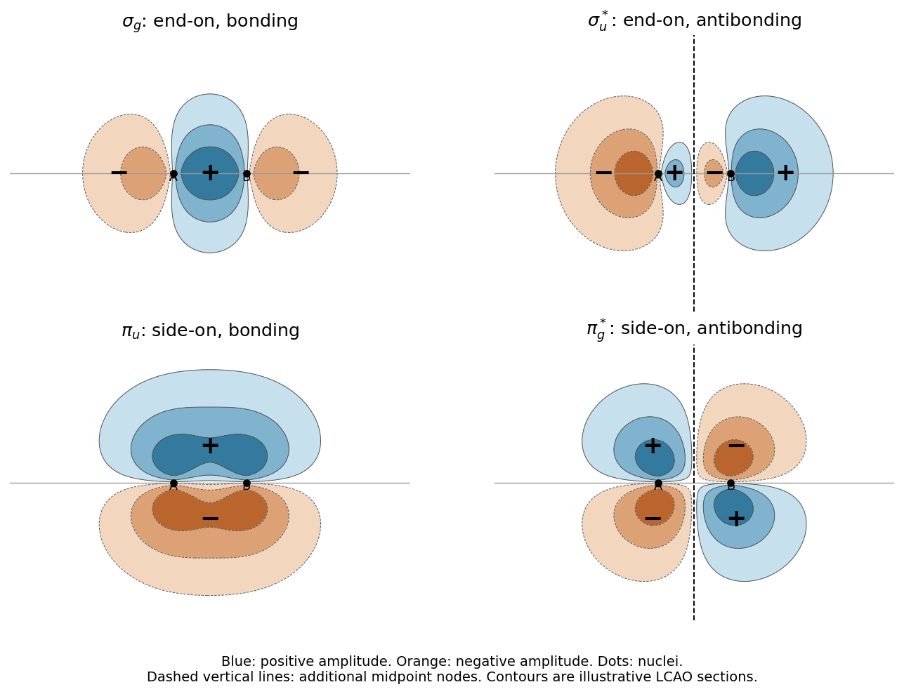

<h1 id="2/b/i/solution">Solution</h1>

↑ **Parent:** [I](../i.md)

**End-on overlap produces $\sigma$ and $\sigma^*$ [molecular orbitals](../../../../../molecular-orbital.md); side-on overlap produces $\pi$ and $\pi^*$ [molecular orbitals](../../../../../molecular-orbital.md).** Matching signs of the facing [atomic orbital](../../../../../atomic-orbital.md) lobes give constructive [interference](../../../../../interference-wave-propagation.md) and a [bonding molecular orbital](../../../../../bonding-orbital.md). Opposite signs give destructive [interference](../../../../../interference-wave-propagation.md) and an additional nodal plane between the [atomic nuclei](../../../../../atomic-nucleus-split.md) in the [antibonding molecular orbital](../../../../../antibonding-orbital.md).

**[Figure 2](#2/b/i/image-original-signed-combinations-of-p-atomic-orbitals-for-four-p-derived-molecular-orbitals). Original signed combinations of p atomic orbitals for four p-derived molecular orbitals**.

Take the internuclear direction as $x$, and define both atomic $p_x$ functions as positive on their own right-hand side. Up to [wavefunction normalization](../../../../../wavefunction-normalization.md), the combinations are

$$
\begin{array}{c|c}
\sigma&p_{x,A}-p_{x,B}\\
\sigma^*&p_{x,A}+p_{x,B}\\
\pi&p_{y,A}+p_{y,B}\\
\pi^*&p_{y,A}-p_{y,B}
\end{array}
$$

The minus sign in the bonding $p_x$ combination follows from this common-axis [quantum phase](../../../../../quantum-phase.md) convention: the facing lobes of the two unmodified $p_x$ functions have opposite signs. It does not make that combination antibonding. Every $\pi$ [molecular orbital](../../../../../molecular-orbital.md) also has a nodal plane containing the internuclear axis; the additional midpoint node distinguishes $\pi^*$ from $\pi$.

## ↑ Ancestors (13)

1. [I](../i.md)
2. [B](../../b.md)
3. [2](../../../2.md)
4. [2025](../../../../2025-split.md)
5. [Past exam of the chemistry course of the year 1 of the natural sciences course of the University of Cambridge](../../../../split.md)
6. [Chemistry course of the year 1 of the natural sciences course of the University of Cambridge](../../../../../chemistry-course-of-the-year-1-of-the-natural-sciences-course-of-the-university-of-cambridge.md)
7. [Year 1 of the natural sciences course of the University of Cambridge](../../../../../year-1-of-the-natural-sciences-course-of-the-university-of-cambridge.md)
8. [Year of the natural sciences course of the University of Cambridge](../../../../../year-of-the-natural-sciences-course-of-the-university-of-cambridge.md)
9. [Natural sciences course of the University of Cambridge](../../../../../natural-sciences-course-of-the-university-of-cambridge.md)
10. [Course of the University of Cambridge](../../../../../course-of-the-university-of-cambridge.md)
11. [University of Cambridge](../../../../../university-of-cambridge-split.md)
12. [List of universities](../../../../../list-of-universities.md)
13. [Codex Wiki](../../../../../split.md)
