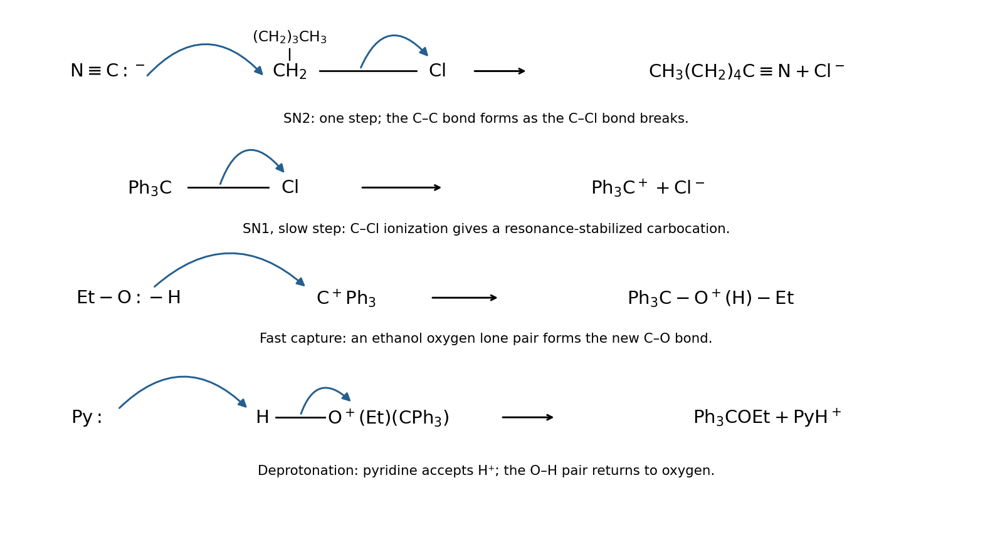

<h1 id="3/a/i/solution">Solution</h1>

↑ **Parent:** [I](../i.md)

**The products are [hexanenitrile](../../../../../hexanenitrile.md), $\mathrm{CH_3(CH_2)_4C\equiv N}$, and [ethyl triphenylmethyl ether](../../../../../ethyl-triphenylmethyl-ether.md), $\mathrm{Ph_3C-O-CH_2CH_3}$.** The nitrile carbon comes from [cyanide](../../../../../cyanide.md), so replacing chloride in the five-carbon chain gives a six-carbon product.

For the primary chloride, the carbon-end [lone pair](../../../../../lone-pair.md) of $\mathrm{CN^-}$ attacks the carbon carrying Cl from the back side while the C–Cl bond pair moves onto Cl. The single concerted [nucleophilic substitution](../../../../../nucleophilic-substitution.md) step forms the C–C bond and releases $\mathrm{Cl^-}$. Attack through the carbon end gives the nitrile, not an isocyanide.

For the triphenylmethyl chloride, the C–Cl bond first undergoes [heterolysis](../../../../../heterolysis.md) to $\mathrm{Ph_3C^+}$ and $\mathrm{Cl^-}$. An [ethanol](../../../../../ethanol.md) [oxygen](../../../../../oxygen.md) [lone pair](../../../../../lone-pair.md) then attacks the [carbocation](../../../../../carbocation.md), giving $\mathrm{Ph_3C-O^+(H)Et}$. Finally [pyridine](../../../../../pyridine.md) accepts that O–H [proton](../../../../../proton.md), with the O–H bond pair returning to [oxygen](../../../../../oxygen.md), giving the neutral [ether](../../../../../ether.md) and pyridinium chloride.

**[Figure 3](#3/a/i/image-original-electron-pair-arrow-schemes-for-cyanide-substitution-and-triphenylmethyl-ether-formation). Original electron-pair arrow schemes for cyanide substitution and triphenylmethyl ether formation**.

## ↑ Ancestors (13)

1. [I](../i.md)
2. [A](../../a.md)
3. [3](../../../3.md)
4. [2025](../../../../2025-split.md)
5. [Past exam of the chemistry course of the year 1 of the natural sciences course of the University of Cambridge](../../../../split.md)
6. [Chemistry course of the year 1 of the natural sciences course of the University of Cambridge](../../../../../chemistry-course-of-the-year-1-of-the-natural-sciences-course-of-the-university-of-cambridge.md)
7. [Year 1 of the natural sciences course of the University of Cambridge](../../../../../year-1-of-the-natural-sciences-course-of-the-university-of-cambridge.md)
8. [Year of the natural sciences course of the University of Cambridge](../../../../../year-of-the-natural-sciences-course-of-the-university-of-cambridge.md)
9. [Natural sciences course of the University of Cambridge](../../../../../natural-sciences-course-of-the-university-of-cambridge.md)
10. [Course of the University of Cambridge](../../../../../course-of-the-university-of-cambridge.md)
11. [University of Cambridge](../../../../../university-of-cambridge-split.md)
12. [List of universities](../../../../../list-of-universities.md)
13. [Codex Wiki](../../../../../split.md)
