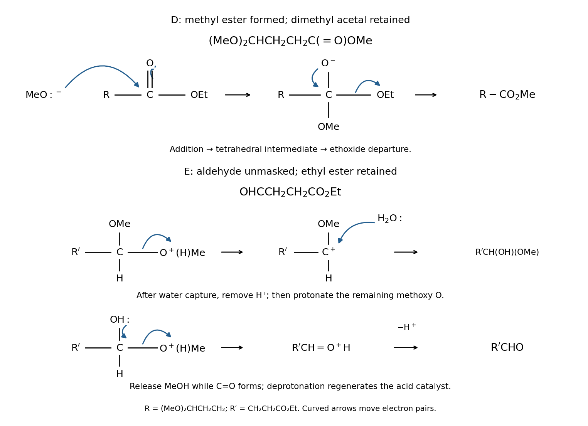

<h1 id="3/c/i/solution">Solution</h1>

↑ **Parent:** [I](../i.md)

**D is $\mathrm{(MeO)_2CHCH_2CH_2CO_2Me}$, and E is $\mathrm{OHCCH_2CH_2CO_2Et}$.** D results from [transesterification](../../../../../transesterification.md); E results from [acid-catalysed acetal hydrolysis](../../../../../acid-catalysed-acetal-hydrolysis.md).

For D, [methoxide](../../../../../methoxide.md) attacks the [ester](../../../../../ester.md) carbonyl carbon and moves the carbonyl $\pi$ pair to [oxygen](../../../../../oxygen.md). Collapse of the tetrahedral [reaction intermediate](../../../../../reaction-intermediate.md) reforms C=O and expels [ethoxide](../../../../../ethoxide.md). [Proton transfer](../../../../../proton-transfer.md) with the [methanol](../../../../../methanol.md) [solvent](../../../../../solvent.md) regenerates [methoxide](../../../../../methoxide.md). Excess [methanol](../../../../../methanol.md) favours replacement of the ethyl [ester](../../../../../ester.md) by a methyl [ester](../../../../../ester.md); the dimethyl [acetal](../../../../../acetal.md) survives these basic conditions.

For E, protonate one [acetal](../../../../../acetal.md) [oxygen](../../../../../oxygen.md), then break its C–O bond with the pair going to [oxygen](../../../../../oxygen.md), releasing [methanol](../../../../../methanol.md) and forming an [oxocarbenium ion](../../../../../oxocarbenium-ion.md). [Water](../../../../../water.md) attacks that carbon. Deprotonation gives a [hemiacetal](../../../../../hemiacetal.md); protonation of its remaining methoxy [oxygen](../../../../../oxygen.md) permits loss of a second [methanol](../../../../../methanol.md). The hydroxyl [oxygen](../../../../../oxygen.md)'s [lone pair](../../../../../lone-pair.md) forms C=O during this loss, and deprotonation gives the [aldehyde](../../../../../aldehyde.md), regenerating the acid [catalyst](../../../../../catalyst.md).

**[Figure 5](#3/c/i/image-original-products-and-electron-flow-steps-for-transesterification-and-acid-catalysed-acetal-hydrolysis). Original products and electron-flow steps for transesterification and acid-catalysed acetal hydrolysis**.

The spectroscopy is consistent with these products. D has one [ester](../../../../../ester.md) carbonyl near $1745\,\mathrm{cm^{-1}}$ and six [carbon-13 NMR](../../../../../carbon-13-nmr.md) environments: acetal CH, two distinct chain $\mathrm{CH_2}$ sites, carbonyl, ester $\mathrm{OCH_3}$, and the two equivalent acetal $\mathrm{OCH_3}$ groups. Thus seven carbon atoms give six resonances. E has separate [ester](../../../../../ester.md) and [aldehyde](../../../../../aldehyde.md) carbonyl bands, approximately $1745$ and $1730\,\mathrm{cm^{-1}}$, and six distinct carbon atoms: two carbonyls, two chain methylenes and the two ethyl carbons.

## ↑ Ancestors (13)

1. [I](../i.md)
2. [C](../../c.md)
3. [3](../../../3.md)
4. [2025](../../../../2025-split.md)
5. [Past exam of the chemistry course of the year 1 of the natural sciences course of the University of Cambridge](../../../../split.md)
6. [Chemistry course of the year 1 of the natural sciences course of the University of Cambridge](../../../../../chemistry-course-of-the-year-1-of-the-natural-sciences-course-of-the-university-of-cambridge.md)
7. [Year 1 of the natural sciences course of the University of Cambridge](../../../../../year-1-of-the-natural-sciences-course-of-the-university-of-cambridge.md)
8. [Year of the natural sciences course of the University of Cambridge](../../../../../year-of-the-natural-sciences-course-of-the-university-of-cambridge.md)
9. [Natural sciences course of the University of Cambridge](../../../../../natural-sciences-course-of-the-university-of-cambridge.md)
10. [Course of the University of Cambridge](../../../../../course-of-the-university-of-cambridge.md)
11. [University of Cambridge](../../../../../university-of-cambridge-split.md)
12. [List of universities](../../../../../list-of-universities.md)
13. [Codex Wiki](../../../../../split.md)
