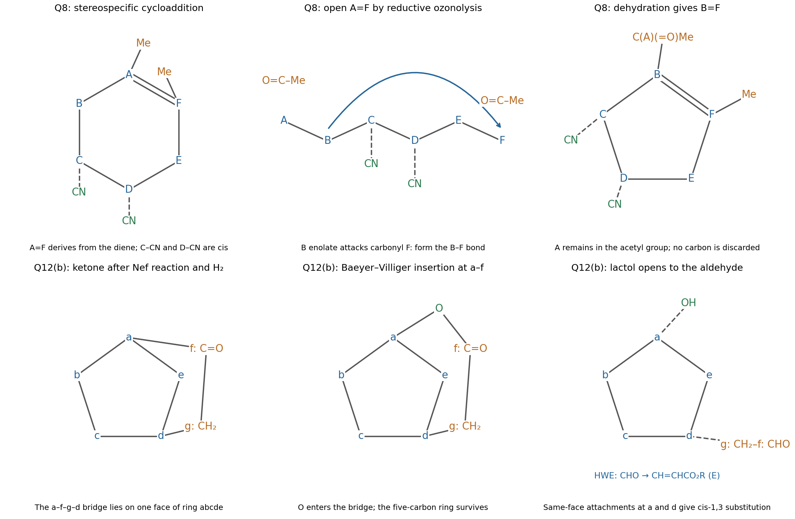
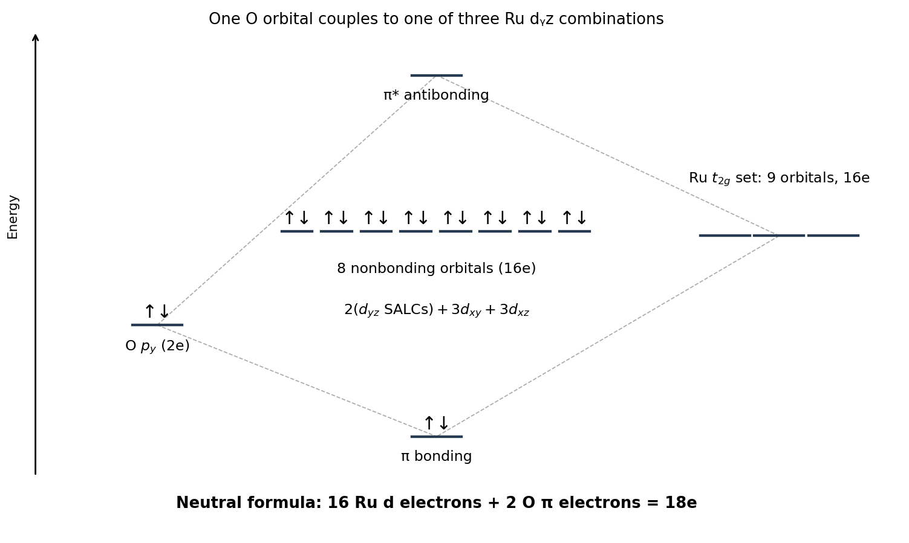

# Paper 1

↑ **Parent:** [2021](../2021.md)

Original source: [FOI bundle, physical PDF pages 405–420; Chemistry Part II Paper 1, 2021](https://www.whatdotheyknow.com/request/past_papers_for_natural_sciences/response/2258285/attach/3/FOI%202023%20126%20James%20materials%20bundle%201.pdf?cookie_passthrough=1). Solutions cover all printed questions in both sections.

**Table of contents**

- [1](#1)
  - [Solution](#1/solution)
- [2](#2)
  - [a](#2/a)
    - [Solution](#2/a/solution)
  - [b](#2/b)
    - [Solution](#2/b/solution)
  - [c](#2/c)
    - [Solution](#2/c/solution)
- [3](#3)
  - [Solution](#3/solution)
- [4](#4)
  - [a](#4/a)
    - [Solution](#4/a/solution)
  - [b](#4/b)
    - [Solution](#4/b/solution)
  - [c](#4/c)
    - [Solution](#4/c/solution)
  - [d](#4/d)
    - [Solution](#4/d/solution)
- [5](#5)
  - [Solution](#5/solution)
- [6](#6)
  - [Solution](#6/solution)
- [7](#7)
  - [Solution](#7/solution)
- [8](#8)
  - [Solution](#8/solution)
- [9](#9)
  - [a](#9/a)
    - [Solution](#9/a/solution)
  - [b](#9/b)
    - [i](#9/b/i)
      - [Solution](#9/b/i/solution)
    - [ii](#9/b/ii)
      - [Solution](#9/b/ii/solution)
  - [c](#9/c)
    - [Solution](#9/c/solution)
- [10](#10)
  - [a](#10/a)
    - [Solution](#10/a/solution)
  - [b](#10/b)
    - [i](#10/b/i)
      - [Solution](#10/b/i/solution)
    - [ii](#10/b/ii)
      - [Solution](#10/b/ii/solution)
  - [c](#10/c)
    - [i](#10/c/i)
      - [Solution](#10/c/i/solution)
    - [ii](#10/c/ii)
      - [Solution](#10/c/ii/solution)
    - [iii](#10/c/iii)
      - [Solution](#10/c/iii/solution)
    - [iv](#10/c/iv)
      - [Solution](#10/c/iv/solution)
  - [d](#10/d)
    - [Solution](#10/d/solution)
- [11](#11)
  - [a](#11/a)
    - [Solution](#11/a/solution)
  - [b](#11/b)
    - [Solution](#11/b/solution)
- [12](#12)
  - [a](#12/a)
    - [Solution](#12/a/solution)
  - [b](#12/b)
    - [Solution](#12/b/solution)

## 1

↑ **Parent:** [Paper 1](paper-1.md)

<h3 id="1/solution">Solution</h3>

↑ **Parent:** [1](#1)

The [isolobal analogy](../../chemistry.md#isolobal-analogy) compares fragments through their [frontier molecular orbitals](../../chemistry.md#frontier-molecular-orbital): their number, approximate energies, shapes, symmetries and [electron](../../physics.md#electron) occupancies should correspond. It does not require the fragments to have the same total number of [electrons](../../physics.md#electron) or the same constituent elements. If the orbitals available for forming new bonds correspond, analogous ways of joining the fragments become plausible.

For example, **$\mathrm{CH_3^{\bullet}}$ and $\mathrm{Mn(CO)_5^{\bullet}}$ are isolobal**. The [methyl radical](../../chemistry.md#methyl-radical) has one singly occupied approximately outward-pointing orbital; removing one [carbonyl ligand](../../chemistry.md#carbonyl-ligand) from an [octahedral molecular geometry](../../molecule.md#octahedral-molecular-geometry) leaves an analogous frontier orbital on the 17-electron $\mathrm{Mn(CO)_5}$ fragment. Joining two such fragments pairs the two [electrons](../../physics.md#electron): the organic example is the C–C bond of [ethane](../../chemical-substance.md#ethane), and the organometallic example is the Mn–Mn bond of $\mathrm{Mn_2(CO)_{10}}$. The analogy predicts a bonding pattern, rather than equality of bond energies or reaction rates.[1982, discussion of the methyl and metal-carbonyl fragment analogy](../../chemistry-bibliography.md#building-bridges-between-inorganic-and-organic-chemistry-nobel-lecture-by-roald-hoffmann)

## 2

↑ **Parent:** [Paper 1](paper-1.md)

<h3 id="2/a">a</h3>

↑ **Parent:** [2](#2)

<h4 id="2/a/solution">Solution</h4>

↑ **Parent:** [A](#2/a)

Use [Wade's rules](../../chemical-bond.md#polyhedral-skeletal-electron-pair-theory) with the metal included as a skeletal vertex. Each BH vertex supplies two skeletal [electrons](../../physics.md#electron), each CH supplies three, and the two additional [hydrogen](../../chemical-substance.md#hydrogen) atoms supply two more. The $\mathrm{Ru(CO)_3}$ fragment supplies $8+3(2)-12=2$ skeletal [electrons](../../physics.md#electron) after the metal's non-skeletal orbitals have been accounted for. Thus

$$
N_{\mathrm{skeletal}}=3(2)+2(3)+2+2=16,\qquad \mathrm{SEP}=8=6+2.
$$

The six-vertex cluster is therefore **nido, with a pentagonal-pyramidal skeleton**: Ru is the apex, bonded to the five vertices of the planar $\mathrm{B_3C_2}$ base, and the three [carbonyl ligands](../../chemistry.md#carbonyl-ligand) project away from that base. This is the six-vertex fragment obtained by removing an equatorial vertex from a seven-vertex [pentagonal bipyramid](../../euclidean-geometry.md#pentagonal-bipyramid). The five ring atoms carry their terminal B–H or C–H bonds; the two additional [hydrogens](../../chemical-substance.md#hydrogen) belong to the hydrogen-rich open-face bonding framework. The skeletal [electron](../../physics.md#electron) count does not, by itself, locate every [bridging hydride](../../chemical-substance.md#bridging-hydride), so a unique detailed [hydrogen](../../chemical-substance.md#hydrogen) arrangement should not be inferred from it.

<h3 id="2/b">b</h3>

↑ **Parent:** [2](#2)

<h4 id="2/b/solution">Solution</h4>

↑ **Parent:** [B](#2/b)

There are **two carbon-placement isomers**, represented by the cyclic base sequences $\mathrm{CCBBB}$ and $\mathrm{CBCBB}$. The [carbon](../../chemical-substance.md#carbon) vertices are adjacent in the first and separated by one [boron](../../chemical-substance.md#boron) vertex in the second. Rotation or reversal of a sequence does not produce another constitutional isomer.

Each arrangement has a [reflection symmetry](../../physics.md#reflection-symmetry) that exchanges a pair of [boron](../../chemical-substance.md#boron) sites while leaving the third distinct. Consequently each can give **two $^{11}\mathrm B$ environments, with site populations $2:1$**, in a [proton-decoupled NMR](../../nuclear-magnetic-resonance.md#proton-decoupled-nmr) spectrum. This assumes that the [hydrogen](../../chemical-substance.md#hydrogen) and [carbonyl](../../chemical-bond.md#carbonyl-group) arrangements preserve, or rapidly average to, the corresponding skeletal symmetry. Two peaks alone neither choose between the two skeletons nor establish a unique [hydrogen](../../chemical-substance.md#hydrogen) arrangement; accidental overlap or [fluxionality](../../molecule.md#fluxionality) can also reduce the number of observed signals.

<h3 id="2/c">c</h3>

↑ **Parent:** [2](#2)

<h4 id="2/c/solution">Solution</h4>

↑ **Parent:** [C](#2/c)

The usual qualitative prediction is the **carbon-separated $\mathrm{CBCBB}$ isomer**. It has four B–C ring edges and one B–B edge, whereas the adjacent-carbon isomer has two B–C, two B–B and one C–C edge. Separating the more electron-rich [carbon](../../chemical-substance.md#carbon) vertices distributes skeletal [electron](../../physics.md#electron) density more evenly and avoids concentrating both [carbon](../../chemical-substance.md#carbon) vertices on one edge, a useful [carborane](../../chemical-substance.md#carborane) stability heuristic.

This is a thermodynamic suggestion, not a consequence of the peak count. [hydrogen](../../chemical-substance.md#hydrogen) placement, metal–ring interactions and entropy can affect the ordering. Establishing the preferred isomer experimentally would require reversible interconversion and an equilibrium composition, rather than simply identifying the product formed fastest.

## 3

↑ **Parent:** [Paper 1](paper-1.md)

<h3 id="3/solution">Solution</h3>

↑ **Parent:** [3](#3)

**A [triangular prism](../../euclidean-geometry.md#triangular-prism)** has exactly the required nine metal–metal edges: six edges around two triangular faces and three edges joining corresponding vertices of those faces. It naturally offers two symmetry-distinct edge families, of sizes six and three.

With twelve $\mathrm{Cl^-}$ ligands, neutral $\mathrm{Re_6Cl_{12}}$ has total rhenium oxidation number $+12$, hence six formally Re(II), $d^5$ centres. After treating the Re–Cl interactions as ligand bonds, the available metal $d$ [electrons](../../physics.md#electron) are

$$
6(7-2)=30\ \mathrm{electrons}=15\ \mathrm{bonding\ pairs}.
$$

Two localized [bond order](../../chemistry.md#bond-order) assignments use those fifteen pairs:

$$
\begin{array}{c|cc|c}
&\text{six triangular edges}&\text{three prism edges}&\text{total bond order}\\
\mathrm{I}&1&3&6+9=15\\
\mathrm{II}&2&1&12+3=15
\end{array}
$$

In scheme I the three inter-triangle edges should be shorter; in scheme II the six [triangle](../../euclidean-geometry.md#triangle) edges should be shorter. Both give each Re five [electrons](../../physics.md#electron)' worth of metal–metal bond-order contributions: two singles plus a triple, or two doubles plus a single. **The [electron](../../physics.md#electron) count permits both schemes**; identifying which family is shorter distinguishes them at this level. Actual cluster [molecular orbitals](../../chemistry.md#molecular-orbital) are delocalized, so these integer [bond orders](../../chemistry.md#bond-order) summarize bonding rather than asserting isolated textbook multiple bonds on every edge.

## 4

↑ **Parent:** [Paper 1](paper-1.md)

<h3 id="4/a">a</h3>

↑ **Parent:** [4](#4)

<h4 id="4/a/solution">Solution</h4>

↑ **Parent:** [A](#4/a)

The key is coupling [redox equilibrium](../../chemical-reaction.md#redox-equilibrium) to [hydrolysis](../../chemical-reaction.md#hydrolysis) and [precipitation](../../chemical-reaction.md#precipitation-chemistry). Ce(IV) has a much greater tendency than Ce(III) to form a hydrated [cerium dioxide](../../chemical-substance.md#cerium-dioxide) solid. Raising [pH](../../acid-base-chemistry.md#ph) therefore preferentially stabilizes the oxidized form. In the presence of dissolved [oxygen](../../chemical-substance.md#oxygen) a representative net reaction is

$$
4\mathrm{Ce^{3+}}+\mathrm{O_2}+6\mathrm{H_2O}
\rightleftharpoons4\mathrm{CeO_2(s)}+12\mathrm{H^+}.
$$

Removing $\mathrm{H^+}$ drives this reaction towards Ce(IV). Writing the solid as hydrated oxide changes its water content, not this redox argument.

The [Nernst equation](../../electrochemistry.md#nernst-equation) makes the [pH](../../acid-base-chemistry.md#ph) effect explicit. At $25^\circ\mathrm C$, the reduction $\mathrm{CeO_2+4H^++e^-\to Ce^{3+}+2H_2O}$ has a [pH](../../acid-base-chemistry.md#ph) slope approximately $-0.236\ \mathrm{V}$ per [pH](../../acid-base-chemistry.md#ph) unit at fixed Ce(III) activity. The [oxygen](../../chemical-substance.md#oxygen)/water reduction has slope about $-0.059\ \mathrm{V}$ per [pH](../../acid-base-chemistry.md#ph) unit. Raising [pH](../../acid-base-chemistry.md#ph) thus makes oxidation of Ce(III) by [oxygen](../../chemical-substance.md#oxygen) increasingly favourable within the relevant phase-stability region. Conversely strong acid favours soluble Ce(III) relative to the oxide and makes Ce(IV) a stronger [oxidizing agent](../../chemical-reaction.md#oxidizing-agent). **[pH](../../acid-base-chemistry.md#ph) changes the redox driving force; an [electron](../../physics.md#electron) acceptor or donor is still required**, and slow [oxygen](../../chemical-substance.md#oxygen) evolution or oxidation kinetics can prevent immediate equilibration.

<h3 id="4/b">b</h3>

↑ **Parent:** [4](#4)

<h4 id="4/b/solution">Solution</h4>

↑ **Parent:** [B](#4/b)

**Not as a general aqueous separation reaction for the other [lanthanides](../../chemical-substance.md#lanthanide).** Most strongly favour the trivalent state in ordinary water chemistry. Ce(IV) is unusually accessible because it has the empty $4f$ shell and is strongly stabilized by oxide formation. Some other [lanthanides](../../chemical-substance.md#lanthanide) have accessible alternative [oxidation states](../../chemical-reaction.md#oxidation-state), such as Eu(II), and higher oxides of Pr or Tb can exist under suitable conditions; this does not imply that they undergo the same Ce(III)/Ce(IV) pH-controlled aqueous oxidation.

<h3 id="4/c">c</h3>

↑ **Parent:** [4](#4)

<h4 id="4/c/solution">Solution</h4>

↑ **Parent:** [C](#4/c)

A natural feed can contain [thorium](../../chemical-substance.md#thorium) and [uranium](../../chemical-substance.md#uranium), as well as other [lanthanides](../../chemical-substance.md#lanthanide). Th(IV) hydrolyses readily and can accompany the cerium precipitate; [uranium](../../chemical-substance.md#uranium) speciation depends on its [oxidation state](../../chemical-reaction.md#oxidation-state) and the ligands present. Raising [pH](../../acid-base-chemistry.md#ph) too far also precipitates other rare-earth hydroxides. Even before their bulk [precipitation](../../chemical-reaction.md#precipitation-chemistry) thresholds, adsorption and [coprecipitation](../../chemical-reaction.md#coprecipitation) on a high-area hydrated cerium oxide can contaminate the solid. Local high-pH zones during base addition and incomplete Ce(III) oxidation make the separation less reproducible.

Thus **a cerium-rich precipitate need not be pure cerium**. A sensible test measures the Ce [oxidation state](../../chemical-reaction.md#oxidation-state), analyses both filtrate and washed solid, and includes thorium-containing and thorium-free mixtures; otherwise low dissolved cerium could be mistaken for selective purification.

<h3 id="4/d">d</h3>

↑ **Parent:** [4](#4)

<h4 id="4/d/solution">Solution</h4>

↑ **Parent:** [D](#4/d)

A better controlled route is **selective [solvent extraction](../../engineering.md#solvent-extraction) in acid, followed by selective stripping**, rather than precipitating everything near overlapping [hydrolysis](../../chemical-reaction.md#hydrolysis) thresholds. Oxidize Ce(III) to Ce(IV) in a controlled acidic nitrate medium, extract its nitrate complexes into an organic donor phase, and separate the phases. Then reduce the extracted Ce(IV) to Ce(III) and back-extract it into an aqueous phase. Trivalent rare earths are less strongly extracted under suitable conditions.

This still needs a [thorium](../../chemical-substance.md#thorium) separation: [tributyl phosphate](../../chemical-substance.md#tributyl-phosphate) can coextract Th(IV). One demonstrated strategy deliberately coextracts Ce(IV) and Th(IV), then uses reducing [peroxide](../../chemical-substance.md#peroxide) solution to strip Ce as Ce(III), followed by a separate [thorium](../../chemical-substance.md#thorium) strip. The appropriate controls are distribution measurements for each ion at the chosen acid concentration, a cerium oxidation-state check, and a complete mass balance over extraction and stripping. **Selectivity comes from combining [oxidation state](../../chemical-reaction.md#oxidation-state) and [complexation](../../chemistry.md#complexation), not from assuming that one extraction removes every contaminant.**[2017, abstract: coextraction from nitric acid and successive [peroxide](../../chemical-substance.md#peroxide)/water stripping](../../chemistry-bibliography.md#coextraction-and-successive-selective-stripping-of-cerium-iv-and-thorium-from-monazite-leach-solutions-with-tributyl-phosphate-tbp-by-a-h-ali)

## 5

↑ **Parent:** [Paper 1](paper-1.md)

<h3 id="5/solution">Solution</h3>

↑ **Parent:** [5](#5)

Disconnect the tertiary [alcohol](../../chemical-substance.md#alcohol) at its bond to the alkenyl group. The required [carbonyl](../../chemical-bond.md#carbonyl-group) partner is $\mathrm{MeCOCH(Me)Et}$; the other partner is an **E-configured $\mathrm{PhCH_2CH{=}CH}$ organometallic reagent**. This disconnection fixes the [alkene](../../chemical-substance.md#alkene) geometry before the [alcohol](../../chemical-substance.md#alcohol) is made.

First form the ethyl-side [enolate](../../chemical-substance.md#enolate) of [butan-2-one](../../chemical-substance.md#butan-2-one) under equilibrating conditions, then trap it with ethyl iodide and isolate the required monoalkylated [ketone](../../chemical-substance.md#ketone):

$$
\mathrm{MeCOCH_2Me}\longrightarrow\mathrm{MeCOCH(Me)Et}.
$$

The incoming group is Et: methylation would give a [carbon](../../chemical-substance.md#carbon) skeleton one [carbon](../../chemical-substance.md#carbon) too short. Because an unsymmetrical [ketone](../../chemical-substance.md#ketone) can form two [enolates](../../chemical-substance.md#enolate) and undergo repeated alkylation, regioisomer separation and controlled conversion are part of this step.

Independently perform a halo-[Wittig reaction](../../chemical-reaction.md#wittig-reaction) on phenylacetaldehyde using $\mathrm{Ph_3P{=}CHBr}$ and isolate **E-$\mathrm{PhCH_2CH{=}CHBr}$** from any geometrical mixture. [magnesium](../../chemical-substance.md#magnesium) insertion in dry ether gives the corresponding [vinylmagnesium halide](../../chemical-substance.md#vinylmagnesium-halide); add the isolated [ketone](../../chemical-substance.md#ketone) at low temperature and protonate the resulting [alkoxide](../../mathematical-biology.md#alkoxide). Addition to C=O preserves the pre-existing C=C geometry:

$$
(E)\text{-}\mathrm{PhCH_2CH{=}CHMgBr}
+\mathrm{MeCOCH(Me)Et}
\longrightarrow
(E)\text{-}\mathrm{PhCH_2CH{=}CHC(OH)(Me)CH(Me)Et}.
$$

**The E [alkene](../../chemical-substance.md#alkene) and the complete fifteen-carbon skeleton are obtained.** No absolute configuration is specified at the newly formed [alcohol](../../chemical-substance.md#alcohol) centre, so an unselected stereoisomeric mixture there is acceptable. An alternative [carbon](../../chemical-substance.md#carbon)–[carbon](../../chemical-substance.md#carbon) disconnection is [acetylide](../../chemical-substance.md#acetylide) addition to the same [ketone](../../chemical-substance.md#ketone) followed by a controlled trans-selective [alkyne](../../chemical-substance.md#alkyne) reduction; the vinyl-reagent route avoids relying on reduction of a tertiary propargylic [alcohol](../../chemical-substance.md#alcohol).

## 6

↑ **Parent:** [Paper 1](paper-1.md)

<h3 id="6/solution">Solution</h3>

↑ **Parent:** [6](#6)

Open the [lactone](../../chemical-substance.md#lactone) formally at its acyl–[oxygen](../../chemical-substance.md#oxygen) bond, then replace the resulting secondary [alcohol](../../chemical-substance.md#alcohol) by its [ketone](../../chemical-substance.md#ketone) precursor. With $R=\mathrm{CH(Me)CH(Me)_2}$, the useful sequence of retrosynthetic intermediates is

$$
\text{lactone}\ \Longleftarrow\
\mathrm{HO_2CCH(Me)CH_2CH_2CH(OH)R}
\ \Longleftarrow\
\mathrm{EtO_2CCH(Me)CH_2CH_2COR}.
$$

Disconnect the last compound as a [Michael addition](../../chemical-reaction.md#michael-addition) product of the methyl-side [enolate](../../chemical-substance.md#enolate) of $\mathrm{RCOCH_3}$ and [ethyl methacrylate](../../chemical-substance.md#ethyl-methacrylate):

$$
\mathrm{RCOCH_3+CH_2{=}C(Me)CO_2Et}
\longrightarrow
\mathrm{RCOCH_2CH_2CH(Me)CO_2Et}.
$$

The substituted [carbon](../../chemical-substance.md#carbon) of the methacrylate becomes the methyl-bearing [carbon](../../chemical-substance.md#carbon) alpha to the [lactone](../../chemical-substance.md#lactone) [carbonyl](../../chemical-bond.md#carbonyl-group). The [ketone](../../chemical-substance.md#ketone) [carbon](../../chemical-substance.md#carbon) becomes the oxygen-bearing ring [carbon](../../chemical-substance.md#carbon). This checks the six-membered ring connectivity.

The required branched methyl [ketone](../../chemical-substance.md#ketone) itself comes from [butan-2-one](../../chemical-substance.md#butan-2-one) by ethyl-side [aldol addition](../../chemical-reaction.md#aldol-addition) to [acetone](../../chemical-substance.md#acetone), followed by [dehydration](../../chemical-reaction.md#dehydration) and selective [hydrogenation](../../chemical-reaction.md#hydrogenation):

$$
\mathrm{MeCOCH_2Me}
\longrightarrow\mathrm{MeCOCH(Me)C(OH)Me_2}
\longrightarrow\mathrm{MeCOC(Me){=}CMe_2}
\longrightarrow\mathrm{MeCOCH(Me)CHMe_2}.
$$

Choose and isolate the aldol regioisomer shown. For the subsequent Michael step, use a bulky base at low temperature to favour its less hindered methyl-side [kinetic enolate](../../chemical-substance.md#kinetic-enolate). Reduce the resulting [ketone](../../chemical-substance.md#ketone) selectively with $\mathrm{NaBH_4}$ while retaining the [ester](../../chemical-substance.md#ester), hydrolyse the [ester](../../chemical-substance.md#ester), then acidify and promote intramolecular [esterification](../../chemical-reaction.md#esterification) with water removal. **The hydroxy acid closes to the required six-membered [lactone](../../chemical-substance.md#lactone).** There is no specified stereochemical relationship to enforce, but a stereochemically pure target would require an additional selectivity or resolution step.

## 7

↑ **Parent:** [Paper 1](paper-1.md)

<h3 id="7/solution">Solution</h3>

↑ **Parent:** [7](#7)

An [acetal](../../chemical-substance.md#acetal) [retrosynthesis](../../chemistry.md#retrosynthetic-analysis) separates the target into **trans-cyclohexane-1,2-diol and cyclohexyl methyl [ketone](../../chemical-substance.md#ketone)**. Both fragments can be prepared using separate portions of [cyclohexene](../../chemical-substance.md#cyclohexene).

For the diol, [epoxidation](../../chemical-reaction.md#epoxidation) with a [peroxy acid](../../chemical-substance.md#peroxy-acid) such as mCPBA gives [cyclohexene](../../chemical-substance.md#cyclohexene) oxide. Acid-catalysed opening with water occurs by backside attack on the protonated [epoxide](../../chemical-substance.md#epoxide), giving the **anti, hence trans, diol**. A syn dihydroxylation would give the wrong relative configuration.

For the [ketone](../../chemical-substance.md#ketone), add HBr to another portion of [cyclohexene](../../chemical-substance.md#cyclohexene) to obtain bromocyclohexane, form its [grignard reagent](../../chemical-substance.md#grignard-reagent) with Mg in dry ether, and add [acetonitrile](../../chemical-substance.md#acetonitrile). Hydrolyse the resulting [magnesium](../../chemical-substance.md#magnesium) imine salt to $\mathrm{C_6H_{11}COMe}$. A [nitrile](../../chemical-substance.md#nitrile) is useful here because addition followed by [hydrolysis](../../chemical-reaction.md#hydrolysis) stops at the [ketone](../../chemical-substance.md#ketone) instead of giving the double addition associated with an [ester](../../chemical-substance.md#ester).

Finally combine the isolated trans diol and [ketone](../../chemical-substance.md#ketone) with catalytic acid and remove water to form the cyclic [ketal](../../chemical-substance.md#ketal). The [ketone](../../chemical-substance.md#ketone) [carbon](../../chemical-substance.md#carbon) becomes the [acetal](../../chemical-substance.md#acetal) [carbon](../../chemical-substance.md#carbon) bearing Me and cyclohexyl; the two original diol C–O bonds retain their relative configuration. **Anti [epoxide](../../chemical-substance.md#epoxide) opening supplies the required trans relationship before [ketal](../../chemical-substance.md#ketal) formation.** [ketal](../../chemical-substance.md#ketal) formation is an equilibrium and the trans-fused product may be less favourable than an unstrained [acetal](../../chemical-substance.md#acetal), so effective water removal and isolation are necessary; substituting a cis diol is not an acceptable shortcut.

## 8

↑ **Parent:** [Paper 1](paper-1.md)

<h3 id="8/solution">Solution</h3>

↑ **Parent:** [8](#8)

The five-membered enone-like [carbon](../../chemical-substance.md#carbon) framework can be obtained by an intramolecular [aldol condensation](../../chemical-reaction.md#aldol-condensation) of

$$
\mathrm{MeCOCH_2CH(CN)CH(CN)CH_2COMe}.
$$

Enolization at an internal methylene next to one [ketone](../../chemical-substance.md#ketone) followed by attack on the opposite [ketone](../../chemical-substance.md#ketone) closes a five-membered ring. [dehydration](../../chemical-reaction.md#dehydration) leaves one acetyl group attached to one [alkene](../../chemical-substance.md#alkene) [carbon](../../chemical-substance.md#carbon) and one methyl group on the other. The two nitrile-bearing [carbons](../../chemical-substance.md#carbon) remain adjacent and their original cis relationship is retained if [epimerization](../../stereochemistry.md#epimerization) is avoided.

Now reverse a reductive [ozonolysis](../../chemical-reaction.md#ozonolysis): the diketone arises by opening a six-membered [cyclohexene](../../chemical-substance.md#cyclohexene) whose [alkene](../../chemical-substance.md#alkene) [carbons](../../chemical-substance.md#carbon) each carry Me. That [cyclohexene](../../chemical-substance.md#cyclohexene) is the [Diels-Alder reaction](../../chemical-reaction.md#diels-alder-reaction) product of **2,3-dimethylbuta-1,3-diene and [maleonitrile](../../chemical-substance.md#maleonitrile)**. The latter is the supplied cis dinitrile. The [stereospecificity](../../chemistry.md#stereospecificity) of the cycloaddition puts the two CN groups on the same face.

Thus the forward plan is **Diels–Alder addition, reductive [ozonolysis](../../chemical-reaction.md#ozonolysis), then five-membered aldol ring closure and [dehydration](../../chemical-reaction.md#dehydration)**. Use a reductive ozone work-up that stops at the diketone. During the final step, avoid prolonged strongly basic heating because the [carbons](../../chemical-substance.md#carbon) bearing CN can be deprotonated and epimerized. Achiral reagents give the racemic pair with the required cis relationship; resolution would be necessary if only the depicted [enantiomer](../../stereochemistry.md#enantiomer) were required. The diene supplies six [carbons](../../chemical-substance.md#carbon) and [maleonitrile](../../chemical-substance.md#maleonitrile) supplies four, accounting for all ten [carbons](../../chemical-substance.md#carbon) without an unexplained [carbon](../../chemical-substance.md#carbon) deletion.

**[Figure 1](#8/image-atom-tracing-through-the-two-cycloaddition-and-ring-reorganization-routes). Atom tracing through the two cycloaddition and ring-reorganization routes**.

## 9

↑ **Parent:** [Paper 1](paper-1.md)

<h3 id="9/a">a</h3>

↑ **Parent:** [9](#9)

<h4 id="9/a/solution">Solution</h4>

↑ **Parent:** [A](#9/a)

For the CO and NCO cases, the added fragment acts as a [Lewis base](../../acid-base-chemistry.md#lewis-base) at [boron](../../chemical-substance.md#boron), rather than becoming a new skeletal vertex. **Both have a triangular $\mathrm{B_3}$ framework**. A useful localized drawing has three $\mathrm{BH_2}$ groups, one B–H–B bridge between two of them, and the donor attached to the third [boron](../../chemical-substance.md#boron). The [boron](../../chemical-substance.md#boron)–[boron](../../chemical-substance.md#boron) framework includes [three-centre two-electron bonds](../../chemical-bond.md#three-centre-two-electron-bond); its edges should not all be read as ordinary independent two-electron single bonds.

For the neutral [carbonyl](../../chemical-bond.md#carbonyl-group) adduct, attach CO through [carbon](../../chemical-substance.md#carbon), giving $\mathrm{B{\leftarrow}C{\equiv}O}$ at the donor-bearing $\mathrm{BH_2}$ site. For the anionic isocyanate adduct, attach $\mathrm{NCO^-}$ through [nitrogen](../../chemical-substance.md#nitrogen), giving a B–N=C=O connectivity and the overall $-1$ charge. In both drawings the [hydrogen](../../chemical-substance.md#hydrogen) count is $3(2)+1=7$. Weak or asymmetric additional B–H contacts can distort this idealized drawing; a hydrogen-rich [borane](../../chemical-substance.md#borane) is not fully characterized by a polygon alone. The [carbonyl](../../chemical-bond.md#carbonyl-group) triborane structure was established in the original [borane](../../chemical-substance.md#borane) study.[1973, pp.2175–2178, structural assignment of the [carbonyl](../../chemical-bond.md#carbonyl-group) adduct](../../chemistry-bibliography.md#boranes-xxxvii-reactions-of-triborane-7-and-the-structure-of-triborane-7-carbonyl-by-james-d-glore-and-others)

The rhodium fragment is instead a skeletal building block. Its neutral [electron](../../physics.md#electron) count is $9+2(2)+1=14$, so it contributes two skeletal [electrons](../../physics.md#electron), like a BH vertex. Combining it with $\mathrm{B_3H_7}$ gives $3(2)+4+2=12$ skeletal [electrons](../../physics.md#electron), or six pairs, for four vertices. A consistent low-vertex structure is **a tetrahedral $\mathrm{RhB_3}$ skeleton**, with the $\mathrm{RhH(PPh_3)_2}$ fragment capping the [boron](../../chemical-substance.md#boron) [triangle](../../euclidean-geometry.md#triangle). Keep the terminal Rh–H ligand distinct from the seven [hydrogens](../../chemical-substance.md#hydrogen) on the [borane](../../chemical-substance.md#borane) portion. The latter can again be represented by three terminal $\mathrm{BH_2}$ groups and a B–H–B bridge. The total formula then contains eight [hydrogens](../../chemical-substance.md#hydrogen) outside the phenyl groups. Treating Rh as a pendant one-centre [Lewis base](../../acid-base-chemistry.md#lewis-base) would miss its skeletal role.

<h3 id="9/b">b</h3>

↑ **Parent:** [9](#9)

<h4 id="9/b/i">i</h4>

↑ **Parent:** [B](#9/b)

<h5 id="9/b/i/solution">Solution</h5>

↑ **Parent:** [I](#9/b/i)

Neutral counting assigns five [electrons](../../physics.md#electron) to [cyclopentadienyl ligand](../../chemistry.md#cyclopentadienyl-ligand) and two to CO. Thus each $\mathrm{FeCpCO}$ fragment has $8+5+2=15$ [valence electrons](../../chemical-bond.md#valence-electron) and contributes three skeletal [electrons](../../physics.md#electron); each $\mathrm{CoCpCO}$ fragment has sixteen and contributes four:

$$
\begin{aligned}
\mathrm A:\quad&4(15)-12(4)=12\ \mathrm{skeletal\ electrons}=6\ \mathrm{pairs},\\
\mathrm B:\quad&3(16)-12(3)=12\ \mathrm{skeletal\ electrons}=6\ \mathrm{pairs}.
\end{aligned}
$$

For A the six-pair four-vertex count is the nido count derived from a five-vertex [trigonal bipyramid](../../chemistry.md#trigonal-bipyramid). Removing an axial vertex leaves a **[tetrahedron](../../euclidean-geometry.md#tetrahedron)**: the three equatorial vertices plus the remaining axial vertex. For B the corresponding arachno fragment is obtained by removing both axial vertices from that same parent, leaving a **three-metal [triangle](../../euclidean-geometry.md#triangle)**. Small clusters require specifying the parent and removed vertices; mechanically calling every nido fragment a square pyramid is wrong.

The Fe tetramer is indeed known to have a tetrahedral $\mathrm{Fe_4}$ core, with four face-capping CO groups. The [carbon](../../chemical-substance.md#carbon) atoms of those [carbonyls](../../chemical-bond.md#carbonyl-group) and the iron atoms form interpenetrating tetrahedra, giving a cubane-like Fe–C connectivity. Bridging rather than terminal CO changes the distribution of local donation, not the total [electron](../../physics.md#electron) count above.[1972, pp.3383–3388, tetrahedral iron core and face-capping [carbonyls](../../chemical-bond.md#carbonyl-group)](../../chemistry-bibliography.md#structural-characterization-of-the-cyclopentadienyliron-carbonyl-tetramer-fe4-eta5-c5h5-4-co-4-a-cubane-type-structure-containing-a-completely-bonding-tetrametal-cluster-unit-by-melvin-a-neuman-and-others)

<h4 id="9/b/ii">ii</h4>

↑ **Parent:** [B](#9/b)

<h5 id="9/b/ii/solution">Solution</h5>

↑ **Parent:** [Ii](#9/b/ii)

For a neutral [borane](../../chemical-substance.md#borane) $\mathrm{B_nH_m}$ with one terminal B–H bond assigned to each vertex, the skeletal [electron](../../physics.md#electron) number is $3n+m-2n=n+m$; an overall charge $q-$ adds $q$ [electrons](../../physics.md#electron). Suitable twelve-electron correspondences are

$$
\boxed{\mathrm C=B_4H_8,\qquad D=[B_3H_8]^- .}
$$

For C, four BH contributions plus four additional [hydrogens](../../chemical-substance.md#hydrogen) give $8+4=12$ [electrons](../../physics.md#electron). For D, three BH contributions plus five additional [hydrogens](../../chemical-substance.md#hydrogen) and the negative charge give $6+5+1=12$. They map to the tetrahedral and triangular low-vertex skeletons respectively. The neutral formal alternative for D is $\mathrm{B_3H_9}$, also with twelve skeletal [electrons](../../physics.md#electron).

The [electron counting](../../chemistry.md#electron-counting) correspondence alone must not be read as evidence that the neutral [boranes](../../chemical-substance.md#borane) are isolable stable bulk materials. Low-vertex hydrogen-rich [boranes](../../chemical-substance.md#borane) can be transient; **the triangular octahydrotriborate anion is the established practical three-boron example**, whereas neutral $\mathrm{B_3H_9}$ is a formal analogy rather than an equally established preparative product. The requested skeletal correspondence should be distinguished from a claim about comparable stability or isolation conditions.[1980, pp.196–200, reactions of the preparatively accessible octahydrotriborate anion](../../chemistry-bibliography.md#reactions-of-the-octahydrotriborate-1-anion-b3h8-with-some-complexes-of-cobalt-i-cobalt-ii-rhodium-i-and-iridium-i-and-the-characterization-of-the-borallyl-complex-iriii-eta3-b3h7-co-h-pph3-2-by-norman-n-greenwood-and-others)

<h3 id="9/c">c</h3>

↑ **Parent:** [9](#9)

<h4 id="9/c/solution">Solution</h4>

↑ **Parent:** [C](#9/c)

For E, each BH supplies two skeletal [electrons](../../physics.md#electron) and each [phosphorus](../../chemical-substance.md#phosphorus) vertex supplies three after retaining a [lone pair](../../covalent-bond.md#lone-pair). Hence $10(2)+2(3)=26$ [electrons](../../physics.md#electron), or thirteen pairs, matching a twelve-vertex [closo cluster](../../molecule.md#closo-cluster). **Place the two adjacent P vertices on a [regular icosahedron](../../euclidean-geometry.md#regular-icosahedron).** The remaining ten [boron](../../chemical-substance.md#boron) vertices fall into four symmetry classes: two sites adjacent to both P vertices, four adjacent to exactly one, two adjacent to neither but opposite the common-neighbour pair, and two opposite the P pair. The populations are **$2:4:2:2$**, so four [boron](../../chemical-substance.md#boron) resonances are expected. Interchanging the identical [phosphorus](../../chemical-substance.md#phosphorus) vertices is allowed when determining chemical equivalence.

For F, a ten-vertex [bicapped square antiprism](../../euclidean-geometry.md#bicapped-square-antiprism) offers a consistent closo model. There are eight BH vertices, one B vertex bearing the $\mathrm{NEt_3}$ donor instead of H, and one P vertex. Their skeletal contributions are respectively $16$, $3$ and $3$, giving **22 [electrons](../../physics.md#electron), eleven pairs**. The donor-bearing B contribution follows from B plus the donated [lone pair](../../covalent-bond.md#lone-pair) minus the exoskeletal B–N bond, $3+2-2=3$.

One explicit arrangement consistent with six [boron](../../chemical-substance.md#boron) signals puts P at one axial cap and the $\mathrm{NEt_3}$ substituent on one B vertex of the nearer square. The remaining [mirror plane](../../physics.md#mirror-plane) through that B, the opposite vertex of its square, and the cap axis leaves three B sites individually fixed: the donor-bearing B, its opposite square vertex and the other axial cap. The other six B sites form three exchanged pairs. Thus the nine [borons](../../chemical-substance.md#boron) give **three singleton environments and three two-site environments**, six signals in all. The original compound has a crystallographically characterized positional assignment; the spectrum alone asks for a compatible structure and does not establish a unique positional isomer. A [single-crystal X-ray diffraction](../../physical-chemistry.md#single-crystal-x-ray-diffraction) determination or assigned heteronuclear correlations would distinguish alternatives.[1989, pp.1087–1091, synthesis of diphosphaborane and crystallographic characterization of the amine-containing side product](../../chemistry-bibliography.md#synthesis-of-polyhedral-phosphaboranes-crystal-structure-of-6-c2h5-3n·2-pb9h8-by-john-l-little-and-others)

**[Figure 2](#9/c/image-original-skeletal-models-and-boron-site-equivalence-classes). Original skeletal models and boron-site equivalence classes**.

## 10

↑ **Parent:** [Paper 1](paper-1.md)

<h3 id="10/a">a</h3>

↑ **Parent:** [10](#10)

<h4 id="10/a/solution">Solution</h4>

↑ **Parent:** [A](#10/a)

Strong ligand-to-metal [pi donation](../../covalent-bond.md#pi-donation) is favoured by **an occupied ligand [p orbital](../../chemistry.md#p-orbital) and a suitable empty metal [d orbital](../../chemistry.md#d-orbital)** of matching symmetry, with reasonably similar energies and good spatial overlap. Small donor atoms such as O or N can supply short bonds and efficient overlap; oxo, imido and nitrido ligands are familiar examples. Early [transition metals](../../chemical-substance.md#transition-metal) in high [oxidation states](../../chemical-reaction.md#oxidation-state), often $d^0$, are particularly favourable because the metal acceptor orbitals are vacant and relatively low in energy. More spatially extended $4d$ and $5d$ orbitals can strengthen the overlap.

Metal-to-ligand [pi backbonding](../../covalent-bond.md#pi-backbonding) is the complementary case: electron-rich, low-oxidation-state metals donate occupied [d orbitals](../../chemistry.md#d-orbital) into low-lying ligand [antibonding orbitals](../../chemistry.md#antibonding-orbital), as for CO. In both directions, filling a metal–ligand pi-antibonding orbital offsets the multiple-bond stabilization. The relevant prediction is orbital occupancy and overlap, rather than the presence of a formal double-bond line in a drawing.

<h3 id="10/b">b</h3>

↑ **Parent:** [10](#10)

<h4 id="10/b/i">i</h4>

↑ **Parent:** [B](#10/b)

<h5 id="10/b/i/solution">Solution</h5>

↑ **Parent:** [I](#10/b/i)

Use the stated local axes: $z$ is radial along O–Ru, $x$ is tangential within the Ru–O plane, and $y$ is perpendicular to that plane. The [oxygen](../../chemical-substance.md#oxygen)'s three $sp^2$ hybrids make the in-plane sigma framework. Its remaining **$p_y$ orbital** is perpendicular to the plane and can overlap with **one $d_{yz}$ orbital on each Ru**.

Choose the local orbital phases so their O-facing lobes agree. Of the three metal orbitals, only

$$
D=\frac{d_{yz}^{(1)}+d_{yz}^{(2)}+d_{yz}^{(3)}}{\sqrt3}
$$

has the appropriate combination to interact with [oxygen](../../chemical-substance.md#oxygen) $p_y$. The other two independent combinations have coefficients summing to zero and are nonbonding with respect to the central [oxygen](../../chemical-substance.md#oxygen). Mixing $D$ with $p_y$ gives one lower pi-bonding orbital and one upper pi-antibonding orbital. Each Ru also retains its $d_{xy}$ and $d_{xz}$ orbitals as nonbonding with respect to this central-oxo pi interaction. Thus the complete low-energy diagram contains **one bonding level, eight metal-nonbonding levels, and one antibonding level**. The eight consist of two $d_{yz}$ combinations, three $d_{xy}$ and three $d_{xz}$ orbitals. They need not be exactly degenerate once other ligands are considered.

For the neutral formula as printed, oxide contributes $-2$ and six acetates contribute $-6$. The Ru oxidation numbers therefore sum to $+8$, giving sixteen metal d [electrons](../../physics.md#electron) overall, formally two Ru(III) and one Ru(II), possibly delocalized. Including the [oxygen](../../chemical-substance.md#oxygen) pi pair gives eighteen [electrons](../../physics.md#electron), filling the [bonding orbital](../../chemistry.md#bonding-orbital) and all eight [nonbonding orbitals](../../chemistry.md#nonbonding-orbital), leaving pi\* empty. If the often encountered singly charged cation were intended instead, there would be seventeen [electrons](../../physics.md#electron) and one singly occupied nonbonding level. This charge distinction changes occupancy, not the orbital connectivity.

**[Figure 3](#10/b/i/image-qualitative-central-oxo-pi-orbitals-for-the-neutral-triruthenium-cluster). Qualitative central-oxo pi orbitals for the neutral triruthenium cluster**.

<h4 id="10/b/ii">ii</h4>

↑ **Parent:** [B](#10/b)

<h5 id="10/b/ii/solution">Solution</h5>

↑ **Parent:** [Ii](#10/b/ii)

The three $d_{xz}$ orbitals are in the Ru–O plane and can overlap directly along the Ru–Ru edges. Their locally rotated lobes have nonzero edge-directed overlap, producing metal–metal bonding and antibonding combinations; a simple [triangle](../../euclidean-geometry.md#triangle) model resolves the three orbitals into a singlet and a doublet. The phases and ordering depend on the chosen local basis, so the important feature is the **complete set of three combinations**.

In the occupancy obtained in (i), this $d_{xz}$ set contains six [electrons](../../physics.md#electron). All three combinations are filled: the stabilization of the bonding combinations is offset by occupation of their antibonding partners. Equivalently, the sum of the three eigenvalues of a pure off-diagonal interaction matrix is zero. Hence **there is no net Ru–Ru [bond order](../../chemistry.md#bond-order) from this filled set in the stated model**. Overlap alone is not evidence of a net metal–metal bond. This conclusion neglects higher-order mixing and the interactions explicitly excluded from the qualitative diagram.

<h3 id="10/c">c</h3>

↑ **Parent:** [10](#10)

<h4 id="10/c/i">i</h4>

↑ **Parent:** [C](#10/c)

<h5 id="10/c/i/solution">Solution</h5>

↑ **Parent:** [I](#10/c/i)

**Nitrogen-bound $\mathrm{Eu{-}NCS}$** is favoured. Eu(III) is a small, highly charged [hard Lewis acid](../../acid-base-chemistry.md#hard-lewis-acid), whereas the [nitrogen](../../chemical-substance.md#nitrogen) end of [thiocyanate](../../chemical-substance.md#thiocyanate) is harder than its more polarizable sulfur end. The [hard and soft acids and bases](../../acid-base-chemistry.md#hard-and-soft-acids-and-bases) argument therefore predicts N coordination, together with coordination through both [nitrogen](../../chemical-substance.md#nitrogen) atoms of each [bipyridine](../../molecule.md#bipyridine).

<h4 id="10/c/ii">ii</h4>

↑ **Parent:** [C](#10/c)

<h5 id="10/c/ii/solution">Solution</h5>

↑ **Parent:** [Ii](#10/c/ii)

**Water** is the preferred solvent ligand in the qualitative prediction. Its [oxygen](../../chemical-substance.md#oxygen) is a hard donor, it is less sterically demanding than ethanol, and it can occupy a crowded Eu(III) coordination sphere. Actual solvent occupancy also depends on activities and crystallization conditions, so a formula containing only the word solvent is not itself a crystallographic identification.

<h4 id="10/c/iii">iii</h4>

↑ **Parent:** [C](#10/c)

<h5 id="10/c/iii/solution">Solution</h5>

↑ **Parent:** [Iii](#10/c/iii)

Two bidentate [bipyridine](../../molecule.md#bipyridine) ligands provide four N donors and three terminal NCS ligands provide three more. Adding one water gives **$n=1$ and [coordination number](../../ionic-bonding.md#coordination-number) eight**:

$$
\mathrm{Eu(NCS)_3(bpy)_2(H_2O)}.
$$

Eight-coordinate arrangements, distorted between familiar ideal polyhedra, are plausible for a sterically crowded Eu(III) centre. A second water would give [coordination number](../../ionic-bonding.md#coordination-number) nine, which is not forbidden for a [lanthanide](../../chemical-substance.md#lanthanide); the requested value is a chemically motivated prediction, not something fixed by charge balance. Diffraction or a direct hydration-number measurement is needed to establish it uniquely.

<h4 id="10/c/iv">iv</h4>

↑ **Parent:** [C](#10/c)

<h5 id="10/c/iv/solution">Solution</h5>

↑ **Parent:** [Iv](#10/c/iv)

An N-bound [thiocyanate](../../chemical-substance.md#thiocyanate) need not make an exactly linear Eu–N–C linkage. Eu(III) bonding is predominantly electrostatic, with weak directional covalent contributions from the shielded $4f$ orbitals. There is consequently less energetic reward for enforcing a precisely collinear metal–donor arrangement than in a strongly directional transition-metal [pi bond](../../covalent-bond.md#pi-bond). In the crowded eight-coordinate sphere, bending the external NCS groups can reduce ligand–ligand repulsion while retaining favourable Eu–N distances. **Angles of $150^\circ$–$160^\circ$ are compatible with bent N coordination**; they do not require changing the linkage to sulfur. This concerns the Eu–N–C angle, not bending the internal N–C–S skeleton.

<h3 id="10/d">d</h3>

↑ **Parent:** [10](#10)

<h4 id="10/d/solution">Solution</h4>

↑ **Parent:** [D](#10/d)

The [bipyrimidine](../../chemistry.md#bipyrimidine) ligand has two distinct N,N-chelating pockets. It can use one pocket as a terminal [bidentate ligand](../../chemistry.md#bidentate-ligand), or use both to bridge two Eu centres. Take all three nitrates per Eu to be bidentate O,O donors.

A consistent structure for B is **$\mathrm{Eu(NO_3)_3(bpm)_2}$**, with two terminal, singly chelating bpm ligands. Six nitrate [oxygens](../../chemical-substance.md#oxygen) plus four bpm [nitrogens](../../chemical-substance.md#nitrogen) give **[coordination number](../../ionic-bonding.md#coordination-number) ten**. The unused pocket of each terminal bpm points away from that Eu centre.

For C, use a dimer **$\mathrm{Eu_2(NO_3)_6(bpm)_3}$**. Place one bpm between the metals, chelating each Eu through a different N,N pocket. Add one terminal bidentate bpm to each Eu and three bidentate nitrates to each Eu. Each metal again has $2+2+6=10$ donor atoms, while the overall Eu:bpm ratio is $2:3$. In this model all four [nitrogens](../../chemical-substance.md#nitrogen) of the bridging bpm are used, but only two of each terminal bpm are used.

Both structures have their accessible coordination sites occupied by multidentate ligands, and the [chelate effect](../../chemistry.md#chelate-effect) favours retention of those donors over adding or exchanging a solvent molecule. This accounts for the absence of coordinated solvent while allowing a higher [coordination number](../../ionic-bonding.md#coordination-number) than the [thiocyanate](../../chemical-substance.md#thiocyanate) example. Stoichiometry alone does not exclude polymeric alternatives or different nitrate binding modes; the monomer/dimer pair is an explicit internally consistent prediction.

## 11

↑ **Parent:** [Paper 1](paper-1.md)

<h3 id="11/a">a</h3>

↑ **Parent:** [11](#11)

<h4 id="11/a/solution">Solution</h4>

↑ **Parent:** [A](#11/a)

Disconnect the [amide](../../chemical-substance.md#amide) into **2-propylhexanoic acid and N-methyl-2-(4-hexylphenyl)ethylamine**. This keeps the [nitrogen](../../chemical-substance.md#nitrogen) substituents distinct: one is Me and the other is the two-carbon aryl side chain. The acid's alpha [carbon](../../chemical-substance.md#carbon) must bear both n-butyl and n-propyl groups.

For the acid fragment, esterify the supplied [hexanoic acid](../../chemical-substance.md#hexanoic-acid), form its [ester enolate](../../chemical-substance.md#ester-enolate) with LDA, and alkylate with 1-iodopropane:

$$
\mathrm{EtO_2CCH_2(nBu)}
\longrightarrow\mathrm{EtO_2CCH(nPr)(nBu)}.
$$

[hydrolysis](../../chemical-reaction.md#hydrolysis) gives 2-propylhexanoic acid; conversion with $\mathrm{SOCl_2}$ gives the [acyl chloride](../../chemical-substance.md#acyl-chloride) for the final coupling. Limit the alkylating reagent and isolate the monoalkylated [ester](../../chemical-substance.md#ester) to avoid overalkylation.

For the aryl fragment, use another portion of [hexanoic acid](../../chemical-substance.md#hexanoic-acid) to make hexanoyl chloride. A [Friedel-Crafts acylation](../../chemical-reaction.md#friedel-crafts-acylation) of [bromobenzene](../../chemical-substance.md#bromobenzene) with this reagent and $\mathrm{AlCl_3}$ gives ortho and para products; isolate the para bromoaryl [ketone](../../chemical-substance.md#ketone). A [Wolff-Kishner reduction](../../chemical-reaction.md#wolff-kishner-reduction) converts $\mathrm{ArCO(CH_2)_4Me}$ into $\mathrm{ArCH_2(CH_2)_4Me}$ without deliberately hydrogenolyzing the aryl bromide. Acylation followed by [carbonyl reduction](../../chemical-reaction.md#carbonyl-reduction) installs an unrearranged n-hexyl group; direct Friedel–Crafts alkylation is a less reliable way to do that.

Convert the retained aryl bromide into its [grignard reagent](../../chemical-substance.md#grignard-reagent), open [ethylene oxide](../../chemical-substance.md#ethylene-oxide), and work up to obtain $\mathrm{p\!-\!HexC_6H_4CH_2CH_2OH}$. Oxidize the primary [alcohol](../../chemical-substance.md#alcohol) to $\mathrm{p\!-\!HexC_6H_4CH_2CHO}$ under conditions that stop at the [aldehyde](../../chemical-substance.md#aldehyde), then perform [reductive amination](../../chemical-reaction.md#reductive-amination) with [methylamine](../../chemical-substance.md#methylamine) and [sodium triacetoxyborohydride](../../chemical-substance.md#sodium-triacetoxyborohydride). Excess [methylamine](../../chemical-substance.md#methylamine) helps favour the desired secondary amine over further alkylation. Finally acylate that secondary amine with the isolated [acyl chloride](../../chemical-substance.md#acyl-chloride), using a separate base to capture HCl.

**The final [amide](../../chemical-substance.md#amide) has an N-methyl group, the para n-hexyl phenethyl group, and the required n-butyl/n-propyl acyl branching.** The [carbon](../../chemical-substance.md#carbon) check is $9$ in the acyl fragment plus $1+2+6+6=15$ in the amine fragment, giving $24$ overall. No absolute [stereochemistry](../../stereochemistry.md) is specified at the acid alpha [carbon](../../chemical-substance.md#carbon).

<h3 id="11/b">b</h3>

↑ **Parent:** [11](#11)

<h4 id="11/b/solution">Solution</h4>

↑ **Parent:** [B](#11/b)

Disconnect the internal **Z [alkene](../../chemical-substance.md#alkene) by a non-stabilized [Wittig reaction](../../chemical-reaction.md#wittig-reaction)**:

$$
\mathrm{MeO_2C(CH_2)_5CH{=}PPh_3}
\quad+\quad
\mathrm{OHCCH(nPr)CH_2CH{=}CH_2}.
$$

The [aldehyde](../../chemical-substance.md#aldehyde) [carbon](../../chemical-substance.md#carbon) becomes the right-hand internal [alkene](../../chemical-substance.md#alkene) [carbon](../../chemical-substance.md#carbon); the ylide [carbon](../../chemical-substance.md#carbon) becomes the left-hand one. Both the methyl [ester](../../chemical-substance.md#ester) and the remote terminal [alkene](../../chemical-substance.md#alkene) survive the olefination.

Make the [aldehyde](../../chemical-substance.md#aldehyde) from pentanal by [Stork enamine reaction](../../chemical-reaction.md#stork-enamine-reaction): form its [pyrrolidine](../../chemical-substance.md#pyrrolidine) [enamine](../../chemical-substance.md#enamine), react at [carbon](../../chemical-substance.md#carbon) with allyl bromide, then hydrolyse to $\mathrm{OHCCH(nPr)CH_2CH{=}CH_2}$. The original alpha [carbon](../../chemical-substance.md#carbon) of pentanal now bears allyl and n-propyl substituents. Control the alkylation to avoid multiple substitutions.

The other branch needs a three-carbon extension of the supplied four-carbon bromo [alcohol](../../chemical-substance.md#alcohol). Protect the OH of $\mathrm{HO(CH_2)_4Br}$ as a [tetrahydropyranyl ether](../../chemical-substance.md#tetrahydropyranyl-ether). Convert the bromide into an [organocuprate](../../chemical-substance.md#organocuprate) and add it conjugatively to [methyl acrylate](../../chemical-substance.md#methyl-acrylate):

$$
\mathrm{THPO(CH_2)_4{-}Cu}
+\mathrm{CH_2{=}CHCO_2Me}
\longrightarrow\mathrm{THPO(CH_2)_6CO_2Me}.
$$

Here the organocopper formula is shorthand for a suitable cuprate preparation, not a claim that an isolated monomer is necessary. The acrylate contributes two methylenes and the [ester](../../chemical-substance.md#ester) [carbonyl](../../chemical-bond.md#carbonyl-group). Remove the THP group, replace the resulting terminal OH by Br, and react with $\mathrm{PPh_3}$ to form $\mathrm{[Ph_3PCH_2(CH_2)_5CO_2Me]^+Br^-}$. Deprotonate adjacent to [phosphorus](../../chemical-substance.md#phosphorus) to generate the non-stabilized ylide. This proton is much more acidic than the [ester](../../chemical-substance.md#ester) alpha protons, but controlled base stoichiometry and low temperature remain important.

Add the allylated [aldehyde](../../chemical-substance.md#aldehyde) under conditions favouring the usual kinetic **[Z-selective Wittig olefination](../../chemical-reaction.md#z-selective-wittig-olefination)**, and separate any E isomer. The result is

$$
\boxed{(Z)\text{-}\mathrm{MeO_2C(CH_2)_5CH{=}CHCH(nPr)CH_2CH{=}CH_2}.}
$$

The four-carbon starting [alcohol](../../chemical-substance.md#alcohol) plus the three-carbon acrylate backbone supplies the seven-carbon acid-derived chain; the [ester](../../chemical-substance.md#ester) Me gives an eighth [carbon](../../chemical-substance.md#carbon). Pentanal plus allyl gives the other eight. The total is sixteen [carbons](../../chemical-substance.md#carbon), including the terminal [alkene](../../chemical-substance.md#alkene). A two-carbon extension would produce the wrong chain length.

## 12

↑ **Parent:** [Paper 1](paper-1.md)

<h3 id="12/a">a</h3>

↑ **Parent:** [12](#12)

<h4 id="12/a/solution">Solution</h4>

↑ **Parent:** [A](#12/a)

Disconnect the N–cyclohexyl bond as a late [reductive amination](../../chemical-reaction.md#reductive-amination) of a primary amine with [cyclohexanone](../../chemical-substance.md#cyclohexanone). Disconnect the exocyclic methylene as a [Wittig methylenation](../../chemical-reaction.md#wittig-methylenation) of a substituted [cyclohexanone](../../chemical-substance.md#cyclohexanone). The useful ring precursor is **3-methyl-5-substituted cyclohex-2-en-1-one**, accessible by a [Robinson annulation](../../chemical-reaction.md#robinson-annulation). The pendant substituent throughout ring construction should be $(\mathrm{CH_2})_4\mathrm{NHBoc}$.

Start with [nucleophilic substitution](../../chemical-reaction.md#nucleophilic-substitution) of the supplied bromo [ester](../../chemical-substance.md#ester) by cyanide:

$$
\mathrm{Br(CH_2)_3CO_2Me}
\longrightarrow\mathrm{NC(CH_2)_3CO_2Me}.
$$

Reduce the [nitrile](../../chemical-substance.md#nitrile) selectively to the primary amine while retaining the [ester](../../chemical-substance.md#ester), for example by controlled catalytic [hydrogenation](../../chemical-reaction.md#hydrogenation) with [Raney nickel](../../chemical-reaction.md#raney-nickel) in the presence of ammonia, and trap the amine promptly as its Boc [carbamate](../../chemical-substance.md#carbamate). Avoid heating or concentrating the free amino [ester](../../chemical-substance.md#ester), which can cyclize to a [lactam](../../chemical-substance.md#lactam). [lithium aluminium hydride](../../chemical-substance.md#lithium-aluminium-hydride) would be unsuitable at this stage because it also reduces the [ester](../../chemical-substance.md#ester).

Partial reduction of the protected [ester](../../chemical-substance.md#ester) with DIBAL at low temperature gives $\mathrm{BocNH(CH_2)_4CHO}$. The [carbon](../../chemical-substance.md#carbon) of the original [nitrile](../../chemical-substance.md#nitrile) is now the methylene nearest [nitrogen](../../chemical-substance.md#nitrogen); the original [ester](../../chemical-substance.md#ester) [carbonyl](../../chemical-bond.md#carbonyl-group) is the [aldehyde](../../chemical-substance.md#aldehyde) [carbon](../../chemical-substance.md#carbon). Condense this [aldehyde](../../chemical-substance.md#aldehyde) with [acetone](../../chemical-substance.md#acetone) and dehydrate to $\mathrm{BocNH(CH_2)_4CH{=}CHCOMe}$.

Now add the [enolate](../../chemical-substance.md#enolate) of a second [acetone](../../chemical-substance.md#acetone) molecule in a [Michael addition](../../chemical-reaction.md#michael-addition). With $R=(\mathrm{CH_2})_4\mathrm{NHBoc}$, the resulting chain is

$$
\mathrm{MeCOCH_2CH(R)CH_2COMe}.
$$

Intramolecular [aldol condensation](../../chemical-reaction.md#aldol-condensation) gives **3-Me-5-R-cyclohex-2-en-1-one**. The beta methyl derives from the [carbonyl](../../chemical-bond.md#carbonyl-group) end attacked in the ring closure; the pendant aminoalkyl chain remains at C5. Hydrogenate the ring C=C selectively, retaining the [ketone](../../chemical-substance.md#ketone), then methylenate the [ketone](../../chemical-substance.md#ketone) with preformed $\mathrm{Ph_3P{=}CH_2}$. Do the [hydrogenation](../../chemical-reaction.md#hydrogenation) before installing the exocyclic methylene so that it is not hydrogenated away.

Remove Boc under brief mild conditions, checking for acid-induced exocyclic [alkene](../../chemical-substance.md#alkene) isomerization. [reductive amination](../../chemical-reaction.md#reductive-amination) of the resulting primary amine with [cyclohexanone](../../chemical-substance.md#cyclohexanone), followed by selective imine reduction, installs the secondary N-cyclohexyl group. Use controlled stoichiometry to suppress tertiary amine formation. **The methyl and four-carbon aminoalkyl substituents occupy the required 1,3-related ring positions, with the exocyclic methylene at the former [carbonyl](../../chemical-bond.md#carbonyl-group).** No ring [stereochemistry](../../stereochemistry.md) is specified. The target contains eighteen [carbons](../../chemical-substance.md#carbon): six ring [carbons](../../chemical-substance.md#carbon), one ring methyl, one methylene, four in the linker, and six in the N-cyclohexyl group.

<h3 id="12/b">b</h3>

↑ **Parent:** [12](#12)

<h4 id="12/b/solution">Solution</h4>

↑ **Parent:** [B](#12/b)

The key stereochemical disconnection is the **cis-1,3-disubstituted cyclopentane**, not a direct functionalization of two arbitrary cyclopentane positions. A [Diels-Alder reaction](../../chemical-reaction.md#diels-alder-reaction) of [cyclopentadiene](../../chemical-substance.md#cyclopentadiene) with [nitroethylene](../../chemical-substance.md#nitroethylene) fixes both ends of the new two-carbon bridge on the same face of the original five-membered ring.

Isolate the useful nitronorbornene adduct, convert its secondary nitro group to a [ketone](../../chemical-substance.md#ketone) by a [Nef reaction](../../chemical-reaction.md#nef-reaction), and then hydrogenate the remaining ring [alkene](../../chemical-substance.md#alkene) to norcamphor. Performing the nitro-to-ketone conversion before catalytic [hydrogenation](../../chemical-reaction.md#hydrogenation) avoids simply reducing the nitro group to an amine.

Use a [Baeyer-Villiger oxidation](../../chemical-reaction.md#baeyer-villiger-oxidation) to insert [oxygen](../../chemical-substance.md#oxygen) between the [carbonyl](../../chemical-bond.md#carbonyl-group) [carbon](../../chemical-substance.md#carbon) and its adjacent bridgehead [carbon](../../chemical-substance.md#carbon). Bridgehead migration is favoured over migration of the competing methylene; isolate the required [lactone](../../chemical-substance.md#lactone) regioisomer if necessary. This opens the way to a hydroxy cyclopentyl side chain without breaking the original five-carbon ring. In the resulting bridged [lactone](../../chemical-substance.md#lactone), one original [cyclopentadiene](../../chemical-substance.md#cyclopentadiene) terminus is bonded to O and the other bears the $\mathrm{CH_2CO}$ segment.

Reduce the [lactone](../../chemical-substance.md#lactone) selectively with DIBAL to its [lactol](../../chemical-substance.md#lactol). Ring opening of that [lactol](../../chemical-substance.md#lactol) gives the [aldehyde](../../chemical-substance.md#aldehyde) equivalent **cis-3-hydroxycyclopentyl-$\mathrm{CH_2CHO}$**. The ring OH and the two-carbon [aldehyde](../../chemical-substance.md#aldehyde) side chain are cis because their original attachments were the two ends of the Diels–Alder bridge; neither the migration nor [lactol](../../chemical-substance.md#lactol) opening inverts those cyclopentane [carbons](../../chemical-substance.md#carbon).

Perform a [Horner-Wadsworth-Emmons reaction](../../chemistry.md#horner-wadsworth-emmons-reaction) on the [lactol](../../chemical-substance.md#lactol)/[aldehyde](../../chemical-substance.md#aldehyde) equilibrium using $\mathrm{(EtO)_2P(O)CH_2CO_2R}$, where $R=\mathrm{CH(Me)CH_2CH(Me)_2}$. Preform the phosphonate anion and allow for consumption of base by the [lactol](../../chemical-substance.md#lactol) OH. Standard stabilized-phosphonate conditions favour the required **E-$\mathrm{CH{=}CHCO_2R}$** unit. No further [hydrogenation](../../chemical-reaction.md#hydrogenation) should follow it.

The required [ester](../../chemical-substance.md#ester) substituent can be prepared by reducing 4-methylpentan-2-one to 4-methylpentan-2-ol, esterifying with bromoacetic acid, and performing an [Arbuzov reaction](../../chemical-reaction.md#arbuzov-reaction) with triethyl phosphite to make the phosphonoacetate. No absolute configuration is indicated at that alcohol-derived centre.

**Bridge-derived cis ring [stereochemistry](../../stereochemistry.md) plus E-selective phosphonate olefination gives both specified relationships.** Achiral cycloaddition and subsequent reagents give a racemic pair with this relative configuration; isolation of one absolute [enantiomer](../../stereochemistry.md#enantiomer) would require resolution or an asymmetric variant. The acid fragment contains nine [carbons](../../chemical-substance.md#carbon): five from [cyclopentadiene](../../chemical-substance.md#cyclopentadiene), two from [nitroethylene](../../chemical-substance.md#nitroethylene) and two from the phosphonoacetate. The [ester](../../chemical-substance.md#ester) alkyl group adds six, giving fifteen overall. The atom tracing in the original schematic in question 8 shows why [oxygen](../../chemical-substance.md#oxygen) insertion retains the five-membered ring rather than producing a six-membered carbocycle.

## ↑ Ancestors (10)

1. [2021](../2021.md)
2. [Past exam of the chemistry course of the year 3 of the natural sciences course of the University of Cambridge](../../past-exam-of-the-chemistry-course-of-the-year-3-of-the-natural-sciences-course-of-the-university-of-cambridge.md)
3. [Chemistry course of the year 3 of the natural sciences course of the University of Cambridge](../../university-of-cambridge.md#chemistry-course-of-the-year-3-of-the-natural-sciences-course-of-the-university-of-cambridge)
4. [Year 3 of the natural sciences course of the University of Cambridge](../../university-of-cambridge.md#year-3-of-the-natural-sciences-course-of-the-university-of-cambridge)
5. [Year of the natural sciences course of the University of Cambridge](../../university-of-cambridge.md#year-of-the-natural-sciences-course-of-the-university-of-cambridge)
6. [Natural sciences course of the University of Cambridge](../../university-of-cambridge.md#natural-sciences-course-of-the-university-of-cambridge)
7. [Course of the University of Cambridge](../../university-of-cambridge.md#course-of-the-university-of-cambridge)
8. [University of Cambridge](../../university-of-cambridge.md)
9. [List of universities](../../README.md#list-of-universities)
10. [Codex Wiki](../../README.md)
