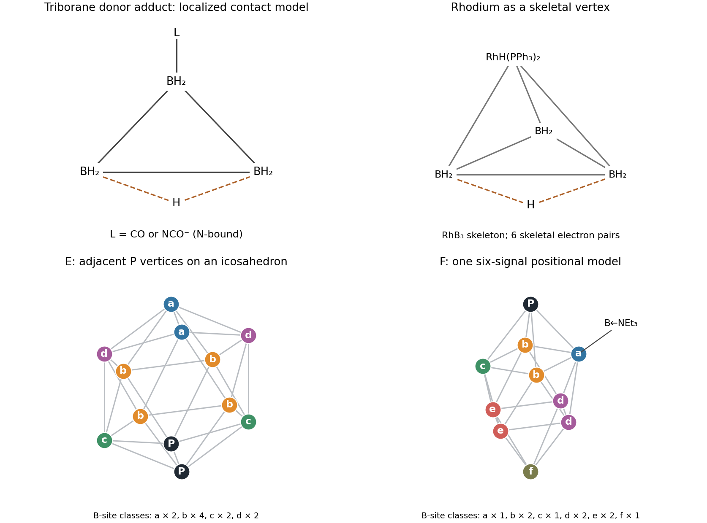

<h1 id="9/c/solution">Solution</h1>

↑ **Parent:** [C](../c.md)

For E, each BH supplies two skeletal [electrons](../../../../../electron.md) and each [phosphorus](../../../../../phosphorus.md) vertex supplies three after retaining a [lone pair](../../../../../lone-pair.md). Hence $10(2)+2(3)=26$ [electrons](../../../../../electron.md), or thirteen pairs, matching a twelve-vertex [closo cluster](../../../../../closo-cluster.md). **Place the two adjacent P vertices on a [regular icosahedron](../../../../../regular-icosahedron.md).** The remaining ten [boron](../../../../../boron.md) vertices fall into four symmetry classes: two sites adjacent to both P vertices, four adjacent to exactly one, two adjacent to neither but opposite the common-neighbour pair, and two opposite the P pair. The populations are **$2:4:2:2$**, so four [boron](../../../../../boron.md) resonances are expected. Interchanging the identical [phosphorus](../../../../../phosphorus.md) vertices is allowed when determining chemical equivalence.

For F, a ten-vertex [bicapped square antiprism](../../../../../bicapped-square-antiprism.md) offers a consistent closo model. There are eight BH vertices, one B vertex bearing the $\mathrm{NEt_3}$ donor instead of H, and one P vertex. Their skeletal contributions are respectively $16$, $3$ and $3$, giving **22 [electrons](../../../../../electron.md), eleven pairs**. The donor-bearing B contribution follows from B plus the donated [lone pair](../../../../../lone-pair.md) minus the exoskeletal B–N bond, $3+2-2=3$.

One explicit arrangement consistent with six [boron](../../../../../boron.md) signals puts P at one axial cap and the $\mathrm{NEt_3}$ substituent on one B vertex of the nearer square. The remaining [mirror plane](../../../../../mirror-plane.md) through that B, the opposite vertex of its square, and the cap axis leaves three B sites individually fixed: the donor-bearing B, its opposite square vertex and the other axial cap. The other six B sites form three exchanged pairs. Thus the nine [borons](../../../../../boron.md) give **three singleton environments and three two-site environments**, six signals in all. The original compound has a crystallographically characterized positional assignment; the spectrum alone asks for a compatible structure and does not establish a unique positional isomer. A [single-crystal X-ray diffraction](../../../../../single-crystal-x-ray-diffraction.md) determination or assigned heteronuclear correlations would distinguish alternatives.[1989, pp.1087–1091, synthesis of diphosphaborane and crystallographic characterization of the amine-containing side product](../../../../../synthesis-of-polyhedral-phosphaboranes-crystal-structure-of-6-c2h5-3n%C2%B72-pb9h8-by-john-l-little-and-others.md)

**[Figure 2](#9/c/image-original-skeletal-models-and-boron-site-equivalence-classes). Original skeletal models and boron-site equivalence classes**.

## ↑ Ancestors (13)

1. [C](../c.md)
2. [9](../../9.md)
3. [Paper 1](../../../paper-1-split.md)
4. [2021](../../../split.md)
5. [Past exam of the chemistry course of the year 3 of the natural sciences course of the University of Cambridge](../../../../split.md)
6. [Chemistry course of the year 3 of the natural sciences course of the University of Cambridge](../../../../../chemistry-course-of-the-year-3-of-the-natural-sciences-course-of-the-university-of-cambridge.md)
7. [Year 3 of the natural sciences course of the University of Cambridge](../../../../../year-3-of-the-natural-sciences-course-of-the-university-of-cambridge.md)
8. [Year of the natural sciences course of the University of Cambridge](../../../../../year-of-the-natural-sciences-course-of-the-university-of-cambridge.md)
9. [Natural sciences course of the University of Cambridge](../../../../../natural-sciences-course-of-the-university-of-cambridge.md)
10. [Course of the University of Cambridge](../../../../../course-of-the-university-of-cambridge.md)
11. [University of Cambridge](../../../../../university-of-cambridge-split.md)
12. [List of universities](../../../../../list-of-universities.md)
13. [Codex Wiki](../../../../../split.md)
