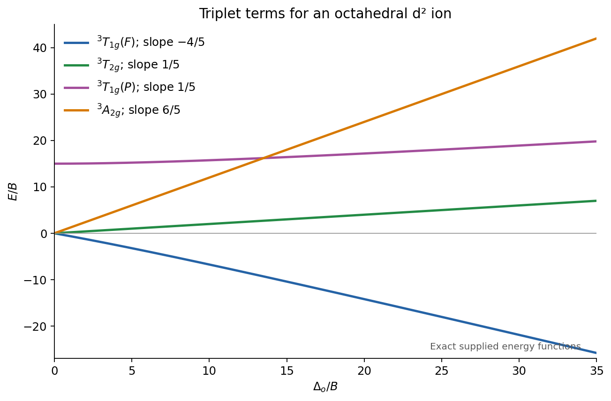
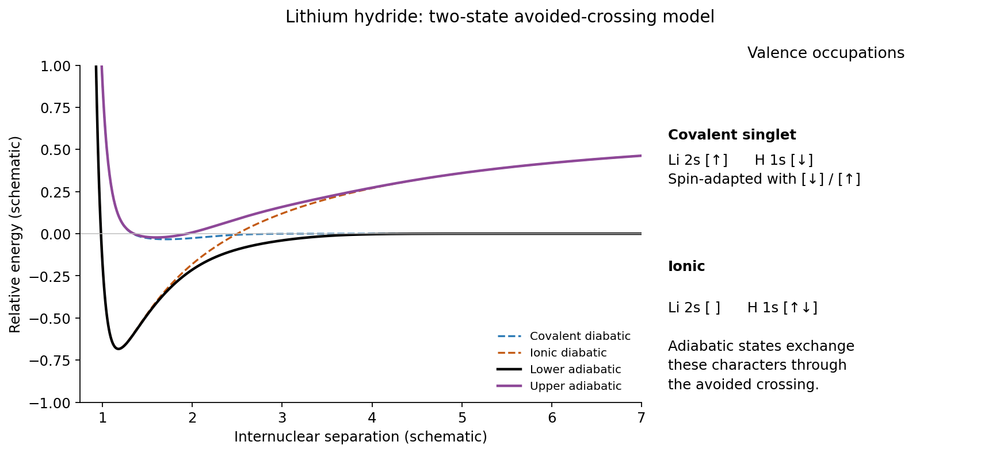
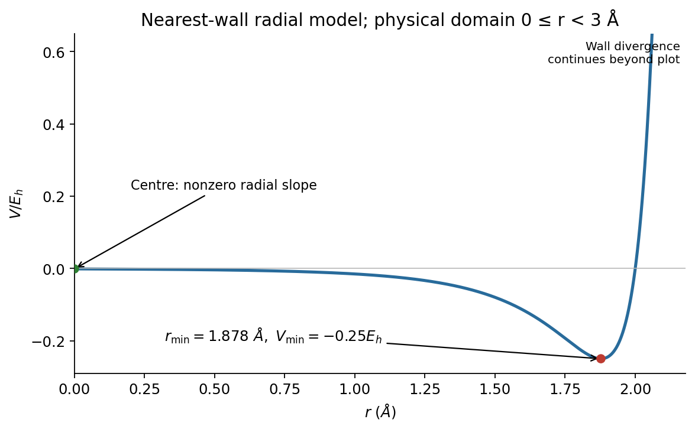
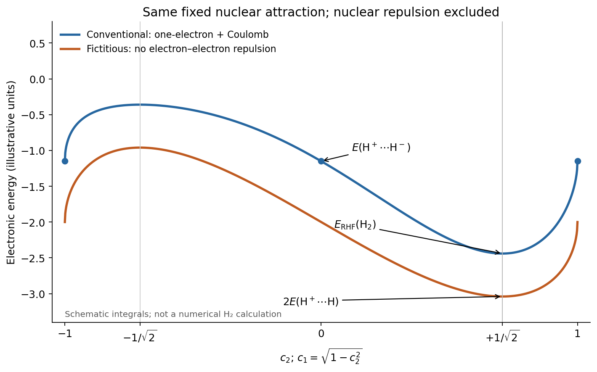
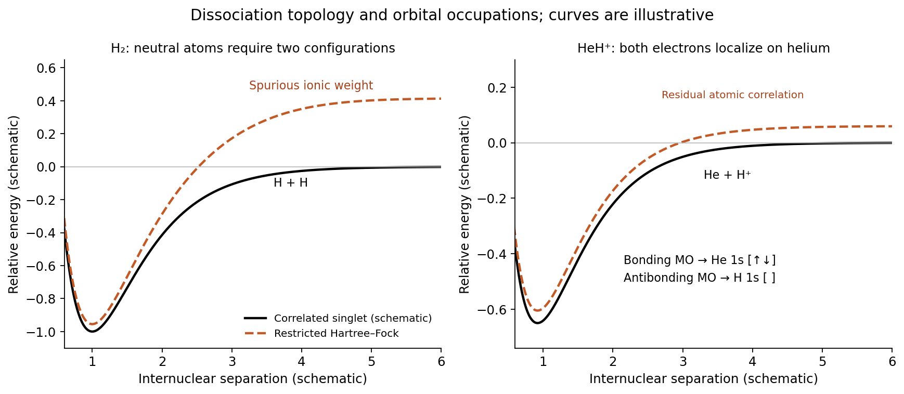

# Paper 2A

↑ **Parent:** [2021](../2021.md)

[Original public PDF, physical pages 421–440](https://www.whatdotheyknow.com/request/past_papers_for_natural_sciences/response/2258285/attach/3/FOI%202023%20126%20James%20materials%20bundle%201.pdf?cookie_passthrough=1#page=421)

The two course covers share one question body. Questions occupy physical pages 424–440 of the public bundle; the printed question numbers run from 13 to 24.

**Table of contents**

- [Section A](#section-a)
  - [13](#section-a/13)
    - [Solution](#section-a/13/solution)
  - [14](#section-a/14)
    - [Solution](#section-a/14/solution)
  - [15](#section-a/15)
    - [a](#section-a/15/a)
      - [Solution](#section-a/15/a/solution)
    - [b](#section-a/15/b)
      - [Solution](#section-a/15/b/solution)
    - [c](#section-a/15/c)
      - [Solution](#section-a/15/c/solution)
  - [16](#section-a/16)
    - [a](#section-a/16/a)
      - [Solution](#section-a/16/a/solution)
    - [b](#section-a/16/b)
      - [Solution](#section-a/16/b/solution)
    - [c](#section-a/16/c)
      - [Solution](#section-a/16/c/solution)
  - [17](#section-a/17)
    - [a](#section-a/17/a)
      - [Solution](#section-a/17/a/solution)
    - [b](#section-a/17/b)
      - [Solution](#section-a/17/b/solution)
  - [18](#section-a/18)
    - [Solution](#section-a/18/solution)
  - [19](#section-a/19)
    - [Solution](#section-a/19/solution)
  - [20](#section-a/20)
    - [Solution](#section-a/20/solution)
- [Section B](#section-b)
  - [21](#section-b/21)
    - [a](#section-b/21/a)
      - [i](#section-b/21/a/i)
        - [Solution](#section-b/21/a/i/solution)
      - [ii](#section-b/21/a/ii)
        - [Solution](#section-b/21/a/ii/solution)
      - [iii](#section-b/21/a/iii)
        - [Solution](#section-b/21/a/iii/solution)
      - [iv](#section-b/21/a/iv)
        - [Solution](#section-b/21/a/iv/solution)
    - [b](#section-b/21/b)
      - [i](#section-b/21/b/i)
        - [Solution](#section-b/21/b/i/solution)
      - [ii](#section-b/21/b/ii)
        - [Solution](#section-b/21/b/ii/solution)
    - [c](#section-b/21/c)
      - [i](#section-b/21/c/i)
        - [Solution](#section-b/21/c/i/solution)
      - [ii](#section-b/21/c/ii)
        - [Solution](#section-b/21/c/ii/solution)
      - [iii](#section-b/21/c/iii)
        - [Solution](#section-b/21/c/iii/solution)
    - [d](#section-b/21/d)
      - [Solution](#section-b/21/d/solution)
  - [22](#section-b/22)
    - [a](#section-b/22/a)
      - [i](#section-b/22/a/i)
        - [Solution](#section-b/22/a/i/solution)
      - [ii](#section-b/22/a/ii)
        - [Solution](#section-b/22/a/ii/solution)
      - [iii](#section-b/22/a/iii)
        - [Solution](#section-b/22/a/iii/solution)
      - [iv](#section-b/22/a/iv)
        - [Solution](#section-b/22/a/iv/solution)
    - [b](#section-b/22/b)
      - [i](#section-b/22/b/i)
        - [Solution](#section-b/22/b/i/solution)
      - [ii](#section-b/22/b/ii)
        - [Solution](#section-b/22/b/ii/solution)
      - [iii](#section-b/22/b/iii)
        - [Solution](#section-b/22/b/iii/solution)
      - [iv](#section-b/22/b/iv)
        - [Solution](#section-b/22/b/iv/solution)
      - [v](#section-b/22/b/v)
        - [Solution](#section-b/22/b/v/solution)
    - [c](#section-b/22/c)
      - [Solution](#section-b/22/c/solution)
  - [23](#section-b/23)
    - [a](#section-b/23/a)
      - [Solution](#section-b/23/a/solution)
    - [b](#section-b/23/b)
      - [i](#section-b/23/b/i)
        - [Solution](#section-b/23/b/i/solution)
      - [ii](#section-b/23/b/ii)
        - [Solution](#section-b/23/b/ii/solution)
    - [c](#section-b/23/c)
      - [i](#section-b/23/c/i)
        - [Solution](#section-b/23/c/i/solution)
      - [ii](#section-b/23/c/ii)
        - [Solution](#section-b/23/c/ii/solution)
      - [iii](#section-b/23/c/iii)
        - [Solution](#section-b/23/c/iii/solution)
  - [24](#section-b/24)
    - [a](#section-b/24/a)
      - [i](#section-b/24/a/i)
        - [Solution](#section-b/24/a/i/solution)
      - [ii](#section-b/24/a/ii)
        - [Solution](#section-b/24/a/ii/solution)
    - [b](#section-b/24/b)
      - [i](#section-b/24/b/i)
        - [Solution](#section-b/24/b/i/solution)
      - [ii](#section-b/24/b/ii)
        - [Solution](#section-b/24/b/ii/solution)
      - [iii](#section-b/24/b/iii)
        - [A](#section-b/24/b/iii/a)
          - [Solution](#section-b/24/b/iii/a/solution)
        - [B](#section-b/24/b/iii/b)
          - [Solution](#section-b/24/b/iii/b/solution)
    - [c](#section-b/24/c)
      - [i](#section-b/24/c/i)
        - [Solution](#section-b/24/c/i/solution)
      - [ii](#section-b/24/c/ii)
        - [Solution](#section-b/24/c/ii/solution)

## Section A

↑ **Parent:** [Paper 2A](paper-2a.md)

<h3 id="section-a/13">13</h3>

↑ **Parent:** [Section A](#section-a)

<h4 id="section-a/13/solution">Solution</h4>

↑ **Parent:** [13](#section-a/13)

**Natural broadening is about $8\times10^2$ times narrower than the thermal Doppler width and is negligible for this comparison.** The supplied [Doppler broadening](../../quantum-ideal-gas-statistics.md#doppler-broadening) formula is a half width at half maximum. Using the integer molecular mass $m=28m_{\rm u}$,

$$
\nu_0=\frac c\lambda=6.97\times10^{14}\ \mathrm{Hz},\qquad
\Delta\nu_{\rm D,HWHM}=\frac1\lambda\sqrt{\frac{2k_BT\ln2}{m}}=1.06\times10^9\ \mathrm{Hz}.
$$

For an excited-state population lifetime $\tau$, the radiating amplitude decays as $e^{-t/(2\tau)}$. Its [Lorentzian line shape](../../stellar-astrophysics.md#lorentzian-line-shape) has [natural linewidth](../../atomic-physics.md#natural-linewidth)

$$
\Delta\nu_{\rm nat,HWHM}=\frac{1}{4\pi\tau}=1.33\times10^6\ \mathrm{Hz}.
$$

Equivalently, compare full widths $2.11\ \mathrm{GHz}$ and $2.65\ \mathrm{MHz}$. Using the same linewidth convention in both expressions matters more than the small isotope-mass correction. This estimate assumes that the lower state's lifetime is long and leaves any [pressure broadening](../../stellar-astrophysics.md#pressure-broadening) as a separate contribution.

<h3 id="section-a/14">14</h3>

↑ **Parent:** [Section A](#section-a)

<h4 id="section-a/14/solution">Solution</h4>

↑ **Parent:** [14](#section-a/14)

**The Stokes vibrational band has O, Q and S branches**, with $\Delta N=-2,0,+2$, respectively. Here $N$ denotes end-over-end [rotational angular momentum](../../molecule.md#rotational-angular-momentum); treating electronic fine structure as unresolved gives the usual elementary rotor calculation. The absolute incident [wavenumber](../../wave-equation.md#wavenumber) is

$$
\widetilde\nu_L=\frac{10^7}{1064}=9398.496\ \mathrm{cm}^{-1},
$$

and energy conservation for [Stokes Raman scattering](../../optics.md#stokes-raman-scattering) gives

$$
\widetilde\nu_s=\widetilde\nu_L-1580-B\{N'(N'+1)-N(N+1)\}.
$$

For the actual $^{16}\mathrm O_2$ ground state, only odd $N$ have nonzero nuclear-spin statistical weight. Thus the lowest initial levels are $N=3$ for O and $N=1$ for Q and S. Ignoring the small change in $B$ upon vibration, the lines are:

| Branch | Lowest transition | Rotational energy gained, in $B$ | Absolute scattered wavenumber, $\mathrm{cm}^{-1}$ | O | $3\to1$ | $-10B$ | **7832.5** | Q | $1\to1$ | $0$ | **7818.5** | S | $1\to3$ | $10B$ | **7804.5** |
| --- | --- | --- | --- | --- | --- | --- | --- | --- | --- | --- | --- | --- | --- | --- | --- |

The odd-$N$ restriction follows from the zero nuclear spin and exchange symmetry of $^{16}\mathrm O_2$; the electronic spin splits each such $N$ into several $J$ levels without changing this simplified branch-centre calculation.[Section 3, manuscript page 4: only odd lower-state N has nonzero statistical weight for oxygen-16 and oxygen-18](../../chemistry-bibliography.md#o2-a-band-line-parameters-to-support-atmospheric-remote-sensing-part-ii-by-david-a-long-and-others)

If the phrase simplest approximation is instead taken to discard nuclear-spin statistics as well, a fictitious unrestricted rotor gives O $2\to0$ at $7826.9\ \mathrm{cm}^{-1}$ and S $0\to2$ at $7810.1\ \mathrm{cm}^{-1}$, with Q still at $7818.5\ \mathrm{cm}^{-1}$. Those even-$N$ lines are not physical ground-state $^{16}\mathrm O_2$ lines.

<h3 id="section-a/15">15</h3>

↑ **Parent:** [Section A](#section-a)

<h4 id="section-a/15/a">a</h4>

↑ **Parent:** [15](#section-a/15)

<h5 id="section-a/15/a/solution">Solution</h5>

↑ **Parent:** [A](#section-a/15/a)

**The terms are $^3\Sigma_g^-$, $^1\Delta_g$ and $^1\Sigma_g^+$.** Closed [molecular orbital](../../chemistry.md#molecular-orbital) shells contribute no net [spin angular momentum](../../angular-momentum-operator.md#spin) or axial orbital projection, so only the two equivalent $\pi_g$ electrons need be coupled. Their individual projections are $\lambda=\pm1$.

Putting both electrons in the same projection gives $|\Lambda|=2$ and forces opposite spins by the [Pauli exclusion principle](../../tensor-product-of-quantum-systems.md#pauli-exclusion-principle), yielding $^1\Delta_g$. With one electron in each projection, the spin-adapted symmetric and antisymmetric spatial combinations give a singlet $\Sigma$ and a triplet $\Sigma$. Their reflection parities are $+$ and $-$, respectively. Both open-shell electrons are gerade, so their product is gerade. The dimensions $3+2+1=6$ exhaust the $\binom42=6$ microstates. By [Hund's rules](../../chemistry.md#hund-s-rules), the triplet is the lowest term, and $^1\Delta_g$ is the lower singlet.

<h4 id="section-a/15/b">b</h4>

↑ **Parent:** [15](#section-a/15)

<h5 id="section-a/15/b/solution">Solution</h5>

↑ **Parent:** [B](#section-a/15/b)

**The terms are $^1\Sigma_u^+$, $^1\Sigma_u^-$, $^1\Delta_u$, $^3\Sigma_u^+$, $^3\Sigma_u^-$ and $^3\Delta_u$.** The active configuration is $\pi_u^3\pi_g^3$. Each nearly filled $\pi$ shell has the angular-momentum possibilities of one hole, so coupling two distinguishable hole sets gives $\Lambda=0$ or $|\Lambda|=2$ with $S=0$ or $1$.

For $\Lambda=0$, the two arrangements of opposite projections combine with either reflection parity, hence both $\Sigma^+$ and $\Sigma^-$. Unlike the equivalent-electron case in part (a), neither spatial combination is excluded for either spin: the holes belong to different orbital shells. The inversion parity is $u^3g^3=u$. Counting degeneracies gives $1+1+2+3+3+6=16$, equal to the $4\times4$ choices of the two holes.

<h4 id="section-a/15/c">c</h4>

↑ **Parent:** [15](#section-a/15)

<h5 id="section-a/15/c/solution">Solution</h5>

↑ **Parent:** [C](#section-a/15/c)

**Only $^1\Delta_g\to{}^1\Delta_u$ is electric-dipole allowed within the listed terms.** For a [diatomic molecule](../../molecule.md#diatomic-molecule), the [electric-dipole selection rule](../../quantum-mechanics.md#electric-dipole-selection-rule) requires $\Delta S=0$, $g\leftrightarrow u$, and $\Delta\Lambda=0,\pm1$. The lower singlet of part (a) is $^1\Delta_g$. Every candidate from the same configuration fails the inversion rule, while the $^1\Sigma_u^{\pm}$ terms of part (b) require $|\Delta\Lambda|=2$. Triplet destinations fail the spin rule. The surviving $\Delta\to\Delta$ transition uses the axial dipole component, so it is a parallel electronic transition. Weak spin-orbit or other intensity-borrowing transitions are outside this leading electric-dipole classification.

<h3 id="section-a/16">16</h3>

↑ **Parent:** [Section A](#section-a)

<h4 id="section-a/16/a">a</h4>

↑ **Parent:** [16](#section-a/16)

<h5 id="section-a/16/a/solution">Solution</h5>

↑ **Parent:** [A](#section-a/16/a)

For positive $\Delta_o\gg B$, expand the common radical as

$$
\sqrt{\Delta_o^2+18B\Delta_o+225B^2}
=\Delta_o+9B+\frac{72B^2}{\Delta_o}+O\!\left(\frac{B^3}{\Delta_o^2}\right).
$$

Substitution into the stated [crystal field theory](../../chemistry.md#crystal-field-theory) energies gives

$$
\boxed{\begin{aligned}
E_0&=-\frac45\Delta_o+3B-\frac{36B^2}{\Delta_o}+\cdots,\\
E_1&=\frac15\Delta_o,\\
E_2&=\frac15\Delta_o+12B+\frac{36B^2}{\Delta_o}+\cdots,\\
E_3&=\frac65\Delta_o.
\end{aligned}}
$$

The leading straight-line asymptotes retain the terms linear in $\Delta_o$ and constant in $B$. The $B^2/\Delta_o$ terms show from which side the interacting $T_{1g}$ levels approach them.

<h4 id="section-a/16/b">b</h4>

↑ **Parent:** [16](#section-a/16)

<h5 id="section-a/16/b/solution">Solution</h5>

↑ **Parent:** [B](#section-a/16/b)

For $B\gg\Delta_o$, the corresponding [asymptotic expansion](../../asymptotic-expansion.md) is

$$
\sqrt{225B^2+18B\Delta_o+\Delta_o^2}
=15B+\frac35\Delta_o+\frac{8\Delta_o^2}{375B}+\cdots.
$$

Hence

$$
\boxed{\begin{aligned}
E_0&=-\frac35\Delta_o-\frac{4\Delta_o^2}{375B}+\cdots,\\
E_1&=\frac15\Delta_o,\\
E_2&=15B+\frac{4\Delta_o^2}{375B}+\cdots,\\
E_3&=\frac65\Delta_o.
\end{aligned}}
$$

At zero field, $E_0,E_1,E_3$ converge to the $^3F$ atomic term and $E_2$ to $^3P$ at $15B$. The $^3T_{1g}(P)$ branch therefore has zero initial slope; its high-field slope is not zero.

<h4 id="section-a/16/c">c</h4>

↑ **Parent:** [16](#section-a/16)

<h5 id="section-a/16/c/solution">Solution</h5>

↑ **Parent:** [C](#section-a/16/c)

**The descending line is $^3T_{1g}(F)$; the low rising line is $^3T_{2g}$; the steep line is $^3A_{2g}$; and the branch starting at $15B$ is $^3T_{1g}(P)$.** Their high-field slopes, in the same order, are

$$
\boxed{-\frac45,\quad\frac15,\quad\frac65,\quad\frac15.}
$$

These are slopes of the supplied absolute term energies relative to their chosen reference, not slopes of transition energies measured upward from the ground state. The two $T_{1g}$ states share a [symmetry](../../physics.md#symmetry-physics) and mix, whereas the crossing of $A_{2g}$ and the upper $T_{1g}$ branch is allowed because they have different [irreducible representations](../../representation-theory.md#irreducible-representation).

**[Figure 1](#section-a/16/c/image-triplet-crystal-field-energies-and-their-strong-field-slopes). Triplet crystal-field energies and their strong-field slopes**.

<h3 id="section-a/17">17</h3>

↑ **Parent:** [Section A](#section-a)

<h4 id="section-a/17/a">a</h4>

↑ **Parent:** [17](#section-a/17)

<h5 id="section-a/17/a/solution">Solution</h5>

↑ **Parent:** [A](#section-a/17/a)

**$\beta=-2.4\ \mathrm{eV}$ and $\alpha=-6.8\ \mathrm{eV}$.** The [Hückel method](../../chemistry.md#huckel-method) gives benzene's occupied frontier level as $\epsilon_H=\alpha+\beta$ and its unoccupied frontier level as $\epsilon_L=\alpha-\beta$. Therefore

$$
4.8=\epsilon_L-\epsilon_H=-2\beta.
$$

Using the [Koopmans' theorem](../../chemistry.md#koopmans-theorem) approximation for the [ionization energy](../../mathematical-physics.md#ionization-energy), $I\simeq-\epsilon_H=9.2$, gives $\alpha+\beta=-9.2$ and the stated parameters. This calibration neglects orbital relaxation, electron correlation and any distinction between a measured optical excitation and an independent-particle orbital gap.

<h4 id="section-a/17/b">b</h4>

↑ **Parent:** [17](#section-a/17)

<h5 id="section-a/17/b/solution">Solution</h5>

↑ **Parent:** [B](#section-a/17/b)

**The model predicts $I\simeq8.28\ \mathrm{eV}$.** For a uniform ten-site cyclic [Hückel method](../../chemistry.md#huckel-method) model,

$$
\epsilon_j=\alpha+2\beta\cos\!\left(\frac{2\pi j}{10}\right).
$$

Ten [pi electrons](../../chemical-bond.md#pi-electron) fill $j=0,\pm1,\pm2$ with two electrons per orbital. The [Homo](../../organism.md#homo) is the degenerate $j=\pm2$ pair, so

$$
I\simeq-\epsilon_H=-\alpha-2\beta\cos(72^\circ)
=6.8+4.8(0.309017)=\boxed{8.283\ \mathrm{eV}}.
$$

This is the prediction for the stipulated planar conjugated ring. It does not assert that an unconstrained all-cis ten-membered ring actually adopts a strain-free planar geometry.

<h3 id="section-a/18">18</h3>

↑ **Parent:** [Section A](#section-a)

<h4 id="section-a/18/solution">Solution</h4>

↑ **Parent:** [18](#section-a/18)

**The ionic and covalent diabatic curves cross; coupling replaces the crossing by an avoided crossing of the adiabatic curves.** Take the separated neutral atoms as the zero of valence [energy](../../energy.md). A covalent [diabatic state](../../quantum-mechanics.md#diabatic-state) has one electron in a lithium-centred $2s$ orbital and one in a hydrogen-centred $1s$ orbital, coupled to an overall singlet. An ionic [diabatic state](../../quantum-mechanics.md#diabatic-state) has an empty lithium valence orbital and a doubly occupied hydrogen $1s$ orbital.

At large internuclear separation $R$, the ionic limit lies above the neutral one by $I(\mathrm{Li})-A(\mathrm H)$. At smaller $R$, its attractive Coulomb term $-e^2/(4\pi\epsilon_0R)$ lowers it; short-range repulsion eventually raises both curves. A two-state [Hamiltonian](../../hamiltonian-mechanics.md#hamiltonian) gives

$$
E_\pm(R)=\frac{E_{\rm cov}+E_{\rm ion}}2
\pm\sqrt{\left(\frac{E_{\rm cov}-E_{\rm ion}}2\right)^2+|W(R)|^2}.
$$

Where the diabatic energies would coincide, nonzero coupling $W$ opens a gap $2|W|$. The lower [adiabatic state](../../quantum-mechanics.md#adiabatic-state) changes continuously from predominantly ionic character near the bond minimum to predominantly neutral covalent character at dissociation. The upper state exchanges character in the opposite direction. Near the crossing both are mixtures, so a sketch assigning a fixed charge pattern to an entire adiabatic curve would miss the important physics.

**[Figure 2](#section-a/18/image-ionic-and-covalent-diabatic-states-of-lithium-hydride-and-their-avoided-crossing). Ionic and covalent diabatic states of lithium hydride and their avoided crossing**.

<h3 id="section-a/19">19</h3>

↑ **Parent:** [Section A](#section-a)

<h4 id="section-a/19/solution">Solution</h4>

↑ **Parent:** [19](#section-a/19)

**Each site has a pi-electron population $4/3$, and each adjacent pi bond order is $2/3$.** The two carbon sites supply one [pi electron](../../chemical-bond.md#pi-electron) each and the nitrogen lone pair supplies two, giving four electrons in two occupied [molecular orbitals](../../chemistry.md#molecular-orbital). Orthogonality to the given [Homo](../../organism.md#homo) and [LUMO](../../chemistry.md#lowest-unoccupied-molecular-orbital) fixes the remaining occupied normalized orbital, up to overall sign, as

$$
\psi_1=\frac1{\sqrt6}(\phi_1+2\phi_2+\phi_3).
$$

For doubly occupied orbitals, the [Hückel orbital charge density](../../chemistry.md#huckel-orbital-charge-density) and [Hückel pi bond order](../../chemistry.md#huckel-pi-bond-order) follow from

$$
P_{ij}=2\sum_{a\in\mathrm{occupied}}c_{ia}c_{ja},\qquad
P=\begin{pmatrix}
4/3&2/3&-2/3\\
2/3&4/3&2/3\\
-2/3&2/3&4/3
\end{pmatrix}.
$$

The diagonal sums to four electrons. The negative $P_{13}$ is an off-diagonal density-matrix element between nonadjacent sites, not an additional directly connected chemical bond.

Relative to neutral pi contributions $(1,2,1)$, the pi-system charges are $(-e/3,+2e/3,-e/3)$: electron density has moved from nitrogen toward the two carbon sites. Thus the physical [electric dipole moment](../../electrostatics.md#electric-dipole-moment) vector points **from the midpoint of the carbon pair toward nitrogen** along the molecular symmetry bisector. The conventional chemical dipole arrow, with a crossed positive tail, points oppositely: from nitrogen toward the carbon pair. This is only the pi contribution, not a prediction of the full sigma-plus-pi molecular dipole.

<h3 id="section-a/20">20</h3>

↑ **Parent:** [Section A](#section-a)

<h4 id="section-a/20/solution">Solution</h4>

↑ **Parent:** [20](#section-a/20)

**The minimum is at $r=1.878\ \mathring{\mathrm A}$ with depth $-0.250\ E_h$; the model is not a smooth physical potential at the cage centre.** Put $s=R-r$ and $x=(B/s)^6$. Then

$$
V=A(x^2-x)=A\left[(x-\tfrac12)^2-\tfrac14\right],
$$

so $x=1/2$ is the minimum. Therefore

$$
\boxed{r_{\min}=R-2^{1/6}B=1.87754\ \mathring{\mathrm A},\qquad V_{\min}=-A/4=-0.25\ E_h,}
$$

while

$$
\boxed{V(0)=A(3^{-12}-3^{-6})=-1.36986\times10^{-3}\ E_h.}
$$

The positive inverse-twelfth-power term mimics short-range overlap repulsion, while the negative inverse-sixth-power term mimics [London dispersion force](../../force.md#london-dispersion-force). These powers are used in the [Lennard-Jones potential](../../energy.md#lennard-jones-potential); they are not a microscopic derivation for an atom inside a carbon cage.

The relevant domain is $0\le r<R$. As the atom approaches the wall the model diverges positively, which is qualitatively sensible. However, the energy depends only on the nearest radial wall distance and omits all the other cage atoms. More decisively, $V'(0)\ne0$: a radial function of the Cartesian position must have zero first radial derivative at the centre to be differentiable there. The model produces a cusp and a nonvanishing directional force as the centre is approached. An off-centre minimum is not by itself forbidden, but this centre behaviour is inconsistent with a smooth symmetric cage potential.

**[Figure 3](#section-a/20/image-radial-cage-model-with-its-off-centre-minimum-and-wall-repulsion). Radial cage model with its off-centre minimum and wall repulsion**.

## Section B

↑ **Parent:** [Paper 2A](paper-2a.md)

<h3 id="section-b/21">21</h3>

↑ **Parent:** [Section B](#section-b)

<h4 id="section-b/21/a">a</h4>

↑ **Parent:** [21](#section-b/21)

<h5 id="section-b/21/a/i">i</h5>

↑ **Parent:** [A](#section-b/21/a)

<h6 id="section-b/21/a/i/solution">Solution</h6>

↑ **Parent:** [I](#section-b/21/a/i)

**The nine normal coordinates transform as $A_{1g}+B_{1g}+B_{2g}+A_{2u}+B_{2u}+2E_u$.** Place the molecule in the $xy$ plane, with its four outer atoms on the $x$ and $y$ axes, as specified for the vertical reflection planes. In the class order

$$
E,\ 2C_4,\ C_2,\ 2C'_2,\ 2C''_2,\ i,\ 2S_4,\ \sigma_h,\ 2\sigma_v,\ 2\sigma_d,
$$

the fifteen Cartesian displacements have [characters of a representation](../../representation-theory.md#character-of-a-representation)

$$
\chi_{3N}=(15,1,-1,-3,-1,-3,-1,5,3,1).
$$

For each operation this character is the number of fixed atoms times the trace of its polar-vector matrix. Subtract [translations](../../geometry-and-topology.md#translation-geometry) $A_{2u}+E_u$ and [rotations](../../riemannian-geometry.md#rotation-mathematics) $A_{2g}+E_g$, giving

$$
\chi_{\rm vib}=(9,-1,1,-1,1,-3,-1,5,3,1).
$$

[Molecular character reduction](../../euclidean-geometry.md#molecular-character-reduction) in the [D4h molecular point group](../../euclidean-geometry.md#d4h-molecular-point-group) yields the stated decomposition. Its dimensions sum to $1+1+1+1+1+2(2)=9=3(5)-6$, providing an independent degree-of-freedom check.

<h5 id="section-b/21/a/ii">ii</h5>

↑ **Parent:** [A](#section-b/21/a)

<h6 id="section-b/21/a/ii/solution">Solution</h6>

↑ **Parent:** [Ii](#section-b/21/a/ii)

An [infrared](../../optics.md#infrared) fundamental must transform like a component of the [electric dipole moment](../../electrostatics.md#electric-dipole-moment); a [Raman spectroscopy](../../optics.md#raman-spectroscopy) fundamental must transform like a component of the symmetric [polarizability](../../electrostatics.md#electric-polarizability) tensor. For this centrosymmetric [D4h molecular point group](../../euclidean-geometry.md#d4h-molecular-point-group), the resulting classification is:

| Symmetry | Number of modes of this symmetry | Infrared | Raman | $A_{1g}$ | 1 | No | Yes: $x^2+y^2,z^2$ | $B_{1g}$ | 1 | No | Yes: $x^2-y^2$ | $B_{2g}$ | 1 | No | Yes: $xy$ | $A_{2u}$ | 1 | **Parallel**, $z$ | No | $B_{2u}$ | 1 | No | No | $E_u$ | 2, each doubly degenerate | **Perpendicular**, $(x,y)$ | No |
| --- | --- | --- | --- | --- | --- | --- | --- | --- | --- | --- | --- | --- | --- | --- | --- | --- | --- | --- | --- | --- | --- | --- | --- | --- | --- | --- | --- |

Here parallel and perpendicular refer to the principal fourfold axis. The table obeys [infrared and Raman mutual exclusion](../../euclidean-geometry.md#infrared-and-raman-mutual-exclusion).

<h5 id="section-b/21/a/iii">iii</h5>

↑ **Parent:** [A](#section-b/21/a)

<h6 id="section-b/21/a/iii/solution">Solution</h6>

↑ **Parent:** [Iii](#section-b/21/a/iii)

**Three separated infrared fundamentals:** one parallel $A_{2u}$ band and two perpendicular $E_u$ bands. Each $E_u$ frequency belongs to a doubly degenerate mode, but degeneracy does not create two distinct band origins.

<h5 id="section-b/21/a/iv">iv</h5>

↑ **Parent:** [A](#section-b/21/a)

<h6 id="section-b/21/a/iv/solution">Solution</h6>

↑ **Parent:** [Iv](#section-b/21/a/iv)

The square-planar rotor is an [oblate symmetric top](../../rigid-body-dynamics.md#oblate-symmetric-top). A parallel band has $\Delta K=0$ and $\Delta J=0,\pm1$, producing P and R progressions with approximate spacing $2\widetilde B$ and a central Q contribution from $K\ne0$; the $K=0$ parallel Q branch is absent. At modest resolution many nearly coincident $K$ components merge.

A perpendicular band has $\Delta K=\pm1$ and $\Delta J=0,\pm1$. Its Q subbranches produce a characteristic series of sharper features on the broader unresolved P/R envelope. Neglecting changes of rotational constants on vibration, successive perpendicular Q features are separated by approximately $2|\widetilde B-\widetilde C|$. These are rotational contours rather than extra normal-mode fundamentals.

<h4 id="section-b/21/b">b</h4>

↑ **Parent:** [21](#section-b/21)

<h5 id="section-b/21/b/i">i</h5>

↑ **Parent:** [B](#section-b/21/b)

<h6 id="section-b/21/b/i/solution">Solution</h6>

↑ **Parent:** [I](#section-b/21/b/i)

**All the listed modes are Raman active; only $A_1$ and $E$ are infrared active.** For the [C4v molecular point group](../../euclidean-geometry.md#c4v-molecular-point-group), with vertical planes through the outer atoms:

| Symmetry | Number of modes of this symmetry | Infrared | Raman | $A_1$ | 2 | **Parallel**, $z$ | Yes: $x^2+y^2,z^2$ | $B_1$ | 2 | No | Yes: $x^2-y^2$ | $B_2$ | 1 | No | Yes: $xy$ | $E$ | 2, each doubly degenerate | **Perpendicular**, $(x,y)$ | Yes: $(xz,yz)$ |
| --- | --- | --- | --- | --- | --- | --- | --- | --- | --- | --- | --- | --- | --- | --- | --- | --- | --- | --- | --- |

There is no inversion centre, so [infrared and Raman mutual exclusion](../../euclidean-geometry.md#infrared-and-raman-mutual-exclusion) does not apply.

<h5 id="section-b/21/b/ii">ii</h5>

↑ **Parent:** [B](#section-b/21/b)

<h6 id="section-b/21/b/ii/solution">Solution</h6>

↑ **Parent:** [Ii](#section-b/21/b/ii)

**In the stipulated ideal, fully resolved limit, yes:** square-planar geometry gives three infrared fundamentals, whereas square-pyramidal geometry gives four: two parallel $A_1$ bands and two perpendicular $E$ bands. The extra parallel fundamental is the distinguishing feature. In a real incomplete spectrum, a weak band, overlap or accidental degeneracy could hide that difference, so absence of a fourth observed band would not alone prove planarity.

<h4 id="section-b/21/c">c</h4>

↑ **Parent:** [21](#section-b/21)

<h5 id="section-b/21/c/i">i</h5>

↑ **Parent:** [C](#section-b/21/c)

<h6 id="section-b/21/c/i/solution">Solution</h6>

↑ **Parent:** [I](#section-b/21/c/i)

**$I_{C_4}\simeq2.43\times10^{-45}\ \mathrm{kg\,m^2}=146.6\,m_{\rm u}\mathring{\mathrm A}^{,2}$.** The parallel-band progression gives $2\widetilde B=0.42\ \mathrm{cm}^{-1}$, so $\widetilde B=0.210\ \mathrm{cm}^{-1}$. The perpendicular Q-feature spacing gives

$$
2|\widetilde B-\widetilde C|=0.19\ \mathrm{cm}^{-1}.
$$

For an [oblate symmetric top](../../rigid-body-dynamics.md#oblate-symmetric-top), $I_{C_4}>I_\perp$, hence $\widetilde C<\widetilde B$ and $\widetilde C=0.115\ \mathrm{cm}^{-1}$. The [rotational constant](../../molecule.md#rotational-constant) relation then gives

$$
I_{C_4}=\frac{h}{8\pi^2c\widetilde C}
=\frac{h}{8\pi^2(2.9979\times10^{10}\ \mathrm{cm\,s^{-1}})(0.115\ \mathrm{cm}^{-1})}.
$$

The estimated constants neglect centrifugal distortion and the change of rotational constants in the excited vibration.

<h5 id="section-b/21/c/ii">ii</h5>

↑ **Parent:** [C](#section-b/21/c)

<h6 id="section-b/21/c/ii/solution">Solution</h6>

↑ **Parent:** [Ii](#section-b/21/c/ii)

**$I_{C_4}=4m_B R^2(1-\cos\theta)$; the central atom makes no contribution.** Let $\rho$ be the radius of the square of outer atoms and $h_A$ the central atom's height above its plane. Then $R^2=\rho^2+h_A^2$. Adjacent bond vectors have perpendicular in-plane components, so

$$
\cos\theta=\frac{h_A^2}{R^2},\qquad \rho^2=R^2(1-\cos\theta).
$$

The [centre of mass](../../classical-mechanics.md#center-of-mass) lies on the fourfold axis, even when $m_A\ne m_B$. Thus the central atom and the shift of origin along the axis contribute no perpendicular lever arm. The four outer atoms each contribute $m_B\rho^2$, giving

$$
\boxed{I_{C_4}=m_A(0)^2+4m_B\rho^2=4m_BR^2(1-\cos\theta).}
$$

The result concerns the smallest adjacent bond angle; the angle between opposite outer atoms is a different angle in a pyramid.

<h5 id="section-b/21/c/iii">iii</h5>

↑ **Parent:** [C](#section-b/21/c)

<h6 id="section-b/21/c/iii/solution">Solution</h6>

↑ **Parent:** [Iii](#section-b/21/c/iii)

With integer fluorine mass $m_B=19m_{\rm u}$ and $R=1.5\ \mathring{\mathrm A}$,

$$
\cos\theta=1-\frac{146.588}{4(19)(1.5)^2}=0.14276,
\qquad\boxed{\theta\simeq81.8^\circ.}
$$

This angle is below the planar limit $90^\circ$, consistent with the proposed pyramid. The sulfur mass does not enter this axial [moment of inertia](../../rigid-body-dynamics.md#moment-of-inertia).

<h4 id="section-b/21/d">d</h4>

↑ **Parent:** [21](#section-b/21)

<h5 id="section-b/21/d/solution">Solution</h5>

↑ **Parent:** [D](#section-b/21/d)

**The inferred dipole moment is approximately $0.626\ \mathrm D$.** With the static field parallel to the radiation electric field, the microwave selection rule is $\Delta M_J=0$. A fully resolved three-component first-order [rotational Stark effect](../../mathematical-physics.md#rotational-stark-effect) pattern naturally identifies the $J=1\to2$, $|K|=1$ transition: the three initial $M_J=-1,0,1$ values give the three components. $K=0$ would have no first-order shift.

Subtract the lower-state field shift from the upper-state field shift, rather than equating a transition shift to one level's shift:

$$
\delta\nu=\frac{\mu E_{\rm field}KM_J}{h}
\left[\frac1{J(J+1)}-\frac1{(J+1)(J+2)}\right].
$$

For $J=1$ and $|K|=1$, neighbouring components are separated by $\mu E_{\rm field}/(3h)$. Hence

$$
\boxed{\mu=\frac{3h(21\times10^6\ \mathrm{s}^{-1})}{2.0\times10^4\ \mathrm{V\,m}^{-1}}
=2.09\times10^{-30}\ \mathrm{C\,m}=0.626\ \mathrm D.}
$$

This assignment assumes the stated splitting resolves all allowed first-order components, rather than three accidentally unresolved groups of a higher-$J$ transition.

<h3 id="section-b/22">22</h3>

↑ **Parent:** [Section B](#section-b)

<h4 id="section-b/22/a">a</h4>

↑ **Parent:** [22](#section-b/22)

<h5 id="section-b/22/a/i">i</h5>

↑ **Parent:** [A](#section-b/22/a)

<h6 id="section-b/22/a/i/solution">Solution</h6>

↑ **Parent:** [I](#section-b/22/a/i)

For the [absorption spectrum](../../physics.md#absorption-spectrum), pass a scanned monochromatic beam through the solution and a matched solvent reference. Record the incident and transmitted intensities and calculate the [absorbance](../../physical-chemistry.md#absorbance) $A(\lambda)=\log_{10}[I_0(\lambda)/I(\lambda)]$, using an appropriate blank and concentration to avoid saturation.

For the [fluorescence emission spectrum](../../fluorescence.md#fluorescence-emission-spectrum), excite at a fixed wavelength within an absorption band, collect emission away from the incident beam, commonly at $90^\circ$, and scan an emission monochromator. Correct the detected signal for wavelength-dependent detector sensitivity, subtract solvent/background light and exclude scattered excitation light. The two plotted vertical scales have been independently normalized; their equal peak heights do not imply equal absorption and emission rates or unit [fluorescence quantum yield](../../fluorescence.md#fluorescence-quantum-yield).

<h5 id="section-b/22/a/ii">ii</h5>

↑ **Parent:** [A](#section-b/22/a)

<h6 id="section-b/22/a/ii/solution">Solution</h6>

↑ **Parent:** [Ii](#section-b/22/a/ii)

**Vibrational and solvent relaxation remove energy before emission, producing a Stokes shift.** [Absorption](../../radiometry.md#absorption-electromagnetic-radiation) initially excites a vertical transition from the populated ground-state vibrational levels to excited-state vibrational levels. [Vibrational relaxation](../../molecule.md#vibrational-relaxation) and solvent rearrangement then bring the molecule near the relaxed lowest excited singlet level before [fluorescence](../../fluorescence.md). Emission ends in vibrationally excited levels of the electronic ground state, so the emitted photon generally has less energy and a longer wavelength. This explanation does not require a change of electronic multiplicity.

<h5 id="section-b/22/a/iii">iii</h5>

↑ **Parent:** [A](#section-b/22/a)

<h6 id="section-b/22/a/iii/solution">Solution</h6>

↑ **Parent:** [Iii](#section-b/22/a/iii)

The approximate mirror relationship follows from the [Franck-Condon principle](../../atomic-physics.md#franck-condon-principle) when the ground and excited electronic states have similar vibrational frequencies and comparable potential shapes displaced along the active coordinates. Absorption samples $S_0,v\simeq0\to S_1,v'$ overlaps, while relaxed emission samples $S_1,v'\simeq0\to S_0,v$ overlaps. For displaced harmonic potentials, the corresponding overlap intensities form similar progressions on opposite sides of the transition between the lowest vibrational levels of the two electronic states.

**The symmetry is approximate and is most naturally compared on an energy or wavenumber axis.** A wavelength axis is nonlinear in photon energy, and solvent response, frequency changes, differing transition strengths and instrumental corrections can spoil an exact mirror image.

<h5 id="section-b/22/a/iv">iv</h5>

↑ **Parent:** [A](#section-b/22/a)

<h6 id="section-b/22/a/iv/solution">Solution</h6>

↑ **Parent:** [Iv](#section-b/22/a/iv)

For a [fluorescence excitation spectrum](../../fluorescence.md#fluorescence-excitation-spectrum), hold the emission detector at a fixed wavelength within the fluorescence band and scan the excitation wavelength. Correct for the incident photon flux and instrumental response at each excitation wavelength.

**For one emitting molecular species with an approximately excitation-independent fluorescence yield, it should follow the absorption spectrum.** In a dilute sample the detected emission is proportional to the photons absorbed, $I_{\rm exc}(1-10^{-A})\phi_F\simeq I_{\rm exc}(\ln10)A\phi_F$. Without the dilute approximation it follows absorptance rather than absorbance exactly. Impurities, photochemistry or multiple emitting states could invalidate that correspondence.

<h4 id="section-b/22/b">b</h4>

↑ **Parent:** [22](#section-b/22)

<h5 id="section-b/22/b/i">i</h5>

↑ **Parent:** [B](#section-b/22/b)

<h6 id="section-b/22/b/i/solution">Solution</h6>

↑ **Parent:** [I](#section-b/22/b/i)

**The phosphorescence quantum yield is the number of phosphorescence photons emitted per photon absorbed.** In rate form,

$$
\phi_P=\frac{\text{rate of phosphorescence photon emission}}{\text{rate of photon absorption}}=\frac{k_P[T_1]}{I_{\rm abs}}.
$$

It is dimensionless. The denominator counts absorbed photons, not incident photons or the instantaneous triplet population.

<h5 id="section-b/22/b/ii">ii</h5>

↑ **Parent:** [B](#section-b/22/b)

<h6 id="section-b/22/b/ii/solution">Solution</h6>

↑ **Parent:** [Ii](#section-b/22/b/ii)

**Almost every absorbed photon generates a triplet**, within the stated kinetic scheme. The branching fraction from the excited singlet is

$$
\phi_{\rm ISC}=\frac{k_{\rm ISC}}{k_F+k_{\rm ISC}}\simeq1,
$$

so $k_{\rm ISC}[S_1]\simeq I_{\rm abs}$ under steady illumination. This statement concerns the triplet formation yield; it does not mean that the triplet population or the phosphorescence yield is also one. The triplet can subsequently deactivate or be quenched.

<h5 id="section-b/22/b/iii">iii</h5>

↑ **Parent:** [B](#section-b/22/b)

<h6 id="section-b/22/b/iii/solution">Solution</h6>

↑ **Parent:** [Iii](#section-b/22/b/iii)

The [steady-state approximation](../../chemical-kinetics.md#steady-state-approximation) for the excited singlet gives

$$
0=I_{\rm abs}-(k_F+k_{\rm ISC})[S_1],
$$

and that for the triplet gives

$$
0=k_{\rm ISC}[S_1]-(k_P+k_D+k_Q[Q])[T_1].
$$

Combining these with the [quantum yield](../../chemical-bond.md#quantum-yield) definition gives the more general expression

$$
\phi_P=\frac{k_{\rm ISC}}{k_F+k_{\rm ISC}}
\frac{k_P}{k_P+k_D+k_Q[Q]}.
$$

Under the supplied limit $k_{\rm ISC}\gg k_F$, this becomes

$$
\boxed{\phi_P\simeq\frac{k_P}{k_P+k_D+k_Q[Q]}.}
$$

The approximation is the near-unit triplet formation yield, not an assumption that phosphorescence is the only triplet loss process.

<h5 id="section-b/22/b/iv">iv</h5>

↑ **Parent:** [B](#section-b/22/b)

<h6 id="section-b/22/b/iv/solution">Solution</h6>

↑ **Parent:** [Iv](#section-b/22/b/iv)

Without quencher, $\phi_{P,0}=k_P/(k_P+k_D)$. Taking the ratio gives the [Stern-Volmer equation](../../fluorescence.md#stern-volmer-equation)

$$
\boxed{\frac{\phi_{P,0}}{\phi_P}=1+\frac{k_Q}{k_P+k_D}[Q]
=1+k_Q\tau_0[Q],\qquad\tau_0=(k_P+k_D)^{-1}.}
$$

Thus the plot has **unit intercept and slope $k_Q\tau_0$**. A triplet formation yield less than one would cancel from this ratio if it remained independent of quencher concentration. The result assumes dynamic triplet quenching and no additional quencher-induced absorption or singlet loss.[Definition and dynamic-quenching relation between quantum-yield ratios, quencher concentration and unquenched lifetime](../../chemistry-bibliography.md#stern-volmer-kinetic-relationships-in-the-iupac-gold-book)

<h5 id="section-b/22/b/v">v</h5>

↑ **Parent:** [B](#section-b/22/b)

<h6 id="section-b/22/b/v/solution">Solution</h6>

↑ **Parent:** [V](#section-b/22/b/v)

**$k_Q=9.9\times10^4\ \mathrm{dm^3\,mol^{-1}\,s^{-1}}$.** The unquenched triplet lifetime is

$$
\tau_0=\frac1{180+18}=5.05\times10^{-3}\ \mathrm s.
$$

Since the slope is $k_Q\tau_0$, the bimolecular [rate constant](../../chemical-kinetics.md#rate-constant) is

$$
\boxed{k_Q=(5.0\times10^2)(198)=9.90\times10^4\ \mathrm{dm^3\,mol^{-1}\,s^{-1}}.}
$$

For comparison, the unquenched phosphorescence yield in the unit-triplet-yield approximation is $180/198=0.909$.

<h4 id="section-b/22/c">c</h4>

↑ **Parent:** [22](#section-b/22)

<h5 id="section-b/22/c/solution">Solution</h5>

↑ **Parent:** [C](#section-b/22/c)

**The measured decay is approximately consistent with the predicted $198\ \mathrm{s^{-1}}$ loss rate.** Following rapid singlet-to-triplet population transfer, the unquenched [phosphorescence](../../optics.md#phosphorescence) intensity obeys

$$
I_P(t)=I_P(0)e^{-(k_P+k_D)t},\qquad \ln I_P=\ln I_P(0)-198t.
$$

A straight-line fit of $\ln I_P$ to the four times, expressed in seconds, gives

$$
\boxed{k_{\rm obs}=194.55\ \mathrm{s^{-1}},\qquad \tau_{\rm obs}=5.14\ \mathrm{ms},\qquad I_P(0)\simeq99.2.}
$$

This differs from $198\ \mathrm{s^{-1}}$ by about $1.7\%$. For example, using the first point and the predicted rate gives subsequent intensities about $67.3,55.2,45.3$, close to the supplied $66.3,56.2,45.3$. The data support the expected millisecond [exponential decay](../../analysis.md#exponential-decay) to this precision. With no measurement uncertainties supplied, a formal statistical acceptance or rejection is not justified.

<h3 id="section-b/23">23</h3>

↑ **Parent:** [Section B](#section-b)

<h4 id="section-b/23/a">a</h4>

↑ **Parent:** [23](#section-b/23)

<h5 id="section-b/23/a/solution">Solution</h5>

↑ **Parent:** [A](#section-b/23/a)

Let $q_i=z_i-z_i^{(0)}$ denote a small longitudinal displacement from equilibrium, and let every atomic mass be $m$. The constant equilibrium lengths disappear from the second derivatives. The [force constant matrix](../../wave-equation.md#force-constant-matrix) is

$$
K=\begin{pmatrix}
k&-k&0&0\\
-k&k+\gamma&-\gamma&0\\
0&-\gamma&k+\gamma&-k\\
0&0&-k&k
\end{pmatrix}.
$$

**The mass-weighted dynamical matrix is $D=K/m$**, with equations $\ddot{\mathbf q}=-D\mathbf q$. If the phrase dynamical matrix denotes the unweighted Hessian, that object is $K$ instead; the normal-mode equation is $K\mathbf v=m\omega^2\mathbf v$ in either notation. Every row sums to zero, as required for a freely translating chain.

<h4 id="section-b/23/b">b</h4>

↑ **Parent:** [23](#section-b/23)

<h5 id="section-b/23/b/i">i</h5>

↑ **Parent:** [B](#section-b/23/b)

<h6 id="section-b/23/b/i/solution">Solution</h6>

↑ **Parent:** [I](#section-b/23/b/i)

At $\gamma=0$, each independent diatomic spring has one translation and one stretch. Consequently the angular frequencies are

$$
\boxed{\omega=0,\ 0,\ \sqrt{2k/m},\ \sqrt{2k/m}.}
$$

The two zero modes are independent centre-of-mass translations of the two molecules. There are no transverse coordinates in this model; adding transverse degrees of freedom would be a different problem.

<h5 id="section-b/23/b/ii">ii</h5>

↑ **Parent:** [B](#section-b/23/b)

<h6 id="section-b/23/b/ii/solution">Solution</h6>

↑ **Parent:** [Ii](#section-b/23/b/ii)

For the collinear centrosymmetric arrangement, the longitudinal coordinates transform in the [D infinity h molecular point group](../../euclidean-geometry.md#d-infinity-h-molecular-point-group). Inversion sends $q_i\mapsto-q_{5-i}$, because displacement is a polar vector. Therefore

$$
\boxed{\Gamma_z=2\Sigma_g^++2\Sigma_u^+.}
$$

An orthonormal set of [symmetry coordinates](../../euclidean-geometry.md#symmetry-coordinate) is:

| Coordinate | Displacement vector | Symmetry | $\omega^2$ at $\gamma=0$ | $t$ | $(1,1,1,1)/2$ | $\Sigma_u^+$ | $0$ | $r$ | $(-1,-1,1,1)/2$ | $\Sigma_g^+$ | $0$ | $s$ | $(-1,1,-1,1)/2$ | $\Sigma_g^+$ | $2k/m$ | $a$ | $(-1,1,1,-1)/2$ | $\Sigma_u^+$ | $2k/m$ |
| --- | --- | --- | --- | --- | --- | --- | --- | --- | --- | --- | --- | --- | --- | --- | --- | --- | --- | --- | --- |

Here $t$ translates the complete system, $r$ separates the molecular centres, $s$ stretches both molecules together, and $a$ lengthens one while shortening the other. Reversing every arrow changes the coordinate sign, not its physical mode.

**[Figure 4](#section-b/23/b/ii/image-normalized-longitudinal-symmetry-coordinates-for-two-collinear-hydrogen-molecules). Normalized longitudinal symmetry coordinates for two collinear hydrogen molecules**.

<h4 id="section-b/23/c">c</h4>

↑ **Parent:** [23](#section-b/23)

<h5 id="section-b/23/c/i">i</h5>

↑ **Parent:** [C](#section-b/23/c)

<h6 id="section-b/23/c/i/solution">Solution</h6>

↑ **Parent:** [I](#section-b/23/c/i)

The nontotally symmetric longitudinal modes are the two $\Sigma_u^+$ coordinates $t$ and $a$. Both have $q_3-q_2=0$, so the middle spring is not extended. Hence its [spring constant](../../elasticity-physics.md#spring-constant) cannot alter their energies:

$$
Dt=0,\qquad Da=\frac{2k}{m}a,
\qquad\boxed{\omega_t=0,\quad\omega_a=\sqrt{2k/m}.}
$$

These results are exact for every positive $\gamma$, not just perturbative. The zero mode expresses overall [translation invariance](../../physics.md#translation-invariance).

<h5 id="section-b/23/c/ii">ii</h5>

↑ **Parent:** [C](#section-b/23/c)

<h6 id="section-b/23/c/ii/solution">Solution</h6>

↑ **Parent:** [Ii](#section-b/23/c/ii)

In the totally symmetric $(r,s)$ basis, the [force constant matrix](../../wave-equation.md#force-constant-matrix) reduces to

$$
K_g=\begin{pmatrix}\gamma&-\gamma\\-\gamma&2k+\gamma\end{pmatrix}
=\begin{pmatrix}0&0\\0&2k\end{pmatrix}
+\gamma\begin{pmatrix}1&-1\\-1&1\end{pmatrix}.
$$

The unperturbed eigenvalues are distinct within this symmetry block, so [nondegenerate perturbation theory](../../quantum-mechanics.md#nondegenerate-perturbation-theory) applies even though the full unperturbed matrix has degeneracies in different symmetry sectors. The first-order shifts are both $\gamma$. At second order the off-diagonal matrix element gives $-\gamma^2/(2k)$ for the lower mode and $+\gamma^2/(2k)$ for the upper one. Therefore

$$
\boxed{\begin{aligned}
\omega_-^2&=\frac1m\left(\gamma-\frac{\gamma^2}{2k}+\cdots\right),\\
\omega_+^2&=\frac1m\left(2k+\gamma+\frac{\gamma^2}{2k}+\cdots\right).
\end{aligned}}
$$

In frequency form,

$$
\omega_-=\sqrt{\frac\gamma m}\left(1-\frac\gamma{4k}+\cdots\right),\qquad
\omega_+=\sqrt{\frac{2k}m}\left(1+\frac\gamma{4k}+\cdots\right).
$$

The corresponding eigenvectors are $r+(\gamma/2k)s+\cdots$ and $s-(\gamma/2k)r+\cdots$. As a check, the exact squared-frequency eigenvalues are

$$
m\omega_\pm^2=k+\gamma\pm\sqrt{k^2+\gamma^2},
$$

whose expansions reproduce the [perturbation theory](../../asymptotic-expansion.md#perturbation-theory) result. The newly lifted zero frequency scales as $\sqrt\gamma$, so expanding $\omega_-$ as an ordinary Taylor series in $\gamma$ would be inappropriate.

<h5 id="section-b/23/c/iii">iii</h5>

↑ **Parent:** [C](#section-b/23/c)

<h6 id="section-b/23/c/iii/solution">Solution</h6>

↑ **Parent:** [Iii](#section-b/23/c/iii)

**$k\simeq5.10\times10^2\ \mathrm{N\,m^{-1}}$ and $\gamma\simeq0.638\ \mathrm{N\,m^{-1}}$.** With $m=m_{\rm u}$ and $\omega_0=2\pi c\widetilde\nu_0$, the dilute-gas stretch gives

$$
k=\frac{m}{2}(2\pi c\,4161.2\ \mathrm{cm}^{-1})^2=510.10\ \mathrm{N\,m^{-1}}.
$$

Use $c$ in $\mathrm{cm\,s^{-1}}$ here. The shifted line is the higher totally symmetric mode; the other molecular stretch remains at $\omega_0$. To first order,

$$
\gamma\simeq m(2\pi c)^2(\widetilde\nu_+^2-\widetilde\nu_0^2)
=\boxed{0.63754\ \mathrm{N\,m^{-1}}}.
$$

The ratio $\gamma/k=1.25\times10^{-3}$ validates the weak-coupling expansion. Inverting the exact eigenvalue instead, with $L=m\omega_+^2$, gives

$$
\gamma=\frac{L(L-2k)}{2(L-k)}=0.63715\ \mathrm{N\,m^{-1}},
$$

a negligible change at the precision of the model.

<h3 id="section-b/24">24</h3>

↑ **Parent:** [Section B](#section-b)

<h4 id="section-b/24/a">a</h4>

↑ **Parent:** [24](#section-b/24)

<h5 id="section-b/24/a/i">i</h5>

↑ **Parent:** [A](#section-b/24/a)

<h6 id="section-b/24/a/i/solution">Solution</h6>

↑ **Parent:** [I](#section-b/24/a/i)

For clamped nuclei and SI units, the many-electron electronic [Hamiltonian](../../hamiltonian-mechanics.md#hamiltonian) is

$$
\boxed{\hat H_e=
-\frac{\hbar^2}{2m_e}(\nabla_1^2+\nabla_2^2)
-\frac{e^2}{4\pi\epsilon_0}\sum_{i=1}^2\sum_{A=1}^2\frac1{|\mathbf r_i-\mathbf R_A|}
+\frac{e^2}{4\pi\epsilon_0|\mathbf r_1-\mathbf r_2|}.}
$$

The terms are electron kinetic energy, electron–nucleus attraction, and electron–electron repulsion. The nuclear kinetic operator is omitted in the [Born-Oppenheimer approximation](../../quantum-mechanics.md#born-oppenheimer-approximation). The nuclear repulsion

$$
V_{NN}=\frac{e^2}{4\pi\epsilon_0|\mathbf R_1-\mathbf R_2|}
$$

is a constant at fixed separation and is added to electronic energies to form the total potential curve. Some conventions include it in $\hat H_e$ as a constant; the electronic-energy convention used below excludes it so that the two one-electron energies can be compared without double-counting nuclear repulsion.

<h5 id="section-b/24/a/ii">ii</h5>

↑ **Parent:** [A](#section-b/24/a)

<h6 id="section-b/24/a/ii/solution">Solution</h6>

↑ **Parent:** [Ii](#section-b/24/a/ii)

An effective one-electron [Hückel method](../../chemistry.md#huckel-method) operator may be written

$$
\boxed{\hat h_{\rm H}=-\frac{\hbar^2}{2m_e}\nabla^2+v_1^{\rm eff}(\mathbf r-\mathbf R_1)+v_2^{\rm eff}(\mathbf r-\mathbf R_2).}
$$

The first term is one-electron kinetic energy. The effective site potentials represent attraction to the nuclei and any averaged screening implicit in the chosen parametrization. They replace the explicit many-electron interaction; they do not contain a coordinate-dependent two-electron operator $r_{12}^{-1}$.

For normalized hydrogen-centred orbitals, symmetry gives

$$
\boxed{\alpha=\langle\phi_1|\hat h_{\rm H}|\phi_1\rangle
=\langle\phi_2|\hat h_{\rm H}|\phi_2\rangle,\qquad
\beta=\langle\phi_1|\hat h_{\rm H}|\phi_2\rangle.}
$$

The [Hückel Coulomb parameter](../../chemistry.md#huckel-coulomb-parameter) $\alpha$ is an on-site one-electron energy, not the electron–electron Coulomb repulsion integral. The [Hückel resonance integral](../../chemistry.md#huckel-resonance-integral) $\beta$ couples the sites; with the usual same-phase atomic-orbital convention it is negative and stabilizes the bonding combination. For zero overlap, the two energies are $\alpha\pm\beta$.

<h4 id="section-b/24/b">b</h4>

↑ **Parent:** [24](#section-b/24)

<h5 id="section-b/24/b/i">i</h5>

↑ **Parent:** [B](#section-b/24/b)

<h6 id="section-b/24/b/i/solution">Solution</h6>

↑ **Parent:** [I](#section-b/24/b/i)

**A doubly occupied spatial orbital gives a spin-singlet Slater determinant:**

$$
\boxed{\Psi(\mathbf x_1,\mathbf x_2)=\frac1{\sqrt2}
\begin{vmatrix}
\psi(\mathbf r_1)\alpha(s_1)&\psi(\mathbf r_1)\beta(s_1)\\
\psi(\mathbf r_2)\alpha(s_2)&\psi(\mathbf r_2)\beta(s_2)
\end{vmatrix}.}
$$

Equivalently, $\Psi=\psi(\mathbf r_1)\psi(\mathbf r_2)[\alpha(s_1)\beta(s_2)-\beta(s_1)\alpha(s_2)]/\sqrt2$. The spatial factor is symmetric, and the normalized antisymmetric spin factor enforces the [Pauli exclusion principle](../../tensor-product-of-quantum-systems.md#pauli-exclusion-principle). Here $\mathbf x$ includes position and spin.

<h5 id="section-b/24/b/ii">ii</h5>

↑ **Parent:** [B](#section-b/24/b)

<h6 id="section-b/24/b/ii/solution">Solution</h6>

↑ **Parent:** [Ii](#section-b/24/b/ii)

Let $S_{12}=\langle\phi_1|\phi_2\rangle$ be real, with each atomic orbital normalized. Then

$$
\boxed{\langle\psi|\psi\rangle=c_1^2+c_2^2+2c_1c_2S_{12}=1.}
$$

Together with orthonormal spin functions, this also normalizes the [Slater determinant](../../tensor-product-of-quantum-systems.md#slater-determinant): its norm squared is $\langle\psi|\psi\rangle^2$. Under the subsequent zero-overlap assumption,

$$
\boxed{c_1=\sqrt{1-c_2^2},\qquad -1\le c_2\le1,}
$$

using the specified nonnegative branch for $c_1$.

<h5 id="section-b/24/b/iii">iii</h5>

↑ **Parent:** [B](#section-b/24/b)

<h6 id="section-b/24/b/iii/a">A</h6>

↑ **Parent:** [Iii](#section-b/24/b/iii)

<h6 id="section-b/24/b/iii/a/solution">Solution</h6>

↑ **Parent:** [A](#section-b/24/b/iii/a)

**The physical curve has its bonding minimum near $c_2=+1/\sqrt2$, with ionic endpoints at $c_2=0,\pm1$.** Use electronic energies excluding the fixed $V_{NN}$. Define $a=h_{11}=h_{22}$, $b=h_{12}<0$, and $p=c_1c_2=c_2\sqrt{1-c_2^2}$. The one-electron contribution is

$$
E_1=2a+4bp.
$$

The Coulomb energy of the doubly occupied orbital is

$$
J_{\psi\psi}=\frac{e^2}{4\pi\epsilon_0}\iint
\frac{|\psi(\mathbf r)|^2|\psi(\mathbf r')|^2}{|\mathbf r-\mathbf r'|}\,d^3r\,d^3r'>0,
$$

so $E_{\rm phys}=E_1+J_{\psi\psi}$. For localized orthogonal orbitals, a transparent illustrative approximation neglects integrals involving the product $\phi_1\phi_2$ and retains the on-site repulsion $U$ and intersite direct repulsion $V$:

$$
J_{\psi\psi}\simeq U(c_1^4+c_2^4)+2Vc_1^2c_2^2
=U+2(V-U)p^2.
$$

Since normally $U>V$, spreading the occupied orbital over both atoms reduces the repulsion. At equilibrium the bonding one-electron term favours $p=+1/2$, so the minimum represents the [Restricted Hartree-Fock method](../../chemistry.md#restricted-hartree-fock-method) approximation to $E(\mathrm H_2)$. At $c_2=0$ or $\pm1$, both electrons occupy one atom, giving the same ionic energy $E(\mathrm H^+\cdots\mathrm H^-)=2a+U$. At $c_2=-1/\sqrt2$ the orbital is antibonding and the one-electron contribution is raised.

The diagram below uses an illustrative set of integrals to show these landmarks; it is not a numerical calculation for the molecule. Zero orbital overlap alone does not force every exchange or three-index Coulomb integral to vanish, so the simplified expression is an explicit sketching approximation, not a consequence of orthogonality.

**[Figure 5](#section-b/24/b/iii/a/image-physical-and-noninteracting-electronic-energies-as-the-occupied-orbital-changes). Physical and noninteracting electronic energies as the occupied orbital changes**.

<h6 id="section-b/24/b/iii/b">B</h6>

↑ **Parent:** [Iii](#section-b/24/b/iii)

<h6 id="section-b/24/b/iii/b/solution">Solution</h6>

↑ **Parent:** [B](#section-b/24/b/iii/b)

**Removing electron–electron repulsion lowers the entire curve and exaggerates the bonding stabilization.** In the same fixed-orbital notation and electronic-energy convention,

$$
\boxed{E_{\rm no\ ee}(c_2)=2a+4bc_2\sqrt{1-c_2^2}.}
$$

Its minima and maxima occur at $c_2=+1/\sqrt2$ and $-1/\sqrt2$, respectively; all three localized points $c_2=0,\pm1$ have energy $2a$. The physical curve lies above it by the positive Coulomb expectation $J_{\psi\psi}$.

For the one-electron problem, the bonding energy is $E(\mathrm H^+\cdots\mathrm H)=a+b$. Two noninteracting opposite-spin electrons may both occupy that orbital, so the lower curve's bonding minimum is

$$
\boxed{E_{\rm no\ ee,min}=2(a+b)=2E(\mathrm H^+\cdots\mathrm H).}
$$

This is the third requested energy label in the common graph. **If total molecular energies include nuclear repulsion, the corresponding identity is $E_{\rm no\ ee,total}=2E_{\rm one\ electron,total}-V_{NN}$**, because the two-electron molecule contains only one nuclear pair. An effective one-electron potential re-fitted after removing repulsion would be a different comparison; here the same kinetic and nuclear-attraction operators are retained.

<h4 id="section-b/24/c">c</h4>

↑ **Parent:** [24](#section-b/24)

<h5 id="section-b/24/c/i">i</h5>

↑ **Parent:** [C](#section-b/24/c)

<h6 id="section-b/24/c/i/solution">Solution</h6>

↑ **Parent:** [I](#section-b/24/c/i)

**Restricted Hartree–Fock incorrectly retains ionic configurations when a homonuclear bond dissociates.** As overlap vanishes, its symmetry-preserving occupied orbital approaches $(\phi_A+\phi_B)/\sqrt2$. The doubly occupied spatial product contains

$$
\psi(1)\psi(2)=\tfrac12\{\phi_A(1)\phi_A(2)+\phi_A(1)\phi_B(2)
+\phi_B(1)\phi_A(2)+\phi_B(1)\phi_B(2)\}.
$$

The first and last terms place both electrons on one separated atom. Their combined probability remains one half, while the correct neutral singlet has one electron on each atom. The resulting spurious Coulomb repulsion raises the restricted dissociation limit. This is missing [static electron correlation](../../physics.md#static-electron-correlation), not a failure of the [Born-Oppenheimer approximation](../../quantum-mechanics.md#born-oppenheimer-approximation).

A two-configuration expansion using both $\sigma_g^2$ and $\sigma_u^2$ can cancel the ionic terms and recover the Heitler–London separated-atom singlet. [Configuration interaction](../../chemistry.md#configuration-interaction) in the appropriate active space or a multiconfigurational self-consistent treatment supplies this remedy. The [Unrestricted Hartree-Fock method](../../chemistry.md#unrestricted-hartree-fock-method) can instead localize opposite spins on different atoms and give the correct separated-atom energy, but its single determinant breaks spin symmetry and is not the pure singlet at intermediate separation. The distinction between restricted and symmetry-broken descriptions of stretched hydrogen is treated in the original analysis of Coulson and Fischer.[Philosophical Magazine 40 (1949), 386–393, molecular-orbital treatment of hydrogen and its dissociation](../../chemistry-bibliography.md#xxxiv-notes-on-the-molecular-orbital-treatment-of-the-hydrogen-molecule-by-charles-alfred-coulson-and-inga-fischer-hjalmars)

**[Figure 6](#section-b/24/c/i/image-restricted-hydrogen-dissociation-failure-contrasted-with-the-helium-hydride-ion). Restricted hydrogen dissociation failure contrasted with the helium hydride ion**.

<h5 id="section-b/24/c/ii">ii</h5>

↑ **Parent:** [C](#section-b/24/c)

<h6 id="section-b/24/c/ii/solution">Solution</h6>

↑ **Parent:** [Ii](#section-b/24/c/ii)

**No: the lowest dissociation channel is $\mathrm{He}+\mathrm H^+$, which a doubly occupied helium-centred orbital can describe.** In the heteronuclear [molecular orbital](../../chemistry.md#molecular-orbital) diagram the helium $1s$ site lies below the hydrogen $1s$ site. As separation grows, the bonding orbital tends to helium $1s$, the antibonding orbital tends to hydrogen $1s$, and the two ground-state electrons remain in the lower orbital.

There is therefore no symmetry requirement to keep both sites equally occupied and no compulsory half-weight mixture of wrong ionic configurations at dissociation. The physical asymptote is already a closed-shell atom plus a bare proton. The alternative $\mathrm{He}^++\mathrm H$ limit lies higher. A [Restricted Hartree-Fock method](../../chemistry.md#restricted-hartree-fock-method) curve approaches the Hartree–Fock helium energy rather than the exact correlated helium energy, so ordinary [dynamic electron correlation](../../physics.md#dynamic-electron-correlation) is still missing, but this is not the homonuclear static-correlation catastrophe. In the preceding two-panel sketch, the helium hydride curves have the same qualitative dissociation channel with a small residual correlation offset, whereas the hydrogen restricted curve reaches a qualitatively wrong high limit.

## ↑ Ancestors (10)

1. [2021](../2021.md)
2. [Past exam of the chemistry course of the year 3 of the natural sciences course of the University of Cambridge](../../past-exam-of-the-chemistry-course-of-the-year-3-of-the-natural-sciences-course-of-the-university-of-cambridge.md)
3. [Chemistry course of the year 3 of the natural sciences course of the University of Cambridge](../../university-of-cambridge.md#chemistry-course-of-the-year-3-of-the-natural-sciences-course-of-the-university-of-cambridge)
4. [Year 3 of the natural sciences course of the University of Cambridge](../../university-of-cambridge.md#year-3-of-the-natural-sciences-course-of-the-university-of-cambridge)
5. [Year of the natural sciences course of the University of Cambridge](../../university-of-cambridge.md#year-of-the-natural-sciences-course-of-the-university-of-cambridge)
6. [Natural sciences course of the University of Cambridge](../../university-of-cambridge.md#natural-sciences-course-of-the-university-of-cambridge)
7. [Course of the University of Cambridge](../../university-of-cambridge.md#course-of-the-university-of-cambridge)
8. [University of Cambridge](../../university-of-cambridge.md)
9. [List of universities](../../README.md#list-of-universities)
10. [Codex Wiki](../../README.md)
