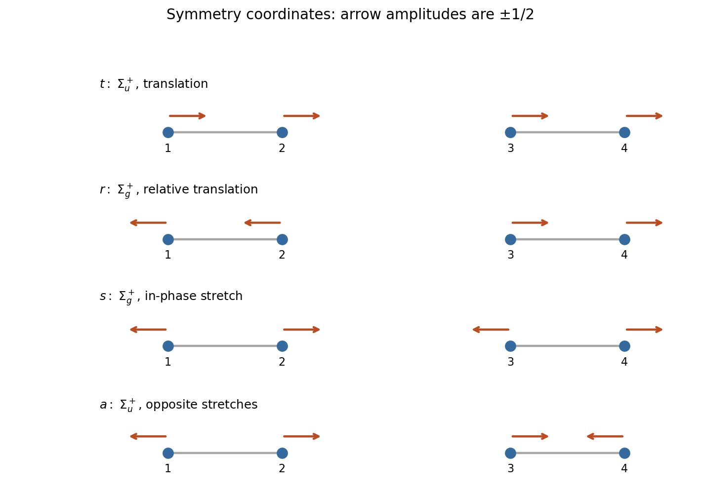

<h1 id="section-b/23/b/ii/solution">Solution</h1>

↑ **Parent:** [Ii](../ii.md)

For the collinear centrosymmetric arrangement, the longitudinal coordinates transform in the [D infinity h molecular point group](../../../../../../../d-infinity-h-molecular-point-group.md). Inversion sends $q_i\mapsto-q_{5-i}$, because displacement is a polar vector. Therefore

$$
\boxed{\Gamma_z=2\Sigma_g^++2\Sigma_u^+.}
$$

An orthonormal set of [symmetry coordinates](../../../../../../../symmetry-coordinate.md) is:

| Coordinate | Displacement vector | Symmetry | $\omega^2$ at $\gamma=0$ | $t$ | $(1,1,1,1)/2$ | $\Sigma_u^+$ | $0$ | $r$ | $(-1,-1,1,1)/2$ | $\Sigma_g^+$ | $0$ | $s$ | $(-1,1,-1,1)/2$ | $\Sigma_g^+$ | $2k/m$ | $a$ | $(-1,1,1,-1)/2$ | $\Sigma_u^+$ | $2k/m$ |
| --- | --- | --- | --- | --- | --- | --- | --- | --- | --- | --- | --- | --- | --- | --- | --- | --- | --- | --- | --- |

Here $t$ translates the complete system, $r$ separates the molecular centres, $s$ stretches both molecules together, and $a$ lengthens one while shortening the other. Reversing every arrow changes the coordinate sign, not its physical mode.

**[Figure 4](#section-b/23/b/ii/image-normalized-longitudinal-symmetry-coordinates-for-two-collinear-hydrogen-molecules). Normalized longitudinal symmetry coordinates for two collinear hydrogen molecules**.

## ↑ Ancestors (15)

1. [Ii](../ii.md)
2. [B](../../b.md)
3. [23](../../../23.md)
4. [Section B](../../../../section-b.md)
5. [Paper 2A](../../../../../paper-2a-split.md)
6. [2021](../../../../../split.md)
7. [Past exam of the chemistry course of the year 3 of the natural sciences course of the University of Cambridge](../../../../../../split.md)
8. [Chemistry course of the year 3 of the natural sciences course of the University of Cambridge](../../../../../../../chemistry-course-of-the-year-3-of-the-natural-sciences-course-of-the-university-of-cambridge.md)
9. [Year 3 of the natural sciences course of the University of Cambridge](../../../../../../../year-3-of-the-natural-sciences-course-of-the-university-of-cambridge.md)
10. [Year of the natural sciences course of the University of Cambridge](../../../../../../../year-of-the-natural-sciences-course-of-the-university-of-cambridge.md)
11. [Natural sciences course of the University of Cambridge](../../../../../../../natural-sciences-course-of-the-university-of-cambridge.md)
12. [Course of the University of Cambridge](../../../../../../../course-of-the-university-of-cambridge.md)
13. [University of Cambridge](../../../../../../../university-of-cambridge-split.md)
14. [List of universities](../../../../../../../list-of-universities.md)
15. [Codex Wiki](../../../../../../../split.md)
