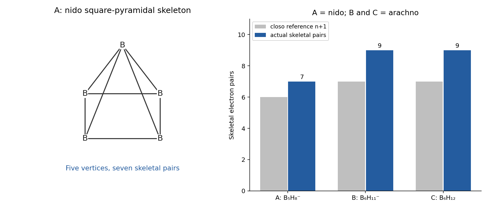
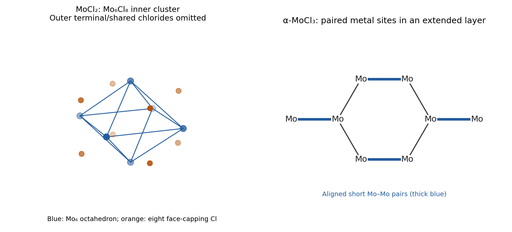
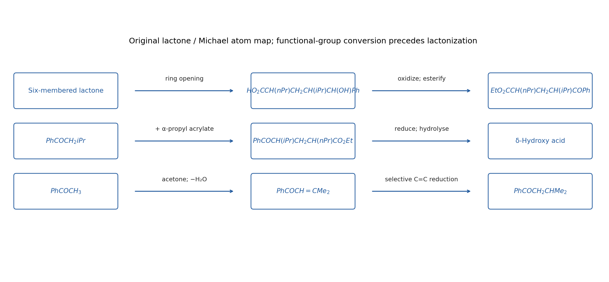
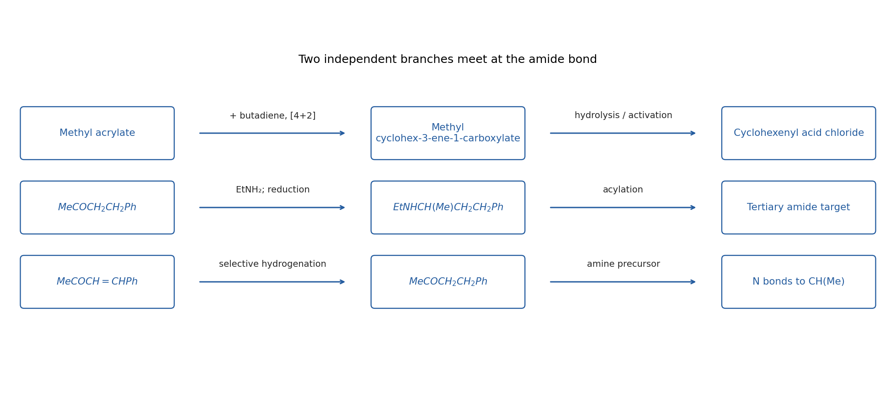
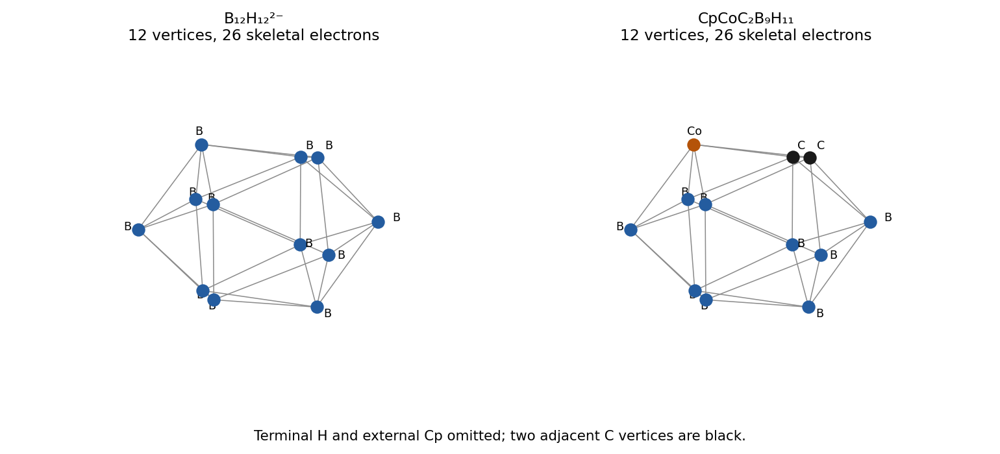
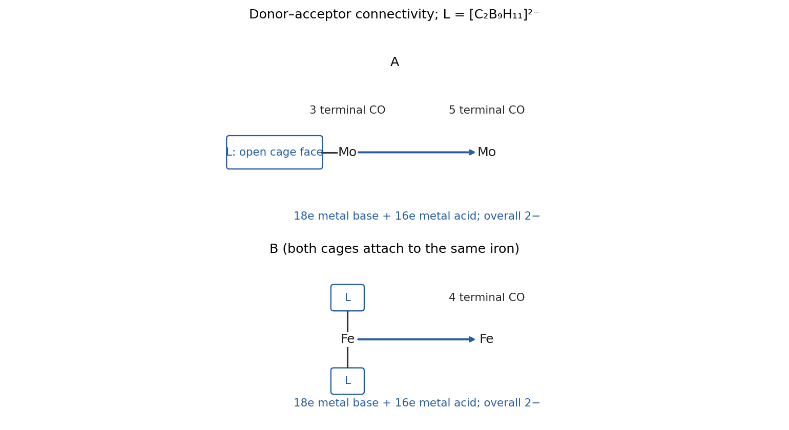
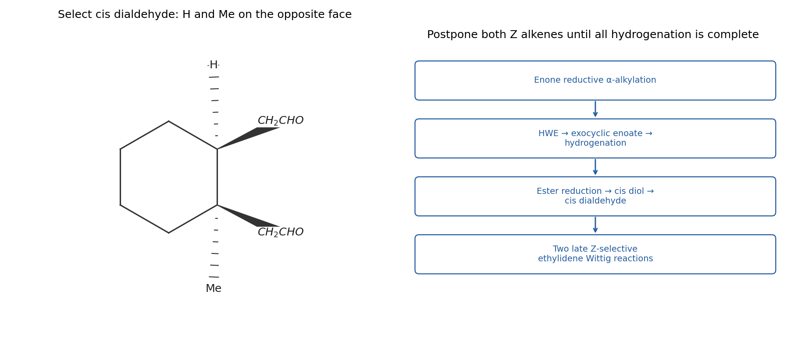

# Paper 1

↑ **Parent:** [2022](../2022.md)

[Original paper, released PDF pages 39–53; two cover variants precede the shared questions](https://www.whatdotheyknow.com/request/nst_chemistry_past_papers_2022/response/2088679/attach/3/FOI%202022%20476%20Whittaker%20materials.pdf?cookie_passthrough=1#page=39)

**Table of contents**

- [1](#1)
  - [a](#1/a)
    - [Solution](#1/a/solution)
  - [b](#1/b)
    - [Solution](#1/b/solution)
- [2](#2)
  - [Solution](#2/solution)
- [3](#3)
  - [Solution](#3/solution)
- [4](#4)
  - [a](#4/a)
    - [Solution](#4/a/solution)
  - [b](#4/b)
    - [Solution](#4/b/solution)
- [5](#5)
  - [Solution](#5/solution)
- [6](#6)
  - [Solution](#6/solution)
- [7](#7)
  - [Solution](#7/solution)
- [8](#8)
  - [Solution](#8/solution)
- [9](#9)
  - [a](#9/a)
    - [Solution](#9/a/solution)
  - [b](#9/b)
    - [Solution](#9/b/solution)
  - [c](#9/c)
    - [Solution](#9/c/solution)
  - [d](#9/d)
    - [Solution](#9/d/solution)
  - [e](#9/e)
    - [Solution](#9/e/solution)
  - [f](#9/f)
    - [Solution](#9/f/solution)
- [10](#10)
  - [a](#10/a)
    - [i](#10/a/i)
      - [Solution](#10/a/i/solution)
    - [ii](#10/a/ii)
      - [Solution](#10/a/ii/solution)
  - [b](#10/b)
    - [i](#10/b/i)
      - [Solution](#10/b/i/solution)
    - [ii](#10/b/ii)
      - [Solution](#10/b/ii/solution)
    - [iii](#10/b/iii)
      - [Solution](#10/b/iii/solution)
- [11](#11)
  - [1](#11/1)
    - [Solution](#11/1/solution)
  - [2](#11/2)
    - [Solution](#11/2/solution)
- [12](#12)
  - [1](#12/1)
    - [Solution](#12/1/solution)
  - [2](#12/2)
    - [Solution](#12/2/solution)

## 1

↑ **Parent:** [Paper 1](paper-1.md)

<h3 id="1/a">a</h3>

↑ **Parent:** [1](#1)

<h4 id="1/a/solution">Solution</h4>

↑ **Parent:** [A](#1/a)

**$\mathrm{A=K[B_5H_8]}$ is [nido](../../molecule.md#nido-cluster); $\mathrm{B=K[B_6H_{11}]}$ and $\mathrm{C=B_6H_{12}}$ are [arachno](../../molecule.md#arachno-cluster).** The initial [hydride](../../chemical-substance.md#hydride) removes an acidic [bridging hydrogen](../../chemical-bond.md#bridging-hydrogen) as a [proton](../../physics.md#proton), releasing $\mathrm{H_2}$ and retaining the [potassium](../../chemical-substance.md#potassium) counterion. Addition of one $\mathrm{BH_3}$ unit expands the [boron](../../chemical-substance.md#boron) framework; final protonation supplies the neutral hexaborane and KCl. These assignments conserve all the atoms in the displayed sequence, without inserting an unshown dehydrogenation step.

For $\mathrm{B_nH_m^{q-}}$, take one terminal B–H bond per vertex and remove its $2n$ electrons from the valence total. The [skeletal electron count](../../chemical-bond.md#skeletal-electron-count) is $3n+m+q-2n=n+m+q$. Thus

$$
\begin{array}{c|c|c|c}
\text{cluster}&n&\text{skeletal electrons}&\text{skeletal pairs}\\\hline
[\mathrm{B_5H_8}]^-&5&5+8+1=14&7=n+2\\
[\mathrm{B_6H_{11}}]^-&6&6+11+1=18&9=n+3\\
\mathrm{B_6H_{12}}&6&6+12=18&9=n+3
\end{array}
$$

[Wade's rules](../../chemical-bond.md#polyhedral-skeletal-electron-pair-theory) assign $n+1$, $n+2$ and $n+3$ pairs to [closo](../../molecule.md#closo-cluster), [nido](../../molecule.md#nido-cluster) and [arachno](../../molecule.md#arachno-cluster) frameworks respectively. A derives from a six-vertex [closo](../../molecule.md#closo-cluster) octahedron by removal of one vertex, giving a square-pyramidal [boron](../../chemical-substance.md#boron) skeleton. B and C have six-vertex open frameworks formally derived from an eight-vertex [closo](../../molecule.md#closo-cluster) polyhedron by removing two vertices. Their additional hydrogens are distributed over bridging and other open-face positions; counting every [hydrogen](../../chemical-substance.md#hydrogen) as an independent terminal B–H vertex would give the wrong classification.

The [arachno](../../molecule.md#arachno-cluster) assignment of $[\mathrm{B_6H_{11}}]^-$ has specific theoretical and NMR support. It should not be replaced by a permanently localized, unrearranged $[\mathrm{B_5H_8}]^-\!\cdot\!\mathrm{BH_3}$ picture: the corresponding symmetric adduct participates in fluxional rearrangement rather than being the lowest-energy structure.[2000, abstract: arachno minimum, bridging-hydrogen removal from B6H12 and alternative-adduct comparison](../../chemistry-bibliography.md#the-structure-of-arachno-b6h11-at-25-degrees-c-in-cd3-2o-is-resolved-via-the-ab-initio-iglo-giao-nmr-procedure-by-matthias-hofmann-and-others)

**[Figure 1](#1/a/image-original-skeletal-electron-accounting-for-the-nido-to-arachno-borane-sequence). Original skeletal-electron accounting for the nido-to-arachno borane sequence**.

<h3 id="1/b">b</h3>

↑ **Parent:** [1](#1)

<h4 id="1/b/solution">Solution</h4>

↑ **Parent:** [B](#1/b)

**C, the neutral [arachno](../../molecule.md#arachno-cluster) $\mathrm{B_6H_{12}}$, is the most plausible [proton](../../physics.md#proton) donor among A, B and C.** Loss of an open-framework bridging [proton](../../physics.md#proton) produces the experimentally accessible, charge-delocalized conjugate base $[\mathrm{B_6H_{11}}]^-$. In contrast, deprotonating A or B would build a dianion and incurs additional electrostatic cost. The neutral, open hydrogen-rich cluster therefore has a more favourable route to a monoanionic conjugate base. This is a qualitative acidity prediction for the listed species, not a numerical solvent-independent $pK_a$ or a claim that all B–H hydrogens are equally acidic.

## 2

↑ **Parent:** [Paper 1](paper-1.md)

<h3 id="2/solution">Solution</h3>

↑ **Parent:** [2](#2)

**$\mathrm{S_4^{2+}}$ is approximately square planar; $\mathrm{Sn_5^{2-}}$ is a [closo](../../molecule.md#closo-cluster) trigonal bipyramid.** Both have 22 [valence electrons](../../chemical-bond.md#valence-electron), $4(6)-2=22$ and $5(4)+2=22$, but their different local orbital requirements prevent inferring identical shapes from this total alone.

For the [sulfur](../../chemical-substance.md#sulfur) ring, four S–S [sigma bonds](../../covalent-bond.md#sigma-bond) use eight electrons and four in-plane [lone pairs](../../covalent-bond.md#lone-pair) use another eight, leaving six electrons in the perpendicular cyclic pi system. The resulting filled bonding and degenerate nonbonding pi levels give a six-pi-electron aromatic description of a four-membered ring, consistent with equivalent S–S links in the ideal square. The out-of-plane p orbitals are retained; this is not a tetrahedral four-vertex [closo](../../molecule.md#closo-cluster) cage.

For [tin](../../chemical-substance.md#tin), allocate one mainly s-rich [lone pair](../../covalent-bond.md#lone-pair) to each atom. The remaining $22-5(2)=12$ electrons form six skeletal pairs, exactly $n+1$ for $n=5$. [Wade's rules](../../chemical-bond.md#polyhedral-skeletal-electron-pair-theory) therefore predict a trigonal bipyramid, with three equatorial vertices and two axial vertices. The axial pair is not joined by a polyhedral edge; its bonding is part of the delocalized three-dimensional framework. The contrast is **a planar aromatic sigma/pi ring versus a three-dimensional multicentre-bonded [Zintl cluster](../../molecule.md#zintl-cluster)**, rather than cationic charge alone imposing planarity or anionic charge alone imposing a polyhedron.

**[Figure 2](#2/image-original-square-ring-and-trigonal-bipyramidal-models-with-their-different-allocations-of-the-same-22-valence-electrons). Original square-ring and trigonal-bipyramidal models with their different allocations of the same 22 valence electrons**.

## 3

↑ **Parent:** [Paper 1](paper-1.md)

<h3 id="3/solution">Solution</h3>

↑ **Parent:** [3](#3)

**Solid $\mathrm{MoCl_2}$ contains octahedral $\mathrm{Mo_6}$ clusters, while $\alpha$-$\mathrm{MoCl_3}$ has paired [molybdenum](../../chemical-substance.md#molybdenum) centres in a layered [chloride](../../chemistry.md#chloride) lattice.** The first material is better represented by $\mathrm{Mo_6Cl_{12}}$ than by isolated bent or linear $\mathrm{MoCl_2}$ molecules. Eight inner chlorides cap the triangular faces of an octahedral metal core, giving $[\mathrm{Mo_6(\mu_3-Cl)_8}]^{4+}$. Outer [chloride](../../chemistry.md#chloride) coordination completes the solid: one useful connectivity notation is $\mathrm{Mo_6Cl_8Cl_2Cl_{4/2}}$, with two terminal outer chlorides and four intercluster-shared outer chlorides per octahedron. The empirical total is $8+2+4/2=12$ chlorides for six metals.

Each Mo(II) is formally $d^4$, giving 24 metal-based electrons. These support extensive Mo–Mo bonding along the 12 octahedral edges; they are not localized as four free spins on each [molybdenum](../../chemical-substance.md#molybdenum). In $\alpha$-$\mathrm{MoCl_3}$, Mo(III) is $d^3$ in edge-sharing $\mathrm{MoCl_6}$ octahedral layers. The metal honeycomb distorts into short Mo–Mo pairs. A localized dimer picture uses the six d electrons to fill one sigma and two pi bonding combinations, producing a formal triple bond and pairing the spins. The bulk crystal remains an extended [chloride](../../chemistry.md#chloride) lattice, rather than a collection of unconnected $\mathrm{Mo_2Cl_6}$ molecules.

By comparison, $\mathrm{CrCl_2}$ has predominantly localized high-spin Cr(II), $d^4$, in Jahn–Teller-distorted [chloride](../../chemistry.md#chloride) octahedra; $\mathrm{CrCl_3}$ has layered Cr(III), $d^3$, with three locally unpaired electrons. Their magnetic exchange is not evidence for the same strong short multiple bonds as in the [molybdenum](../../chemical-substance.md#molybdenum) solids. The greater radial extent of Mo $4d$ orbitals enables larger metal–metal overlap than the more contracted Cr $3d$ orbitals. Real structure and magnetism still depend on ligand geometry and phase, so the orbital comparison is a trend rather than a prohibition of [chromium](../../chemical-substance.md#chromium)–[chromium](../../chemical-substance.md#chromium) bonds in other compounds. Diffraction and magnetic/spectroscopic studies directly distinguish the dimerized $\alpha$-$\mathrm{MoCl_3}$ lattice from $\mathrm{CrCl_3}$.[Introduction and spectroscopic discussion: paired Mo centres, localized Cr spins and diffraction/magnetic evidence](../../chemistry-bibliography.md#structural-and-magnetic-transitions-caused-by-dimer-formation-in-the-crcl3-mocl3-solid-solution-by-samuel-froeschke-and-others)

**[Figure 3](#3/image-original-mo6-octahedral-core-and-paired-layer-schematics-selected-chloride-connectivity-is-explained-in-the-text). Original Mo6 octahedral-core and paired-layer schematics; selected chloride connectivity is explained in the text**.

## 4

↑ **Parent:** [Paper 1](paper-1.md)

<h3 id="4/a">a</h3>

↑ **Parent:** [4](#4)

<h4 id="4/a/solution">Solution</h4>

↑ **Parent:** [A](#4/a)

An [alpha decay](../../physics.md#alpha-decay) decreases [mass number](../../chemical-substance.md#mass-number) by four and [atomic number](../../chemical-substance.md#atomic-number) by two; a [beta-minus decay](../../physics.md#beta-minus-decay) keeps the [mass number](../../chemical-substance.md#mass-number) fixed and increases [atomic number](../../chemical-substance.md#atomic-number) by one. Therefore

$$
\boxed{\mathrm{A}={}^{239}_{93}\mathrm{Np},\qquad\mathrm{B}={}^{239}_{94}\mathrm{Pu},\qquad\mathrm{C}={}^{235}_{92}\mathrm U.}
$$

The beta-minus step converts a neutron to a [proton](../../physics.md#proton) with emission of an [electron](../../physics.md#electron) and an [electron antineutrino](../../standard-model.md#electron-antineutrino). It is not capture of an orbital [electron](../../physics.md#electron), which would change the [atomic number](../../chemical-substance.md#atomic-number) in the opposite direction.

<h3 id="4/b">b</h3>

↑ **Parent:** [4](#4)

<h4 id="4/b/solution">Solution</h4>

↑ **Parent:** [B](#4/b)

**Radiation changes the solution's chemistry by [radiolysis](../../biology.md#radiolysis); it does not turn Am(VI) nuclei into Am(V) nuclei.** An emitted alpha particle deposits energy into many water and solute molecules, generating ionized/excited species, hydrated electrons, [hydrogen](../../chemical-substance.md#hydrogen) atoms and molecular products including [hydrogen peroxide](../../chemical-substance.md#hydrogen-peroxide). Reducing products can supply the [electron](../../physics.md#electron) needed for

$$
\mathrm{AmO_2^{2+}+e^-\longrightarrow AmO_2^+}.
$$

For example, [hydrogen peroxide](../../chemical-substance.md#hydrogen-peroxide) can be oxidized while reducing two americyl(VI) ions:

$$
\mathrm{2AmO_2^{2+}+H_2O_2\longrightarrow2AmO_2^++O_2+2H^+}.
$$

The $0.3$ mM loss of Am(VI) equals the $0.3$ mM appearance of Am(V), preserving the measured dissolved [americium](../../chemical-substance.md#americium) total while transferring $0.3\,\mathrm{mmol\,L^{-1}}$ of [electron](../../physics.md#electron) equivalents. Oxidizing [radiolysis](../../biology.md#radiolysis) products are also present, and the net reduction depends on acid, dissolved gases and scavengers; not every radiolytic event is reducing. In nitric acid, primary kinetic [work](../../energy.md#work) identifies [hydrogen peroxide](../../chemical-substance.md#hydrogen-peroxide) and radiolytically produced [nitrous acid](../../acid-base-chemistry.md#nitrous-acid) as important reductants, with a rate controlled by total [americium](../../chemical-substance.md#americium) activity rather than necessarily by the instantaneous Am(VI) [concentration](../../mathematical-physics.md#concentration).[2017, abstract: oxidation-state mass balance, UV–visible measurements and radiolytic reducing agents](../../chemistry-bibliography.md#kinetics-of-the-autoreduction-of-hexavalent-americium-in-aqueous-nitric-acid-by-travis-s-grimes-and-others)

## 5

↑ **Parent:** [Paper 1](paper-1.md)

<h3 id="5/solution">Solution</h3>

↑ **Parent:** [5](#5)

Let $R=\mathrm{CH(Me)CH_2CH_2CH_3}$. The useful disconnections are **benzoate formation, [carbonyl reduction](../../chemical-reaction.md#carbonyl-reduction) and [thiol](../../chemical-substance.md#thiol) conjugate addition**:

$$
\begin{aligned}
\mathrm{RCH(OCOPh)CH_2CH_2SPh}
&\Leftarrow\mathrm{RCH(OH)CH_2CH_2SPh}+\mathrm{PhCOCl}\\
&\Leftarrow\mathrm{RCOCH_2CH_2SPh}\\
&\Leftarrow\mathrm{RCOCH=CH_2}+\mathrm{PhSH}.
\end{aligned}
$$

The sulfur-bearing [carbon](../../chemical-substance.md#carbon) is the enone beta [carbon](../../chemical-substance.md#carbon), so this is a Michael disconnection, not attack of thiophenol on the alcohol-derived central [carbon](../../chemical-substance.md#carbon). Reduce the saturated [ketone](../../chemical-substance.md#ketone) with [sodium borohydride](../../chemical-substance.md#sodium-borohydride) after installing SPh, then benzoylate the [alcohol](../../chemical-substance.md#alcohol) with [benzoyl chloride](../../chemical-substance.md#benzoyl-chloride) and pyridine or a tertiary amine.

Disconnect the enone to $\mathrm{RCOCH_3}$ and formaldehyde. Kinetic deprotonation on the methyl side of the hindered unsymmetrical [ketone](../../chemical-substance.md#ketone), trapping with formaldehyde, and dehydration gives $\mathrm{RCOCH=CH_2}$. This order leaves the substituted $R$ side unchanged. An [alpha-methylenation](../../chemical-reaction.md#alpha-methylenation)/Mannich-base-elimination variant is an equivalent way of installing the terminal enone.

Finally, $\mathrm{RCOCH_3=CH_3COCH(Me)CH_2CH_2CH_3}$ disconnects by alpha alkylation to **[butan-2-one](../../chemical-substance.md#butan-2-one) and 1-iodopropane**. Use the more substituted, ethyl-side [enolate](../../chemical-substance.md#enolate) of [butan-2-one](../../chemical-substance.md#butan-2-one) for this step, rather than its usual methyl-side [kinetic enolate](../../chemical-substance.md#kinetic-enolate); an equilibrated/regioisomerically selected [enolate](../../chemical-substance.md#enolate) or enol derivative is required, and the desired monoalkylated [ketone](../../chemical-substance.md#ketone) should be isolated. Three carbons from propyl iodide and one from formaldehyde increase the original four-carbon [ketone](../../chemical-substance.md#ketone) to the required eight-carbon [alcohol](../../chemical-substance.md#alcohol)/thioether skeleton. Choosing ethyl iodide here would leave the target short by one [carbon](../../chemical-substance.md#carbon).

This is a constitutional synthesis: the target drawing specifies no configuration at either newly formed stereogenic site, so no unproved stereoselective reduction or alkylation is needed. Regioisomeric [enolate alkylation](../../chemical-substance.md#enolate-alkylation) and competing overalkylation are the practical selectivity issues to control, rather than something that follows from writing “base”.

**[Figure 4](#5/image-original-atom-counted-retrosynthetic-sequence-from-the-benzoate-thioether-target-back-to-butan-2-one). Original atom-counted retrosynthetic sequence from the benzoate/thioether target back to butan-2-one**.

## 6

↑ **Parent:** [Paper 1](paper-1.md)

<h3 id="6/solution">Solution</h3>

↑ **Parent:** [6](#6)

The target is **[5-Aminohexanoic acid](../../chemical-substance.md#5-aminohexanoic-acid), $\mathrm{HO_2C(CH_2)_3CH(NH_2)Me}$**. Disconnect its terminal amine/carboxylic-acid relationship through hydrolysis of **6-methylpiperidin-2-one**. This six-membered [lactam](../../chemical-substance.md#lactam) follows from a regioselected Beckmann ring expansion of 2-methylcyclopentanone [oxime](../../chemical-substance.md#oxime).

Start with [cyclopentanone](../../chemical-substance.md#cyclopentanone). Form its [enolate](../../chemical-substance.md#enolate) with [lithium diisopropylamide](../../chemical-substance.md#lithium-diisopropylamide) in dry THF at low [temperature](../../temperature.md), add methyl iodide, then quench to obtain 2-methylcyclopentanone. Control the methyl iodide/base stoichiometry to suppress a second alkylation. React the [ketone](../../chemical-substance.md#ketone) with hydroxylamine to form its [oxime](../../chemical-substance.md#oxime) and select the geometrical [oxime](../../chemical-substance.md#oxime) isomer in which the bond to the methyl-substituted adjacent ring [carbon](../../chemical-substance.md#carbon) is anti to the departing [oxime](../../chemical-substance.md#oxime) [oxygen](../../chemical-substance.md#oxygen) group.

Activate the [oxime](../../chemical-substance.md#oxime), for example under appropriate acid-promoted Beckmann conditions. The anti methyl-bearing C–C bond migrates onto [nitrogen](../../chemical-substance.md#nitrogen) as the N–O-derived leaving group departs, inserting [nitrogen](../../chemical-substance.md#nitrogen) **between the original [carbonyl](../../chemical-bond.md#carbonyl-group) [carbon](../../chemical-substance.md#carbon) and the methyl-substituted ring [carbon](../../chemical-substance.md#carbon)**. Hydration/tautomerization gives 6-methylpiperidin-2-one. The opposite [oxime](../../chemical-substance.md#oxime) geometry would insert [nitrogen](../../chemical-substance.md#nitrogen) on the other side and ultimately place methyl at a different position in the amino acid; [oxime](../../chemical-substance.md#oxime) geometry is therefore an essential part of this proposal.

Hydrolyse the [lactam](../../chemical-substance.md#lactam) with aqueous acid and [heat](../../heat.md), then adjust the work-up to the desired acid/[ammonium](../../chemistry.md#ammonium) form. Cleavage of its acyl–[nitrogen](../../chemical-substance.md#nitrogen) bond opens the ring to $\mathrm{HO_2C(CH_2)_3CH(NH_2)Me}$ after suitable neutralization. All five original [cyclopentanone](../../chemical-substance.md#cyclopentanone) carbons are retained, and the one methyl [carbon](../../chemical-substance.md#carbon) comes from methyl iodide. A [racemic mixture](../../stereochemistry.md#racemic-mixture) product is appropriate to the stereochemically unspecified target. The reaction sequence is an organic ring-expansion synthesis and requires no biological transformation.

**[Figure 5](#6/image-original-carbon-numbered-route-through-the-anti-oxime-and-ring-expanded-lactam-to-the-amino-acid). Original carbon-numbered route through the anti oxime and ring-expanded lactam to the amino acid**.

## 7

↑ **Parent:** [Paper 1](paper-1.md)

<h3 id="7/solution">Solution</h3>

↑ **Parent:** [7](#7)

Open the cyclic [ester](../../chemical-substance.md#ester) at its acyl–[oxygen](../../chemical-substance.md#oxygen) bond. The resulting delta-hydroxy acid is

$$
\mathrm{HO_2C-CH(nPr)-CH_2-CH(iPr)-CH(OH)Ph}.
$$

Oxidation-state reversal at the benzylic [alcohol](../../chemical-substance.md#alcohol) gives $\mathrm{HO_2C-CH(nPr)-CH_2-CH(iPr)-C(=O)Ph}$. This identifies the key **Michael disconnection between the central $\mathrm{CH_2}$ and $\mathrm{CH(iPr)}$ groups**:

$$
\mathrm{PhCOCH_2iPr}+\mathrm{CH_2=C(nPr)CO_2Et}
\longrightarrow\mathrm{PhCOCH(iPr)CH_2CH(nPr)CO_2Et}.
$$

The [nucleophile](../../chemical-reaction.md#nucleophile) is the [enolate](../../chemical-substance.md#enolate) or [enamine](../../chemical-substance.md#enamine) of the phenyl [ketone](../../chemical-substance.md#ketone). The [electrophile](../../chemical-reaction.md#electrophile)'s propyl substituent must be alpha to its [ester](../../chemical-substance.md#ester) [carbonyl](../../chemical-bond.md#carbonyl-group); using a beta-propyl acrylate would move the substituent to the wrong ring position.

Disconnect $\mathrm{PhCOCH_2iPr}$ further to the indicated **[acetophenone](../../chemical-substance.md#acetophenone)**. Crossed aldol addition to acetone followed by dehydration gives $\mathrm{PhCOCH=CMe_2}$; selective conjugate reduction or controlled alkene [hydrogenation](../../chemical-reaction.md#hydrogenation) then gives $\mathrm{PhCOCH_2CHMe_2}$. This avoids requiring an efficient SN2 alkylation with a secondary isopropyl halide. The alpha-propyl acrylate can be obtained by alpha-hydroxymethylation/dehydration of [ethyl pentanoate](../../chemical-substance.md#ethyl-pentanoate), $\mathrm{EtO_2CCH_2nPr}$, using formaldehyde.

In the forward direction, perform the Michael coupling, reduce the phenyl [ketone](../../chemical-substance.md#ketone) selectively with [sodium borohydride](../../chemical-substance.md#sodium-borohydride) while retaining the ordinary [ester](../../chemical-substance.md#ester), hydrolyse the [ester](../../chemical-substance.md#ester), and cyclize the delta-hydroxy acid by controlled acid-catalysed [lactonization](../../chemical-reaction.md#lactonization) or an activated-acid coupling. The six-membered ring then has the order **[carbonyl](../../chemical-bond.md#carbonyl-group)–$\mathrm{CH(nPr)}$–$\mathrm{CH_2}$–$\mathrm{CH(iPr)}$–$\mathrm{CH(Ph)}$–O**. This atom order checks all three substituent positions. No relative configuration is specified, so the scheme does not imply a single [diastereomer](../../stereochemistry.md#diastereomer) from the [Michael addition](../../chemical-reaction.md#michael-addition) or reduction.

**[Figure 6](#7/image-original-lactone-opening-and-michael-disconnections-with-propyl-and-isopropyl-positions-tracked-separately). Original lactone-opening and Michael disconnections, with propyl and isopropyl positions tracked separately**.

## 8

↑ **Parent:** [Paper 1](paper-1.md)

<h3 id="8/solution">Solution</h3>

↑ **Parent:** [8](#8)

Disconnect the tertiary [amide](../../chemical-substance.md#amide) into **cyclohex-3-ene-1-carboxylic acid** and the secondary amine $\mathrm{EtNHCH(Me)CH_2CH_2Ph}$. The acid-derived ring is an immediate Diels–Alder disconnection: [buta-1,3-diene](../../chemical-substance.md#buta-1-3-diene) plus the indicated **[methyl acrylate](../../chemical-substance.md#methyl-acrylate)** gives methyl cyclohex-3-ene-1-carboxylate. Heating, or suitable Lewis-acid activation of the [dienophile](../../chemical-reaction.md#dienophile), forms the two new [sigma bonds](../../covalent-bond.md#sigma-bond) and leaves the [diene](../../chemical-substance.md#diene)'s internal double bond as the ring alkene.

Hydrolyse this [ester](../../chemical-substance.md#ester) to the acid. Convert it to its acid [chloride](../../chemistry.md#chloride) with oxalyl [chloride](../../chemistry.md#chloride) or thionyl [chloride](../../chemistry.md#chloride), and react with the secondary amine in the presence of a base to capture HCl. The tertiary [amide](../../chemical-substance.md#amide) now contains the complete [cyclohexene](../../chemical-substance.md#cyclohexene) acyl fragment; direct conjugate addition of the amine to [methyl acrylate](../../chemical-substance.md#methyl-acrylate) before ring construction would give the wrong connectivity.

Prepare the amine by [reductive amination](../../chemical-reaction.md#reductive-amination) of **4-phenylbutan-2-one, $\mathrm{MeCOCH_2CH_2Ph}$**, with ethylamine, using [sodium triacetoxyborohydride](../../chemical-substance.md#sodium-triacetoxyborohydride) or another iminium-selective reducing system. This places [nitrogen](../../chemical-substance.md#nitrogen) on $\mathrm{CH(Me)}$, not on a terminal methylene. If a route from simpler [carbon](../../chemical-substance.md#carbon) compounds is wanted, crossed [aldol condensation](../../chemical-reaction.md#aldol-condensation) of acetone with [benzaldehyde](../../chemical-substance.md#benzaldehyde) gives $\mathrm{MeCOCH=CHPh}$, and selective C=C reduction gives the required [ketone](../../chemical-substance.md#ketone) before [reductive amination](../../chemical-reaction.md#reductive-amination).

The acid branch retains the acrylic [carbonyl](../../chemical-bond.md#carbonyl-group) as the [amide](../../chemical-substance.md#amide) [carbonyl](../../chemical-bond.md#carbonyl-group); the amine branch supplies both N-ethyl and N-(4-phenylbutan-2-yl) substituents. The unlabelled stereogenic centres may be [racemic mixture](../../stereochemistry.md#racemic-mixture). This sequence separates ring formation from [amide](../../chemical-substance.md#amide) formation and avoids invoking uncontrolled alkylation of a tertiary [amide](../../chemical-substance.md#amide) [nitrogen](../../chemical-substance.md#nitrogen).

**[Figure 7](#8/image-original-two-branch-synthesis-combining-a-diels-alder-acid-fragment-with-a-reductively-aminated-secondary-amine). Original two-branch synthesis combining a Diels–Alder acid fragment with a reductively aminated secondary amine**.

## 9

↑ **Parent:** [Paper 1](paper-1.md)

<h3 id="9/a">a</h3>

↑ **Parent:** [9](#9)

<h4 id="9/a/solution">Solution</h4>

↑ **Parent:** [A](#9/a)

An [isolobal analogy](../../chemistry.md#isolobal-analogy) compares fragment frontier orbitals, not atomic sizes or total [electron](../../physics.md#electron) counts. The neutral BH fragment has four [valence electrons](../../chemical-bond.md#valence-electron); two make the external B–H bond, leaving **two skeletal electrons in three frontier orbitals** directed towards possible cluster neighbours. For the neutral $\mathrm{CpCo}$ fragment, $\mathrm{Cp=C_5H_5}$ contributes five electrons and [cobalt](../../chemical-substance.md#cobalt) nine, giving 14. Removing the 12 electrons assigned to filled, predominantly non-skeletal fragment orbitals again leaves **two electrons in three cluster-directed frontier orbitals**.

The corresponding frontier sets have comparable numbers, spatial symmetries and occupations, allowing replacement of a BH vertex by CpCo in a suitable cluster-electron count. This is why the metal fragment can cap an open [carborane](../../chemical-substance.md#carborane) face without adding an arbitrary new set of skeletal electrons. Exact orbital energies, ligand preferences and bond lengths need not be identical.[1982, isolobal fragment correspondence and its use across organic/inorganic bonding](../../chemistry-bibliography.md#building-bridges-between-inorganic-and-organic-chemistry-nobel-lecture-by-roald-hoffmann)

<h3 id="9/b">b</h3>

↑ **Parent:** [9](#9)

<h4 id="9/b/solution">Solution</h4>

↑ **Parent:** [B](#9/b)

React pentaborane with an alkyne under relatively mild conditions to obtain a **[nido](../../molecule.md#nido-cluster) $\mathrm{C_2B_4H_8}$ framework**, conventionally nido-2,3-dicarbahexaborane(8) for acetylene. The two entering [carbon](../../chemical-substance.md#carbon) atoms initially retain their adjacency. A specific mild example uses 2-butyne with triethylamine-assisted $\mathrm{B_5H_9}$ at or below room [temperature](../../temperature.md) to give nido-$\mathrm{Me_2C_2B_4H_6}$. This is a practical route to an explicitly [nido carborane](../../chemical-substance.md#nido-carborane), rather than an assumption that an alkyne supplies a [closo](../../molecule.md#closo-cluster) cage under every condition.[1979, abstract and preparation discussion: amine-assisted substituted-alkyne reaction under mild conditions](../../chemistry-bibliography.md#improved-synthetic-routes-to-small-carboranes-bench-scale-preparation-of-nido-2-3-c2b4h8-derivatives-from-b5h9-and-from-b3h8-salts-by-narayan-s-hosmane-and-russell-n-grimes)

More energetic gas-phase reaction or pyrolysis promotes [hydrogen](../../chemical-substance.md#hydrogen) loss, boron-fragment loss and cage rearrangement, giving **[closo](../../molecule.md#closo-cluster) [carboranes](../../chemical-substance.md#carborane)**, for example $1,5$-$\mathrm{C_2B_3H_5}$ and $1,6$-$\mathrm{C_2B_4H_6}$, with other cage sizes possible in the mixture. Thermolysis of a previously formed [nido carborane](../../chemical-substance.md#nido-carborane) is an alternative route to this stage. The point is not a clean same-composition nido-to-closo [isomerization](../../chemical-reaction.md#isomerization): the change of [hydrogen](../../chemical-substance.md#hydrogen) content and sometimes cage size must be retained in the formulas.

Milder conditions favour kinetically trapped adjacent-carbon products; higher temperatures permit migration to carbon-separated arrangements, often increasing favourable B–C contacts relative to adjacent C–C/B–B contacts. Conditions and Lewis bases also influence which separated-carbon cage is isolated; [temperature](../../temperature.md) alone does not prescribe a single quantitative isomer distribution. Primary thermolysis studies and the small-carborane literature document both cage rearrangement and reagent-dependent product mixtures.[1963, printed p. 3378, introduction and product summary](../../chemistry-bibliography.md#synthesis-of-carboranes-from-dihydrocarboranes-by-thomas-p-onak-and-others)

<h3 id="9/c">c</h3>

↑ **Parent:** [9](#9)

<h4 id="9/c/solution">Solution</h4>

↑ **Parent:** [C](#9/c)

For $[\mathrm{B_{12}H_{12}}]^{2-}$, twelve BH vertices supply $12(2)$ skeletal electrons and the charge adds two:

$$
N_{\rm skel}=26=2(12+1).
$$

For the [cobaltacarborane](../../chemical-substance.md#cobaltacarborane), nine BH vertices supply 18, two CH vertices supply six and CpCo supplies two by (a):

$$
N_{\rm skel}=9(2)+2(3)+2=26.
$$

**Both are 12-vertex [closo](../../molecule.md#closo-cluster) icosahedra with 13 [skeletal electron pairs](../../chemical-bond.md#skeletal-electron-pair).** In the [cobalt](../../chemical-substance.md#cobalt) compound, the Cp ring is external to the cage. [cobalt](../../chemical-substance.md#cobalt) caps the five-membered open face of the 11-vertex dicarbollide fragment and is a vertex of the resulting icosahedron, giving the usual adjacent-carbon [cobaltacarborane](../../chemical-substance.md#cobaltacarborane) framework. Counting all five Cp carbons as additional polyhedral vertices would be incorrect.

**[Figure 8](#9/c/image-original-12-vertex-closo-frameworks-for-dodecaborate-and-the-adjacent-carbon-cobaltacarborane-with-external-ligands-omitted). Original 12-vertex closo frameworks for dodecaborate and the adjacent-carbon cobaltacarborane, with external ligands omitted**.

<h3 id="9/d">d</h3>

↑ **Parent:** [9](#9)

<h4 id="9/d/solution">Solution</h4>

↑ **Parent:** [D](#9/d)

Write $L=[\mathrm{C_2B_9H_{11}}]^{2-}$ for the open-face [dicarbollide ligand](../../chemical-substance.md#dicarbollide-ligand). The structure consistent with the stated attachment is **$[L\mathrm{Mo(CO)_3\rightarrow Mo(CO)_5}]^{2-}$**, with a direct Mo–Mo connection, three carbonyls on the cage-capping Mo and five on the outside Mo. The first Mo has an $\eta^5$ interaction with the five-vertex face and completes a 12-vertex [metallacarborane](../../chemical-substance.md#metallacarborane) cage; the second is exo to that cage. The two [tetramethylammonium](../../chemical-substance.md#tetramethylammonium) ions are counterions.

The unsaturated $\mathrm{Mo(CO)_5}$ fragment is a 16-electron Lewis acceptor; $[L\mathrm{Mo(CO)_3}]^{2-}$ is an 18-electron metal-base fragment in ionic counting, $d^6+6e(L)+6e(3CO)$. Donation from a filled Mo-based orbital supplies the external fragment with a pair. This donor–acceptor representation avoids the mistaken claim that both initially saturated 18-electron fragments simply add a new conventional bond without changing anything.

An alternative formal oxidation-state allocation for a single covalent Mo–Mo bond is cage Mo(I) and external Mo(−I): the local counts are $d^5+6+6+1=18$ and $d^7+10+1=18$. These are electron-bookkeeping alternatives to the metal-base/metal-acid picture, not a measurement of integral site charges. With terminal carbonyls, the external $\mathrm{Mo(CO)_5}$ group can be approximately octahedral when the Mo–Mo direction occupies its sixth coordination direction. The cage-containing unit must accommodate an exo metal interaction in addition to its facial cage/CO environment; its geometry need not be a perfectly undistorted isolated half-sandwich.

**[Figure 9](#9/d/image-original-donor-acceptor-models-for-the-exo-mo-and-fe-carbonyl-fragments-attached-to-cage-bound-metal-donors). Original donor–acceptor models for the exo Mo and Fe carbonyl fragments attached to cage-bound metal donors**.

<h3 id="9/e">e</h3>

↑ **Parent:** [9](#9)

<h4 id="9/e/solution">Solution</h4>

↑ **Parent:** [E](#9/e)

The wording places both dicarbollide cages on the same [iron](../../chemical-substance.md#iron), leaving the second [iron](../../chemical-substance.md#iron) outside the cages. The corresponding proposal is **$[L_2\mathrm{Fe\rightarrow Fe(CO)_4}]^{2-}$**, with the first [iron](../../chemical-substance.md#iron) sandwiched between the two open $\eta^5$ faces and the second carrying four carbonyls. It is not the symmetric arrangement with one cage on each [iron](../../chemical-substance.md#iron), which would contradict the specified single cage-interacting metal site.

The donor fragment $[\mathrm{Fe^{II}}L_2]^{2-}$ has $d^6+2(6)=18$ electrons; the external neutral $\mathrm{Fe(CO)_4}$ fragment has $8+4(2)=16$. Metal-to-metal donation therefore provides a natural 18-electron acceptor adduct. In covalent-single-bond oxidation-state bookkeeping, the analogous assignments Fe(III)/Fe(−I) give $d^5+12+1=18$ and $d^9+8+1=18$. In either account the whole species has two negative charges. The outside [iron](../../chemical-substance.md#iron) can have an approximately trigonal-bipyramidal five-coordinate arrangement when the Fe–Fe direction and its four CO ligands are counted.

The important structural distinction is **a bis(dicarbollide) [iron](../../chemical-substance.md#iron) donor joined to an exo tetracarbonyl [iron](../../chemical-substance.md#iron) acceptor**. Formula and [electron counting](../../chemistry.md#electron-counting) alone do not uniquely fix all [carbonyl](../../chemical-bond.md#carbonyl-group) angles or prove a particular crystalline conformation.

<h3 id="9/f">f</h3>

↑ **Parent:** [9](#9)

<h4 id="9/f/solution">Solution</h4>

↑ **Parent:** [F](#9/f)

Neither formula requires a bridging [carbonyl](../../chemical-bond.md#carbonyl-group) to repair an [electron](../../physics.md#electron) deficiency: the terminal-CO donor–acceptor structures in (d) and (e) already give an electron-counting rationale for the metal–metal interaction. **A predominantly terminal-carbonyl model is a reasonable starting proposal for A; bridging or semibridging CO is more geometrically plausible for the shorter Fe–Fe contact in B.** Larger metal separation makes a [carbonyl](../../chemical-bond.md#carbonyl-group) simultaneously engaging both Mo atoms less favourable, while [carbonyl](../../chemical-bond.md#carbonyl-group) redistribution or tilting can be easier around a compact Fe pair.

This is a qualified structural prediction, not a determination from molecular formula. A bridging CO can change the relative hapticity and local [electron](../../physics.md#electron) allocation, and the two metal centres are inequivalent; a large frequency shift by itself need not prove a symmetric bridge. Infrared [carbonyl](../../chemical-bond.md#carbonyl-group) frequencies combined with diffraction would test terminal versus bridging or semibridging assignments. The given low-temperature preparation can trap a coordination pattern before complete [carbonyl](../../chemical-bond.md#carbonyl-group) redistribution.

## 10

↑ **Parent:** [Paper 1](paper-1.md)

<h3 id="10/a">a</h3>

↑ **Parent:** [10](#10)

<h4 id="10/a/i">i</h4>

↑ **Parent:** [A](#10/a)

<h5 id="10/a/i/solution">Solution</h5>

↑ **Parent:** [I](#10/a/i)

Ultrashort metal–metal contacts are favoured when the valence configuration fills strongly metal–metal-bonding orbitals while leaving their antibonding partners empty. Early or middle [transition metals](../../chemical-substance.md#transition-metal) in low [oxidation states](../../chemical-reaction.md#oxidation-state) can retain enough d electrons for multiple bonding without the unavoidable antibonding occupation of a more filled d shell. Good radial and angular overlap, a compatible metal–metal axis, and low competing ligand-field stabilization all matter; a short contact should be interpreted together with an orbital/electron-counting model, not automatically called a high-order bond.

Ligands should support a geometry in which the relevant d orbitals can overlap and protect the low-valent pair from oligomerization or oxidative attack. Bulky aryl-substituted bridging amidinates can provide this protection while maintaining an appropriate small coordination number. Strongly coordinating axial ligands or inappropriate pi interactions can compete with metal–metal bonding, especially its weaker delta components. For quadruple or quintuple bonds, retaining two appropriately oriented delta-capable orbitals is particularly important; a geometry optimized only for metal–ligand bonding can remove that advantage.

Ligand bridges need not literally squeeze two otherwise unbound metals together. Comparing bond lengths across [oxidation states](../../chemical-reaction.md#oxidation-state) and across related ligands helps distinguish electronic multiple bonding from enforced steric compression. The lantern-type dichromium experiment in (ii) is informative because reduction changes the [electron](../../physics.md#electron) occupation within essentially the same three-bridge supporting framework.[2008, printed pp. 7250–7253: mixed-valent precursor, reduced anion, orbital analysis and discussion of ligand constraints](../../chemistry-bibliography.md#remarkably-short-metal-metal-bonds-a-lantern-type-quintuply-bonded-dichromium-i-complex-by-yi-chou-tsai-and-others)

<h4 id="10/a/ii">ii</h4>

↑ **Parent:** [A](#10/a)

<h5 id="10/a/ii/solution">Solution</h5>

↑ **Parent:** [Ii](#10/a/ii)

**[chromium](../../chemical-substance.md#chromium) is the characteristic assignment, giving Cr(I)–Cr(I) with a formal [quintuple bond](../../covalent-bond.md#quintuple-bond).** Each formamidinate is monoanionic, so $2x-3=-1$ gives $x=+1$. [chromium](../../chemical-substance.md#chromium)(I) is $d^5$ and the pair supplies ten d electrons. Relative to a metal–metal $z$ axis, the idealized bonding combinations are $d_{z^2}$ sigma, $d_{xz},d_{yz}$ pi and $d_{xy},d_{x^2-y^2}$ delta:

$$
\boxed{\sigma^2\pi^4\delta^4,\qquad\mathrm{BO}=\frac{10-0}{2}=5.}
$$

End-on sigma overlap gives the largest splitting, pi overlap a smaller splitting, and delta overlap the weakest. A useful qualitative ordering places bonding sigma lowest, then the two pi combinations, then the two delta combinations; all are occupied. Their antibonding partners are empty, with the weakly split delta-star levels nearest their bonding counterparts. The actual three-bridge ligand field can mix and split symmetry-compatible levels, so the diagram is a bond-axis model rather than five perfectly degenerate metal d levels in the molecular complex.

The identified lantern-type anion has an experimentally determined Cr–Cr distance near $1.740$ Å; reduction of its nine-bonding-electron precursor supplies the tenth [electron](../../physics.md#electron). This corroborates the model more specifically than citing “short bonds” in an unrelated framework.[2008, abstract and structural/orbital discussion: reduced anion and 1.7397(9) Å contact](../../chemistry-bibliography.md#remarkably-short-metal-metal-bonds-a-lantern-type-quintuply-bonded-dichromium-i-complex-by-yi-chou-tsai-and-others)

**[Figure 10](#10/a/ii/image-original-idealized-d-orbital-combinations-and-ten-electron-occupancy-for-a-sigma-two-pi-two-delta-quintuple-bond). Original idealized d-orbital combinations and ten-electron occupancy for a sigma-two-pi-two-delta quintuple bond**.

<h3 id="10/b">b</h3>

↑ **Parent:** [10](#10)

<h4 id="10/b/i">i</h4>

↑ **Parent:** [B](#10/b)

<h5 id="10/b/i/solution">Solution</h5>

↑ **Parent:** [I](#10/b/i)

Use the balanced aqueous-acid reaction

$$
\mathrm{Ln(s)+3H^+(aq)\longrightarrow Ln^{3+}(aq)+\tfrac32H_2(g)}.
$$

A Hess cycle first atomizes the metal, then ionizes its gas-phase atoms, then hydrates the triply charged gas ions:

$$
\begin{aligned}
\mathrm{Ln(s)}&\longrightarrow\mathrm{Ln(g)}&&\Delta_{\rm at}H^\circ>0,\\
\mathrm{Ln(g)}&\longrightarrow\mathrm{Ln^{3+}(g)+3e^-(g)}&&I_1+I_2+I_3>0,\\
\mathrm{Ln^{3+}(g)}&\longrightarrow\mathrm{Ln^{3+}(aq)}&&\Delta_{\rm hyd}H^\circ<0.
\end{aligned}
$$

Close the reference leg by combining the three electrons with $3\mathrm{H^+(aq)}$ to make $\tfrac32\mathrm{H_2(g)}$. Calling that element-independent contribution $C_H$ gives

$$
\boxed{\Delta H^\circ_{\rm acid}=\Delta_{\rm at}H^\circ+I_1+I_2+I_3+\Delta_{\rm hyd}H^\circ+C_H.}
$$

A single-ion [standard enthalpy of formation](../../chemistry.md#standard-enthalpy-of-formation) uses the conventional hydrogen-ion reference; it must not be treated as a balanced creation of net charge from neutral metal without an [electron](../../physics.md#electron)/reference term. The constant [hydrogen](../../chemical-substance.md#hydrogen) leg does not affect comparisons along the [lanthanide](../../chemical-substance.md#lanthanide) series.

**[Figure 11](#10/b/i/image-original-hess-cycle-separating-atomization-three-ionizations-hydration-and-the-common-aqueous-hydrogen-reference-leg). Original Hess cycle separating atomization, three ionizations, hydration and the common aqueous hydrogen reference leg**.

<h4 id="10/b/ii">ii</h4>

↑ **Parent:** [B](#10/b)

<h5 id="10/b/ii/solution">Solution</h5>

↑ **Parent:** [Ii](#10/b/ii)

The **large positive sum of ionization energies and large negative [hydration enthalpy](../../ionic-bonding.md#hydration-enthalpy) dominate**, with a smaller but significant positive atomization term. Ionization depends on effective nuclear attraction, orbital energies and the stability of successive gas-ion [electron](../../physics.md#electron) configurations; removing the third [electron](../../physics.md#electron) may require disruption of a particularly stable divalent f configuration. Atomization depends on the metal's cohesive bonding and valence participation, and need not vary perfectly smoothly.

Hydration becomes more favourable for higher charge density. All the compared ions have charge $+3$, so smaller effective ionic radius generally gives more negative [hydration enthalpy](../../ionic-bonding.md#hydration-enthalpy). Incomplete shielding by the 4f shell produces the [lanthanide contraction](../../chemical-substance.md#lanthanide-contraction) and strengthens ion–water attraction along the series. A Born-type electrostatic estimate has a stabilization scale proportional to $-z^2/r$, but hydration-shell structure, water polarization and [temperature](../../temperature.md) dependence prevent treating that crude scale as an exact [enthalpy](../../enthalpy.md) formula. The hydration trend is smoother than the sharp configuration-dependent ionization anomalies. The measured formation [enthalpy](../../enthalpy.md) reflects cancellation of large terms, so comparison of just one term can give a misleading prediction.

<h4 id="10/b/iii">iii</h4>

↑ **Parent:** [B](#10/b)

<h5 id="10/b/iii/solution">Solution</h5>

↑ **Parent:** [Iii](#10/b/iii)

**The unusually stable divalent configurations Eu(II) $4f^7$ and Yb(II) $4f^{14}$ make their third ionization particularly costly.** Forming Eu(III), $4f^6$, or Yb(III), $4f^{13}$ removes an [electron](../../physics.md#electron) from a half-filled or filled f shell. The positive ionization-energy contribution therefore increases relative to the smoother background across the series.

Their trivalent ionic radii and hydration enthalpies do not supply a matching abrupt extra stabilization. Differences in atomization and the divalent character of elemental Eu and Yb partly compensate the ionization anomaly but do not erase the net less favourable trivalent aqueous formation [enthalpy](../../enthalpy.md). This explanation concerns formation of the $+3$ aqueous ions, not a claim that $\mathrm{Eu^{3+}}$ or $\mathrm{Yb^{3+}}$ is intrinsically the most stable isolated f configuration.

## 11

↑ **Parent:** [Paper 1](paper-1.md)

<h3 id="11/1">1</h3>

↑ **Parent:** [11](#11)

<h4 id="11/1/solution">Solution</h4>

↑ **Parent:** [1](#11/1)

There are three largely independent constructions: **a substituted Robinson-annulation core, a protected vicinal diol, and the [ester](../../chemical-substance.md#ester) acyl fragment**. Disconnect the [ester](../../chemical-substance.md#ester) first to an allylic [alcohol](../../chemical-substance.md#alcohol) on the bicyclic ring and the acid $\mathrm{HO_2CCH(Et)CH(Me)_2}$. Disconnect the [benzylidene acetal](../../chemical-substance.md#benzylidene-acetal) to a side chain $\mathrm{-CH_2CH(OH)CH_2OH}$ and [benzaldehyde](../../chemical-substance.md#benzaldehyde). Reversing 1,2-reduction of the allylic [alcohol](../../chemical-substance.md#alcohol) gives the corresponding bicyclic enone; its six-membered enone ring is a Robinson disconnection back to a suitably alpha-substituted cyclohexanone and methyl vinyl [ketone](../../chemical-substance.md#ketone).

An efficient way to protect the side chain before annulation is to prepare **4-(bromomethyl)-2-phenyl-1,3-dioxolane** from $\mathrm{BrCH_2CH(OH)CH_2OH}$ and [benzaldehyde](../../chemical-substance.md#benzaldehyde) with mild acid and water removal. The desired five-membered [acetal](../../chemical-substance.md#acetal) protects the adjacent hydroxyl groups, while its external primary [bromide](../../chemistry.md#bromide) remains an alkylating site. Alpha alkylation of the indicated cyclohexanone with this [bromide](../../chemistry.md#bromide) gives a ring bearing $\mathrm{-CH_2CH(O-)CH_2O-}$ in the benzylidene-protected form. There is no need to expose the eventual ring enone to a nonselective late dihydroxylation.

Generate the [enolate](../../chemical-substance.md#enolate) at the **other, less substituted alpha position** of the cyclohexanone and add methyl vinyl [ketone](../../chemical-substance.md#ketone). Hydrolysis of an enamine-mediated Michael variant or direct [enolate](../../chemical-substance.md#enolate) trapping gives the appropriate 1,5-dicarbonyl. Intramolecular [aldol condensation](../../chemical-reaction.md#aldol-condensation) closes a six-membered ring onto the original cyclohexanone [carbonyl](../../chemical-bond.md#carbonyl-group). Dehydration gives the fused bicyclic enone, with the protected three-carbon side chain on the adjacent [carbon](../../chemical-substance.md#carbon) of the original ring. Regioselecting the initial [Michael addition](../../chemical-reaction.md#michael-addition) is essential: reaction at the side-chain-bearing alpha site would place that substituent at the wrong fusion position.

Reduce the new enone [carbonyl](../../chemical-bond.md#carbonyl-group) **by 1,2-addition**, for example [sodium borohydride](../../chemical-substance.md#sodium-borohydride) with cerium(III) [chloride](../../chemistry.md#chloride) under Luche-type conditions, to retain the displayed ring C=C bond and produce the allylic [alcohol](../../chemical-substance.md#alcohol). The [benzylidene acetal](../../chemical-substance.md#benzylidene-acetal) should be maintained through these neutral/basic operations. The target has no wedge/dash assignments, so a constitutional solution does not require a claim of a unique fused-ring/[alcohol](../../chemical-substance.md#alcohol) [diastereomer](../../stereochemistry.md#diastereomer); isolate the required constitutional annulation product.

For the acyl branch, form the [enolate](../../chemical-substance.md#enolate) of the indicated **[methyl butanoate](../../chemical-substance.md#methyl-butanoate)**, add acetone, then dehydrate the beta-hydroxy [ester](../../chemical-substance.md#ester):

$$
\mathrm{MeO_2CCH_2Et\longrightarrow MeO_2CCH(Et)C(OH)Me_2
\longrightarrow MeO_2CC(Et)=CMe_2}.
$$

Hydrogenate this isolated alkene before coupling it to the bicyclic substrate, giving $\mathrm{MeO_2CCH(Et)CHMe_2}$. [saponification](../../chemical-reaction.md#saponification) gives $\mathrm{HO_2CCH(Et)CHMe_2}$; activate it as its acid [chloride](../../chemistry.md#chloride) or use a mild ester-coupling reagent, then acylate the bicyclic allylic [alcohol](../../chemical-substance.md#alcohol). Performing the [hydrogenation](../../chemical-reaction.md#hydrogenation) on the separate acyl branch avoids reducing the target ring alkene. Strong acid should be avoided during the final esterification because the benzylidene group is acid-labile.

The [carbon](../../chemical-substance.md#carbon) audit is particularly useful: the fused rings contain six carbons from cyclohexanone plus four from methyl vinyl [ketone](../../chemical-substance.md#ketone); the side chain has three carbons from the protected bromodiol; the benzylidene unit supplies its [acetal](../../chemical-substance.md#acetal) [carbon](../../chemical-substance.md#carbon) and [phenyl group](../../chemical-substance.md#phenyl-group). In the acyl fragment, the four butanoate acyl carbons plus three acetone carbons give seven; the starting [ester](../../chemical-substance.md#ester) methoxy [carbon](../../chemical-substance.md#carbon) is lost during hydrolysis.

**[Figure 12](#11/1/image-original-modular-disconnections-separating-protected-side-chain-installation-regioselected-robinson-annulation-and-synthesis-of-the-seven-carbon-acyl-group). Original modular disconnections separating protected side-chain installation, regioselected Robinson annulation and synthesis of the seven-carbon acyl group**.

<h3 id="11/2">2</h3>

↑ **Parent:** [11](#11)

<h4 id="11/2/solution">Solution</h4>

↑ **Parent:** [2](#11/2)

Both side chains have the order **ring–$\mathrm{CH_2CH=CHMe}$**, and both printed double bonds have the Z geometry. The two [carbon](../../chemical-substance.md#carbon) side chains are cis to one another; equivalently the labelled ring H and ring Me are cis on the opposite face. A useful common late precursor therefore has two cis **ring–$\mathrm{CH_2CHO}$** substituents, which can undergo two Z-selective ethylidene Wittig reactions.

Use the starting 2-methylcyclohex-2-en-1-one in a **reductive alpha-alkylation**. Conjugate reduction under dissolving-metal/enolate-trapping conditions, followed by a primary [electrophile](../../chemical-reaction.md#electrophile) $\mathrm{BrCH_2CH_2OTBS}$, installs a protected two-carbon [alcohol](../../chemical-substance.md#alcohol) side chain at the original methyl-bearing alpha [carbon](../../chemical-substance.md#carbon). This gives 2-methyl-2-(2-siloxyethyl)cyclohexanone. The [carbon](../../chemical-substance.md#carbon) at that position is now quaternary, with its original methyl retained. Alternatively, reduce the enone to 2-methylcyclohexanone and deliberately form/select its more substituted [enolate](../../chemical-substance.md#enolate) before alkylation; its opposite [kinetic enolate](../../chemical-substance.md#kinetic-enolate) would give the wrong regioisomer.

Convert the remaining ring [ketone](../../chemical-substance.md#ketone) to an exocyclic enoate by Horner–Wadsworth–Emmons [olefination](../../chemical-reaction.md#olefination) with a [phosphonoacetate](../../chemical-substance.md#phosphonoacetate):

$$
\mathrm{ring\ C=O\longrightarrow ring\ C=CHCO_2Et}.
$$

Hydrogenate this sole alkene to give ring–$\mathrm{CH_2CO_2Et}$ at that [carbon](../../chemical-substance.md#carbon). Select the [diastereomer](../../stereochemistry.md#diastereomer) with this substituent cis to the pre-existing protected hydroxyethyl side chain, so the newly installed ring H is cis to ring Me. Less hindered-face [hydrogenation](../../chemical-reaction.md#hydrogenation) can assist this relationship, but the route should include separation/verification of the desired cis product rather than assert complete stereoselectivity without data.

Reduce the [ester](../../chemical-substance.md#ester) with [lithium aluminium hydride](../../chemical-substance.md#lithium-aluminium-hydride) to ring–$\mathrm{CH_2CH_2OH}$ and remove the TBS group from the other side chain. Both appendages are now two-carbon primary alcohols. Oxidize them to aldehydes under non-overoxidizing conditions, for example Dess–Martin oxidation, obtaining the cis dialdehyde with two ring–$\mathrm{CH_2CHO}$ groups. Treat with excess salt-controlled, nonstabilized ethylidenetriphenylphosphorane under conditions favouring kinetic Z [olefination](../../chemical-reaction.md#olefination); isolate the **Z,Z product**. Each aldehyde [carbon](../../chemical-substance.md#carbon) becomes the inner vinylic [carbon](../../chemical-substance.md#carbon) of its crotyl group, while the [ylide](../../chemistry.md#ylide) supplies $\mathrm{CHMe}$.

This order postpones both stereodefined alkenes until after [hydrogenation](../../chemical-reaction.md#hydrogenation), so they are not accidentally saturated. It also avoids assuming that a crotyl [grignard reagent](../../chemical-substance.md#grignard-reagent) adds without allylic transposition or that direct [alcohol](../../chemical-substance.md#alcohol) deoxygenation fixes the required ring stereochemistry. An achiral synthesis gives a [racemic mixture](../../stereochemistry.md#racemic-mixture) pair with the specified relative configuration.

**[Figure 13](#11/2/image-original-stereochemical-plan-through-a-cis-diol-dialdehyde-and-late-double-z-selective-wittig-olefination). Original stereochemical plan through a cis diol/dialdehyde and late double Z-selective Wittig olefination**.

## 12

↑ **Parent:** [Paper 1](paper-1.md)

<h3 id="12/1">1</h3>

↑ **Parent:** [12](#12)

<h4 id="12/1/solution">Solution</h4>

↑ **Parent:** [1](#12/1)

Use the nitro group as a **[masked carbonyl](../../chemistry.md#masked-carbonyl) and a [carbon](../../chemical-substance.md#carbon) [nucleophile](../../chemical-reaction.md#nucleophile)**. The most informative disconnection reverses the six-membered aldol annulation. Before that closure, the [cyclopentanone](../../chemical-substance.md#cyclopentanone) beta [carbon](../../chemical-substance.md#carbon) bears

$$
\mathrm{-CH(NO_2)CH_2CH_2COCH_3}.
$$

The [carbon](../../chemical-substance.md#carbon) carrying $\mathrm{NO_2}$ will become the lower [carbonyl](../../chemical-bond.md#carbonyl-group) of the final six-membered ring by a [Nef reaction](../../chemical-reaction.md#nef-reaction). It comes from the specified nitromethane. The remote methyl [ketone](../../chemical-substance.md#ketone) supplies the upper methyl-substituted alkene [carbon](../../chemical-substance.md#carbon) after [aldol condensation](../../chemical-reaction.md#aldol-condensation).

First, use a mild base to generate a nitromethane-derived [nitronate](../../chemistry.md#nitronate) and add it conjugatively to the indicated cyclopent-2-en-1-one. Protonation gives **3-(nitromethyl)[cyclopentanone](../../chemical-substance.md#cyclopentanone)**. Deprotonate its nitromethyl group and perform a second [Michael addition](../../chemical-reaction.md#michael-addition) to methyl vinyl [ketone](../../chemical-substance.md#ketone), giving $\mathrm{cyclopentanone\!-!C3-CH(NO_2)CH_2CH_2COCH_3}$. The nitro-stabilized [carbon](../../chemical-substance.md#carbon) is appreciably more acidic than a simple [ketone](../../chemical-substance.md#ketone) alpha [carbon](../../chemical-substance.md#carbon), permitting selective [nitronate](../../chemistry.md#nitronate) formation; control the acceptor stoichiometry to avoid a further Michael alkylation of the remaining nitro-bearing H.

Form the [enolate](../../chemical-substance.md#enolate)/[enamine](../../chemical-substance.md#enamine) at the [cyclopentanone](../../chemical-substance.md#cyclopentanone) [carbon](../../chemical-substance.md#carbon) **between its [carbonyl](../../chemical-bond.md#carbonyl-group) and the side-chain-bearing [carbon](../../chemical-substance.md#carbon)**. Intramolecular attack on the remote methyl [ketone](../../chemical-substance.md#ketone) closes a six-membered ring; the two shared atoms are the original enone alpha and beta carbons. Hydrolysis if required and dehydration create the alkene between the original alpha [carbon](../../chemical-substance.md#carbon) and the newly formed tertiary carbinol [carbon](../../chemical-substance.md#carbon). That carbinol [carbon](../../chemical-substance.md#carbon) retains its methyl substituent, placing the methyl exactly as required. The original [cyclopentanone](../../chemical-substance.md#cyclopentanone) [carbonyl](../../chemical-bond.md#carbonyl-group) remains the [carbonyl](../../chemical-bond.md#carbonyl-group) of the five-membered ring.

Finally, form the secondary [nitronate](../../chemistry.md#nitronate) and carry out controlled acidic Nef hydrolysis to replace its $\mathrm{CH(NO_2)}$ unit by $\mathrm{C=O}$. The resulting fused product contains the two required ketones. Carrying out the annulation **before** exposing this second [ketone](../../chemical-substance.md#ketone) reduces competing [enolate](../../chemical-substance.md#enolate)/aldol pathways that would be available in the corresponding triketone. The nitro intermediate's competing deprotonation means that the aldol step needs conditions designed to access the ring [carbonyl](../../chemical-bond.md#carbonyl-group) [enolate](../../chemical-substance.md#enolate)/[enamine](../../chemical-substance.md#enamine); simply treating every [carbonyl](../../chemical-bond.md#carbonyl-group) position as equally reactive would not establish the route.

The [carbon](../../chemical-substance.md#carbon) ledger is $5$ from cyclopentenone, $1$ from nitromethane and $4$ from methyl vinyl [ketone](../../chemical-substance.md#ketone), giving the nine-carbon fused skeleton plus its methyl substituent. A primary-nitro [Nef reaction](../../chemical-reaction.md#nef-reaction) performed before the second [carbon](../../chemical-substance.md#carbon) alkylation would instead give an aldehyde and would lose this useful protected-carbonyl construction.

**[Figure 14](#12/1/image-original-tandem-michael-michael-six-membered-aldol-and-late-nef-plan-with-the-nitromethane-carbon-mapped-to-a-target-ketone). Original tandem Michael–Michael, six-membered aldol and late Nef plan, with the nitromethane carbon mapped to a target ketone**.

<h3 id="12/2">2</h3>

↑ **Parent:** [12](#12)

<h4 id="12/2/solution">Solution</h4>

↑ **Parent:** [2](#12/2)

The left ring system is **spiro**, and the right-hand substituent is **$\mathrm{CH(OMe)Me}$**, not OMe directly attached to the [cyclohexene](../../chemical-substance.md#cyclohexene) ring. Let $Q$ denote the right cyclohexenyl group bearing that methoxyethyl substituent cis to its linker. The connection to the left alkene [carbon](../../chemical-substance.md#carbon) is $\mathrm{-(CH_2)_3-Q}$. These observations suggest two Diels–Alder constructions. A left-hand [diene](../../chemical-substance.md#diene)

$$
\mathrm{(cyclopentane)C=C[(CH_2)_3Q]-CH=CH_2}
$$

has the original [cyclopentane](../../chemical-substance.md#cyclopentane) [carbon](../../chemical-substance.md#carbon) as one terminal [diene](../../chemical-substance.md#diene) atom; cycloaddition with an [ethylene equivalent](../../chemical-reaction.md#ethylene-equivalent) gives the spiro six-membered ring. Its residual double bond is between the two internal [diene](../../chemical-substance.md#diene) atoms, putting the linker on the required alkene [carbon](../../chemical-substance.md#carbon).

Build $Q$ and its four-carbon [alcohol](../../chemical-substance.md#alcohol) appendage first. Protect the OH group of the indicated **[4-Bromobutan-1-ol](../../chemical-substance.md#4-bromobutan-1-ol)**, for example as a [THP ether](../../chemical-substance.md#tetrahydropyranyl-ether). Convert the primary [bromide](../../chemistry.md#bromide) to its [grignard reagent](../../chemical-substance.md#grignard-reagent) and formylate with DMF, giving $\mathrm{THPOCH_2(CH_2)_3CHO}$. [olefination](../../chemical-reaction.md#olefination) with an allylidenetriphenylphosphorane, $\mathrm{Ph_3P=CHCH=CH_2}$, supplies a conjugated [diene](../../chemical-substance.md#diene) $\mathrm{THPOCH_2(CH_2)_3CH=CHCH=CH_2}$; select the required [diene](../../chemical-substance.md#diene) geometry rather than assume a single E/Z outcome.

Cycloaddition with methyl vinyl [ketone](../../chemical-substance.md#ketone) produces a [cyclohexene](../../chemical-substance.md#cyclohexene) with a protected four-carbon [alcohol](../../chemical-substance.md#alcohol) chain at one saturated ring [carbon](../../chemical-substance.md#carbon) and an acetyl group at its adjacent ring [carbon](../../chemical-substance.md#carbon). Choose and isolate the **adjacent-substituent cis regioisomer**, matching the two dashed substituent bonds in the target. Endo preference and [diene](../../chemical-substance.md#diene) geometry can aid the selection, but an unsymmetrical [diene](../../chemical-substance.md#diene) is not guaranteed to give a unique regioisomer. Reduce the acetyl [ketone](../../chemical-substance.md#ketone) to $\mathrm{CH(OH)Me}$, then methylate that [alcohol](../../chemical-substance.md#alcohol) with [sodium hydride](../../chemical-substance.md#sodium-hydride)/methyl iodide while the chain-end OH is protected. Remove the THP group under mild acid conditions to reveal $\mathrm{Q(CH_2)_4OH}$, preserving the secondary methyl [ether](../../chemical-substance.md#ether) and the ring alkene.

Oxidize this primary [alcohol](../../chemical-substance.md#alcohol) to $\mathrm{Q(CH_2)_3CHO}$. Add vinylmagnesium [bromide](../../chemistry.md#bromide) to give $\mathrm{Q(CH_2)_3CH(OH)CH=CH_2}$, then oxidize the allylic [alcohol](../../chemical-substance.md#alcohol) to the enone $\mathrm{Q(CH_2)_3C(=O)CH=CH_2}$. This [carbonyl](../../chemical-bond.md#carbonyl-group) [carbon](../../chemical-substance.md#carbon) is the original alcohol-end [carbon](../../chemical-substance.md#carbon) of 4-bromobutanol; after [olefination](../../chemical-reaction.md#olefination) it will be the linker-bearing [carbon](../../chemical-substance.md#carbon) of the left ring alkene.

In the other branch, reduce the specified [cyclopentanone](../../chemical-substance.md#cyclopentanone) to cyclopentanol, convert to bromocyclopentane, and react with [triphenylphosphine](../../chemical-substance.md#triphenylphosphine) to obtain the cyclopentylphosphonium salt. Deprotonation gives the **cyclopentylidene phosphorane**, whose ylidic [carbon](../../chemical-substance.md#carbon) is part of the five-membered ring. Wittig [olefination](../../chemical-reaction.md#olefination) of the just-prepared enone gives the substituted [diene](../../chemical-substance.md#diene) displayed above. This [carbonyl](../../chemical-bond.md#carbonyl-group)–[ylide](../../chemistry.md#ylide) pairing keeps the ring [carbon](../../chemical-substance.md#carbon) terminal in the [diene](../../chemical-substance.md#diene) and avoids accidentally constructing a fused ring instead of a spiro ring.

Finally, cycloadd an [ethylene equivalent](../../chemical-reaction.md#ethylene-equivalent). Ethylene itself requires suitably forcing/high-pressure conditions; a more reactive alternative is [phenyl vinyl sulfone](../../chemistry.md#phenyl-vinyl-sulfone), followed by reductive removal of the sulfone substituent using a method compatible with the methyl [ether](../../chemical-substance.md#ether) and retained C=C bonds. The latter installs the same two otherwise unsubstituted saturated carbons. Control or separate any additional cycloaddition isomers, and retain the previously selected cis configuration on $Q$.

The [carbon](../../chemical-substance.md#carbon) count provides a strong check: [cyclopentanone](../../chemical-substance.md#cyclopentanone) supplies five, bromobutanol four, DMF formylation one, the first allylidene [ylide](../../chemistry.md#ylide) three, methyl vinyl [ketone](../../chemical-substance.md#ketone) four, O-methylation one, vinylmagnesium two, and the final [ethylene equivalent](../../chemical-reaction.md#ethylene-equivalent) two, totalling **22 target carbons**. Three original bromobutanol carbons form the linker; its fourth becomes the substituted [carbon](../../chemical-substance.md#carbon) of the spiro ring's alkene. The proposal is a multistep constitutional/relative-stereochemical route with explicit regioisomer and [diastereomer](../../stereochemistry.md#diastereomer) selection, not an unsupported claim of a single quantitative cycloaddition product.

**[Figure 15](#12/2/image-original-two-cycloaddition-spiro-synthesis-with-the-four-bromobutanol-carbons-mapped-to-the-three-carbon-linker-and-its-adjacent-alkene-carbon). Original two-cycloaddition spiro synthesis with the four bromobutanol carbons mapped to the three-carbon linker and its adjacent alkene carbon**.

## ↑ Ancestors (10)

1. [2022](../2022.md)
2. [Past exam of the chemistry course of the year 3 of the natural sciences course of the University of Cambridge](../../past-exam-of-the-chemistry-course-of-the-year-3-of-the-natural-sciences-course-of-the-university-of-cambridge.md)
3. [Chemistry course of the year 3 of the natural sciences course of the University of Cambridge](../../university-of-cambridge.md#chemistry-course-of-the-year-3-of-the-natural-sciences-course-of-the-university-of-cambridge)
4. [Year 3 of the natural sciences course of the University of Cambridge](../../university-of-cambridge.md#year-3-of-the-natural-sciences-course-of-the-university-of-cambridge)
5. [Year of the natural sciences course of the University of Cambridge](../../university-of-cambridge.md#year-of-the-natural-sciences-course-of-the-university-of-cambridge)
6. [Natural sciences course of the University of Cambridge](../../university-of-cambridge.md#natural-sciences-course-of-the-university-of-cambridge)
7. [Course of the University of Cambridge](../../university-of-cambridge.md#course-of-the-university-of-cambridge)
8. [University of Cambridge](../../university-of-cambridge.md)
9. [List of universities](../../README.md#list-of-universities)
10. [Codex Wiki](../../README.md)
