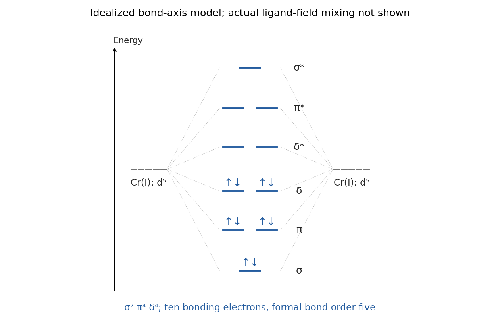

<h1 id="10/a/ii/solution">Solution</h1>

↑ **Parent:** [Ii](../ii.md)

**[chromium](../../../../../../chromium.md) is the characteristic assignment, giving Cr(I)–Cr(I) with a formal [quintuple bond](../../../../../../quintuple-bond.md).** Each formamidinate is monoanionic, so $2x-3=-1$ gives $x=+1$. [chromium](../../../../../../chromium.md)(I) is $d^5$ and the pair supplies ten d electrons. Relative to a metal–metal $z$ axis, the idealized bonding combinations are $d_{z^2}$ sigma, $d_{xz},d_{yz}$ pi and $d_{xy},d_{x^2-y^2}$ delta:

$$
\boxed{\sigma^2\pi^4\delta^4,\qquad\mathrm{BO}=\frac{10-0}{2}=5.}
$$

End-on sigma overlap gives the largest splitting, pi overlap a smaller splitting, and delta overlap the weakest. A useful qualitative ordering places bonding sigma lowest, then the two pi combinations, then the two delta combinations; all are occupied. Their antibonding partners are empty, with the weakly split delta-star levels nearest their bonding counterparts. The actual three-bridge ligand field can mix and split symmetry-compatible levels, so the diagram is a bond-axis model rather than five perfectly degenerate metal d levels in the molecular complex.

The identified lantern-type anion has an experimentally determined Cr–Cr distance near $1.740$ Å; reduction of its nine-bonding-electron precursor supplies the tenth [electron](../../../../../../electron.md). This corroborates the model more specifically than citing “short bonds” in an unrelated framework.[2008, abstract and structural/orbital discussion: reduced anion and 1.7397(9) Å contact](../../../../../../remarkably-short-metal-metal-bonds-a-lantern-type-quintuply-bonded-dichromium-i-complex-by-yi-chou-tsai-and-others.md)

**[Figure 10](#10/a/ii/image-original-idealized-d-orbital-combinations-and-ten-electron-occupancy-for-a-sigma-two-pi-two-delta-quintuple-bond). Original idealized d-orbital combinations and ten-electron occupancy for a sigma-two-pi-two-delta quintuple bond**.

## ↑ Ancestors (14)

1. [Ii](../ii.md)
2. [A](../../a.md)
3. [10](../../../10.md)
4. [Paper 1](../../../../paper-1-split.md)
5. [2022](../../../../split.md)
6. [Past exam of the chemistry course of the year 3 of the natural sciences course of the University of Cambridge](../../../../../split.md)
7. [Chemistry course of the year 3 of the natural sciences course of the University of Cambridge](../../../../../../chemistry-course-of-the-year-3-of-the-natural-sciences-course-of-the-university-of-cambridge.md)
8. [Year 3 of the natural sciences course of the University of Cambridge](../../../../../../year-3-of-the-natural-sciences-course-of-the-university-of-cambridge.md)
9. [Year of the natural sciences course of the University of Cambridge](../../../../../../year-of-the-natural-sciences-course-of-the-university-of-cambridge.md)
10. [Natural sciences course of the University of Cambridge](../../../../../../natural-sciences-course-of-the-university-of-cambridge.md)
11. [Course of the University of Cambridge](../../../../../../course-of-the-university-of-cambridge.md)
12. [University of Cambridge](../../../../../../university-of-cambridge-split.md)
13. [List of universities](../../../../../../list-of-universities.md)
14. [Codex Wiki](../../../../../../split.md)
