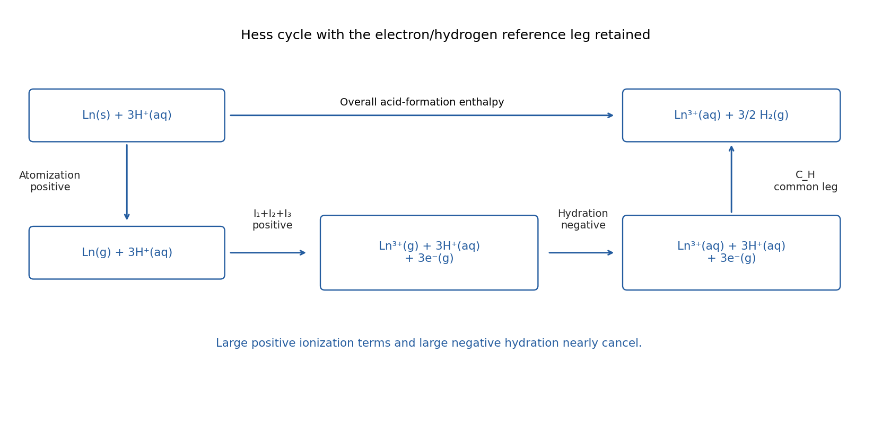

<h1 id="10/b/i/solution">Solution</h1>

↑ **Parent:** [I](../i.md)

Use the balanced aqueous-acid reaction

$$
\mathrm{Ln(s)+3H^+(aq)\longrightarrow Ln^{3+}(aq)+\tfrac32H_2(g)}.
$$

A Hess cycle first atomizes the metal, then ionizes its gas-phase atoms, then hydrates the triply charged gas ions:

$$
\begin{aligned}
\mathrm{Ln(s)}&\longrightarrow\mathrm{Ln(g)}&&\Delta_{\rm at}H^\circ>0,\\
\mathrm{Ln(g)}&\longrightarrow\mathrm{Ln^{3+}(g)+3e^-(g)}&&I_1+I_2+I_3>0,\\
\mathrm{Ln^{3+}(g)}&\longrightarrow\mathrm{Ln^{3+}(aq)}&&\Delta_{\rm hyd}H^\circ<0.
\end{aligned}
$$

Close the reference leg by combining the three electrons with $3\mathrm{H^+(aq)}$ to make $\tfrac32\mathrm{H_2(g)}$. Calling that element-independent contribution $C_H$ gives

$$
\boxed{\Delta H^\circ_{\rm acid}=\Delta_{\rm at}H^\circ+I_1+I_2+I_3+\Delta_{\rm hyd}H^\circ+C_H.}
$$

A single-ion [standard enthalpy of formation](../../../../../../standard-enthalpy-of-formation.md) uses the conventional hydrogen-ion reference; it must not be treated as a balanced creation of net charge from neutral metal without an [electron](../../../../../../electron.md)/reference term. The constant [hydrogen](../../../../../../hydrogen.md) leg does not affect comparisons along the [lanthanide](../../../../../../lanthanide.md) series.

**[Figure 11](#10/b/i/image-original-hess-cycle-separating-atomization-three-ionizations-hydration-and-the-common-aqueous-hydrogen-reference-leg). Original Hess cycle separating atomization, three ionizations, hydration and the common aqueous hydrogen reference leg**.

## ↑ Ancestors (14)

1. [I](../i.md)
2. [B](../../b.md)
3. [10](../../../10.md)
4. [Paper 1](../../../../paper-1-split.md)
5. [2022](../../../../split.md)
6. [Past exam of the chemistry course of the year 3 of the natural sciences course of the University of Cambridge](../../../../../split.md)
7. [Chemistry course of the year 3 of the natural sciences course of the University of Cambridge](../../../../../../chemistry-course-of-the-year-3-of-the-natural-sciences-course-of-the-university-of-cambridge.md)
8. [Year 3 of the natural sciences course of the University of Cambridge](../../../../../../year-3-of-the-natural-sciences-course-of-the-university-of-cambridge.md)
9. [Year of the natural sciences course of the University of Cambridge](../../../../../../year-of-the-natural-sciences-course-of-the-university-of-cambridge.md)
10. [Natural sciences course of the University of Cambridge](../../../../../../natural-sciences-course-of-the-university-of-cambridge.md)
11. [Course of the University of Cambridge](../../../../../../course-of-the-university-of-cambridge.md)
12. [University of Cambridge](../../../../../../university-of-cambridge-split.md)
13. [List of universities](../../../../../../list-of-universities.md)
14. [Codex Wiki](../../../../../../split.md)
