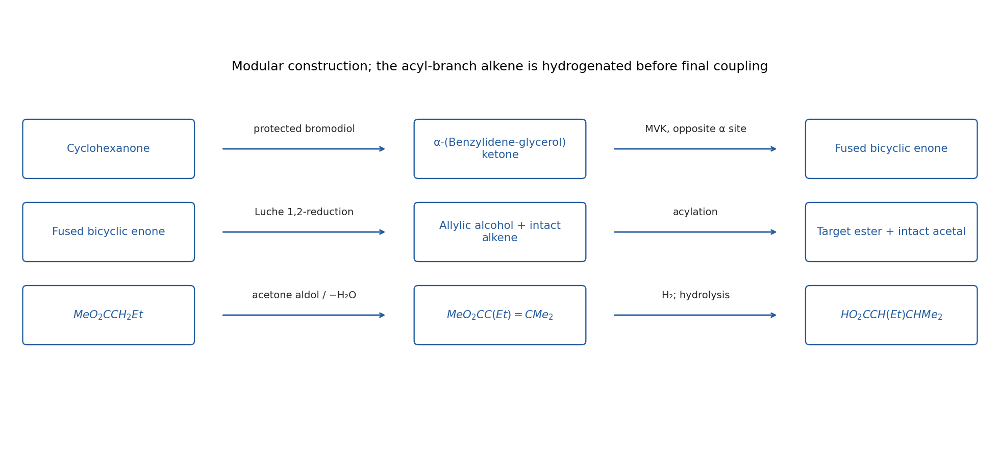

<h1 id="11/1/solution">Solution</h1>

↑ **Parent:** [1](../1.md)

There are three largely independent constructions: **a substituted Robinson-annulation core, a protected vicinal diol, and the [ester](../../../../../ester.md) acyl fragment**. Disconnect the [ester](../../../../../ester.md) first to an allylic [alcohol](../../../../../alcohol.md) on the bicyclic ring and the acid $\mathrm{HO_2CCH(Et)CH(Me)_2}$. Disconnect the [benzylidene acetal](../../../../../benzylidene-acetal.md) to a side chain $\mathrm{-CH_2CH(OH)CH_2OH}$ and [benzaldehyde](../../../../../benzaldehyde.md). Reversing 1,2-reduction of the allylic [alcohol](../../../../../alcohol.md) gives the corresponding bicyclic enone; its six-membered enone ring is a Robinson disconnection back to a suitably alpha-substituted cyclohexanone and methyl vinyl [ketone](../../../../../ketone.md).

An efficient way to protect the side chain before annulation is to prepare **4-(bromomethyl)-2-phenyl-1,3-dioxolane** from $\mathrm{BrCH_2CH(OH)CH_2OH}$ and [benzaldehyde](../../../../../benzaldehyde.md) with mild acid and water removal. The desired five-membered [acetal](../../../../../acetal.md) protects the adjacent hydroxyl groups, while its external primary [bromide](../../../../../bromide.md) remains an alkylating site. Alpha alkylation of the indicated cyclohexanone with this [bromide](../../../../../bromide.md) gives a ring bearing $\mathrm{-CH_2CH(O-)CH_2O-}$ in the benzylidene-protected form. There is no need to expose the eventual ring enone to a nonselective late dihydroxylation.

Generate the [enolate](../../../../../enolate.md) at the **other, less substituted alpha position** of the cyclohexanone and add methyl vinyl [ketone](../../../../../ketone.md). Hydrolysis of an enamine-mediated Michael variant or direct [enolate](../../../../../enolate.md) trapping gives the appropriate 1,5-dicarbonyl. Intramolecular [aldol condensation](../../../../../aldol-condensation.md) closes a six-membered ring onto the original cyclohexanone [carbonyl](../../../../../carbonyl-group.md). Dehydration gives the fused bicyclic enone, with the protected three-carbon side chain on the adjacent [carbon](../../../../../carbon.md) of the original ring. Regioselecting the initial [Michael addition](../../../../../michael-addition.md) is essential: reaction at the side-chain-bearing alpha site would place that substituent at the wrong fusion position.

Reduce the new enone [carbonyl](../../../../../carbonyl-group.md) **by 1,2-addition**, for example [sodium borohydride](../../../../../sodium-borohydride.md) with cerium(III) [chloride](../../../../../chloride.md) under Luche-type conditions, to retain the displayed ring C=C bond and produce the allylic [alcohol](../../../../../alcohol.md). The [benzylidene acetal](../../../../../benzylidene-acetal.md) should be maintained through these neutral/basic operations. The target has no wedge/dash assignments, so a constitutional solution does not require a claim of a unique fused-ring/[alcohol](../../../../../alcohol.md) [diastereomer](../../../../../diastereomer.md); isolate the required constitutional annulation product.

For the acyl branch, form the [enolate](../../../../../enolate.md) of the indicated **[methyl butanoate](../../../../../methyl-butanoate.md)**, add acetone, then dehydrate the beta-hydroxy [ester](../../../../../ester.md):

$$
\mathrm{MeO_2CCH_2Et\longrightarrow MeO_2CCH(Et)C(OH)Me_2
\longrightarrow MeO_2CC(Et)=CMe_2}.
$$

Hydrogenate this isolated alkene before coupling it to the bicyclic substrate, giving $\mathrm{MeO_2CCH(Et)CHMe_2}$. [saponification](../../../../../saponification.md) gives $\mathrm{HO_2CCH(Et)CHMe_2}$; activate it as its acid [chloride](../../../../../chloride.md) or use a mild ester-coupling reagent, then acylate the bicyclic allylic [alcohol](../../../../../alcohol.md). Performing the [hydrogenation](../../../../../hydrogenation.md) on the separate acyl branch avoids reducing the target ring alkene. Strong acid should be avoided during the final esterification because the benzylidene group is acid-labile.

The [carbon](../../../../../carbon.md) audit is particularly useful: the fused rings contain six carbons from cyclohexanone plus four from methyl vinyl [ketone](../../../../../ketone.md); the side chain has three carbons from the protected bromodiol; the benzylidene unit supplies its [acetal](../../../../../acetal.md) [carbon](../../../../../carbon.md) and [phenyl group](../../../../../phenyl-group.md). In the acyl fragment, the four butanoate acyl carbons plus three acetone carbons give seven; the starting [ester](../../../../../ester.md) methoxy [carbon](../../../../../carbon.md) is lost during hydrolysis.

**[Figure 12](#11/1/image-original-modular-disconnections-separating-protected-side-chain-installation-regioselected-robinson-annulation-and-synthesis-of-the-seven-carbon-acyl-group). Original modular disconnections separating protected side-chain installation, regioselected Robinson annulation and synthesis of the seven-carbon acyl group**.

## ↑ Ancestors (13)

1. [1](../1.md)
2. [11](../../11.md)
3. [Paper 1](../../../paper-1-split.md)
4. [2022](../../../split.md)
5. [Past exam of the chemistry course of the year 3 of the natural sciences course of the University of Cambridge](../../../../split.md)
6. [Chemistry course of the year 3 of the natural sciences course of the University of Cambridge](../../../../../chemistry-course-of-the-year-3-of-the-natural-sciences-course-of-the-university-of-cambridge.md)
7. [Year 3 of the natural sciences course of the University of Cambridge](../../../../../year-3-of-the-natural-sciences-course-of-the-university-of-cambridge.md)
8. [Year of the natural sciences course of the University of Cambridge](../../../../../year-of-the-natural-sciences-course-of-the-university-of-cambridge.md)
9. [Natural sciences course of the University of Cambridge](../../../../../natural-sciences-course-of-the-university-of-cambridge.md)
10. [Course of the University of Cambridge](../../../../../course-of-the-university-of-cambridge.md)
11. [University of Cambridge](../../../../../university-of-cambridge-split.md)
12. [List of universities](../../../../../list-of-universities.md)
13. [Codex Wiki](../../../../../split.md)
