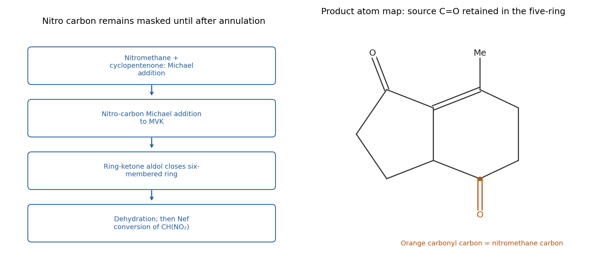

<h1 id="12/1/solution">Solution</h1>

↑ **Parent:** [1](../1.md)

Use the nitro group as a **[masked carbonyl](../../../../../masked-carbonyl.md) and a [carbon](../../../../../carbon.md) [nucleophile](../../../../../nucleophile.md)**. The most informative disconnection reverses the six-membered aldol annulation. Before that closure, the [cyclopentanone](../../../../../cyclopentanone.md) beta [carbon](../../../../../carbon.md) bears

$$
\mathrm{-CH(NO_2)CH_2CH_2COCH_3}.
$$

The [carbon](../../../../../carbon.md) carrying $\mathrm{NO_2}$ will become the lower [carbonyl](../../../../../carbonyl-group.md) of the final six-membered ring by a [Nef reaction](../../../../../nef-reaction.md). It comes from the specified nitromethane. The remote methyl [ketone](../../../../../ketone.md) supplies the upper methyl-substituted alkene [carbon](../../../../../carbon.md) after [aldol condensation](../../../../../aldol-condensation.md).

First, use a mild base to generate a nitromethane-derived [nitronate](../../../../../nitronate.md) and add it conjugatively to the indicated cyclopent-2-en-1-one. Protonation gives **3-(nitromethyl)[cyclopentanone](../../../../../cyclopentanone.md)**. Deprotonate its nitromethyl group and perform a second [Michael addition](../../../../../michael-addition.md) to methyl vinyl [ketone](../../../../../ketone.md), giving $\mathrm{cyclopentanone\!-!C3-CH(NO_2)CH_2CH_2COCH_3}$. The nitro-stabilized [carbon](../../../../../carbon.md) is appreciably more acidic than a simple [ketone](../../../../../ketone.md) alpha [carbon](../../../../../carbon.md), permitting selective [nitronate](../../../../../nitronate.md) formation; control the acceptor stoichiometry to avoid a further Michael alkylation of the remaining nitro-bearing H.

Form the [enolate](../../../../../enolate.md)/[enamine](../../../../../enamine.md) at the [cyclopentanone](../../../../../cyclopentanone.md) [carbon](../../../../../carbon.md) **between its [carbonyl](../../../../../carbonyl-group.md) and the side-chain-bearing [carbon](../../../../../carbon.md)**. Intramolecular attack on the remote methyl [ketone](../../../../../ketone.md) closes a six-membered ring; the two shared atoms are the original enone alpha and beta carbons. Hydrolysis if required and dehydration create the alkene between the original alpha [carbon](../../../../../carbon.md) and the newly formed tertiary carbinol [carbon](../../../../../carbon.md). That carbinol [carbon](../../../../../carbon.md) retains its methyl substituent, placing the methyl exactly as required. The original [cyclopentanone](../../../../../cyclopentanone.md) [carbonyl](../../../../../carbonyl-group.md) remains the [carbonyl](../../../../../carbonyl-group.md) of the five-membered ring.

Finally, form the secondary [nitronate](../../../../../nitronate.md) and carry out controlled acidic Nef hydrolysis to replace its $\mathrm{CH(NO_2)}$ unit by $\mathrm{C=O}$. The resulting fused product contains the two required ketones. Carrying out the annulation **before** exposing this second [ketone](../../../../../ketone.md) reduces competing [enolate](../../../../../enolate.md)/aldol pathways that would be available in the corresponding triketone. The nitro intermediate's competing deprotonation means that the aldol step needs conditions designed to access the ring [carbonyl](../../../../../carbonyl-group.md) [enolate](../../../../../enolate.md)/[enamine](../../../../../enamine.md); simply treating every [carbonyl](../../../../../carbonyl-group.md) position as equally reactive would not establish the route.

The [carbon](../../../../../carbon.md) ledger is $5$ from cyclopentenone, $1$ from nitromethane and $4$ from methyl vinyl [ketone](../../../../../ketone.md), giving the nine-carbon fused skeleton plus its methyl substituent. A primary-nitro [Nef reaction](../../../../../nef-reaction.md) performed before the second [carbon](../../../../../carbon.md) alkylation would instead give an aldehyde and would lose this useful protected-carbonyl construction.

**[Figure 14](#12/1/image-original-tandem-michael-michael-six-membered-aldol-and-late-nef-plan-with-the-nitromethane-carbon-mapped-to-a-target-ketone). Original tandem Michael–Michael, six-membered aldol and late Nef plan, with the nitromethane carbon mapped to a target ketone**.

## ↑ Ancestors (13)

1. [1](../1.md)
2. [12](../../12.md)
3. [Paper 1](../../../paper-1-split.md)
4. [2022](../../../split.md)
5. [Past exam of the chemistry course of the year 3 of the natural sciences course of the University of Cambridge](../../../../split.md)
6. [Chemistry course of the year 3 of the natural sciences course of the University of Cambridge](../../../../../chemistry-course-of-the-year-3-of-the-natural-sciences-course-of-the-university-of-cambridge.md)
7. [Year 3 of the natural sciences course of the University of Cambridge](../../../../../year-3-of-the-natural-sciences-course-of-the-university-of-cambridge.md)
8. [Year of the natural sciences course of the University of Cambridge](../../../../../year-of-the-natural-sciences-course-of-the-university-of-cambridge.md)
9. [Natural sciences course of the University of Cambridge](../../../../../natural-sciences-course-of-the-university-of-cambridge.md)
10. [Course of the University of Cambridge](../../../../../course-of-the-university-of-cambridge.md)
11. [University of Cambridge](../../../../../university-of-cambridge-split.md)
12. [List of universities](../../../../../list-of-universities.md)
13. [Codex Wiki](../../../../../split.md)
