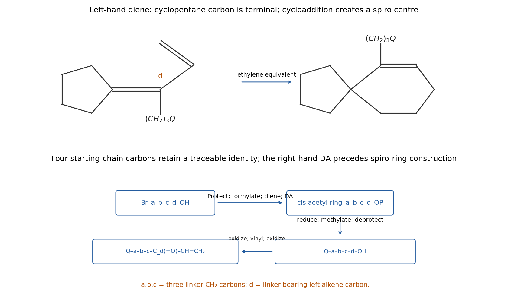

<h1 id="12/2/solution">Solution</h1>

↑ **Parent:** [2](../2.md)

The left ring system is **spiro**, and the right-hand substituent is **$\mathrm{CH(OMe)Me}$**, not OMe directly attached to the [cyclohexene](../../../../../cyclohexene.md) ring. Let $Q$ denote the right cyclohexenyl group bearing that methoxyethyl substituent cis to its linker. The connection to the left alkene [carbon](../../../../../carbon.md) is $\mathrm{-(CH_2)_3-Q}$. These observations suggest two Diels–Alder constructions. A left-hand [diene](../../../../../diene.md)

$$
\mathrm{(cyclopentane)C=C[(CH_2)_3Q]-CH=CH_2}
$$

has the original [cyclopentane](../../../../../cyclopentane.md) [carbon](../../../../../carbon.md) as one terminal [diene](../../../../../diene.md) atom; cycloaddition with an [ethylene equivalent](../../../../../ethylene-equivalent.md) gives the spiro six-membered ring. Its residual double bond is between the two internal [diene](../../../../../diene.md) atoms, putting the linker on the required alkene [carbon](../../../../../carbon.md).

Build $Q$ and its four-carbon [alcohol](../../../../../alcohol.md) appendage first. Protect the OH group of the indicated **[4-Bromobutan-1-ol](../../../../../4-bromobutan-1-ol.md)**, for example as a [THP ether](../../../../../tetrahydropyranyl-ether.md). Convert the primary [bromide](../../../../../bromide.md) to its [grignard reagent](../../../../../grignard-reagent.md) and formylate with DMF, giving $\mathrm{THPOCH_2(CH_2)_3CHO}$. [olefination](../../../../../olefination.md) with an allylidenetriphenylphosphorane, $\mathrm{Ph_3P=CHCH=CH_2}$, supplies a conjugated [diene](../../../../../diene.md) $\mathrm{THPOCH_2(CH_2)_3CH=CHCH=CH_2}$; select the required [diene](../../../../../diene.md) geometry rather than assume a single E/Z outcome.

Cycloaddition with methyl vinyl [ketone](../../../../../ketone.md) produces a [cyclohexene](../../../../../cyclohexene.md) with a protected four-carbon [alcohol](../../../../../alcohol.md) chain at one saturated ring [carbon](../../../../../carbon.md) and an acetyl group at its adjacent ring [carbon](../../../../../carbon.md). Choose and isolate the **adjacent-substituent cis regioisomer**, matching the two dashed substituent bonds in the target. Endo preference and [diene](../../../../../diene.md) geometry can aid the selection, but an unsymmetrical [diene](../../../../../diene.md) is not guaranteed to give a unique regioisomer. Reduce the acetyl [ketone](../../../../../ketone.md) to $\mathrm{CH(OH)Me}$, then methylate that [alcohol](../../../../../alcohol.md) with [sodium hydride](../../../../../sodium-hydride.md)/methyl iodide while the chain-end OH is protected. Remove the THP group under mild acid conditions to reveal $\mathrm{Q(CH_2)_4OH}$, preserving the secondary methyl [ether](../../../../../ether.md) and the ring alkene.

Oxidize this primary [alcohol](../../../../../alcohol.md) to $\mathrm{Q(CH_2)_3CHO}$. Add vinylmagnesium [bromide](../../../../../bromide.md) to give $\mathrm{Q(CH_2)_3CH(OH)CH=CH_2}$, then oxidize the allylic [alcohol](../../../../../alcohol.md) to the enone $\mathrm{Q(CH_2)_3C(=O)CH=CH_2}$. This [carbonyl](../../../../../carbonyl-group.md) [carbon](../../../../../carbon.md) is the original alcohol-end [carbon](../../../../../carbon.md) of 4-bromobutanol; after [olefination](../../../../../olefination.md) it will be the linker-bearing [carbon](../../../../../carbon.md) of the left ring alkene.

In the other branch, reduce the specified [cyclopentanone](../../../../../cyclopentanone.md) to cyclopentanol, convert to bromocyclopentane, and react with [triphenylphosphine](../../../../../triphenylphosphine.md) to obtain the cyclopentylphosphonium salt. Deprotonation gives the **cyclopentylidene phosphorane**, whose ylidic [carbon](../../../../../carbon.md) is part of the five-membered ring. Wittig [olefination](../../../../../olefination.md) of the just-prepared enone gives the substituted [diene](../../../../../diene.md) displayed above. This [carbonyl](../../../../../carbonyl-group.md)–[ylide](../../../../../ylide.md) pairing keeps the ring [carbon](../../../../../carbon.md) terminal in the [diene](../../../../../diene.md) and avoids accidentally constructing a fused ring instead of a spiro ring.

Finally, cycloadd an [ethylene equivalent](../../../../../ethylene-equivalent.md). Ethylene itself requires suitably forcing/high-pressure conditions; a more reactive alternative is [phenyl vinyl sulfone](../../../../../phenyl-vinyl-sulfone.md), followed by reductive removal of the sulfone substituent using a method compatible with the methyl [ether](../../../../../ether.md) and retained C=C bonds. The latter installs the same two otherwise unsubstituted saturated carbons. Control or separate any additional cycloaddition isomers, and retain the previously selected cis configuration on $Q$.

The [carbon](../../../../../carbon.md) count provides a strong check: [cyclopentanone](../../../../../cyclopentanone.md) supplies five, bromobutanol four, DMF formylation one, the first allylidene [ylide](../../../../../ylide.md) three, methyl vinyl [ketone](../../../../../ketone.md) four, O-methylation one, vinylmagnesium two, and the final [ethylene equivalent](../../../../../ethylene-equivalent.md) two, totalling **22 target carbons**. Three original bromobutanol carbons form the linker; its fourth becomes the substituted [carbon](../../../../../carbon.md) of the spiro ring's alkene. The proposal is a multistep constitutional/relative-stereochemical route with explicit regioisomer and [diastereomer](../../../../../diastereomer.md) selection, not an unsupported claim of a single quantitative cycloaddition product.

**[Figure 15](#12/2/image-original-two-cycloaddition-spiro-synthesis-with-the-four-bromobutanol-carbons-mapped-to-the-three-carbon-linker-and-its-adjacent-alkene-carbon). Original two-cycloaddition spiro synthesis with the four bromobutanol carbons mapped to the three-carbon linker and its adjacent alkene carbon**.

## ↑ Ancestors (13)

1. [2](../2.md)
2. [12](../../12.md)
3. [Paper 1](../../../paper-1-split.md)
4. [2022](../../../split.md)
5. [Past exam of the chemistry course of the year 3 of the natural sciences course of the University of Cambridge](../../../../split.md)
6. [Chemistry course of the year 3 of the natural sciences course of the University of Cambridge](../../../../../chemistry-course-of-the-year-3-of-the-natural-sciences-course-of-the-university-of-cambridge.md)
7. [Year 3 of the natural sciences course of the University of Cambridge](../../../../../year-3-of-the-natural-sciences-course-of-the-university-of-cambridge.md)
8. [Year of the natural sciences course of the University of Cambridge](../../../../../year-of-the-natural-sciences-course-of-the-university-of-cambridge.md)
9. [Natural sciences course of the University of Cambridge](../../../../../natural-sciences-course-of-the-university-of-cambridge.md)
10. [Course of the University of Cambridge](../../../../../course-of-the-university-of-cambridge.md)
11. [University of Cambridge](../../../../../university-of-cambridge-split.md)
12. [List of universities](../../../../../list-of-universities.md)
13. [Codex Wiki](../../../../../split.md)
