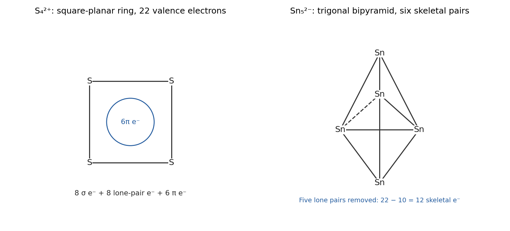

<h1 id="2/solution">Solution</h1>

↑ **Parent:** [2](../2.md)

**$\mathrm{S_4^{2+}}$ is approximately square planar; $\mathrm{Sn_5^{2-}}$ is a [closo](../../../../closo-cluster.md) trigonal bipyramid.** Both have 22 [valence electrons](../../../../valence-electron.md), $4(6)-2=22$ and $5(4)+2=22$, but their different local orbital requirements prevent inferring identical shapes from this total alone.

For the [sulfur](../../../../sulfur.md) ring, four S–S [sigma bonds](../../../../sigma-bond.md) use eight electrons and four in-plane [lone pairs](../../../../lone-pair.md) use another eight, leaving six electrons in the perpendicular cyclic pi system. The resulting filled bonding and degenerate nonbonding pi levels give a six-pi-electron aromatic description of a four-membered ring, consistent with equivalent S–S links in the ideal square. The out-of-plane p orbitals are retained; this is not a tetrahedral four-vertex [closo](../../../../closo-cluster.md) cage.

For [tin](../../../../tin.md), allocate one mainly s-rich [lone pair](../../../../lone-pair.md) to each atom. The remaining $22-5(2)=12$ electrons form six skeletal pairs, exactly $n+1$ for $n=5$. [Wade's rules](../../../../polyhedral-skeletal-electron-pair-theory.md) therefore predict a trigonal bipyramid, with three equatorial vertices and two axial vertices. The axial pair is not joined by a polyhedral edge; its bonding is part of the delocalized three-dimensional framework. The contrast is **a planar aromatic sigma/pi ring versus a three-dimensional multicentre-bonded [Zintl cluster](../../../../zintl-cluster.md)**, rather than cationic charge alone imposing planarity or anionic charge alone imposing a polyhedron.

**[Figure 2](#2/image-original-square-ring-and-trigonal-bipyramidal-models-with-their-different-allocations-of-the-same-22-valence-electrons). Original square-ring and trigonal-bipyramidal models with their different allocations of the same 22 valence electrons**.

## ↑ Ancestors (12)

1. [2](../2.md)
2. [Paper 1](../../paper-1-split.md)
3. [2022](../../split.md)
4. [Past exam of the chemistry course of the year 3 of the natural sciences course of the University of Cambridge](../../../split.md)
5. [Chemistry course of the year 3 of the natural sciences course of the University of Cambridge](../../../../chemistry-course-of-the-year-3-of-the-natural-sciences-course-of-the-university-of-cambridge.md)
6. [Year 3 of the natural sciences course of the University of Cambridge](../../../../year-3-of-the-natural-sciences-course-of-the-university-of-cambridge.md)
7. [Year of the natural sciences course of the University of Cambridge](../../../../year-of-the-natural-sciences-course-of-the-university-of-cambridge.md)
8. [Natural sciences course of the University of Cambridge](../../../../natural-sciences-course-of-the-university-of-cambridge.md)
9. [Course of the University of Cambridge](../../../../course-of-the-university-of-cambridge.md)
10. [University of Cambridge](../../../../university-of-cambridge-split.md)
11. [List of universities](../../../../list-of-universities.md)
12. [Codex Wiki](../../../../split.md)
