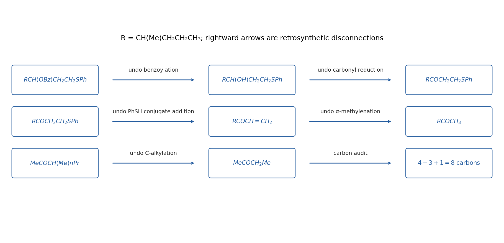

<h1 id="5/solution">Solution</h1>

↑ **Parent:** [5](../5.md)

Let $R=\mathrm{CH(Me)CH_2CH_2CH_3}$. The useful disconnections are **benzoate formation, [carbonyl reduction](../../../../carbonyl-reduction.md) and [thiol](../../../../thiol.md) conjugate addition**:

$$
\begin{aligned}
\mathrm{RCH(OCOPh)CH_2CH_2SPh}
&\Leftarrow\mathrm{RCH(OH)CH_2CH_2SPh}+\mathrm{PhCOCl}\\
&\Leftarrow\mathrm{RCOCH_2CH_2SPh}\\
&\Leftarrow\mathrm{RCOCH=CH_2}+\mathrm{PhSH}.
\end{aligned}
$$

The sulfur-bearing [carbon](../../../../carbon.md) is the enone beta [carbon](../../../../carbon.md), so this is a Michael disconnection, not attack of thiophenol on the alcohol-derived central [carbon](../../../../carbon.md). Reduce the saturated [ketone](../../../../ketone.md) with [sodium borohydride](../../../../sodium-borohydride.md) after installing SPh, then benzoylate the [alcohol](../../../../alcohol.md) with [benzoyl chloride](../../../../benzoyl-chloride.md) and pyridine or a tertiary amine.

Disconnect the enone to $\mathrm{RCOCH_3}$ and formaldehyde. Kinetic deprotonation on the methyl side of the hindered unsymmetrical [ketone](../../../../ketone.md), trapping with formaldehyde, and dehydration gives $\mathrm{RCOCH=CH_2}$. This order leaves the substituted $R$ side unchanged. An [alpha-methylenation](../../../../alpha-methylenation.md)/Mannich-base-elimination variant is an equivalent way of installing the terminal enone.

Finally, $\mathrm{RCOCH_3=CH_3COCH(Me)CH_2CH_2CH_3}$ disconnects by alpha alkylation to **[butan-2-one](../../../../butan-2-one.md) and 1-iodopropane**. Use the more substituted, ethyl-side [enolate](../../../../enolate.md) of [butan-2-one](../../../../butan-2-one.md) for this step, rather than its usual methyl-side [kinetic enolate](../../../../kinetic-enolate.md); an equilibrated/regioisomerically selected [enolate](../../../../enolate.md) or enol derivative is required, and the desired monoalkylated [ketone](../../../../ketone.md) should be isolated. Three carbons from propyl iodide and one from formaldehyde increase the original four-carbon [ketone](../../../../ketone.md) to the required eight-carbon [alcohol](../../../../alcohol.md)/thioether skeleton. Choosing ethyl iodide here would leave the target short by one [carbon](../../../../carbon.md).

This is a constitutional synthesis: the target drawing specifies no configuration at either newly formed stereogenic site, so no unproved stereoselective reduction or alkylation is needed. Regioisomeric [enolate alkylation](../../../../enolate-alkylation.md) and competing overalkylation are the practical selectivity issues to control, rather than something that follows from writing “base”.

**[Figure 4](#5/image-original-atom-counted-retrosynthetic-sequence-from-the-benzoate-thioether-target-back-to-butan-2-one). Original atom-counted retrosynthetic sequence from the benzoate/thioether target back to butan-2-one**.

## ↑ Ancestors (12)

1. [5](../5.md)
2. [Paper 1](../../paper-1-split.md)
3. [2022](../../split.md)
4. [Past exam of the chemistry course of the year 3 of the natural sciences course of the University of Cambridge](../../../split.md)
5. [Chemistry course of the year 3 of the natural sciences course of the University of Cambridge](../../../../chemistry-course-of-the-year-3-of-the-natural-sciences-course-of-the-university-of-cambridge.md)
6. [Year 3 of the natural sciences course of the University of Cambridge](../../../../year-3-of-the-natural-sciences-course-of-the-university-of-cambridge.md)
7. [Year of the natural sciences course of the University of Cambridge](../../../../year-of-the-natural-sciences-course-of-the-university-of-cambridge.md)
8. [Natural sciences course of the University of Cambridge](../../../../natural-sciences-course-of-the-university-of-cambridge.md)
9. [Course of the University of Cambridge](../../../../course-of-the-university-of-cambridge.md)
10. [University of Cambridge](../../../../university-of-cambridge-split.md)
11. [List of universities](../../../../list-of-universities.md)
12. [Codex Wiki](../../../../split.md)
