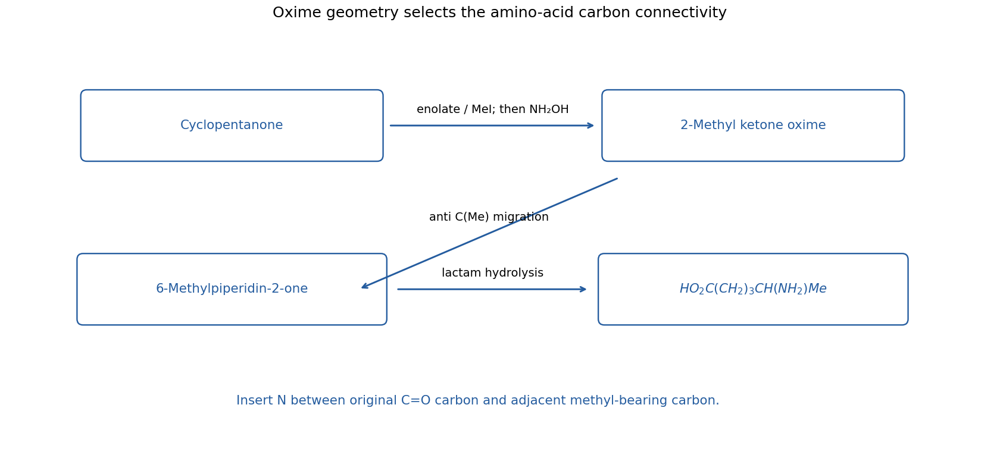

<h1 id="6/solution">Solution</h1>

↑ **Parent:** [6](../6.md)

The target is **[5-Aminohexanoic acid](../../../../5-aminohexanoic-acid.md), $\mathrm{HO_2C(CH_2)_3CH(NH_2)Me}$**. Disconnect its terminal amine/carboxylic-acid relationship through hydrolysis of **6-methylpiperidin-2-one**. This six-membered [lactam](../../../../lactam.md) follows from a regioselected Beckmann ring expansion of 2-methylcyclopentanone [oxime](../../../../oxime.md).

Start with [cyclopentanone](../../../../cyclopentanone.md). Form its [enolate](../../../../enolate.md) with [lithium diisopropylamide](../../../../lithium-diisopropylamide.md) in dry THF at low [temperature](../../../../temperature-split.md), add methyl iodide, then quench to obtain 2-methylcyclopentanone. Control the methyl iodide/base stoichiometry to suppress a second alkylation. React the [ketone](../../../../ketone.md) with hydroxylamine to form its [oxime](../../../../oxime.md) and select the geometrical [oxime](../../../../oxime.md) isomer in which the bond to the methyl-substituted adjacent ring [carbon](../../../../carbon.md) is anti to the departing [oxime](../../../../oxime.md) [oxygen](../../../../oxygen.md) group.

Activate the [oxime](../../../../oxime.md), for example under appropriate acid-promoted Beckmann conditions. The anti methyl-bearing C–C bond migrates onto [nitrogen](../../../../nitrogen.md) as the N–O-derived leaving group departs, inserting [nitrogen](../../../../nitrogen.md) **between the original [carbonyl](../../../../carbonyl-group.md) [carbon](../../../../carbon.md) and the methyl-substituted ring [carbon](../../../../carbon.md)**. Hydration/tautomerization gives 6-methylpiperidin-2-one. The opposite [oxime](../../../../oxime.md) geometry would insert [nitrogen](../../../../nitrogen.md) on the other side and ultimately place methyl at a different position in the amino acid; [oxime](../../../../oxime.md) geometry is therefore an essential part of this proposal.

Hydrolyse the [lactam](../../../../lactam.md) with aqueous acid and [heat](../../../../heat-split.md), then adjust the work-up to the desired acid/[ammonium](../../../../ammonium.md) form. Cleavage of its acyl–[nitrogen](../../../../nitrogen.md) bond opens the ring to $\mathrm{HO_2C(CH_2)_3CH(NH_2)Me}$ after suitable neutralization. All five original [cyclopentanone](../../../../cyclopentanone.md) carbons are retained, and the one methyl [carbon](../../../../carbon.md) comes from methyl iodide. A [racemic mixture](../../../../racemic-mixture.md) product is appropriate to the stereochemically unspecified target. The reaction sequence is an organic ring-expansion synthesis and requires no biological transformation.

**[Figure 5](#6/image-original-carbon-numbered-route-through-the-anti-oxime-and-ring-expanded-lactam-to-the-amino-acid). Original carbon-numbered route through the anti oxime and ring-expanded lactam to the amino acid**.

## ↑ Ancestors (12)

1. [6](../6.md)
2. [Paper 1](../../paper-1-split.md)
3. [2022](../../split.md)
4. [Past exam of the chemistry course of the year 3 of the natural sciences course of the University of Cambridge](../../../split.md)
5. [Chemistry course of the year 3 of the natural sciences course of the University of Cambridge](../../../../chemistry-course-of-the-year-3-of-the-natural-sciences-course-of-the-university-of-cambridge.md)
6. [Year 3 of the natural sciences course of the University of Cambridge](../../../../year-3-of-the-natural-sciences-course-of-the-university-of-cambridge.md)
7. [Year of the natural sciences course of the University of Cambridge](../../../../year-of-the-natural-sciences-course-of-the-university-of-cambridge.md)
8. [Natural sciences course of the University of Cambridge](../../../../natural-sciences-course-of-the-university-of-cambridge.md)
9. [Course of the University of Cambridge](../../../../course-of-the-university-of-cambridge.md)
10. [University of Cambridge](../../../../university-of-cambridge-split.md)
11. [List of universities](../../../../list-of-universities.md)
12. [Codex Wiki](../../../../split.md)
