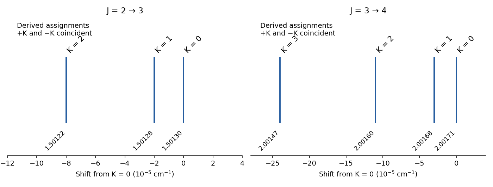
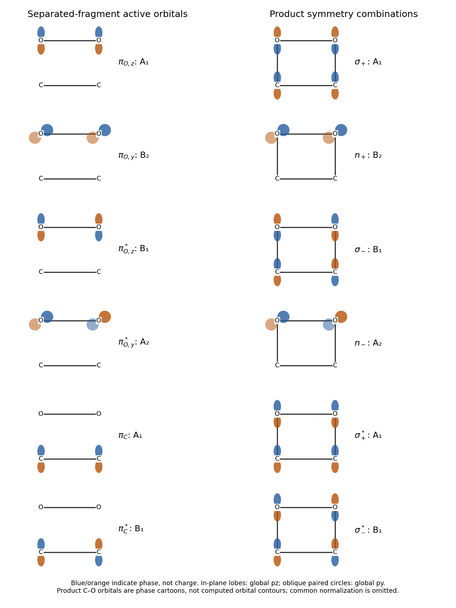
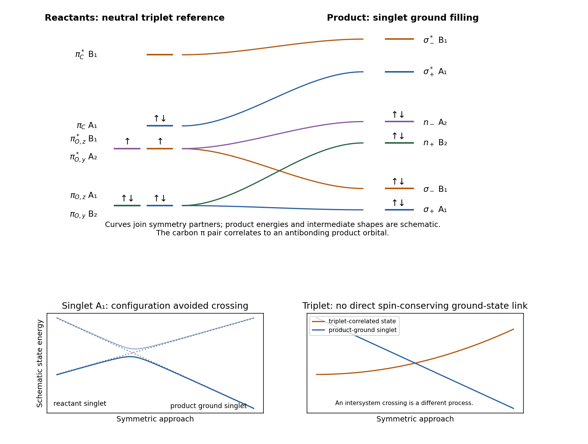
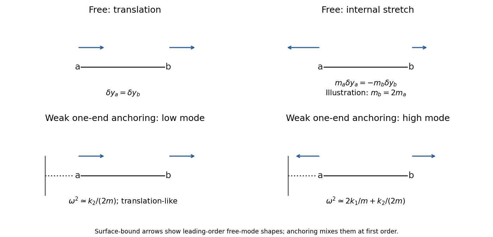

# Paper 2A

↑ **Parent:** [2022](../2022.md)

[Original paper, physical release pages 54–72; including both cover sheets](https://www.whatdotheyknow.com/request/nst_chemistry_past_papers_2022/response/2088679/attach/3/FOI%202022%20476%20Whittaker%20materials.pdf?cookie_passthrough=1#page=54)

**Table of contents**

- [Section A](#section-a)
  - [13](#section-a/13)
    - [Solution](#section-a/13/solution)
  - [14](#section-a/14)
    - [Solution](#section-a/14/solution)
  - [15](#section-a/15)
    - [a](#section-a/15/a)
      - [Solution](#section-a/15/a/solution)
    - [b](#section-a/15/b)
      - [Solution](#section-a/15/b/solution)
    - [c](#section-a/15/c)
      - [i](#section-a/15/c/i)
        - [Solution](#section-a/15/c/i/solution)
      - [ii](#section-a/15/c/ii)
        - [Solution](#section-a/15/c/ii/solution)
  - [16](#section-a/16)
    - [a](#section-a/16/a)
      - [Solution](#section-a/16/a/solution)
    - [b](#section-a/16/b)
      - [Solution](#section-a/16/b/solution)
    - [c](#section-a/16/c)
      - [Solution](#section-a/16/c/solution)
  - [17](#section-a/17)
    - [a](#section-a/17/a)
      - [Solution](#section-a/17/a/solution)
    - [b](#section-a/17/b)
      - [Solution](#section-a/17/b/solution)
    - [c](#section-a/17/c)
      - [Solution](#section-a/17/c/solution)
  - [18](#section-a/18)
    - [a](#section-a/18/a)
      - [Solution](#section-a/18/a/solution)
    - [b](#section-a/18/b)
      - [Solution](#section-a/18/b/solution)
  - [19](#section-a/19)
    - [a](#section-a/19/a)
      - [i](#section-a/19/a/i)
        - [Solution](#section-a/19/a/i/solution)
      - [ii](#section-a/19/a/ii)
        - [Solution](#section-a/19/a/ii/solution)
      - [iii](#section-a/19/a/iii)
        - [Solution](#section-a/19/a/iii/solution)
    - [b](#section-a/19/b)
      - [Solution](#section-a/19/b/solution)
  - [20](#section-a/20)
    - [a](#section-a/20/a)
      - [Solution](#section-a/20/a/solution)
    - [b](#section-a/20/b)
      - [Solution](#section-a/20/b/solution)
- [Section B](#section-b)
  - [21](#section-b/21)
    - [a](#section-b/21/a)
      - [i](#section-b/21/a/i)
        - [Solution](#section-b/21/a/i/solution)
      - [ii](#section-b/21/a/ii)
        - [Solution](#section-b/21/a/ii/solution)
      - [iii](#section-b/21/a/iii)
        - [Solution](#section-b/21/a/iii/solution)
      - [iv](#section-b/21/a/iv)
        - [Solution](#section-b/21/a/iv/solution)
    - [b](#section-b/21/b)
      - [i](#section-b/21/b/i)
        - [Solution](#section-b/21/b/i/solution)
      - [ii](#section-b/21/b/ii)
        - [Solution](#section-b/21/b/ii/solution)
  - [22](#section-b/22)
    - [a](#section-b/22/a)
      - [i](#section-b/22/a/i)
        - [Solution](#section-b/22/a/i/solution)
      - [ii](#section-b/22/a/ii)
        - [Solution](#section-b/22/a/ii/solution)
      - [iii](#section-b/22/a/iii)
        - [Solution](#section-b/22/a/iii/solution)
    - [b](#section-b/22/b)
      - [i](#section-b/22/b/i)
        - [Solution](#section-b/22/b/i/solution)
      - [ii](#section-b/22/b/ii)
        - [Solution](#section-b/22/b/ii/solution)
  - [23](#section-b/23)
    - [a](#section-b/23/a)
      - [Solution](#section-b/23/a/solution)
    - [b](#section-b/23/b)
      - [Solution](#section-b/23/b/solution)
    - [c](#section-b/23/c)
      - [Solution](#section-b/23/c/solution)
    - [d](#section-b/23/d)
      - [Solution](#section-b/23/d/solution)
    - [e](#section-b/23/e)
      - [Solution](#section-b/23/e/solution)
    - [f](#section-b/23/f)
      - [Solution](#section-b/23/f/solution)
    - [g](#section-b/23/g)
      - [Solution](#section-b/23/g/solution)
  - [24](#section-b/24)
    - [a](#section-b/24/a)
      - [i](#section-b/24/a/i)
        - [Solution](#section-b/24/a/i/solution)
      - [ii](#section-b/24/a/ii)
        - [Solution](#section-b/24/a/ii/solution)
      - [iii](#section-b/24/a/iii)
        - [Solution](#section-b/24/a/iii/solution)
    - [b](#section-b/24/b)
      - [i](#section-b/24/b/i)
        - [Solution](#section-b/24/b/i/solution)
      - [ii](#section-b/24/b/ii)
        - [Solution](#section-b/24/b/ii/solution)

## Section A

↑ **Parent:** [Paper 2A](paper-2a.md)

<h3 id="section-a/13">13</h3>

↑ **Parent:** [Section A](#section-a)

<h4 id="section-a/13/solution">Solution</h4>

↑ **Parent:** [13](#section-a/13)

Using mass $7\,\mathrm u$ for the dominant [lithium](../../chemical-substance.md#lithium) isotope gives a transition [wavenumber](../../wave-equation.md#wavenumber) $\widetilde\nu_0=14925\ \mathrm{cm^{-1}}$. Inserting the thermal speed into the stated [Doppler broadening](../../quantum-ideal-gas-statistics.md#doppler-broadening) expression gives

$$
\Delta\widetilde\nu_D={\widetilde\nu_0\over c}\sqrt{\frac{2k_BT\ln2}{m}}
\simeq0.128\ \mathrm{cm^{-1}}.
$$

The supplied formula is the Gaussian [half width at half maximum](../../analysis.md#half-width-at-half-maximum); the corresponding full width is about $0.256\ \mathrm{cm^{-1}}$. Meanwhile exponential population decay with lifetime $\tau$ produces a [natural linewidth](../../atomic-physics.md#natural-linewidth) expressed as a full width

$$
\delta\widetilde\nu_{\rm nat}=\frac{1}{2\pi c\tau}\simeq1.97\times10^{-4}\ \mathrm{cm^{-1}}.
$$

Here $c$ must be in $\mathrm{cm\,s^{-1}}$ in the second expression. Equivalently the fine-structure separation is about $9.0$ GHz, the Doppler half width about $3.83$ GHz, and the [natural linewidth](../../atomic-physics.md#natural-linewidth) expressed as a full width about $5.89$ MHz. The [natural linewidth](../../atomic-physics.md#natural-linewidth) is therefore negligible compared with thermal broadening; low density also makes collision broadening less important.

**The doublet is resolvable in principle, but only marginally against the Doppler width.** The separation exceeds one Doppler full width, so two components can survive, although their profiles overlap strongly. The $J=3/2$ and $J=1/2$ upper levels have different [statistical weights](../../quantum-mechanics.md#statistical-weight), so the weaker member need not make an equally conspicuous maximum. A [spectral resolving power](../../optical-instrument.md#spectral-resolving-power) $R\gtrsim\widetilde\nu_0/0.3\simeq5\times10^4$ is the basic instrumental requirement; a width well below $0.1\ \mathrm{cm^{-1}}$ and adequate signal would make the test more convincing. An arbitrarily fine spectrometer cannot remove the physical Doppler overlap. This conclusion uses the stipulated thermal, optically thin picture; additional photospheric velocity fields or optical-depth effects would require more information.

<h3 id="section-a/14">14</h3>

↑ **Parent:** [Section A](#section-a)

<h4 id="section-a/14/solution">Solution</h4>

↑ **Parent:** [14](#section-a/14)

Use the [D3h molecular point group](../../euclidean-geometry.md#d3h-molecular-point-group) for [phosphorus pentafluoride](../../chemical-substance.md#phosphorus-pentafluoride), with $z$ along the two axial P–F bonds. For each [symmetry](../../physics.md#symmetry-physics) operation, only atoms left in place contribute to the character of the Cartesian displacement representation; each contributes the trace of the corresponding $3\times3$ spatial [matrix](../../vector-space.md#matrix). In the class order $E,2C_3,3C_2',\sigma_h,2S_3,3\sigma_v$ this gives

$$
\chi_{3N}=(18,0,-2,4,-2,4).
$$

For example a $C_2'$ fixes P and one equatorial F, and each fixed atom has Cartesian trace $-1$, giving $-2$. [reflection](../../linear-algebra.md#reflection-mathematics) in the equatorial plane fixes four atoms, each with trace $1$, giving $4$. Reduction with the [character table](../../representation-theory.md#character-table) gives

$$
\Gamma_{3N}=2A_1'+A_2'+4E'+3A_2''+2E''.
$$

Subtract translations $E'+A_2''$ and rotations $A_2'+E''$ to obtain

$$
\boxed{\Gamma_{\rm vib}=2A_1'+3E'+2A_2''+E''.}
$$

Its dimension is $2+6+2+2=12=3(6)-6$, as required for a nonlinear six-atom molecule. Thus there are eight symmetry-distinct fundamental [frequencies](../../wave.md#frequency) in the harmonic picture, with each E mode doubly degenerate. This analysis concerns vibrations about one trigonal-bipyramidal minimum; it does not treat large-amplitude rearrangements between minima.

<h3 id="section-a/15">15</h3>

↑ **Parent:** [Section A](#section-a)

<h4 id="section-a/15/a">a</h4>

↑ **Parent:** [15](#section-a/15)

<h5 id="section-a/15/a/solution">Solution</h5>

↑ **Parent:** [A](#section-a/15/a)

The [octahedral splitting](../../chemistry.md#octahedral-splitting) $\Delta_o$ separates the metal $t_{2g}$ and $e_g$ orbital sets. The [Racah parameter](../../chemistry.md#racah-parameter) $B$ characterizes interelectronic repulsion and hence the spacing of many-electron d-shell terms; it is not another name for $\Delta_o$. A [Tanabe-Sugano diagram](../../chemistry.md#tanabe-sugano-diagram) plots term excitation energies $E/B$ against $\Delta_o/B$, for specified values of the other repulsion-parameter ratios. Each ordinate is measured relative to whichever term is the [ground state](../../quantum-mechanics.md#ground-state) at that field strength. The original many-electron treatment diagonalizes the relevant d-shell energy [matrices](../../vector-space.md#matrix) rather than identifying every [absorption](../../radiometry.md#absorption-electromagnetic-radiation) with a one-electron $t_{2g}\to e_g$ gap.[1954, pp. 753–766, d-shell energy matrices in a cubic field](../../chemistry-bibliography.md#on-the-absorption-spectra-of-complex-ions-i-by-yukito-tanabe-and-satoru-sugano)

<h4 id="section-a/15/b">b</h4>

↑ **Parent:** [15](#section-a/15)

<h5 id="section-a/15/b/solution">Solution</h5>

↑ **Parent:** [B](#section-a/15/b)

**The [ground state](../../quantum-mechanics.md#ground-state) changes from high-spin $t_{2g}^3e_g^2$, ${}^6A_{1g}$, to low-spin $t_{2g}^5$, ${}^2T_{2g}$.** The larger splitting eventually compensates the additional pairing cost. Because all plotted excitation energies are re-referenced to the new [ground state](../../quantum-mechanics.md#ground-state), the branches change slope at the crossover. The break is not an infinite physical excitation energy or a discontinuity of the underlying [Hamiltonian](../../hamiltonian-mechanics.md#hamiltonian).

<h4 id="section-a/15/c">c</h4>

↑ **Parent:** [15](#section-a/15)

<h5 id="section-a/15/c/i">i</h5>

↑ **Parent:** [C](#section-a/15/c)

<h6 id="section-a/15/c/i/solution">Solution</h6>

↑ **Parent:** [I](#section-a/15/c/i)

Here $\Delta_o/B=20$, so the ground term is ${}^6A_{1g}$. **There are no spin-allowed d–d bands in the displayed manifold under the [spin selection rule](../../atomic-physics.md#spin-selection-rule):** the excited terms shown have doublet or quartet rather than sextet [multiplicity](../../polynomial.md#multiplicity-mathematics). Very weak spin-forbidden [absorptions](../../radiometry.md#absorption-electromagnetic-radiation) can still gain intensity through spin–orbit coupling, and even spin-allowed d–d transitions would be forbidden by the [Laporte rule](../../quantum-mechanics.md#laporte-rule) in ideal centrosymmetric coordination. Thus a strong ordinary d–d spectrum should not be predicted simply by multiplying the splitting by a numerical factor. For scale, the lowest quartet branches read roughly $E/B\simeq17,23,33$ at this abscissa, corresponding to weak features around $1.4\times10^4$, $1.8\times10^4$ and $2.6\times10^4\ \mathrm{cm^{-1}}$ if such forbidden intensity is detectable. These are graphical estimates, not precision assignments of every weak line.

<h5 id="section-a/15/c/ii">ii</h5>

↑ **Parent:** [C](#section-a/15/c)

<h6 id="section-a/15/c/ii/solution">Solution</h6>

↑ **Parent:** [Ii](#section-a/15/c/ii)

Now $\Delta_o/B=40$ and the ground term is ${}^2T_{2g}$. Spin-conserving transitions to the labelled doublet excited terms are possible. Reading the diagram gives approximately

$$
\boxed{\begin{array}{c|c|c}
\text{upper term}&E/B&\widetilde\nu\ /\mathrm{cm^{-1}}\\ \hline
{}^2A_{2g},\ {}^2T_{1g}&35&2.8\times10^4\\
{}^2E_g&41&3.3\times10^4\\
{}^2A_{1g}&52&4.2\times10^4
\end{array}}
$$

The first two upper terms are coincident or unresolved at this diagram's resolution. These doublet transitions should dominate over the spin-forbidden transitions to sextet or quartet levels. Their intensity still depends on vibronic or other relaxation of the [Laporte rule](../../quantum-mechanics.md#laporte-rule). The plotted curves justify only approximate [wavenumbers](../../wave-equation.md#wavenumber), not several-digit band positions.

<h3 id="section-a/16">16</h3>

↑ **Parent:** [Section A](#section-a)

<h4 id="section-a/16/a">a</h4>

↑ **Parent:** [16](#section-a/16)

<h5 id="section-a/16/a/solution">Solution</h5>

↑ **Parent:** [A](#section-a/16/a)

Let $s=[S_1]$ and treat the quencher concentration as a constant reservoir. Weak steady excitation, one emitting population, and the three specified processes give

$$
\frac{ds}{dt}=I_{\rm abs}-(k_F+k_Q[Q])s=0,
\qquad s=\frac{I_{\rm abs}}{k_F+k_Q[Q]}.
$$

Dividing the [fluorescence](../../fluorescence.md) photon-production rate by the absorbed [photon](../../quantum-mechanics.md#photon) rate therefore gives

$$
\boxed{\phi_Q=\frac{k_Fs}{I_{\rm abs}}=\frac{k_F}{k_F+k_Q[Q]}.}
$$

This assumes no saturation, photochemical loss, reabsorption, static association or additional excited-state decay, and that each counted absorbed [photon](../../quantum-mechanics.md#photon) reaches the stated $S_1$ population. In this restricted scheme $\phi_0=1$ and the unquenched lifetime is $\tau_0=1/k_F$.

<h4 id="section-a/16/b">b</h4>

↑ **Parent:** [16](#section-a/16)

<h5 id="section-a/16/b/solution">Solution</h5>

↑ **Parent:** [B](#section-a/16/b)

Rearrangement gives the [Stern-Volmer equation](../../fluorescence.md#stern-volmer-equation)

$$
\boxed{\frac{\phi_0}{\phi_Q}=1+k_Q\tau_0[Q].}
$$

Thus a straight-line plot against $[Q]$ has unit intercept and slope $K_{\rm SV}=k_Q\tau_0$. **Determine $k_Q=K_{\rm SV}/\tau_0$ using an independently measured unquenched lifetime**, or use known $k_F$ in the restricted model. Yield measurements alone do not separate two unknown [rate constants](../../chemical-kinetics.md#rate-constant). Equivalently the slope of $1/\phi_Q$ is $k_Q/k_F$.

Use the absorbed intensity rather than incident intensity to normalize samples, and correct solvent/background signals, quencher [absorption](../../radiometry.md#absorption-electromagnetic-radiation) and [fluorescence](../../fluorescence.md) reabsorption. Under [dynamic fluorescence quenching](../../fluorescence.md#dynamic-fluorescence-quenching) the lifetime ratio should follow the same straight line as the yield ratio. A reduced intensity without the corresponding lifetime change suggests [static fluorescence quenching](../../fluorescence.md#static-fluorescence-quenching) or an optical artefact; curvature can also indicate multiple populations or more complicated kinetics.

<h4 id="section-a/16/c">c</h4>

↑ **Parent:** [16](#section-a/16)

<h5 id="section-a/16/c/solution">Solution</h5>

↑ **Parent:** [C](#section-a/16/c)

A quencher-independent intersystem-crossing rate adds to the unquenched decay rate:

$$
\phi_Q=\frac{k_F}{k_F+k_{\rm ISC}+k_Q[Q]},\qquad
\tau_0=\frac1{k_F+k_{\rm ISC}}.
$$

The normalized [Stern-Volmer equation](../../fluorescence.md#stern-volmer-equation) retains the same form, so **[intersystem crossing](../../energy-eigenvalue.md#intersystem-crossing) does not bias $k_Q$ if the actual unquenched lifetime is used**. It reduces $\phi_0$ below one and changes the slope through $\tau_0$; assuming $\tau_0=1/k_F$ would then give the wrong result. A quencher that itself changes [intersystem crossing](../../energy-eigenvalue.md#intersystem-crossing) or returns triplet population to the singlet requires a larger kinetic scheme.

<h3 id="section-a/17">17</h3>

↑ **Parent:** [Section A](#section-a)

<h4 id="section-a/17/a">a</h4>

↑ **Parent:** [17](#section-a/17)

<h5 id="section-a/17/a/solution">Solution</h5>

↑ **Parent:** [A](#section-a/17/a)

Writing $A(\mathbf r)=\phi_{1sA}(\mathbf r)$ and $B(\mathbf r)=\phi_{1sB}(\mathbf r)$, the normalized [determinant](../../multilinear-algebra.md#determinant) is

$$
\boxed{\Psi_{\rm UHF}={1\over\sqrt2}\left[A(\mathbf r_1)\alpha(\omega_1)B(\mathbf r_2)\beta(\omega_2)-B(\mathbf r_1)\beta(\omega_1)A(\mathbf r_2)\alpha(\omega_2)\right].}
$$

Its two [spin orbitals](../../tensor-product-of-quantum-systems.md#spin-orbital) are orthogonal because $\langle\alpha|\beta\rangle=0$, even if the spatial atomic functions have nonzero overlap. Exchanging both the spatial and spin coordinates of the two [electrons](../../physics.md#electron) reverses the sign, as required for fermionic antisymmetry.

<h4 id="section-a/17/b">b</h4>

↑ **Parent:** [17](#section-a/17)

<h5 id="section-a/17/b/solution">Solution</h5>

↑ **Parent:** [B](#section-a/17/b)

At this separation the [orbital overlap](../../chemistry.md#orbital-overlap) and interatomic [two-electron exchange integrals](../../chemistry.md#two-electron-exchange-integral) are negligible. Each localized [electron](../../physics.md#electron) then contributes essentially the isolated [hydrogen](../../chemical-substance.md#hydrogen) energy, while the interatomic electrostatic terms cancel to leading order for neutral fragments. Including nuclear repulsion in the molecular energy gives

$$
\boxed{E_{\rm UHF}\simeq2(-\tfrac12 E_h)=-1E_h\simeq-27.2\ \mathrm{eV}.}
$$

The closed-shell [RHF](../../chemistry.md#restricted-hartree-fock-method) [determinant](../../multilinear-algebra.md#determinant) instead doubly occupies $g\simeq(A+B)/\sqrt2$. It retains ionic configurations with both [electrons](../../physics.md#electron) on the same atom, even at dissociation. Using [atomic units](../../physics.md#atomic-units) and the [Hartree energy](../../physics.md#hartree-energy) in the stated unrelaxed hydrogenic 1s basis, the same-atom [two-electron Coulomb integral](../../chemistry.md#two-electron-coulomb-integral) is $J_{AA}=J_{BB}=5E_h/8$. Consequently at infinite separation

$$
E_{\rm RHF}\simeq-1+\tfrac14(J_{AA}+J_{BB})=-\frac{11}{16}E_h\simeq-18.7\ \mathrm{eV},
$$

where energies and integrals inside the first expression are in [atomic units](../../physics.md#atomic-units). It is much too high compared with two neutral atoms. Retaining the leading intersite Coulomb term at $R=10\ \text{Å}=18.90a_0$ gives $E_{\rm RHF}\simeq-11/16-1/(2R)\simeq-0.714E_h$, still about $0.286E_h$ above [UHF](../../chemistry.md#unrestricted-hartree-fock-method). The numerical [RHF](../../chemistry.md#restricted-hartree-fock-method) estimates specify the supplied fixed 1s basis; a larger optimized orbital space changes them. If nuclear repulsion is excluded by an electronic-energy convention, subtract the same $1/R$ from both quoted total molecular energies. The restricted/unrestricted comparison and their dissociation behaviour are unchanged.[1949, pp. 386–393, minimal atomic-1s molecular-orbital treatment](../../chemistry-bibliography.md#xxxiv-notes-on-the-molecular-orbital-treatment-of-the-hydrogen-molecule-by-charles-alfred-coulson-and-inga-fischer-hjalmars)

<h4 id="section-a/17/c">c</h4>

↑ **Parent:** [17](#section-a/17)

<h5 id="section-a/17/c/solution">Solution</h5>

↑ **Parent:** [C](#section-a/17/c)

**The fixed localized [determinant](../../multilinear-algebra.md#determinant) is unsuitable near equilibrium.** It does not develop the correct shared bonding orbital and is not a pure singlet: for one alpha and one beta orbital, $\langle S^2\rangle/\hbar^2=1-|\langle A|B\rangle|^2$, which is nonzero unless the occupied [spatial orbitals](../../tensor-product-of-quantum-systems.md#spatial-orbital) coincide. At dissociation it is an equal singlet/triplet mixture, though their energies become degenerate there. Near equilibrium the physical [ground state](../../quantum-mechanics.md#ground-state) is a bonding singlet. An optimized [UHF](../../chemistry.md#unrestricted-hartree-fock-method) calculation can recover the restricted, spin-pure solution by making its two occupied [spatial orbitals](../../tensor-product-of-quantum-systems.md#spatial-orbital) equal; that does not rescue the particular fixed atomic-orbital [determinant](../../multilinear-algebra.md#determinant) written here. A spin-adapted multideterminant description is needed to combine good bonding near equilibrium with correct singlet dissociation.

<h3 id="section-a/18">18</h3>

↑ **Parent:** [Section A](#section-a)

<h4 id="section-a/18/a">a</h4>

↑ **Parent:** [18](#section-a/18)

<h5 id="section-a/18/a/solution">Solution</h5>

↑ **Parent:** [A](#section-a/18/a)

Number the four sites of the [cyclobutadienyl dianion](../../chemical-substance.md#cyclobutadienyl-dianion) cyclically and apply the [Hückel method](../../chemistry.md#huckel-method). The [orthonormal](../../inner-product.md#orthonormal-set) pi basis gives

$$
H=\alpha I+\beta\begin{pmatrix}0&1&0&1\\1&0&1&0\\0&1&0&1\\1&0&1&0\end{pmatrix},\qquad \beta<0.
$$

A convenient real [orthonormal](../../inner-product.md#orthonormal-set) eigenbasis is

$$
\begin{array}{c|c|c}
E& (c_1,c_2,c_3,c_4)&\text{occupation}\\ \hline
\alpha+2\beta&\tfrac12(1,1,1,1)&2\\
\alpha&\tfrac1{\sqrt2}(1,0,-1,0)&2\\
\alpha&\tfrac1{\sqrt2}(0,1,0,-1)&2\\
\alpha-2\beta&\tfrac12(1,-1,1,-1)&0
\end{array}
$$

Thus **one bonding and two degenerate nonbonding orbitals are filled**, and the antibonding orbital is empty. There are six pi [electrons](../../physics.md#electron), including the two added by the dianion charge. Rotating the two occupied nonbonding orbitals within their degenerate subspace changes their individual sketches but not the total density [matrix](../../vector-space.md#matrix).

**[Figure 1](#section-a/18/a/image-original-orbital-levels-and-occupations-for-the-four-site-dianion-and-valence-o2). Original orbital levels and occupations for the four-site dianion and valence O2**.

<h4 id="section-a/18/b">b</h4>

↑ **Parent:** [18](#section-a/18)

<h5 id="section-a/18/b/solution">Solution</h5>

↑ **Parent:** [B](#section-a/18/b)

The [Hückel orbital charge density](../../chemistry.md#huckel-orbital-charge-density) and [Hückel pi bond order](../../chemistry.md#huckel-pi-bond-order) give

$$
n_i=\sum_k f_kc_{ik}^2,\qquad p_{ij}=\sum_k f_kc_{ik}c_{jk}.
$$

Each site receives $1/2$ [electron](../../physics.md#electron) from the lowest orbital and one from the occupied nonbonding subspace, so **$n_i=3/2$ at every [carbon](../../chemical-substance.md#carbon)**, summing to six. Relative to one neutral pi [electron](../../physics.md#electron) per [carbon](../../chemical-substance.md#carbon) this is a pi charge of $-e/2$ at each site.

For adjacent sites, only the lowest orbital contributes, giving **$p_{12}=p_{23}=p_{34}=p_{41}=1/2$**. For opposite sites the nonbonding contribution reverses the sign: **$p_{13}=p_{24}=-1/2$**. These non-neighbour negative density-matrix entries are not extra [sigma bonds](../../covalent-bond.md#sigma-bond) or extra resonance integrals in the [Hamiltonian](../../hamiltonian-mechanics.md#hamiltonian). If only skeletal nearest-neighbour [pi bond](../../covalent-bond.md#pi-bond) orders are requested, the four values $1/2$ are the relevant ones.

<h3 id="section-a/19">19</h3>

↑ **Parent:** [Section A](#section-a)

<h4 id="section-a/19/a">a</h4>

↑ **Parent:** [19](#section-a/19)

<h5 id="section-a/19/a/i">i</h5>

↑ **Parent:** [A](#section-a/19/a)

<h6 id="section-a/19/a/i/solution">Solution</h6>

↑ **Parent:** [I](#section-a/19/a/i)

**[configuration interaction with singles and doubles](../../chemistry.md#configuration-interaction-with-singles-and-doubles) ([CISD](../../chemistry.md#configuration-interaction-with-singles-and-doubles))** uses a linear combination of the reference [Slater determinant](../../tensor-product-of-quantum-systems.md#slater-determinant) and singly and doubly excited [determinants](../../multilinear-algebra.md#determinant). Its many-electron trial state is therefore not restricted to one [determinant](../../multilinear-algebra.md#determinant); the orbitals may be held fixed while the configuration coefficients are varied.

<h5 id="section-a/19/a/ii">ii</h5>

↑ **Parent:** [A](#section-a/19/a)

<h6 id="section-a/19/a/ii/solution">Solution</h6>

↑ **Parent:** [Ii](#section-a/19/a/ii)

**[Kohn-Sham equations](../../chemistry.md#kohn-sham-equations) in [density functional theory](../../chemistry.md#density-functional-theory)** use an auxiliary one-electron [Hamiltonian](../../hamiltonian-mechanics.md#hamiltonian) whose effective potential depends on the density. Its orbitals construct a density representing an interacting electronic system; this is distinct from explicitly diagonalizing a large many-electron [determinant](../../multilinear-algebra.md#determinant) [Hamiltonian](../../hamiltonian-mechanics.md#hamiltonian).[1965, pp. A1133–A1135, ground-state effective one-electron formulation](../../chemistry-bibliography.md#self-consistent-equations-including-exchange-and-correlation-effects-by-walter-kohn-and-lu-jeu-sham)

<h5 id="section-a/19/a/iii">iii</h5>

↑ **Parent:** [A](#section-a/19/a)

<h6 id="section-a/19/a/iii/solution">Solution</h6>

↑ **Parent:** [Iii](#section-a/19/a/iii)

**[molecular mechanics](../../chemistry.md#molecular-mechanics)** evaluates a parametrized potential of atomic positions, with terms such as bond stretching, angle bending, torsion and nonbonded interactions. [electrons](../../physics.md#electron) are represented implicitly through the fitted force field, rather than by electronic orbitals, a density or an electronic [wavefunction](../../wave-function.md). This example is different from both preceding electronic methods.

<h4 id="section-a/19/b">b</h4>

↑ **Parent:** [19](#section-a/19)

<h5 id="section-a/19/b/solution">Solution</h5>

↑ **Parent:** [B](#section-a/19/b)

For conventional [CISD](../../chemistry.md#configuration-interaction-with-singles-and-doubles), the leading matrix-vector contraction scales as $O(o^2v^4)$ in occupied and virtual orbital dimensions. If both grow proportionally to a system-size parameter $N$, the familiar estimate is **$O(N^6)$ work per iteration**; the iteration count and integral-storage strategy add implementation-dependent costs.

Calculated [potential energy surfaces](../../chemical-kinetics.md#potential-energy-surface) can predict equilibrium geometries and harmonic force constants, permitting comparison with diffraction-derived structures, [rotational constants](../../molecule.md#rotational-constant) and vibrational spectra. Calculating several roots or different charge states can also estimate excitation or [ionization energies](../../mathematical-physics.md#ionization-energy). Such predictions depend on basis and truncation quality; truncated [CI](../../chemistry.md#configuration-interaction) is not generally size extensive and is not automatically reliable for strongly multiconfigurational bond breaking. The quoted polynomial scaling is for [CISD](../../chemistry.md#configuration-interaction-with-singles-and-doubles), not full [configuration interaction](../../chemistry.md#configuration-interaction), whose [determinant](../../multilinear-algebra.md#determinant) space grows combinatorially.

<h3 id="section-a/20">20</h3>

↑ **Parent:** [Section A](#section-a)

<h4 id="section-a/20/a">a</h4>

↑ **Parent:** [20](#section-a/20)

<h5 id="section-a/20/a/solution">Solution</h5>

↑ **Parent:** [A](#section-a/20/a)

An **[alternant hydrocarbon](../../chemical-substance.md#alternant-hydrocarbon)** has a pi-site graph that can be divided into two sets so that every retained neighbouring resonance interaction joins different sets. Equivalently, the graph is bipartite. A chain and an even ring satisfy this condition; an odd ring does not. The classification refers to the model's coupling graph, rather than simply to which bonds are drawn double in one [Lewis structure](../../covalent-bond.md#lewis-structure).

<h4 id="section-a/20/b">b</h4>

↑ **Parent:** [20](#section-a/20)

<h5 id="section-a/20/b/solution">Solution</h5>

↑ **Parent:** [B](#section-a/20/b)

Write $H=\alpha I+K$ with the same [carbon](../../chemical-substance.md#carbon) diagonal parameter throughout, and define $P$ to have entries $+1$ on one sublattice and $-1$ on the other. Bipartite connectivity implies

$$
PKP=-K.
$$

Thus $Kc=\epsilon c$ implies $K(Pc)=-\epsilon(Pc)$. This proves **energy pairing about $\alpha$**, $E=\alpha\pm\epsilon$, and **equal site-probability magnitudes in each paired pair**, since $|(Pc)_i|^2=|c_i|^2$. This is the Coulson-Rushbrooke pairing property.[1940, pp. 193–200, alternant-system pairing and density properties](../../chemistry-bibliography.md#note-on-the-method-of-molecular-orbitals-by-charles-alfred-coulson-and-g-s-rushbrooke)

For the usual neutral half-filled closed-shell occupation, the lower member of each pair is doubly occupied. Combining paired coefficients with completeness of the [orthonormal basis](../../inner-product.md#orthonormal-basis) gives **one pi [electron](../../physics.md#electron) per [carbon](../../chemical-substance.md#carbon)**, so the model predicts no net pi charge separation. The same argument makes **off-diagonal [pi bond](../../covalent-bond.md#pi-bond) orders between sites on the same sublattice zero**. These statements assume a neutral half-filled density and do not apply unchanged to the charged six-electron four-site ion considered separately.

An imbalance of sublattice sizes also guarantees **at least $|N_A-N_B|$ nonbonding orbitals at energy $\alpha$**, because the rectangular coupling block has insufficient [rank](../../quadratic-form.md#rank-one-quadratic-form) to remove all its [null space](../../kernel-of-a-linear-map.md). None of the spectral pairing, equal paired densities, neutral charge uniformity or sublattice bond-order restrictions is required for a non-alternant graph. Long-range same-sublattice couplings or unequal diagonal parameters can likewise destroy the simple proof.

## Section B

↑ **Parent:** [Paper 2A](paper-2a.md)

<h3 id="section-b/21">21</h3>

↑ **Parent:** [Section B](#section-b)

<h4 id="section-b/21/a">a</h4>

↑ **Parent:** [21](#section-b/21)

<h5 id="section-b/21/a/i">i</h5>

↑ **Parent:** [A](#section-b/21/a)

<h6 id="section-b/21/a/i/solution">Solution</h6>

↑ **Parent:** [I](#section-b/21/a/i)

The coarse spacing is about $2\widetilde B$, so $\widetilde B\simeq0.25\ \mathrm{cm^{-1}}$. The two groups near 1.5 and $2.0\ \mathrm{cm^{-1}}$ therefore have **$J=2\to3$ and $J=3\to4$**, respectively. For positive $\widetilde D_{JK}$, increasing $K^2$ moves a component to lower [wavenumber](../../wave-equation.md#wavenumber). The assignments are

$$
\boxed{\begin{array}{c|c|c}
J\to J+1&K&\widetilde\nu\ /\mathrm{cm^{-1}}\\ \hline
2\to3&0&1.50130\\
&1&1.50128\\
&2&1.50122\\ \hline
3\to4&0&2.00171\\
&1&2.00168\\
&2&2.00160\\
&3&2.00147
\end{array}}
$$

Within one group, successive separations scale as $(K+1)^2-K^2=1,3,5,\ldots$. The observed gaps follow that pattern to their printed precision. There are $J+1$ distinct $|K|$ components because $|K|\leq J$ in the lower state; the $+K$ and $-K$ members remain coincident without an applied field. A high-resolution feature here is therefore not simply assigned to an arbitrary magnetic sublevel.

**[Figure 2](#section-b/21/a/i/image-derived-stick-assignments-of-the-two-rotational-groups-showing-the-k-squared-pattern). Derived stick assignments of the two rotational groups, showing the K-squared pattern**.

<h5 id="section-b/21/a/ii">ii</h5>

↑ **Parent:** [A](#section-b/21/a)

<h6 id="section-b/21/a/ii/solution">Solution</h6>

↑ **Parent:** [Ii](#section-b/21/a/ii)

The $K=0$ lines give two equations independent of $\widetilde D_{JK}$:

$$
1.50130=6\widetilde B-108\widetilde D_J,\qquad
2.00171=8\widetilde B-256\widetilde D_J.
$$

Solving yields **$\widetilde B\simeq0.25022\ \mathrm{cm^{-1}}$ and $\widetilde D_J\simeq2.1\times10^{-7}\ \mathrm{cm^{-1}}$**. The small distortion is obtained by subtracting close numbers, so its precision is considerably worse than that of $\widetilde B$.

For components in a fixed group,

$$
\widetilde\nu(J,0)-\widetilde\nu(J,K)=2\widetilde D_{JK}(J+1)K^2.
$$

For example the $J=2,K=2$ displacement gives $\widetilde D_{JK}=0.00008/24$, while $J=3,K=3$ gives $0.00024/72$. Both give **$\widetilde D_{JK}\simeq3.3\times10^{-6}\ \mathrm{cm^{-1}}$**; the smaller gaps are consistent after rounding. The pure rotational transitions have $\Delta K=0$, so the $(\widetilde A-\widetilde B)K^2$ and $\widetilde D_KK^4$ terms cancel. **Neither $\widetilde A$ nor $\widetilde D_K$ can be determined from these zero-field lines.**

<h5 id="section-b/21/a/iii">iii</h5>

↑ **Parent:** [A](#section-b/21/a)

<h6 id="section-b/21/a/iii/solution">Solution</h6>

↑ **Parent:** [Iii](#section-b/21/a/iii)

A spectral component shifts by the difference between its upper- and lower-level Stark shifts. With $\Delta J=+1$, $\Delta K=0$ and $\Delta M=q$, the supplied energy formula gives

$$
\delta\widetilde\nu=\frac{\mu E_{\rm field}}{hc}K\left[\frac{M+q}{(J+1)(J+2)}-\frac{M}{J(J+1)}\right].
$$

For radiation polarized parallel to the static field, $q=0$, so

$$
\boxed{\delta\widetilde\nu=-\frac{2\mu E_{\rm field}KM}{hc\,J(J+1)(J+2)}.}
$$

Thus **the assigned $K=0$ feature has no first-order splitting**, whereas the $K\ne0$ features acquire symmetrically arranged magnetic-sublevel components with spacings proportional to $|K|$. With perpendicular radiation, $q=\pm1$ gives the corresponding different allowed pattern. Recording field-dependent spectra with specified [polarization](../../wave.md#polarization-waves) would test both the J values and the K sequence; using an individual level's shift alone would not predict the observed line positions. Higher-order shifts of the nominally unsplit feature are outside this first-order test.

<h5 id="section-b/21/a/iv">iv</h5>

↑ **Parent:** [A](#section-b/21/a)

<h6 id="section-b/21/a/iv/solution">Solution</h6>

↑ **Parent:** [Iv](#section-b/21/a/iv)

The largest applied field gives

$$
\frac{\mu E_{\rm field}}{hc}=\frac{(1.6)(3.33564\times10^{-30})(10^4)}{(6.62607015\times10^{-34})(2.99792458\times10^{10})}
\simeq2.69\times10^{-3}\ \mathrm{cm^{-1}}.
$$

For parallel [polarization](../../wave.md#polarization-waves), adjacent allowed M values in a $J,K$ component are separated by

$$
\Delta_M\widetilde\nu=\frac{2(2.69\times10^{-3})|K|}{J(J+1)(J+2)}.
$$

Already at $K=1$ this is **$2.24\times10^{-4}\ \mathrm{cm^{-1}}$ for $J=2$** and **$8.96\times10^{-5}\ \mathrm{cm^{-1}}$ for $J=3$**. Both exceed the stated $2\times10^{-5}\ \mathrm{cm^{-1}}$ resolution, and larger $|K|$ gives larger first-order spacings. **The spectrometer should resolve suitable Stark components**, provided their physical linewidths and signal-to-noise permit it. This predicts resolvable splittings rather than incorrectly comparing the maximum level shift directly with instrumental resolution.

<h4 id="section-b/21/b">b</h4>

↑ **Parent:** [21](#section-b/21)

<h5 id="section-b/21/b/i">i</h5>

↑ **Parent:** [B](#section-b/21/b)

<h6 id="section-b/21/b/i/solution">Solution</h6>

↑ **Parent:** [I](#section-b/21/b/i)

A regularly repeated set of sharp features is characteristic of the unresolved **Q subbranches of a [perpendicular rovibrational band](../../molecule.md#perpendicular-rovibrational-band)**. The transition dipole is perpendicular to the [symmetry](../../physics.md#symmetry-physics) axis, giving $\Delta K=\pm1$; for the [Q branch](../../molecule.md#q-branch) $\Delta J=0$. Holding the [rotational constants](../../molecule.md#rotational-constant) fixed between vibrational states cancels the $BJ(J+1)$ term, leaving

$$
\widetilde\nu_Q=\widetilde\nu_v+(\widetilde A-\widetilde B)\big[(K\pm1)^2-K^2\big]
=\widetilde\nu_v+(\widetilde A-\widetilde B)(\pm2K+1).
$$

Many J transitions therefore coincide within each K-changing Q subbranch in this approximation. The different K subbranches are separated by

$$
\boxed{\Delta\widetilde\nu_Q=2(\widetilde A-\widetilde B).}
$$

The P and [R branches](../../molecule.md#r-branch) have $\Delta J=-1$ and $+1$, respectively. Their extra J-dependent terms spread many transitions across a broad background at modest resolution. A parallel band, with $\Delta K=0$, would not generate this repeated Q-subbranch spacing under the stated assumptions.

<h5 id="section-b/21/b/ii">ii</h5>

↑ **Parent:** [B](#section-b/21/b)

<h6 id="section-b/21/b/ii/solution">Solution</h6>

↑ **Parent:** [Ii](#section-b/21/b/ii)

The subbranch spacing gives $\widetilde A-\widetilde B=4.9\ \mathrm{cm^{-1}}$, hence **$\widetilde A\simeq5.15\ \mathrm{cm^{-1}}$**. Rotation about the C–I [symmetry](../../physics.md#symmetry-physics) axis has moment

$$
I_a=\frac{h}{8\pi^2c\widetilde A}\simeq5.44\times10^{-47}\ \mathrm{kg\,m^2}.
$$

C and I lie on this axis, so only the three [hydrogens](../../chemical-substance.md#hydrogen) contribute to $I_a$. If $\theta$ is the I–C–H angle, their perpendicular distances are $r_{\rm CH}\sin\theta$. Taking integer [hydrogen](../../chemical-substance.md#hydrogen) mass gives

$$
I_a=3m_Hr_{\rm CH}^2\sin^2\theta,\qquad
\sin^2\theta\simeq\frac{5.44\times10^{-47}}{3(1.66054\times10^{-27})(1.1\times10^{-10})^2}\simeq0.902.
$$

The molecular arrangement selects the obtuse solution, so **$\theta\simeq108^\circ$**. The supplementary acute angle describes the opposite axial direction, not the bond angle to iodine. This is a rigid-geometry estimate based on an effective [rotational constant](../../molecule.md#rotational-constant) and the stipulated bond length, rather than a precision equilibrium-structure measurement.

<h3 id="section-b/22">22</h3>

↑ **Parent:** [Section B](#section-b)

<h4 id="section-b/22/a">a</h4>

↑ **Parent:** [22](#section-b/22)

<h5 id="section-b/22/a/i">i</h5>

↑ **Parent:** [A](#section-b/22/a)

<h6 id="section-b/22/a/i/solution">Solution</h6>

↑ **Parent:** [I](#section-b/22/a/i)

In the Condon approximation the intensity from $v''=0$ to $v'$ contains the [Franck-Condon factor](../../atomic-physics.md#franck-condon-factor)

$$
|\langle\chi^A_{v'}|\chi^X_0\rangle|^2.
$$

The lower ground-state vibrational [wavefunction](../../wave-function.md) is localized near its equilibrium bond length. If the two equilibrium lengths are similar, it overlaps strongly with the upper $v'=0$ [wavefunction](../../wave-function.md), but its overlap with highly excited upper vibrational states is usually small or suffers oscillatory cancellation. If the equilibrium lengths differ enough that a vertical excitation reaches the outer portion of the upper well, high-$v'$ transitions can be strong while the $0\to0$ overlap is small. Thus **the two ends of a long progression are not normally both intense**. This is an overlap argument, not a ban on either set of transitions; anharmonicity, a varying electronic transition moment and unusual [wavefunctions](../../wave-function.md) can modify the intensity envelope.

<h5 id="section-b/22/a/ii">ii</h5>

↑ **Parent:** [A](#section-b/22/a)

<h6 id="section-b/22/a/ii/solution">Solution</h6>

↑ **Parent:** [Ii](#section-b/22/a/ii)

Write the upper [Morse oscillator](../../quantum-system.md#morse-oscillator) term values in [wavenumber](../../wave-equation.md#wavenumber) units as

$$
G(v)=\widetilde\omega_e(v+\tfrac12)-a(v+\tfrac12)^2,\qquad a=\widetilde\omega_ex_e.
$$

The spacing is $G(v+1)-G(v)=\widetilde\omega_e-2a(v+1)$. A [Birge-Sponer plot](../../quantum-system.md#birge-sponer-plot) therefore falls linearly in this model and can be extrapolated to zero spacing. If its horizontal coordinate is $x=v+1/2$, the plotted line is $y=(\widetilde\omega_e-a)-2ax$. Its area from $x=0$ to its zero gives

$$
\boxed{\widetilde D_0=\frac{(\widetilde\omega_e-a)^2}{4a}.}
$$

Equivalently a plot against $v+1$ has intercept $\widetilde\omega_e$ and triangle area $\widetilde D_e=\widetilde\omega_e^2/(4a)$; subtracting $G(0)=\widetilde\omega_e/2-a/4$ recovers $\widetilde D_0$. These conventions distinguish dissociation from the potential minimum and from the lowest vibrational level.

Measured consecutive members fix a local slope and intercept, so unobserved members can be supplied by extrapolation under an explicit spacing law. The upper-state limit on the [absorption](../../radiometry.md#absorption-electromagnetic-radiation) scale is $\widetilde\nu_{\rm lim}=\widetilde\nu_{00}+\widetilde D_0$. A local high-v fit can likewise estimate the remaining energy above an observed member without knowing its absolute v index. Near dissociation a real potential need not remain Morse-like, so an extrapolated triangle has model uncertainty; missing lines must not be silently assumed consecutive.

<h5 id="section-b/22/a/iii">iii</h5>

↑ **Parent:** [A](#section-b/22/a)

<h6 id="section-b/22/a/iii/solution">Solution</h6>

↑ **Parent:** [Iii](#section-b/22/a/iii)

Successive differences remove the unknown absolute origin and the unknown initial vibrational quantum number. The five spacings are $329.3$, $296.0$, $261.7$, $226.7$ and $190.7\ \mathrm{cm^{-1}}$. Plot them at relative mid-indices $x=n+1/2$. A straight-line fit gives

$$
\Delta\widetilde\nu(x)\simeq347.505-34.650x\quad\mathrm{cm^{-1}},\qquad x_*\simeq10.029.
$$

The curve reaches zero spacing at $x_*$. Since a quadratic Morse progression has a spacing equal to its derivative at the interval midpoint, integrating the fitted line from the first observed relative level $n=0$ to $x_*$ estimates the energy still needed to reach the continuous limit:

$$
\widetilde\nu_{\rm lim}\simeq56298.9+\int_0^{x_*}(347.505-34.650x)\,dx
=56298.9+\frac{347.505^2}{2(34.650)}
\simeq58041.5\ \mathrm{cm^{-1}}.
$$

Thus the appropriate graphical conclusion is **$\widetilde\nu_{\rm lim}\approx5.80\times10^4\ \mathrm{cm^{-1}}$**, not a many-digit threshold. Directly fitting a quadratic to the six measured transition positions puts its vertex at about $58042.8\ \mathrm{cm^{-1}}$, which checks the arithmetic but not the physical extrapolation law. The slight variation of second differences shows that extrapolating a constant anharmonicity beyond the observed range is approximate. No assignment of the arbitrary index n to an absolute upper-state v is needed.

**[Figure 3](#section-b/22/a/iii/image-original-relative-index-birge-sponer-extrapolation-and-the-inferred-progression-limit). Original relative-index Birge–Sponer extrapolation and the inferred progression limit**.

<h4 id="section-b/22/b">b</h4>

↑ **Parent:** [22](#section-b/22)

<h5 id="section-b/22/b/i">i</h5>

↑ **Parent:** [B](#section-b/22/b)

<h6 id="section-b/22/b/i/solution">Solution</h6>

↑ **Parent:** [I](#section-b/22/b/i)

Let $T_{v',v''}=T_e+G'(v')-G''(v'')$. For a fixed row, moving one column to the right therefore gives

$$
T_{v',v''+1}-T_{v',v''}=-\big[G''(v''+1)-G''(v'')\big]
=-\widetilde\omega_e''+2\widetilde\omega_e''x_e''(v''+1).
$$

Thus **adjacent-column entries decrease by the lower-state vibrational spacing**, independent of the upper-state row in the ideal model. If the positive difference is instead defined as left minus right, it is $\widetilde\omega_e''-2\widetilde\omega_e''x_e''(v''+1)$. Stating the subtraction direction prevents an artificial negative vibrational [frequency](../../wave.md#frequency).

<h5 id="section-b/22/b/ii">ii</h5>

↑ **Parent:** [B](#section-b/22/b)

<h6 id="section-b/22/b/ii/solution">Solution</h6>

↑ **Parent:** [Ii](#section-b/22/b/ii)

Averaging the left-minus-right differences across the three rows gives lower-state spacings of about $1613.0$ and $1591.7\ \mathrm{cm^{-1}}$. Their difference is $2\widetilde\omega_e''x_e''$, so

$$
\boxed{\widetilde\omega_e''x_e''\simeq10.7\ \mathrm{cm^{-1}},\qquad
\widetilde\omega_e''\simeq1634\ \mathrm{cm^{-1}}.}
$$

Similarly, averaging successive down-column differences across the three columns gives upper-state spacings of about $1750.3$ and $1710.7\ \mathrm{cm^{-1}}$. Hence

$$
\boxed{\widetilde\omega_e'x_e'\simeq19.8\ \mathrm{cm^{-1}},\qquad
\widetilde\omega_e'\simeq1790\ \mathrm{cm^{-1}}.}
$$

Using the first row and first column alone would give approximately $(1637,11)$ and $(1790,20.5)\ \mathrm{cm^{-1}}$, respectively. The small inconsistency between nominally identical spacings is already present in the entries; it should be treated as limited data/model precision rather than fitted by assigning different lower-state constants to different rows. Values near **$(1.63\times10^3,11)$ for the lower state and $(1.79\times10^3,20)$ for the upper state** express the supported precision.

<h3 id="section-b/23">23</h3>

↑ **Parent:** [Section B](#section-b)

<h4 id="section-b/23/a">a</h4>

↑ **Parent:** [23](#section-b/23)

<h5 id="section-b/23/a/solution">Solution</h5>

↑ **Parent:** [A](#section-b/23/a)

Choose x along O–O. The valence orbital order appropriate to O$_2$ is approximately

$$
2\sigma_g(2s)<2\sigma_u^*(2s)<3\sigma_g(2p_x)<1\pi_u(2p_y,2p_z)<1\pi_g^*(2p_y,2p_z)<3\sigma_u^*(2p_x).
$$

Its twelve valence [electrons](../../physics.md#electron) occupy

$$
\boxed{(2\sigma_g)^2(2\sigma_u^*)^2(3\sigma_g)^2(1\pi_u)^4(1\pi_{g,y}^*)^1(1\pi_{g,z}^*)^1.}
$$

The two degenerate pi-antibonding orbitals are singly occupied with parallel spins according to [Hund's rules](../../chemistry.md#hund-s-rules). Thus **$S=1$, [multiplicity](../../polynomial.md#multiplicity-mathematics) $2S+1=3$**, with three possible $M_S$ values. A triplet is a many-electron spin classification, not three [electrons](../../physics.md#electron) in one orbital. The resulting ground term is ${}^3\Sigma_g^-$. Exchange stabilization favours this triplet over the singlets formed within the same frontier-orbital manifold.

**[Figure 4](#section-b/23/a/image-original-valence-o2-diagram-with-the-two-singly-occupied-pi-antibonding-orbitals). Original valence-O2 diagram with the two singly occupied pi-antibonding orbitals**.

<h4 id="section-b/23/b">b</h4>

↑ **Parent:** [23](#section-b/23)

<h5 id="section-b/23/b/solution">Solution</h5>

↑ **Parent:** [B](#section-b/23/b)

The active set contains four [oxygen](../../chemical-substance.md#oxygen) pi orbitals and two [carbon](../../chemical-substance.md#carbon) pi orbitals, with **eight [electrons](../../physics.md#electron) in six orbitals**. The noninteracting levels, using the parameters inferred below, are

$$
\begin{array}{c|c|c}
\text{fragment orbitals}&E\ /\mathrm{eV}&\text{occupation}\\ \hline
\pi_{O,z},\ \pi_{O,y}&-16.1&2,2\\
\pi_{O,z}^*,\ \pi_{O,y}^*&-12.1&1,1\quad(\text{parallel spins})\\
\pi_C&-10.5&2\\
\pi_C^*&-5.5&0
\end{array}
$$

Each bonding [oxygen](../../chemical-substance.md#oxygen) orbital has equal-phase coefficients on its two O atoms; its antibonding partner reverses one coefficient. The two pi directions are z in the prospective ring plane and y perpendicular to it. [carbon](../../chemical-substance.md#carbon) pi and pi-star use z-directed [p orbitals](../../chemistry.md#p-orbital) with equal and opposite coefficient signs. In this separated-fragment comparison the occupations are those of neutral triplet O$_2$ plus neutral [ethene](../../polymer.md#ethylene). **Do not refill the combined list solely by energy**, which would move an [electron](../../physics.md#electron) between infinitely separated fragments and describe a charge-transfer state instead.

**[Figure 5](#section-b/23/b/image-original-signed-orbital-sketches-for-the-six-reactant-and-six-product-active-orbitals). Original signed-orbital sketches for the six reactant and six product active orbitals**.

<h4 id="section-b/23/c">c</h4>

↑ **Parent:** [23](#section-b/23)

<h5 id="section-b/23/c/solution">Solution</h5>

↑ **Parent:** [C](#section-b/23/c)

Use negative bonding [Hückel resonance integrals](../../chemistry.md#huckel-resonance-integral), $\beta_{OO}=-2.0$ and $\beta_{CC}=-2.5\ \mathrm{eV}$. The [oxygen](../../chemical-substance.md#oxygen) HOMO is pi-antibonding, whereas the [ethene](../../polymer.md#ethylene) HOMO is pi-bonding. The frozen-orbital Koopmans estimate therefore gives

$$
\alpha_O-\beta_{OO}\simeq-12.1,\qquad
\alpha_C+\beta_{CC}\simeq-10.5.
$$

Consequently **$\alpha_O\simeq-14.1\ \mathrm{eV}$ and $\alpha_C\simeq-8.0\ \mathrm{eV}$**. These [Hückel Coulomb parameters](../../chemistry.md#huckel-coulomb-parameter) are effective parameters of this spectroscopically calibrated model. Real [ionization energies](../../mathematical-physics.md#ionization-energy) include relaxation and correlation, so they are not exact [matrix](../../vector-space.md#matrix) elements of an isolated-atom [Hamiltonian](../../hamiltonian-mechanics.md#hamiltonian).

<h4 id="section-b/23/d">d</h4>

↑ **Parent:** [23](#section-b/23)

<h5 id="section-b/23/d/solution">Solution</h5>

↑ **Parent:** [D](#section-b/23/d)

Let $\sigma_L,\sigma_R$ be localized bonding orbitals of the two new C–O bonds, and let $\sigma_L^*,\sigma_R^*$ be their antibonding partners. Their [symmetry](../../physics.md#symmetry-physics) combinations are

$$
\sigma_\pm=\frac{\sigma_L\pm\sigma_R}{\sqrt2},\qquad
\sigma_\pm^*=\frac{\sigma_L^*\pm\sigma_R^*}{\sqrt2}.
$$

The two remaining active orbitals are out-of-ring [oxygen](../../chemical-substance.md#oxygen) lone-pair combinations, $n_\pm=(p_{y,L}\pm p_{y,R})/\sqrt2$. The opposite-phase combination $n_-$ is the HOMO in the supplied ordering and $n_+$ is HOMO−1. Both are filled, as are the two C–O bonding combinations, giving

$$
\boxed{(\sigma_+)^2(\sigma_-)^2(n_+)^2(n_-)^2(\sigma_+^*)^0(\sigma_-^*)^0.}
$$

The original active-orbital sketches show these phase relations, while the correlation diagram gives a qualitative energy ordering. Precise splittings between unrelated [symmetry](../../physics.md#symmetry-physics) blocks are not determined by the fragment [ionization energies](../../mathematical-physics.md#ionization-energy). The retained O–O [sigma bond](../../covalent-bond.md#sigma-bond), the C–C [sigma bond](../../covalent-bond.md#sigma-bond) and the other framework orbitals lie outside this six-orbital active comparison; the eight-electron count does not describe all valence [electrons](../../physics.md#electron) of the product.

<h4 id="section-b/23/e">e</h4>

↑ **Parent:** [23](#section-b/23)

<h5 id="section-b/23/e/solution">Solution</h5>

↑ **Parent:** [E](#section-b/23/e)

The symmetric approach preserves the [C2v molecular point group](../../euclidean-geometry.md#c2v-molecular-point-group) with its twofold axis z and mirror planes xz and yz. The molecular ring lies in xz. Classify orbitals by [reflection](../../linear-algebra.md#reflection-mathematics) signs $(\sigma_{xz},\sigma_{yz})$: $A_1=(+,+)$, $B_1=(+,-)$, $B_2=(-,+)$, $A_2=(-,-)$. With globally defined p-orbital phases the [molecular orbital correlation diagram](../../chemistry.md#molecular-orbital-correlation-diagram) gives

$$
\boxed{\begin{array}{c|c|c}
\text{reactant orbital}&C_{2v}&\text{product orbital}\\ \hline
\pi_{O,z}&A_1&\sigma_+\\
\pi_C&A_1&\sigma_+^*\\
\pi_{O,z}^*&B_1&\sigma_-\\
\pi_C^*&B_1&\sigma_-^*\\
\pi_{O,y}&B_2&n_+\\
\pi_{O,y}^*&A_2&n_-
\end{array}}
$$

Within either two-orbital [symmetry](../../physics.md#symmetry-physics) block the lower member remains correlated with the lower product member; the [non-crossing rule](../../quantum-mechanics.md#non-crossing-rule) prevents swapping their order through an ordinary same-symmetry crossing. Crossings between different [irreducible representations](../../representation-theory.md#irreducible-representation) are allowed. The crucial consequence is that the occupied [carbon](../../chemical-substance.md#carbon) pi orbital correlates to a C–O-antibonding combination, rather than both initially occupied $A_1$ orbitals becoming the two product bonding orbitals.

**[Figure 6](#section-b/23/e/image-original-six-orbital-correlation-and-schematic-state-correlation-for-the-symmetric-oxygen-addition). Original six-orbital correlation and schematic state correlation for the symmetric oxygen addition**.

<h4 id="section-b/23/f">f</h4>

↑ **Parent:** [23](#section-b/23)

<h5 id="section-b/23/f/solution">Solution</h5>

↑ **Parent:** [F](#section-b/23/f)

**Endpoint energies, endpoint phase patterns and a conserved [symmetry](../../physics.md#symmetry-physics) fix the qualitative connectivity.** Each initial orbital must end in the appropriate product [symmetry](../../physics.md#symmetry-physics) block, and the ordering within a generic block is preserved by avoided crossings. The two singleton blocks $A_2$ and $B_2$ have unique partners. No numerical calculation at each intermediate separation is required to draw those connections.

This conclusion is limited to a correlation diagram: it does not determine intermediate orbital energies, interaction strengths, the location or height of a [reaction energy barrier](../../chemical-kinetics.md#reaction-energy-barrier), or the lowest route on a multidimensional [potential energy surface](../../chemical-kinetics.md#potential-energy-surface). If the reaction breaks the assumed [symmetry](../../physics.md#symmetry-physics), previously distinct [symmetry](../../physics.md#symmetry-physics) blocks can mix and the diagram must be reconsidered.

<h4 id="section-b/23/g">g</h4>

↑ **Parent:** [23](#section-b/23)

<h5 id="section-b/23/g/solution">Solution</h5>

↑ **Parent:** [G](#section-b/23/g)

In the [electronic state correlation diagram](../../chemical-kinetics.md#electronic-state-correlation-diagram), the singly occupied reactant orbitals for triplet [oxygen](../../chemical-substance.md#oxygen) have [symmetries](../../physics.md#symmetry-physics) $B_1$ and $A_2$, so their spatial product is $B_2$. The reactant state is therefore a triplet ${}^3B_2$, whereas the closed-shell product is ${}^1A_1$. **A strictly spin-conserving path cannot correlate triplet reactants directly to the ground-state product.** It correlates to an excited triplet product configuration or requires [intersystem crossing](../../energy-eigenvalue.md#intersystem-crossing); the symmetric direct reaction consequently has a substantial electronic obstacle.

Simply changing the [oxygen](../../chemical-substance.md#oxygen) spin does not repair the occupied carbon-orbital correlation. The lowest [oxygen](../../chemical-substance.md#oxygen) singlet manifold has spatial components of $A_1$ and $B_2$ [symmetry](../../physics.md#symmetry-physics) in this subgroup. The $A_1$ singlet can have an avoided crossing with another $A_1$ configuration and reach the product singlet; the $B_2$ singlet cannot mix directly with the product ${}^1A_1$ while $C_{2v}$ is maintained. Following either closed-shell [oxygen](../../chemical-substance.md#oxygen) singlet component in the orbital diagram still leaves the carbon-pi [electron](../../physics.md#electron) pair in the rising $\sigma_+^*$ orbital. Its redistribution into the final occupied orbitals requires configuration mixing at an avoided crossing. **A barrier is therefore expected even for the symmetry-constrained concerted singlet addition; singlet does not imply barrierless.** The state curves in the original diagram are schematic, illustrating this avoided-crossing argument rather than computed energies.[1969, orbital and state correlation for concerted olefin additions](../../chemistry-bibliography.md#selection-rules-for-singlet-oxygen-reactions-concerted-addition-reactions-by-david-r-kearns)

The real singlet reaction can lower this obstacle through asymmetric or stepwise pathways that are absent from the stipulated direct approach. A primary multireference study explicitly distinguishes singlet and triplet addition through biradical intermediates, supporting that limitation of a one-coordinate [symmetry](../../physics.md#symmetry-physics) argument.[2010, abstract and calculated addition/isomerization surfaces](../../chemistry-bibliography.md#singlet-and-triplet-potential-surfaces-for-the-o2-plus-c2h4-reaction-by-kyoyeon-park-and-others) Neither correlation alone nor a spin label supplies a numerical [activation energy](../../chemical-kinetics.md#activation-energy).

<h3 id="section-b/24">24</h3>

↑ **Parent:** [Section B](#section-b)

<h4 id="section-b/24/a">a</h4>

↑ **Parent:** [24](#section-b/24)

<h5 id="section-b/24/a/i">i</h5>

↑ **Parent:** [A](#section-b/24/a)

<h6 id="section-b/24/a/i/solution">Solution</h6>

↑ **Parent:** [I](#section-b/24/a/i)

The missing kinetic contribution is **$\tfrac12m_b\dot y_b^2$**. Both atoms contribute independent translational kinetic energy before the coordinates are changed.

<h5 id="section-b/24/a/ii">ii</h5>

↑ **Parent:** [A](#section-b/24/a)

<h6 id="section-b/24/a/ii/solution">Solution</h6>

↑ **Parent:** [Ii](#section-b/24/a/ii)

Substituting $y_i=q_i/\sqrt{m_i}$ gives

$$
\boxed{E=\frac12\dot q_a^2+\frac12\dot q_b^2+
\frac{k_1}{2}\left(\frac{q_b}{\sqrt{m_b}}-\frac{q_a}{\sqrt{m_a}}-\bar r\right)^2.}
$$

The shifted equilibrium coordinates satisfy $\bar q_b/\sqrt{m_b}-\bar q_a/\sqrt{m_a}=\bar r$. Expanding about them replaces q by displacements without changing the kinetic metric or the Hessian.

<h5 id="section-b/24/a/iii">iii</h5>

↑ **Parent:** [A](#section-b/24/a)

<h6 id="section-b/24/a/iii/solution">Solution</h6>

↑ **Parent:** [Iii](#section-b/24/a/iii)

Taking the Hessian of the potential with respect to mass-weighted displacements gives

$$
\boxed{D_0=k_1\begin{pmatrix}1/m_a&-1/\sqrt{m_am_b}\\-1/\sqrt{m_am_b}&1/m_b\end{pmatrix}.}
$$

The equations of motion are $\ddot{\boldsymbol q}=-D_0\boldsymbol q$, so [eigenvalues](../../linear-operator-theory.md#eigenvalue) are squared [angular frequencies](../../lagrangian-mechanics.md#angular-frequency). Normalized [eigenvectors](../../linear-operator-theory.md#eigenvector) and [frequencies](../../wave.md#frequency) are

$$
\boxed{u_T=\frac{(\sqrt{m_a},\sqrt{m_b})}{\sqrt{m_a+m_b}},\quad\omega_T=0;\qquad
u_S=\frac{(\sqrt{m_b},-\sqrt{m_a})}{\sqrt{m_a+m_b}},\quad
\omega_S=\sqrt{k_1\left(\frac1{m_a}+\frac1{m_b}\right)}=\sqrt{\frac{k_1}{\mu}}.}
$$

Both vectors are in the q basis, and $\mu=m_am_b/(m_a+m_b)$. The translation corresponds to equal physical displacements $\delta y_a=\delta y_b$. The stretch has $m_a\delta y_a+m_b\delta y_b=0$ and opposite physical displacements with magnitude ratio $|\delta y_a/\delta y_b|=m_b/m_a$. Ordinary [frequencies](../../wave.md#frequency) are $\nu=\omega/(2\pi)$; [spectroscopic wavenumbers](../../wave-equation.md#spectroscopic-wavenumber) are $\omega/(2\pi c)$.

**[Figure 7](#section-b/24/a/iii/image-original-normal-mode-displacements-for-free-and-weakly-surface-bound-diatomic-models). Original normal mode displacements for free and weakly surface-bound diatomic models**.

<h4 id="section-b/24/b">b</h4>

↑ **Parent:** [24](#section-b/24)

<h5 id="section-b/24/b/i">i</h5>

↑ **Parent:** [B](#section-b/24/b)

<h6 id="section-b/24/b/i/solution">Solution</h6>

↑ **Parent:** [I](#section-b/24/b/i)

With equal masses m, the two mass-weighted Hessians are

$$
\boxed{D_{(1)}=\frac1m\begin{pmatrix}k_1+k_2&-k_1\\-k_1&k_1\end{pmatrix},\qquad
D_{(2)}=\frac1m\begin{pmatrix}k_1+k_3&-k_1\\-k_1&k_1+k_3\end{pmatrix}.}
$$

For a uniform displacement vector $t=(1,1)$,

$$
D_{(1)}t=\frac1m(k_2,0),\qquad D_{(2)}t=\frac{k_3}{m}(1,1).
$$

Therefore **uniform translation is not a [normal mode](../../wave-equation.md#normal-mode) in orientation (1)** when $k_2\ne0$: anchoring only one atom mixes translation with internal stretching. **It is an exact [normal mode](../../wave-equation.md#normal-mode) displacement in orientation (2)** because both atoms have identical restoring terms. Its [frequency](../../wave.md#frequency) is nevertheless nonzero, $\omega_T=\sqrt{k_3/m}$; the antisymmetric stretch has $\omega_S=\sqrt{(2k_1+k_3)/m}$. The rigid surface breaks free translational invariance in both orientations. A vector resembling a uniform translation need not be a zero-frequency mode when the molecule is anchored.

<h5 id="section-b/24/b/ii">ii</h5>

↑ **Parent:** [B](#section-b/24/b)

<h6 id="section-b/24/b/ii/solution">Solution</h6>

↑ **Parent:** [Ii](#section-b/24/b/ii)

For weak anchoring, $k_2\ll k_1$, use the normalized free-molecule [eigenvectors](../../linear-operator-theory.md#eigenvector) $u_T=(1,1)/\sqrt2$ and $u_S=(1,-1)/\sqrt2$. The perturbation is

$$
\delta D=\frac{k_2}{m}\begin{pmatrix}1&0\\0&0\end{pmatrix}.
$$

Its diagonal [matrix](../../vector-space.md#matrix) elements in this basis are both $k_2/(2m)$. First-order [time-independent perturbation theory](../../quantum-mechanics.md#time-independent-perturbation-theory) for the [eigenvalues](../../linear-operator-theory.md#eigenvalue) therefore gives

$$
\boxed{\omega_T^2\simeq\frac{k_2}{2m},\qquad
\omega_S^2\simeq\frac{2k_1}{m}+\frac{k_2}{2m}.}
$$

Hence **$\omega_T\simeq\sqrt{k_2/(2m)}$** and **$\omega_S\simeq\sqrt{2k_1/m}\,[1+k_2/(8k_1)]$**. The zero free translation requires taking a square root of its new [eigenvalue](../../linear-operator-theory.md#eigenvalue), rather than Taylor-expanding the [frequency](../../wave.md#frequency) about zero. It is not a degenerate [eigenvalue](../../linear-operator-theory.md#eigenvalue) in the stipulated one-dimensional two-coordinate model.

As a check, the exact squared [frequencies](../../wave.md#frequency) are

$$
\omega_\pm^2=\frac{2k_1+k_2\pm\sqrt{4k_1^2+k_2^2}}{2m}.
$$

Expansion gives the same first-order results; the next lower-mode correction is $-k_2^2/(8k_1m)$. The perturbed [eigenvectors](../../linear-operator-theory.md#eigenvector) contain small translation/stretch admixtures of order $k_2/(4k_1)$, consistent with the failure of uniform translation to remain an exact mode in orientation (1).

## ↑ Ancestors (10)

1. [2022](../2022.md)
2. [Past exam of the chemistry course of the year 3 of the natural sciences course of the University of Cambridge](../../past-exam-of-the-chemistry-course-of-the-year-3-of-the-natural-sciences-course-of-the-university-of-cambridge.md)
3. [Chemistry course of the year 3 of the natural sciences course of the University of Cambridge](../../university-of-cambridge.md#chemistry-course-of-the-year-3-of-the-natural-sciences-course-of-the-university-of-cambridge)
4. [Year 3 of the natural sciences course of the University of Cambridge](../../university-of-cambridge.md#year-3-of-the-natural-sciences-course-of-the-university-of-cambridge)
5. [Year of the natural sciences course of the University of Cambridge](../../university-of-cambridge.md#year-of-the-natural-sciences-course-of-the-university-of-cambridge)
6. [Natural sciences course of the University of Cambridge](../../university-of-cambridge.md#natural-sciences-course-of-the-university-of-cambridge)
7. [Course of the University of Cambridge](../../university-of-cambridge.md#course-of-the-university-of-cambridge)
8. [University of Cambridge](../../university-of-cambridge.md)
9. [List of universities](../../README.md#list-of-universities)
10. [Codex Wiki](../../README.md)
