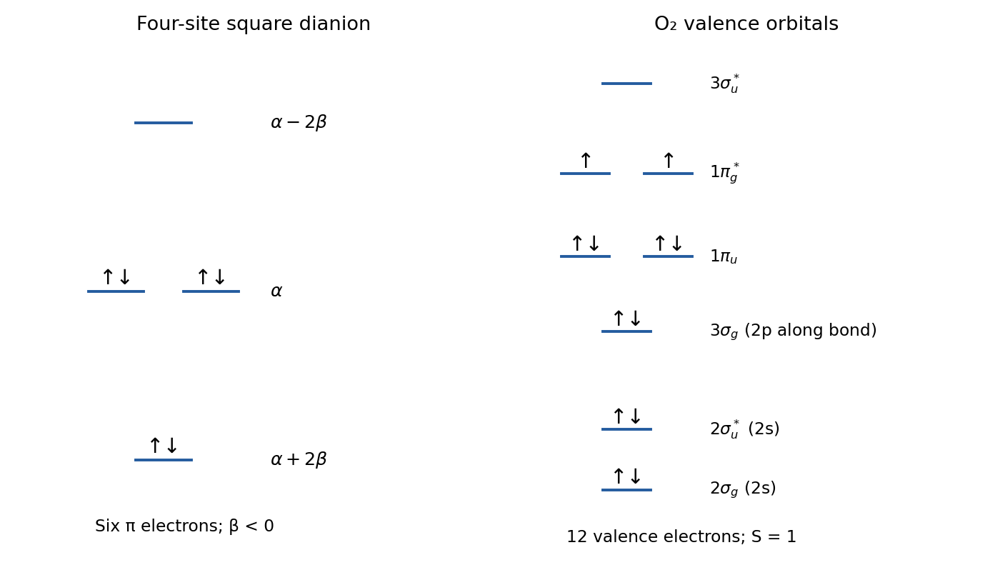

<h1 id="section-a/18/a/solution">Solution</h1>

↑ **Parent:** [A](../a.md)

Number the four sites of the [cyclobutadienyl dianion](../../../../../../cyclobutadienyl-dianion.md) cyclically and apply the [Hückel method](../../../../../../huckel-method.md). The [orthonormal](../../../../../../orthonormal-set.md) pi basis gives

$$
H=\alpha I+\beta\begin{pmatrix}0&1&0&1\\1&0&1&0\\0&1&0&1\\1&0&1&0\end{pmatrix},\qquad \beta<0.
$$

A convenient real [orthonormal](../../../../../../orthonormal-set.md) eigenbasis is

$$
\begin{array}{c|c|c}
E& (c_1,c_2,c_3,c_4)&\text{occupation}\\ \hline
\alpha+2\beta&\tfrac12(1,1,1,1)&2\\
\alpha&\tfrac1{\sqrt2}(1,0,-1,0)&2\\
\alpha&\tfrac1{\sqrt2}(0,1,0,-1)&2\\
\alpha-2\beta&\tfrac12(1,-1,1,-1)&0
\end{array}
$$

Thus **one bonding and two degenerate nonbonding orbitals are filled**, and the antibonding orbital is empty. There are six pi [electrons](../../../../../../electron.md), including the two added by the dianion charge. Rotating the two occupied nonbonding orbitals within their degenerate subspace changes their individual sketches but not the total density [matrix](../../../../../../matrix.md).

**[Figure 1](#section-a/18/a/image-original-orbital-levels-and-occupations-for-the-four-site-dianion-and-valence-o2). Original orbital levels and occupations for the four-site dianion and valence O2**.

## ↑ Ancestors (14)

1. [A](../a.md)
2. [18](../../18.md)
3. [Section A](../../../section-a.md)
4. [Paper 2A](../../../../paper-2a-split.md)
5. [2022](../../../../split.md)
6. [Past exam of the chemistry course of the year 3 of the natural sciences course of the University of Cambridge](../../../../../split.md)
7. [Chemistry course of the year 3 of the natural sciences course of the University of Cambridge](../../../../../../chemistry-course-of-the-year-3-of-the-natural-sciences-course-of-the-university-of-cambridge.md)
8. [Year 3 of the natural sciences course of the University of Cambridge](../../../../../../year-3-of-the-natural-sciences-course-of-the-university-of-cambridge.md)
9. [Year of the natural sciences course of the University of Cambridge](../../../../../../year-of-the-natural-sciences-course-of-the-university-of-cambridge.md)
10. [Natural sciences course of the University of Cambridge](../../../../../../natural-sciences-course-of-the-university-of-cambridge.md)
11. [Course of the University of Cambridge](../../../../../../course-of-the-university-of-cambridge.md)
12. [University of Cambridge](../../../../../../university-of-cambridge-split.md)
13. [List of universities](../../../../../../list-of-universities.md)
14. [Codex Wiki](../../../../../../split.md)
