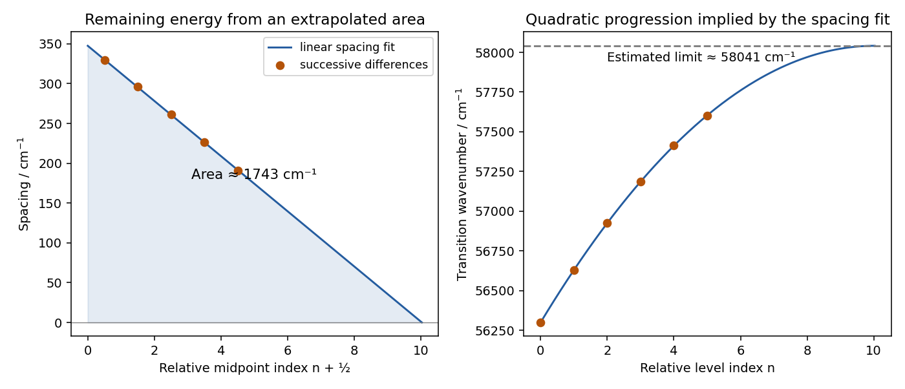

<h1 id="section-b/22/a/iii/solution">Solution</h1>

↑ **Parent:** [Iii](../iii.md)

Successive differences remove the unknown absolute origin and the unknown initial vibrational quantum number. The five spacings are $329.3$, $296.0$, $261.7$, $226.7$ and $190.7\ \mathrm{cm^{-1}}$. Plot them at relative mid-indices $x=n+1/2$. A straight-line fit gives

$$
\Delta\widetilde\nu(x)\simeq347.505-34.650x\quad\mathrm{cm^{-1}},\qquad x_*\simeq10.029.
$$

The curve reaches zero spacing at $x_*$. Since a quadratic Morse progression has a spacing equal to its derivative at the interval midpoint, integrating the fitted line from the first observed relative level $n=0$ to $x_*$ estimates the energy still needed to reach the continuous limit:

$$
\widetilde\nu_{\rm lim}\simeq56298.9+\int_0^{x_*}(347.505-34.650x)\,dx
=56298.9+\frac{347.505^2}{2(34.650)}
\simeq58041.5\ \mathrm{cm^{-1}}.
$$

Thus the appropriate graphical conclusion is **$\widetilde\nu_{\rm lim}\approx5.80\times10^4\ \mathrm{cm^{-1}}$**, not a many-digit threshold. Directly fitting a quadratic to the six measured transition positions puts its vertex at about $58042.8\ \mathrm{cm^{-1}}$, which checks the arithmetic but not the physical extrapolation law. The slight variation of second differences shows that extrapolating a constant anharmonicity beyond the observed range is approximate. No assignment of the arbitrary index n to an absolute upper-state v is needed.

**[Figure 3](#section-b/22/a/iii/image-original-relative-index-birge-sponer-extrapolation-and-the-inferred-progression-limit). Original relative-index Birge–Sponer extrapolation and the inferred progression limit**.

## ↑ Ancestors (15)

1. [Iii](../iii.md)
2. [A](../../a.md)
3. [22](../../../22.md)
4. [Section B](../../../../section-b.md)
5. [Paper 2A](../../../../../paper-2a-split.md)
6. [2022](../../../../../split.md)
7. [Past exam of the chemistry course of the year 3 of the natural sciences course of the University of Cambridge](../../../../../../split.md)
8. [Chemistry course of the year 3 of the natural sciences course of the University of Cambridge](../../../../../../../chemistry-course-of-the-year-3-of-the-natural-sciences-course-of-the-university-of-cambridge.md)
9. [Year 3 of the natural sciences course of the University of Cambridge](../../../../../../../year-3-of-the-natural-sciences-course-of-the-university-of-cambridge.md)
10. [Year of the natural sciences course of the University of Cambridge](../../../../../../../year-of-the-natural-sciences-course-of-the-university-of-cambridge.md)
11. [Natural sciences course of the University of Cambridge](../../../../../../../natural-sciences-course-of-the-university-of-cambridge.md)
12. [Course of the University of Cambridge](../../../../../../../course-of-the-university-of-cambridge.md)
13. [University of Cambridge](../../../../../../../university-of-cambridge-split.md)
14. [List of universities](../../../../../../../list-of-universities.md)
15. [Codex Wiki](../../../../../../../split.md)
