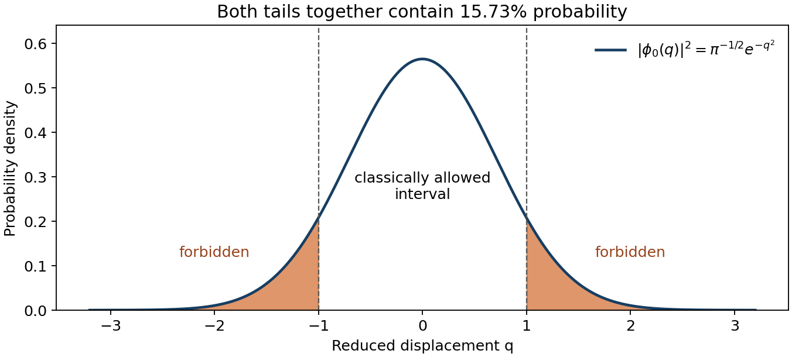
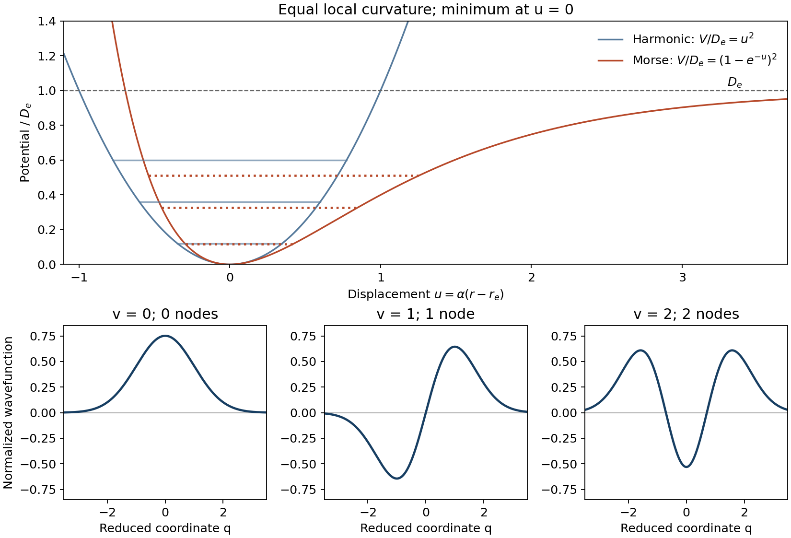
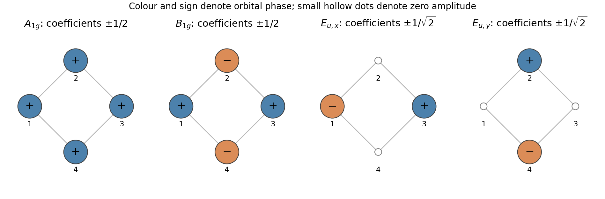
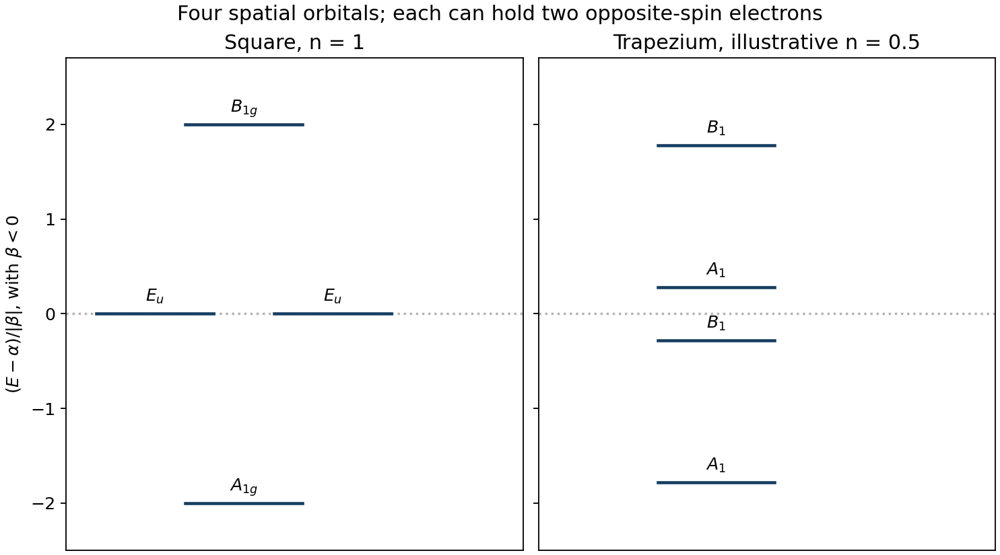
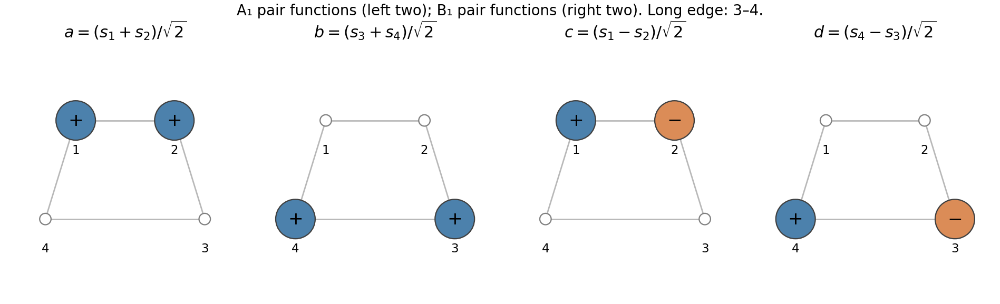
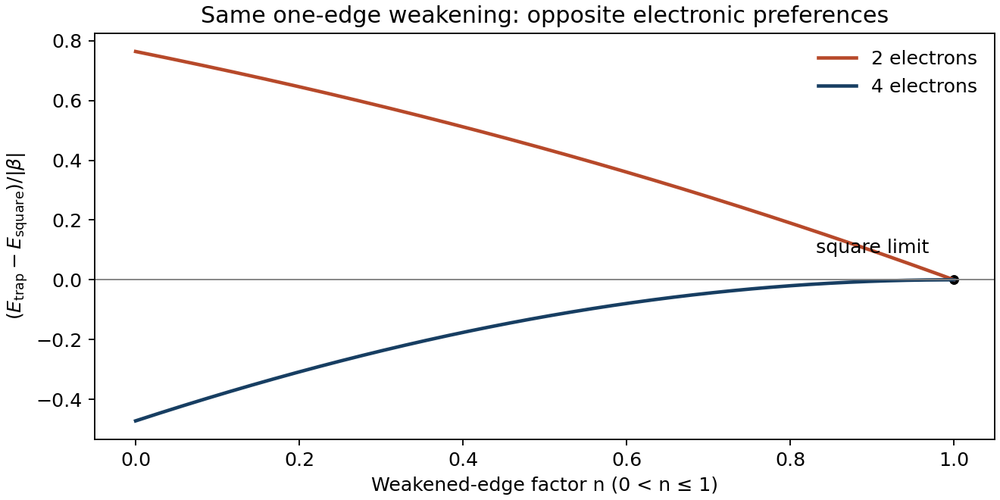

# Paper 2B

↑ **Parent:** [2022](../2022.md)

Original paper: [Released Cambridge examination PDF, physical pages 73–87; printed question pages 1–13](https://www.whatdotheyknow.com/request/nst_chemistry_past_papers_2022/response/2088679/attach/3/FOI%202022%20476%20Whittaker%20materials.pdf?cookie_passthrough=1#page=73).

**Table of contents**

- [Section A](#section-a)
  - [25](#section-a/25)
    - [a](#section-a/25/a)
      - [Solution](#section-a/25/a/solution)
    - [b](#section-a/25/b)
      - [Solution](#section-a/25/b/solution)
  - [26](#section-a/26)
    - [a](#section-a/26/a)
      - [Solution](#section-a/26/a/solution)
    - [b](#section-a/26/b)
      - [Solution](#section-a/26/b/solution)
    - [c](#section-a/26/c)
      - [Solution](#section-a/26/c/solution)
  - [27](#section-a/27)
    - [a](#section-a/27/a)
      - [Solution](#section-a/27/a/solution)
    - [b](#section-a/27/b)
      - [Solution](#section-a/27/b/solution)
  - [28](#section-a/28)
    - [a](#section-a/28/a)
      - [Solution](#section-a/28/a/solution)
    - [b](#section-a/28/b)
      - [Solution](#section-a/28/b/solution)
    - [c](#section-a/28/c)
      - [Solution](#section-a/28/c/solution)
  - [29](#section-a/29)
    - [a](#section-a/29/a)
      - [Solution](#section-a/29/a/solution)
    - [b](#section-a/29/b)
      - [Solution](#section-a/29/b/solution)
  - [30](#section-a/30)
    - [Solution](#section-a/30/solution)
  - [31](#section-a/31)
    - [Solution](#section-a/31/solution)
  - [32](#section-a/32)
    - [a](#section-a/32/a)
      - [Solution](#section-a/32/a/solution)
    - [b](#section-a/32/b)
      - [Solution](#section-a/32/b/solution)
    - [c](#section-a/32/c)
      - [Solution](#section-a/32/c/solution)
    - [d](#section-a/32/d)
      - [Solution](#section-a/32/d/solution)
    - [e](#section-a/32/e)
      - [Solution](#section-a/32/e/solution)
- [Section B](#section-b)
  - [33](#section-b/33)
    - [a](#section-b/33/a)
      - [Solution](#section-b/33/a/solution)
    - [b](#section-b/33/b)
      - [Solution](#section-b/33/b/solution)
    - [c](#section-b/33/c)
      - [i](#section-b/33/c/i)
        - [Solution](#section-b/33/c/i/solution)
      - [ii](#section-b/33/c/ii)
        - [Solution](#section-b/33/c/ii/solution)
      - [iii](#section-b/33/c/iii)
        - [Solution](#section-b/33/c/iii/solution)
  - [34](#section-b/34)
    - [a](#section-b/34/a)
      - [Solution](#section-b/34/a/solution)
    - [b](#section-b/34/b)
      - [Solution](#section-b/34/b/solution)
    - [c](#section-b/34/c)
      - [Solution](#section-b/34/c/solution)
    - [d](#section-b/34/d)
      - [i](#section-b/34/d/i)
        - [Solution](#section-b/34/d/i/solution)
      - [ii](#section-b/34/d/ii)
        - [Solution](#section-b/34/d/ii/solution)
      - [iii](#section-b/34/d/iii)
        - [Solution](#section-b/34/d/iii/solution)
  - [35](#section-b/35)
    - [a](#section-b/35/a)
      - [Solution](#section-b/35/a/solution)
    - [b](#section-b/35/b)
      - [i](#section-b/35/b/i)
        - [Solution](#section-b/35/b/i/solution)
      - [ii](#section-b/35/b/ii)
        - [Solution](#section-b/35/b/ii/solution)
    - [c](#section-b/35/c)
      - [i](#section-b/35/c/i)
        - [Solution](#section-b/35/c/i/solution)
      - [ii](#section-b/35/c/ii)
        - [Solution](#section-b/35/c/ii/solution)
  - [36](#section-b/36)
    - [a](#section-b/36/a)
      - [i](#section-b/36/a/i)
        - [Solution](#section-b/36/a/i/solution)
      - [ii](#section-b/36/a/ii)
        - [Solution](#section-b/36/a/ii/solution)
      - [iii](#section-b/36/a/iii)
        - [Solution](#section-b/36/a/iii/solution)
      - [iv](#section-b/36/a/iv)
        - [Solution](#section-b/36/a/iv/solution)
    - [b](#section-b/36/b)
      - [i](#section-b/36/b/i)
        - [Solution](#section-b/36/b/i/solution)
      - [ii](#section-b/36/b/ii)
        - [Solution](#section-b/36/b/ii/solution)
      - [iii](#section-b/36/b/iii)
        - [Solution](#section-b/36/b/iii/solution)
    - [c](#section-b/36/c)
      - [i](#section-b/36/c/i)
        - [Solution](#section-b/36/c/i/solution)
      - [ii](#section-b/36/c/ii)
        - [Solution](#section-b/36/c/ii/solution)

## Section A

↑ **Parent:** [Paper 2B](paper-2b.md)

<h3 id="section-a/25">25</h3>

↑ **Parent:** [Section A](#section-a)

<h4 id="section-a/25/a">a</h4>

↑ **Parent:** [25](#section-a/25)

<h5 id="section-a/25/a/solution">Solution</h5>

↑ **Parent:** [A](#section-a/25/a)

[Quantum tunnelling](../../quantum-mechanics.md#quantum-tunnelling) is penetration of, or transmission through, a finite [potential barrier](../../quantum-mechanics.md#potential-barrier) into a [classically forbidden region](../../mathematical-physics.md#classically-forbidden-region), where the total [energy](../../energy.md) is less than the [potential energy](../../energy.md#potential-energy). The [wavefunction](../../wave-function.md) generally remains nonzero there, so the [Born rule](../../wave-function.md#born-rule) assigns a nonzero [probability](../../probability-theory.md#probability) of detection. This does not require an increase in total [energy](../../energy.md); it is the classical relation between a definite position and a definite [kinetic energy](../../energy.md#kinetic-energy) that cannot be imposed on the [quantum state](../../quantum-system.md#quantum-state). For a bound [quantum harmonic oscillator](../../quantum-harmonic-oscillator.md), the relevant quantity is the [probability](../../probability-theory.md#probability) of finding the particle beyond its [classical turning points](../../analysis.md#classical-turning-point); it is not an escaping transmitted beam.

<h4 id="section-a/25/b">b</h4>

↑ **Parent:** [25](#section-a/25)

<h5 id="section-a/25/b/solution">Solution</h5>

↑ **Parent:** [B](#section-a/25/b)

For the reduced [quantum harmonic oscillator](../../quantum-harmonic-oscillator.md), $V(q)=q^2/2$ and the ground-state [energy](../../energy.md) is $E_0=1/2$. Thus the [classical turning points](../../analysis.md#classical-turning-point) satisfy $q^2/2=1/2$, giving $q=\pm1$. Normalizing the [wavefunction](../../wave-function.md) gives $\phi_0(q)=\pi^{-1/4}e^{-q^2/2}$, because $\int_{-\infty}^{\infty}e^{-q^2}\,dq=\sqrt\pi$. The [Born rule](../../wave-function.md#born-rule) therefore gives the [harmonic-oscillator forbidden-region probability](../../quantum-harmonic-oscillator.md#harmonic-oscillator-forbidden-region-probability)

$$
P(|q|>1)=\frac{2}{\sqrt\pi}\int_1^\infty e^{-q^2}\,dq
\simeq\frac{2(0.1394)}{\sqrt\pi}=\boxed{0.1573\simeq15.7\%}.
$$

The factor two includes both tails. Using the exact [complementary error function](../../integral.md#complementary-error-function) gives $\operatorname{erfc}(1)=0.1572992$. A stationary real [wavefunction](../../wave-function.md) has zero [probability current](../../wave-function.md#probability-current), so this result describes forbidden-region occupancy, not continuous loss of the bound particle.

**[Figure 1](#section-a/25/b/image-normalized-ground-state-probability-with-both-classically-forbidden-tails-shaded). Normalized ground-state probability with both classically forbidden tails shaded**.

<h3 id="section-a/26">26</h3>

↑ **Parent:** [Section A](#section-a)

<h4 id="section-a/26/a">a</h4>

↑ **Parent:** [26](#section-a/26)

<h5 id="section-a/26/a/solution">Solution</h5>

↑ **Parent:** [A](#section-a/26/a)

Inside the [infinite square well](../../quantum-mechanics.md#infinite-square-well), the [Hamiltonian](../../quantum-system.md#hamiltonian-quantum-mechanics) is purely the [kinetic energy](../../energy.md#kinetic-energy) operator,

$$
\boxed{\hat H=-\frac{\hbar^2}{2m}\frac{d^2}{dx^2},\qquad 0<x<L.}
$$

Its admissible [wavefunctions](../../wave-function.md) obey the [boundary conditions](../../differential-equation.md#boundary-condition) $\psi(0)=\psi(L)=0$ and vanish outside the interval. Equivalently write $\hat H=\hat p^2/(2m)+V(x)$ with $V=0$ inside and an infinite confining wall outside. The [boundary conditions](../../differential-equation.md#boundary-condition) are part of the specification of this [Hamiltonian](../../quantum-system.md#hamiltonian-quantum-mechanics); the differential expression alone does not determine the spectrum.

<h4 id="section-a/26/b">b</h4>

↑ **Parent:** [26](#section-a/26)

<h5 id="section-a/26/b/solution">Solution</h5>

↑ **Parent:** [B](#section-a/26/b)

Twice differentiating gives $d^2\sin(kx)/dx^2=-k^2\sin(kx)$, so inside the [infinite square well](../../quantum-mechanics.md#infinite-square-well)

$$
\hat H\sin(kx)=\frac{\hbar^2k^2}{2m}\sin(kx).
$$

The [boundary condition](../../differential-equation.md#boundary-condition) at zero is automatic. The other requires $\sin(kL)=0$, hence $kL=n\pi$. A nonzero [eigenfunction](../../linear-operator-theory.md#eigenfunction) can therefore be labelled by

$$
\boxed{k_n=\frac{n\pi}{L},\qquad E_n=\frac{n^2\pi^2\hbar^2}{2mL^2},\qquad n=1,2,3,\ldots.}
$$

If desired, its normalized form is $\sqrt{2/L}\sin(n\pi x/L)$. The positive lowest [energy](../../energy.md) follows from confinement and the required spatial variation of a nonzero [wavefunction](../../wave-function.md).

<h4 id="section-a/26/c">c</h4>

↑ **Parent:** [26](#section-a/26)

<h5 id="section-a/26/c/solution">Solution</h5>

↑ **Parent:** [C](#section-a/26/c)

For $n=0$ the proposed [wavefunction](../../wave-function.md) vanishes identically and cannot be normalized. A negative integer gives $\sin(-|n|\pi x/L)=-\sin(|n|\pi x/L)$, which differs from the corresponding positive-integer [wavefunction](../../wave-function.md) only by a physically irrelevant [global phase](../../quantum-system.md#global-phase). Both have the same positive [energy](../../energy.md), proportional to $n^2$. Thus **zero is inadmissible and negative labels are redundant**. A negative integer is not forbidden by a separate negative-energy argument.

<h3 id="section-a/27">27</h3>

↑ **Parent:** [Section A](#section-a)

<h4 id="section-a/27/a">a</h4>

↑ **Parent:** [27](#section-a/27)

<h5 id="section-a/27/a/solution">Solution</h5>

↑ **Parent:** [A](#section-a/27/a)

Within a specified [electron configuration](../../chemistry.md#electron-configuration) in the [LS coupling](../../angular-momentum-operator.md#ls-coupling) regime, [Hund's rules](../../chemistry.md#hund-s-rules) select the lowest [atomic term](../../atomic-physics.md#atomic-term) as follows. First maximize the total [electron spin](../../angular-momentum-operator.md#electron-spin) $S$ subject to the [Pauli exclusion principle](../../tensor-product-of-quantum-systems.md#pauli-exclusion-principle). Among the terms having that $S$, choose the largest total orbital [angular momentum](../../momentum.md#angular-momentum) $L$. Finally, [spin-orbit coupling](../../atomic-physics.md#spin-orbit-interaction) places the smallest allowed $J=|L-S|$ lowest for a subshell less than half full, and the largest $J=L+S$ lowest for a subshell more than half full. At half filling the maximum-spin term has $L=0$, hence $J=S$. These rules rank terms within configurations; the exceptional neutral-atom configurations of [chromium](../../chemical-substance.md#chromium) and [copper](../../chemical-substance.md#copper) must also be used.

<h4 id="section-a/27/b">b</h4>

↑ **Parent:** [27](#section-a/27)

<h5 id="section-a/27/b/solution">Solution</h5>

↑ **Parent:** [B](#section-a/27/b)

For [chromium](../../chemical-substance.md#chromium) the configuration is $[\mathrm{Ar}]3d^54s^1$. The half-filled $3d$ subshell has $S_d=5/2$ and $L_d=0$; aligning the $4s$ spin gives $S=3$, while $L=0$. Therefore the ground-state [term symbol](../../atomic-physics.md#term-symbol) is **$\mathrm{Cr}:{}^7S_3$**. For [cobalt](../../chemical-substance.md#cobalt), $[\mathrm{Ar}]3d^74s^2$ has a closed $4s^2$ pair. The $d^7$ subshell has the same possible $L,S$ values as three $d$ holes; maximizing spin and then orbital [angular momentum](../../momentum.md#angular-momentum) gives $S=3/2$, $L=3$. Because it is more than half full, $J=3+3/2=9/2$, giving **$\mathrm{Co}:{}^4F_{9/2}$**. For [copper](../../chemical-substance.md#copper), $[\mathrm{Ar}]3d^{10}4s^1$ has a closed $d$ subshell, leaving $L=0$, $S=1/2$ and **$\mathrm{Cu}:{}^2S_{1/2}$**. These are neutral-atom terms, rather than the terms of the common metal ions. The tabulated zero-energy levels independently confirm all three assignments.[Cr I table, ground row 3d5(6S)4s 7S3](../../physics-bibliography.md#energy-levels-of-neutral-chromium-in-the-nist-handbook)[Co I table, ground row 3d7 4s2 4F9/2](../../physics-bibliography.md#handbook-of-basic-atomic-spectroscopic-data-by-jean-e-sansonetti-and-william-c-martin/energy-levels-of-neutral-cobalt-co-i-by-national-institute-of-standards-and-technology)[Cu I table, ground row 3d10(1S)4s 2S1/2](../../physics-bibliography.md#handbook-of-basic-atomic-spectroscopic-data-by-jean-e-sansonetti-and-william-c-martin/energy-levels-of-neutral-copper-cu-i-by-national-institute-of-standards-and-technology)

<h3 id="section-a/28">28</h3>

↑ **Parent:** [Section A](#section-a)

<h4 id="section-a/28/a">a</h4>

↑ **Parent:** [28](#section-a/28)

<h5 id="section-a/28/a/solution">Solution</h5>

↑ **Parent:** [A](#section-a/28/a)

For the [character of a localized orbital basis](../../representation-theory.md#character-of-a-localized-orbital-basis), take the [trace](../../linear-algebra.md#matrix-trace) of the transformation [matrix](../../vector-space.md#matrix): both permutation of centres and signs of [atomic orbitals](../../chemistry.md#atomic-orbital) matter. The two metal centres lie on the principal axis and remain fixed under rotation about $z$. At either metal the $(p_x,p_y)$ [basis](../../vector-space.md#basis) has the [matrix](../../vector-space.md#matrix)

$$
R(\theta)=\begin{pmatrix}\cos\theta&-\sin\theta\\\sin\theta&\cos\theta\end{pmatrix}.
$$

The full four-dimensional [group representation](../../representation-theory.md#group-representation) is block diagonal with two such blocks. Consequently $\chi(R)=4\cos\theta$, and for the $60^\circ$ rotation of the [D6h molecular point group](../../euclidean-geometry.md#d6h-molecular-point-group), **$\chi(C_6)=4\cos(\pi/3)=2$**.

<h4 id="section-a/28/b">b</h4>

↑ **Parent:** [28](#section-a/28)

<h5 id="section-a/28/b/solution">Solution</h5>

↑ **Parent:** [B](#section-a/28/b)

A $180^\circ$ rotation leaves both metal centres fixed but reverses each transverse [p orbital](../../chemistry.md#p-orbital): $p_x\mapsto-p_x$ and $p_y\mapsto-p_y$. Its [matrix](../../vector-space.md#matrix) is $-I_4$, so its [character of a representation](../../representation-theory.md#character-of-a-representation) is **$\chi(C_6^3)=-4$**, also obtained from $4\cos\pi$.

<h4 id="section-a/28/c">c</h4>

↑ **Parent:** [28](#section-a/28)

<h5 id="section-a/28/c/solution">Solution</h5>

↑ **Parent:** [C](#section-a/28/c)

Choose transverse directions parallel and perpendicular to the vertical mirror plane. At each metal the parallel [p orbital](../../chemistry.md#p-orbital) is unchanged, whereas the perpendicular [p orbital](../../chemistry.md#p-orbital) changes sign. Thus each two-dimensional block has [trace](../../linear-algebra.md#matrix-trace) $1-1=0$. The total [character of a representation](../../representation-theory.md#character-of-a-representation) is **$\chi(\sigma_d)=0$**. A mirror plane passing through an orbital centre does not imply that every orbital on that centre contributes $+1$.

<h3 id="section-a/29">29</h3>

↑ **Parent:** [Section A](#section-a)

<h4 id="section-a/29/a">a</h4>

↑ **Parent:** [29](#section-a/29)

<h5 id="section-a/29/a/solution">Solution</h5>

↑ **Parent:** [A](#section-a/29/a)

Use the axes actually printed: the two hydrogens lie in the $xz$ plane, $z$ is the principal twofold axis, and $y$ is perpendicular to that plane. For a Cartesian-displacement [group representation](../../representation-theory.md#group-representation), only atoms left at their own sites contribute to the [trace](../../linear-algebra.md#matrix-trace); their vector components must also be transformed. In the order $(E,C_2(z),\sigma(xz),\sigma(yz))$, identity fixes six components, the twofold rotation exchanges the hydrogens, the $xz$ reflection fixes both hydrogens with vector [matrix](../../vector-space.md#matrix) $\operatorname{diag}(1,-1,1)$, and the $yz$ reflection exchanges them. Therefore

$$
\boxed{\chi_\Gamma=(6,0,2,0).}
$$

The nonzero mirror [character of a representation](../../representation-theory.md#character-of-a-representation) is $2(1-1+1)=2$, not six.

<h4 id="section-a/29/b">b</h4>

↑ **Parent:** [29](#section-a/29)

<h5 id="section-a/29/b/solution">Solution</h5>

↑ **Parent:** [B](#section-a/29/b)

The [C2v molecular point group](../../euclidean-geometry.md#c2v-molecular-point-group) has four one-dimensional [irreducible representations](../../representation-theory.md#irreducible-representation). In the operation order used above, the [character table](../../representation-theory.md#character-table) rows are $A_1=(1,1,1,1)$, $A_2=(1,1,-1,-1)$, $B_1=(1,-1,1,-1)$ and $B_2=(1,-1,-1,1)$. Their [character inner products](../../representation-theory.md#character-inner-product) with $\chi_\Gamma=(6,0,2,0)$ give

$$
m_{A_1}=\frac{6+2}{4}=2,\quad m_{A_2}=\frac{6-2}{4}=1,\quad m_{B_1}=2,\quad m_{B_2}=1.
$$

Hence **$\Gamma=2A_1\oplus A_2\oplus2B_1\oplus B_2$**, whose dimensions sum to six. The labels $B_1,B_2$ refer to the source axes; swapping $x$ and $y$ swaps these names.

<h3 id="section-a/30">30</h3>

↑ **Parent:** [Section A](#section-a)

<h4 id="section-a/30/solution">Solution</h4>

↑ **Parent:** [30](#section-a/30)

Fix the positive lobes of the real [atomic orbitals](../../chemistry.md#atomic-orbital) along the printed positive axes, and write $\phi_1=p_x(1)$, $\phi_4=p_x(4)$, $\phi_5=p_y(5)$ and $\phi_8=p_y(8)$. A coordinate model consistent with the figure is $r_1=(0,a,-b)$, $r_4=(0,-a,-b)$, $r_5=(a,0,b)$ and $r_8=(-a,0,b)$, with $a,b>0$. For the [D2d molecular point group](../../euclidean-geometry.md#d2d-molecular-point-group), take the two transverse twofold axes along $x+y$ and $x-y$, with vertical mirrors $xz$ and $yz$. The $A_2$ [character table](../../representation-theory.md#character-table) row on $(E,2S_4,C_2,2C_2',2\sigma_d)$ is $(1,1,1,-1,-1)$. The [character projection operator](../../representation-theory.md#character-projection-operator) is

$$
P_{A_2}=\frac18\sum_{g\in D_{2d}}\chi_{A_2}(g)^*\,U(g).
$$

The eight signed images needed for this projection are

$$
\begin{array}{c|rrrrrrrr}
g&E&S_4^+&S_4^-&C_2&C_2(x+y)&C_2(x-y)&\sigma(xz)&\sigma(yz)\\\hline
U(g)\phi_1&\phi_1&\phi_8&-\phi_5&-\phi_4&\phi_5&-\phi_8&\phi_4&-\phi_1\\
\chi_{A_2}(g)&1&1&1&1&-1&-1&-1&-1
\end{array}
$$

so $P_{A_2}\phi_1=(\phi_1-\phi_4-\phi_5+\phi_8)/4$. Under the standard orthonormal [atomic orbital](../../chemistry.md#atomic-orbital) approximation its squared norm is $4/16=1/4$. Therefore the normalized [symmetry-adapted linear combination](../../chemistry.md#symmetry-adapted-linear-combination) is

$$
\boxed{\Phi_{A_2}=\tfrac12(\phi_1-\phi_4-\phi_5+\phi_8).}
$$

An overall minus sign describes the same [quantum state](../../quantum-system.md#quantum-state); changing one local [atomic orbital](../../chemistry.md#atomic-orbital) phase requires changing its coefficient too. If intersite [orbital overlap](../../chemistry.md#orbital-overlap) were retained, normalization would instead use the overlap [matrix](../../vector-space.md#matrix).

<h3 id="section-a/31">31</h3>

↑ **Parent:** [Section A](#section-a)

<h4 id="section-a/31/solution">Solution</h4>

↑ **Parent:** [31](#section-a/31)

Two contributions must be separated: the underlying contraction of the metal ion across the series and the configuration-dependent [crystal field stabilization energy](../../chemistry.md#crystal-field-stabilization-energy). Increasing [effective nuclear charge](../../chemistry.md#effective-nuclear-charge) across the relevant divalent ions generally contracts the metal orbitals and favours shorter metal–chlorine bonds. Superimposed on this, a weak-field tetrahedral chloride environment places the $e$ set below the $t_2$ set, at $-0.6\Delta_t$ and $+0.4\Delta_t$ relative to the barycentre. The high-spin occupancies and corresponding [crystal field stabilization energies](../../chemistry.md#crystal-field-stabilization-energy) are

$$
\begin{array}{c|c|r}
d\text{ count}&\text{occupancy}&\mathrm{CFSE}/\Delta_t\\\hline
6&e^3t_2^3&-0.6\\
7&e^4t_2^3&-1.2\\
8&e^4t_2^4&-0.8\\
10&e^4t_2^6&0
\end{array}
$$

Because the [tetrahedral crystal field splitting](../../chemistry.md#tetrahedral-crystal-field-splitting) increases on bringing the ligands inward, the stabilization is especially effective at shortening the $d^7$ bond. Adding the next [electron](../../physics.md#electron) to the upper $t_2$ set reduces that stabilization; in a simple sigma-bonding description this set also has more metal–ligand antibonding character. That change explains the upward deviation from $d^7$ to $d^8$ despite the general contraction trend. By $d^{10}$ the [crystal field stabilization energy](../../chemistry.md#crystal-field-stabilization-energy) is zero, but the background contraction can still produce the shortest bond in the plotted set. Thus **the $d^7$ shortening and $d^8$ rebound reflect orbital filling, while the overall decrease reflects contraction**. A zero [crystal field stabilization energy](../../chemistry.md#crystal-field-stabilization-energy) does not mean no chemical bonding. Absolute distances also involve [covalent bonds](../../covalent-bond.md), repulsion and ligand interactions; this qualitative model does not determine them numerically. No inference about the missing $d^9$ distance is required.

<h3 id="section-a/32">32</h3>

↑ **Parent:** [Section A](#section-a)

<h4 id="section-a/32/a">a</h4>

↑ **Parent:** [32](#section-a/32)

<h5 id="section-a/32/a/solution">Solution</h5>

↑ **Parent:** [A](#section-a/32/a)

The planar [benzene](../../chemical-substance.md#benzene) structure has a sixfold principal axis normal to its plane, six transverse twofold axes, the molecular mirror plane and an [inversion centre](../../physics.md#inversion-centre). Its [molecular point group](../../euclidean-geometry.md#molecular-point-group) is **$D_{6h}$**, the [D6h molecular point group](../../euclidean-geometry.md#d6h-molecular-point-group).

<h4 id="section-a/32/b">b</h4>

↑ **Parent:** [32](#section-a/32)

<h5 id="section-a/32/b/solution">Solution</h5>

↑ **Parent:** [B](#section-a/32/b)

The [fulvene](../../chemical-substance.md#fulvene) structure has an in-plane twofold axis through the exocyclic [double bond](../../covalent-bond.md#double-bond) and the opposite part of the five-membered ring. The molecular plane and a plane perpendicular to it containing that axis are both mirrors. There is no perpendicular sixfold axis or [inversion centre](../../physics.md#inversion-centre). Its [molecular point group](../../euclidean-geometry.md#molecular-point-group) is **$C_{2v}$**, the [C2v molecular point group](../../euclidean-geometry.md#c2v-molecular-point-group).

<h4 id="section-a/32/c">c</h4>

↑ **Parent:** [32](#section-a/32)

<h5 id="section-a/32/c/solution">Solution</h5>

↑ **Parent:** [C](#section-a/32/c)

For [hexa-1,5-diyne](../../chemical-substance.md#hexa-1-5-diyne) in the extended anti conformation drawn, inversion at the midpoint of the central [carbon](../../chemical-substance.md#carbon)–[carbon](../../chemical-substance.md#carbon) bond exchanges the two identical ends. A twofold axis through that midpoint perpendicular to the [carbon](../../chemical-substance.md#carbon) skeleton plane, together with the mirror plane of that skeleton, completes the [C2h molecular point group](../../euclidean-geometry.md#c2h-molecular-point-group). The methylene hydrogens occur in the corresponding mirror-related pairs. Thus the answer is **$C_{2h}$**. The whole molecule is not linear simply because its terminal triple-bond fragments are linear; the conformation is essential to this assignment.

<h4 id="section-a/32/d">d</h4>

↑ **Parent:** [32](#section-a/32)

<h5 id="section-a/32/d/solution">Solution</h5>

↑ **Parent:** [D](#section-a/32/d)

The planar [three-radialene](../../chemical-substance.md#three-radialene) structure has a threefold axis normal to the plane, three in-plane twofold axes and the molecular plane as a horizontal mirror. Therefore its [molecular point group](../../euclidean-geometry.md#molecular-point-group) is **$D_{3h}$**, the [D3h molecular point group](../../euclidean-geometry.md#d3h-molecular-point-group). Its threefold connectivity does not supply a sixfold axis.

<h4 id="section-a/32/e">e</h4>

↑ **Parent:** [32](#section-a/32)

<h5 id="section-a/32/e/solution">Solution</h5>

↑ **Parent:** [E](#section-a/32/e)

The folded [benzvalene](../../chemical-substance.md#benzvalene) cage has one twofold axis and two mirror planes containing it. The double-bonded edge distinguishes it from cages having higher rotational [symmetry](../../physics.md#symmetry-physics); it has neither an [inversion centre](../../physics.md#inversion-centre) nor a horizontal mirror perpendicular to the twofold axis. Its [molecular point group](../../euclidean-geometry.md#molecular-point-group) is **$C_{2v}$**, the [C2v molecular point group](../../euclidean-geometry.md#c2v-molecular-point-group).

## Section B

↑ **Parent:** [Paper 2B](paper-2b.md)

<h3 id="section-b/33">33</h3>

↑ **Parent:** [Section B](#section-b)

<h4 id="section-b/33/a">a</h4>

↑ **Parent:** [33](#section-b/33)

<h5 id="section-b/33/a/solution">Solution</h5>

↑ **Parent:** [A](#section-b/33/a)

For a self-adjoint [Hamiltonian](../../quantum-system.md#hamiltonian-quantum-mechanics) bounded below, every nonzero admissible trial [wavefunction](../../wave-function.md) satisfies the [quantum variational principle](../../quantum-mechanics.md#quantum-variational-principle)

$$
\boxed{\mathcal E[\psi]=\frac{\langle\psi|\hat H|\psi\rangle}{\langle\psi|\psi\rangle}\ge E_0.}
$$

Here $E_0$ is the lowest exact [energy](../../energy.md), and the trial function must obey the physical [boundary conditions](../../differential-equation.md#boundary-condition) and have finite relevant integrals. Equality holds for a [wavefunction](../../wave-function.md) in the ground-state eigenspace. The quotient is unchanged by normalization or any nonzero overall scalar.

<h4 id="section-b/33/b">b</h4>

↑ **Parent:** [33](#section-b/33)

<h5 id="section-b/33/b/solution">Solution</h5>

↑ **Parent:** [B](#section-b/33/b)

Expand the trial [wavefunction](../../wave-function.md) in a complete [orthonormal set](../../inner-product.md#orthonormal-set) of exact [eigenfunctions](../../linear-operator-theory.md#eigenfunction), $\psi=\sum_n c_n\phi_n$, with $\hat H\phi_n=E_n\phi_n$ and $E_n\ge E_0$. The coefficients may depend on any chosen variational parameters. [Orthogonality](../../inner-product.md#orthogonal-vectors) removes the cross terms in both integrals, giving

$$
\langle\psi|\psi\rangle=\sum_n|c_n|^2,\qquad
\langle\psi|\hat H|\psi\rangle=\sum_n E_n|c_n|^2.
$$

Consequently

$$
\boxed{\mathcal E[\psi]-E_0=\frac{\sum_n(E_n-E_0)|c_n|^2}{\sum_n|c_n|^2}\ge0.}
$$

This proves the [quantum variational principle](../../quantum-mechanics.md#quantum-variational-principle). The denominator is positive because the trial function is nonzero. Equality requires every occupied exact state to have $E_n=E_0$, allowing for [ground-state degeneracy](../../quantum-mechanics.md#ground-state-degeneracy). With a continuous part of the spectrum, the corresponding nonnegative spectral integral gives the same conclusion.

<h4 id="section-b/33/c">c</h4>

↑ **Parent:** [33](#section-b/33)

<h5 id="section-b/33/c/i">i</h5>

↑ **Parent:** [C](#section-b/33/c)

<h6 id="section-b/33/c/i/solution">Solution</h6>

↑ **Parent:** [I](#section-b/33/c/i)

Write $g=e^{-q^2/2}$ and $f=2q^2-a$. Product differentiation for the reduced [quantum harmonic oscillator](../../quantum-harmonic-oscillator.md) gives

$$
\hat H(fg)=\left[-\tfrac12 f''+qf'+\tfrac12 f\right]g
=\left(5q^2-2-\frac a2\right)g.
$$

For an [eigenfunction](../../linear-operator-theory.md#eigenfunction), this must equal $E(2q^2-a)g$ at every $q$. Matching the $q^2$ coefficients gives $E=5/2$, and matching constants then gives $5a/2=2+a/2$. Hence **$a=1$ and $E=5/2$**. This is the even $n=2$ oscillator state. Its normalized [wavefunction](../../wave-function.md) is $\phi_2=(2q^2-1)e^{-q^2/2}/(\sqrt2\,\pi^{1/4})$.

<h5 id="section-b/33/c/ii">ii</h5>

↑ **Parent:** [C](#section-b/33/c)

<h6 id="section-b/33/c/ii/solution">Solution</h6>

↑ **Parent:** [Ii](#section-b/33/c/ii)

Direct evaluation of the [Rayleigh quotient](../../linear-operator-theory.md#rayleigh-quotient) exposes a problem with the requested minimization. Using the supplied [Gaussian integrals](../../integral.md#gaussian-integral),

$$
\begin{aligned}
\langle\psi|\psi\rangle&=\sqrt\pi(a^2-2a+3),\\
\langle\psi|\hat H|\psi\rangle&=\frac{\sqrt\pi}{2}(a^2-2a+11),\\
\mathcal E(a)&=\frac{a^2-2a+11}{2(a^2-2a+3)}
=\frac12+\frac4{(a-1)^2+2}.
\end{aligned}
$$

Thus

$$
\mathcal E'(a)=\frac{-8(a-1)}{[(a-1)^2+2]^2},\qquad
\mathcal E'(1)=0,\qquad \mathcal E''(1)=-2.
$$

**The [eigenfunction](../../linear-operator-theory.md#eigenfunction) value $a=1$ is a maximum, not a minimum.** Indeed $\mathcal E(1)=5/2$, whereas $\mathcal E(0)=11/6$ is already lower. There is no finite minimizing $a$ in this family: its infimum is $1/2$, approached as $|a|\to\infty$, when the normalized trial [wavefunction](../../wave-function.md) approaches the ground state. This is consistent with the [quantum variational principle](../../quantum-mechanics.md#quantum-variational-principle). The original printed instruction in this subpart is therefore inconsistent as an unconstrained minimization; a stationary [Rayleigh quotient](../../linear-operator-theory.md#rayleigh-quotient) need not be a minimum.

The intended excited state can instead be obtained by imposing an [excited-state variational constraint](../../quantum-mechanics.md#excited-state-variational-constraint). [Orthogonality](../../inner-product.md#orthogonal-vectors) to the ground state requires

$$
\langle g|\psi\rangle=\sqrt\pi(1-a)=0,
$$

which fixes **$a=1$**. Every member of the family is even, so it is already orthogonal to the odd $n=1$ state. With the ground state excluded, the lowest allowed oscillator [energy](../../energy.md) is therefore $E_2=5/2$. In the exact oscillator [basis](../../vector-space.md#basis), $\psi$ is proportional to $\sqrt2\,\phi_2+(1-a)\phi_0$, making both the maximum and the [orthogonality](../../inner-product.md#orthogonal-vectors) correction transparent.

**[Figure 2](#section-b/33/c/ii/image-the-trial-family-energy-has-a-maximum-at-the-exact-second-excited-state-parameter). The trial-family energy has a maximum at the exact second-excited-state parameter**.

<h5 id="section-b/33/c/iii">iii</h5>

↑ **Parent:** [C](#section-b/33/c)

<h6 id="section-b/33/c/iii/solution">Solution</h6>

↑ **Parent:** [Iii](#section-b/33/c/iii)

Exact solutions of the [Schrödinger equation](../../mathematical-physics.md#schrodinger-equation) are unavailable for most interacting or realistic molecular systems. The [quantum variational principle](../../quantum-mechanics.md#quantum-variational-principle) turns the search for a ground-state [wavefunction](../../wave-function.md) into optimization of a computable [energy](../../energy.md) quotient in a tractable trial family. The result is an upper bound: enlarging a nested trial space can only lower or preserve the optimized [energy](../../energy.md), providing a systematic convergence check. Trial functions can incorporate [boundary conditions](../../differential-equation.md#boundary-condition) and known [symmetry](../../physics.md#symmetry-physics) before calculation. Near an exact normalized ground state, a small orthogonal [wavefunction](../../wave-function.md) error changes the [energy](../../energy.md) only to second order, which explains why useful energies can result from imperfect trial functions. This does not ensure that every other observable is equally accurate, nor that a restricted trial family captures correlation adequately. Excited states require [orthogonality](../../inner-product.md#orthogonal-vectors) or appropriate [symmetry](../../physics.md#symmetry-physics) restrictions; unrestricted minimization seeks the ground state, as the preceding calculation demonstrates.

<h3 id="section-b/34">34</h3>

↑ **Parent:** [Section B](#section-b)

<h4 id="section-b/34/a">a</h4>

↑ **Parent:** [34](#section-b/34)

<h5 id="section-b/34/a/solution">Solution</h5>

↑ **Parent:** [A](#section-b/34/a)

Let $u=r-r_e$ measure displacement from the equilibrium [bond length](../../chemical-bond.md#bond-length) and put the minimum of [potential energy](../../energy.md#potential-energy) at zero. The harmonic model and the [Morse potential](../../quantum-system.md#morse-potential) are

$$
V_{\rm harm}(r)=\frac12ku^2,\qquad
V_{\rm Morse}(r)=D_e(1-e^{-\alpha u})^2.
$$

The [harmonic approximation](../../lagrangian-mechanics.md#harmonic-approximation) is a symmetric parabola and has no dissociation limit. The [Morse potential](../../quantum-system.md#morse-potential) has a steep compressed side and a shallower extended side, approaching $D_e$ as $r\to\infty$. Matching the curvatures at the minimum gives $k=2D_e\alpha^2$. With $\widetilde\omega$ denoting a [spectroscopic wavenumber](../../wave-equation.md#spectroscopic-wavenumber) rather than an angular frequency, the [energy](../../energy.md) levels are

$$
\begin{aligned}
E_v^{\rm harm}&=hc\widetilde\omega(v+\tfrac12),\quad v=0,1,2,\ldots,\\
E_v^{\rm Morse}&=hc\widetilde\omega\left[(v+\tfrac12)-x_e(v+\tfrac12)^2\right],\quad v+\tfrac12<\frac1{2x_e}.
\end{aligned}
$$

Here $x_e$ is the dimensionless [spectroscopic anharmonicity constant](../../molecule.md#spectroscopic-anharmonicity-constant). The harmonic spacing is constant, while the [Morse oscillator](../../quantum-system.md#morse-oscillator) spacing is $E_{v+1}-E_v=hc\widetilde\omega[1-2x_e(v+1)]$ and decreases as the levels approach dissociation. Only finitely many [Morse oscillator](../../quantum-system.md#morse-oscillator) levels are bound. The exactly solvable potential was introduced to model this anharmonic behaviour.[Physical Review 34 (1929), pp. 57–64, potential and bound-level solution](../../physics-bibliography.md#diatomic-molecules-according-to-the-wave-mechanics-ii-vibrational-levels-by-philip-m-morse)

For the harmonic model put $q=\sqrt{\mu\omega/\hbar}\,u$, with $\omega=2\pi c\widetilde\omega$, and $N=\pi^{-1/4}$. The first three normalized reduced-coordinate [wavefunctions](../../wave-function.md) are

$$
\phi_0=Ne^{-q^2/2},\qquad
\phi_1=\sqrt2\,Nq e^{-q^2/2},\qquad
\phi_2=\frac{N}{\sqrt2}(2q^2-1)e^{-q^2/2}.
$$

Their numbers of nodes are zero, one and two, and their parities are even, odd and even. The $v=2$ nodes are at $q=\pm1/\sqrt2$. The diagrams below use analytic curves and arbitrary illustrative scales, with both potentials given the same local curvature.

**[Figure 3](#section-b/34/a/image-harmonic-and-morse-potential-models-and-the-three-lowest-harmonic-wavefunctions). Harmonic and Morse potential models and the three lowest harmonic wavefunctions**.

<h4 id="section-b/34/b">b</h4>

↑ **Parent:** [34](#section-b/34)

<h5 id="section-b/34/b/solution">Solution</h5>

↑ **Parent:** [B](#section-b/34/b)

Write $s=v+1/2$ and complete the square in the [Morse oscillator](../../quantum-system.md#morse-oscillator) [energy](../../energy.md):

$$
E(s)=hc\widetilde\omega(s-x_es^2)
=\frac{hc\widetilde\omega}{4x_e}
-hc\widetilde\omega x_e\left(s-\frac1{2x_e}\right)^2.
$$

The finite bound-level sequence approaches the dissociation limit at the vertex of this extrapolated parabola. Thus the [bond potential-well depth](../../chemical-bond.md#bond-potential-well-depth) is

$$
\boxed{D_e=\frac{hc\widetilde\omega}{4x_e}.}
$$

The continuous vertex is a convenient way to identify the limit; it is not an additional normalizable bound level at the threshold.

<h4 id="section-b/34/c">c</h4>

↑ **Parent:** [34](#section-b/34)

<h5 id="section-b/34/c/solution">Solution</h5>

↑ **Parent:** [C](#section-b/34/c)

The [ground-state dissociation energy](../../chemical-bond.md#ground-state-dissociation-energy) starts at the lowest vibrational level, rather than the minimum of the potential. The [zero-point energy](../../quantum-harmonic-oscillator.md#zero-point-energy) of the [Morse oscillator](../../quantum-system.md#morse-oscillator) is

$$
E_0=hc\widetilde\omega\left(\frac12-\frac{x_e}{4}\right)=D_e(2x_e-x_e^2).
$$

Subtracting it from the [bond potential-well depth](../../chemical-bond.md#bond-potential-well-depth) gives

$$
\boxed{D_0=D_e-E_0=D_e(1-2x_e+x_e^2)=D_e(1-x_e)^2.}
$$

This distinction matters whenever a dissociation [energy](../../energy.md) is inferred from a vibrational spectrum.

<h4 id="section-b/34/d">d</h4>

↑ **Parent:** [34](#section-b/34)

<h5 id="section-b/34/d/i">i</h5>

↑ **Parent:** [D](#section-b/34/d)

<h6 id="section-b/34/d/i/solution">Solution</h6>

↑ **Parent:** [I](#section-b/34/d/i)

The strong band is the **$v=0\to1$ vibrational fundamental**, and the weaker band near twice its [wavenumber](../../wave-equation.md#wavenumber) is the **$v=0\to2$ first vibrational overtone**. At room temperature these high-frequency oscillators have overwhelmingly ground-state vibrational populations. In the harmonic-potential, linear-dipole limit the infrared [selection rule](../../atomic-physics.md#selection-rule) is $\Delta v=\pm1$; [anharmonicity](../../wave.md#anharmonicity) and nonlinear dipole dependence make the overtone weakly allowed. A $1\to2$ [hot band](../../molecule.md#hot-band) would lie near, and slightly below, the fundamental [wavenumber](../../wave-equation.md#wavenumber), rather than near twice it.

<h5 id="section-b/34/d/ii">ii</h5>

↑ **Parent:** [D](#section-b/34/d)

<h6 id="section-b/34/d/ii/solution">Solution</h6>

↑ **Parent:** [Ii](#section-b/34/d/ii)

Let $f$ and $o$ denote the measured fundamental and first-overtone wavenumbers, and put $y=\widetilde\omega x_e$. Differences of the [Morse oscillator](../../quantum-system.md#morse-oscillator) levels give

$$
f=\widetilde\omega-2y,\qquad o=2\widetilde\omega-6y,
\qquad\boxed{y=f-\frac o2,\quad\widetilde\omega=3f-o.}
$$

Consequently $x_e=y/\widetilde\omega$, $D_e/(hc)=\widetilde\omega^2/(4y)$ and $D_0/(hc)=D_e/(hc)-(\widetilde\omega/2-y/4)$. Substituting the two pairs of measured bands gives the following derived quantities:

$$
\begin{array}{c|rr}
&\mathrm A&\mathrm B\\\hline
\widetilde\omega\ (\mathrm{cm^{-1}})&2648.98&2309.01\\
y\ (\mathrm{cm^{-1}})&45.22&39.64\\
x_e&0.0170707&0.0171675\\
D_e/(hc)\ (\mathrm{cm^{-1}})&38794.20&33624.67\\
E_0/(hc)\ (\mathrm{cm^{-1}})&1313.185&1144.595\\
D_0/(hc)\ (\mathrm{cm^{-1}})&37481.02&32480.07
\end{array}
$$

The conversion is $1\ \mathrm{cm^{-1}}=0.0119626566\ \mathrm{kJ\,mol^{-1}}$, after multiplication by $N_Ahc$ and consistent length units. Therefore the requested [ground-state dissociation energies](../../chemical-bond.md#ground-state-dissociation-energy) are **$D_0(\mathrm A)=448.4\ \mathrm{kJ\,mol^{-1}}$ and $D_0(\mathrm B)=388.5\ \mathrm{kJ\,mol^{-1}}$**. The corresponding potential-well depths are $D_e(\mathrm A)=464.1$ and $D_e(\mathrm B)=402.2\ \mathrm{kJ\,mol^{-1}}$. These are extrapolations under the stipulated [Morse oscillator](../../quantum-system.md#morse-oscillator) model; two low-lying bands do not establish the accuracy of the real potential near dissociation.

<h5 id="section-b/34/d/iii">iii</h5>

↑ **Parent:** [D](#section-b/34/d)

<h6 id="section-b/34/d/iii/solution">Solution</h6>

↑ **Parent:** [Iii](#section-b/34/d/iii)

The molecule with the larger inferred dissociation [energy](../../energy.md) is assigned the stronger [hydrogen](../../chemical-substance.md#hydrogen)–halogen bond: **$\mathrm A=\mathrm{HBr}$ and $\mathrm B=\mathrm{HI}$**. Moving from [bromine](../../chemical-substance.md#bromine) to the larger [iodine](../../chemical-substance.md#iodine) atom generally lengthens the bond and reduces effective overlap with the compact [hydrogen](../../chemical-substance.md#hydrogen) $1s$ orbital, so [hydrogen iodide](../../chemical-substance.md#hydrogen-iodide) is more weakly bound. Independently, the tabulated ground-state harmonic constants near $2649\ \mathrm{cm^{-1}}$ for [hydrogen bromide](../../chemical-substance.md#hydrogen-bromide) and $2309\ \mathrm{cm^{-1}}$ for [hydrogen iodide](../../chemical-substance.md#hydrogen-iodide) agree with the inferred assignment.[Ground X 1Sigma+ row, harmonic [wavenumber](../../wave-equation.md#wavenumber) 2648.975 cm−1](../../chemistry-bibliography.md#hydrogen-bromide-constants-of-diatomic-molecules-by-klaus-p-huber-and-others)[Ground X 1Sigma+ row, harmonic [wavenumber](../../wave-equation.md#wavenumber) 2309.014 cm−1](../../chemistry-bibliography.md#hydrogen-iodide-constants-of-diatomic-molecules-by-klaus-p-huber-and-others) The ordering is the identification criterion; the low-level [Morse oscillator](../../quantum-system.md#morse-oscillator) extrapolations above should not be presented as measured dissociation energies.

<h3 id="section-b/35">35</h3>

↑ **Parent:** [Section B](#section-b)

<h4 id="section-b/35/a">a</h4>

↑ **Parent:** [35](#section-b/35)

<h5 id="section-b/35/a/solution">Solution</h5>

↑ **Parent:** [A](#section-b/35/a)

The operator $\hat J_z$ describes the $z$ component of [angular momentum](../../momentum.md#angular-momentum), whereas $\hat J^2$ describes its total squared magnitude. For a [spherical harmonic](../../analysis.md#spherical-harmonic) $Y_{JM}$ the corresponding [eigenvalues](../../linear-operator-theory.md#eigenvalue) are

$$
\boxed{\hat J_zY_{JM}=M\hbar Y_{JM},\qquad
\hat J^2Y_{JM}=J(J+1)\hbar^2Y_{JM}.}
$$

Thus the magnitude is $\hbar\sqrt{J(J+1)}$, not $J\hbar$. For ordinary orbital rotation $J=0,1,2,\ldots$ and $M=-J,-J+1,\ldots,J$. The simultaneous values are possible because these two operators commute.

<h4 id="section-b/35/b">b</h4>

↑ **Parent:** [35](#section-b/35)

<h5 id="section-b/35/b/i">i</h5>

↑ **Parent:** [B](#section-b/35/b)

<h6 id="section-b/35/b/i/solution">Solution</h6>

↑ **Parent:** [I](#section-b/35/b/i)

Normalization of a [wavefunction](../../wave-function.md) on the unit sphere uses solid angle $d\Omega=\sin\theta\,d\theta\,d\phi$, not the flat measure $d\theta\,d\phi$. Since $|e^{-i\phi}|=1$,

$$
\int|\psi|^2d\Omega=\int_0^{2\pi}d\phi\int_0^\pi\sin^3\theta\,d\theta
=2\pi\int_{-1}^{1}(1-u^2)\,du=\frac{8\pi}{3},
$$

where $u=\cos\theta$. Therefore

$$
\boxed{\Psi(\theta,\phi)=\sqrt{\frac3{8\pi}}\sin\theta\,e^{-i\phi}.}
$$

With the usual phase convention this is the [spherical harmonic](../../analysis.md#spherical-harmonic) $Y_{1,-1}$. An arbitrary global unit-modulus factor would not change normalization or any observable.

<h5 id="section-b/35/b/ii">ii</h5>

↑ **Parent:** [B](#section-b/35/b)

<h6 id="section-b/35/b/ii/solution">Solution</h6>

↑ **Parent:** [Ii](#section-b/35/b/ii)

The azimuthal derivative is $\partial_\phi\psi=-i\psi$, so $\hat J_z\psi=(-i\hbar)(-i)\psi=-\hbar\psi$. For the polar part of the angular Laplacian,

$$
\frac1{\sin\theta}\partial_\theta(\sin\theta\,\partial_\theta\psi)
=\frac{\cos^2\theta-\sin^2\theta}{\sin\theta}e^{-i\phi},
\qquad
\frac1{\sin^2\theta}\partial_\phi^2\psi=-\frac1{\sin\theta}e^{-i\phi}.
$$

Their sum is $-2\sin\theta e^{-i\phi}=-2\psi$, hence $\hat J^2\psi=2\hbar^2\psi$. Comparing these two [eigenvalues](../../linear-operator-theory.md#eigenvalue) with $M\hbar$ and $J(J+1)\hbar^2$ gives **$J=1$, $M=-1$**. The sign of $M$ follows from both minus signs in the $\hat J_z$ calculation.

<h4 id="section-b/35/c">c</h4>

↑ **Parent:** [35](#section-b/35)

<h5 id="section-b/35/c/i">i</h5>

↑ **Parent:** [C](#section-b/35/c)

<h6 id="section-b/35/c/i/solution">Solution</h6>

↑ **Parent:** [I](#section-b/35/c/i)

For a [linear rigid rotor](../../molecule.md#linear-rigid-rotor), dividing the [angular momentum](../../momentum.md#angular-momentum) squared [eigenvalue](../../linear-operator-theory.md#eigenvalue) by twice the [moment of inertia](../../rigid-body-dynamics.md#moment-of-inertia) gives

$$
\boxed{E_J=\frac{\hbar^2}{2I}J(J+1),\qquad g_J=2J+1.}
$$

The [quantum degeneracy](../../quantum-mechanics.md#degenerate-energy-levels) counts the values $M=-J,\ldots,J$ with the same [energy](../../energy.md). It excludes nuclear-spin multiplicity and any fine or hyperfine splitting absent from this model.

<h5 id="section-b/35/c/ii">ii</h5>

↑ **Parent:** [C](#section-b/35/c)

<h6 id="section-b/35/c/ii/solution">Solution</h6>

↑ **Parent:** [Ii](#section-b/35/c/ii)

Express the [rotational constant](../../molecule.md#rotational-constant) as a [spectroscopic wavenumber](../../wave-equation.md#spectroscopic-wavenumber) $\widetilde B=h/(8\pi^2cI)$. The rotational absorption [selection rule](../../atomic-physics.md#selection-rule) $\Delta J=+1$ gives

$$
\widetilde\nu_{J\to J+1}=2\widetilde B(J+1).
$$

Successive lines therefore have spacing $2\widetilde B$, regardless of the starting $J$. Both observed spacings are $20.88\ \mathrm{cm^{-1}}$, giving **$\widetilde B=10.44\ \mathrm{cm^{-1}}$**. The three lines are consequently the $5\to6$, $6\to7$ and $7\to8$ transitions within the stated precision; the first observed line is not the $0\to1$ line.

Using the given isotopic masses, the [reduced mass](../../classical-mechanics.md#reduced-mass) is

$$
\mu=\frac{1.0078(34.969)}{1.0078+34.969}\,m_u
=1.62661\times10^{-27}\ \mathrm{kg}.
$$

With $\widetilde B=1044\ \mathrm{m^{-1}}$ and $c$ in $\mathrm{m\,s^{-1}}$, the [bond length](../../chemical-bond.md#bond-length) follows from

$$
\boxed{r=\sqrt{\frac{h}{8\pi^2c\mu\widetilde B}}
=1.28390\times10^{-10}\ \mathrm m\simeq1.284\ \text{Å}.}
$$

The small common $0.01\ \mathrm{cm^{-1}}$ offset relative to integer multiples of the spacing is immaterial at the precision of this model. A real ground-vibrational-state [rotational constant](../../molecule.md#rotational-constant) determines an effective vibrationally averaged [bond length](../../chemical-bond.md#bond-length); it need not equal the exact equilibrium separation.

<h3 id="section-b/36">36</h3>

↑ **Parent:** [Section B](#section-b)

<h4 id="section-b/36/a">a</h4>

↑ **Parent:** [36](#section-b/36)

<h5 id="section-b/36/a/i">i</h5>

↑ **Parent:** [A](#section-b/36/a)

<h6 id="section-b/36/a/i/solution">Solution</h6>

↑ **Parent:** [I](#section-b/36/a/i)

The drawn $x,y$ axes pass through opposite sites, rather than along the square edges. In the [D4h molecular point group](../../euclidean-geometry.md#d4h-molecular-point-group) class order $(E,2C_4,C_2,2C_2',2C_2'',i,2S_4,\sigma_h,2\sigma_v,2\sigma_d)$, an [s orbital](../../chemistry.md#s-orbital) contributes $+1$ whenever its centre is fixed and zero otherwise. Thus

$$
\chi_\Gamma=(4,0,0,2,0,0,0,4,2,0).
$$

For example, a transverse twofold rotation about the printed $x$ axis fixes sites 1 and 3, while its diagonal counterpart exchanges all four sites. Reflection in the square plane fixes every site. Taking [character inner products](../../representation-theory.md#character-inner-product), with class sizes $(1,2,1,2,2,1,2,1,2,2)$, gives

$$
\boxed{\Gamma=A_{1g}\oplus B_{1g}\oplus E_u.}
$$

These have dimensions $1+1+2=4$. The $B_{1g}$ label is tied to the printed diagonal-axis convention; rotating the transverse coordinate labels by $45^\circ$ would interchange $B_{1g}$ and $B_{2g}$.

<h5 id="section-b/36/a/ii">ii</h5>

↑ **Parent:** [A](#section-b/36/a)

<h6 id="section-b/36/a/ii/solution">Solution</h6>

↑ **Parent:** [Ii](#section-b/36/a/ii)

Treat the site [atomic orbitals](../../chemistry.md#atomic-orbital) $s_1,\ldots,s_4$ as orthonormal, as in the [Hückel method](../../chemistry.md#huckel-method). A normalized set of [symmetry-adapted linear combinations](../../chemistry.md#symmetry-adapted-linear-combination) is

$$
\boxed{\begin{aligned}
\Phi_{A_{1g}}&=\tfrac12(s_1+s_2+s_3+s_4),\\
\Phi_{B_{1g}}&=\tfrac12(s_1-s_2+s_3-s_4),\\
\Phi_{E_u,x}&=\tfrac1{\sqrt2}(s_3-s_1),\\
\Phi_{E_u,y}&=\tfrac1{\sqrt2}(s_2-s_4).
\end{aligned}}
$$

The first combination is unchanged by every operation; the alternating combination has the transformation signs of $x^2-y^2$ for the printed axes. The last two transform together like $(x,y)$. The squared coefficients sum to one in each case, and their pairwise inner products vanish. Any orthogonal rotation of the two $E_u$ combinations is an equally valid [basis](../../vector-space.md#basis) for that degenerate subspace.

**[Figure 4](#section-b/36/a/ii/image-original-coefficient-and-phase-maps-for-the-four-square-array-symmetry-orbitals). Original coefficient and phase maps for the four square-array symmetry orbitals**.

<h5 id="section-b/36/a/iii">iii</h5>

↑ **Parent:** [A](#section-b/36/a)

<h6 id="section-b/36/a/iii/solution">Solution</h6>

↑ **Parent:** [Iii](#section-b/36/a/iii)

Use a common Coulomb integral $\alpha$ on each site, a resonance integral $\beta$ on each adjacent pair, zero interaction across a diagonal, and the identity overlap [matrix](../../vector-space.md#matrix). In site order $(1,2,3,4)$ the [Hückel method](../../chemistry.md#huckel-method) gives

$$
H=\begin{pmatrix}\alpha&\beta&0&\beta\\\beta&\alpha&\beta&0\\0&\beta&\alpha&\beta\\\beta&0&\beta&\alpha\end{pmatrix}.
$$

Applying it to the four [symmetry-adapted linear combinations](../../chemistry.md#symmetry-adapted-linear-combination) gives

$$
\boxed{E_{A_{1g}}=\alpha+2\beta,\qquad E_{E_u}=\alpha\ \text{(twice)},\qquad E_{B_{1g}}=\alpha-2\beta.}
$$

For the conventional bonding sign $\beta<0$, the all-in-phase combination is lowest and the alternating combination is highest. The $E_u$ combinations have canceling nearest-neighbour interactions and are nonbonding within this model.

<h5 id="section-b/36/a/iv">iv</h5>

↑ **Parent:** [A](#section-b/36/a)

<h6 id="section-b/36/a/iv/solution">Solution</h6>

↑ **Parent:** [Iv](#section-b/36/a/iv)

The [molecular orbital](../../chemistry.md#molecular-orbital) diagram has one level at $\alpha+2\beta$ labelled $A_{1g}$, two degenerate levels at $\alpha$ labelled $E_u$, and one level at $\alpha-2\beta$ labelled $B_{1g}$, in increasing [energy](../../energy.md) for $\beta<0$. Each spatial [molecular orbital](../../chemistry.md#molecular-orbital) admits two opposite-spin [electrons](../../physics.md#electron). The diagram below also shows how one representative distortion lifts the middle degeneracy; the distorted scale is illustrative, not a fitted molecular spectrum.

**[Figure 5](#section-b/36/a/iv/image-square-array-orbital-levels-and-their-splitting-in-a-representative-trapezium-model). Square-array orbital levels and their splitting in a representative trapezium model**.

<h4 id="section-b/36/b">b</h4>

↑ **Parent:** [36](#section-b/36)

<h5 id="section-b/36/b/i">i</h5>

↑ **Parent:** [B](#section-b/36/b)

<h6 id="section-b/36/b/i/solution">Solution</h6>

↑ **Parent:** [I](#section-b/36/b/i)

Use the trapezium's printed axes, with principal axis $z$ in its plane and $y$ perpendicular to the plane. For either site pair $(1,2)$ or $(3,4)$, the [group representation](../../representation-theory.md#group-representation) has [characters of a representation](../../representation-theory.md#character-of-a-representation) $(2,0,2,0)$ in the order $(E,C_2(z),\sigma(xz),\sigma(yz))$: identity and the molecular-plane mirror fix both [s orbitals](../../chemistry.md#s-orbital), while the other two operations exchange them. The [character inner products](../../representation-theory.md#character-inner-product) give **$\Gamma_{12}=\Gamma_{34}=A_1\oplus B_1$** in the [C2v molecular point group](../../euclidean-geometry.md#c2v-molecular-point-group).

<h5 id="section-b/36/b/ii">ii</h5>

↑ **Parent:** [B](#section-b/36/b)

<h6 id="section-b/36/b/ii/solution">Solution</h6>

↑ **Parent:** [Ii](#section-b/36/b/ii)

Within each pair the in-phase and out-of-phase combinations have $A_1$ and $B_1$ [symmetry](../../physics.md#symmetry-physics) respectively. One normalized choice is

$$
\boxed{\begin{aligned}
a&=(s_1+s_2)/\sqrt2,& b&=(s_3+s_4)/\sqrt2&& (A_1),\\
c&=(s_1-s_2)/\sqrt2,& d&=(s_4-s_3)/\sqrt2&& (B_1).
\end{aligned}}
$$

The sign convention for $d$ is chosen to make the off-diagonal interaction positive in the corresponding two-by-two block. It does not change the physical predictions. These are pair [symmetry-adapted linear combinations](../../chemistry.md#symmetry-adapted-linear-combination); the actual [molecular orbitals](../../chemistry.md#molecular-orbital) are [linear combinations](../../vector-space.md#linear-combination) within each of the two equal-symmetry pairs, found by diagonalizing the blocks.

**[Figure 6](#section-b/36/b/ii/image-original-normalized-pair-combinations-used-to-reduce-the-trapezium-hamiltonian). Original normalized pair combinations used to reduce the trapezium Hamiltonian**.

<h5 id="section-b/36/b/iii">iii</h5>

↑ **Parent:** [B](#section-b/36/b)

<h6 id="section-b/36/b/iii/solution">Solution</h6>

↑ **Parent:** [Iii](#section-b/36/b/iii)

The long edge is $3$–$4$. In the orthonormal pair [basis](../../vector-space.md#basis) $(a,b)$, its weaker resonance integral $n\beta$ changes the second diagonal element. The two short side edges contribute an inter-pair [matrix element](../../vector-space.md#matrix-element) $\beta$, giving

$$
H_{A_1}=\begin{pmatrix}\alpha+\beta&\beta\\\beta&\alpha+n\beta\end{pmatrix}.
$$

With $\lambda=(E-\alpha)/\beta$, its secular equation is

$$
(1-\lambda)(n-\lambda)-1=0,
\quad\lambda^2-(n+1)\lambda+(n-1)=0.
$$

The [eigenvalues](../../linear-operator-theory.md#eigenvalue) are therefore

$$
\boxed{E_{A_1}=\alpha+\frac\beta2\left[n+1\pm\sqrt{n^2-2n+5}\right].}
$$

At $n=1$ they become $\alpha+2\beta$ and $\alpha$, agreeing with the square limit. [Symmetry](../../physics.md#symmetry-physics) permits mixing of the two $A_1$ pair functions; treating each pair as an isolated bond would miss the off-diagonal term.

<h4 id="section-b/36/c">c</h4>

↑ **Parent:** [36](#section-b/36)

<h5 id="section-b/36/c/i">i</h5>

↑ **Parent:** [C](#section-b/36/c)

<h6 id="section-b/36/c/i/solution">Solution</h6>

↑ **Parent:** [I](#section-b/36/c/i)

Put $D=\sqrt{n^2-2n+5}=\sqrt{(n-1)^2+4}$. For $0<n<1$, $D>n+1$, since $D^2-(n+1)^2=4(1-n)>0$. Remembering $\beta<0$, the two lowest trapezium [molecular orbital](../../chemistry.md#molecular-orbital) energies are

$$
\epsilon_1=\alpha+\frac\beta2(n+1+D)\quad(A_1),\qquad
\epsilon_2=\alpha+\frac\beta2(D-n-1)\quad(B_1).
$$

The remaining levels lie at $2\alpha-\epsilon_2$ and $2\alpha-\epsilon_1$. Filling the lowest spatial orbitals with opposite-spin pairs gives

$$
\boxed{\begin{array}{c|cc}
&\text{square}&\text{trapezium}\\\hline
2\ \text{electrons}&2\alpha+4\beta&2\alpha+\beta(n+1+D)\\
4\ \text{electrons}&4\alpha+4\beta&4\alpha+2\beta D
\end{array}}
$$

For the square four-electron case, two [electrons](../../physics.md#electron) occupy the lowest orbital and two occupy the degenerate $E_u$ set. Their summed one-electron [energy](../../energy.md) is fixed here, but this [Hückel method](../../chemistry.md#huckel-method) calculation alone does not decide the spin or correlation within that open shell.

<h5 id="section-b/36/c/ii">ii</h5>

↑ **Parent:** [C](#section-b/36/c)

<h6 id="section-b/36/c/ii/solution">Solution</h6>

↑ **Parent:** [Ii](#section-b/36/c/ii)

For two [electrons](../../physics.md#electron), $n+1+D<4$ whenever $0<n<1$: both sides of $D<3-n$ are positive and squaring reduces the inequality to $n<1$. Since $\beta<0$, the trapezium then has a higher total electronic [energy](../../energy.md) than the square. **The two-electron model favours the square.** For four [electrons](../../physics.md#electron), $D>2$, so $2\beta D<4\beta$: **the four-electron model favours the distortion toward a trapezium.** The lower split middle orbital is occupied while the upper one is empty.

The distinction is especially clear near the square. Write $\delta=1-n>0$; then $D=2+\delta^2/4+O(\delta^4)$ and

$$
\begin{aligned}
E_2^{\rm trap}-E_2^{\rm sq}&=\beta[-\delta+\delta^2/4+O(\delta^4)]>0,\\
E_4^{\rm trap}-E_4^{\rm sq}&=\tfrac12\beta\delta^2+O(\delta^4)<0.
\end{aligned}
$$

In particular the four-electron lowering in this specified one-edge model is quadratic near the square; a first-order lowering of the entire occupied sum should not be asserted merely from the middle-level splitting. This [Hückel square-to-trapezium distortion](../../chemistry.md#huckel-square-to-trapezium-distortion) is an electronic comparison under the stated fixed-$\alpha$, fixed-short-edge-$\beta$ assumptions. Nuclear repulsion, other bonding contributions and the structural cost of distortion are omitted, so an actual equilibrium geometry or optimum $n$ is not determined by this calculation alone.

**[Figure 7](#section-b/36/c/ii/image-two-and-four-electron-total-energy-changes-for-the-one-edge-huckel-distortion-model). Two- and four-electron total-energy changes for the one-edge Hückel distortion model**.

## ↑ Ancestors (10)

1. [2022](../2022.md)
2. [Past exam of the chemistry course of the year 3 of the natural sciences course of the University of Cambridge](../../past-exam-of-the-chemistry-course-of-the-year-3-of-the-natural-sciences-course-of-the-university-of-cambridge.md)
3. [Chemistry course of the year 3 of the natural sciences course of the University of Cambridge](../../university-of-cambridge.md#chemistry-course-of-the-year-3-of-the-natural-sciences-course-of-the-university-of-cambridge)
4. [Year 3 of the natural sciences course of the University of Cambridge](../../university-of-cambridge.md#year-3-of-the-natural-sciences-course-of-the-university-of-cambridge)
5. [Year of the natural sciences course of the University of Cambridge](../../university-of-cambridge.md#year-of-the-natural-sciences-course-of-the-university-of-cambridge)
6. [Natural sciences course of the University of Cambridge](../../university-of-cambridge.md#natural-sciences-course-of-the-university-of-cambridge)
7. [Course of the University of Cambridge](../../university-of-cambridge.md#course-of-the-university-of-cambridge)
8. [University of Cambridge](../../university-of-cambridge.md)
9. [List of universities](../../README.md#list-of-universities)
10. [Codex Wiki](../../README.md)
