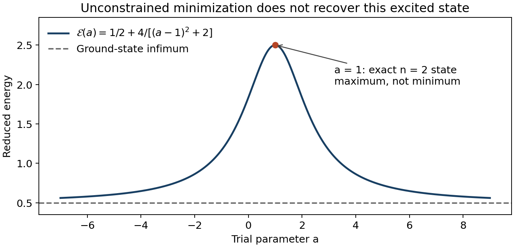

<h1 id="section-b/33/c/ii/solution">Solution</h1>

↑ **Parent:** [Ii](../ii.md)

Direct evaluation of the [Rayleigh quotient](../../../../../../../rayleigh-quotient.md) exposes a problem with the requested minimization. Using the supplied [Gaussian integrals](../../../../../../../gaussian-integral.md),

$$
\begin{aligned}
\langle\psi|\psi\rangle&=\sqrt\pi(a^2-2a+3),\\
\langle\psi|\hat H|\psi\rangle&=\frac{\sqrt\pi}{2}(a^2-2a+11),\\
\mathcal E(a)&=\frac{a^2-2a+11}{2(a^2-2a+3)}
=\frac12+\frac4{(a-1)^2+2}.
\end{aligned}
$$

Thus

$$
\mathcal E'(a)=\frac{-8(a-1)}{[(a-1)^2+2]^2},\qquad
\mathcal E'(1)=0,\qquad \mathcal E''(1)=-2.
$$

**The [eigenfunction](../../../../../../../eigenfunction.md) value $a=1$ is a maximum, not a minimum.** Indeed $\mathcal E(1)=5/2$, whereas $\mathcal E(0)=11/6$ is already lower. There is no finite minimizing $a$ in this family: its infimum is $1/2$, approached as $|a|\to\infty$, when the normalized trial [wavefunction](../../../../../../../wave-function-split.md) approaches the ground state. This is consistent with the [quantum variational principle](../../../../../../../quantum-variational-principle.md). The original printed instruction in this subpart is therefore inconsistent as an unconstrained minimization; a stationary [Rayleigh quotient](../../../../../../../rayleigh-quotient.md) need not be a minimum.

The intended excited state can instead be obtained by imposing an [excited-state variational constraint](../../../../../../../excited-state-variational-constraint.md). [Orthogonality](../../../../../../../orthogonal-vectors.md) to the ground state requires

$$
\langle g|\psi\rangle=\sqrt\pi(1-a)=0,
$$

which fixes **$a=1$**. Every member of the family is even, so it is already orthogonal to the odd $n=1$ state. With the ground state excluded, the lowest allowed oscillator [energy](../../../../../../../energy-split.md) is therefore $E_2=5/2$. In the exact oscillator [basis](../../../../../../../basis.md), $\psi$ is proportional to $\sqrt2\,\phi_2+(1-a)\phi_0$, making both the maximum and the [orthogonality](../../../../../../../orthogonal-vectors.md) correction transparent.

**[Figure 2](#section-b/33/c/ii/image-the-trial-family-energy-has-a-maximum-at-the-exact-second-excited-state-parameter). The trial-family energy has a maximum at the exact second-excited-state parameter**.

## ↑ Ancestors (15)

1. [Ii](../ii.md)
2. [C](../../c.md)
3. [33](../../../33.md)
4. [Section B](../../../../section-b.md)
5. [Paper 2B](../../../../../paper-2b-split.md)
6. [2022](../../../../../split.md)
7. [Past exam of the chemistry course of the year 3 of the natural sciences course of the University of Cambridge](../../../../../../split.md)
8. [Chemistry course of the year 3 of the natural sciences course of the University of Cambridge](../../../../../../../chemistry-course-of-the-year-3-of-the-natural-sciences-course-of-the-university-of-cambridge.md)
9. [Year 3 of the natural sciences course of the University of Cambridge](../../../../../../../year-3-of-the-natural-sciences-course-of-the-university-of-cambridge.md)
10. [Year of the natural sciences course of the University of Cambridge](../../../../../../../year-of-the-natural-sciences-course-of-the-university-of-cambridge.md)
11. [Natural sciences course of the University of Cambridge](../../../../../../../natural-sciences-course-of-the-university-of-cambridge.md)
12. [Course of the University of Cambridge](../../../../../../../course-of-the-university-of-cambridge.md)
13. [University of Cambridge](../../../../../../../university-of-cambridge-split.md)
14. [List of universities](../../../../../../../list-of-universities.md)
15. [Codex Wiki](../../../../../../../split.md)
