# Paper 3

↑ **Parent:** [2022](../2022.md)

[Original paper, released PDF pages 88–119](https://www.whatdotheyknow.com/request/nst_chemistry_past_papers_2022/response/2088679/attach/3/FOI%202022%20476%20Whittaker%20materials.pdf?cookie_passthrough=1#page=88)

**Table of contents**

- [37](#37)
  - [a](#37/a)
    - [i](#37/a/i)
      - [Solution](#37/a/i/solution)
    - [ii](#37/a/ii)
      - [Solution](#37/a/ii/solution)
  - [b](#37/b)
    - [i](#37/b/i)
      - [Solution](#37/b/i/solution)
    - [ii](#37/b/ii)
      - [Solution](#37/b/ii/solution)
    - [iii](#37/b/iii)
      - [Solution](#37/b/iii/solution)
    - [iv](#37/b/iv)
      - [Solution](#37/b/iv/solution)
  - [c](#37/c)
    - [i](#37/c/i)
      - [Solution](#37/c/i/solution)
    - [ii](#37/c/ii)
      - [Solution](#37/c/ii/solution)
- [38](#38)
  - [a](#38/a)
    - [i](#38/a/i)
      - [Solution](#38/a/i/solution)
    - [ii](#38/a/ii)
      - [Solution](#38/a/ii/solution)
  - [b](#38/b)
    - [i](#38/b/i)
      - [Solution](#38/b/i/solution)
    - [ii](#38/b/ii)
      - [Solution](#38/b/ii/solution)
  - [c](#38/c)
    - [i](#38/c/i)
      - [Solution](#38/c/i/solution)
    - [ii](#38/c/ii)
      - [Solution](#38/c/ii/solution)
- [39](#39)
  - [a](#39/a)
    - [Solution](#39/a/solution)
  - [b](#39/b)
    - [Solution](#39/b/solution)
  - [c](#39/c)
    - [Solution](#39/c/solution)
  - [d](#39/d)
    - [Solution](#39/d/solution)
  - [e](#39/e)
    - [Solution](#39/e/solution)
- [40](#40)
  - [a](#40/a)
    - [i](#40/a/i)
      - [Solution](#40/a/i/solution)
    - [ii](#40/a/ii)
      - [Solution](#40/a/ii/solution)
  - [b](#40/b)
    - [i](#40/b/i)
      - [Solution](#40/b/i/solution)
    - [ii](#40/b/ii)
      - [Solution](#40/b/ii/solution)
    - [iii](#40/b/iii)
      - [Solution](#40/b/iii/solution)
- [41](#41)
  - [a](#41/a)
    - [Solution](#41/a/solution)
  - [b](#41/b)
    - [Solution](#41/b/solution)
  - [c](#41/c)
    - [Solution](#41/c/solution)
- [42](#42)
  - [a](#42/a)
    - [Solution](#42/a/solution)
  - [b](#42/b)
    - [Solution](#42/b/solution)
  - [c](#42/c)
    - [i](#42/c/i)
      - [Solution](#42/c/i/solution)
    - [ii](#42/c/ii)
      - [Solution](#42/c/ii/solution)
    - [iii](#42/c/iii)
      - [Solution](#42/c/iii/solution)
  - [d](#42/d)
    - [Solution](#42/d/solution)
- [43](#43)
  - [a](#43/a)
    - [Solution](#43/a/solution)
  - [b](#43/b)
    - [i](#43/b/i)
      - [Solution](#43/b/i/solution)
    - [ii](#43/b/ii)
      - [Solution](#43/b/ii/solution)
  - [c](#43/c)
    - [Solution](#43/c/solution)
- [44](#44)
  - [a](#44/a)
    - [i](#44/a/i)
      - [Solution](#44/a/i/solution)
    - [ii](#44/a/ii)
      - [Solution](#44/a/ii/solution)
    - [iii](#44/a/iii)
      - [Solution](#44/a/iii/solution)
    - [iv](#44/a/iv)
      - [Solution](#44/a/iv/solution)
  - [b](#44/b)
    - [i](#44/b/i)
      - [Solution](#44/b/i/solution)
    - [ii](#44/b/ii)
      - [Solution](#44/b/ii/solution)
    - [iii](#44/b/iii)
      - [Solution](#44/b/iii/solution)
    - [iv](#44/b/iv)
      - [Solution](#44/b/iv/solution)
- [45](#45)
  - [a](#45/a)
    - [i](#45/a/i)
      - [Solution](#45/a/i/solution)
    - [ii](#45/a/ii)
      - [Solution](#45/a/ii/solution)
    - [iii](#45/a/iii)
      - [Solution](#45/a/iii/solution)
  - [b](#45/b)
    - [Solution](#45/b/solution)
  - [c](#45/c)
    - [Solution](#45/c/solution)
  - [d](#45/d)
    - [i](#45/d/i)
      - [Solution](#45/d/i/solution)
    - [ii](#45/d/ii)
      - [Solution](#45/d/ii/solution)
    - [iii](#45/d/iii)
      - [Solution](#45/d/iii/solution)
- [46](#46)
  - [a](#46/a)
    - [Solution](#46/a/solution)
  - [b](#46/b)
    - [i](#46/b/i)
      - [Solution](#46/b/i/solution)
    - [ii](#46/b/ii)
      - [Solution](#46/b/ii/solution)
    - [iii](#46/b/iii)
      - [Solution](#46/b/iii/solution)
  - [c](#46/c)
    - [i](#46/c/i)
      - [Solution](#46/c/i/solution)
    - [ii](#46/c/ii)
      - [Solution](#46/c/ii/solution)
- [47](#47)
  - [a](#47/a)
    - [Solution](#47/a/solution)
  - [b](#47/b)
    - [Solution](#47/b/solution)
  - [c](#47/c)
    - [Solution](#47/c/solution)
  - [d](#47/d)
    - [Solution](#47/d/solution)
- [48](#48)
  - [a](#48/a)
    - [Solution](#48/a/solution)
  - [b](#48/b)
    - [Solution](#48/b/solution)
  - [c](#48/c)
    - [Solution](#48/c/solution)
  - [d](#48/d)
    - [Solution](#48/d/solution)
  - [e](#48/e)
    - [Solution](#48/e/solution)
  - [f](#48/f)
    - [Solution](#48/f/solution)
- [49](#49)
  - [a](#49/a)
    - [i](#49/a/i)
      - [Solution](#49/a/i/solution)
    - [ii](#49/a/ii)
      - [Solution](#49/a/ii/solution)
    - [iii](#49/a/iii)
      - [Solution](#49/a/iii/solution)
  - [b](#49/b)
    - [i](#49/b/i)
      - [Solution](#49/b/i/solution)
    - [ii](#49/b/ii)
      - [Solution](#49/b/ii/solution)
  - [c](#49/c)
    - [i](#49/c/i)
      - [Solution](#49/c/i/solution)
    - [ii](#49/c/ii)
      - [Solution](#49/c/ii/solution)
    - [iii](#49/c/iii)
      - [Solution](#49/c/iii/solution)
    - [iv](#49/c/iv)
      - [Solution](#49/c/iv/solution)
- [50](#50)
  - [a](#50/a)
    - [Solution](#50/a/solution)
  - [b](#50/b)
    - [Solution](#50/b/solution)
  - [c](#50/c)
    - [Solution](#50/c/solution)
  - [d](#50/d)
    - [Solution](#50/d/solution)
  - [e](#50/e)
    - [Solution](#50/e/solution)
  - [f](#50/f)
    - [Solution](#50/f/solution)

## 37

↑ **Parent:** [Paper 3](paper-3.md)

<h3 id="37/a">a</h3>

↑ **Parent:** [37](#37)

<h4 id="37/a/i">i</h4>

↑ **Parent:** [A](#37/a)

<h5 id="37/a/i/solution">Solution</h5>

↑ **Parent:** [I](#37/a/i)

Ni(II) is $d^8$. A [square-planar complex](../../chemistry.md#square-planar-complex) can keep its strongly antibonding in-plane orbital empty and has a paired, $S=0$ configuration. A tetrahedral $d^8$ arrangement has two unpaired [electrons](../../physics.md#electron), $S=1$.

The important change here is the substituent **on the imine nitrogen**: Me, Et, then tert-butyl. The phenolic ortho-tert-butyl substituent is common to all three ligands. The small N-Me groups permit coplanar N$_2$O$_2$ coordination in $\mathrm{Ni(L_a)_2}$. N-tert-butyl crowds that arrangement and favors twisting the two chelate planes toward a distorted tetrahedron in $\mathrm{Ni(L_c)_2}$. N-Et gives a closer energetic competition, so $\mathrm{Ni(L_b)_2}$ accesses both structures. The observed equilibrium reflects ligand-field stabilization, pairing, steric strain and temperature-dependent [entropy](../../entropy.md); it is not a change in nickel [oxidation state](../../chemical-reaction.md#oxidation-state).

<h4 id="37/a/ii">ii</h4>

↑ **Parent:** [A](#37/a)

<h5 id="37/a/ii/solution">Solution</h5>

↑ **Parent:** [Ii](#37/a/ii)

The negative [activation volume](../../chemical-kinetics.md#activation-volume) is consistent with an **associative** substitution pathway: an incoming donor of the tetradentate ligand approaches square-planar Ni, giving a five-coordinate transition structure/intermediate before a donor of an original chelate leaves. Successive donor substitution and chelate closure give the tetradentate N$_2$O$_2$ complex. Proton transfers convert the incoming phenolic groups to coordinated phenoxides while releasing the original ligands.

With acid/base forms written explicitly, the net ligand exchange is $\mathrm{Ni(L_a)_2+H_2L_d\to Ni(L_d)+2HL_a}$. The connected four-donor ligand benefits from the [chelate effect](../../chemistry.md#chelate-effect).

The bulky N-tert-butyl groups in $\mathrm{Ni(L_c)_2}$ hinder precisely the close donor approach needed for that associative route, and the starting tetrahedral geometry must reorganize to accept the planar tetradentate ligand. Consequently exchange can be too slow to observe under the stated conditions. Failure to observe a new product is a kinetic observation; it does not establish that all tetrahedral nickel complexes are inert or that the tetradentate product is thermodynamically impossible.

<h3 id="37/b">b</h3>

↑ **Parent:** [37](#37)

<h4 id="37/b/i">i</h4>

↑ **Parent:** [B](#37/b)

<h5 id="37/b/i/solution">Solution</h5>

↑ **Parent:** [I](#37/b/i)

**A is the N-bound linkage isomer**, $\mathrm{[(NH_3)_5Co(NCS)]^{2+}}$: five ammines plus NCS account for $\mathrm{CoCH_{15}N_6S}$.

The natural route is [conjugate-base substitution](../../chemistry.md#conjugate-base-substitution). [Hydroxide](../../chemistry.md#hydroxide) reversibly removes an ammine proton:

$$
\mathrm{[(NH_3)_5CoX]^{2+}+OH^-
\rightleftharpoons[(NH_3)_4(NH_2)CoX]^++H_2O}.
$$

The amido donor promotes loss of X$^-$, producing a short-lived five-coordinate $\mathrm{[(NH_3)_4(NH_2)Co]^{2+}}$ intermediate. That leaving-group-sensitive loss is the slower stage. Subsequent trapping/proton transfers are fast and no longer depend on which halide left.

[Water](../../chemical-substance.md#water) capture followed by proton transfer gives the hydroxo complex. Competing SCN$^-$ capture can occur at either end of this [ambidentate ligand](../../chemistry.md#ambidentate-ligand), producing Co-SCN and Co-NCS. Any initially captured S-bound material can undergo the base-assisted linkage rearrangement considered next. [Water](../../chemical-substance.md#water) is overwhelmingly abundant, so the stable N-bound product can remain a minor overall product. The slow X-dependent and fast X-independent stages fit loss of X followed by chemistry of a common intermediate; a single rate-limiting direct attack by thiocyanate would not explain that separation naturally.

<h4 id="37/b/ii">ii</h4>

↑ **Parent:** [B](#37/b)

<h5 id="37/b/ii/solution">Solution</h5>

↑ **Parent:** [Ii](#37/b/ii)

Begin with the same ammine [deprotonation](../../acid-base-chemistry.md#deprotonation) and amido-assisted weakening/cleavage of the Co-S bond, but now SCN$^-$ is already beside the metal. A **solvent-caged pair** of five-coordinate cobalt amido species and the departing thiocyanate can reorient and recombine through nitrogen before the ligand diffuses into bulk solution. Reprotonation restores the five ammines and gives A.

Thus the essential sequence is

$$
\mathrm{Co{-}SCN\xrightarrow[\text{ammine deprotonation}]{OH^-}
\{Co_{\rm amido}\cdots SCN^-\}_{cage}
\longrightarrow Co{-}NCS}.
$$

[Water](../../chemical-substance.md#water) capture competes to give Co-OH, but rapid internal return of the already associated ligand accounts for the high yield of A. The slower entry into the reactive conjugate-base/dissociation sequence is followed by faster reorientation, capture and proton transfer. This is [linkage isomerization](../../chemistry.md#linkage-isomerization), not oxidation or reduction of cobalt.

<h4 id="37/b/iii">iii</h4>

↑ **Parent:** [B](#37/b)

<h5 id="37/b/iii/solution">Solution</h5>

↑ **Parent:** [Iii](#37/b/iii)

The near absence of incoming $^{14}$C label means the coordinated thiocyanate usually retains its **molecular identity** during linkage change. A mechanism that releases it into a fully mixed solution pool and then captures an arbitrary external thiocyanate would predict much more exchange.

Rapid geminate return within a [solvent cage](../../physical-chemistry.md#solvent-cage) explains the result: the original ligand turns and binds through N before an external labeled ligand can intercept the cobalt centre. A continuously bound intramolecular rearrangement is also compatible with low exchange. Therefore the label result supports an intramolecular/cage-local process but does not alone prove that the Co-S bond stays unbroken throughout.

[Base hydrolysis of pentaamminecobalt complexes by W. Gregory Jackson and C. N. Hookey](../../chemistry-bibliography.md#base-hydrolysis-of-pentaamminecobalt-complexes-by-w-gregory-jackson-and-c-n-hookey)

<h4 id="37/b/iv">iv</h4>

↑ **Parent:** [B](#37/b)

<h5 id="37/b/iv/solution">Solution</h5>

↑ **Parent:** [Iv](#37/b/iv)

Low-spin Co(III) is substitution-inert. In acid, coordinated ammine [deprotonation](../../acid-base-chemistry.md#deprotonation) is suppressed, so the strongly donating amido [conjugate base](../../acid-base-chemistry.md#conjugate-base) that assists ligand loss is not generated appreciably. Direct aquation/linkage change consequently remains very slow.

The persistence of the starting S-bound complex therefore supports a **base-activated kinetic pathway**. It is consistent with the rapid rearrangement in base and does not [mean](../../expected-value.md) that the S-bound form must be the thermodynamically preferred linkage isomer under every condition.

<h3 id="37/c">c</h3>

↑ **Parent:** [37](#37)

<h4 id="37/c/i">i</h4>

↑ **Parent:** [C](#37/c)

<h5 id="37/c/i/solution">Solution</h5>

↑ **Parent:** [I](#37/c/i)

These are [inner-sphere electron transfer](../../electrochemistry.md#inner-sphere-electron-transfer) pathways distinguished by where Cr(II) attacks the coordinated thiocyanate. Cr(II) is substitution-labile and can replace an aqua ligand to form a bridged Co(III)/Cr(II) precursor.

- **Remote attack at nitrogen:** form $\mathrm{Co^{III}{-}S{-}C{-}N{-}Cr^{II}}$. [Electron transfer](../../electrochemistry.md#electron-transfer) through the bridge gives Co(II)/Cr(III). Cleavage on the now labile Co(II) side leaves the N-bound product $\mathrm{[Cr(NCS)(OH_2)_5]^{2+}}$. This is the faster $2.0\times10^5\,\mathrm{M^{-1}s^{-1}}$ channel.
- **Adjacent attack at sulfur:** Cr binds the same sulfur that is attached to cobalt, giving a shared-S bridge, $\mathrm{Co^{III}{-}S(CN){-}Cr^{II}}$. [Electron transfer](../../electrochemistry.md#electron-transfer) and Co-S cleavage leave $\mathrm{[Cr(SCN)(OH_2)_5]^{2+}}$, the $0.8\times10^5$ channel.

In both cases the product Co(II) rapidly loses its ammines to give the hexaaqua [ion](../../chemistry.md#ion), whereas substitution-inert Cr(III) retains the bridge-end information. The two chromium linkage isomers are therefore a record of two precursor geometries, rather than evidence that one outer-sphere electron-transfer event somehow selects two arbitrary new ligands afterwards.

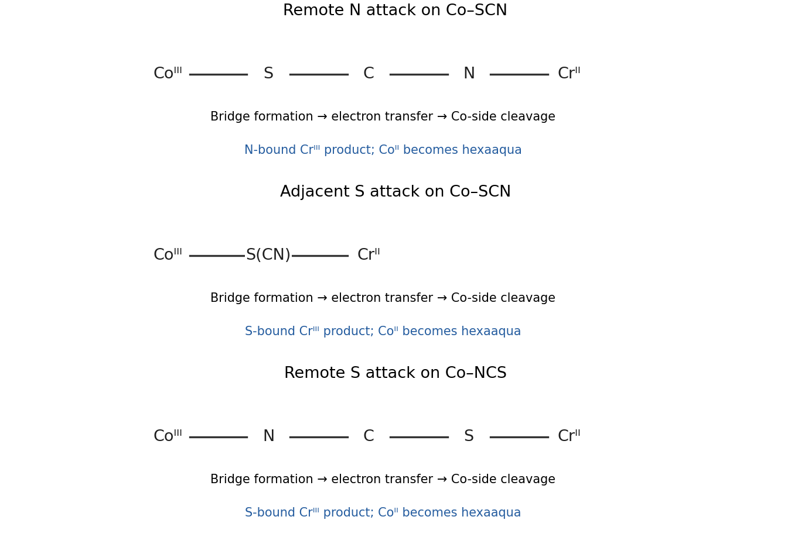

**[Figure 1](#37/c/i/image-remote-and-adjacent-bridges-retain-different-thiocyanate-linkage-information). Remote and adjacent bridges retain different thiocyanate linkage information**.

<h4 id="37/c/ii">ii</h4>

↑ **Parent:** [C](#37/c)

<h5 id="37/c/ii/solution">Solution</h5>

↑ **Parent:** [Ii](#37/c/ii)

The free end of N-bound $\mathrm{Co{-}NCS}$ is sulfur. Cr(II) binds there, giving the remote bridge $\mathrm{Co^{III}{-}N{-}C{-}S{-}Cr^{II}}$. [Electron transfer](../../electrochemistry.md#electron-transfer) and cleavage of the Co-N bond leave S-bound Cr(III), $\mathrm{[Cr(SCN)(OH_2)_5]^{2+}}$; labile Co(II) becomes hexaaquacobalt(II).

The much smaller [rate constant](../../chemical-kinetics.md#rate-constant) shows that the efficiency of bridge formation/[electron](../../physics.md#electron) transmission is strongly sensitive to linkage orientation. Efficient donation and coupling in a Co-S-bound precursor need not be reproduced when cobalt is N-bound. Its reduction is still consistent with [inner-sphere electron transfer](../../electrochemistry.md#inner-sphere-electron-transfer); a slow rate alone is not a criterion for outer-sphere transfer.

## 38

↑ **Parent:** [Paper 3](paper-3.md)

<h3 id="38/a">a</h3>

↑ **Parent:** [38](#38)

<h4 id="38/a/i">i</h4>

↑ **Parent:** [A](#38/a)

<h5 id="38/a/i/solution">Solution</h5>

↑ **Parent:** [I](#38/a/i)

Write $L$ for the imidazolylidene [N-heterocyclic carbene](../../chemistry.md#n-heterocyclic-carbene) bearing the two mesityl groups shown. The proposed active unit is **$\mathrm{LNi(H)(SiPh_3)}$**, with H and SiPh$_3$ both bonded to nickel, rather than a nickel-free hydrosilane or a bare NHC-Ni fragment.

Displacement of coordinated styrene and formal [oxidative addition](../../chemical-reaction.md#oxidative-addition) of Si-H to Ni(0) give a low-coordinate nickel(II) hydride-silyl unit; substrate binding fills a vacant site. The productive cycle is [alkene](../../chemical-substance.md#alkene) coordination, [migratory insertion](../../chemical-reaction.md#migratory-insertion) into Ni-H, then [beta-hydride elimination](../../chemical-reaction.md#beta-hydride-elimination) from the other beta [carbon](../../chemical-substance.md#carbon), releasing the shifted [alkene](../../chemical-substance.md#alkene) and regenerating Ni-H.

The strongly donating NHC stabilizes a reactive low-coordinate metal and assists Si-H activation. Its steric bulk discourages unproductive saturated bis-alkene species and promotes product departure, but excessive crowding can hinder substrate binding/insertion. The [silyl ligand](../../chemistry.md#silyl-ligand) also tunes the metal electronically: changing its aryl substituents changes donation and the barriers for hydride transfer/elimination. Product release and reversible insertion determine whether further double-bond migration occurs. Bulky ligands can suppress competing alkyl-silyl [reductive elimination](../../chemical-reaction.md#reductive-elimination), which would instead consume substrate by hydrosilylation.

The hydride-silyl formulation and insertion/elimination interpretation are the experimentally proposed mechanism; the individual catalyst resting states need not all be uniquely fixed by the activation recipe.[Modular nickel-silane catalytic system for the isomerization of alkenes by Kiana E. Kawamura and colleagues](../../chemistry-bibliography.md#modular-nickel-silane-catalytic-system-for-the-isomerization-of-alkenes-by-kiana-e-kawamura-and-colleagues)

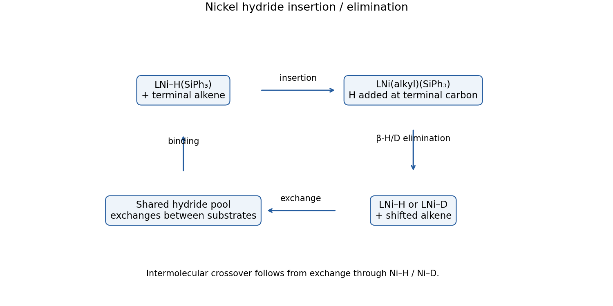

**[Figure 2](#38/a/i/image-hydride-insertion-and-beta-elimination-with-a-shared-intermolecular-h-d-pool). Hydride insertion and beta elimination with a shared intermolecular H/D pool**.

<h4 id="38/a/ii">ii</h4>

↑ **Parent:** [A](#38/a)

<h5 id="38/a/ii/solution">Solution</h5>

↑ **Parent:** [Ii](#38/a/ii)

Label the starting exomethylene [carbon](../../chemical-substance.md#carbon) $a$, the aryl-bearing [carbon](../../chemical-substance.md#carbon) $b$, the ethyl CH$_2$/CD$_2$ [carbon](../../chemical-substance.md#carbon) $c$, and the terminal methyl $d$:

$$
\mathrm{aCH_2=C_b(Ar)-C_cL_2-C_dH_3}.
$$

Insertion into Ni-H places H on $a$ and Ni on $b$. Elimination of a beta H or D from $c$ gives $\mathrm{CH_3-C(Ar)=C(L)-CH_3}$ and Ni-H or Ni-D. Thus the labeled substrate can retain one D on the new vinylic [carbon](../../chemical-substance.md#carbon) while exporting the other into the catalyst hydride pool.

Ni-D can then add to the exomethylene of **either** aryl substrate, introducing D into the methyl group derived from $a$. Reversible insertion/elimination and substrate exchange also introduce D into the vinylic position of the originally unlabeled compound. This explains both the approximately comparable methyl labeling of the two products and the larger residual vinylic labeling of the initially CD$_2$-bearing substrate.

The decisive observation is **intermolecular crossover of deuterium** into the unsubstituted-phenyl product. It rules out a purely intramolecular, identity-preserving 1,3-H/D shift. The unequal percentages retain kinetic and substrate-history information; they are not a requirement for completely statistical H/D equilibration and cannot determine all elementary [rate constants](../../chemical-kinetics.md#rate-constant) by themselves.

<h3 id="38/b">b</h3>

↑ **Parent:** [38](#38)

<h4 id="38/b/i">i</h4>

↑ **Parent:** [B](#38/b)

<h5 id="38/b/i/solution">Solution</h5>

↑ **Parent:** [I](#38/b/i)

A [Fischer carbene complex](../../chemistry.md#fischer-carbene-complex) typically has a low-oxidation-state, relatively electron-rich middle/late transition metal with strong pi-acceptor ligands such as CO. The [carbene](../../chemistry.md#carbene) is treated as a neutral two-electron donor; metal-to-carbene back-donation contributes to its bond, but its [carbon](../../chemical-substance.md#carbon) remains electrophilic. An OR or NR$_2$ substituent stabilizes that [carbon](../../chemical-substance.md#carbon) by heteroatom donation. Here the metal is Cr(0), $d^6$, in an 18-electron pentacarbonyl complex.

A [Schrock carbene complex](../../chemistry.md#schrock-carbene-complex) usually contains an early metal in a high [oxidation state](../../chemical-reaction.md#oxidation-state), often $d^0$, with electron-donating ligands rather than a shell of pi-accepting [carbonyls](../../chemical-bond.md#carbonyl-group). Its alkylidene has substantial dianionic [character](../../representation-theory.md#character-of-a-representation) in ionic counting, and its [carbon](../../chemical-substance.md#carbon) is correspondingly nucleophilic. Alkyl substituents are common; heteroatom stabilization of an electrophilic [carbon](../../chemical-substance.md#carbon) is not the defining feature. These are bonding/electronic limiting descriptions rather than a rule based only on the drawn metal-carbon double bond.

<h4 id="38/b/ii">ii</h4>

↑ **Parent:** [B](#38/b)

<h5 id="38/b/ii/solution">Solution</h5>

↑ **Parent:** [Ii](#38/b/ii)

CO first dissociates from the 18-electron Fischer [carbene](../../chemistry.md#carbene). Pyridyl nitrogen of C then coordinates at the vacant chromium site, positioning an ortho C-D bond of its [phenyl group](../../chemical-substance.md#phenyl-group) beside the [carbene](../../chemistry.md#carbene) unit.

The appropriate pathway is **[oxidative hydrogen migration](../../chemical-reaction.md#oxidative-hydrogen-migration)**: chromium assists C-D cleavage while D transfers to the electrophilic [carbene](../../chemistry.md#carbene) [carbon](../../chemical-substance.md#carbon). The resulting cyclometalated intermediate has both an aryl-Cr bond and an alkyl-Cr bond, the latter to $\mathrm{C(D)(OEt)(o\!-\!tolyl)}$. Formally Cr(0) becomes Cr(II). [Reductive elimination](../../chemical-reaction.md#reductive-elimination) between those two [carbon](../../chemical-substance.md#carbon) ligands forms the new aryl–$\mathrm{C(D)(OEt)(o\!-\!tolyl)}$ bond and returns chromium to low [oxidation state](../../chemical-reaction.md#oxidation-state).

This accounts for all three controls. Extra CO suppresses the coordinative vacancy. Biphenyl E lacks the pyridyl-N directing group and cannot organize the necessary C-H activation geometry. The ortho deuterium moves onto the former [carbene](../../chemistry.md#carbene) [carbon](../../chemical-substance.md#carbon) rather than being lost to solvent: four D remain on the original phenyl ring and the fifth becomes the benzylic C-D bond.

This is not adequately represented as electrophilic aromatic substitution followed by proton loss, which would discard the diagnostic D. The primary mechanistic study distinguishes [oxidative hydrogen migration](../../chemical-reaction.md#oxidative-hydrogen-migration)/[reductive elimination](../../chemical-reaction.md#reductive-elimination) from that classical alternative.[Azacycle-directed formal aromatic C-H insertion with a chromium Fischer carbene by Xing-Qi Yao and colleagues](../../chemistry-bibliography.md#azacycle-directed-formal-aromatic-c-h-insertion-with-a-chromium-fischer-carbene-by-xing-qi-yao-and-colleagues)

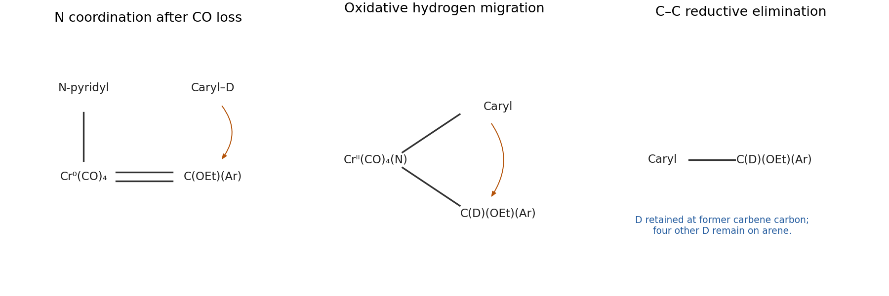

**[Figure 3](#38/b/ii/image-directed-oxidative-deuterium-migration-followed-by-carbon-carbon-reductive-elimination). Directed oxidative deuterium migration followed by carbon-carbon reductive elimination**.

<h3 id="38/c">c</h3>

↑ **Parent:** [38](#38)

<h4 id="38/c/i">i</h4>

↑ **Parent:** [C](#38/c)

<h5 id="38/c/i/solution">Solution</h5>

↑ **Parent:** [I](#38/c/i)

Phosphine binding breaks the hydroxo-bridged dimer into mononuclear Rh-OH units. [Hydroxide](../../chemistry.md#hydroxide)/boronic-acid association forms a Rh-O-B linkage; transfer of the aryl group from boron to rhodium, with Rh-O bond cleavage, gives the Rh-aryl initiator. This is [transmetalation](../../chemistry.md#transmetalation), with rhodium remaining formally Rh(I).

Writing $\mathrm{Ar}=p\!-\!\mathrm{C_6H_4Me}$ and $L=\mathrm{PPh_3}$, the balanced net activation is

$$
\mathrm{[(COD)Rh(\mu-OH)]_2+2ArB(OH)_2+2L
\longrightarrow2(COD)Rh(L)Ar+2B(OH)_3}.
$$

The stoichiometric byproduct is **boric acid**, $\mathrm{B(OH)_3}$. Each monomeric Rh(I) product is a 16-electron complex: $d^8$ Rh(I), four [electrons](../../physics.md#electron) from COD, two from phosphine and two from the aryl X ligand. Temporary phosphine dissociation makes room for alkyne binding during propagation.

<h4 id="38/c/ii">ii</h4>

↑ **Parent:** [C](#38/c)

<h5 id="38/c/ii/solution">Solution</h5>

↑ **Parent:** [Ii](#38/c/ii)

Coordinate one diphenylacetylene and insert it into Rh-Ar. Syn migration puts the new Rh-C and Ar-C bonds on the same face of the former alkyne. Repeat alkyne coordination/insertion into the resulting Rh-vinyl bond. The chain after two insertions is

$$
\mathrm{(COD)(L)Rh-C_1(Ph)=C_2(Ph)-C_3(Ph)=C_4(Ph)-Ar}.
$$

Numbering runs from the metal toward the initiating aryl group. Each insertion is syn: Rh and the continuing chain lie on the same side of the newly made double bond, giving the displayed cis relationship of the two Ph substituents at each inserted unit. The second alkyne inserts at the Rh end; it is not appended by coupling two free vinyl radicals.

To obtain F, promote **PPh$_3$ dissociation**, allowing G's dienyl group to fold and form the new C$_1$-C$_4$ bond. A four-pi-electron [electrocyclic ring closure](../../chemical-reaction.md#electrocyclic-ring-closure) gives a cyclobutenyl ligand, stabilized by eta-three coordination of its allylic C$_1$-C$_2$-C$_3$ fragment to Rh. The substituted C$_4$ is the saturated ring [carbon](../../chemical-substance.md#carbon) bearing Ar and Ph.

The thermal four-pi closure is [conrotatory](../../chemical-reaction.md#conrotatory-motion). Ring closure plus eta-three binding restores a 16-electron Rh(I) centre after phosphine loss; no net oxidation-state change is needed. F is an eta-three **cyclobutenyl** complex, not an eta-four cyclobutadiene with five substituents squeezed onto four unsaturated carbons.

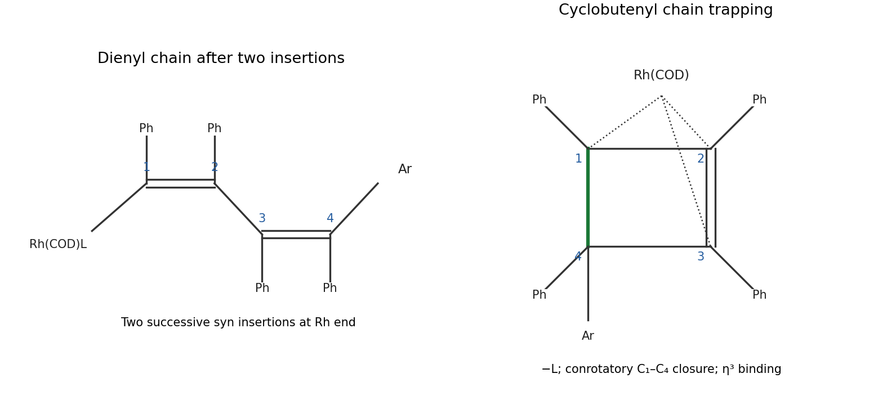

**[Figure 4](#38/c/ii/image-successive-syn-alkyne-insertions-and-electrocyclic-trapping-as-a-cyclobutenyl-complex). Successive syn alkyne insertions and electrocyclic trapping as a cyclobutenyl complex**.

## 39

↑ **Parent:** [Paper 3](paper-3.md)

<h3 id="39/a">a</h3>

↑ **Parent:** [39](#39)

<h4 id="39/a/solution">Solution</h4>

↑ **Parent:** [A](#39/a)

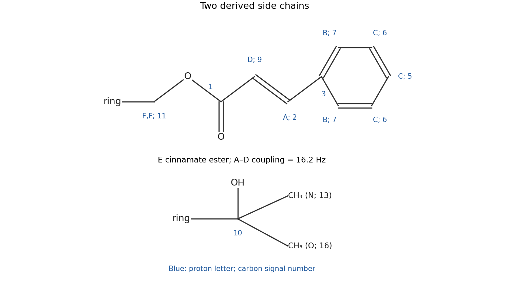

**[Figure 5](#39/a/image-the-cinnamoyloxymethyl-and-tertiary-alcohol-side-chains-with-their-spectral-assignments). The cinnamoyloxymethyl and tertiary-alcohol side chains, with their spectral assignments**.

The two substituents are **$\mathrm{-CH_2-O-C(O)-CH=CH-Ph}$**, with the [alkene](../../chemical-substance.md#alkene) E, and **$\mathrm{-C(OH)(CH_3)_2}$**. The free bond at the left of each drawing attaches to the [cyclohexene](../../chemical-substance.md#cyclohexene).

The A-D [COSY](../../nuclear-magnetic-resonance.md#cosy) correlation and $16.2\,\mathrm{Hz}$ coupling identify the trans cinnamate double bond. Five aromatic protons and four phenyl-carbon environments identify its monosubstituted phenyl ring. F is a two-proton OCH$_2$ signal; its [HMBC](../../nuclear-magnetic-resonance.md#hmbc) correlation to [carbonyl](../../chemical-bond.md#carbonyl-group) 1 joins that methylene through [oxygen](../../chemical-substance.md#oxygen) to the [ester](../../chemical-substance.md#ester). The two three-proton singlets N/O, their correlations to oxygenated quaternary [carbon](../../chemical-substance.md#carbon) 10, and the missing OH resonance give the tertiary-alcohol substituent.

<h3 id="39/b">b</h3>

↑ **Parent:** [39](#39)

<h4 id="39/b/solution">Solution</h4>

↑ **Parent:** [B](#39/b)

**[Figure 6](#39/b/image-proton-letters-and-carbon-numbers-assigned-to-the-two-side-chains). Proton letters and carbon numbers assigned to the two side chains**.

On the ester-containing side chain, read outward from the [cyclohexene](../../chemical-substance.md#cyclohexene):

$$
\mathrm{ring{-}\underset{11;\ F,F}{CH_2}{-}O{-}
\underset{1}{C}(=O){-}
\underset{9;\ D}{CH}{=}
\underset{2;\ A}{CH}{-}
\underset{3\ (ipso)}{Ph}}.
$$

A is the downfield beta-vinylic proton and D the alpha-vinylic proton next to the [ester](../../chemical-substance.md#ester).

The phenyl ortho pair is **B on [carbon](../../chemical-substance.md#carbon) 7**; the meta pair is **C on [carbon](../../chemical-substance.md#carbon) 6**; its para proton is the remaining **C on [carbon](../../chemical-substance.md#carbon) 5**. Thus the C envelope integrates to three protons, while B integrates to two. [Carbon](../../chemical-substance.md#carbon) 3 is the unprotonated ipso site.

In the other substituent, **10** is the quaternary C-OH [carbon](../../chemical-substance.md#carbon). The methyl assignments are **N on 13** and **O on 16**, reading the very closely spaced [HSQC](../../nuclear-magnetic-resonance.md#hsqc) cross peaks together with the positive methyl responses in [DEPT-135](../../nuclear-magnetic-resonance.md#dept-135). Their mutual long-range correlations and correlations to 10 support the gem-dimethyl group. The two methyl carbons are distinguishable in this chiral molecular environment; their exact stereotopic names are not determined here.

<h3 id="39/c">c</h3>

↑ **Parent:** [39](#39)

<h4 id="39/c/solution">Solution</h4>

↑ **Parent:** [C](#39/c)

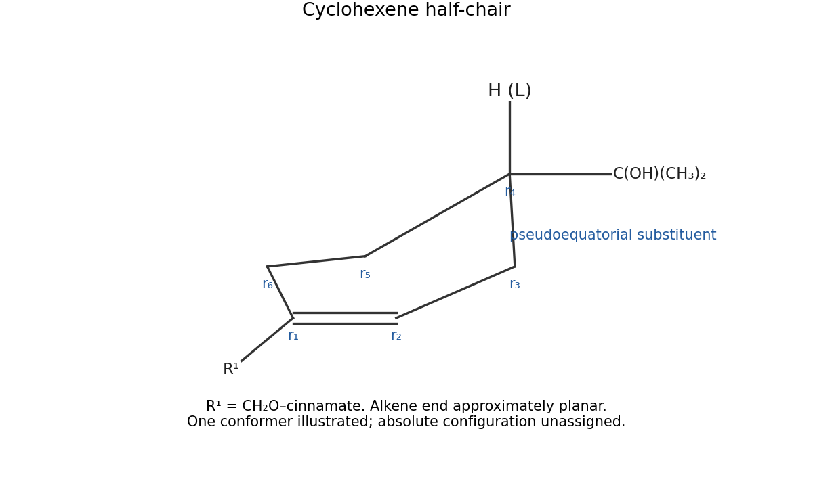

**[Figure 7](#39/c/image-preferred-cyclohexene-half-chair-with-the-bulky-tertiary-alcohol-side-chain-pseudoequatorial). Preferred cyclohexene half-chair with the bulky tertiary-alcohol side chain pseudoequatorial**.

Use a **[cyclohexene half-chair](../../chemical-substance.md#cyclohexene-half-chair)**, not a fully puckered saturated-cyclohexane chair. The [alkene](../../chemical-substance.md#alkene) carbons and their directly attached bonds form the approximately planar end; the saturated part puckers. Put the $\mathrm{C(OH)(CH_3)_2}$ substituent pseudoequatorial at the opposite saturated methine to avoid a crowded pseudoaxial arrangement. Its methine proton is correspondingly pseudoaxial. This is a preferred [conformation](../../stereochemistry.md#conformation); the achiral spectra do not assign an absolute configuration.

<h3 id="39/d">d</h3>

↑ **Parent:** [39](#39)

<h4 id="39/d/solution">Solution</h4>

↑ **Parent:** [D](#39/d)

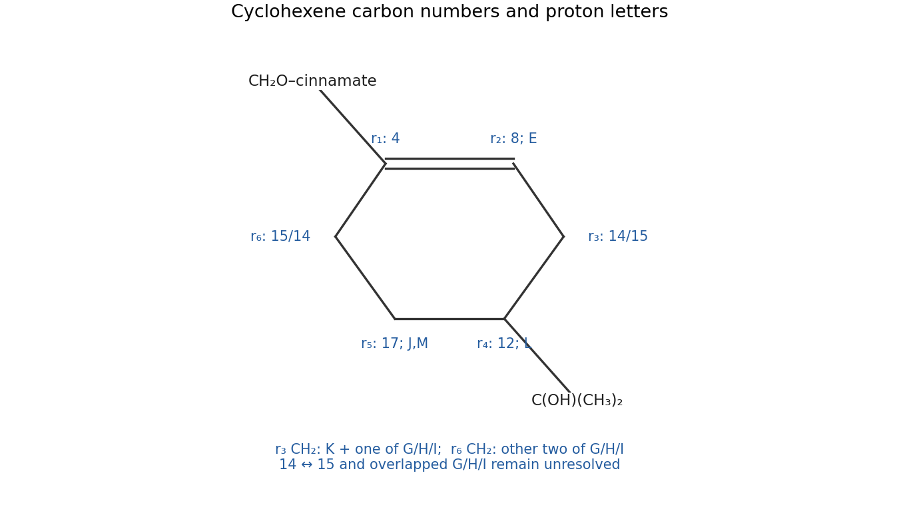

**[Figure 8](#39/d/image-cyclohexene-assignments-with-explicit-ambiguity-for-the-overlapping-allylic-methylenes). Cyclohexene assignments with explicit ambiguity for the overlapping allylic methylenes**.

Number ring positions $r_1$ through $r_6$ around the ring, with $r_1=r_2$ the double bond. These auxiliary ring-position labels are distinct from the printed carbon-signal numbers.

- **$r_1$:** quaternary [alkene](../../chemical-substance.md#alkene) [carbon](../../chemical-substance.md#carbon) **4**, attached to the OCH$_2$ side chain.
- **$r_2$:** [alkene](../../chemical-substance.md#alkene) CH **8**, proton **E**.
- **$r_3$:** allylic CH$_2$, one of [carbon](../../chemical-substance.md#carbon) signals **14/15**; its protons are **K and one of G/H/I**.
- **$r_4$:** methine **12**, proton **L**, attached to the tertiary-alcohol [carbon](../../chemical-substance.md#carbon) 10.
- **$r_5$:** CH$_2$ **17**, protons **J and M**.
- **$r_6$:** the other allylic CH$_2$ **15/14**, carrying the remaining **two of G/H/I**.

The [HSQC](../../nuclear-magnetic-resonance.md#hsqc) pairs J and M with 17 and places L on 12. It also places K and one unresolved member of G/H/I on one of the closely spaced allylic carbons, with the other two G/H/I protons on the other. [COSY](../../nuclear-magnetic-resonance.md#cosy) connects the vinylic E to the adjacent allylic part and connects the methine L to its neighboring methylenes; [HMBC](../../nuclear-magnetic-resonance.md#hmbc) links F to the substituted [alkene](../../chemical-substance.md#alkene) end and the gem-dimethyl group to the methine end.

The printed overlap does not justify a unique assignment of every G/H/I letter or a forced 14-versus-15 assignment to those two ring positions. The drawing retains those alternatives explicitly. In the half-chair, L is pseudoaxial; the resolved large/small couplings are consistent with pseudoaxial/pseudoequatorial methylene partners, but exact axial letter labels within the overlapped group remain uncertain.

<h3 id="39/e">e</h3>

↑ **Parent:** [39](#39)

<h4 id="39/e/solution">Solution</h4>

↑ **Parent:** [E](#39/e)

**[Figure 9](#39/e/image-complete-constitution-cinnamoyloxymethyl-at-cyclohexene-position-1-and-a-tertiary-alcohol-substituent-at-position-4). Complete constitution: cinnamoyloxymethyl at cyclohexene position 1 and a tertiary-alcohol substituent at position 4**.

The constitution is **\[4-(2-hydroxypropan-2-yl)cyclohex-1-en-1-yl\]methyl (E)-3-phenylprop-2-enoate**, with absolute configuration at the saturated substituted ring [carbon](../../chemical-substance.md#carbon) unspecified.

The OCH$_2$ side chain is attached to the **unprotonated [alkene](../../chemical-substance.md#alkene) [carbon](../../chemical-substance.md#carbon) 4**: F correlates through the ring junction to the [alkene](../../chemical-substance.md#alkene) carbons and an allylic methylene, while its correlation to 1 fixes the [ester](../../chemical-substance.md#ester) linkage. The $\mathrm{C(OH)(CH_3)_2}$ side chain is attached to **methine [carbon](../../chemical-substance.md#carbon) 12**, as shown by the methyl-to-12 [HMBC](../../nuclear-magnetic-resonance.md#hmbc) correlations and the contiguous ring [COSY](../../nuclear-magnetic-resonance.md#cosy) network.

The formula check gives 19 carbons and 24 hydrogens including OH. Its [degree of unsaturation](../../chemical-substance.md#degree-of-unsaturation) is eight: four from phenyl, one [ester](../../chemical-substance.md#ester) [carbonyl](../../chemical-bond.md#carbonyl-group), one cinnamate C=C, one [cyclohexene](../../chemical-substance.md#cyclohexene) C=C and one ring. No additional double bond or hidden second [carbonyl](../../chemical-bond.md#carbonyl-group) is needed.

## 40

↑ **Parent:** [Paper 3](paper-3.md)

<h3 id="40/a">a</h3>

↑ **Parent:** [40](#40)

<h4 id="40/a/i">i</h4>

↑ **Parent:** [A](#40/a)

<h5 id="40/a/i/solution">Solution</h5>

↑ **Parent:** [I](#40/a/i)

**TODO: user-deferred biology question.**

<h4 id="40/a/ii">ii</h4>

↑ **Parent:** [A](#40/a)

<h5 id="40/a/ii/solution">Solution</h5>

↑ **Parent:** [Ii](#40/a/ii)

**TODO: user-deferred biology question.**

<h3 id="40/b">b</h3>

↑ **Parent:** [40](#40)

<h4 id="40/b/i">i</h4>

↑ **Parent:** [B](#40/b)

<h5 id="40/b/i/solution">Solution</h5>

↑ **Parent:** [I](#40/b/i)

**TODO: user-deferred biology question.**

<h4 id="40/b/ii">ii</h4>

↑ **Parent:** [B](#40/b)

<h5 id="40/b/ii/solution">Solution</h5>

↑ **Parent:** [Ii](#40/b/ii)

**TODO: user-deferred biology question.**

<h4 id="40/b/iii">iii</h4>

↑ **Parent:** [B](#40/b)

<h5 id="40/b/iii/solution">Solution</h5>

↑ **Parent:** [Iii](#40/b/iii)

**TODO: user-deferred biology question.**

## 41

↑ **Parent:** [Paper 3](paper-3.md)

<h3 id="41/a">a</h3>

↑ **Parent:** [41](#41)

<h4 id="41/a/solution">Solution</h4>

↑ **Parent:** [A](#41/a)

**TODO: user-deferred biology question.**

<h3 id="41/b">b</h3>

↑ **Parent:** [41](#41)

<h4 id="41/b/solution">Solution</h4>

↑ **Parent:** [B](#41/b)

**TODO: user-deferred biology question.**

<h3 id="41/c">c</h3>

↑ **Parent:** [41](#41)

<h4 id="41/c/solution">Solution</h4>

↑ **Parent:** [C](#41/c)

**TODO: user-deferred biology question.**

## 42

↑ **Parent:** [Paper 3](paper-3.md)

<h3 id="42/a">a</h3>

↑ **Parent:** [42](#42)

<h4 id="42/a/solution">Solution</h4>

↑ **Parent:** [A](#42/a)

A warmer [troposphere](../../planetary-science.md#troposphere) does not imply a warmer [stratosphere](../../planetary-science.md#stratosphere): increased [carbon dioxide](../../chemical-substance.md#carbon-dioxide) can cool the middle and upper stratosphere by enhancing infrared emission. One direct kinetic effect is slower temperature-dependent destruction in the [Chapman cycle](../../chemistry.md#chapman-cycle), tending to increase upper-stratospheric [ozone](../../chemical-substance.md#ozone). Two indirect chemical effects can have the opposite sign. If the entry [atmospheric cold trap](../../exoplanet.md#atmospheric-cold-trap) warms, it can admit more [water](../../chemical-substance.md#water); reaction with an [electronically excited oxygen atom](../../chemical-substance.md#electronically-excited-oxygen-atom) then supplies more of the [HOx family](../../chemical-kinetics.md#hox-family), enhancing catalytic [ozone](../../chemical-substance.md#ozone) loss. In cold polar air, changes in [water](../../chemical-substance.md#water) and [temperature](../../temperature.md) can favour [polar stratospheric clouds](../../planetary-science.md#polar-stratospheric-cloud), whose surfaces activate halogen reservoirs and can enhance [ozone](../../chemical-substance.md#ozone) destruction when sunlight returns. These are conditional pathways, not a universal sign for total [ozone](../../chemical-substance.md#ozone): cold-trap [temperature](../../temperature.md) and circulation, halogen abundance and altitude all matter. [Methane](../../chemical-substance.md#methane) oxidation can also supply stratospheric [water](../../chemical-substance.md#water).[Executive summary: Stratospheric Temperature, water-vapour influences, and temperature-dependent polar ozone loss](../../chemistry.md#scientific-assessment-of-ozone-depletion-2022-executive-summary)

<h3 id="42/b">b</h3>

↑ **Parent:** [42](#42)

<h4 id="42/b/solution">Solution</h4>

↑ **Parent:** [B](#42/b)

For one specified channel, the [photolysis rate coefficient](../../chemical-bond.md#photolysis-rate-coefficient) is

$$
J(z)=\int F_\lambda(z)\,\sigma_\lambda(T)\,\Phi_\lambda(T)\,d\lambda.
$$

It depends on spectral [actinic flux](../../radiometry.md#actinic-flux), absorption [cross section](../../physics.md#cross-section-physics), and channel [quantum yield](../../chemical-bond.md#quantum-yield). Solar zenith angle, season, overhead absorbers, clouds and [aerosol](../../chemistry.md#aerosol) scattering affect the photon field; branching and collisional quenching affect the chemical yield. Absorption alone does not guarantee the desired dissociation.

**Curve A is [oxygen](../../chemical-substance.md#oxygen) [photodissociation](../../chemical-bond.md#photodissociation); curve B is [ozone](../../chemical-substance.md#ozone) [photodissociation](../../chemical-bond.md#photodissociation).** Molecular [oxygen](../../chemical-substance.md#oxygen) needs relatively short-wavelength ultraviolet photons, which are strongly screened at lower altitudes, so its rate increases steeply with height. [Ozone](../../chemical-substance.md#ozone) can dissociate using longer wavelengths that penetrate much further, producing the much larger, less height-sensitive rate shown by B. The plotted quantity is a first-order coefficient with units $\mathrm{s^{-1}}$, rather than a bimolecular [rate constant](../../chemical-kinetics.md#rate-constant).

<h3 id="42/c">c</h3>

↑ **Parent:** [42](#42)

<h4 id="42/c/i">i</h4>

↑ **Parent:** [C](#42/c)

<h5 id="42/c/i/solution">Solution</h5>

↑ **Parent:** [I](#42/c/i)

The dominant OH-to-HO$_2$ pseudo-first-order rate is $k_5[\mathrm O_3]=90\,\mathrm{s^{-1}}$, corresponding to **$0.0111\,\mathrm s$**. Recycling HO$_2$ through atomic [oxygen](../../chemical-substance.md#oxygen) and NO has rate $k_6[\mathrm O]+k_8[\mathrm{NO}]=0.0218\,\mathrm{s^{-1}}$, corresponding to **$45.9\,\mathrm s$** for an individual HO$_2$ radical. A fixed-total two-state exchange relaxes at the sum of forward and reverse rates, giving about $0.0111\,\mathrm s$ for the partition perturbation. Its fast partition is therefore

$$
\frac{[\mathrm{HO_2}]}{[\mathrm{OH}]}
\simeq\frac{k_5[\mathrm O_3]}{k_6[\mathrm O]+k_8[\mathrm{NO}]}
=4.13\times10^3.
$$

This supports a [steady-state approximation in chemical kinetics](../../chemical-kinetics.md#steady-state-approximation-in-chemical-kinetics) for rapidly recycled intermediates if the parent [concentrations](../../mathematical-physics.md#concentration) vary slowly. It does not by itself establish stationarity of the entire [HOx family](../../chemical-kinetics.md#hox-family). The later source–termination estimate gives a family turnover time of about 16 hours, far longer than partition relaxation; a stationary absolute abundance additionally assumes sufficiently persistent radiation and background conditions. This is the distinction between [fast family partition and slow family balance](../../chemical-kinetics.md#fast-family-partition-and-slow-family-balance).

<h4 id="42/c/ii">ii</h4>

↑ **Parent:** [C](#42/c)

<h5 id="42/c/ii/solution">Solution</h5>

↑ **Parent:** [Ii](#42/c/ii)

Let $v_i$ denote the rate of reaction $i$. For [odd oxygen](../../chemistry.md#odd-oxygen) defined as O plus O$_3$, reactions 5 and 6 each consume one unit, while NO$_2$ [photodissociation](../../chemical-bond.md#photodissociation) in reaction 7 restores one. Thus the loss from reactions 4–8 is $L=v_5+v_6-v_7$. HO$_2$ stationarity gives $v_5=v_6+v_8+v_4$, and NO$_2$ stationarity within this restricted recycling loop gives $v_7=v_8$. Therefore

$$
L=2v_6+v_4\simeq\boxed{2k_6[\mathrm{HO_2}][\mathrm O]}.
$$

The requested expression neglects the small termination correction $v_4$ in the odd-oxygen budget, while retaining it to determine the much slower total-radical balance. This is consistent when cycling greatly exceeds termination. The net main catalytic cycle is O plus O$_3$ forming two O$_2$ [molecules](../../molecule.md); the NO-assisted route mainly interconverts O and O$_3$ and cancels from this restricted net loss after NO$_2$ recycling.

<h4 id="42/c/iii">iii</h4>

↑ **Parent:** [C](#42/c)

<h5 id="42/c/iii/solution">Solution</h5>

↑ **Parent:** [Iii](#42/c/iii)

Using an isothermal atmosphere with the stated scale height gives $p(30\,\mathrm{km})=10^5e^{-30/7}\,\mathrm{Pa}$ and $[\mathrm M]=p/(k_BT)=3.46\times10^{17}\,\mathrm{cm^{-3}}$ at $288\,\mathrm K$. The [water](../../chemical-substance.md#water) [atmospheric mixing ratio](../../chemistry.md#atmospheric-mixing-ratio) then gives $[\mathrm{H_2O}]=6.92\times10^{11}\,\mathrm{cm^{-3}}$. Applying steady state to the short-lived [electronically excited oxygen atom](../../chemical-substance.md#electronically-excited-oxygen-atom),

$$
[\mathrm O({}^1D)]=\frac{J_1[\mathrm O_3]}{k_2[\mathrm M]+k_3[\mathrm{H_2O}]}
=21.7\,\mathrm{cm^{-3}}.
$$

Its [HOx family](../../chemical-kinetics.md#hox-family) source is $S=2k_3[\mathrm O({}^1D)][\mathrm{H_2O}]\simeq6.00\times10^3\,\mathrm{cm^{-3}s^{-1}}$. Balancing this with termination gives $2k_4[\mathrm{OH}][\mathrm{HO_2}]=S$. Combining with the rapid partition, or solving both stationary radical equations including termination, gives

$$
\boxed{[\mathrm{OH}]\simeq8.53\times10^4,\qquad
[\mathrm{HO_2}]\simeq3.52\times10^8\ \mathrm{cm^{-3}}}.
$$

Consequently the main catalytic odd-oxygen loss is

$$
\boxed{L_{\rm HO_x}\simeq1.27\times10^6\,\mathrm{cm^{-3}s^{-1}}}.
$$

The [Chapman cycle](../../chemistry.md#chapman-cycle) loss is $L_{\rm Ch}=2k_9[\mathrm O][\mathrm O_3]=5.40\times10^5\,\mathrm{cm^{-3}s^{-1}}$, so the given HO$_x$ cycle is **about 2.35 times larger**. Both rates count two odd-oxygen units per completed O-plus-O$_3$ destruction event. The omitted $v_4\simeq3.00\times10^3$ correction is only about $0.24\%$ of the main HO$_x$ loss. The family abundance divided by its source is about $5.87\times10^4\,\mathrm s$, explaining why its absolute stationary state is a stronger assumption than rapid OH/HO$_2$ interconversion.

<h3 id="42/d">d</h3>

↑ **Parent:** [42](#42)

<h4 id="42/d/solution">Solution</h4>

↑ **Parent:** [D](#42/d)

With $[\mathrm{H_2}]=5\times10^{-6}[\mathrm M]$, a reaction of an [electronically excited oxygen atom](../../chemical-substance.md#electronically-excited-oxygen-atom) with [hydrogen](../../chemical-substance.md#hydrogen) gives one OH and, after rapid H conversion, one HO$_2$. The radical source becomes

$$
S'=\frac{2J_1[\mathrm O_3]\left(k_3[\mathrm{H_2O}]+k_{10}[\mathrm{H_2}]\right)}
{k_2[\mathrm M]+k_3[\mathrm{H_2O}]+k_{10}[\mathrm{H_2}]}
\simeq2.85\times10^4\,\mathrm{cm^{-3}s^{-1}}.
$$

This is about 4.75 times the original source. Holding [water](../../chemical-substance.md#water), [oxygen](../../chemical-substance.md#oxygen), NO and radiation fixed keeps the fast radical partition approximately unchanged, while bimolecular termination makes total radical abundance scale as $\sqrt S$. Thus

$$
[\mathrm{HO_2}]'\simeq7.67\times10^8\,\mathrm{cm^{-3}},\qquad
\boxed{L'_{\rm HO_x}\simeq2.76\times10^6\,\mathrm{cm^{-3}s^{-1}}},
$$

**about 2.18 times the original catalytic loss**. This predicts a stronger ozone-loss tendency within the specified stationary box model, not a numerically determined percentage change in the [ozone](../../chemical-substance.md#ozone) layer. The latter requires coupled odd-oxygen production, changing [ozone](../../chemical-substance.md#ozone) [concentrations](../../mathematical-physics.md#concentration), transport and the longer-term [water](../../chemical-substance.md#water) budget; those have been held fixed here.

## 43

↑ **Parent:** [Paper 3](paper-3.md)

<h3 id="43/a">a</h3>

↑ **Parent:** [43](#43)

<h4 id="43/a/solution">Solution</h4>

↑ **Parent:** [A](#43/a)

[Peroxyacetyl nitrate](../../chemical-substance.md#peroxyacetyl-nitrate) forms reversibly from a peroxyacetyl radical and NO$_2$. It stores reactive nitrogen while intact, then thermal dissociation can release it again. It can therefore transport nitrogen through colder free-tropospheric air and recycle it more rapidly in a warmer [planetary boundary layer](../../planetary-science.md#planetary-boundary-layer). Deposition or further chemistry can compete, but reversible storage is its reservoir role.

[Dinitrogen pentoxide](../../chemical-substance.md#dinitrogen-pentoxide) is likewise a reservoir because $\mathrm{NO_2+NO_3+M\rightleftharpoons N_2O_5+M}$ can return reactive species. Conversion to nitric acid makes it a sink from the active [nitrogen oxides](../../chemistry.md#nitrogen-oxides) family, especially through heterogeneous uptake on wet [aerosol](../../chemistry.md#aerosol) or cloud particles, followed by deposition or washout. [Water](../../chemical-substance.md#water) vapour alone and wet-particle uptake are different mechanisms; they should not be assigned the same [rate constant](../../chemical-kinetics.md#rate-constant). [Temperature](../../temperature.md), particle surface area and removal are often very different between the boundary layer and the free troposphere, so a reservoir can be transported in one environment and chemically removed in another.

<h3 id="43/b">b</h3>

↑ **Parent:** [43](#43)

<h4 id="43/b/i">i</h4>

↑ **Parent:** [B](#43/b)

<h5 id="43/b/i/solution">Solution</h5>

↑ **Parent:** [I](#43/b/i)

For the stated total number density, multiply the number [atmospheric mixing ratio](../../chemistry.md#atmospheric-mixing-ratio) by $[\mathrm M]$. With NO$_x$ defined as NO plus NO$_2$,

$$
\boxed{\begin{aligned}
[\mathrm{NO_x}]&=2.46\times10^{11},&[\mathrm{NO}]&=7.38\times10^{10},\\
[\mathrm{NO_2}]&=1.722\times10^{11},&[\mathrm O_3]&=9.84\times10^{11},\\
[\mathrm{H_2O}]&=7.38\times10^{17}
\end{aligned}\quad\mathrm{molecules\,cm^{-3}}}.
$$

The [water](../../chemical-substance.md#water) partial [pressure](../../pressure.md) is $30/1000=0.030$ of the total [pressure](../../pressure.md). It is a 3% number fraction, not 30 ppm.

<h4 id="43/b/ii">ii</h4>

↑ **Parent:** [B](#43/b)

<h5 id="43/b/ii/solution">Solution</h5>

↑ **Parent:** [Ii](#43/b/ii)

The fast family is **NO$_3$ plus N$_2$O$_5$**. Put $x=[\mathrm{NO_3}]$, $y=[\mathrm{N_2O_5}]$, and freeze the supplied parent [concentrations](../../mathematical-physics.md#concentration) while defining

$$
S=k_2[\mathrm{NO_2}][\mathrm O_3],\quad a=k_6[\mathrm{NO_2}][\mathrm M],
\quad b=k_7,\quad c=k_8[\mathrm{H_2O}],\quad
 d=k_4[\mathrm{NO}]+k_5[\mathrm{NO_2}].
$$

The two equations are $\dot x=S-(a+d)x+by$ and $\dot y=ax-(b+c)y$. Their stationary solution is

$$
\boxed{x=\frac{S}{d+ac/(b+c)}=3.09\times10^6\,\mathrm{molecules\,cm^{-3}}},
\qquad y=\frac{ax}{b+c}=7.02\times10^8\,\mathrm{molecules\,cm^{-3}}.
$$

Here $a=15.67$, $b=0.0690$, $c=3.84\times10^{-7}$ and $d=1.919$ in inverse seconds; $S=5.93\times10^6\,\mathrm{molecules\,cm^{-3}s^{-1}}$. Reversible storage must not be counted as permanent family loss: only the $ac/(b+c)$ term represents the association route followed by [hydrolysis](../../chemical-reaction.md#hydrolysis).

Closed-family interconversion has $\tau_{\rm eq}=1/(a+b)=0.0635\,\mathrm s$. Including the supplied losses, the two linear relaxation times are approximately **$0.0566\,\mathrm s$ and $133\,\mathrm s$**, from the [eigenvalues](../../linear-operator-theory.md#eigenvalue) of $\begin{pmatrix}a+d&-b\\-a&b+c\end{pmatrix}$. Fast exchange is therefore well separated from the slower total-family adjustment. However, NO is consumed by [ozone](../../chemical-substance.md#ozone) on $1/(k_1[\mathrm O_3])\simeq59.8\,\mathrm s$, comparable to and shorter than the family relaxation. Thus the quoted stationary [concentration](../../mathematical-physics.md#concentration) is justified for a maintained background or a sufficiently slowly varying quasi-stationary environment; it is not automatically reached in an isolated parcel initialized with the supplied composition. NO auto-oxidation is negligible at this [concentration](../../mathematical-physics.md#concentration). Additional organic losses of NO$_3$, if present, would need to be added to the model.

<h3 id="43/c">c</h3>

↑ **Parent:** [43](#43)

<h4 id="43/c/solution">Solution</h4>

↑ **Parent:** [C](#43/c)

At night, [nitrate radical](../../chemistry.md#nitrate-radical) addition and [ozone](../../chemical-substance.md#ozone) attack are relevant oxidations of [isoprene](../../chemical-substance.md#isoprene); direct daytime photochemistry is absent, though small OH sources can still exist. The nitrate-containing products identify the NO$_3$-addition route. Add NO$_3$ to the terminal [carbon](../../chemical-substance.md#carbon) next to the methyl-substituted alkene [carbon](../../chemical-substance.md#carbon), producing a nitrooxy substituent and an allylic radical. Resonance moves the radical to the far terminal [carbon](../../chemical-substance.md#carbon) while shifting the double bond. [Oxygen](../../chemical-substance.md#oxygen) trapping gives a [peroxy radical](../../chemistry.md#peroxy-radical) with the [carbon](../../chemical-substance.md#carbon) skeleton

$$
\mathrm{O_2NOCH_2-C(CH_3)=CH-CH_2OO^{\bullet}}.
$$

A nitrate-forming termination branch, for example the organic-nitrate branch of reaction with NO, replaces the terminal peroxyl group by a [nitrate ester](../../chemical-substance.md#nitrate-ester), giving $\mathrm{O_2NOCH_2-C(CH_3)=CH-CH_2ONO_2}$. An alternative branch forms an [alkoxy radical](../../chemistry.md#alkoxy-radical), such as peroxy-radical reaction with NO$_3$ producing RO$^{\bullet}$, NO$_2$ and O$_2$. Reaction of the terminal CH$_2$O$^{\bullet}$ group with O$_2$ then gives an aldehyde plus HO$_2$, producing $\mathrm{O_2NOCH_2-C(CH_3)=CH-CHO}$. These are covalent O–NO$_2$ ester groups, not C–NO$_2$ nitro groups. The delocalized radical can be trapped after conformational change, so this mechanism does not require one universal alkene geometry for both product channels. Product structures alone do not fix a unique branching ratio.

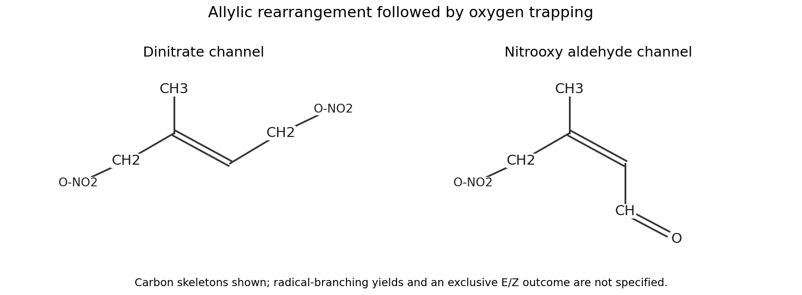

**[Figure 10](#43/c/image-two-nitrate-containing-product-channels-from-an-isoprene-allylic-radical). Two nitrate-containing product channels from an isoprene allylic radical**. Original molecular drawings of the dinitrate and nitrooxy aldehyde carbon skeletons; branching yields and a unique stereochemical ratio are not inferred from the structures alone.

## 44

↑ **Parent:** [Paper 3](paper-3.md)

<h3 id="44/a">a</h3>

↑ **Parent:** [44](#44)

<h4 id="44/a/i">i</h4>

↑ **Parent:** [A](#44/a)

<h5 id="44/a/i/solution">Solution</h5>

↑ **Parent:** [I](#44/a/i)

Activate the [oxime](../../chemical-substance.md#oxime) hydroxyl [oxygen](../../chemical-substance.md#oxygen) with thionyl [chloride](../../chemistry.md#chloride) to give a good N–O leaving group. In the [Beckmann rearrangement](../../chemical-reaction.md#beckmann-rearrangement) branch, the C–C bond anti to that leaving group migrates onto nitrogen as the N–O bond breaks. Here the migrating [carbon](../../chemical-substance.md#carbon) is the spiro centre. Inserting N between that centre and the former [oxime](../../chemical-substance.md#oxime) [carbon](../../chemical-substance.md#carbon) expands the five-membered [oxime](../../chemical-substance.md#oxime) ring to a six-membered [nitrilium ion](../../chemistry.md#nitrilium-ion) ring. [Water](../../chemical-substance.md#water) attacks the electrophilic nitrilium [carbon](../../chemical-substance.md#carbon), followed by proton transfers and tautomerization to the observed spiro [lactam](../../chemical-substance.md#lactam). The [lactam](../../chemical-substance.md#lactam) [carbonyl](../../chemical-bond.md#carbonyl-group) [oxygen](../../chemical-substance.md#oxygen) is introduced in the aqueous work-up.

The competing [Beckmann fragmentation](../../chemical-reaction.md#beckmann-fragmentation) cleaves the same anti C–C bond instead of completing migration onto N. Formation of the C≡N bond gives an open-chain [nitrile](../../chemical-substance.md#nitrile) and a tertiary [carbocation](../../chemical-substance.md#carbocation) at the former spiro centre. Loss of a proton from the adjacent chain [carbon](../../chemical-substance.md#carbon) then gives the exocyclic alkene attached to the retained cyclopentane. The key distinction is **N insertion and ring expansion for the [lactam](../../chemical-substance.md#lactam), versus C–C cleavage followed by elimination for the unsaturated [nitrile](../../chemical-substance.md#nitrile)**. Stabilization of the resulting tertiary [carbocation](../../chemical-substance.md#carbocation) makes fragmentation plausible.

<h4 id="44/a/ii">ii</h4>

↑ **Parent:** [A](#44/a)

<h5 id="44/a/ii/solution">Solution</h5>

↑ **Parent:** [Ii](#44/a/ii)

Base first gives [phenoxide](../../chemistry.md#phenoxide). Use its para-carbanion/quinoid resonance contributor: the para [carbon](../../chemical-substance.md#carbon) bearing the tether attacks the terminal chloromethylene [carbon](../../chemical-substance.md#carbon) in an intramolecular substitution, ejecting [chloride](../../chemistry.md#chloride). This forms a five-membered ring at that [carbon](../../chemical-substance.md#carbon) and produces a **para-spirocyclohexadienone**, with the [phenoxide](../../chemistry.md#phenoxide) [oxygen](../../chemical-substance.md#oxygen) becoming a [carbonyl](../../chemical-bond.md#carbonyl-group) [oxygen](../../chemical-substance.md#oxygen). The first stage is a [dearomatizing spirocyclization of a phenoxide](../../chemical-reaction.md#dearomatizing-spirocyclization-of-a-phenoxide).

On acidification, [carbonyl](../../chemical-bond.md#carbonyl-group) protonation makes the dienone electrophilic. A tether C–C bond attached to the spiro centre migrates to the adjacent dienone [carbon](../../chemical-substance.md#carbon), with the accompanying pi-bond shifts; loss of a proton restores aromaticity. This [dienone-phenol rearrangement](../../chemical-reaction.md#dienone-phenol-rearrangement) converts the spiro five-membered ring into the fused six-membered ring while regenerating the phenolic OH. The apparent bond formation meta to OH is thus explained by **para spirocyclization followed by skeletal migration**, rather than requiring the final fused connectivity to form directly in the base step.

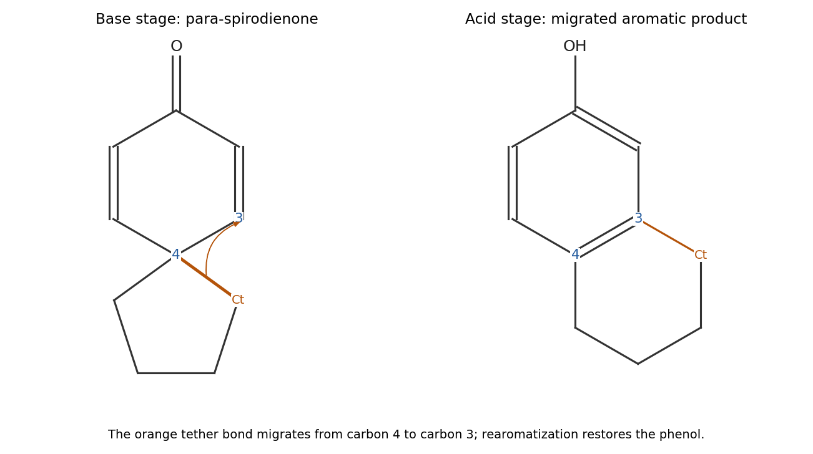

**[Figure 11](#44/a/ii/image-dearomatizing-spirocyclization-followed-by-a-dienone-phenol-skeletal-migration). Dearomatizing spirocyclization followed by a dienone-phenol skeletal migration**. Original numbered connectivity scheme. The highlighted tether bond changes attachment from carbon 4 to carbon 3; proton transfers and bond-order changes complete rearomatization.

<h4 id="44/a/iii">iii</h4>

↑ **Parent:** [A](#44/a)

<h5 id="44/a/iii/solution">Solution</h5>

↑ **Parent:** [Iii](#44/a/iii)

Amide base removes a proton alpha to the [nitrile](../../chemical-substance.md#nitrile), giving a resonance-stabilized [carbon](../../chemical-substance.md#carbon) [nucleophile](../../chemical-reaction.md#nucleophile). Removal of the available aryl proton ortho to [chlorine](../../chemical-substance.md#chlorine), together with [chloride](../../chemistry.md#chloride) elimination, generates a [benzyne](../../chemical-substance.md#benzyne) between the chlorine-bearing [carbon](../../chemical-substance.md#carbon) and its unsubstituted ortho neighbour. The side-chain [nitrile](../../chemical-substance.md#nitrile) carbanion attacks the former chlorine-bearing aryne [carbon](../../chemical-substance.md#carbon) intramolecularly; one aryne pi bond shifts to the neighbouring aryl [carbon](../../chemical-substance.md#carbon). Protonation of that aryl anion by ammonia restores the aromatic ring. The newly formed C–C bond closes the **four-membered ring of the cyanobenzocyclobutane product**. Two deprotonation processes are required to generate both the [nitrile](../../chemical-substance.md#nitrile) [nucleophile](../../chemical-reaction.md#nucleophile) and the aryne. The [nitrile](../../chemical-substance.md#nitrile) group is retained, and the product is not formed by simple replacement of aryl [chlorine](../../chemical-substance.md#chlorine) with an external amide [nucleophile](../../chemical-reaction.md#nucleophile).

<h4 id="44/a/iv">iv</h4>

↑ **Parent:** [A](#44/a)

<h5 id="44/a/iv/solution">Solution</h5>

↑ **Parent:** [Iv](#44/a/iv)

Copper-assisted loss of nitrogen from the diazo group forms a [metal carbenoid](../../chemistry.md#metal-carbenoid) at the [carbon](../../chemical-substance.md#carbon) bearing the ester substituent. That tethered electrophilic [carbon](../../chemical-substance.md#carbon) adds across the nearby exocyclic alkene in an [intramolecular cyclopropanation](../../chemical-reaction.md#intramolecular-cyclopropanation). Two C–C bonds form: one to the alkene ring [carbon](../../chemical-substance.md#carbon) and one to its terminal methylene. The existing tether thereby also becomes the five-membered ketone ring in the product; the methyl ester stays attached to the former diazo [carbon](../../chemical-substance.md#carbon).

Cyclopropanation is [suprafacial](../../stereochemistry.md#suprafaciality) on the reacting alkene face. A folded tether geometry that permits the short intramolecular closure selects the approach face and accounts for the shown relationship of the angular methyl group and the new cyclopropane methylene bridge. This is a stereoselective conformational ring-closure model, not a freely rotating intermediate [carbocation](../../chemical-substance.md#carbocation): the two new bonds are formed in the same cyclopropanation event. A detailed quantitative preference between folded conformers would require an energetic model beyond the structure alone.

<h3 id="44/b">b</h3>

↑ **Parent:** [44](#44)

<h4 id="44/b/i">i</h4>

↑ **Parent:** [B](#44/b)

<h5 id="44/b/i/solution">Solution</h5>

↑ **Parent:** [I](#44/b/i)

**C has the original cyclohexadiene connectivity but trans, rather than cis, adjacent methyl groups.** Draw one methyl wedge and the other dash, keeping both phenyl groups at the diene termini. One [enantiomer](../../stereochemistry.md#enantiomer) is shown below; reversing both stereobonds gives its mirror image. For the symmetric achiral starting framework under achiral conditions, the two trans [enantiomers](../../stereochemistry.md#enantiomer) are not distinguished by this orbital-symmetry argument.

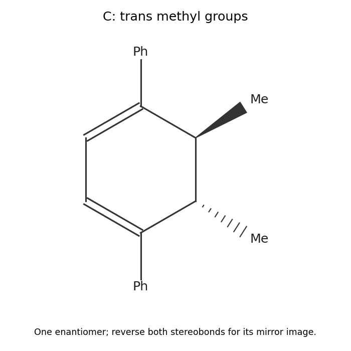

**[Figure 12](#44/b/i/image-trans-dimethyl-cyclohexadiene-from-thermal-closure-of-the-photogenerated-triene). Trans dimethyl cyclohexadiene from thermal closure of the photogenerated triene**. Original product drawing. Opposite stereobonds specify the two methyl faces; the mirror image is obtained by reversing both.

<h4 id="44/b/ii">ii</h4>

↑ **Parent:** [B](#44/b)

<h5 id="44/b/ii/solution">Solution</h5>

↑ **Parent:** [Ii](#44/b/ii)

The six pi [electrons](../../physics.md#electron) of B reorganize in a concerted [electrocyclic reaction](../../chemical-reaction.md#electrocyclic-reaction): the two terminal p orbitals form the new sigma bond, and the other two pi bonds shift to give the conjugated cyclohexadiene. Thermal six-electron closure is [disrotatory](../../chemical-reaction.md#disrotatory-motion), so the termini rotate in opposite senses. Applied to the terminal configurations drawn for B, this gives the trans methyl relationship. There is no need to invoke a radical chain or a sigmatropic transfer of a methyl group.

<h4 id="44/b/iii">iii</h4>

↑ **Parent:** [B](#44/b)

<h5 id="44/b/iii/solution">Solution</h5>

↑ **Parent:** [Iii](#44/b/iii)

**A to B is a photochemical six-electron electrocyclic ring opening; B to C is a thermal six-electron electrocyclic ring closure.** The broken or formed sigma bond is between the two methyl-bearing saturated carbons of the cyclohexadiene. Both transformations conserve the [carbon](../../chemical-substance.md#carbon) skeleton. The light-induced and thermal processes differ in their orbital occupation and therefore in their stereochemical selection rule.

<h4 id="44/b/iv">iv</h4>

↑ **Parent:** [B](#44/b)

<h5 id="44/b/iv/solution">Solution</h5>

↑ **Parent:** [Iv](#44/b/iv)

The [Woodward-Hoffmann rules](../../chemical-reaction.md#woodward-hoffmann-rules) for a $4n+2$ [electron](../../physics.md#electron) [electrocyclic reaction](../../chemical-reaction.md#electrocyclic-reaction) permit **thermal disrotation and photochemical conrotation**. Here six [electrons](../../physics.md#electron) [mean](../../expected-value.md) $n=1$. For the ground-state six-electron chain, opposite terminal rotations match the terminal phases of its highest occupied orbital as the closing sigma bond forms. A one-electron excitation changes the relevant occupancy and reverses the allowed rotational mode. Thus A opens conrotatorily under light to the specified B, while B closes disrotatorily on heating. Reversing the rotational mode changes the adjacent methyl relationship from cis to trans, exactly as in C.

## 45

↑ **Parent:** [Paper 3](paper-3.md)

<h3 id="45/a">a</h3>

↑ **Parent:** [45](#45)

<h4 id="45/a/i">i</h4>

↑ **Parent:** [A](#45/a)

<h5 id="45/a/i/solution">Solution</h5>

↑ **Parent:** [I](#45/a/i)

**TODO: user-deferred biology question.**

<h4 id="45/a/ii">ii</h4>

↑ **Parent:** [A](#45/a)

<h5 id="45/a/ii/solution">Solution</h5>

↑ **Parent:** [Ii](#45/a/ii)

**TODO: user-deferred biology question.**

<h4 id="45/a/iii">iii</h4>

↑ **Parent:** [A](#45/a)

<h5 id="45/a/iii/solution">Solution</h5>

↑ **Parent:** [Iii](#45/a/iii)

**TODO: user-deferred biology question.**

<h3 id="45/b">b</h3>

↑ **Parent:** [45](#45)

<h4 id="45/b/solution">Solution</h4>

↑ **Parent:** [B](#45/b)

**TODO: user-deferred biology question.**

<h3 id="45/c">c</h3>

↑ **Parent:** [45](#45)

<h4 id="45/c/solution">Solution</h4>

↑ **Parent:** [C](#45/c)

**TODO: user-deferred biology question.**

<h3 id="45/d">d</h3>

↑ **Parent:** [45](#45)

<h4 id="45/d/i">i</h4>

↑ **Parent:** [D](#45/d)

<h5 id="45/d/i/solution">Solution</h5>

↑ **Parent:** [I](#45/d/i)

**TODO: user-deferred biology question.**

<h4 id="45/d/ii">ii</h4>

↑ **Parent:** [D](#45/d)

<h5 id="45/d/ii/solution">Solution</h5>

↑ **Parent:** [Ii](#45/d/ii)

**TODO: user-deferred biology question.**

<h4 id="45/d/iii">iii</h4>

↑ **Parent:** [D](#45/d)

<h5 id="45/d/iii/solution">Solution</h5>

↑ **Parent:** [Iii](#45/d/iii)

**TODO: user-deferred biology question.**

## 46

↑ **Parent:** [Paper 3](paper-3.md)

<h3 id="46/a">a</h3>

↑ **Parent:** [46](#46)

<h4 id="46/a/solution">Solution</h4>

↑ **Parent:** [A](#46/a)

**TODO: user-deferred biology question.**

<h3 id="46/b">b</h3>

↑ **Parent:** [46](#46)

<h4 id="46/b/i">i</h4>

↑ **Parent:** [B](#46/b)

<h5 id="46/b/i/solution">Solution</h5>

↑ **Parent:** [I](#46/b/i)

**TODO: user-deferred biology question.**

<h4 id="46/b/ii">ii</h4>

↑ **Parent:** [B](#46/b)

<h5 id="46/b/ii/solution">Solution</h5>

↑ **Parent:** [Ii](#46/b/ii)

**TODO: user-deferred biology question.**

<h4 id="46/b/iii">iii</h4>

↑ **Parent:** [B](#46/b)

<h5 id="46/b/iii/solution">Solution</h5>

↑ **Parent:** [Iii](#46/b/iii)

**TODO: user-deferred biology question.**

<h3 id="46/c">c</h3>

↑ **Parent:** [46](#46)

<h4 id="46/c/i">i</h4>

↑ **Parent:** [C](#46/c)

<h5 id="46/c/i/solution">Solution</h5>

↑ **Parent:** [I](#46/c/i)

**TODO: user-deferred biology question.**

<h4 id="46/c/ii">ii</h4>

↑ **Parent:** [C](#46/c)

<h5 id="46/c/ii/solution">Solution</h5>

↑ **Parent:** [Ii](#46/c/ii)

**TODO: user-deferred biology question.**

## 47

↑ **Parent:** [Paper 3](paper-3.md)

<h3 id="47/a">a</h3>

↑ **Parent:** [47](#47)

<h4 id="47/a/solution">Solution</h4>

↑ **Parent:** [A](#47/a)

At fixed [particle number](../../physics.md#particle-number) and [pressure](../../pressure.md), the joint [isothermal-isobaric ensemble](../../statistical-physics.md#isothermal-isobaric-ensemble) weight for a [microstate](../../statistical-physics.md#microstate) of [energy](../../energy.md) $E$ and [volume](../../geometry-and-topology.md#volume) $V$ is $e^{-\beta(E+PV)}$. Write its [enthalpy](../../enthalpy.md) as $H=E+PV$. Differentiating the [isothermal-isobaric partition function](../../statistical-physics.md#isothermal-isobaric-partition-function) with a temperature-independent [volume](../../geometry-and-topology.md#volume) measure gives

$$
\partial_\beta Q_P=-\int_0^\infty dV\sum_s H_s(V)e^{-\beta H_s(V)}.
$$

After division by $Q_P$ this is the normalized [ensemble average](../../expected-value.md), so

$$
\boxed{\langle H\rangle_P=-\partial_\beta\ln Q_P}.
$$

The differentiation assumes that the microscopic [Hamiltonian](../../hamiltonian-mechanics.md#hamiltonian) and the integration measure have no additional explicit [temperature](../../temperature.md) dependence. An extra temperature-dependent normalization factor must be differentiated separately.

<h3 id="47/b">b</h3>

↑ **Parent:** [47](#47)

<h4 id="47/b/solution">Solution</h4>

↑ **Parent:** [B](#47/b)

Differentiate the normalized average, including the [derivative](../../calculus.md#derivative) of its denominator. The [enthalpy fluctuation formula](../../statistical-physics.md#enthalpy-fluctuation-formula) follows from

$$
\partial_\beta\langle H\rangle_P
=-\langle H^2\rangle_P+\langle H\rangle_P^2
=-\operatorname{Var}(H).
$$

Since $d\beta/dT=-1/(k_BT^2)$,

$$
\boxed{C_P=\frac{\operatorname{Var}(H)}{k_BT^2}}.
$$

Thus a larger equilibrium spread of [enthalpy](../../enthalpy.md) corresponds to a larger response to heating at fixed [pressure](../../pressure.md). The [variance](../../variance.md) is nonnegative, so this finite-system equilibrium description has $C_P\geq0$. The relation connects a response coefficient to fluctuations of the appropriate exchanged quantity; at fixed [volume](../../geometry-and-topology.md#volume) the corresponding quantity is [internal energy](../../internal-energy.md).

<h3 id="47/c">c</h3>

↑ **Parent:** [47](#47)

<h4 id="47/c/solution">Solution</h4>

↑ **Parent:** [C](#47/c)

Away from singular regimes, assume [enthalpy](../../enthalpy.md) and [heat capacity at constant pressure](../../enthalpy.md#heat-capacity-at-constant-pressure) are extensive: $\langle H\rangle=Nh$ and $C_P=Nc_P$, with nonzero intensive $h$. The [enthalpy fluctuation formula](../../statistical-physics.md#enthalpy-fluctuation-formula) then gives

$$
\boxed{\frac{\sqrt{\operatorname{Var}(H)}}{|\langle H\rangle|}
=\frac{\sqrt{k_BT^2c_P}}{|h|\sqrt N}}.
$$

Absolute fluctuations grow as $\sqrt N$, while the [mean](../../expected-value.md) grows as $N$. In the [thermodynamic limit](../../statistical-physics.md#thermodynamic-limit), [enthalpy](../../enthalpy.md) per particle therefore concentrates around its [mean](../../expected-value.md); it is relative, rather than absolute, fluctuations that vanish. This is the usual [relative fluctuations of an extensive observable](../../statistical-physics.md#relative-fluctuations-of-an-extensive-observable) scaling. It assumes ordinary extensive [heat capacity](../../heat.md#heat-capacity) and a nonzero [mean](../../expected-value.md) with a stated [energy](../../energy.md) reference; a critical divergence or an artificially zero [mean](../../expected-value.md) requires separate analysis.

<h3 id="47/d">d</h3>

↑ **Parent:** [47](#47)

<h4 id="47/d/solution">Solution</h4>

↑ **Parent:** [D](#47/d)

The [volume](../../geometry-and-topology.md#volume) [integral](../../integral.md) is a [gamma function](../../complex-analysis.md#gamma-function) [integral](../../integral.md),

$$
\int_0^\infty V^N e^{-\beta PV}\,dV=\frac{N!}{(\beta P)^{N+1}},
\qquad
\boxed{Q_P=\frac{1}{\Lambda^{3N}(\beta P)^{N+1}}}.
$$

For the prescribed bridge relation, $\beta PQ_P=(\beta P\Lambda^3)^{-N}$, so $G=Nk_BT\ln(\beta P\Lambda^3)$. Since $\Lambda\propto T^{-1/2}$, this gives the macroscopic ideal-gas result

$$
\boxed{H=G-T(\partial_TG)_P=\frac52Nk_BT,\qquad C_P=\frac52Nk_B},
\qquad C_P-C_V=Nk_B.
$$

Heating at fixed [pressure](../../pressure.md) requires both an increase in [internal energy](../../internal-energy.md) and expansion work; at fixed [volume](../../geometry-and-topology.md#volume) the latter contribution is absent.

The [finite-size normalization of the isothermal-isobaric ensemble](../../statistical-physics.md#finite-size-normalization-of-the-isothermal-isobaric-ensemble) matters here. Applying part (a) literally to the unprefactored $Q_P$ instead gives $\langle H\rangle_P=(5N/2+1)k_BT$ and $C_P=(5N/2+1)k_B$. The two answers differ because $-\partial_\beta\ln(\beta PQ_P)=-\partial_\beta\ln Q_P-k_BT$. The normalized continuous-volume distribution has $\langle PV\rangle=(N+1)k_BT$; its [variance](../../variance.md) agrees with the unprefactored result in part (b). The bridge convention subtracts an order-one contribution and recovers the usual extensive thermodynamic answer. Both agree to leading order in the [thermodynamic limit](../../statistical-physics.md#thermodynamic-limit), but their exact finite-$N$ derivatives should not be mixed.

## 48

↑ **Parent:** [Paper 3](paper-3.md)

<h3 id="48/a">a</h3>

↑ **Parent:** [48](#48)

<h4 id="48/a/solution">Solution</h4>

↑ **Parent:** [A](#48/a)

With wall effects neglected, **$a_1=a$**. A second [hard disc](../../statistical-physics.md#hard-disc) cannot have its centre within distance $2r$ of the first centre. Its [excluded volume](../../statistical-physics.md#excluded-volume) in this two-dimensional setting is an excluded area $\pi(2r)^2=4a_d$, giving

$$
\boxed{a_2=a-4a_d}.
$$

This is exclusion of the second centre, rather than simply subtraction of the first disc's own area.

<h3 id="48/b">b</h3>

↑ **Parent:** [48](#48)

<h4 id="48/b/solution">Solution</h4>

↑ **Parent:** [B](#48/b)

At sufficiently low [packing fraction](../../euclidean-geometry.md#packing-fraction), neglect overlaps of the excluded regions around different disc centres. Sequential insertion gives the configurational [integral](../../integral.md)

$$
\mathcal Z_N\simeq\prod_{j=0}^{N-1}(a-4ja_d).
$$

Taking logarithms and expanding to first order in density,

$$
\ln\mathcal Z_N\simeq N\ln a-\frac{4a_d}{a}\sum_{j=0}^{N-1}j
=N\ln a-\frac{2a_dN(N-1)}a.
$$

For large $N$, replace $N-1$ by $N$. The expression $N\ln(a-Nb)$ has the same leading-density expansion when **$b=2a_d$**. Thus the [hard-disc excluded-area approximation](../../statistical-physics.md#hard-disc-excluded-area-approximation) yields

$$
\boxed{Q_{\rm ld}\simeq\frac{(a-2Na_d)^N}{\Lambda^{2N}N!}}.
$$

The factor $N!$ accounts for indistinguishable particles and $\Lambda^{2N}$ for two-dimensional momentum integration. The factor one-half between pair-excluded area and $b$ avoids counting every pair twice. Equality of leading expansions does not make this free-volume resummation exact at high density.

<h3 id="48/c">c</h3>

↑ **Parent:** [48](#48)

<h4 id="48/c/solution">Solution</h4>

↑ **Parent:** [C](#48/c)

The surface [pressure](../../pressure.md) follows by differentiating the logarithm of the [canonical partition function](../../canonical-ensemble.md#canonical-partition-function) with respect to container area:

$$
\Pi=k_BT(\partial_a\ln Q)_{N,T}
=\frac{Nk_BT}{a-2Na_d}
=\frac{k_BT}{a_d}\frac{\phi}{1-2\phi}.
$$

Its formal divergence is therefore **$\phi=1/2$**. This lies outside the low-density regime used to derive the expression. It is a model pole, not an actual geometrical close-packing fraction.

<h3 id="48/d">d</h3>

↑ **Parent:** [48](#48)

<h4 id="48/d/solution">Solution</h4>

↑ **Parent:** [D](#48/d)

In the circular [hard-disc cage approximation](../../statistical-physics.md#hard-disc-cage-approximation), moving the central disc towards a neighbour brings contact after a centre displacement $R-2r$. Thus

$$
\boxed{\mathcal A=\pi(R-2r)^2}.
$$

At close packing, **$R=2r$ and $\mathcal A=0$**. The radius concerns the accessible positions of the moving centre; subtracting only one disc radius would incorrectly leave a finite rattling area at contact. The real cage is bounded by curved exclusion arcs, so the circle is an inscribed approximation.

<h3 id="48/e">e</h3>

↑ **Parent:** [48](#48)

<h4 id="48/e/solution">Solution</h4>

↑ **Parent:** [E](#48/e)

Insert the stipulated near-close-packing relation for $R$ into the [hard-disc cage approximation](../../statistical-physics.md#hard-disc-cage-approximation):

$$
\mathcal A=4a_d\left(\sqrt{\frac{\phi_{\rm cp}}\phi}-1\right)^2
=4a_d\left(\sqrt{\frac{\phi_{\rm cp}a}{Na_d}}-1\right)^2.
$$

Writing $y=\sqrt{\phi_{\rm cp}a/(Na_d)}$, we have $\partial_a y=y/(2a)$ and therefore $\partial_a\ln\mathcal A=y/[a(y-1)]$. From the supplied crystalline [canonical partition function](../../canonical-ensemble.md#canonical-partition-function),

$$
\boxed{\Pi_{\rm xtl}=Nk_BT\partial_a\ln\mathcal A
=\frac{k_BT}{a_d}\frac{\phi}{1-\sqrt{\phi/\phi_{\rm cp}}}}.
$$

Its close-packing scale is set by the [triangular lattice packing of discs](../../euclidean-geometry.md#triangular-lattice-packing-of-discs), with $\phi_{\rm cp}=\pi/(2\sqrt3)$ in the ideal geometry.

<h3 id="48/f">f</h3>

↑ **Parent:** [48](#48)

<h4 id="48/f/solution">Solution</h4>

↑ **Parent:** [F](#48/f)

The crystalline expression diverges at **$\phi=\phi_{\rm cp}\simeq0.907$**, where the cage free area vanishes. This is physically different from the spurious $\phi=0.5$ pole produced by extrapolating the low-density fluid approximation. A real compression path cannot be inferred by following that fluid pole and then abruptly switching curves. At low density it follows a fluid equation of state, while at sufficiently high density an ordered arrangement can leave more accessible rattling configurations than a disordered crowded arrangement. This is [entropy-driven hard-sphere crystallization](../../statistical-physics.md#entropy-driven-hard-sphere-crystallization), here in two dimensions: allowed hard-core configurations have the same interaction [energy](../../energy.md), so [configurational entropy](../../entropy.md#configurational-entropy) drives the phase competition. An equilibrium first-order coexistence interval would have common [pressure](../../pressure.md) and [chemical potential](../../chemical-potential.md), giving a constant-pressure segment as [mean](../../expected-value.md) density changes. The two asymptotic expressions alone neither locate that interval nor determine the detailed two-dimensional melting sequence. They require a consistent free-energy comparison and trustworthy approximations in the transition region.

## 49

↑ **Parent:** [Paper 3](paper-3.md)

<h3 id="49/a">a</h3>

↑ **Parent:** [49](#49)

<h4 id="49/a/i">i</h4>

↑ **Parent:** [A](#49/a)

<h5 id="49/a/i/solution">Solution</h5>

↑ **Parent:** [I](#49/a/i)

For the ordinary spatial symmetries here, a [symmetry operator](../../quantum-mechanics.md#symmetry-operator) is a unitary operator $U$ preserving the [Hamiltonian](../../hamiltonian-mechanics.md#hamiltonian):

$$
\boxed{UHU^{-1}=H},\qquad [U,H]=0.
$$

It maps an [energy](../../energy.md) eigenstate to another state with the same [energy](../../energy.md) and preserves the quantum dynamics. More general quantum symmetries can be antiunitary; [time reversal](../../quantum-field-theory.md#t-symmetry) is an important separate case.

<h4 id="49/a/ii">ii</h4>

↑ **Parent:** [A](#49/a)

<h5 id="49/a/ii/solution">Solution</h5>

↑ **Parent:** [Ii](#49/a/ii)

An ordinary molecular [point group](../../euclidean-geometry.md#point-group) consists of the identity, proper rotations $C_n$, and, when present, reflections $\sigma$, inversion $i$, and improper rotations $S_n$. Each operation leaves the nuclear geometry and chemical labels equivalent, so only identical nuclei can be interchanged. Translations are not elements of the [point group](../../euclidean-geometry.md#point-group) of a finite isolated [molecule](../../molecule.md). The [molecular symmetry operations](../../euclidean-geometry.md#molecular-symmetry-operation) determine how electronic and vibrational coordinates transform.

<h4 id="49/a/iii">iii</h4>

↑ **Parent:** [A](#49/a)

<h5 id="49/a/iii/solution">Solution</h5>

↑ **Parent:** [Iii](#49/a/iii)

The [spin isomers of hydrogen](../../molecule.md#spin-isomers-of-hydrogen) illustrate how [nuclear spin statistics](../../tensor-product-of-quantum-systems.md#nuclear-spin-statistics) constrain the product of electronic, vibrational, rotational and nuclear-spin exchange symmetries. In the ground electronic and vibrational states of these homonuclear [molecules](../../molecule.md), the first two factors are symmetric. Exchanging the nuclei reverses the internuclear direction, so a rotational state has parity $(-1)^J$.

For $^1\mathrm H_2$, the protons are spin-one-half [fermions](../../tensor-product-of-quantum-systems.md#fermion) and the total nuclear-exchange wavefunction must be antisymmetric. The antisymmetric [spin](../../angular-momentum-operator.md#spin) singlet pairs with **[even](../../calculus.md#even-function) $J$ (para-hydrogen, one [spin](../../angular-momentum-operator.md#spin) state)**; the symmetric [spin](../../angular-momentum-operator.md#spin) triplet pairs with **[odd](../../calculus.md#odd-function) $J$ (ortho-hydrogen, three [spin](../../angular-momentum-operator.md#spin) states)**. For $^2\mathrm H_2$, spin-one deuterons are [bosons](../../tensor-product-of-quantum-systems.md#boson), so the total must be symmetric. Nuclear spins $I=0,2$ supply six symmetric states paired with **[even](../../calculus.md#even-function) $J$ (ortho-deuterium)**; $I=1$ supplies three antisymmetric states paired with **[odd](../../calculus.md#odd-function) $J$ (para-deuterium)**. The high-temperature ortho/para statistical ratios are $3:1$ for [hydrogen](../../chemical-substance.md#hydrogen) and $2:1$ for deuterium, while low-temperature equilibrium populations also depend on rotational energies and whether [spin](../../angular-momentum-operator.md#spin) conversion can occur.

<h3 id="49/b">b</h3>

↑ **Parent:** [49](#49)

<h4 id="49/b/i">i</h4>

↑ **Parent:** [B](#49/b)

<h5 id="49/b/i/solution">Solution</h5>

↑ **Parent:** [I](#49/b/i)

For representation spaces $V,W$, the [tensor product of group representations](../../representation-theory.md#tensor-product-of-group-representations) acts on product basis vectors through

$$
D_{V\otimes W}(g)=D_V(g)\otimes D_W(g).
$$

Its [character](../../representation-theory.md#character-of-a-representation) is the [trace](../../linear-algebra.md#matrix-trace). Summing diagonal elements explicitly,

$$
\chi_{V\otimes W}(g)=\sum_{i,j}[D_V(g)]_{ii}[D_W(g)]_{jj}
=\boxed{\chi_V(g)\chi_W(g)}.
$$

No step assumes one-dimensional matrices, so the result applies to both degenerate and nondegenerate representations.

<h4 id="49/b/ii">ii</h4>

↑ **Parent:** [B](#49/b)

<h5 id="49/b/ii/solution">Solution</h5>

↑ **Parent:** [Ii](#49/b/ii)

For a real-character irreducible molecular representation with [character](../../representation-theory.md#character-of-a-representation) $\chi$, the multiplicity of the [fully symmetric representation](../../representation-theory.md#fully-symmetric-representation) in its tensor square is

$$
m_{\rm sym}=\frac1{|G|}\sum_{g\in G}\chi(g)^2
=\frac1{|G|}\sum_{g\in G}|\chi(g)|^2
=\boxed{1},
$$

by [character orthogonality](../../representation-theory.md#character-orthogonality). The identity uses the real-character assumption appropriate to the usual real [irreducible representations](../../representation-theory.md#irreducible-representation) intended here. For a general complex [irreducible representation](../../representation-theory.md#irreducible-representation), the [trivial representation in a tensor square](../../representation-theory.md#trivial-representation-in-a-tensor-square) has multiplicity one precisely when it is self-dual, and zero otherwise, by [Schur's lemma](../../representation-theory.md#schur-s-lemma). The universally valid tensor product is $V\otimes V^*$.

<h3 id="49/c">c</h3>

↑ **Parent:** [49](#49)

<h4 id="49/c/i">i</h4>

↑ **Parent:** [C](#49/c)

<h5 id="49/c/i/solution">Solution</h5>

↑ **Parent:** [I](#49/c/i)

In the class order $(E,8C_3,3C_2,6S_4,6\sigma_d)$, the 15 Cartesian nuclear displacements of [methane](../../chemical-substance.md#methane) have [characters](../../representation-theory.md#character-of-a-representation) $(15,0,-1,-1,3)$. Only nuclei left fixed by an operation contribute to that operation's [trace](../../linear-algebra.md#matrix-trace). Subtract translations $T_2$ and rotations $T_1$ to obtain the [methane normal-mode representation](../../euclidean-geometry.md#methane-normal-mode-representation)

$$
\boxed{\Gamma_{\rm vib}=A_1+E+2T_2}.
$$

Its dimension is $1+2+3+3=9=3(5)-6$. There are four frequency families: a nondegenerate symmetric stretch, a doubly degenerate bend, and triply degenerate stretch and bend modes.

<h4 id="49/c/ii">ii</h4>

↑ **Parent:** [C](#49/c)

<h5 id="49/c/ii/solution">Solution</h5>

↑ **Parent:** [Ii](#49/c/ii)

Choose mass-weighted coordinates $Q_A$, $\mathbf Q_E=(Q_{E1},Q_{E2})$, and two triplets $\mathbf Q_3,\mathbf Q_4$ for the two $T_2$ copies. About a stationary equilibrium geometry, the allowed harmonic potential is

$$
V^{(2)}=\frac12k_AQ_A^2+\frac12k_E|\mathbf Q_E|^2
+\frac12k_{33}|\mathbf Q_3|^2+k_{34}\mathbf Q_3\cdot\mathbf Q_4
+\frac12k_{44}|\mathbf Q_4|^2.
$$

The [kinetic energy](../../energy.md#kinetic-energy) is one-half the sum of the squared conjugate momenta. Cross terms between inequivalent [irreducible representations](../../representation-theory.md#irreducible-representation) are forbidden, but the two equivalent $T_2$ triplets permit the displayed scalar-product term. This is [equivalent-mode harmonic coupling](../../molecule.md#equivalent-mode-harmonic-coupling). An orthogonal rotation between the two triplets diagonalizes their $2\times2$ force-constant matrix. In [molecular normal coordinates](../../molecule.md#molecular-normal-coordinate) the complete [Hamiltonian](../../hamiltonian-mechanics.md#hamiltonian) becomes

$$
\boxed{H=E_0+\frac12(P_A^2+\omega_1^2Q_A^2)
+\frac12\sum_{j=1}^2(P_{Ej}^2+\omega_2^2Q_{Ej}^2)
+\frac12\sum_{j=1}^3(P_{3j}^2+\omega_3^2Q_{3j}^2+P_{4j}^2+\omega_4^2Q_{4j}^2)}.
$$

Symmetry enforces degeneracies within each multiplet; it does not require equal frequencies for the two distinct $T_2$ [normal modes](../../wave-equation.md#normal-mode).

<h4 id="49/c/iii">iii</h4>

↑ **Parent:** [C](#49/c)

<h5 id="49/c/iii/solution">Solution</h5>

↑ **Parent:** [Iii](#49/c/iii)

For a real nonmagnetic $T_1$ electronic triplet, the [symmetric square of a group representation](../../representation-theory.md#symmetric-square-of-a-group-representation) decomposes as

$$
\operatorname{Sym}^2T_1=A_1+E+T_2.
$$

The $A_1$ coordinate shifts all components equally and does not remove the degeneracy. The [linear Jahn-Teller selection rule](../../chemistry.md#linear-jahn-teller-selection-rule) therefore permits **$E$ and $T_2$ vibrational modes** to couple and split the triplet. Both [methane](../../chemical-substance.md#methane) $T_2$ vibrational triplets are symmetry-eligible. A nonzero allowed coupling generally produces a symmetry-lowering instability, although symmetry alone does not determine its strength or the preferred minimum.

<h4 id="49/c/iv">iv</h4>

↑ **Parent:** [C](#49/c)

<h5 id="49/c/iv/solution">Solution</h5>

↑ **Parent:** [Iv](#49/c/iv)

The relevant decomposition is unchanged:

$$
\operatorname{Sym}^2T_2=A_1+E+T_2.
$$

Thus **the same $E$ and $T_2$ vibrational symmetries are linearly Jahn-Teller active**. Their coupling constants and the resulting [energy](../../energy.md) surface can differ from those of a $T_1$ state. The ground-geometry [methane normal-mode representation](../../euclidean-geometry.md#methane-normal-mode-representation) and the symmetry-allowed harmonic invariants are also unchanged; actual force constants in the excited state need not have the same values.

## 50

↑ **Parent:** [Paper 3](paper-3.md)

<h3 id="50/a">a</h3>

↑ **Parent:** [50](#50)

<h4 id="50/a/solution">Solution</h4>

↑ **Parent:** [A](#50/a)

Addition consumes the [carbon](../../chemical-substance.md#carbon)–[carbon](../../chemical-substance.md#carbon) double bond of [vinyl chloride](../../chemical-substance.md#vinyl-chloride) and retains [chlorine](../../chemical-substance.md#chlorine) as a side substituent. The interior repeat of A is therefore

$$
\boxed{[-\mathrm{CH_2-CH(Cl)}-]_n},
$$

namely [polyvinyl chloride](../../polymer.md#polyvinyl-chloride). [Benzoyl peroxide](../../chemical-substance.md#benzoyl-peroxide) supplies initiating [free radicals](../../chemistry.md#radical-chemistry); head-to-tail addition gives the usual backbone connectivity. End groups and [tacticity](../../polymer.md#tacticity) are not uniquely specified by this repeat formula.

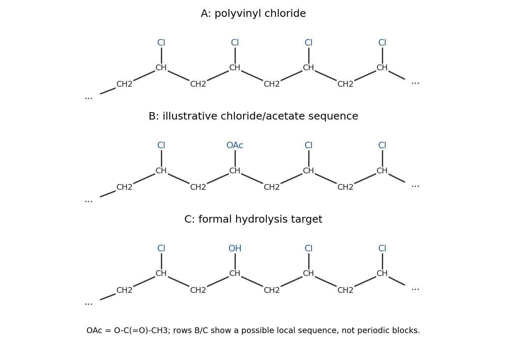

**[Figure 13](#50/a/image-representative-backbone-segments-of-the-chloride-polymer-and-the-two-copolymers). Representative backbone segments of the chloride polymer and the two copolymers**. Original labelled segments. The copolymer rows illustrate one possible sequence, not regularly repeating three-to-one blocks; the feed ratio alone does not determine incorporated composition.

<h3 id="50/b">b</h3>

↑ **Parent:** [50](#50)

<h4 id="50/b/solution">Solution</h4>

↑ **Parent:** [B](#50/b)

**[Radical polymerization](../../polymer.md#radical-polymerization), a type of [chain-growth polymerization](../../polymer.md#chain-growth-polymerization).** Peroxide bond cleavage initiates reactive chains; propagation adds [monomer](../../polymer.md#monomer) to a radical end while regenerating a radical end on the longer chain. Termination and chain transfer can then stop or redirect growth. In the propagation step there is no obligatory small-molecule condensate, so this is not a step-growth condensation.

<h3 id="50/c">c</h3>

↑ **Parent:** [50](#50)

<h4 id="50/c/solution">Solution</h4>

↑ **Parent:** [C](#50/c)

B contains both $-\mathrm{CH_2-CH(Cl)}-$ and $-\mathrm{CH_2-CH(OCOCH_3)}-$ monomeric units distributed along the same [carbon](../../chemical-substance.md#carbon) backbone: **a [vinyl chloride-vinyl acetate copolymer](../../polymer.md#vinyl-chloride-vinyl-acetate-copolymer)**. One possible local segment is

$$
\mathrm{\cdots-CH_2-CH(Cl)-CH_2-CH(OAc)-CH_2-CH(Cl)-\cdots},
\qquad \mathrm{OAc=OC(O)CH_3}.
$$

The ester is attached through [oxygen](../../chemical-substance.md#oxygen) to the backbone [carbon](../../chemical-substance.md#carbon). A [random copolymer](../../polymer.md#random-copolymer) should not be drawn as two long homopolymer blocks. The stated $75:25$ [monomer](../../polymer.md#monomer) feed is not enough to prove an incorporated $75:25$ unit ratio: [monomer](../../polymer.md#monomer) reactivity ratios and conversion affect composition and sequence statistics. Under an explicitly ideal equal-incorporation assumption that ratio could be used as a schematic average, not a periodic repeat.

<h3 id="50/d">d</h3>

↑ **Parent:** [50](#50)

<h4 id="50/d/solution">Solution</h4>

↑ **Parent:** [D](#50/d)

Taking the stated melting point as the reference for a crystallizable A, introducing acetate-bearing units disrupts regular sequences and crystal packing. The expected result is **a lower melting point for B**, often with broader or less complete crystallization. The ideal [copolymer melting-point depression](../../polymer.md#copolymer-melting-point-depression) estimate is

$$
\frac1{T_m}-\frac1{T_m^0}\simeq-\frac{R}{\Delta h_f}\ln x_{\rm crystallizable}>0
$$

when unlike units are excluded from the crystal. The larger vinyl ester in the drawing is [vinyl pentanoate](../../chemical-substance.md#vinyl-pentanoate): its acyl substituent has a four-carbon alkyl chain. At comparable incorporation it should generally disrupt regular packing more and favour a still lower melting range or suppressed crystallinity, although the exact trend depends on composition and side-group interactions. The formula concerns melting of crystallites, not the glass transition; a universal numerical melting point cannot be inferred for an unspecified real PVC copolymer.

<h3 id="50/e">e</h3>

↑ **Parent:** [50](#50)

<h4 id="50/e/solution">Solution</h4>

↑ **Parent:** [E](#50/e)

[Saponification](../../chemical-reaction.md#saponification) cleaves the acetate ester side groups while the intended [carbon](../../chemical-substance.md#carbon) backbone remains intact:

$$
\mathrm{-CH_2-CH(OCOCH_3)-+OH^-\longrightarrow-CH_2-CH(OH)-+CH_3CO_2^-}.
$$

The ideal target C is therefore **a [vinyl chloride-vinyl alcohol copolymer](../../polymer.md#vinyl-chloride-vinyl-alcohol-copolymer)**, containing $-\mathrm{CH_2-CH(Cl)}-$ and $-\mathrm{CH_2-CH(OH)}-$ units in the original sequence positions. The [carbon](../../chemical-substance.md#carbon)–[oxygen](../../chemical-substance.md#oxygen) bond to the backbone remains; [hydrolysis](../../chemical-reaction.md#hydrolysis) removes the acetyl group from [oxygen](../../chemical-substance.md#oxygen). Incomplete [hydrolysis](../../chemical-reaction.md#hydrolysis) would leave a three-component population of [chloride](../../chemistry.md#chloride), acetate and alcohol units. New hydroxyl groups can strengthen adhesion and coating interactions through [hydrogen bonds](../../chemical-bond.md#hydrogen-bond).

<h3 id="50/f">f</h3>

↑ **Parent:** [50](#50)

<h4 id="50/f/solution">Solution</h4>

↑ **Parent:** [F](#50/f)

The difficulty is competing chemistry and isolation selectivity. Alkaline treatment can promote [dehydrohalogenation](../../chemical-reaction.md#dehydrohalogenation) at chlorinated backbone units while hydrolysing the acetate side groups. Loss of HCl produces unsaturated segments, potentially followed by further degradation or cross-linking; hydroxyl formation also changes solvent compatibility and intermolecular association. The isolated material can therefore differ from the ideal undegraded C in part (e). [Competing dehydrochlorination during copolymer saponification](../../polymer.md#competing-dehydrochlorination-during-copolymer-saponification) explains why selective conditions are needed.

This is not an absolute prohibition on hydroxyl-containing [chloride](../../chemistry.md#chloride) copolymers. Analytical work on these copolymers used staged alcoholysis/[saponification](../../chemical-reaction.md#saponification) and [polymer](../../polymer.md) precipitation to restrain dehydrochlorination. The sensible conclusion is that clean, exhaustive conversion and isolation are difficult under unselective conditions, rather than that no suitable treatment can ever preserve [chloride](../../chemistry.md#chloride) units.[Abstract, pp. 619–623: staged treatment and precipitation used to restrain competing dehydrochlorination](../../chemistry-bibliography.md#determination-of-vinyl-acetate-in-vinyl-chloride-acetate-copolymers-by-takanori-shimazaki-and-others)

## ↑ Ancestors (10)

1. [2022](../2022.md)
2. [Past exam of the chemistry course of the year 3 of the natural sciences course of the University of Cambridge](../../past-exam-of-the-chemistry-course-of-the-year-3-of-the-natural-sciences-course-of-the-university-of-cambridge.md)
3. [Chemistry course of the year 3 of the natural sciences course of the University of Cambridge](../../university-of-cambridge.md#chemistry-course-of-the-year-3-of-the-natural-sciences-course-of-the-university-of-cambridge)
4. [Year 3 of the natural sciences course of the University of Cambridge](../../university-of-cambridge.md#year-3-of-the-natural-sciences-course-of-the-university-of-cambridge)
5. [Year of the natural sciences course of the University of Cambridge](../../university-of-cambridge.md#year-of-the-natural-sciences-course-of-the-university-of-cambridge)
6. [Natural sciences course of the University of Cambridge](../../university-of-cambridge.md#natural-sciences-course-of-the-university-of-cambridge)
7. [Course of the University of Cambridge](../../university-of-cambridge.md#course-of-the-university-of-cambridge)
8. [University of Cambridge](../../university-of-cambridge.md)
9. [List of universities](../../README.md#list-of-universities)
10. [Codex Wiki](../../README.md)
