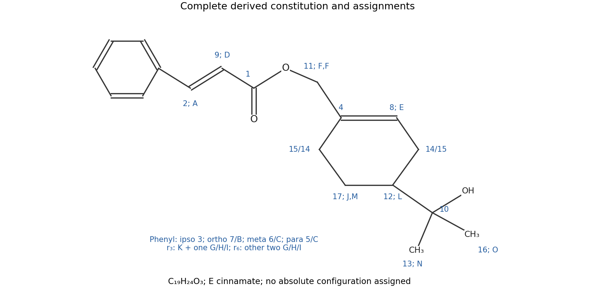

<h1 id="39/e/solution">Solution</h1>

↑ **Parent:** [E](../e.md)

**[Figure 9](#39/e/image-complete-constitution-cinnamoyloxymethyl-at-cyclohexene-position-1-and-a-tertiary-alcohol-substituent-at-position-4). Complete constitution: cinnamoyloxymethyl at cyclohexene position 1 and a tertiary-alcohol substituent at position 4**.

The constitution is **\[4-(2-hydroxypropan-2-yl)cyclohex-1-en-1-yl\]methyl (E)-3-phenylprop-2-enoate**, with absolute configuration at the saturated substituted ring [carbon](../../../../../carbon.md) unspecified.

The OCH$_2$ side chain is attached to the **unprotonated [alkene](../../../../../alkene.md) [carbon](../../../../../carbon.md) 4**: F correlates through the ring junction to the [alkene](../../../../../alkene.md) carbons and an allylic methylene, while its correlation to 1 fixes the [ester](../../../../../ester.md) linkage. The $\mathrm{C(OH)(CH_3)_2}$ side chain is attached to **methine [carbon](../../../../../carbon.md) 12**, as shown by the methyl-to-12 [HMBC](../../../../../hmbc.md) correlations and the contiguous ring [COSY](../../../../../cosy.md) network.

The formula check gives 19 carbons and 24 hydrogens including OH. Its [degree of unsaturation](../../../../../degree-of-unsaturation.md) is eight: four from phenyl, one [ester](../../../../../ester.md) [carbonyl](../../../../../carbonyl-group.md), one cinnamate C=C, one [cyclohexene](../../../../../cyclohexene.md) C=C and one ring. No additional double bond or hidden second [carbonyl](../../../../../carbonyl-group.md) is needed.

## ↑ Ancestors (13)

1. [E](../e.md)
2. [39](../../39.md)
3. [Paper 3](../../../paper-3-split.md)
4. [2022](../../../split.md)
5. [Past exam of the chemistry course of the year 3 of the natural sciences course of the University of Cambridge](../../../../split.md)
6. [Chemistry course of the year 3 of the natural sciences course of the University of Cambridge](../../../../../chemistry-course-of-the-year-3-of-the-natural-sciences-course-of-the-university-of-cambridge.md)
7. [Year 3 of the natural sciences course of the University of Cambridge](../../../../../year-3-of-the-natural-sciences-course-of-the-university-of-cambridge.md)
8. [Year of the natural sciences course of the University of Cambridge](../../../../../year-of-the-natural-sciences-course-of-the-university-of-cambridge.md)
9. [Natural sciences course of the University of Cambridge](../../../../../natural-sciences-course-of-the-university-of-cambridge.md)
10. [Course of the University of Cambridge](../../../../../course-of-the-university-of-cambridge.md)
11. [University of Cambridge](../../../../../university-of-cambridge-split.md)
12. [List of universities](../../../../../list-of-universities.md)
13. [Codex Wiki](../../../../../split.md)
