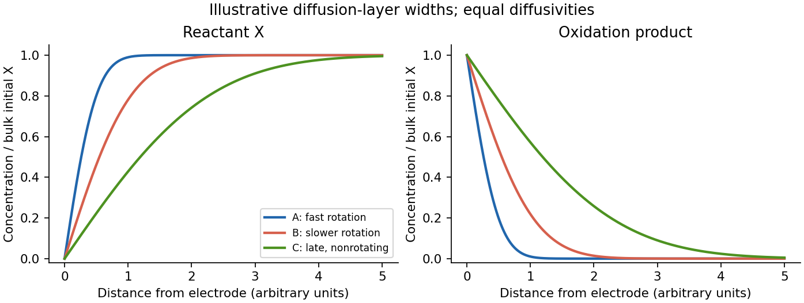
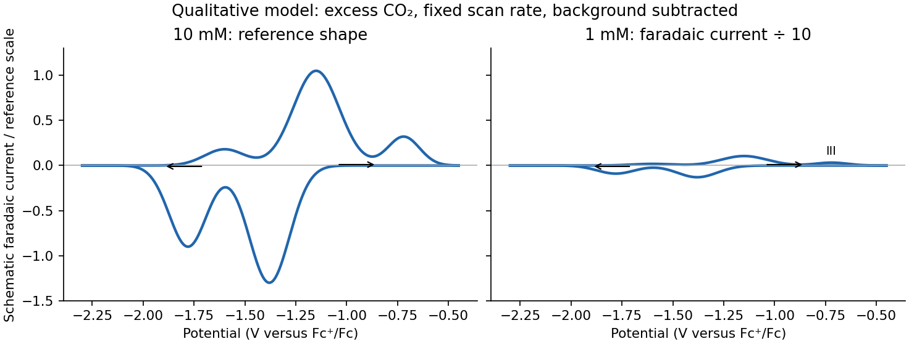
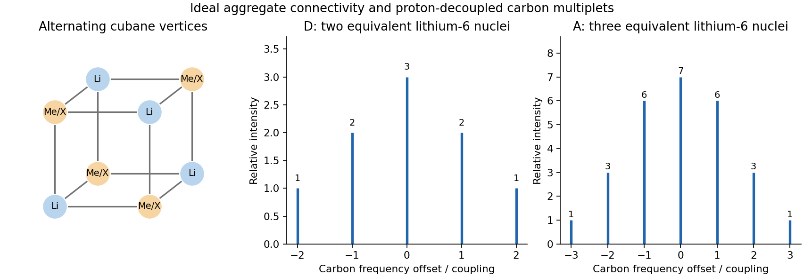
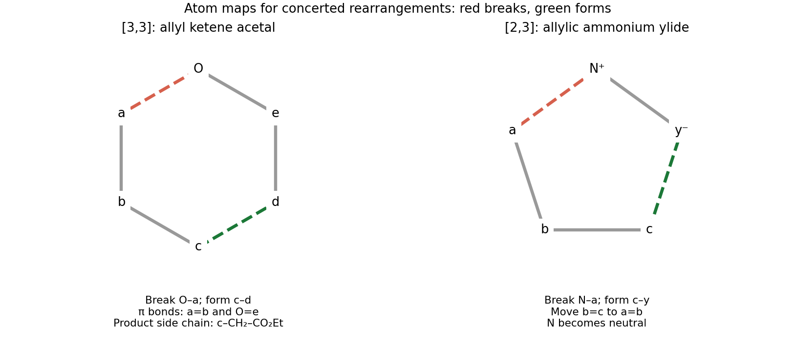
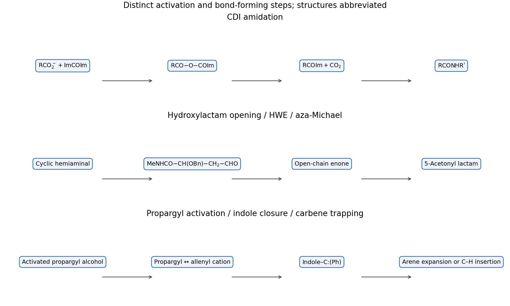
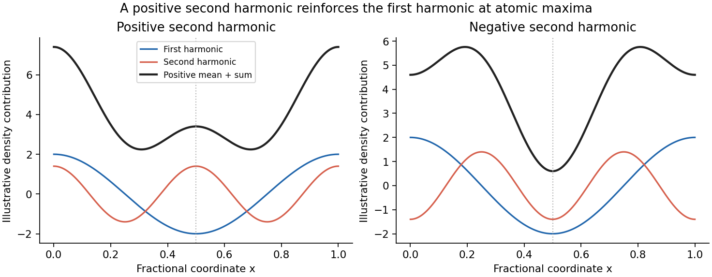
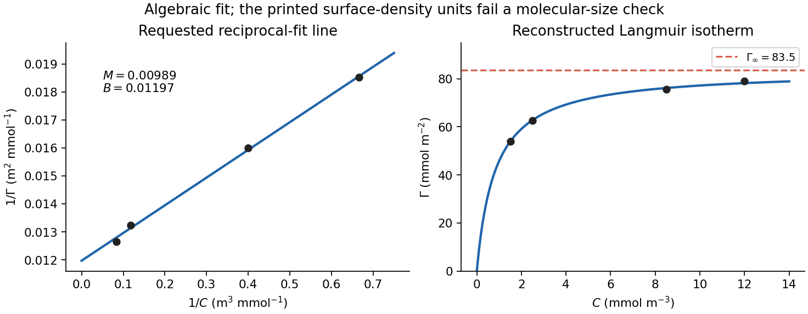
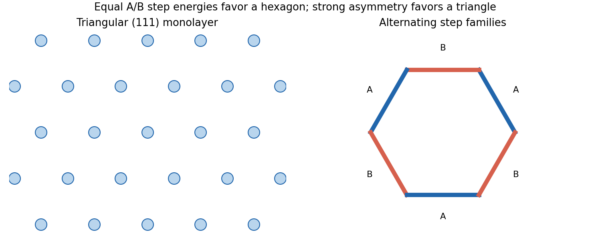
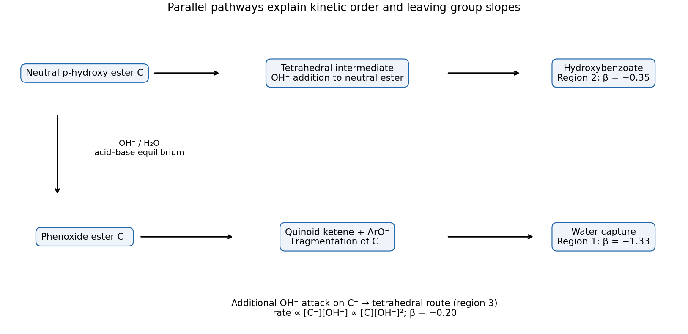
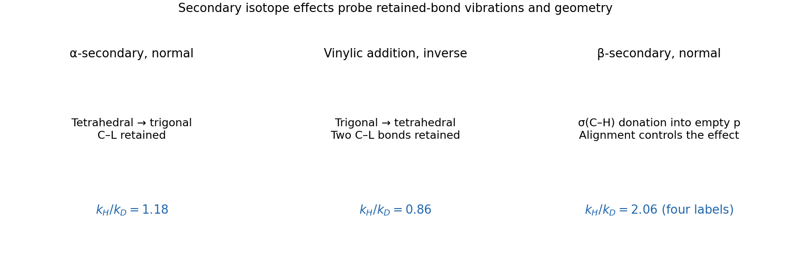

# Paper 4

↑ **Parent:** [2022](../2022.md)

[Original released paper; physical PDF pages 120–154](https://www.whatdotheyknow.com/request/nst_chemistry_past_papers_2022/response/2088679/attach/3/FOI%202022%20476%20Whittaker%20materials.pdf?cookie_passthrough=1#page=120)

**Table of contents**

- [51](#51)
  - [a](#51/a)
    - [i](#51/a/i)
      - [Solution](#51/a/i/solution)
    - [ii](#51/a/ii)
      - [Solution](#51/a/ii/solution)
  - [b](#51/b)
    - [Solution](#51/b/solution)
  - [c](#51/c)
    - [i](#51/c/i)
      - [Solution](#51/c/i/solution)
    - [ii](#51/c/ii)
      - [Solution](#51/c/ii/solution)
    - [iii](#51/c/iii)
      - [Solution](#51/c/iii/solution)
    - [iv](#51/c/iv)
      - [Solution](#51/c/iv/solution)
    - [v](#51/c/v)
      - [Solution](#51/c/v/solution)
    - [vi](#51/c/vi)
      - [Solution](#51/c/vi/solution)
- [52](#52)
  - [a](#52/a)
    - [Solution](#52/a/solution)
  - [b](#52/b)
    - [Solution](#52/b/solution)
  - [c](#52/c)
    - [Solution](#52/c/solution)
  - [d](#52/d)
    - [Solution](#52/d/solution)
  - [e](#52/e)
    - [Solution](#52/e/solution)
- [53](#53)
  - [a](#53/a)
    - [i](#53/a/i)
      - [Solution](#53/a/i/solution)
    - [ii](#53/a/ii)
      - [Solution](#53/a/ii/solution)
    - [iii](#53/a/iii)
      - [Solution](#53/a/iii/solution)
    - [iv](#53/a/iv)
      - [Solution](#53/a/iv/solution)
  - [b](#53/b)
    - [Solution](#53/b/solution)
  - [c](#53/c)
    - [Solution](#53/c/solution)
  - [d](#53/d)
    - [Solution](#53/d/solution)
  - [e](#53/e)
    - [Solution](#53/e/solution)
  - [f](#53/f)
    - [Solution](#53/f/solution)
  - [g](#53/g)
    - [Solution](#53/g/solution)
- [54](#54)
  - [a](#54/a)
    - [Solution](#54/a/solution)
  - [b](#54/b)
    - [Solution](#54/b/solution)
  - [c](#54/c)
    - [Solution](#54/c/solution)
  - [d](#54/d)
    - [Solution](#54/d/solution)
  - [e](#54/e)
    - [Solution](#54/e/solution)
  - [f](#54/f)
    - [Solution](#54/f/solution)
  - [g](#54/g)
    - [1](#54/g/1)
      - [Solution](#54/g/1/solution)
    - [2](#54/g/2)
      - [Solution](#54/g/2/solution)
- [55](#55)
  - [a](#55/a)
    - [i](#55/a/i)
      - [Solution](#55/a/i/solution)
    - [ii](#55/a/ii)
      - [Solution](#55/a/ii/solution)
    - [iii](#55/a/iii)
      - [Solution](#55/a/iii/solution)
  - [b](#55/b)
    - [i](#55/b/i)
      - [Solution](#55/b/i/solution)
    - [ii](#55/b/ii)
      - [Solution](#55/b/ii/solution)
  - [c](#55/c)
    - [i](#55/c/i)
      - [Solution](#55/c/i/solution)
    - [ii](#55/c/ii)
      - [Solution](#55/c/ii/solution)
    - [iii](#55/c/iii)
      - [Solution](#55/c/iii/solution)
- [56](#56)
  - [a](#56/a)
    - [Solution](#56/a/solution)
  - [b](#56/b)
    - [Solution](#56/b/solution)
  - [c](#56/c)
    - [Solution](#56/c/solution)
  - [d](#56/d)
    - [Solution](#56/d/solution)
- [57](#57)
  - [a](#57/a)
    - [Solution](#57/a/solution)
  - [b](#57/b)
    - [Solution](#57/b/solution)
  - [c](#57/c)
    - [Solution](#57/c/solution)
  - [d](#57/d)
    - [Solution](#57/d/solution)
  - [e](#57/e)
    - [Solution](#57/e/solution)
- [58](#58)
  - [a](#58/a)
    - [i](#58/a/i)
      - [Solution](#58/a/i/solution)
    - [ii](#58/a/ii)
      - [Solution](#58/a/ii/solution)
    - [iii](#58/a/iii)
      - [Solution](#58/a/iii/solution)
    - [iv](#58/a/iv)
      - [Solution](#58/a/iv/solution)
  - [b](#58/b)
    - [i](#58/b/i)
      - [Solution](#58/b/i/solution)
    - [ii](#58/b/ii)
      - [Solution](#58/b/ii/solution)
    - [iii](#58/b/iii)
      - [Solution](#58/b/iii/solution)
    - [iv](#58/b/iv)
      - [Solution](#58/b/iv/solution)
    - [v](#58/b/v)
      - [Solution](#58/b/v/solution)
- [59](#59)
  - [a](#59/a)
    - [Solution](#59/a/solution)
  - [b](#59/b)
    - [i](#59/b/i)
      - [Solution](#59/b/i/solution)
    - [ii](#59/b/ii)
      - [Solution](#59/b/ii/solution)
    - [iii](#59/b/iii)
      - [Solution](#59/b/iii/solution)
    - [iv](#59/b/iv)
      - [Solution](#59/b/iv/solution)
    - [v](#59/b/v)
      - [Solution](#59/b/v/solution)
  - [c](#59/c)
    - [Solution](#59/c/solution)
- [60](#60)
  - [a](#60/a)
    - [Solution](#60/a/solution)
  - [b](#60/b)
    - [i](#60/b/i)
      - [Solution](#60/b/i/solution)
    - [ii](#60/b/ii)
      - [Solution](#60/b/ii/solution)
    - [iii](#60/b/iii)
      - [Solution](#60/b/iii/solution)
  - [c](#60/c)
    - [i](#60/c/i)
      - [Solution](#60/c/i/solution)
    - [ii](#60/c/ii)
      - [Solution](#60/c/ii/solution)
    - [iii](#60/c/iii)
      - [Solution](#60/c/iii/solution)
    - [iv](#60/c/iv)
      - [Solution](#60/c/iv/solution)
    - [v](#60/c/v)
      - [Solution](#60/c/v/solution)
- [61](#61)
  - [a](#61/a)
    - [Solution](#61/a/solution)
  - [b](#61/b)
    - [Solution](#61/b/solution)
  - [c](#61/c)
    - [i](#61/c/i)
      - [Solution](#61/c/i/solution)
    - [ii](#61/c/ii)
      - [Solution](#61/c/ii/solution)
  - [d](#61/d)
    - [i](#61/d/i)
      - [Solution](#61/d/i/solution)
    - [ii](#61/d/ii)
      - [Solution](#61/d/ii/solution)
    - [iii](#61/d/iii)
      - [Solution](#61/d/iii/solution)
    - [iv](#61/d/iv)
      - [Solution](#61/d/iv/solution)
- [62](#62)
  - [a](#62/a)
    - [i](#62/a/i)
      - [Solution](#62/a/i/solution)
    - [ii](#62/a/ii)
      - [Solution](#62/a/ii/solution)
    - [iii](#62/a/iii)
      - [Solution](#62/a/iii/solution)
    - [iv](#62/a/iv)
      - [Solution](#62/a/iv/solution)
    - [v](#62/a/v)
      - [Solution](#62/a/v/solution)
  - [b](#62/b)
    - [Solution](#62/b/solution)
- [63](#63)
  - [a](#63/a)
    - [i](#63/a/i)
      - [Solution](#63/a/i/solution)
    - [ii](#63/a/ii)
      - [Solution](#63/a/ii/solution)
    - [iii](#63/a/iii)
      - [Solution](#63/a/iii/solution)
    - [iv](#63/a/iv)
      - [Solution](#63/a/iv/solution)
  - [b](#63/b)
    - [i](#63/b/i)
      - [Solution](#63/b/i/solution)
    - [ii](#63/b/ii)
      - [Solution](#63/b/ii/solution)
    - [iii](#63/b/iii)
      - [Solution](#63/b/iii/solution)
- [64](#64)
  - [a](#64/a)
    - [Solution](#64/a/solution)
  - [b](#64/b)
    - [i](#64/b/i)
      - [Solution](#64/b/i/solution)
    - [ii](#64/b/ii)
      - [Solution](#64/b/ii/solution)
    - [iii](#64/b/iii)
      - [Solution](#64/b/iii/solution)
    - [iv](#64/b/iv)
      - [Solution](#64/b/iv/solution)
  - [c](#64/c)
    - [i](#64/c/i)
      - [Solution](#64/c/i/solution)
    - [ii](#64/c/ii)
      - [Solution](#64/c/ii/solution)
    - [iii](#64/c/iii)
      - [Solution](#64/c/iii/solution)
    - [iv](#64/c/iv)
      - [Solution](#64/c/iv/solution)
    - [v](#64/c/v)
      - [Solution](#64/c/v/solution)
  - [d](#64/d)
    - [i](#64/d/i)
      - [Solution](#64/d/i/solution)
    - [ii](#64/d/ii)
      - [Solution](#64/d/ii/solution)
    - [iii](#64/d/iii)
      - [Solution](#64/d/iii/solution)
- [65](#65)
  - [a](#65/a)
    - [Solution](#65/a/solution)
  - [b](#65/b)
    - [i](#65/b/i)
      - [Solution](#65/b/i/solution)
    - [ii](#65/b/ii)
      - [Solution](#65/b/ii/solution)
  - [c](#65/c)
    - [i](#65/c/i)
      - [Solution](#65/c/i/solution)
    - [ii](#65/c/ii)
      - [Solution](#65/c/ii/solution)
  - [d](#65/d)
    - [i](#65/d/i)
      - [Solution](#65/d/i/solution)
    - [ii](#65/d/ii)
      - [Solution](#65/d/ii/solution)
    - [iii](#65/d/iii)
      - [Solution](#65/d/iii/solution)
- [66](#66)
  - [a](#66/a)
    - [i](#66/a/i)
      - [Solution](#66/a/i/solution)
    - [ii](#66/a/ii)
      - [Solution](#66/a/ii/solution)
    - [iii](#66/a/iii)
      - [Solution](#66/a/iii/solution)
  - [b](#66/b)
    - [Solution](#66/b/solution)
  - [c](#66/c)
    - [i](#66/c/i)
      - [Solution](#66/c/i/solution)
    - [ii](#66/c/ii)
      - [Solution](#66/c/ii/solution)
    - [iii](#66/c/iii)
      - [Solution](#66/c/iii/solution)
    - [iv](#66/c/iv)
      - [Solution](#66/c/iv/solution)
- [67](#67)
  - [a](#67/a)
    - [Solution](#67/a/solution)
  - [b](#67/b)
    - [Solution](#67/b/solution)
  - [c](#67/c)
    - [Solution](#67/c/solution)
  - [d](#67/d)
    - [Solution](#67/d/solution)
  - [e](#67/e)
    - [Solution](#67/e/solution)

## 51

↑ **Parent:** [Paper 4](paper-4.md)

<h3 id="51/a">a</h3>

↑ **Parent:** [51](#51)

<h4 id="51/a/i">i</h4>

↑ **Parent:** [A](#51/a)

<h5 id="51/a/i/solution">Solution</h5>

↑ **Parent:** [I](#51/a/i)

Make heterogeneous [electron transfer](../../electrochemistry.md#electron-transfer) fast relative to delivery of reactant, usually by applying sufficient [overpotential](../../electrochemistry.md#overpotential) so that its surface concentration approaches zero. Use excess [supporting electrolyte](../../electrochemistry.md#supporting-electrolyte) to suppress migration. For purely diffusional transient transport, suppress uncontrolled [convection](../../convection.md); for a [rotating disk electrode](../../electrochemistry.md#rotating-disk-electrode), controlled [convection](../../convection.md) supplies the bulk while [diffusion](../../thermodynamics.md#diffusion) across the thin interfacial boundary layer limits the current. A limiting current that no longer increases with driving potential is the characteristic test; a large current alone is not sufficient.

<h4 id="51/a/ii">ii</h4>

↑ **Parent:** [A](#51/a)

<h5 id="51/a/ii/solution">Solution</h5>

↑ **Parent:** [Ii](#51/a/ii)

The [midpoint potential](../../electrochemistry.md#midpoint-potential) $E_m$ characterizes the redox couple under specified solution conditions: it is the potential at which oxidized and reduced forms have equal activities, or equal concentrations in the corresponding formal-potential convention. For a reversible cyclic voltammogram it is estimated by $(E_{pa}+E_{pc})/2$. It approximates the formal redox potential when the usual reversibility and [diffusion](../../thermodynamics.md#diffusion) assumptions apply; it is not the potential halfway along a scan chosen arbitrarily.

<h3 id="51/b">b</h3>

↑ **Parent:** [51](#51)

<h4 id="51/b/solution">Solution</h4>

↑ **Parent:** [B](#51/b)

All three marked points are at strongly oxidizing potentials, where X is depleted at the electrode: $c_X(0)\simeq0$. Assuming only X initially in bulk, $c_{X^+}(\infty)=0$ and $c_X(\infty)=c_b$. Oxidation produces X$^+$ at the interface.

- **A:** the largest steady limiting current corresponds to the fastest rotation and thinnest [diffusion](../../thermodynamics.md#diffusion) boundary layer. X rises steeply from zero to $c_b$; X$^+$ falls steeply from its surface value to zero.
- **B:** slower rotation gives a thicker layer and shallower gradients, hence a smaller limiting current.
- **C:** the nonrotating electrode gives the peaked, subsequently decaying current. Its [diffusion](../../thermodynamics.md#diffusion) layer continues to broaden with time, approximately as $\sqrt{Dt}$, giving the broadest and shallowest profiles at the indicated late-scan point.

For equal [diffusion coefficients](../../brownian-motion.md#diffusion-coefficient), the two concentration profiles are complementary, $c_X+c_{X^+}=c_b$. More generally equality of their interfacial molar fluxes requires $D_Xc_X'(0)=-D_{X^+}c_{X^+}'(0)$, so the product surface concentration need not equal $c_b$. A and B are approximately steady hydrodynamic profiles; C is a time-dependent [diffusion](../../thermodynamics.md#diffusion) profile.

**[Figure 1](#51/b/image-illustrative-reactant-and-product-diffusion-profiles-at-the-three-transport-conditions). Illustrative reactant and product diffusion profiles at the three transport conditions**.

<h3 id="51/c">c</h3>

↑ **Parent:** [51](#51)

<h4 id="51/c/i">i</h4>

↑ **Parent:** [C](#51/c)

<h5 id="51/c/i/solution">Solution</h5>

↑ **Parent:** [I](#51/c/i)

Read the potential labels rather than the alphabetical order: **b**, the less negative event, is $\mathrm Q+e^-\rightleftharpoons Q^{\bullet-}$; **a**, the more negative event, is $\mathrm Q^{\bullet-}+e^-\rightleftharpoons Q^{2-}$. These are the first and second reductions respectively, with the reverse branches giving the corresponding oxidations. The second electron is harder to add to an already negatively charged species.

<h4 id="51/c/ii">ii</h4>

↑ **Parent:** [C](#51/c)

<h5 id="51/c/ii/solution">Solution</h5>

↑ **Parent:** [Ii](#51/c/ii)

Event a probes [electron transfer](../../electrochemistry.md#electron-transfer) between the semiquinone and dianion. Benzoquinone's smaller framework localizes charge and undergoes a greater change in bonding and solvation on this reduction; a larger effective reorganization barrier can make its heterogeneous transfer insufficiently fast for Nernst equilibrium on the $50\,\mathrm{mV\,s^{-1}}$ time scale. Anthraquinone's extended framework distributes the added charge and can support the more reversible response seen here.

This is a kinetic interpretation of quasi-reversibility, not a claim that benzoquinone cannot be reduced. Follow-up chemistry or [adsorption](../../physical-chemistry.md#adsorption) can also distort peak separation and return-current ratios; scan-rate-dependent measurements would distinguish them from slow [electron transfer](../../electrochemistry.md#electron-transfer). A single trace does not uniquely identify the cause.

<h4 id="51/c/iii">iii</h4>

↑ **Parent:** [C](#51/c)

<h5 id="51/c/iii/solution">Solution</h5>

↑ **Parent:** [Iii](#51/c/iii)

A useful electrode-surface scheme for the proposed [ECEC mechanism](../../electrochemistry.md#ecec-mechanism) is

$$
\mathrm{AQ}\xrightarrow{+e^-}\mathrm{AQ^{\bullet-}}
\xrightarrow{+CO_2}\mathrm{AQCO_2^{\bullet-}}
\xrightarrow{+e^-}\mathrm{AQCO_2^{2-}}
\xrightarrow{+CO_2}\mathrm{AQ(CO_2)_2^{2-}}.
$$

Electron-transfer arrows occur at the electrode, whereas both capture steps occur in the adjacent solution layer. CO$_2$ is attacked by an oxygen-centered nucleophilic component of the reduced quinone, forming an O-carbonate linkage rather than simply physically adsorbing on neutral AQ.

At potentials more negative than $-2.0\,\mathrm V$, direct second reduction of any unbound semiquinone is also accessible: $\mathrm{AQ^{\bullet-}}\to\mathrm{AQ^{2-}}$, followed by carbonate formation. Thus the fully reduced unbound and mono-adduct species can feed the bis-adduct, and the drawing should include CO$_2$ transport into the layer and adduct transport away. ECEC is the proposed sequence; competing EECC transfer/capture ordering is possible at such negative potentials.

<h4 id="51/c/iv">iv</h4>

↑ **Parent:** [C](#51/c)

<h5 id="51/c/iv/solution">Solution</h5>

↑ **Parent:** [Iv](#51/c/iv)

Peak **I** is the cathodic reduction shifted positive of the unbound AQ$^{\bullet-}$/AQ$^{2-}$ event, consistent with reduction of the CO$_2$-bound semiquinone to mono-carbonate dianion. Peak **II** is the corresponding relatively negative-potential return oxidation of mono-carbonate dianion. Peak **III**, appearing farther positive on the faster return scan, is consistent with direct oxidation of the more strongly protected bis-carbonate dianion, followed by CO$_2$ release.

This assignment is consistent with binding making the reduced species harder to oxidize. At slow scan, chemical interconversion and CO$_2$ dissociation can feed the easier mono-carbonate oxidation pathway; at fast scan a larger fraction of kinetically retained bis-adduct survives to its direct oxidation potential. The two separated reductions also show that initial capture and its associated potential shift are not sufficient to make every ECEC step a single equilibrated two-electron wave.

These traces support coupled electron-transfer/binding chemistry but do not determine every microscopic rate constant or exclude EECC pathways. The peak assignments are species-family assignments within the stated mechanism, rather than proof of a unique elementary sequence from voltammetry alone.

<h4 id="51/c/v">v</h4>

↑ **Parent:** [C](#51/c)

<h5 id="51/c/v/solution">Solution</h5>

↑ **Parent:** [V](#51/c/v)

Within the stated ECEC model and with CO$_2$ genuinely in large excess, its concentration is effectively constant. Both capture steps are then pseudo-first-order in the quinone species, and at the same scan rate the faradaic current is linear in bulk AQ concentration.

The sketch therefore retains the peak potentials, sweep directions and relative features of the $200\,\mathrm{mV\,s^{-1}}$ trace, including the positive-potential return feature III, but reduces the faradaic current scale by **a factor of ten**. Charging/background current need not scale with AQ concentration and should be shown separately. A changed normalized shape would indicate effects outside this simple scaling limit, such as CO$_2$ depletion, [adsorption](../../physical-chemistry.md#adsorption) or reactions between quinone species.

**[Figure 2](#51/c/v/image-qualitative-tenfold-faradaic-current-scaling-at-fixed-scan-rate-and-excess-carbon-dioxide). Qualitative tenfold faradaic-current scaling at fixed scan rate and excess carbon dioxide**.

<h4 id="51/c/vi">vi</h4>

↑ **Parent:** [C](#51/c)

<h5 id="51/c/vi/solution">Solution</h5>

↑ **Parent:** [Vi](#51/c/vi)

The target dianion consumes two electrons per molecule, so

$$
\eta_F=\frac{2n_{\rm product}}{n_{e^-}}
=\frac{2(7.8)}{18.2}
=0.857,
$$

giving **$85.7\%$ Faradaic yield**. Of the passed electron equivalents, $2.6\,\mathrm{mmol}$ are not accounted for by the quantified bis-adduct.

They can reside in incompletely captured reduced quinones, other reduction products or parasitic solvent/proton/CO$_2$ chemistry. The data do not identify one unique loss pathway. The starting solution contains $50\,\mathrm{mmol}$ BQ, so the target product represents only $15.6\%$ of that inventory; low bulk conversion alone does not explain a sub-unity Faradaic yield, because unreacted BQ has consumed no charge.

## 52

↑ **Parent:** [Paper 4](paper-4.md)

<h3 id="52/a">a</h3>

↑ **Parent:** [52](#52)

<h4 id="52/a/solution">Solution</h4>

↑ **Parent:** [A](#52/a)

Write $\mathrm{Me=CH_3}$. The alternating-vertex cubane A is $\mathrm{Li_4Me_4}$; replacing one or two methyl vertices gives $\mathrm B=\mathrm{Li_4Me_3X}$ and $\mathrm C=\mathrm{Li_4Me_2X_2}$. Balanced redistributions are

$$
\mathrm{A+LiX\rightleftharpoons B+MeLi},\qquad
\mathrm{A+2LiX\rightleftharpoons C+2MeLi}.
$$

The smaller aggregate has composition $\mathrm D=\mathrm{Li_2MeX}$, since the conventional masses $2(7)+15+80=109$ or $2(7)+15+127=156$ match the supplied values. Thus $\mathrm{A+4LiX\rightleftharpoons4D}$ is another balanced redistribution.

For the structures, place Li on one tetrahedral set of cube corners and Me/X on the complementary set, joining adjacent unlike vertices. A contains four Me vertices, B three Me and one X, and C two of each. D is a four-membered alternating Li-Me-Li-X ring. The quoted relative masses use conventional elemental masses; a fully $^6$Li-enriched D would be approximately two mass units lighter, without changing its composition.

<h3 id="52/b">b</h3>

↑ **Parent:** [52](#52)

<h4 id="52/b/solution">Solution</h4>

↑ **Parent:** [B](#52/b)

Useful isotope-selection factors include spin and quadrupole moment, [gyromagnetic ratio](../../electromagnetism.md#gyromagnetic-ratio), natural abundance or enrichment, sensitivity at the available field, line widths and relaxation, chemical-shift dispersion and the couplings needed for structural assignment. Both lithium isotopes are quadrupolar, but $^6$Li has a much smaller quadrupole moment and often much narrower lines, allowing inequivalent sites and carbon-lithium couplings to be resolved. Enrichment compensates its low natural abundance and removes isotope-mixture complexity.

Fully enriched $^7$Li would generally be more sensitive but broader in these aggregates. Its chemical-shift pattern would remain chemically similar, although isotope shifts and dynamics can make small differences. Resolved H-Li couplings increase in frequency approximately with $\gamma_7/\gamma_6=2.67$ and have different multiplicities because $I$ changes from $1$ to $3/2$: $n$ equivalent Li nuclei give $2nI+1$ lines. If such long-range proton couplings remain unresolved, the main visible difference can instead be broadened lines. One should not invent resolved multiplets absent from the printed spectra.

<h3 id="52/c">c</h3>

↑ **Parent:** [52](#52)

<h4 id="52/c/solution">Solution</h4>

↑ **Parent:** [C](#52/c)

The nucleus-count ratios H:$^6$Li are **A, $12:4=3:1$; B, $9:4$; C, $6:4=3:2$; D, $3:2$**. Enrichment changes which isotope is counted but not these stoichiometric ratios.

Quantitative lithium integration requires adequate excitation bandwidth, a suitable calibrated pulse, acquisition of the entire broad as well as narrow signal, correct baseline/phasing and no differential saturation. Recycle delays should be long relative to the slowest relevant longitudinal relaxation time, or saturation must be measured and corrected. Exchange and unresolved overlap must be handled in the integrated areas. Proton and lithium spectra also require a stated relative calibration before raw numbers can be compared across nuclei.

<h3 id="52/d">d</h3>

↑ **Parent:** [52](#52)

<h4 id="52/d/solution">Solution</h4>

↑ **Parent:** [D](#52/d)

The zero-ppm signals E are plausibly solvated lithium halide, predominantly LiBr or LiI and their solution ion-pair/aggregate forms. Structural symmetry predicts one Li environment in A, two in B in a $3:1$ ratio, two in C in a $2:2$ ratio, and one in an ideal symmetric D.

The natural lithium assignment is therefore:

- **Br mixture:** A at approximately $1.68\,\mathrm{ppm}$ (43.4); B at approximately $0.80$ (16.2, three Li) and $1.55$ (5.4, one Li); D at $0.73$ (10.3, broad); E at $0.00$ (24.8).
- **I mixture:** A at approximately $1.68$ (59.9); B at approximately $1.10$ (8.4, three Li) and $1.55$ (2.8, one Li); C at approximately $1.0$ and $0.35$ (0.6 each); D at $0.97$ (2.3, broad); E at $0.00$ (3.0). The close C/D signals require care about overlap.

The major proton peak near $-2.08\,\mathrm{ppm}$ is A. The next peak near $-2.15$ to $-2.16$ is naturally assigned to B; in the iodide mixture the smaller peaks near $-2.22$ and $-2.28$ distinguish C and D. Smaller D aggregates can exchange Li or ligands with free halide-containing species more rapidly, giving intermediate-exchange broadening at the two specifically identified broad lithium resonances.

**There is a quantitative inconsistency in the printed integrations under these ideal single-species assignments.** For example the Br lithium B integrals give molecular amount proportional to $5.4$, while A gives $43.4/4=10.85$. Their proton areas should consequently obey $H_B/H_A=9(5.4)/[12(10.85)]=0.373$, whereas either small proton integral gives $17/66=0.258$. No common proton-versus-lithium calibration removes that ratio discrepancy. Similarly the I B/A ratio predicted from Li is $0.140$, compared with printed $9/90=0.100$.

Thus the symmetry-based assignment above is useful, but an exact simultaneous quantitative assignment satisfying every printed reliable integral is not established by these data. It would require corrected integrals, an explicitly overlapped signal or an additional speciation model; the discrepancy should not be concealed by treating independently normalized spectra as automatically consistent.

[The aggregation behaviour of methyllithium in the presence of LiBr and LiI in diethyl ether and tetrahydrofuran by Thomas Fox and colleagues](../../chemistry-bibliography.md#the-aggregation-behaviour-of-methyllithium-in-the-presence-of-libr-and-lii-in-diethyl-ether-and-tetrahydrofuran-by-thomas-fox-and-colleagues)

<h3 id="52/e">e</h3>

↑ **Parent:** [52](#52)

<h4 id="52/e/solution">Solution</h4>

↑ **Parent:** [E](#52/e)

In the slowly exchanging cubane A each methyl carbon is bonded to three equivalent $^6$Li nuclei with $I=1$. Its single carbon environment gives a **septet**, with first-order intensities $1:3:6:7:6:3:1$.

In B the three methyl vertices remain equivalent by the ideal threefold symmetry, but each carbon sees two equivalent Li of one type and one Li of the other. The carbon resonance is therefore a **quintet of triplets** (15 first-order lines if both couplings are resolved and unequal): the equivalent pair gives $1:2:3:2:1$, and the third Li gives $1:1:1$. Accidental equality of couplings can collapse this to a septet.

D has one methyl-carbon environment coupled to two equivalent Li, giving a **quintet** $1:2:3:2:1$. E has no methyl carbon. These patterns assume [proton decoupling](../../nuclear-magnetic-resonance.md#proton-decoupling), resolved $^1J_{CLi}$, ideal aggregate symmetry and slow exchange; without [proton decoupling](../../nuclear-magnetic-resonance.md#proton-decoupling) each methyl-carbon pattern is additionally split by its three attached protons.

**[Figure 3](#52/e/image-ideal-lithium-aggregate-connectivity-and-resolved-carbon-lithium-multiplets). Ideal lithium aggregate connectivity and resolved carbon-lithium multiplets**.

## 53

↑ **Parent:** [Paper 4](paper-4.md)

<h3 id="53/a">a</h3>

↑ **Parent:** [53](#53)

<h4 id="53/a/i">i</h4>

↑ **Parent:** [A](#53/a)

<h5 id="53/a/i/solution">Solution</h5>

↑ **Parent:** [I](#53/a/i)

**TODO: Biology topic deferred under the current solving scope.**

<h4 id="53/a/ii">ii</h4>

↑ **Parent:** [A](#53/a)

<h5 id="53/a/ii/solution">Solution</h5>

↑ **Parent:** [Ii](#53/a/ii)

**TODO: Biology topic deferred under the current solving scope.**

<h4 id="53/a/iii">iii</h4>

↑ **Parent:** [A](#53/a)

<h5 id="53/a/iii/solution">Solution</h5>

↑ **Parent:** [Iii](#53/a/iii)

**TODO: Biology topic deferred under the current solving scope.**

<h4 id="53/a/iv">iv</h4>

↑ **Parent:** [A](#53/a)

<h5 id="53/a/iv/solution">Solution</h5>

↑ **Parent:** [Iv](#53/a/iv)

**TODO: Biology topic deferred under the current solving scope.**

<h3 id="53/b">b</h3>

↑ **Parent:** [53](#53)

<h4 id="53/b/solution">Solution</h4>

↑ **Parent:** [B](#53/b)

**TODO: Biology topic deferred under the current solving scope.**

<h3 id="53/c">c</h3>

↑ **Parent:** [53](#53)

<h4 id="53/c/solution">Solution</h4>

↑ **Parent:** [C](#53/c)

**TODO: Biology topic deferred under the current solving scope.**

<h3 id="53/d">d</h3>

↑ **Parent:** [53](#53)

<h4 id="53/d/solution">Solution</h4>

↑ **Parent:** [D](#53/d)

**TODO: Biology topic deferred under the current solving scope.**

<h3 id="53/e">e</h3>

↑ **Parent:** [53](#53)

<h4 id="53/e/solution">Solution</h4>

↑ **Parent:** [E](#53/e)

**TODO: Biology topic deferred under the current solving scope.**

<h3 id="53/f">f</h3>

↑ **Parent:** [53](#53)

<h4 id="53/f/solution">Solution</h4>

↑ **Parent:** [F](#53/f)

**TODO: Biology topic deferred under the current solving scope.**

<h3 id="53/g">g</h3>

↑ **Parent:** [53](#53)

<h4 id="53/g/solution">Solution</h4>

↑ **Parent:** [G](#53/g)

**TODO: Biology topic deferred under the current solving scope.**

## 54

↑ **Parent:** [Paper 4](paper-4.md)

<h3 id="54/a">a</h3>

↑ **Parent:** [54](#54)

<h4 id="54/a/solution">Solution</h4>

↑ **Parent:** [A](#54/a)

**TODO: Biology topic deferred under the current solving scope.**

<h3 id="54/b">b</h3>

↑ **Parent:** [54](#54)

<h4 id="54/b/solution">Solution</h4>

↑ **Parent:** [B](#54/b)

**TODO: Biology topic deferred under the current solving scope.**

<h3 id="54/c">c</h3>

↑ **Parent:** [54](#54)

<h4 id="54/c/solution">Solution</h4>

↑ **Parent:** [C](#54/c)

**TODO: Biology topic deferred under the current solving scope.**

<h3 id="54/d">d</h3>

↑ **Parent:** [54](#54)

<h4 id="54/d/solution">Solution</h4>

↑ **Parent:** [D](#54/d)

**TODO: Biology topic deferred under the current solving scope.**

<h3 id="54/e">e</h3>

↑ **Parent:** [54](#54)

<h4 id="54/e/solution">Solution</h4>

↑ **Parent:** [E](#54/e)

**TODO: Biology topic deferred under the current solving scope.**

<h3 id="54/f">f</h3>

↑ **Parent:** [54](#54)

<h4 id="54/f/solution">Solution</h4>

↑ **Parent:** [F](#54/f)

**TODO: Biology topic deferred under the current solving scope.**

<h3 id="54/g">g</h3>

↑ **Parent:** [54](#54)

<h4 id="54/g/1">1</h4>

↑ **Parent:** [G](#54/g)

<h5 id="54/g/1/solution">Solution</h5>

↑ **Parent:** [1](#54/g/1)

**TODO: Biology topic deferred under the current solving scope.**

<h4 id="54/g/2">2</h4>

↑ **Parent:** [G](#54/g)

<h5 id="54/g/2/solution">Solution</h5>

↑ **Parent:** [2](#54/g/2)

**TODO: Biology topic deferred under the current solving scope.**

## 55

↑ **Parent:** [Paper 4](paper-4.md)

<h3 id="55/a">a</h3>

↑ **Parent:** [55](#55)

<h4 id="55/a/i">i</h4>

↑ **Parent:** [A](#55/a)

<h5 id="55/a/i/solution">Solution</h5>

↑ **Parent:** [I](#55/a/i)

The first transformation is an [Achmatowicz rearrangement](../../chemistry.md#achmatowicz-rearrangement), followed by protection and selective reduction; the last is a [Johnson-Claisen rearrangement](../../chemistry.md#johnson-claisen-rearrangement).

- Butyllithium removes the furan 2-proton, giving a 2-lithiofuran. Its carbon attacks the [aldehyde](../../chemical-substance.md#aldehyde) [carbonyl](../../chemical-bond.md#carbonyl-group); [protonation](../../chemical-reaction.md#protonation) of the resulting alkoxide gives the furfuryl alcohol. Carbon-carbon bond formation occurs at the lithiated position.
- Electrophilic oxygen transfer from mCPBA to the electron-rich furan gives an oxidized, ring-opened intermediate. Opening the oxygenated furan gives a hydroxy enedicarbonyl: the original furfuryl hydroxyl then attacks the remote [aldehyde](../../chemical-substance.md#aldehyde) intramolecularly. This expands the five-membered furan into a six-membered [lactol](../../chemical-substance.md#lactol) containing an enone [carbonyl](../../chemical-bond.md#carbonyl-group). The original furfuryl oxygen becomes the pyran ring oxygen; oxidation of the furan supplies the new [carbonyl](../../chemical-bond.md#carbonyl-group) and [lactol](../../chemical-substance.md#lactol) functionality.
- Ag$_2$O/MeI converts the [lactol](../../chemical-substance.md#lactol) OH into its methyl [acetal](../../chemical-substance.md#acetal): oxygen attacks methyl iodide by [SN2 reaction](../../chemical-reaction.md#sn2-reaction), with iodide removal and proton transfer. This protects the anomeric position.
- LiAlH$_4$ delivers hydride to the remaining [ketone](../../chemical-substance.md#ketone) [carbonyl](../../chemical-bond.md#carbonyl-group), followed by [protonation](../../chemical-reaction.md#protonation). The methyl [acetal](../../chemical-substance.md#acetal) survives these basic reducing conditions, leaving the depicted allylic alcohol.
- Under weak-acid catalysis, that allylic OH replaces an ethoxy group of triethyl orthoacetate. Loss of another ethanol molecule, with removal of a methyl proton, gives the mixed [ketene acetal](../../chemistry.md#ketene-acetal) $\mathrm{CH_2=C(OEt)-O-(allyl)}$. A six-electron, chair-like [Claisen rearrangement](../../chemistry.md#claisen-rearrangement) breaks the allyl-O bond, forms a bond between the terminal allyl carbon and the ketene-acetal CH$_2$, and moves the ring double bond one position. [Carbonyl](../../chemical-bond.md#carbonyl-group) formation gives the $\mathrm{-CH_2CO_2Et}$ substituent.

The [acetal](../../chemical-substance.md#acetal) protects the other oxygenated position during hydride reduction. The orthoester transfers an acetate-derived two-carbon unit through a [ketene acetal](../../chemistry.md#ketene-acetal); it does not directly substitute the allylic OH with an intact acetate ion.

[Simple stereoselective version of the Claisen rearrangement by William S. Johnson and colleagues](../../chemistry-bibliography.md#simple-stereoselective-version-of-the-claisen-rearrangement-by-william-s-johnson-and-colleagues)

**[Figure 4](#55/a/i/image-atom-maps-for-the-allylic-ketene-acetal-and-ammonium-ylide-rearrangements). Atom maps for the allylic ketene-acetal and ammonium-ylide rearrangements**.

<h4 id="55/a/ii">ii</h4>

↑ **Parent:** [A](#55/a)

<h5 id="55/a/ii/solution">Solution</h5>

↑ **Parent:** [Ii](#55/a/ii)

For a concrete choice, draw the intermediate in the planar ring orientation used in the question and put the allylic OH on the upper face, with a solid-wedge C-OH bond. Fix either configuration at the R-bearing and methoxy-bearing centres and retain it throughout; no absolute configuration is specified by the question.

Draw the six-membered rearrangement array with its allylic C-C-C segment along the same ring edge and the O-ketene-acetal tether above that edge. Suprafacial transfer forms the new ring-carbon–CH$_2$CO$_2$Et bond on that upper face: draw it as a solid wedge, replacing the original allylic OH with the shifted double bond. The R-bearing and methoxy-bearing [stereocentres](../../chemistry.md#stereocentre) retain their configurations. The opposite OH epimer transfers the tether from the opposite face and gives the opposite new [stereocentre](../../chemistry.md#stereocentre). Favor the chair-like transition structure that puts the larger tether substituents outward. This explicitly correlates the selected OH face with the new bond rather than invoking a freely rotating allylic [carbocation](../../chemical-substance.md#carbocation).

<h4 id="55/a/iii">iii</h4>

↑ **Parent:** [A](#55/a)

<h5 id="55/a/iii/solution">Solution</h5>

↑ **Parent:** [Iii](#55/a/iii)

Propionic acid is a weak, relatively high-boiling acid: its normal boiling point is about $141^\circ\mathrm C$, compared with about $118^\circ\mathrm C$ for acetic acid. It provides mild proton catalysis while remaining in the hot orthoester mixture more effectively. This is useful because ketene-acetal formation and the thermal [Johnson-Claisen rearrangement](../../chemistry.md#johnson-claisen-rearrangement) require heating, whereas strong acid would threaten the pyran [acetal](../../chemical-substance.md#acetal).

This is a practical catalyst choice, not an absolute mechanistic prohibition on acetic acid; acetic-acid-catalysed orthoester rearrangements are also possible.

<h3 id="55/b">b</h3>

↑ **Parent:** [55](#55)

<h4 id="55/b/i">i</h4>

↑ **Parent:** [B](#55/b)

<h5 id="55/b/i/solution">Solution</h5>

↑ **Parent:** [I](#55/b/i)

Write Im for an imidazolyl group. The acid protonates one imidazole nitrogen, and its carboxylate attacks the central [carbonyl](../../chemical-bond.md#carbonyl-group) of [carbonyldiimidazole](../../chemistry.md#carbonyldiimidazole). Collapse of the [tetrahedral intermediate](../../chemical-kinetics.md#tetrahedral-intermediate) expels imidazole and gives the mixed anhydride $\mathrm{RCO-O-CO-Im}$. Acyl transfer to imidazole, with decarboxylation, produces the activated acyl imidazole $\mathrm{RCO-Im}$, CO$_2$ and imidazole.

The amine attacks the **RCO [carbonyl](../../chemical-bond.md#carbonyl-group)** of that acyl imidazole. Its [tetrahedral intermediate](../../chemical-kinetics.md#tetrahedral-intermediate) collapses with loss of imidazole; proton transfer gives $\mathrm{RCONHR'}$. The [carbonyl](../../chemical-bond.md#carbonyl-group) originally belonging to CDI leaves as CO$_2$, while the product amide [carbonyl](../../chemical-bond.md#carbonyl-group) is the original acid [carbonyl](../../chemical-bond.md#carbonyl-group). Imidazole serves both as a leaving group and a proton-transfer base.

**[Figure 5](#55/b/i/image-activated-acyl-transfer-hemiaminal-opening-and-carbene-formation). Activated acyl transfer, hemiaminal opening and carbene formation**.

<h4 id="55/b/ii">ii</h4>

↑ **Parent:** [B](#55/b)

<h5 id="55/b/ii/solution">Solution</h5>

↑ **Parent:** [Ii](#55/b/ii)

[Carbonyldiimidazole](../../chemistry.md#carbonyldiimidazole) activates the acid under mild conditions without first isolating an acid chloride. CO$_2$ and imidazole are convenient byproducts; the latter also buffers proton transfers. Avoiding strongly acidic acid-chloride-forming conditions can preserve sensitive protecting groups and reduce unwanted side reactions. The activated intermediate still reacts readily with an amine, whereas the unactivated acid and amine would mainly form an ammonium carboxylate.

<h3 id="55/c">c</h3>

↑ **Parent:** [55](#55)

<h4 id="55/c/i">i</h4>

↑ **Parent:** [C](#55/c)

<h5 id="55/c/i/solution">Solution</h5>

↑ **Parent:** [I](#55/c/i)

The alcohol first attacks CDI, forming an activated O-carbonylimidazole derivative. Its departure gives the resonance-stabilized propargyl/allenyl cation

$$
\mathrm{Ar-C^+(CF_3)-C{\equiv}C-Ph
\leftrightarrow Ar-C(CF_3)=C=C^+(Ph)}.
$$

The ortho amino nitrogen attacks the **central carbon of the allenyl system**, closing the five-membered indole ring. Electron redistribution and loss of the N-H proton establish the indole aromatic system while leaving a [carbene](../../chemistry.md#carbene) at the original distal, phenyl-bearing alkyne carbon.

For atom tracking, the original carbinol carbon becomes indole C3, the proximal alkyne carbon becomes C2, and the distal $\mathrm{C(Ph)}$ becomes the exocyclic [carbene](../../chemistry.md#carbene). Attack at the distal alkyne carbon would make a six-membered ring and cannot give the displayed skeleton. This carbene-based rearrangement has a primary experimental precedent.[Rapid assembly of substituted dihydrocycloheptapyrroloindoles by Lisa F. Frey and colleagues](../../chemistry-bibliography.md#rapid-assembly-of-substituted-dihydrocycloheptapyrroloindoles-by-lisa-f-frey-and-colleagues)

<h4 id="55/c/ii">ii</h4>

↑ **Parent:** [C](#55/c)

<h5 id="55/c/ii/solution">Solution</h5>

↑ **Parent:** [Ii](#55/c/ii)

With an N-trityl substituent, the [carbene](../../chemistry.md#carbene) attacks a nearby trityl phenyl ring. Addition across an arene bond gives a norcaradiene-like cyclopropane, followed by electrocyclic opening to the seven-membered cycloheptatriene: this is a [Buchner ring expansion](../../chemistry.md#buchner-ring-expansion). Intramolecular trapping explains the fused product rather than an intermolecular [carbene](../../chemistry.md#carbene) reaction.

With N-tert-butyl, there is no pendant arene. Instead the [carbene](../../chemistry.md#carbene) inserts into a C-H bond of one tert-butyl methyl group. The new bond between the [carbene](../../chemistry.md#carbene) carbon and that methyl carbon closes the five-membered N-containing ring; H is transferred to the [carbene](../../chemistry.md#carbene) carbon in the same insertion. The remaining two methyl groups stay on the carbon attached to N.

<h4 id="55/c/iii">iii</h4>

↑ **Parent:** [C](#55/c)

<h5 id="55/c/iii/solution">Solution</h5>

↑ **Parent:** [Iii](#55/c/iii)

No stereochemical information need survive from the starting carbinol. Ionization converts that tetrahedral [stereocentre](../../chemistry.md#stereocentre) into a planar, delocalized propargyl/allenyl cation before cyclization. In achiral conditions the two enantiomeric pathways to the new [stereocentre](../../chemistry.md#stereocentre) in the tert-butyl-derived product are equivalent, so an enantiopure alcohol is expected to give racemic product. A claim of retained enantiopurity would require evidence for unusually effective conformational memory or ion-pair control.

## 56

↑ **Parent:** [Paper 4](paper-4.md)

<h3 id="56/a">a</h3>

↑ **Parent:** [56](#56)

<h4 id="56/a/solution">Solution</h4>

↑ **Parent:** [A](#56/a)

[Osmium tetroxide](../../chemical-substance.md#osmium-tetroxide) adds to the alkene through a concerted cyclic addition, giving a five-membered osmate [ester](../../chemical-substance.md#ester) with both C-O bonds on the same face. Hydrolysis releases the vicinal diol; NMO reoxidizes reduced osmium so that OsO$_4$ can be catalytic.

The two new hydroxyl groups are therefore **syn**. For the drawn substrate, approach opposite the two existing solid-wedge substituents is less crowded: draw **both new C-OH bonds dashed**, while retaining the solid-wedge CO$_2$Bn and NHBoc bonds. The major diol is cis at its two new centres and anti to the pre-existing substituted face.

Syn delivery is the [stereospecificity](../../chemistry.md#stereospecificity) of cyclic osmylation; preference for one of the two diastereotopic alkene faces is substrate-controlled [diastereoselectivity](../../stereochemistry.md#diastereoselectivity). Attack from the other face would still be syn but would give the minor diastereomer.

<h3 id="56/b">b</h3>

↑ **Parent:** [56](#56)

<h4 id="56/b/solution">Solution</h4>

↑ **Parent:** [B](#56/b)

The hydroxylactam is a cyclic [hemiaminal](../../chemistry.md#hemiaminal). Its alkoxide can open to the corresponding [aldehyde](../../chemical-substance.md#aldehyde)/amidate, $\mathrm{MeNHCO-CH(OBn)-CH_2-CHO}$ in its protonated representation. This exposes an [aldehyde](../../chemical-substance.md#aldehyde) without reducing or replacing the lactam [carbonyl](../../chemical-bond.md#carbonyl-group).

The ketophosphonate anion attacks that [aldehyde](../../chemical-substance.md#aldehyde). Formation and collapse of the phosphorus-containing intermediate give the predominantly E enone $\mathrm{MeNHCO-CH(OBn)-CH_2-CH=CH-COCH_3}$ and phosphate by [Horner-Wadsworth-Emmons reaction](../../chemistry.md#horner-wadsworth-emmons-reaction). The amide nitrogen then closes by intramolecular [aza-Michael addition](../../chemistry.md#aza-michael-addition) at the enone beta carbon. [Protonation](../../chemical-reaction.md#protonation) of the [ketone](../../chemical-substance.md#ketone) enolate gives the observed five-membered lactam with a $\mathrm{-CH_2COCH_3}$ substituent.

A folded, relatively unencumbered closure places OBn and the developing side chain in outward-facing positions; the expected major product has **OBn and the C5 acetonyl substituent cis**. With the OBn wedge retained, show the new C5–CH$_2$COCH$_3$ bond as a solid wedge. The closure is diastereoselective, while the original wavy [hemiaminal](../../chemistry.md#hemiaminal) centre is erased by [aldehyde](../../chemical-substance.md#aldehyde) formation. This facial prediction rests on the preferred folded conformer rather than retention of either starting [hemiaminal](../../chemistry.md#hemiaminal) epimer.

<h3 id="56/c">c</h3>

↑ **Parent:** [56](#56)

<h4 id="56/c/solution">Solution</h4>

↑ **Parent:** [C](#56/c)

This is a thermal [Claisen rearrangement](../../chemistry.md#claisen-rearrangement) followed by intramolecular [acetal](../../chemical-substance.md#acetal) exchange. Identify the six-atom array as the cyclopentenone enol-ether C=C–O–CH$_2$–C=C unit. In its concerted $[3,3]$ rearrangement:

- The O–CH$_2$ bond breaks.
- A new C-C bond joins the other end of the cyclopentenone enol double bond to the cyclohexene carbon bearing CH(OEt)$_2$.
- The former ether-bearing cyclopentene carbon becomes a [ketone](../../chemical-substance.md#ketone), and the cyclohexene double bond becomes the exocyclic methylene.

The intermediate is thus a substituted cyclopentane-1,3-dione, with the [acetal](../../chemical-substance.md#acetal) tether now correctly placed for six-membered-ring closure. Its enol oxygen attacks the [acetal](../../chemical-substance.md#acetal) carbon, replacing OEt and releasing ethanol. Enolization gives the conjugated cyclic enol ether drawn in the product; the second ethoxy group remains.

A chair-like [Claisen rearrangement](../../chemistry.md#claisen-rearrangement) transition structure with the phenyl-bearing part of the cyclohexane directed outward avoids severe axial crowding. Suprafacial bond formation and the pre-existing configuration give the two indicated ring-junction hydrogens on opposite faces: the left H is a wedge and the right H a dash in the supplied orientation. Closure favors the [acetal](../../chemical-substance.md#acetal) epimer with outward OEt, drawn as a wedge, while the original Ph remains dashed. This is substrate-controlled diastereoselection followed by conformationally selective [acetal](../../chemical-substance.md#acetal) closure, rather than independent arbitrary assignment of three centres.

<h3 id="56/d">d</h3>

↑ **Parent:** [56](#56)

<h4 id="56/d/solution">Solution</h4>

↑ **Parent:** [D](#56/d)

First the tertiary amine attacks the primary allylic bromide carbon by [SN2 reaction](../../chemical-reaction.md#sn2-reaction), giving the quaternary ammonium salt. The less hindered nitrogen face is favored by the pre-existing fused-ring stereochemistry.

DBU removes the proton at the carbon alpha to both the ammonium nitrogen and the [ester](../../chemical-substance.md#ester) [carbonyl](../../chemical-bond.md#carbonyl-group). The resulting ammonium [ylide](../../chemistry.md#ylide) undergoes a concerted [2,3-sigmatropic rearrangement](../../chemistry.md#2-3-sigmatropic-rearrangement): the N–CH$_2$(allyl) bond breaks, a bond forms between the [ylide](../../chemistry.md#ylide) carbon and the **aryl-bearing terminal allyl carbon**, and the double bond moves to give $\mathrm{-CH(Ar)-C(Me)=CH_2}$. Nitrogen becomes neutral again. An ordinary alkyl substitution would attach the wrong end of the allyl unit.

An envelope-like five-membered transition structure keeps Ar outside the crowded bicyclic framework. With the pre-existing OMe dash and ring-junction geometry fixed, place the newly installed side chain on the solid-wedge face at the former [ylide](../../chemistry.md#ylide) carbon and choose the benzylic configuration that places Ar outward, as in the displayed intermediate. This is diastereoselective, suprafacial allyl transfer.

Finally methanesulfonic acid protonates the methyl [acetal](../../chemical-substance.md#acetal). Methanol leaves to give an oxocarbenium/iminium-stabilized electrophilic centre, which is attacked intramolecularly by the electron-rich arene at its available ortho position. [Deprotonation](../../acid-base-chemistry.md#deprotonation) restores aromaticity and closes the bridge. The terminal isopropenyl group survives; it is **not** the bond consumed in this final [Intramolecular Friedel-Crafts reaction](../../chemistry.md#intramolecular-friedel-crafts-reaction). The constrained tether selects the displayed bridged diastereomer.

## 57

↑ **Parent:** [Paper 4](paper-4.md)

<h3 id="57/a">a</h3>

↑ **Parent:** [57](#57)

<h4 id="57/a/solution">Solution</h4>

↑ **Parent:** [A](#57/a)

The useful feature is the selenium atom's wavelength-dependent [anomalous X-ray scattering](../../physical-chemistry.md#anomalous-x-ray-scattering). Close to its absorption edge the atomic scattering factor is complex:

$$
f_{\rm Se}=f_0+f'(\lambda)+if''(\lambda),\qquad
F(\mathbf h,\lambda)=\sum_j f_j(\lambda)e^{2\pi i\mathbf h\cdot\mathbf r_j}.
$$

Replacing a sulfur-containing side chain by its selenium analogue introduces relatively strong, spatially localized anomalous scatterers. This is the diffraction-physics reason for the label; no biological preparation procedure is needed for the calculation.

The Se substructure can be located from intensity differences or [Patterson maps](../../physical-chemistry.md#patterson-map). Measurements at several wavelengths change its known complex contribution while leaving most other atoms' scattering nearly unchanged. Interference between that contribution and the unknown remainder constrains the otherwise missing [structure factor](../../quantum-scattering.md#structure-factor) phases. Both wavelength-dependent dispersive differences and differences between [Friedel pairs](../../physical-chemistry.md#friedel-pair) contribute to [multiwavelength anomalous diffraction](../../physical-chemistry.md#multiwavelength-anomalous-diffraction). Several wavelength constraints resolve phase ambiguities that remain with one intensity difference. The resulting phased Fourier synthesis yields the electron-density map.

<h3 id="57/b">b</h3>

↑ **Parent:** [57](#57)

<h4 id="57/b/solution">Solution</h4>

↑ **Parent:** [B](#57/b)

[Patterson maps](../../physical-chemistry.md#patterson-map) give interatomic displacement vectors rather than absolute positions. The three strong half-cell vectors are consistent with a face-centered four-point Se substructure. One permissible coordinate set is

$$
(0,0,0),\quad(0,\tfrac12,\tfrac12),\quad
(\tfrac12,0,\tfrac12),\quad(\tfrac12,\tfrac12,0).
$$

Each nonzero vector occurs four times among the twelve ordered Se-Se pairs, explaining equal weights. These positions form a valid four-site orbit of the specified [space group](../../physical-chemistry.md#space-group) in a suitable origin convention.

A common translation of all four sites is invisible to a [Patterson map](../../physical-chemistry.md#patterson-map); absolute coordinates are therefore not uniquely fixed by these three peaks. Subsequent phases are stated in the origin convention above. The remaining atoms need not have face-centered translational symmetry merely because the dominant Se substructure does.

<h3 id="57/c">c</h3>

↑ **Parent:** [57](#57)

<h4 id="57/c/solution">Solution</h4>

↑ **Parent:** [C](#57/c)

For reflection $222$, the positional phase factor is $e^{2\pi i(2x+2y+2z)}=1$ for each of the four sites just found. Treat the supplied anomalous increment as the imaginary term $if''$, with $f''=4.8$ electrons per Se atom. Then

$$
\Delta F(222)=4i(4.8)=19.2i\ {\rm electrons}.
$$

Its magnitude is **$19.2$ electrons** and its phase is **$+90^\circ$** relative to the real axis in this structure-factor convention. Translating the origin rotates both this reference contribution and the ordinary [structure factor](../../quantum-scattering.md#structure-factor) consistently; the physically relevant phase difference is invariant.

<h3 id="57/d">d</h3>

↑ **Parent:** [57](#57)

<h4 id="57/d/solution">Solution</h4>

↑ **Parent:** [D](#57/d)

Write the ordinary [structure factor](../../quantum-scattering.md#structure-factor) as $F_0=|F_0|e^{i\phi}$ and use $F=F_0+19.2i$. The intensities imply

$$
|F_0|=\sqrt{13130}=114.59,\qquad
15430=13130+19.2^2+2(19.2)|F_0|\sin\phi.
$$

Consequently $\sin\phi=0.43893$, and the two possible ordinary phases are

$$
\boxed{\phi\simeq26.0^\circ\quad\hbox{or}\quad154.0^\circ.}
$$

The twofold ambiguity is expected from a single anomalous-intensity constraint. The calculation assumes that the specified imaginary increment is the only change requiring inclusion; an additional unspecified real dispersive change could not be reconstructed from these data alone.

<h3 id="57/e">e</h3>

↑ **Parent:** [57](#57)

<h4 id="57/e/solution">Solution</h4>

↑ **Parent:** [E](#57/e)

Without significant anomalous scattering, the [electron density](../../chemistry.md#electron-density) is effectively real and [Friedel's law](../../physical-chemistry.md#friedel-s-law) gives $F_0(-\mathbf h)=F_0(\mathbf h)^*$, hence $I(\overline{222})=13130$.

With anomalous scattering the atomic imaginary term retains its sign when the reflection index reverses. Here $\Delta F(-222)=19.2i$, so

$$
I(-222)=|F_0^*+19.2i|^2
=13130+19.2^2-2(19.2)|F_0|\sin\phi
=11567.3\ {\rm electrons}^2.
$$

Thus the second expected intensity is approximately **$1.157\times10^4\ {\rm electrons}^2$**. Conjugating the complete anomalous [structure factor](../../quantum-scattering.md#structure-factor) would incorrectly impose Friedel equality on the second experiment.

## 58

↑ **Parent:** [Paper 4](paper-4.md)

<h3 id="58/a">a</h3>

↑ **Parent:** [58](#58)

<h4 id="58/a/i">i</h4>

↑ **Parent:** [A](#58/a)

<h5 id="58/a/i/solution">Solution</h5>

↑ **Parent:** [I](#58/a/i)

Reality of the [electron density](../../chemistry.md#electron-density) implies $F(-h)=F(h)^*$. Writing $F(h)=|F(h)|e^{i\phi_h}$ and pairing positive and negative indices gives

$$
\rho(x)=F(0)+2\sum_{h=1}^\infty |F(h)|
\cos(2\pi hx-\phi_h).
$$

The sign in the cosine follows from the supplied negative-sign Fourier-synthesis convention. $F(0)$ is the mean [electron density](../../chemistry.md#electron-density) in the fractional-coordinate normalization.

<h4 id="58/a/ii">ii</h4>

↑ **Parent:** [A](#58/a)

<h5 id="58/a/ii/solution">Solution</h5>

↑ **Parent:** [Ii](#58/a/ii)

With an origin at an inversion center, the [structure factors](../../quantum-scattering.md#structure-factor) are real, so their phases are either $0$ or $\pi$. Defining $S(h)=\operatorname{sgn}F(h)$ gives

$$
\rho(x)=F(0)+2\sum_{h=1}^\infty S(h)|F(h)|\cos(2\pi hx).
$$

Centrosymmetry converts the phase problem into a sign problem; it does not imply that every [structure factor](../../quantum-scattering.md#structure-factor) is positive.

<h4 id="58/a/iii">iii</h4>

↑ **Parent:** [A](#58/a)

<h5 id="58/a/iii/solution">Solution</h5>

↑ **Parent:** [Iii](#58/a/iii)

For a strong $h$ term, maxima lie where $S(h)\cos(2\pi hx)=+1$. At either possible set of such maxima, $\cos(4\pi hx)=+1$: doubling a phase of either $0$ or $\pi$ gives zero modulo $2\pi$. A strong $2h$ term reinforces those positive maxima when $S(2h)=+1$. The [direct-methods pair relationship](../../physical-chemistry.md#direct-methods-pair-relationship) is therefore

$$
S(h)^2S(2h)\simeq+1,\qquad\hbox{hence }S(2h)\simeq+1.
$$

A negative strong second harmonic would oppose the maxima favored by the first and tend to create implausible negative or flattened density elsewhere. The relationship is a strong-reflection inference, not a sign identity for arbitrary weak coefficients.

**[Figure 6](#58/a/iii/image-how-the-sign-of-a-second-harmonic-changes-reinforcement-of-an-atomic-maximum). How the sign of a second harmonic changes reinforcement of an atomic maximum**.

<h4 id="58/a/iv">iv</h4>

↑ **Parent:** [A](#58/a)

<h5 id="58/a/iv/solution">Solution</h5>

↑ **Parent:** [Iv](#58/a/iv)

The inference is most useful when the contributing normalized amplitudes are large. Positivity gives a precise illustration: let $f_h=F(h)/F(0)$ and regard $\rho(x)/F(0)$ as a probability density over a period. From $\langle\cos^2(2\pi hx)\rangle\geq\langle\cos(2\pi hx)\rangle^2$,

$$
f_{2h}\geq2f_h^2-1.
$$

Thus $|f_h|>1/\sqrt2$ forces $F(2h)>0$. If $F(h)$ is weak, this bound allows either sign; a small $F(2h)$ also contributes too little to the density sketch to impose a persuasive sign constraint. Large unnormalized intensity alone should not be confused with a large amplitude relative to $F(0)$.

<h3 id="58/b">b</h3>

↑ **Parent:** [58](#58)

<h4 id="58/b/i">i</h4>

↑ **Parent:** [B](#58/b)

<h5 id="58/b/i/solution">Solution</h5>

↑ **Parent:** [I](#58/b/i)

The dominant contributions are $2F(10)\cos(2\pi x)+2F(01)\cos(2\pi y)$. Their extrema occur at $x=0$ or $\tfrac12$ and independently $y=0$ or $\tfrac12$, modulo unit translations. The four candidate positions are

$$
(0,0),\quad(\tfrac12,0),\quad(0,\tfrac12),\quad
(\tfrac12,\tfrac12).
$$

Which is a maximum rather than a minimum or saddle depends on the two signs. Higher Fourier terms sharpen these broad maxima into atomic peaks.

<h4 id="58/b/ii">ii</h4>

↑ **Parent:** [B](#58/b)

<h5 id="58/b/ii/solution">Solution</h5>

↑ **Parent:** [Ii](#58/b/ii)

The sign choices that make each dominant cosine positive at the selected maximum are:

- $(0,0)$: $S(10)=+$ and $S(01)=+$.
- $(\tfrac12,0)$: $S(10)=-$ and $S(01)=+$.
- $(0,\tfrac12)$: $S(10)=+$ and $S(01)=-$.
- $(\tfrac12,\tfrac12)$: $S(10)=-$ and $S(01)=-$.

Equivalently, at a selected maximum $(x_0,y_0)$, the signs are $(-1)^{2x_0}$ and $(-1)^{2y_0}$.

<h4 id="58/b/iii">iii</h4>

↑ **Parent:** [B](#58/b)

<h5 id="58/b/iii/solution">Solution</h5>

↑ **Parent:** [Iii](#58/b/iii)

The third term is $2F(11)\cos[2\pi(x+y)]$. To reinforce a maximum at $(x_0,y_0)$ from the preceding table, its sign should be

$$
S(11)=(-1)^{2x_0+2y_0}=S(10)S(01).
$$

Hence the [direct-methods triplet relationship](../../physical-chemistry.md#direct-methods-triplet-relationship) is $S(10)S(01)S(11)\simeq+1$ for the strong reflections under consideration. This maximizes constructive density at shared atomic positions. For weak or competing reflections the relation is probabilistic rather than an unconditional algebraic theorem.

<h4 id="58/b/iv">iv</h4>

↑ **Parent:** [B](#58/b)

<h5 id="58/b/iv/solution">Solution</h5>

↑ **Parent:** [Iv](#58/b/iv)

Moving the origin by $\mathbf t$ changes a structure-factor phase by $-2\pi\mathbf h\cdot\mathbf t$ in the corresponding coordinate convention. The triplet phase

$$
\phi_{\mathbf h}+\phi_{\mathbf k}-\phi_{\mathbf h+\mathbf k}
$$

is unchanged because the three origin shifts cancel. In a centrosymmetric origin convention, the associated sign product $S(\mathbf h)S(\mathbf k)S(\mathbf h+\mathbf k)$ is therefore invariant.

For example shifting $x$ by half a period flips both $S(10)$ and $S(11)$, leaving $S(01)$ unchanged; shifting $y$ flips the other corresponding pair. A general origin may make the factors complex, but the phase-invariant statement remains valid.

<h4 id="58/b/v">v</h4>

↑ **Parent:** [B](#58/b)

<h5 id="58/b/v/solution">Solution</h5>

↑ **Parent:** [V](#58/b/v)

Set $\mathbf k=\mathbf h$ in the [direct-methods triplet relationship](../../physical-chemistry.md#direct-methods-triplet-relationship). It becomes $S(\mathbf h)^2S(2\mathbf h)\simeq+1$, and since the square of a nonzero sign is one, $S(2\mathbf h)\simeq+1$. This recovers the [direct-methods pair relationship](../../physical-chemistry.md#direct-methods-pair-relationship), with the same strong-amplitude qualifications.

## 59

↑ **Parent:** [Paper 4](paper-4.md)

<h3 id="59/a">a</h3>

↑ **Parent:** [59](#59)

<h4 id="59/a/solution">Solution</h4>

↑ **Parent:** [A](#59/a)

Let $H^{(0)}|n\rangle=E_n^{(0)}|n\rangle$ with a nondegenerate reference [eigenvalue](../../linear-operator-theory.md#eigenvalue), and choose intermediate normalization $\langle n|n^{(1)}\rangle=0$. The first-order equation is

$$
(H^{(0)}-E_n^{(0)})|n^{(1)}\rangle
=-(H^{(1)}-E_n^{(1)})|n\rangle.
$$

Projection on $|j\rangle$, $j\ne n$, gives $\langle j|n^{(1)}\rangle=H_{jn}^{(1)}/(E_n^{(0)}-E_j^{(0)})$. The second-order projected equation gives $E_n^{(2)}=\langle n|H^{(1)}|n^{(1)}\rangle$, hence

$$
E_n^{(2)}
=-\sum_{j\ne n}
\frac{|H_{nj}^{(1)}|^2}{E_j^{(0)}-E_n^{(0)}}.
$$

The sum runs over a complete orthonormal reference basis except the reference state; continuum states require integration if present. Degenerate states with zero denominators require [degenerate perturbation theory](../../quantum-mechanics.md#degenerate-perturbation-theory) first. These are expansion coefficients in $E_n=E_n^{(0)}+\lambda E_n^{(1)}+\lambda^2E_n^{(2)}+\cdots$.

<h3 id="59/b">b</h3>

↑ **Parent:** [59](#59)

<h4 id="59/b/i">i</h4>

↑ **Parent:** [B](#59/b)

<h5 id="59/b/i/solution">Solution</h5>

↑ **Parent:** [I](#59/b/i)

The electric potential is $\varepsilon(x-a/2)$, so inside the box

$$
H=-\frac{\hbar^2}{2m}\frac{d^2}{dx^2}
+q\varepsilon(x-a/2),\quad
H^{(0)}=-\frac{\hbar^2}{2m}\frac{d^2}{dx^2},\quad
H^{(1)}=x-a/2,\quad \lambda=q\varepsilon.
$$

The infinite walls impose zero [wavefunction](../../wave-function.md) at $0,a$. The normalized [particle in a box](../../quantum-mechanics.md#infinite-square-well) states are $\psi_n(x)=\sqrt{2/a}\sin(n\pi x/a)$ and $E_n^{(0)}=n^2h^2/(8ma^2)$ for positive integers $n$.

<h4 id="59/b/ii">ii</h4>

↑ **Parent:** [B](#59/b)

<h5 id="59/b/ii/solution">Solution</h5>

↑ **Parent:** [Ii](#59/b/ii)

The probability density $|\psi_n(x)|^2$ is symmetric about $a/2$, while $x-a/2$ is antisymmetric. Therefore

$$
E_n^{(1)}=\int_0^a|\psi_n(x)|^2(x-a/2)\,dx=0.
$$

The use of a midpoint-zero electric potential matters: adding a constant potential would add the corresponding uniform energy shift.

<h4 id="59/b/iii">iii</h4>

↑ **Parent:** [B](#59/b)

<h5 id="59/b/iii/solution">Solution</h5>

↑ **Parent:** [Iii](#59/b/iii)

Reflection $x\mapsto a-x$ preserves the walls and kinetic operator but sends $\lambda(x-a/2)$ to $-\lambda(x-a/2)$. The Hamiltonians at $\lambda$ and $-\lambda$ are unitarily equivalent, so each analytic nondegenerate energy branch obeys $E_n(\lambda)=E_n(-\lambda)$. Its Taylor expansion contains only even powers: all odd-order energy coefficients vanish, not merely the first-order expectation.

<h4 id="59/b/iv">iv</h4>

↑ **Parent:** [B](#59/b)

<h5 id="59/b/iv/solution">Solution</h5>

↑ **Parent:** [Iv](#59/b/iv)

The midpoint-odd perturbation couples the [ground state](../../quantum-mechanics.md#ground-state) only to even-index states. Direct integration gives

$$
\langle1|x-a/2|2j\rangle
=-\frac{16aj}{\pi^2(4j^2-1)^2},\qquad
E_{2j}^{(0)}-E_1^{(0)}
=\frac{h^2}{8ma^2}(4j^2-1).
$$

Insertion in the second-order expression yields

$$
E_1^{(2)}=
-\frac{2048ma^4}{h^2\pi^4}
\sum_{j=1}^\infty\frac{j^2}{(4j^2-1)^5}.
$$

It is negative because all coupled states lie above the [ground state](../../quantum-mechanics.md#ground-state). This is the coefficient of $\lambda^2$; the physical energy shift includes the additional factor $q^2\varepsilon^2$.

<h4 id="59/b/v">v</h4>

↑ **Parent:** [B](#59/b)

<h5 id="59/b/v/solution">Solution</h5>

↑ **Parent:** [V](#59/b/v)

With the supplied sum, the second-order approximation is

$$
E_1\simeq\frac{h^2}{8ma^2}
-\frac{2048ma^4q^2\varepsilon^2}{h^2\pi^4}
(4.12\times10^{-3}).
$$

For an electron in the $1\,\mu\mathrm m$ box, $E_1^{(0)}=6.02\times10^{-26}\,\mathrm J$ and the correction is $-4.61\times10^{-27}\,\mathrm J$, giving **$5.56\times10^{-26}\,\mathrm J=3.47\times10^{-7}\,\mathrm{eV}$**.

For $10\,\mu\mathrm m$, the formal result is approximately **$-4.61\times10^{-23}\,\mathrm J=-2.88\times10^{-4}\,\mathrm{eV}$**. It is not a credible approximation: even the minimum electric potential energy in that box is only $-5\,\mu\mathrm{eV}$, whereas this answer is much lower. The ground-to-first-excited-state mixing estimate increases from $0.160$ to $160$ when the length grows tenfold. The shift grows as $a^4$ while the level spacing decreases as $a^{-2}$, so the larger box is far outside the perturbative regime.

<h3 id="59/c">c</h3>

↑ **Parent:** [59](#59)

<h4 id="59/c/solution">Solution</h4>

↑ **Parent:** [C](#59/c)

The first excited unperturbed level is twofold degenerate, spanned by $|1,2\rangle$ and $|2,1\rangle$, with energy $5h^2/(8ma^2)$. The perturbation is $q\varepsilon_Q(x-a/2)(y-a/2)$. Both diagonal matrix elements vanish, but the off-diagonal element does not:

$$
W_{12,21}=q\varepsilon_Q
\left[-\frac{16a}{9\pi^2}\right]^2
=\frac{256q\varepsilon_Qa^2}{81\pi^4}.
$$

Diagonalizing the $2\times2$ matrix with zero diagonal gives first-order shifts

$$
\boxed{\Delta E^{(1)}_\pm=
\pm\frac{256q\varepsilon_Qa^2}{81\pi^4}},
$$

with symmetric/antisymmetric combinations $(|1,2\rangle\pm|2,1\rangle)/\sqrt2$. Their order depends on the sign of $q\varepsilon_Q$; the lower branch has shift $-|W_{12,21}|$. Applying nondegenerate [perturbation theory](../../asymptotic-expansion.md#perturbation-theory) to either product state would miss the splitting.

## 60

↑ **Parent:** [Paper 4](paper-4.md)

<h3 id="60/a">a</h3>

↑ **Parent:** [60](#60)

<h4 id="60/a/solution">Solution</h4>

↑ **Parent:** [A](#60/a)

Define $h_{pq}=\langle p|\hat h|q\rangle$, the one-electron kinetic plus nuclear-attraction integral, and physicists' two-electron integrals

$$
\langle pq|rs\rangle=\iint\phi_p(1)\phi_q(2)
\frac1{r_{12}}\phi_r(1)\phi_s(2)\,d1\,d2
$$

in [atomic units](../../physics.md#atomic-units). With $E_{\rm NN}$ the zero-electron nuclear-repulsion term, the [Slater determinant](../../tensor-product-of-quantum-systems.md#slater-determinant) expectation is

$$
E_0=E_{\rm NN}+\sum_i h_{ii}
+\frac12\sum_{ij}\bigl(\langle ij|ij\rangle-\langle ij|ji\rangle\bigr).
$$

The occupied sums include spin-orbitals, so the exchange integral vanishes for incompatible spins without needing a separate closed-shell factor.

<h3 id="60/b">b</h3>

↑ **Parent:** [60](#60)

<h4 id="60/b/i">i</h4>

↑ **Parent:** [B](#60/b)

<h5 id="60/b/i/solution">Solution</h5>

↑ **Parent:** [I](#60/b/i)

A [Hartree-Fock wavefunction](../../quantum-mechanics.md#hartree-fock-wavefunction) is stationary in energy with respect to all infinitesimal occupied-virtual orbital rotations, subject to orbital orthonormality. The determinant then satisfies the self-consistent Hartree-Fock equations. Stationarity alone does not guarantee that it is the lowest-energy or even a locally stable determinant.

<h4 id="60/b/ii">ii</h4>

↑ **Parent:** [B](#60/b)

<h5 id="60/b/ii/solution">Solution</h5>

↑ **Parent:** [Ii](#60/b/ii)

$\Phi_i^a$ is the normalized determinant obtained by replacing occupied spin-orbital $i$ in $\Phi_0$ with previously unoccupied orbital $a$, using a consistent antisymmetric determinant ordering. Thus $i=1,\ldots,N$ labels occupied orbitals and $a=N+1,\ldots,2M$ labels virtual orbitals. Occupied-to-occupied rotations only change the representation of the same occupied subspace; the occupied-virtual rotations describe distinct nearby determinants.

<h4 id="60/b/iii">iii</h4>

↑ **Parent:** [B](#60/b)

<h5 id="60/b/iii/solution">Solution</h5>

↑ **Parent:** [Iii](#60/b/iii)

Orthogonality of the determinants gives $\langle\Phi^{(1)}|\Phi^{(1)}\rangle=1+O(\lambda^2)$. To first order the normalized energy is therefore

$$
E^{(1)}=E_0+2\sum_{ia}\lambda_i^a
\langle\Phi_0|\hat H|\Phi_i^a\rangle+O(\lambda^2).
$$

[Slater-Condon rules](../../tensor-product-of-quantum-systems.md#slater-condon-rules) give the matrix element as the occupied-virtual Fock element

$$
F_{ia}=h_{ia}+\sum_{j\ {\rm occ}}
\left(\langle ij|aj\rangle-\langle ij|ja\rangle\right).
$$

Stationarity for independently variable real $\lambda_i^a$ requires every $F_{ia}=0$. This is [Brillouin's theorem](../../quantum-mechanics.md#brillouin-s-theorem). Because $F$ is Hermitian, occupied and virtual blocks can separately be diagonalized; canonical orbitals then satisfy $\hat F\phi_p=\gamma_p\phi_p$.

<h3 id="60/c">c</h3>

↑ **Parent:** [60](#60)

<h4 id="60/c/i">i</h4>

↑ **Parent:** [C](#60/c)

<h5 id="60/c/i/solution">Solution</h5>

↑ **Parent:** [I](#60/c/i)

The stationary determinant should be stable against orbital rotations: its orbital-energy Hessian must have no negative direction. A suitable local minimum, preferably the lowest accessible determinant of the appropriate symmetry and spin, can approximate the [ground state](../../quantum-mechanics.md#ground-state); a stationary excited determinant or saddle generally cannot. Stability is still not a guarantee of small electron-correlation error.

<h4 id="60/c/ii">ii</h4>

↑ **Parent:** [C](#60/c)

<h5 id="60/c/ii/solution">Solution</h5>

↑ **Parent:** [Ii](#60/c/ii)

An example is the doubly occupied antibonding configuration $(\sigma_u)^2$, rather than the bonding $(\sigma_g)^2$ configuration dominant near equilibrium. It can be a self-consistent stationary determinant because symmetry makes the corresponding occupied-virtual Fock mixing vanish, while its bonding energy and nodal structure are inappropriate for the [ground state](../../quantum-mechanics.md#ground-state). Solving the Hartree-Fock stationarity equations does not impose ground-state occupancy automatically.

<h4 id="60/c/iii">iii</h4>

↑ **Parent:** [C](#60/c)

<h5 id="60/c/iii/solution">Solution</h5>

↑ **Parent:** [Iii](#60/c/iii)

The reference, singly excited and doubly excited determinants are mutually orthogonal. Singles have amplitude $O(\lambda)$ and doubles $O(\lambda^2)$, so only the reference norm and squares of single-excitation amplitudes contribute through second order:

$$
\langle\Phi^{(2)}|\Phi^{(2)}\rangle
=1+\sum_{ia}(\lambda_i^a)^2+O(\lambda^4).
$$

There is no reference-double cross term. The stated expansion has no cubic contribution because its single and double sectors are orthogonal.

<h4 id="60/c/iv">iv</h4>

↑ **Parent:** [C](#60/c)

<h5 id="60/c/iv/solution">Solution</h5>

↑ **Parent:** [Iv](#60/c/iv)

At a Hartree-Fock stationary point the reference-single terms vanish. Expanding the normalized expectation through second order gives

$$
\mathcal E^{(2)}
=\sum_{ia,jb}\lambda_i^a\lambda_j^b
\left[
\langle\Phi_i^a|(\hat H-E_0)|\Phi_j^b\rangle
+\langle\Phi_0|\hat H|\Phi_{ij}^{ab}\rangle
\right].
$$

The reference-double term arises twice in the numerator and cancels the factor $1/2$ in the [wavefunction](../../wave-function.md). The normalization subtracts $E_0\sum_{ia}(\lambda_i^a)^2$.

Using [Slater-Condon rules](../../tensor-product-of-quantum-systems.md#slater-condon-rules) in canonical orbitals,

$$
\langle\Phi_i^a|(\hat H-E_0)|\Phi_j^b\rangle
=(\gamma_a-\gamma_i)\delta_{ij}\delta_{ab}
+\langle aj|ib\rangle-\langle aj|bi\rangle,
$$

and $\langle\Phi_0|\hat H|\Phi_{ij}^{ab}\rangle
=\langle ab|ij\rangle-\langle ab|ji\rangle$. Combining them gives the requested $X_{ij}^{ab}$. The orbital energies are

$$
\gamma_p=h_{pp}+
\sum_{k\ {\rm occ}}\left(\langle pk|pk\rangle-\langle pk|kp\rangle\right),
$$

for either occupied or virtual $p$. Diagonalizing the occupied and virtual Fock blocks is the suitable orbital choice that makes the delta form valid for coincident as well as distinct indices.

<h4 id="60/c/v">v</h4>

↑ **Parent:** [C](#60/c)

<h5 id="60/c/v/solution">Solution</h5>

↑ **Parent:** [V](#60/c/v)

The real symmetric quadratic form is positive for every nonzero vector of occupied-virtual rotation parameters precisely when its matrix $X$ is positive definite. Then the Hartree-Fock determinant is a strict local minimum within the considered real orbital-rotation space. A negative [eigenvalue](../../linear-operator-theory.md#eigenvalue) gives an unstable lowering direction; a zero [eigenvalue](../../linear-operator-theory.md#eigenvalue) requires higher-order analysis. Stability in this space does not by itself prove global minimality or stability under more general spin/complex-orbital variations.

## 61

↑ **Parent:** [Paper 4](paper-4.md)

<h3 id="61/a">a</h3>

↑ **Parent:** [61](#61)

<h4 id="61/a/solution">Solution</h4>

↑ **Parent:** [A](#61/a)

For fixed electron-electron interaction and electron number, a nondegenerate ground-state [electron density](../../chemistry.md#electron-density) determines the external potential up to an additive constant, and hence determines the Hamiltonian and ground-state observables.

Suppose two potentials $v,v'$ differing by more than a constant have different [ground states](../../quantum-mechanics.md#ground-state) $\Psi,\Psi'$ but the same density $\rho$. Strict [Rayleigh-Ritz variational principle](../../linear-operator-theory.md#rayleigh-ritz-variational-principle) inequalities give

$$
E< E'+\int[v(\mathbf r)-v'(\mathbf r)]\rho(\mathbf r)\,d^3r,
$$

$$
E'< E+\int[v'(\mathbf r)-v(\mathbf r)]\rho(\mathbf r)\,d^3r.
$$

Adding produces the contradiction $E+E'<E+E'$. This proves the first [Hohenberg-Kohn theorem](../../quantum-mechanics.md#hohenberg-kohn-theorem) under the stated nondegeneracy assumptions. A constant potential shift changes energy by $N$ times that constant without changing the density.[Density-potential uniqueness argument](../../physics-bibliography.md#inhomogeneous-electron-gas-by-pierre-hohenberg-and-walter-kohn)

<h3 id="61/b">b</h3>

↑ **Parent:** [61](#61)

<h4 id="61/b/solution">Solution</h4>

↑ **Parent:** [B](#61/b)

Far from a neutral bound system, the slowest-decaying electron-removal amplitude is controlled by the first ionization energy $I=E_{N-1}-E_N>0$. Its asymptotic [wavefunction](../../wave-function.md) satisfies a free-particle-like equation at negative energy $-I$, giving a decay exponent $\kappa=\sqrt{2m_eI}/\hbar$. Density is quadratic in the amplitude, so

$$
\boxed{a=2\kappa=\frac{2\sqrt{2m_eI}}{\hbar}}
$$

or $a=2\sqrt{2I}$ in [atomic units](../../physics.md#atomic-units). Power-law radial factors and angular dependence do not alter this leading exponential coefficient. It is the ionization energy, not the electron affinity, that controls this tail.

<h3 id="61/c">c</h3>

↑ **Parent:** [61](#61)

<h4 id="61/c/i">i</h4>

↑ **Parent:** [C](#61/c)

<h5 id="61/c/i/solution">Solution</h5>

↑ **Parent:** [I](#61/c/i)

The [Wigner-Seitz radius](../../quantum-mechanics.md#wigner-seitz-radius) $r_s$ is the radius of a sphere containing one electron at the local uniform density:

$$
\frac43\pi r_s^3\rho=1,\qquad
r_s=\left(\frac3{4\pi\rho}\right)^{1/3}.
$$

In [atomic units](../../physics.md#atomic-units), the unpolarized homogeneous electron gas has exchange energy per electron $-0.4582/r_s$. The [local density approximation](../../quantum-mechanics.md#local-density-approximation) applies that uniform-gas result at each position using the local density, then integrates the result weighted by $\rho$. It assumes local uniform-gas behavior rather than resolving nonlocal exchange explicitly.

<h4 id="61/c/ii">ii</h4>

↑ **Parent:** [C](#61/c)

<h5 id="61/c/ii/solution">Solution</h5>

↑ **Parent:** [Ii](#61/c/ii)

Substitution gives

$$
\varepsilon_X^{\rm LDA}(\mathbf r)
=-0.4582\left(\frac{4\pi}3\right)^{1/3}\rho(\mathbf r)^{1/3}
\simeq-0.7386\,\rho(\mathbf r)^{1/3}.
$$

For $\rho\propto e^{-ar}$, this decays as $-C e^{-ar/3}$, with possible subleading radial prefactors. It therefore vanishes exponentially rather than with the required algebraic $-c/r$ exchange-energy tail.

<h3 id="61/d">d</h3>

↑ **Parent:** [61](#61)

<h4 id="61/d/i">i</h4>

↑ **Parent:** [D](#61/d)

<h5 id="61/d/i/solution">Solution</h5>

↑ **Parent:** [I](#61/d/i)

$x_\sigma=|\nabla\rho_\sigma|/\rho_\sigma^{4/3}$ is a dimensionless reduced density gradient. It measures inhomogeneity relative to the local density scale, vanishes for a uniform gas, and allows a [generalized gradient approximation](../../quantum-mechanics.md#generalized-gradient-approximation) correction to distinguish rapidly varying density from slowly varying density with the same local value.

The parameter $\beta$ controls the correction strength in the [Becke 1988 exchange functional](../../quantum-mechanics.md#becke-1988-exchange-functional); it was fitted to atomic exchange energies. The large-gradient denominator simultaneously produces the intended asymptotic behavior, so its role is more constrained than an arbitrary multiplicative adjustment.[Reduced-gradient form, fitted parameter and asymptotic construction](../../physics-bibliography.md#density-functional-exchange-energy-approximation-with-correct-asymptotic-behavior-by-axel-d-becke)

<h4 id="61/d/ii">ii</h4>

↑ **Parent:** [D](#61/d)

<h5 id="61/d/ii/solution">Solution</h5>

↑ **Parent:** [Ii](#61/d/ii)

For typical atoms and molecules, the [Becke 1988 exchange functional](../../quantum-mechanics.md#becke-1988-exchange-functional) improves exchange energies and commonly improves molecular energetics relative to exchange-only [local density approximation](../../quantum-mechanics.md#local-density-approximation), because it accounts for density gradients and corrects important nonuniformity errors. This is a general trend, not a theorem for every observable or system.

A comparison of total molecular predictions also depends on the correlation functional, basis, spin treatment and geometry. B88 is an exchange approximation, not by itself a complete specification of an exchange-correlation calculation.

<h4 id="61/d/iii">iii</h4>

↑ **Parent:** [D](#61/d)

<h5 id="61/d/iii/solution">Solution</h5>

↑ **Parent:** [Iii](#61/d/iii)

For a tail $\rho_\sigma\sim A_\sigma e^{-ar}$,

$$
|\nabla\rho_\sigma|\sim a\rho_\sigma,\qquad
x_\sigma\sim a\rho_\sigma^{-1/3},\qquad
\sinh^{-1}x_\sigma\sim ar/3.
$$

At large $r$, the B88 correction integrand becomes

$$
-\rho_\sigma^{4/3}
\frac{\beta x_\sigma^2}{6\beta x_\sigma\sinh^{-1}x_\sigma}
\sim-\frac{a\rho_\sigma}{6(ar/3)}
=-\frac{\rho_\sigma}{2r}.
$$

Summing the spin densities and dividing by total density gives

$$
\varepsilon_X^{\rm B88}\sim-\frac1{2r},\qquad
\boxed{c=\tfrac12}
$$

in [atomic units](../../physics.md#atomic-units). The exponentially decaying LDA term is negligible in this limit. The parameter $\beta$ cancels from the leading asymptotic term.

<h4 id="61/d/iv">iv</h4>

↑ **Parent:** [D](#61/d)

<h5 id="61/d/iv/solution">Solution</h5>

↑ **Parent:** [Iv](#61/d/iv)

In the usual exchange-hole representation, the hole around an electron integrates to charge deficit $-1$. Far outside a finite system, the localized hole therefore looks like a unit opposite charge at distance $r$. The Coulomb interaction has leading scale $-1/r$, and the exchange pair energy carries the usual factor $1/2$ to avoid double counting, giving exchange energy per electron $-1/(2r)$.

This energy-per-electron tail should not be confused with the exchange or exchange-correlation potential, whose leading coefficient is generally $-1/r$ in the corresponding exact finite-system setting. Local energy-density representations also require a specified gauge; the question uses the conventional exchange-hole interpretation.

## 62

↑ **Parent:** [Paper 4](paper-4.md)

<h3 id="62/a">a</h3>

↑ **Parent:** [62](#62)

<h4 id="62/a/i">i</h4>

↑ **Parent:** [A](#62/a)

<h5 id="62/a/i/solution">Solution</h5>

↑ **Parent:** [I](#62/a/i)

**TODO: Biology topic deferred under the current solving scope.**

<h4 id="62/a/ii">ii</h4>

↑ **Parent:** [A](#62/a)

<h5 id="62/a/ii/solution">Solution</h5>

↑ **Parent:** [Ii](#62/a/ii)

**TODO: Biology topic deferred under the current solving scope.**

<h4 id="62/a/iii">iii</h4>

↑ **Parent:** [A](#62/a)

<h5 id="62/a/iii/solution">Solution</h5>

↑ **Parent:** [Iii](#62/a/iii)

**TODO: Biology topic deferred under the current solving scope.**

<h4 id="62/a/iv">iv</h4>

↑ **Parent:** [A](#62/a)

<h5 id="62/a/iv/solution">Solution</h5>

↑ **Parent:** [Iv](#62/a/iv)

**TODO: Biology topic deferred under the current solving scope.**

<h4 id="62/a/v">v</h4>

↑ **Parent:** [A](#62/a)

<h5 id="62/a/v/solution">Solution</h5>

↑ **Parent:** [V](#62/a/v)

**TODO: Biology topic deferred under the current solving scope.**

<h3 id="62/b">b</h3>

↑ **Parent:** [62](#62)

<h4 id="62/b/solution">Solution</h4>

↑ **Parent:** [B](#62/b)

**TODO: Biology topic deferred under the current solving scope.**

## 63

↑ **Parent:** [Paper 4](paper-4.md)

<h3 id="63/a">a</h3>

↑ **Parent:** [63](#63)

<h4 id="63/a/i">i</h4>

↑ **Parent:** [A](#63/a)

<h5 id="63/a/i/solution">Solution</h5>

↑ **Parent:** [I](#63/a/i)

**TODO: Biology topic deferred under the current solving scope.**

<h4 id="63/a/ii">ii</h4>

↑ **Parent:** [A](#63/a)

<h5 id="63/a/ii/solution">Solution</h5>

↑ **Parent:** [Ii](#63/a/ii)

**TODO: Biology topic deferred under the current solving scope.**

<h4 id="63/a/iii">iii</h4>

↑ **Parent:** [A](#63/a)

<h5 id="63/a/iii/solution">Solution</h5>

↑ **Parent:** [Iii](#63/a/iii)

**TODO: Biology topic deferred under the current solving scope.**

<h4 id="63/a/iv">iv</h4>

↑ **Parent:** [A](#63/a)

<h5 id="63/a/iv/solution">Solution</h5>

↑ **Parent:** [Iv](#63/a/iv)

**TODO: Biology topic deferred under the current solving scope.**

<h3 id="63/b">b</h3>

↑ **Parent:** [63](#63)

<h4 id="63/b/i">i</h4>

↑ **Parent:** [B](#63/b)

<h5 id="63/b/i/solution">Solution</h5>

↑ **Parent:** [I](#63/b/i)

**TODO: Biology topic deferred under the current solving scope.**

<h4 id="63/b/ii">ii</h4>

↑ **Parent:** [B](#63/b)

<h5 id="63/b/ii/solution">Solution</h5>

↑ **Parent:** [Ii](#63/b/ii)

**TODO: Biology topic deferred under the current solving scope.**

<h4 id="63/b/iii">iii</h4>

↑ **Parent:** [B](#63/b)

<h5 id="63/b/iii/solution">Solution</h5>

↑ **Parent:** [Iii](#63/b/iii)

**TODO: Biology topic deferred under the current solving scope.**

## 64

↑ **Parent:** [Paper 4](paper-4.md)

<h3 id="64/a">a</h3>

↑ **Parent:** [64](#64)

<h4 id="64/a/solution">Solution</h4>

↑ **Parent:** [A](#64/a)

For cubes of side $\ell$, total area divided by total mass is $S=6/(\rho\ell)$, independently of how many cubes share the $100\,\mathrm g$ sample. With $S=5000\,\mathrm{m^2\,kg^{-1}}$ and $\rho=2330\,\mathrm{kg\,m^{-3}}$,

$$
\boxed{\ell=\frac6{\rho S}=5.15\times10^{-7}\,\mathrm m.}
$$

This assumes accessible external faces, negligible contact-area losses and equally sized nonporous cubes; [BET adsorption](../../physical-chemistry.md#bet-adsorption) can also count accessible internal surface in a porous powder.

<h3 id="64/b">b</h3>

↑ **Parent:** [64](#64)

<h4 id="64/b/i">i</h4>

↑ **Parent:** [B](#64/b)

<h5 id="64/b/i/solution">Solution</h5>

↑ **Parent:** [I](#64/b/i)

The coherent [neutron scattering length density](../../neutron.md#neutron-scattering-length-density) is atomic number density times scattering length:

$$
\rho_b^{Si}=\frac{2.33\times10^6}{28}
(6.022\times10^{23})(4.15\times10^{-15})
=2.080\times10^{14}\,\mathrm{m^{-2}}
=\boxed{2.080\times10^{-6}\,\mathrm{\mathring A^{-2}}}.
$$

The density was converted to $\mathrm{g\,m^{-3}}$ to match the molar mass in grams per mole, and $1\,\mathrm{m^{-2}}=10^{-20}\,\mathrm{\mathring A^{-2}}$.

<h4 id="64/b/ii">ii</h4>

↑ **Parent:** [B](#64/b)

<h5 id="64/b/ii/solution">Solution</h5>

↑ **Parent:** [Ii](#64/b/ii)

Use the water data to determine the common oxygen contribution rather than assume identical molar volumes. Ordinary water has molecular number density

$$
n_H=\frac{10^6}{18}N_A=3.346\times10^{28}\,\mathrm{m^{-3}},
$$

so $b_O=\rho_b^{H_2O}/n_H-2b_H\simeq5.81\times10^{-15}\,\mathrm m$. Therefore $b_{D_2O}=2b_D+b_O\simeq1.915\times10^{-14}\,\mathrm m$ and

$$
n_D=\frac{6.335\times10^{14}}{b_{D_2O}},\qquad
\boxed{\rho_{D_2O}=\frac{20n_D}{N_A}\simeq1.10\,\mathrm{g\,cm^{-3}}}.
$$

The assumptions are isotopically pure waters, additive nuclear scattering lengths, the same oxygen isotope contribution, and molar masses approximately $18$ and $20\,\mathrm{g\,mol^{-1}}$. Equal molar volumes would give the rougher estimate $20/18=1.11\,\mathrm{g\,cm^{-3}}$.

<h4 id="64/b/iii">iii</h4>

↑ **Parent:** [B](#64/b)

<h5 id="64/b/iii/solution">Solution</h5>

↑ **Parent:** [Iii](#64/b/iii)

Assuming additive liquid volumes, the scattering length density is linear in D$_2$O volume fraction $\phi_D$:

$$
2.080=-0.560(1-\phi_D)+6.335\phi_D,
\qquad \phi_D=0.3828,
$$

where all scattering length densities are in $10^{-6}\,\mathrm{\mathring A^{-2}}$. The $100\,\mathrm g$ of heavy water occupies about $90.99\,\mathrm{cm^3}$. The required ordinary-water volume is

$$
V_H=V_D\frac{1-\phi_D}{\phi_D}\simeq146.7\,\mathrm{cm^3}.
$$

Thus add approximately **$147\,\mathrm g$ of H$_2$O**. Volume fraction, rather than mass fraction, enters this contrast-matching equation. Isotope exchange to form HDO does not change the total nuclear scattering-length balance in the additive-volume approximation.

<h4 id="64/b/iv">iv</h4>

↑ **Parent:** [B](#64/b)

<h5 id="64/b/iv/solution">Solution</h5>

↑ **Parent:** [Iv](#64/b/iv)

Without the film, a sharp silicon-water boundary gives the usual Fresnel-like reflectivity governed by its scattering-length-density contrast. If the contrast-matched mixture from part (iii) is used, that ideal interface signal is strongly suppressed.

Polyethylene has a different scattering length density from both matched media. Its two interfaces generate interference oscillations, or [Kiessig fringes](../../neutron.md#kiessig-fringe), in reflectivity versus normal momentum transfer $q_z$. Their approximate spacing is

$$
\Delta q_z=\frac{2\pi}{d}\simeq0.00628\,\mathrm{\mathring A^{-1}}
$$

for $d=100\,\mathrm{nm}=1000\,\mathrm{\mathring A}$. Fit several fringes, with refraction, roughness and instrument resolution included if necessary, to determine the thickness accurately. Even with unmatched water the film changes the reflection envelope and adds thickness-dependent interference.

<h3 id="64/c">c</h3>

↑ **Parent:** [64](#64)

<h4 id="64/c/i">i</h4>

↑ **Parent:** [C](#64/c)

<h5 id="64/c/i/solution">Solution</h5>

↑ **Parent:** [I](#64/c/i)

The [Langmuir adsorption model](../../physical-chemistry.md#langmuir-adsorption-model) assumes equivalent independent sites, a maximum of one adsorbate per site, no lateral adsorbate interactions, reversible adsorption-desorption equilibrium and non-dissociative [adsorption](../../physical-chemistry.md#adsorption) here. Surface coverage obeys $\theta=bC/(1+bC)$ for the solution analogue.

[BET adsorption](../../physical-chemistry.md#bet-adsorption) allows multiple layers: occupation of one layer creates sites for further [adsorption](../../physical-chemistry.md#adsorption) above it, and higher-layer binding is treated differently from first-layer binding, commonly using a condensation-like energy. Langmuir saturation is monolayer saturation; the BET model is not simply Langmuir with a different numerical equilibrium constant.

<h4 id="64/c/ii">ii</h4>

↑ **Parent:** [C](#64/c)

<h5 id="64/c/ii/solution">Solution</h5>

↑ **Parent:** [Ii](#64/c/ii)

Invert the stated expression:

$$
\frac1\Gamma=\frac{1+bC}{\Gamma_\infty bC}
=\frac{1}{b\Gamma_\infty}\frac1C+\frac1{\Gamma_\infty}.
$$

Hence the line of $1/\Gamma$ against $1/C$ has slope $M=1/(b\Gamma_\infty)$ and intercept $1/\Gamma_\infty$. Their ratio gives $b=(\mathrm{intercept})/(\mathrm{slope})$.

<h4 id="64/c/iii">iii</h4>

↑ **Parent:** [C](#64/c)

<h5 id="64/c/iii/solution">Solution</h5>

↑ **Parent:** [Iii](#64/c/iii)

A least-squares straight-line fit in the requested reciprocal coordinates gives approximately

$$
\frac1\Gamma=0.00989\,\frac1C+0.01197
$$

when the supplied numerical units are used. Thus

$$
\boxed{\Gamma_\infty\simeq83.5\,\mathrm{mmol\,m^{-2}}},
\qquad
\boxed{b\simeq1.21\,\mathrm{m^3\,mmol^{-1}}}.
$$

The slope and intercept units follow from the plotted reciprocal quantities. These parameters are the result of the requested reciprocal linear fit; fitting the original nonlinear isotherm with a different error model would give slightly different estimates.

**[Figure 7](#64/c/iii/image-requested-reciprocal-fit-and-its-reconstructed-adsorption-isotherm). Requested reciprocal fit and its reconstructed adsorption isotherm**.

<h4 id="64/c/iv">iv</h4>

↑ **Parent:** [C](#64/c)

<h5 id="64/c/iv/solution">Solution</h5>

↑ **Parent:** [Iv](#64/c/iv)

The inferred saturation density is physically implausible for a single molecular layer in the printed units:

$$
A_{\rm molecule}=\frac1{(83.5\times10^{-3})N_A}
\simeq2.0\times10^{-23}\,\mathrm{m^2}
=2.0\times10^{-5}\,\mathrm{nm^2}.
$$

That is far smaller than an atomic cross-section, let alone a butyric-acid molecule. The near-linear reciprocal plot therefore does not validate the physical monolayer interpretation. Possible issues include reported units or normalization, inaccessible/internal area not accounted for correctly, multilayer [adsorption](../../physical-chemistry.md#adsorption) or other uptake processes. The numbers must not silently be relabelled as micromoles to obtain a more comfortable molecular area.

<h4 id="64/c/v">v</h4>

↑ **Parent:** [C](#64/c)

<h5 id="64/c/v/solution">Solution</h5>

↑ **Parent:** [V](#64/c/v)

Electric-dipole [sum-frequency generation spectroscopy](../../physics.md#sum-frequency-generation-spectroscopy) is a coherent second-order optical probe. It is sensitive to appropriately oriented, symmetry-allowed molecular responses at the interface; randomly oriented populations can cancel in the orientational average, and centrosymmetric arrangements give no net electric-dipole second-order response.

Thus an ordered fraction of surface-bound carboxylate or hydrocarbon groups may dominate the measured spectrum, while disordered, differently oriented or weakly active adsorbates contribute little. The observed vibrational intensity is not a direct count of every molecule retained in an [adsorption](../../physical-chemistry.md#adsorption) measurement. Selection rules, polarization and interference between contributions also matter.

<h3 id="64/d">d</h3>

↑ **Parent:** [64](#64)

<h4 id="64/d/i">i</h4>

↑ **Parent:** [D](#64/d)

<h5 id="64/d/i/solution">Solution</h5>

↑ **Parent:** [I](#64/d/i)

For competing reactant and product species on shared equivalent sites, add each $b_jC_j$ term to the denominator:

$$
\theta_i=\frac{b_iC_i}{1+\sum_jb_jC_j}.
$$

Rapid product [desorption](../../physical-chemistry.md#desorption) makes product coverages small, reducing competitive site blocking and simplifying the rate to reactant coverage alone. Without that assumption, product [adsorption](../../physical-chemistry.md#adsorption) can inhibit conversion and make the apparent rate evolve as products accumulate.

<h4 id="64/d/ii">ii</h4>

↑ **Parent:** [D](#64/d)

<h5 id="64/d/ii/solution">Solution</h5>

↑ **Parent:** [Ii](#64/d/ii)

$0.1\,\mathrm M=100\,\mathrm{mol\,m^{-3}}=10^5\,\mathrm{mmol\,m^{-3}}$. Therefore

$$
\theta_p=\frac{0.36(10^5)}{1+0.36(10^5)}
=0.999972,
\qquad
v=2.1\theta_p\simeq
\boxed{2.10\,\mathrm{mmol\,m^{-3}s^{-1}}}.
$$

The surface is almost saturated, so the rate approaches the supplied limiting constant. This assumes rapid [adsorption](../../physical-chemistry.md#adsorption) equilibrium, negligible product coverage, no competing species and unchanged substrate area/photochemical conditions.

<h4 id="64/d/iii">iii</h4>

↑ **Parent:** [D](#64/d)

<h5 id="64/d/iii/solution">Solution</h5>

↑ **Parent:** [Iii](#64/d/iii)

For simultaneous competitive [adsorption](../../physical-chemistry.md#adsorption), use the butyric-acid constant inferred in part (c), $b_b\simeq1.21\,\mathrm{m^3\,mmol^{-1}}$, and $C_b=10^6\,\mathrm{mmol\,m^{-3}}$:

$$
\theta_p=\frac{0.36(10^5)}
{1+0.36(10^5)+1.21(10^6)}
\simeq0.0289.
$$

The propionic-acid rate is therefore approximately

$$
\boxed{v_p=2.1\theta_p\simeq0.061\,\mathrm{mmol\,m^{-3}s^{-1}}}.
$$

The abundant, more strongly adsorbing butyric acid occupies most common sites, reducing propionic conversion by roughly a factor of $35$. This calculation follows the requested competitive Langmuir model despite the physical concern about the fitted saturation density noted earlier.

## 65

↑ **Parent:** [Paper 4](paper-4.md)

<h3 id="65/a">a</h3>

↑ **Parent:** [65](#65)

<h4 id="65/a/solution">Solution</h4>

↑ **Parent:** [A](#65/a)

A [face-centered cubic](../../thermodynamics.md#face-centered-cubic) cell has atoms at its corners and face centers. The $(111)$ plane intercepts the three positive cubic axes at $(a_0,0,0)$, $(0,a_0,0)$ and $(0,0,a_0)$; it is a close-packed triangular layer. Close-packed directions are the $\langle110\rangle$ family, with the in-plane members satisfying $u+v+w=0$.

Nearest neighbors touch along a face diagonal: $4r=\sqrt2a_0$. Hence

$$
\boxed{r=\frac{a_0}{2\sqrt2}=1.389\,\mathrm{\mathring A}}.
$$

The body diagonal is not the touching direction for this crystal structure.

<h3 id="65/b">b</h3>

↑ **Parent:** [65](#65)

<h4 id="65/b/i">i</h4>

↑ **Parent:** [B](#65/b)

<h5 id="65/b/i/solution">Solution</h5>

↑ **Parent:** [I](#65/b/i)

Take the outward surface normal as $[111]$ toward the observer and retain the supplied downward vector $\mathbf a=[\bar1\bar12]$. The opposite vector is immediately $\mathbf b=[11\bar2]$. With the diagram's orientation, the remaining arrows are

$$
\boxed{\mathbf c=[01\bar1],\quad
\mathbf d=[1\bar10],\quad
\mathbf e=[\bar101].}
$$

All have zero dot product with $[111]$. The last three are in-plane close-packed $\langle110\rangle$ directions; $\mathbf a,\mathbf b$ are opposite $\langle112\rangle$ directions perpendicular to the corresponding straight close-packed step edge.

<h4 id="65/b/ii">ii</h4>

↑ **Parent:** [B](#65/b)

<h5 id="65/b/ii/solution">Solution</h5>

↑ **Parent:** [Ii](#65/b/ii)

At equilibrium and fixed island area, the relevant anisotropic step free energies, their atom coordination and any important strain determine shape through a two-dimensional [Wulff construction](../../thermodynamics.md#wulff-construction). Since the island and substrate are the same element, lattice mismatch is not the main distinction here. Kinetic growth can change shape if equilibration is incomplete.

The two alternating step families on an fcc(111) surface have locally $\{100\}$-like and $\{111\}$-like microfacets. Nearly equal energies on Cu(111) favor approximately hexagonal islands. A sufficiently large difference on Pt(111) favors a truncated triangle or, in the strong-anisotropy limit, a triangle bounded by the lower-energy family.

With the hollow-site registration shown, the steps facing direction $\mathbf b$ are the more close-packed $\{111\}$-type steps and are expected to be lower in energy than the $\{100\}$-type steps facing $\mathbf a$. Their bonding and relaxation differ even though the upper terrace is the same close-packed lattice. Exact energy ratios or triangle truncations are not fixed by the diagram alone.

**[Figure 8](#65/b/ii/image-triangular-close-packed-layer-and-alternating-step-energy-families). Triangular close-packed layer and alternating step-energy families**.

<h3 id="65/c">c</h3>

↑ **Parent:** [65](#65)

<h4 id="65/c/i">i</h4>

↑ **Parent:** [C](#65/c)

<h5 id="65/c/i/solution">Solution</h5>

↑ **Parent:** [I](#65/c/i)

One Pt(111) layer has height $d_{111}=a_0/\sqrt3=2.269\,\mathrm{\mathring A}$. In constant-height operation the separation above the island is therefore only $5.000-2.269=2.731\,\mathrm{\mathring A}$. With the same decay constant,

$$
\frac{I_{\rm island}}{I_{\rm terrace}}
=\exp(2q\,d_{111})
=\exp(5.446)\simeq232.
$$

Thus the ideal predicted current is **about $232\,\mathrm{nA}$**. This very large increase can exceed the useful current range or risk tip-surface contact; constant-height imaging is poorly suited to unexpected monolayer steps. Constant-current feedback can follow the height more safely, subject to its response bandwidth.

<h4 id="65/c/ii">ii</h4>

↑ **Parent:** [C](#65/c)

<h5 id="65/c/ii/solution">Solution</h5>

↑ **Parent:** [Ii](#65/c/ii)

Potassium is electropositive and transfers [electron density](../../chemistry.md#electron-density) toward the metal. The resulting surface dipole generally lowers the metal [work function](../../quantum-mechanics.md#work-function) at such submonolayer coverages, reducing the tunnelling barrier and its inverse decay length $q\propto\sqrt{\Phi_{\rm effective}}$.

At the same specified $5\,\mathrm{\mathring A}$ separation, a smaller $q$ gives a larger $\exp(-2qs)$, so the expected tunnelling current is **greater than $1\,\mathrm{nA}$** in the barrier-dominated comparison. No numerical value follows without the modified [work function](../../quantum-mechanics.md#work-function) and electronic [density of states](../../quantum-ideal-gas-statistics.md#density-of-states). A real STM image also depends on the local [density of states](../../quantum-ideal-gas-statistics.md#density-of-states) and adsorbate corrugation; equal geometric separation does not imply equal electronic barrier height.

<h3 id="65/d">d</h3>

↑ **Parent:** [65](#65)

<h4 id="65/d/i">i</h4>

↑ **Parent:** [D](#65/d)

<h5 id="65/d/i/solution">Solution</h5>

↑ **Parent:** [I](#65/d/i)

The reconstruction matrix has area multiplier $|\det M|=44$. A bulk-terminated monatomic surface would therefore contain $44$ atoms in that projected cell, whereas the reconstructed top layer contains $46$. Its density increases by

$$
\boxed{\left(\frac{46}{44}-1\right)100\%=4.55\%.}
$$

The denser layer can reduce the large tensile surface stress and improve the outermost layer's preferred metallic bonding, at the expense of registry/domain-boundary and elastic costs. Surface atoms need not prefer exactly the same equilibrium spacing as bulk-coordinated atoms.

<h4 id="65/d/ii">ii</h4>

↑ **Parent:** [D](#65/d)

<h5 id="65/d/ii/solution">Solution</h5>

↑ **Parent:** [Ii](#65/d/ii)

Close-packed layers occupy one of three lateral registries, conventionally A, B and C. [Hexagonal close packing](../../thermodynamics.md#hexagonal-close-packing) has ABAB stacking, while [face-centered cubic](../../thermodynamics.md#face-centered-cubic) stacking is ABCABC. On a bulk-terminated (111) terrace the two kinds of threefold hollow differ by subsurface registry: an hcp hollow places an atom above a second-layer atom, while an fcc hollow continues the ABC sequence.

Compressing the top Au layer makes its registry drift relative to the unreconstructed layers. Parts of the cell occupy fcc hollows, others hcp hollows, and transition strips pass through less favorable bridge-like positions. Those registry changes are associated with partial-dislocation/domain boundaries. Varying local coordination and repulsion from the substrate cause vertical relaxation, producing the observed corrugation rather than an entirely flat shifted sheet.

<h4 id="65/d/iii">iii</h4>

↑ **Parent:** [D](#65/d)

<h5 id="65/d/iii/solution">Solution</h5>

↑ **Parent:** [Iii](#65/d/iii)

The Au(111) surface has three equivalent in-plane directions related by $120^\circ$ rotations. A reconstruction that contracts along only one direction creates anisotropic stress. Periodically changing boundary direction among equivalent orientations redistributes that strain and lowers its long-range elastic cost, while boundary formation and bending carry their own energy cost.

The resulting compromise produces the characteristic herringbone arrangement. Threefold symmetry explains the equivalent turning directions; a balance of elastic relaxation and boundary costs, rather than symmetry alone, sets the finite repeat distance.

## 66

↑ **Parent:** [Paper 4](paper-4.md)

<h3 id="66/a">a</h3>

↑ **Parent:** [66](#66)

<h4 id="66/a/i">i</h4>

↑ **Parent:** [A](#66/a)

<h5 id="66/a/i/solution">Solution</h5>

↑ **Parent:** [I](#66/a/i)

For the ordinary [esters](../../chemical-substance.md#ester), [hydroxide](../../chemistry.md#hydroxide) adds to the acyl carbon, producing a tetrahedral oxyanion; collapse expels 2,4-dinitrophenoxide, followed by acid-base equilibration to the benzoate. This is base-promoted acyl-oxygen cleavage, a [BAC2 mechanism](../../chemical-reaction.md#bac2-mechanism). Rate-limiting addition naturally gives the observed bimolecular dependence on [ester](../../chemical-substance.md#ester) and OH$^-$.

<h4 id="66/a/ii">ii</h4>

↑ **Parent:** [A](#66/a)

<h5 id="66/a/ii/solution">Solution</h5>

↑ **Parent:** [Ii](#66/a/ii)

The [Hammett equation](../../physical-chemistry.md#hammett-equation) is $\log(k_X/k_H)=\rho\sigma_X$. The positive slope, $\rho=+1.97$, means electron-withdrawing para substituents accelerate hydrolysis. They increase [carbonyl](../../chemical-bond.md#carbonyl-group) electrophilicity and stabilize the additional negative charge associated with the addition transition state/[tetrahedral intermediate](../../chemical-kinetics.md#tetrahedral-intermediate). Strong electron donation has the opposite effect. [Hydroxide](../../chemistry.md#hydroxide) addition to the acyl carbon, followed by tetrahedral-intermediate collapse and aryloxide loss, is consistent with both this trend and the bimolecular rate law.

<h4 id="66/a/iii">iii</h4>

↑ **Parent:** [A](#66/a)

<h5 id="66/a/iii/solution">Solution</h5>

↑ **Parent:** [Iii](#66/a/iii)

The neutral para-OH [ester](../../chemical-substance.md#ester) B lies **above** the ordinary Hammett line, so an additional accelerating pathway is needed; ordinary resonance donation by OH alone predicts the wrong direction.

The phenoxide B$^-$ lies far **below** the line: its strong resonance donation reduces acyl electrophilicity, and an anionic [ester](../../chemical-substance.md#ester) is less favorable for approach by OH$^-$. A single neutral-substituent $\sigma$ parameter is also a poor description of this charged, strongly conjugated substrate. These deviations should not be forced onto the same straight line.

<h3 id="66/b">b</h3>

↑ **Parent:** [66](#66)

<h4 id="66/b/solution">Solution</h4>

↑ **Parent:** [B](#66/b)

The kink indicates that **two pathways with different leaving-group sensitivities compete**: one dominates for good leaving groups and another for poorer ones. A single straight-line free-energy relationship is insufficient. The additional hydroxide-order information can be accommodated by rapid phenol [deprotonation](../../acid-base-chemistry.md#deprotonation),

$$
\mathrm{C+OH^-\rightleftharpoons C^-+H_2O},\qquad
[\mathrm{C^-}]=K_{\rm OH}[\mathrm C][\mathrm{OH^-}].
$$

Two rates are then possible. A route with one [hydroxide](../../chemistry.md#hydroxide) equivalent in its overall kinetic dependence contributes $k_2[\mathrm C][\mathrm{OH^-}]$. Attack of a **further [hydroxide](../../chemistry.md#hydroxide)** on phenoxide [ester](../../chemical-substance.md#ester) contributes

$$
k_{\rm add}[\mathrm{C^-}][\mathrm{OH^-}]
=k_{\rm add}K_{\rm OH}[\mathrm C][\mathrm{OH^-}]^2.
$$

Thus $k_3=k_{\rm add}K_{\rm OH}$. The third-order term need not involve a simultaneous collision of three molecules: sequential acid-base equilibration followed by bimolecular attack produces it.

<h3 id="66/c">c</h3>

↑ **Parent:** [66](#66)

<h4 id="66/c/i">i</h4>

↑ **Parent:** [C](#66/c)

<h5 id="66/c/i/solution">Solution</h5>

↑ **Parent:** [I](#66/c/i)

[Hydroxide](../../chemistry.md#hydroxide) attack at the aromatic carbon bearing the leaving-group oxygen, followed by [SNAr reaction](../../chemical-reaction.md#nucleophilic-aromatic-substitution), would put solvent-derived $^{18}$O into the liberated dinitrophenol. Its absence rules out that aryl C-O cleavage route, conventionally called **BAr2**, as the significant pathway.

Acyl C-O cleavage instead releases the original aryloxy oxygen with the leaving group, so unlabeled dinitrophenol is expected for both tetrahedral acyl substitution and the elimination route below.

<h4 id="66/c/ii">ii</h4>

↑ **Parent:** [C](#66/c)

<h5 id="66/c/ii/solution">Solution</h5>

↑ **Parent:** [Ii](#66/c/ii)

The three regions represent competing pathways whose leaving-group sensitivities differ.

- **Region 1, $\beta_{\rm lg}=-1.33$:** good leaving groups permit [E1cB mechanism](../../chemistry.md#e1cb-mechanism). OH$^-$ first deprotonates the para phenol. The phenoxide lone pair then pushes through the ring, with loss of ArO$^-$ from the acyl group, giving a [quinoid ketene](../../chemistry.md#quinoid-ketene), schematically $\mathrm{O=C_6H_4=C=O}$. Water/[hydroxide](../../chemistry.md#hydroxide) traps the ketene and proton transfers restore the aromatic hydroxybenzoate. Rate-limiting fragmentation has extensive C–OAr cleavage, hence strong dependence on leaving-group basicity.
- **Region 2, $\beta_{\rm lg}=-0.35$:** as ArO$^-$ becomes a worse leaving group, elimination slows steeply and ordinary [hydroxide](../../chemistry.md#hydroxide) addition to neutral C becomes competitive/dominant. The tetrahedral acyl-substitution pathway is much less sensitive to leaving-group p$K_a$.
- **Region 3, $\beta_{\rm lg}=-0.20$:** [hydroxide](../../chemistry.md#hydroxide) attacks the deprotonated phenoxide [ester](../../chemical-substance.md#ester) C$^-$. Its low electrophilicity and anion-anion interaction make addition slow. The leaving group is little involved in that addition transition state. Combined with prior [deprotonation](../../acid-base-chemistry.md#deprotonation), this is the third-order term.

The bend in the upper plot is a crossover of mechanisms, not a discontinuous change in the identity of the leaving group. The lower plot is the separate hydroxide-on-phenoxide pathway.

[Model experiments implicate a benzoquinoneketene intermediate in LCP synthesis by Jeffrey M. Robertson and colleagues](../../chemistry-bibliography.md#model-experiments-implicate-a-benzoquinoneketene-intermediate-in-lcp-synthesis-by-jeffrey-m-robertson-and-colleagues)

**[Figure 9](#66/c/ii/image-parallel-acyl-substitution-and-conjugate-base-elimination-pathways). Parallel acyl-substitution and conjugate-base elimination pathways**.

<h4 id="66/c/iii">iii</h4>

↑ **Parent:** [C](#66/c)

<h5 id="66/c/iii/solution">Solution</h5>

↑ **Parent:** [Iii](#66/c/iii)

The positive $\Delta S^\ddagger=+40\,\mathrm{J\,K^{-1}\,mol^{-1}}$ is compatible with fragmentation/desolvation in the elimination route. A simple rate-limiting association of [hydroxide](../../chemistry.md#hydroxide) with a neutral [ester](../../chemical-substance.md#ester) would usually have a less favorable [activation entropy](../../chemical-kinetics.md#activation-entropy).

The measured activation parameters belong to the overall second-order rate constant: the acid-base pre-equilibrium and solvent reorganization contribute as well. Consequently positive [activation entropy](../../chemical-kinetics.md#activation-entropy) supports the fragmentation interpretation together with the leaving-group slope, but does not by itself prove a particular elementary transition structure.

<h4 id="66/c/iv">iv</h4>

↑ **Parent:** [C](#66/c)

<h5 id="66/c/iv/solution">Solution</h5>

↑ **Parent:** [Iv](#66/c/iv)

For B, $\Delta V^\ddagger=+12\,\mathrm{cm^3\,mol^{-1}}$ is consistent with bond fission and release/reorganization of electrostricted solvent on reaching a fragmentation transition state. The ordinary methoxy [ester](../../chemical-substance.md#ester) has $\Delta V^\ddagger=-13\,\mathrm{cm^3\,mol^{-1}}$, consistent with associative [hydroxide](../../chemistry.md#hydroxide) addition and the compact, strongly solvated developing tetrahedral species.

The opposite signs corroborate distinct mechanisms. Since both values include solvation and any pre-equilibria, they should not be interpreted merely as geometric volumes of isolated molecules.

## 67

↑ **Parent:** [Paper 4](paper-4.md)

<h3 id="67/a">a</h3>

↑ **Parent:** [67](#67)

<h4 id="67/a/solution">Solution</h4>

↑ **Parent:** [A](#67/a)

[Protonation](../../chemical-reaction.md#protonation) converts OH into a water leaving group; ionization then gives the diarylmethyl cation. The labeled C-H/D bond is retained, so $k_H/k_D=1.18$ is a **normal alpha-secondary [kinetic isotope effect](../../chemical-kinetics.md#kinetic-isotope-effect)**, not a primary C-H cleavage effect.

At the labeled carbon, tetrahedral geometry becomes approximately trigonal planar. The associated change in bending vibrations and zero-point energies favors the H isotopologue in a substantially carbocation-like transition state. The two anisyl rings stabilize that cation and make this ionization pathway plausible.

<h3 id="67/b">b</h3>

↑ **Parent:** [67](#67)

<h4 id="67/b/solution">Solution</h4>

↑ **Parent:** [B](#67/b)

A plausible ionic catalytic cycle is reversible thiocyanate addition to the activated maleic-acid double bond, with proton transfers, followed by rotation about the resulting C-C single bond and elimination that regenerates thiocyanate and forms the less crowded trans alkene.

The retained vinylic labels pass from approximately sp$^2$ toward sp$^3$ at the addition stage. Stiffer bending modes in that direction give an **inverse secondary [kinetic isotope effect](../../chemical-kinetics.md#kinetic-isotope-effect)**, consistent with $0.86$. The cycle changes alkene geometry without requiring cleavage of either original labeled C-H bond. Since two positions are labeled, $0.86$ is a combined effect; equal independent contributions would each be $\sqrt{0.86}=0.927$.

The isotope effect supports an addition/elimination route rather than simple rotation of an intact double bond; it does not, alone, identify every proton-transfer order.

<h3 id="67/c">c</h3>

↑ **Parent:** [67](#67)

<h4 id="67/c/solution">Solution</h4>

↑ **Parent:** [C](#67/c)

The natural mechanism is ionizing solvolysis: C-OTs cleavage gives a cyclopentyl cation/ion pair, capture by acetic acid gives the protonated acetate [ester](../../chemical-substance.md#ester), and [deprotonation](../../acid-base-chemistry.md#deprotonation) gives product.

The **$1.15$** effect from H/D at the leaving-group carbon is normal alpha-secondary: that carbon develops trigonal [carbocation](../../chemical-substance.md#carbocation) character. The **$2.06$** effect from four neighboring labels is a combined beta-secondary effect. Adjacent C-H sigma bonds stabilize the developing empty p orbital by [hyperconjugation](../../chemistry.md#hyperconjugation); replacing H by D changes the vibrational stabilization and slows ionization. If the four contributions were equal and independent, each would be $2.06^{1/4}=1.198$.

None of those labeled C-H bonds is broken. The isotope effects support substantial [carbocation](../../chemical-substance.md#carbocation) character, although distinguishing a free cation from an intimate ion pair needs additional evidence.

**[Figure 10](#67/c/image-retained-bond-geometry-and-the-sign-of-secondary-isotope-effects). Retained-bond geometry and the sign of secondary isotope effects**.

<h3 id="67/d">d</h3>

↑ **Parent:** [67](#67)

<h4 id="67/d/solution">Solution</h4>

↑ **Parent:** [D](#67/d)

Bridgehead substitution proceeds by ionization and solvent capture; backside displacement at the adamantyl bridgehead is geometrically inaccessible. The rigid cage prevents the labeled bonds from sampling all the favorable alignments available in cyclopentyl solvolysis.

The two labeled bonds in the adjacent methylene group are poorly oriented for ordinary C-H-to-empty-orbital [hyperconjugation](../../chemistry.md#hyperconjugation), explaining an effect close to **$1.000$**. Cage C-C sigma donation and geometrical relaxation can still stabilize the developing adamantyl cation. The three remote bridgehead labels perturb that coupled framework and give the smaller normal effect **$1.073$**, or about $1.024$ per label if contributions are equivalent.

This is a geometrical and remote secondary isotope effect. It does not imply cleavage of the remote C-H bonds, and absence of a beta effect at one selected site does not establish absence of a cation.

<h3 id="67/e">e</h3>

↑ **Parent:** [67](#67)

<h4 id="67/e/solution">Solution</h4>

↑ **Parent:** [E](#67/e)

Triethylamine attacks the benzyl carbon and bromide leaves, giving the quaternary benzyltriethylammonium salt. A useful substitution transition structure is

$$
\left[\mathrm{Et_3N\cdots C(L)_2(Ar)\cdots Br}\right]^\ddagger,
$$

with developing N-C bonding and breaking C-Br bonding. The C-H/D bonds remain intact, so the small effects are secondary.

For X=NO$_2$, a relatively associative [SN2 reaction](../../chemical-reaction.md#sn2-reaction) transition state can give a small inverse effect, $0.988$, through altered bending constraints. The unsubstituted case, $0.993$, is close to cancellation of opposing contributions. Electron-donating OMe stabilizes benzylic positive charge, favoring a looser, more dissociative transition state and a slightly normal effect, $1.014$; it also explains the increased relative rate, $7.4$ versus $1$ for H and $0.52$ for NO$_2$.

Thus the data indicate increasing dissociative character with electron donation. A contribution from a separate ionization pathway is possible for the strongest donor, but these small isotope effects and three relative rates do not uniquely require a sharp SN2-to-SN1 mechanism switch.

## ↑ Ancestors (10)

1. [2022](../2022.md)
2. [Past exam of the chemistry course of the year 3 of the natural sciences course of the University of Cambridge](../../past-exam-of-the-chemistry-course-of-the-year-3-of-the-natural-sciences-course-of-the-university-of-cambridge.md)
3. [Chemistry course of the year 3 of the natural sciences course of the University of Cambridge](../../university-of-cambridge.md#chemistry-course-of-the-year-3-of-the-natural-sciences-course-of-the-university-of-cambridge)
4. [Year 3 of the natural sciences course of the University of Cambridge](../../university-of-cambridge.md#year-3-of-the-natural-sciences-course-of-the-university-of-cambridge)
5. [Year of the natural sciences course of the University of Cambridge](../../university-of-cambridge.md#year-of-the-natural-sciences-course-of-the-university-of-cambridge)
6. [Natural sciences course of the University of Cambridge](../../university-of-cambridge.md#natural-sciences-course-of-the-university-of-cambridge)
7. [Course of the University of Cambridge](../../university-of-cambridge.md#course-of-the-university-of-cambridge)
8. [University of Cambridge](../../university-of-cambridge.md)
9. [List of universities](../../README.md#list-of-universities)
10. [Codex Wiki](../../README.md)
