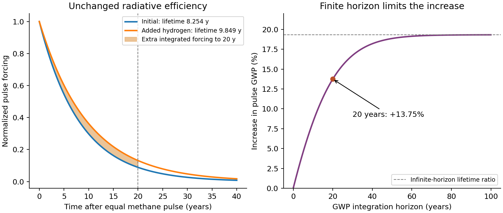

# Interdisciplinary paper IDP1

↑ **Parent:** [2021](../2021.md)

Original paper: [Released original PDF, physical pages 46–52; printed pages 1–7](https://www.whatdotheyknow.com/request/past_papers_for_natural_sciences/response/2258288/attach/2/FOI%202023%20126%20James%20materials%20bundle%203.pdf?cookie_passthrough=1#page=46).

**Table of contents**

- [1](#1)
  - [a](#1/a)
    - [i](#1/a/i)
      - [Solution](#1/a/i/solution)
    - [ii](#1/a/ii)
      - [Solution](#1/a/ii/solution)
    - [iii](#1/a/iii)
      - [Solution](#1/a/iii/solution)
  - [b](#1/b)
    - [Solution](#1/b/solution)
  - [c](#1/c)
    - [Solution](#1/c/solution)
  - [d](#1/d)
    - [i](#1/d/i)
      - [Solution](#1/d/i/solution)
    - [ii](#1/d/ii)
      - [Solution](#1/d/ii/solution)
    - [iii](#1/d/iii)
      - [Solution](#1/d/iii/solution)
  - [e](#1/e)
    - [Solution](#1/e/solution)
- [2](#2)
  - [a](#2/a)
    - [i](#2/a/i)
      - [Solution](#2/a/i/solution)
    - [ii](#2/a/ii)
      - [Solution](#2/a/ii/solution)
    - [iii](#2/a/iii)
      - [Solution](#2/a/iii/solution)
  - [b](#2/b)
    - [Solution](#2/b/solution)
  - [c](#2/c)
    - [Solution](#2/c/solution)
  - [d](#2/d)
    - [Solution](#2/d/solution)
  - [e](#2/e)
    - [Solution](#2/e/solution)
  - [f](#2/f)
    - [Solution](#2/f/solution)
- [3](#3)
  - [a](#3/a)
    - [i](#3/a/i)
      - [Solution](#3/a/i/solution)
    - [ii](#3/a/ii)
      - [Solution](#3/a/ii/solution)
    - [iii](#3/a/iii)
      - [Solution](#3/a/iii/solution)
  - [b](#3/b)
    - [i](#3/b/i)
      - [Solution](#3/b/i/solution)
    - [ii](#3/b/ii)
      - [Solution](#3/b/ii/solution)
    - [iii](#3/b/iii)
      - [Solution](#3/b/iii/solution)
    - [iv](#3/b/iv)
      - [Solution](#3/b/iv/solution)
    - [v](#3/b/v)
      - [Solution](#3/b/v/solution)
  - [c](#3/c)
    - [Solution](#3/c/solution)
  - [d](#3/d)
    - [i](#3/d/i)
      - [Solution](#3/d/i/solution)
    - [ii](#3/d/ii)
      - [Solution](#3/d/ii/solution)
  - [e](#3/e)
    - [1](#3/e/1)
      - [Solution](#3/e/1/solution)
    - [2](#3/e/2)
      - [Solution](#3/e/2/solution)
    - [3](#3/e/3)
      - [Solution](#3/e/3/solution)

## 1

↑ **Parent:** [Interdisciplinary paper IDP1](paper-id.md)

<h3 id="1/a">a</h3>

↑ **Parent:** [1](#1)

<h4 id="1/a/i">i</h4>

↑ **Parent:** [A](#1/a)

<h5 id="1/a/i/solution">Solution</h5>

↑ **Parent:** [I](#1/a/i)

Write $D=[\mathrm{Cl_2O_2}]$ and $c=[\mathrm{ClO}]$. In the [steady-state approximation](../../chemical-kinetics.md#steady-state-approximation) for the dimer, [chlorine peroxide](../../chemistry.md#chlorine-peroxide) [chlorine peroxide](../../chemistry.md#chlorine-peroxide) formation is balanced by its two competing removal channels:

$$
\frac{dD}{dt}=k_1[M]c^2-\{J_2+k_3[M]\}D\simeq0,
\qquad D=\frac{k_1[M]c^2}{J_2+k_3[M]}.
$$

The association event rate is $k_1[M]c^2$; the associated disappearance rate of [chlorine monoxide](../../chemistry.md#chlorine-monoxide) is twice that value. Each successful [photodissociation](../../chemical-bond.md#photodissociation) event produces two [chlorine](../../chemical-substance.md#chlorine) atoms after the subsequent fast fragmentation, and their return to [chlorine monoxide](../../chemistry.md#chlorine-monoxide) consumes two [ozone](../../chemical-substance.md#ozone) [molecules](../../molecule.md). [Thermal dissociation](../../chemical-reaction.md#thermal-dissociation) instead returns the dimer to two [chlorine monoxide](../../chemistry.md#chlorine-monoxide) [radicals](../../chemistry.md#radical-chemistry) without destroying [ozone](../../chemical-substance.md#ozone). Thus the [chemical branching fraction](../../chemical-kinetics.md#chemical-branching-fraction) for an ozone-destroying event is $f=J_2/(J_2+k_3[M])=0.7$, giving

$$
\boxed{-\frac{d[\mathrm O_3]}{dt}=2J_2D
=2f k_1[M][\mathrm{ClO}]^2=1.4k_1[M][\mathrm{ClO}]^2.}
$$

This is the sunlit [chlorine monoxide dimer cycle](../../chemistry.md#chlorine-monoxide-dimer-cycle), with net conversion $2\mathrm O_3\to3\mathrm O_2$. It assumes that the dimer relaxes rapidly, downstream fragmentation and [chlorine](../../chemical-substance.md#chlorine)–[ozone](../../chemical-substance.md#ozone) reactions are sufficiently fast, and competing [chlorine](../../chemical-substance.md#chlorine) sinks can be neglected. Counting the formation event twice and then multiplying by two again would overestimate loss by a factor of two.

<h4 id="1/a/ii">ii</h4>

↑ **Parent:** [A](#1/a)

<h5 id="1/a/ii/solution">Solution</h5>

↑ **Parent:** [Ii](#1/a/ii)

Low [temperature](../../temperature.md) favours association into the dimer and, especially, suppresses its thermally activated dissociation back to [chlorine monoxide](../../chemistry.md#chlorine-monoxide). More of the dimer can therefore follow [photodissociation](../../chemical-bond.md#photodissociation) instead of the chemically unproductive thermal return. The supplied branching fraction is a local condition, not a temperature-independent universal yield.

Cold polar air also permits [polar stratospheric clouds](../../planetary-science.md#polar-stratospheric-cloud) and efficient heterogeneous conversion of [chlorine](../../chemical-substance.md#chlorine) reservoirs into photolabile forms. The [stratospheric polar vortex](../../planetary-science.md#stratospheric-polar-vortex) isolates and cools that air. Darkness permits activation and storage, but **rapid catalytic [ozone](../../chemical-substance.md#ozone) loss requires the return of sunlight**. These chemical and meteorological conditions explain the springtime maximum; low [temperature](../../temperature.md) alone does not supply the [photodissociation](../../chemical-bond.md#photodissociation) photons.

<h4 id="1/a/iii">iii</h4>

↑ **Parent:** [A](#1/a)

<h5 id="1/a/iii/solution">Solution</h5>

↑ **Parent:** [Iii](#1/a/iii)

The two initial reservoirs each contain one [chlorine](../../chemical-substance.md#chlorine) atom, so complete activation supplies a total [chlorine](../../chemical-substance.md#chlorine) [mixing ratio](../../chemistry.md#atmospheric-mixing-ratio) of $2.2\times10^{-9}$. Under the specified approximation that active [chlorine](../../chemical-substance.md#chlorine) in sunlight is predominantly [chlorine monoxide](../../chemistry.md#chlorine-monoxide),

$$
[\mathrm{ClO}]=(2.2\times10^{-9})(1.2\times10^{18})
=2.64\times10^9\ \mathrm{molecules\,cm^{-3}}.
$$

The daytime loss is consequently

$$
L_d=1.4(9\times10^{-32})(1.2\times10^{18})(2.64\times10^9)^2
=\boxed{1.054\times10^6\ \mathrm{molecules\,cm^{-3}\,s^{-1}}.}
$$

For twelve sunlit hours per day, the daily [ozone](../../chemical-substance.md#ozone) decrement is

$$
\Delta x_{\mathrm O_3}=\frac{L_d(43200)}{1.2\times10^{18}}
=\boxed{3.794\times10^{-8}\ \mathrm{day^{-1}}
=37.94\ \mathrm{ppb\,day^{-1}}=0.03794\ \mathrm{ppm\,day^{-1}}.}
$$

The full-day mean [concentration](../../mathematical-physics.md#concentration) loss is $5.269\times10^5\ \mathrm{molecules\,cm^{-3}\,s^{-1}}$. Maintaining that rate would consume the initial [ozone](../../chemical-substance.md#ozone) in about $79.1$ days. This is a fixed-active-chlorine estimate: reservoir reformation, transport and [chlorine](../../chemical-substance.md#chlorine) partitioning change during a real depletion event, and the approximation fails when insufficient [ozone](../../chemical-substance.md#ozone) remains to recycle [chlorine](../../chemical-substance.md#chlorine) rapidly.

<h3 id="1/b">b</h3>

↑ **Parent:** [1](#1)

<h4 id="1/b/solution">Solution</h4>

↑ **Parent:** [B](#1/b)

The initial [ozone](../../chemical-substance.md#ozone) [concentration](../../mathematical-physics.md#concentration) is $(3\times10^{-6})[M]=3.60\times10^{12}\ \mathrm{molecules\,cm^{-3}}$. Over fifty days with twelve active hours per day, the required combined daytime rate is

$$
L_{\rm req}=\frac{3.60\times10^{12}}{50(43200)}
=1.667\times10^6\ \mathrm{molecules\,cm^{-3}\,s^{-1}}.
$$

The [mixed chlorine-bromine ozone-loss cycle](../../chemistry.md#mixed-chlorine-bromine-ozone-loss-cycle) also consumes two [ozone](../../chemical-substance.md#ozone) [molecules](../../molecule.md) per radical-pair reaction, so $L_{\rm Br}=2k_6[\mathrm{ClO}][\mathrm{BrO}]$. Subtracting the dimer contribution yields

$$
[\mathrm{BrO}]=\frac{L_{\rm req}-L_d}{2k_6[\mathrm{ClO}]}
=1.935\times10^7\ \mathrm{molecules\,cm^{-3}},
\qquad
\boxed{x_{\rm BrO}=1.612\times10^{-11}=16.1\ \mathrm{ppt}.}
$$

The same result follows by assigning the dimer $1.897$ ppm of the fifty-day loss and the mixed cycle the remaining $1.103$ ppm. This uses the same daylight fraction for both cycles and retains the earlier fixed-ClO approximation. It estimates a sunlit [BrO](../../chemistry.md#bromine-monoxide) abundance, not the total inventory of [bromine](../../chemical-substance.md#bromine) in all reservoirs.

<h3 id="1/c">c</h3>

↑ **Parent:** [1](#1)

<h4 id="1/c/solution">Solution</h4>

↑ **Parent:** [C](#1/c)

Under the proposed steady balance,

$$
k_9[\mathrm{Cl}][\mathrm{CH_4}]=k_{10}[\mathrm{OH}][\mathrm{HCl}],
\qquad
[\mathrm{OH}]=\frac{k_9[\mathrm{Cl}]x_{\mathrm{CH_4}}}{k_{10}x_{\mathrm{HCl}}}.
$$

The air [number density](../../statistical-physics.md#number-density) cancels from the ratio. Therefore

$$
\boxed{[\mathrm{OH}]=\frac{(10^{-14})(1.2\times10^5)(0.6\times10^{-6})}
{(4.5\times10^{-13})(1.1\times10^{-9})}
=1.45\times10^6\ \mathrm{molecules\,cm^{-3}}.}
$$

The [reservoir relaxation test for a chemical steady state](../../chemical-kinetics.md#reservoir-relaxation-test-for-a-chemical-steady-state) gives a [hydrogen chloride](../../electronegativity.md#hydrogen-chloride) relaxation time of $1/(k_{10}[\mathrm{OH}])=1.53\times10^6\ \mathrm s\simeq17.7$ days. [Hydrogen chloride](../../electronegativity.md#hydrogen-chloride) is a reservoir rather than a rapidly equilibrating [radical](../../chemistry.md#radical-chemistry). A steady state is plausible only if [chlorine](../../chemical-substance.md#chlorine) abundance, [methane](../../chemical-substance.md#methane), [hydroxyl radical](../../chemistry.md#hydroxyl-radical) and transport vary slowly compared with several weeks. **It is doubtful during rapid vortex breakdown and reservoir reformation**, precisely when production and mixing are changing. The numerical [hydroxyl radical](../../chemistry.md#hydroxyl-radical) value is conditional on the steady-state hypothesis, not an independent measurement of [hydroxyl radical](../../chemistry.md#hydroxyl-radical).

<h3 id="1/d">d</h3>

↑ **Parent:** [1](#1)

<h4 id="1/d/i">i</h4>

↑ **Parent:** [D](#1/d)

<h5 id="1/d/i/solution">Solution</h5>

↑ **Parent:** [I](#1/d/i)

Cooling can increase springtime [ozone](../../chemical-substance.md#ozone) destruction by extending cold conditions favourable for [polar stratospheric clouds](../../planetary-science.md#polar-stratospheric-cloud), [stratospheric chlorine activation](../../planetary-science.md#stratospheric-chlorine-activation) and dimer stability. Removal of reactive nitrogen into settling particles can delay [chlorine nitrate](../../chemistry.md#chlorine-nitrate) reformation. With sunlight and substantial available [chlorine](../../chemical-substance.md#chlorine), the active period can become longer or stronger. Vortex breakup, transport and the declining halogen inventory also matter, so a colder year does not determine the [ozone](../../chemical-substance.md#ozone) loss by [temperature](../../temperature.md) alone.

<h4 id="1/d/ii">ii</h4>

↑ **Parent:** [D](#1/d)

<h5 id="1/d/ii/solution">Solution</h5>

↑ **Parent:** [Ii](#1/d/ii)

Outside the cold polar activation regime, cooling generally slows temperature-activated gas-phase [ozone](../../chemical-substance.md#ozone) destruction and can increase [ozone](../../chemical-substance.md#ozone) if other conditions are held fixed. This is a weaker, less universal conclusion in the lower [stratosphere](../../planetary-science.md#stratosphere) because transport and imported [ozone](../../chemical-substance.md#ozone) are important. Enhanced sulfate-surface activation or unusually cold cloud-forming air can instead activate [chlorine](../../chemical-substance.md#chlorine) and reverse the purely gas-phase tendency. **Distinguish a local chemical cooling effect from the dynamical response of the midlatitude [ozone-column photolysis shielding](../../chemical-bond.md#ozone-column-photolysis-shielding).**

<h4 id="1/d/iii">iii</h4>

↑ **Parent:** [D](#1/d)

<h5 id="1/d/iii/solution">Solution</h5>

↑ **Parent:** [Iii](#1/d/iii)

In the upper [stratosphere](../../planetary-science.md#stratosphere), cooling slows temperature-dependent odd-oxygen destruction, including $\mathrm O+\mathrm O_3\to2\mathrm O_2$ and important catalytic reactions. With photochemical production otherwise fixed, the local steady [ozone](../../chemical-substance.md#ozone) abundance tends to rise. This chemical response is one reason increasing [carbon dioxide](../../chemical-substance.md#carbon-dioxide) can enhance upper-stratospheric [ozone](../../chemical-substance.md#ozone) while cooling that region. It is compatible with enhanced chemical depletion in cold activated polar air; the controlling regimes differ.[Future ozone changes and Ozone, climate, and circulation: upper-stratospheric cooling, polar cloud formation and circulation are distinct drivers](../../chemistry.md#scientific-assessment-of-ozone-depletion-2022-executive-summary)

<h3 id="1/e">e</h3>

↑ **Parent:** [1](#1)

<h4 id="1/e/solution">Solution</h4>

↑ **Parent:** [E](#1/e)

For [fluorine](../../chemical-substance.md#fluorine), the key is **chemical sequestration**, not an inability of free F to react. [Fluorine](../../chemical-substance.md#fluorine) atoms readily form very stable [hydrogen fluoride](../../electronegativity.md#hydrogen-fluoride) through reaction with hydrogen-containing gases. Breaking [hydrogen fluoride](../../electronegativity.md#hydrogen-fluoride) or regenerating a sustained free-fluorine [radical](../../chemistry.md#radical-chemistry) population under ordinary stratospheric conditions is difficult, so an efficient analogous catalytic family is not maintained.

For [iodine](../../chemical-substance.md#iodine), the traditional approximation is **limited delivery to the [stratosphere](../../planetary-science.md#stratosphere)**. Many [iodine](../../chemical-substance.md#iodine) source gases are short lived in the [troposphere](../../planetary-science.md#troposphere), and their reactive products are efficiently taken up or removed before slow large-scale ascent. This historically motivated omitting [iodine](../../chemical-substance.md#iodine) from the major stratospheric [chlorine](../../chemical-substance.md#chlorine)/[bromine](../../chemical-substance.md#bromine) budget. It does not establish that [iodine](../../chemical-substance.md#iodine) atoms are intrinsically ineffective catalysts, or that stratospheric [iodine](../../chemical-substance.md#iodine) is exactly zero.

Indeed, the blanket omission needs qualification even for this exam's date. Aircraft observations published in 2020 detected both [IO](../../chemistry.md#iodine-monoxide) and particulate [iodine](../../chemical-substance.md#iodine) in stratospheric air and inferred continuing multiphase recycling and [ozone](../../chemical-substance.md#ozone) loss. Gas/particle partitioning and measurement sensitivity must be considered together; a small gas-phase [concentration](../../mathematical-physics.md#concentration) alone can miss an active reservoir. Thus the traditional supply argument is the intended contrast with [fluorine](../../chemical-substance.md#fluorine)'s stable-HF sink, but **zero stratospheric [iodine](../../chemical-substance.md#iodine) chemistry is not supported by those observations**.[PNAS 117 (2020), pp. 1860–1866, Abstract and Significance: aircraft IO/particulate-iodine measurements and nonzero stratospheric injection](../../chemistry.md#quantitative-detection-of-iodine-in-the-stratosphere-by-theodore-k-koenig-and-others)

## 2

↑ **Parent:** [Interdisciplinary paper IDP1](paper-id.md)

<h3 id="2/a">a</h3>

↑ **Parent:** [2](#2)

<h4 id="2/a/i">i</h4>

↑ **Parent:** [A](#2/a)

<h5 id="2/a/i/solution">Solution</h5>

↑ **Parent:** [I](#2/a/i)

[Methane](../../chemical-substance.md#methane) consumes [hydroxyl radicals](../../chemistry.md#hydroxyl-radical) during its initial [oxidation](../../chemical-reaction.md#oxidation) and therefore influences atmospheric oxidative capacity and the removal of other trace gases. Subsequent [oxidation](../../chemical-reaction.md#oxidation) generates [peroxy radicals](../../chemistry.md#peroxy-radical). In the presence of sufficient [nitrogen monoxide](../../chemistry.md#nitrogen-monoxide), these convert [nitrogen monoxide](../../chemistry.md#nitrogen-monoxide) to [nitrogen dioxide](../../chemistry.md#nitrogen-dioxide) without consuming [ozone](../../chemical-substance.md#ozone), allowing net [photochemical ozone production](../../chemical-substance.md#photochemical-ozone-production). At low [nitrogen monoxide](../../chemistry.md#nitrogen-monoxide), peroxide formation and ozone-destroying [radical](../../chemistry.md#radical-chemistry) reactions compete. [Methane](../../chemical-substance.md#methane) [oxidation](../../chemical-reaction.md#oxidation) ultimately produces [carbon monoxide](../../chemical-substance.md#carbon-monoxide) and [carbon dioxide](../../chemical-substance.md#carbon-dioxide); the sign and rate of the associated [ozone](../../chemical-substance.md#ozone) response depend on the [radical](../../chemistry.md#radical-chemistry)/[nitrogen oxides](../../chemistry.md#nitrogen-oxides) regime, not [methane](../../chemical-substance.md#methane) alone.

<h4 id="2/a/ii">ii</h4>

↑ **Parent:** [A](#2/a)

<h5 id="2/a/ii/solution">Solution</h5>

↑ **Parent:** [Ii](#2/a/ii)

[Methane](../../chemical-substance.md#methane) reaching the [stratosphere](../../planetary-science.md#stratosphere) is oxidized and is an important source of stratospheric [water vapor](../../chemical-substance.md#water-vapor). That [water](../../chemical-substance.md#water) can feed [HOx radical family](../../chemistry.md#hox-radical-family) chemistry and alter [radiative cooling](../../heat.md#radiative-cooling) and polar-cloud conditions. [Methane](../../chemical-substance.md#methane) also converts [chlorine](../../chemical-substance.md#chlorine) atoms into [hydrogen chloride](../../electronegativity.md#hydrogen-chloride), opposing some chlorine-driven [ozone](../../chemical-substance.md#ozone) loss. These effects compete: increasing [methane](../../chemical-substance.md#methane) does not have one universal [ozone](../../chemical-substance.md#ozone) sign at every altitude and latitude.

<h4 id="2/a/iii">iii</h4>

↑ **Parent:** [A](#2/a)

<h5 id="2/a/iii/solution">Solution</h5>

↑ **Parent:** [Iii](#2/a/iii)

[Methane](../../chemical-substance.md#methane) is an infrared-active [greenhouse gas](../../exoplanet.md#greenhouse-gas) with absorption in the terrestrial thermal spectrum. Its direct forcing is supplemented by chemically induced changes in [tropospheric ozone](../../chemical-substance.md#tropospheric-ozone) and stratospheric [water vapor](../../chemical-substance.md#water-vapor). Its finite [atmospheric lifetime](../../chemistry.md#atmospheric-lifetime) makes sustained emissions and emission pulses different experiments: stopping emissions permits the [methane](../../chemical-substance.md#methane) burden to decline much faster than the long tail of a carbon-dioxide perturbation. Quantitative comparisons require a specified emission [mass](../../classical-mechanics.md#mass), time horizon and treatment of indirect effects, as formalized by [global warming potential](../../exoplanet.md#global-warming-potential).

<h3 id="2/b">b</h3>

↑ **Parent:** [2](#2)

<h4 id="2/b/solution">Solution</h4>

↑ **Parent:** [B](#2/b)

A [humidity](../../physiology.md#humidity) assumption is necessary: warming does not by itself specify how much [water](../../chemical-substance.md#water) is available. At fixed [relative humidity](../../physiology.md#relative-humidity), the [Clausius-Clapeyron equation](../../thermodynamic-potential.md#clausius-clapeyron-relation) gives the first-order [vapor pressure](../../thermodynamic-potential.md#vapor-pressure) response

$$
\Delta\ln e_s\simeq\frac{45050}{8.314(285)^2}(4)=0.2668.
$$

If [water](../../chemical-substance.md#water) abundance is approximated as proportional to $e_s$, the usual first-order estimate is **a $26.7\%$ increase in [hydroxyl radical](../../chemistry.md#hydroxyl-radical) production**. Integrating the constant-latent-heat expression instead of linearizing gives $e_s(289)/e_s(285)=\exp[(45050/8.314)(1/285-1/289)]=1.3010$.

There is a small but explicit [concentration](../../mathematical-physics.md#concentration) correction when the square brackets are literal [molecules](../../molecule.md) per volume. Since $[\mathrm H_2\mathrm O]=\phi e_s/(k_BT)$ and $P_{\rm OH}=2k[\mathrm O({}^1D)][\mathrm H_2\mathrm O]$,

$$
\boxed{\frac{\Delta P_{\rm OH}}{P_{\rm OH}}
\simeq\left(\frac{\Delta H_{\rm vap}}{RT^2}-\frac1T\right)\Delta T
=0.2528\quad\text{at fixed relative humidity}.}
$$

The corresponding finite-change [concentration](../../mathematical-physics.md#concentration) result is $(285/289)(1.3010)-1=0.2830$. The $25.3\%$ linear [concentration](../../mathematical-physics.md#concentration) estimate and the $26.7\%$ [vapor pressure](../../thermodynamic-potential.md#vapor-pressure) approximation express different stated approximations; neither follows without a [humidity](../../physiology.md#humidity) condition.

Extra [water](../../chemical-substance.md#water) increases the fraction of [oxygen singlet D atoms](../../chemical-substance.md#oxygen-singlet-d-atom) reacting to form [hydroxyl radicals](../../chemistry.md#hydroxyl-radical) rather than being collisionally quenched and recycled into [ozone](../../chemical-substance.md#ozone). In clean, low-[nitrogen oxides](../../chemistry.md#nitrogen-oxides) air this tends to increase [ozone](../../chemical-substance.md#ozone) loss. In [nitrogen oxides](../../chemistry.md#nitrogen-oxides)-rich air, increased [hydroxyl radical](../../chemistry.md#hydroxyl-radical) can accelerate precursor [oxidation](../../chemical-reaction.md#oxidation) and [ozone](../../chemical-substance.md#ozone) production, while [radical termination](../../chemistry.md#radical-termination) also changes. **Greater [hydroxyl radical](../../chemistry.md#hydroxyl-radical) production therefore does not imply a universally positive or negative [ozone](../../chemical-substance.md#ozone) response.**

<h3 id="2/c">c</h3>

↑ **Parent:** [2](#2)

<h4 id="2/c/solution">Solution</h4>

↑ **Parent:** [C](#2/c)

The lost [ozone-column photolysis shielding](../../chemical-bond.md#ozone-column-photolysis-shielding) is $\Delta N=20(2.69\times10^{16})=5.38\times10^{17}\ \mathrm{molecules\,cm^{-2}}$, so its optical-depth decrement is $\sigma\Delta N=0.0538$. Under the stipulated effective-cross-section Beer-Lambert model, the transmitted [photodissociation](../../chemical-bond.md#photodissociation) flux increases by $\exp(0.0538)$.

The short-lived [oxygen singlet D atom](../../chemical-substance.md#oxygen-singlet-d-atom) satisfies $[\mathrm O({}^1D)]\simeq J_{\mathrm O_3}[\mathrm O_3]/(k_q[M])$ when quenching dominates. At fixed local [ozone](../../chemical-substance.md#ozone), [water](../../chemical-substance.md#water) and air density, [hydroxyl radical](../../chemistry.md#hydroxyl-radical) production is proportional to $J_{\mathrm O_3}$. Consequently

$$
\boxed{\frac{P'_{\rm OH}-P_{\rm OH}}{P_{\rm OH}}
=e^{0.0538}-1=0.0553,\quad\text{a }5.53\%\text{ increase}.}
$$

A linear optical-depth approximation would give $5.38\%$. A realistic calculation integrates the wavelength-dependent [absorption cross section](../../quantum-mechanics.md#absorption-cross-section), [quantum yield](../../chemical-bond.md#quantum-yield) and [actinic flux](../../radiometry.md#actinic-flux); [clouds](../../geophysics.md#cloud) and multiple scattering modify the simple transmitted-beam model.

[Ozone](../../chemical-substance.md#ozone) change can also alter the radiative [temperature](../../temperature.md) structure, [water vapor](../../chemical-substance.md#water-vapor) and circulation, thereby changing the [water](../../chemical-substance.md#water) reaction channel and the supply of [ozone](../../chemical-substance.md#ozone)/precursors to the [troposphere](../../planetary-science.md#troposphere). If the held-fixed [tropospheric ozone](../../chemical-substance.md#tropospheric-ozone) assumption is relaxed, altered [ozone](../../chemical-substance.md#ozone) itself changes the photochemical source of [oxygen singlet D atom](../../chemical-substance.md#oxygen-singlet-d-atom). These are additional feedbacks, distinct from the isolated UV-transmission calculation above.

<h3 id="2/d">d</h3>

↑ **Parent:** [2](#2)

<h4 id="2/d/solution">Solution</h4>

↑ **Parent:** [D](#2/d)

For the [tropospheric OH budget](../../chemistry.md#tropospheric-oh-budget), let $P$ be [hydroxyl radical](../../chemistry.md#hydroxyl-radical) production per unit volume and $K$ its total first-order loss frequency. The present [hydroxyl radical](../../chemistry.md#hydroxyl-radical) steady state has

$$
P=\frac{10^{-6}(2.5\times10^{19})}{1\ \mathrm{yr}}
=7.922\times10^5\ \mathrm{molecules\,cm^{-3}\,s^{-1}},
\qquad[\mathrm{OH}]_0=\frac P{1.3}=6.094\times10^5\ \mathrm{molecules\,cm^{-3}}.
$$

Here one year is $365.25$ days; using it consistently makes the reported lifetimes in years independent of that conversion convention. [Methane](../../chemical-substance.md#methane)'s chemical lifetime is $\tau_0=1/(k_2[\mathrm{OH}]_0)$, giving

$$
\boxed{\tau_0=8.254\ \mathrm{yr}.}
$$

The current combined loss frequency already includes existing hydrogen, so **add only the incremental hydrogen sink**:

$$
\Delta K=k_1(2.0-0.5)10^{-6}[M]=0.25125\ \mathrm{s^{-1}},
\qquad K_1=1.55125\ \mathrm{s^{-1}}.
$$

Holding production and the other losses fixed then gives $[\mathrm{OH}]_1=5.107\times10^5\ \mathrm{molecules\,cm^{-3}}$ and

$$
\boxed{\tau_1=9.849\ \mathrm{yr},\qquad\tau_1/\tau_0=1.19327.}
$$

The rapid [hydroxyl radical](../../chemistry.md#hydroxyl-radical) adjustment time, $1/K$ of order a second, supports its [steady-state approximation](../../chemical-kinetics.md#steady-state-approximation) in this box model. Subsequent [methane](../../chemical-substance.md#methane) growth would itself change [hydroxyl radical](../../chemistry.md#hydroxyl-radical) consumption, so the computed increase is not a fully coupled long-term atmospheric prediction. Detailed [molecular hydrogen](../../chemical-substance.md#molecular-hydrogen) modelling treats changes in [methane](../../chemical-substance.md#methane), [ozone](../../chemical-substance.md#ozone) and stratospheric [water](../../chemical-substance.md#water) alongside reductions in other precursor emissions.[Atmospheric Chemistry and Physics 23 (2023), §3.1 and Abstract: indirect methane, ozone and water-vapor responses](../../chemistry.md#atmospheric-composition-and-climate-impacts-of-a-future-hydrogen-economy-by-nicola-j-warwick-and-others)

<h3 id="2/e">e</h3>

↑ **Parent:** [2](#2)

<h4 id="2/e/solution">Solution</h4>

↑ **Parent:** [E](#2/e)

The [finite-horizon GWP lifetime sensitivity](../../exoplanet.md#finite-horizon-gwp-lifetime-sensitivity) follows because a longer lifetime leaves more [methane](../../chemical-substance.md#methane) from a given pulse at later times and raises the steady burden for a given constant emission rate. For the stipulated exponential pulse response and unchanged [greenhouse gas radiative efficiency](../../exoplanet.md#greenhouse-gas-radiative-efficiency), the integrated [methane](../../chemical-substance.md#methane) forcing over horizon $H$ is proportional to $\tau(1-e^{-H/\tau})$. The same [carbon dioxide](../../chemical-substance.md#carbon-dioxide) reference pulse appears in both [global warming potential](../../exoplanet.md#global-warming-potential) denominators, so it cancels from their ratio:

$$
\frac{\mathrm{GWP}_{20,1}}{\mathrm{GWP}_{20,0}}
=\frac{9.8492(1-e^{-20/9.8492})}{8.2540(1-e^{-20/8.2540})}
=1.13748.
$$

Thus **the twenty-year GWP increases by $13.75\%$** under these fixed-efficiency assumptions. This is smaller than the $19.33\%$ lifetime increase because part of the extra forcing occurs beyond the finite horizon. For an infinite horizon the fractional increase would approach the lifetime ratio. Indirect forcing and the distinction between a chemical lifetime and a [hydroxyl radical](../../chemistry.md#hydroxyl-radical)-coupled [methane perturbation lifetime](../../chemistry.md#methane-perturbation-lifetime) require a fuller chemical model; they are held fixed in this comparison.

**[Figure 1](#2/e/image-original-exponential-methane-pulse-responses-and-finite-horizon-gwp-sensitivity). Original exponential methane-pulse responses and finite-horizon GWP sensitivity**.

<h3 id="2/f">f</h3>

↑ **Parent:** [2](#2)

<h4 id="2/f/solution">Solution</h4>

↑ **Parent:** [F](#2/f)

Lower [carbon monoxide](../../chemical-substance.md#carbon-monoxide) and [VOC](../../chemistry.md#volatile-organic-compound) emissions generally reduce the supply of [peroxy radicals](../../chemistry.md#peroxy-radical) from their [oxidation](../../chemical-reaction.md#oxidation) and therefore reduce [photochemical ozone production](../../chemical-substance.md#photochemical-ozone-production) where [nitrogen monoxide](../../chemistry.md#nitrogen-monoxide) is available. Lower [nitrogen oxides](../../chemistry.md#nitrogen-oxides) abundance suppresses the [nitrogen monoxide](../../chemistry.md#nitrogen-monoxide)-to-[nitrogen dioxide](../../chemistry.md#nitrogen-dioxide) pathway in [NOx-limited ozone production](../../chemical-substance.md#nox-limited-ozone-production) regions. These are reasons for a regional/background [ozone](../../chemical-substance.md#ozone) decrease when fossil-fuel precursor emissions decline.

The response can have the opposite local sign in a [nitrogen monoxide](../../chemistry.md#nitrogen-monoxide)-rich urban core: reducing [nitrogen monoxide](../../chemistry.md#nitrogen-monoxide) weakens [ozone titration](../../chemical-substance.md#ozone-titration), and reducing [nitrogen oxides](../../chemistry.md#nitrogen-oxides) in a [VOC-limited ozone production](../../chemical-substance.md#voc-limited-ozone-production) regime can initially lessen [radical termination](../../chemistry.md#radical-termination) and raise [ozone](../../chemical-substance.md#ozone). Less [carbon monoxide](../../chemical-substance.md#carbon-monoxide) can also leave more [hydroxyl radical](../../chemistry.md#hydroxyl-radical) available to remove [methane](../../chemical-substance.md#methane), partly opposing the [hydroxyl radical](../../chemistry.md#hydroxyl-radical) demand from leaked hydrogen. Changes in precursor transport, chemistry and sunlight matter. **Reduced emissions usually reduce net regional [ozone](../../chemical-substance.md#ozone) production, but do not guarantee a lower [ozone](../../chemical-substance.md#ozone) [concentration](../../mathematical-physics.md#concentration) at every monitoring site.**

## 3

↑ **Parent:** [Interdisciplinary paper IDP1](paper-id.md)

<h3 id="3/a">a</h3>

↑ **Parent:** [3](#3)

<h4 id="3/a/i">i</h4>

↑ **Parent:** [A](#3/a)

<h5 id="3/a/i/solution">Solution</h5>

↑ **Parent:** [I](#3/a/i)

Absorption depends on an allowed transition with a nonzero [transition dipole moment](../../quantum-mechanics.md#electric-dipole-transition-moment) and appreciable line strength at [wavelengths](../../wave-equation.md#wavelength) carrying terrestrial [thermal radiation](../../electromagnetic-radiation.md#thermal-radiation). [Molecular vibration](../../molecule.md#molecular-vibration) and [molecular rotation](../../molecule.md#molecular-rotation), level populations and [pressure](../../pressure.md)/temperature-dependent line shapes determine the spectrum. A band in an [atmospheric window](../../optics.md#atmospheric-window) can be more effective incrementally than one already strongly absorbed by [water](../../chemical-substance.md#water) or [carbon dioxide](../../chemical-substance.md#carbon-dioxide). Symmetry can make a vibration [infrared](../../optics.md#infrared) inactive even when the [molecule](../../molecule.md) has many [normal modes](../../wave-equation.md#normal-mode). [Atmospheric lifetime](../../chemistry.md#atmospheric-lifetime) affects the persistence of a released gas, **not the intrinsic absorption strength of one [molecule](../../molecule.md)**.

<h4 id="3/a/ii">ii</h4>

↑ **Parent:** [A](#3/a)

<h5 id="3/a/ii/solution">Solution</h5>

↑ **Parent:** [Ii](#3/a/ii)

The size parameter $x=2\pi r/\lambda$, [complex refractive index](../../electromagnetic-wave.md#complex-refractive-index) and particle shape determine scattering strength and direction. In the small-sphere [Rayleigh scattering](../../electromagnetic-radiation.md#rayleigh-scattering) regime, [scattering cross-section](../../quantum-scattering.md#scattering-cross-section) scales as $r^6\lambda^{-4}|(m^2-1)/(m^2+2)|^2$; the [Mie scattering](../../electromagnetic-radiation.md#mie-scattering) regime is needed when particle size approaches the [wavelength](../../wave-equation.md#wavelength). Particle [number density](../../statistical-physics.md#number-density) and [particle size distribution](../../mixture.md#particle-size-distribution), [aerosol hygroscopicity](../../chemistry.md#aerosol-hygroscopicity) and the angular fraction returned to space control an ensemble's radiative effect. High scattering does not imply strong cooling if most light is scattered forward or the particle also absorbs strongly; [single-scattering albedo](../../astrophysics.md#single-scattering-albedo) distinguishes scattering from absorption.

<h4 id="3/a/iii">iii</h4>

↑ **Parent:** [A](#3/a)

<h5 id="3/a/iii/solution">Solution</h5>

↑ **Parent:** [Iii](#3/a/iii)

[Carbon dioxide](../../chemical-substance.md#carbon-dioxide) is relatively well mixed, its abundance is measured accurately, and its spectroscopy and large-scale radiative effect are well constrained. [Aerosols](../../chemistry.md#aerosol) are short lived and spatially heterogeneous; uncertain emissions, removal, size, composition, [water](../../chemical-substance.md#water) uptake and height change both scattering and absorption. Their [aerosol-cloud interaction](../../chemistry.md#aerosol-cloud-interaction) effects and subsequent [cloud](../../geophysics.md#cloud) adjustments add uncertainty, and the unobserved preindustrial [aerosol](../../chemistry.md#aerosol) baseline complicates anthropogenic attribution. Thus total [aerosol](../../chemistry.md#aerosol) forcing combines poorly constrained physical pathways and a less certain counterfactual, rather than simply an uncertain molecular absorption coefficient.[IPCC AR6 WGI Chapter 7 (2021), §§7.3.2–7.3.3: greenhouse-gas and aerosol effective radiative forcing](../../chemistry.md#the-earth’s-energy-budget-climate-feedbacks-and-climate-sensitivity-by-piers-forster-and-others)

<h3 id="3/b">b</h3>

↑ **Parent:** [3](#3)

<h4 id="3/b/i">i</h4>

↑ **Parent:** [B](#3/b)

<h5 id="3/b/i/solution">Solution</h5>

↑ **Parent:** [I](#3/b/i)

Injected [sulfur dioxide](../../chemical-substance.md#sulfur-dioxide) is oxidized, principally through [hydroxyl radical](../../chemistry.md#hydroxyl-radical) chemistry, to [sulfuric acid](../../chemical-substance.md#sulfuric-acid), which nucleates or condenses into aqueous [sulfate](../../chemistry.md#sulfate) particles. A suitably sized, weakly absorbing particle population scatters some incoming sunlight back to space, increasing planetary [albedo](../../geophysics.md#albedo) and decreasing absorbed solar energy. The [sulfur dioxide](../../chemical-substance.md#sulfur-dioxide) [molecules](../../molecule.md) are precursors, not the persistent reflective population.

The [albedo](../../geophysics.md#albedo) lifetime reflects [aerosol](../../chemistry.md#aerosol) formation, growth/[aerosol coagulation](../../chemistry.md#aerosol-coagulation), [sedimentation](../../suspension-chemistry.md#sedimentation), stratospheric transport and eventual return to efficiently scavenged tropospheric air. The [stratosphere](../../planetary-science.md#stratosphere) has little [atmospheric precipitation](../../geophysics.md#atmospheric-precipitation), so the effect can outlast analogous tropospheric [aerosol](../../chemistry.md#aerosol). The assumed year is an effective persistence scale, not a universal lifetime of [sulfur dioxide](../../chemical-substance.md#sulfur-dioxide) [oxidation](../../chemical-reaction.md#oxidation) or an exact clock for every particle.

<h4 id="3/b/ii">ii</h4>

↑ **Parent:** [B](#3/b)

<h5 id="3/b/ii/solution">Solution</h5>

↑ **Parent:** [Ii](#3/b/ii)

For the [albedo-to-forcing conversion](../../geophysics.md#albedo-to-forcing-conversion), Earth intercepts sunlight over a disk but distributes the global mean over its full sphere, giving incident mean flux $S_0/4$. The absorbed shortwave flux is $F_{\rm abs}=(1-A)S_0/4$, and hence

$$
\boxed{\Delta F_{\rm abs}=-\frac{1370}{4}(4\times10^{-8})
=-1.37\times10^{-5}\ \mathrm{W\,m^{-2}}.}
$$

The cooling magnitude is $1.37\times10^{-5}\ \mathrm{W\,m^{-2}}$ for the assumed one-year effect of one [mass](../../classical-mechanics.md#mass) unit of injection. [Albedo](../../geophysics.md#albedo) does not change the sunlight incident at the top of the atmosphere; it changes the absorbed/net incoming flux. The minus sign therefore accompanies the [radiative cooling](../../heat.md#radiative-cooling).

<h4 id="3/b/iii">iii</h4>

↑ **Parent:** [B](#3/b)

<h5 id="3/b/iii/solution">Solution</h5>

↑ **Parent:** [Iii](#3/b/iii)

For the first year's increase, the forcing increment is

$$
\Delta F_1=5.4\ln\!\left(\frac{417.5}{415}\right)
=0.0324325\ \mathrm{W\,m^{-2}}.
$$

Using linear superposition of the supplied one-year [aerosol](../../chemistry.md#aerosol) calibration,

$$
\boxed{m_1=\frac{0.0324325}{1.37\times10^{-5}}
=2.367\times10^3\ \mathrm{tons\ of\ SO_2}.}
$$

This compensates the year-end forcing increment for a one-year [aerosol](../../chemistry.md#aerosol) effect. It is not a one-time permanent cancellation of the continuing carbon-dioxide increase. Treating the rising [carbon dioxide](../../chemical-substance.md#carbon-dioxide) [concentration](../../mathematical-physics.md#concentration) as a uniform-in-time forcing during that first year would be an additional time-averaging model, rather than the end-of-year comparison used here.

<h4 id="3/b/iv">iv</h4>

↑ **Parent:** [B](#3/b)

<h5 id="3/b/iv/solution">Solution</h5>

↑ **Parent:** [Iv](#3/b/iv)

If “steady [temperature](../../temperature.md) in 2050” means preventing the next annual increase relative to the climate at the delayed start, the relevant forcing increment is

$$
\Delta F_{2050}=5.4\ln(502.5/500)=0.0269327\ \mathrm{W\,m^{-2}},
\qquad
\boxed{m_{2050,\rm increment}=1.966\times10^3\ \mathrm{tons\ of\ SO_2}.}
$$

Its smaller value follows from $dF/dC=5.4/C$: the same additional ppm gives less incremental forcing at a higher baseline.

That interpretation must be separated from the earlier objective of holding [temperature](../../temperature.md) at the original reference climate. To cancel the accumulated increase from $415$ to $500$ ppm requires

$$
\Delta F_{\rm accumulated}=5.4\ln(500/415)=1.00618\ \mathrm{W\,m^{-2}},
\qquad
\boxed{m_{2050,\rm original\ reference}=7.344\times10^4\ \mathrm{tons\ of\ SO_2}.}
$$

This [annual versus accumulated radiative forcing](../../geophysics.md#annual-versus-accumulated-radiative-forcing) distinction is essential: the first box offsets just the further year's growth; the second is the equivalent one-year [aerosol](../../chemistry.md#aerosol) inventory needed for the accumulated forcing. In subsequent years that inventory must be replaced as particles disappear and increased as [carbon dioxide](../../chemical-substance.md#carbon-dioxide) rises. A delayed start does not erase the earlier warming merely because the annual incremental requirement is smaller.

**[Figure 2](#3/b/iv/image-original-comparison-of-annual-and-accumulated-forcing-and-their-distinct-so2-compensation-masses). Original comparison of annual and accumulated forcing and their distinct SO2 compensation masses**.

<h4 id="3/b/v">v</h4>

↑ **Parent:** [B](#3/b)

<h5 id="3/b/v/solution">Solution</h5>

↑ **Parent:** [V](#3/b/v)

The logarithmic forcing relation implies decreasing incremental forcing per additional ppm, explaining the two annual-increment results. It does not imply that a higher total [carbon dioxide](../../chemical-substance.md#carbon-dioxide) burden requires less compensation relative to a fixed original climate. The chosen reference and whether an end-of-year, mean-year or steady maintained [aerosol](../../chemistry.md#aerosol) burden is intended must remain explicit.

The numerical [mass](../../classical-mechanics.md#mass) estimates use an unusually simple, stipulated constant albedo-per-mass calibration. Real particle size and lifetime change with loading, [aerosol coagulation](../../chemistry.md#aerosol-coagulation), injection altitude/latitude and circulation. [Sulfate](../../chemistry.md#sulfate) absorbs radiation as well as scattering it and changes stratospheric chemistry. A global-mean shortwave/longwave [radiative forcing](../../geophysics.md#radiative-forcing) balance also need not reproduce regional [temperature](../../temperature.md), rainfall or transient ocean heat uptake; it does not undo CO2-driven acidification. Chemistry–climate simulations explicitly resolve some of these competing aerosol-size, [temperature](../../temperature.md) and [ozone](../../chemical-substance.md#ozone) effects.[Environmental Research Letters 4 (2009), 045108, Abstract: coupled aerosol-size and chemistry–climate simulations](../../chemistry.md#the-impact-of-geoengineering-aerosols-on-stratospheric-temperature-and-ozone-by-p-heckendorn-and-others)

<h3 id="3/c">c</h3>

↑ **Parent:** [3](#3)

<h4 id="3/c/solution">Solution</h4>

↑ **Parent:** [C](#3/c)

Use the transmitted-flux form of the [Beer-Lambert law](../../physical-chemistry.md#beer-lambert-law). The [optical depth](../../astrophysics.md#optical-depth) falls from $0.25$ to $0.225$, so

$$
\frac{F'}{F}=\frac{e^{-0.225}}{e^{-0.25}}=e^{0.025},
\qquad\boxed{100\left(\frac{F'}F-1\right)=2.532\%\ \mathrm{increase}.}
$$

A ten-percent loss of [ozone](../../chemical-substance.md#ozone) therefore does not imply a ten-percent increase of transmitted UV. The response depends on the initial [optical depth](../../astrophysics.md#optical-depth), [wavelength](../../wave-equation.md#wavelength) and path geometry. This calculation uses the stated effective [optical depth](../../astrophysics.md#optical-depth) and holds the incident flux and other absorbers/scatterers fixed.

<h3 id="3/d">d</h3>

↑ **Parent:** [3](#3)

<h4 id="3/d/i">i</h4>

↑ **Parent:** [D](#3/d)

<h5 id="3/d/i/solution">Solution</h5>

↑ **Parent:** [I](#3/d/i)

For independent first-order sinks acting on the same well-mixed burden, loss frequencies add:

$$
k_{\rm tot}=\frac14+\frac14+\frac18=\frac58\ \mathrm{day^{-1}},
\qquad\boxed{\tau_{\rm SO_2}=1.60\ \mathrm{days}.}
$$

The fraction converted to [sulfate](../../chemistry.md#sulfate) before removal by the competing direct-deposition sink is

$$
\boxed{f_{\rm oxidation}=\frac{1/4+1/8}{5/8}=0.60.}
$$

The individual event fractions are $0.40$ for direct [sulfur dioxide](../../chemical-substance.md#sulfur-dioxide) deposition, $0.40$ for [cloud](../../geophysics.md#cloud) [oxidation](../../chemical-reaction.md#oxidation) and $0.20$ for [hydroxyl radical](../../chemistry.md#hydroxyl-radical) [oxidation](../../chemical-reaction.md#oxidation). These are branching fractions for the [sulfur dioxide](../../chemical-substance.md#sulfur-dioxide) fate; [sulfate](../../chemistry.md#sulfate) formed by [oxidation](../../chemical-reaction.md#oxidation) can subsequently be deposited as well. The argument assumes the supplied channel lifetimes are compatible effective first-order rates, not residence times of isolated air masses that never exchange.

<h4 id="3/d/ii">ii</h4>

↑ **Parent:** [D](#3/d)

<h5 id="3/d/ii/solution">Solution</h5>

↑ **Parent:** [Ii](#3/d/ii)

First, weakly absorbing [sulfate](../../chemistry.md#sulfate) scatters shortwave [electromagnetic radiation](../../electromagnetic-radiation.md) and tends to cool the surface/planetary energy budget, with magnitude and sign influenced by [cloud](../../geophysics.md#cloud) background and particle optics. Second, [sulfate](../../chemistry.md#sulfate) can supply [cloud condensation nuclei](../../chemistry.md#cloud-condensation-nucleus): at fixed [cloud](../../geophysics.md#cloud) [water](../../chemical-substance.md#water), more activated droplets give smaller droplets and greater [cloud albedo](../../geophysics.md#cloud-albedo) through the [Twomey effect](../../chemistry.md#twomey-effect); [atmospheric precipitation](../../geophysics.md#atmospheric-precipitation) and water-content adjustments can modify that idealized cooling. Third, [sulfate](../../chemistry.md#sulfate) particles change atmospheric composition through uptake, aqueous chemistry and heterogeneous surface reactions, with their acidity and available [reactants](../../chemical-reaction.md#reactant) controlling what is converted. Particle surfaces alone do not guarantee polar-style [stratospheric chlorine activation](../../planetary-science.md#stratospheric-chlorine-activation) in an ordinary tropospheric [cloud](../../geophysics.md#cloud).[1977, fixed-water-content relation between droplet number and shortwave cloud albedo](../../chemistry.md#the-influence-of-pollution-on-the-shortwave-albedo-of-clouds-by-s-twomey)

<h3 id="3/e">e</h3>

↑ **Parent:** [3](#3)

<h4 id="3/e/1">1</h4>

↑ **Parent:** [E](#3/e)

<h5 id="3/e/1/solution">Solution</h5>

↑ **Parent:** [1](#3/e/1)

Increasing [greenhouse gases](../../exoplanet.md#greenhouse-gas) generally strengthen the wave-driven [Brewer-Dobson circulation](../../planetary-science.md#brewer-dobson-circulation): tropical stratospheric upwelling, poleward transport and extratropical descent intensify in model projections. This can shorten transit times, reduce tropical lower-stratospheric [ozone](../../chemical-substance.md#ozone) by importing ozone-poor air, and increase [ozone](../../chemical-substance.md#ozone) supply to extratropical regions or the [troposphere](../../planetary-science.md#troposphere). Changes in wave propagation and momentum deposition drive the residual circulation; it is not simply a direct thermal overturning inferred from local [temperature](../../temperature.md) alone. Regional branches and variability need not all accelerate equally.[Ozone, climate, and circulation: greenhouse-gas-driven acceleration of global stratospheric transport](../../chemistry.md#scientific-assessment-of-ozone-depletion-2022-executive-summary)

<h4 id="3/e/2">2</h4>

↑ **Parent:** [E](#3/e)

<h5 id="3/e/2/solution">Solution</h5>

↑ **Parent:** [2](#3/e/2)

At fixed precursor emissions, more tropospheric [water vapor](../../chemical-substance.md#water-vapor) in a warmer climate promotes the ozone-photolysis/O(${}^1D$)-water loss route, especially in clean tropical lower air. Warmer conditions also accelerate some precursor chemistry; [lightning](../../geophysics.md#lightning) [nitrogen oxides](../../chemistry.md#nitrogen-oxides), stagnation and stronger stratosphere-to-troposphere [ozone](../../chemical-substance.md#ozone) transport can increase [ozone](../../chemical-substance.md#ozone) elsewhere. Thus near-surface regional [ozone](../../chemical-substance.md#ozone) and the integrated tropospheric burden can respond differently. **There is no universal decrease of the global burden from the [humidity](../../physiology.md#humidity) effect alone**; competing chemistry and transport must be evaluated consistently.

<h4 id="3/e/3">3</h4>

↑ **Parent:** [E](#3/e)

<h5 id="3/e/3/solution">Solution</h5>

↑ **Parent:** [3](#3/e/3)

For the chemical sink, $\tau_{\rm CH_4}\sim1/(k[\mathrm{OH}])$. Warming increases the [methane](../../chemical-substance.md#methane)–[hydroxyl radical](../../chemistry.md#hydroxyl-radical) [rate constant](../../chemical-kinetics.md#rate-constant) and, with increased [water vapor](../../chemical-substance.md#water-vapor), often increases [hydroxyl radical](../../chemistry.md#hydroxyl-radical) production, tending to shorten the chemical lifetime. Changes in [ozone](../../chemical-substance.md#ozone) [photodissociation](../../chemical-bond.md#photodissociation), [radical](../../chemistry.md#radical-chemistry) recycling, [lightning](../../geophysics.md#lightning) and competing [carbon monoxide](../../chemical-substance.md#carbon-monoxide)/[VOC](../../chemistry.md#volatile-organic-compound)/[methane](../../chemical-substance.md#methane) consumption can reinforce or oppose that trend. Increasing [methane](../../chemical-substance.md#methane) itself consumes [hydroxyl radicals](../../chemistry.md#hydroxyl-radical) and lengthens its [methane perturbation lifetime](../../chemistry.md#methane-perturbation-lifetime). The physical/chemical warming tendency should therefore be separated from scenarios with changed emissions; **shorter chemical lifetime at fixed precursor conditions is a tendency, not an unconditional prediction for the future atmosphere**.[IPCC AR6 WGI Chapter 6 (2021), §§6.3.1 and 6.4.5: methane chemical versus [methane perturbation lifetime](../../chemistry.md#methane-perturbation-lifetime) and climate–chemistry feedbacks](../../chemistry.md#short-lived-climate-forcers-by-sophie-szopa-and-others)

## ↑ Ancestors (10)

1. [2021](../2021.md)
2. [Past exam of the chemistry course of the year 4 of the natural sciences course of the University of Cambridge](../../past-exam-of-the-chemistry-course-of-the-year-4-of-the-natural-sciences-course-of-the-university-of-cambridge.md)
3. [Chemistry course of the year 4 of the natural sciences course of the University of Cambridge](../../university-of-cambridge.md#chemistry-course-of-the-year-4-of-the-natural-sciences-course-of-the-university-of-cambridge)
4. [Year 4 of the natural sciences course of the University of Cambridge](../../university-of-cambridge.md#year-4-of-the-natural-sciences-course-of-the-university-of-cambridge)
5. [Year of the natural sciences course of the University of Cambridge](../../university-of-cambridge.md#year-of-the-natural-sciences-course-of-the-university-of-cambridge)
6. [Natural sciences course of the University of Cambridge](../../university-of-cambridge.md#natural-sciences-course-of-the-university-of-cambridge)
7. [Course of the University of Cambridge](../../university-of-cambridge.md#course-of-the-university-of-cambridge)
8. [University of Cambridge](../../university-of-cambridge.md)
9. [List of universities](../../README.md#list-of-universities)
10. [Codex Wiki](../../README.md)
