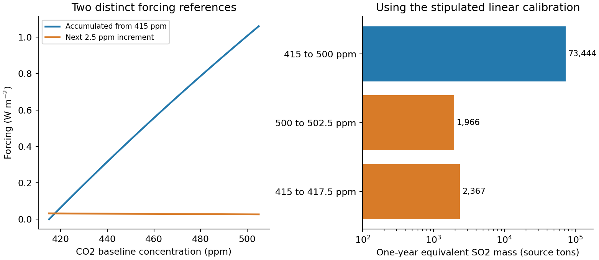

<h1 id="3/b/iv/solution">Solution</h1>

↑ **Parent:** [Iv](../iv.md)

If “steady [temperature](../../../../../../temperature-split.md) in 2050” means preventing the next annual increase relative to the climate at the delayed start, the relevant forcing increment is

$$
\Delta F_{2050}=5.4\ln(502.5/500)=0.0269327\ \mathrm{W\,m^{-2}},
\qquad
\boxed{m_{2050,\rm increment}=1.966\times10^3\ \mathrm{tons\ of\ SO_2}.}
$$

Its smaller value follows from $dF/dC=5.4/C$: the same additional ppm gives less incremental forcing at a higher baseline.

That interpretation must be separated from the earlier objective of holding [temperature](../../../../../../temperature-split.md) at the original reference climate. To cancel the accumulated increase from $415$ to $500$ ppm requires

$$
\Delta F_{\rm accumulated}=5.4\ln(500/415)=1.00618\ \mathrm{W\,m^{-2}},
\qquad
\boxed{m_{2050,\rm original\ reference}=7.344\times10^4\ \mathrm{tons\ of\ SO_2}.}
$$

This [annual versus accumulated radiative forcing](../../../../../../annual-versus-accumulated-radiative-forcing.md) distinction is essential: the first box offsets just the further year's growth; the second is the equivalent one-year [aerosol](../../../../../../aerosol.md) inventory needed for the accumulated forcing. In subsequent years that inventory must be replaced as particles disappear and increased as [carbon dioxide](../../../../../../carbon-dioxide.md) rises. A delayed start does not erase the earlier warming merely because the annual incremental requirement is smaller.

**[Figure 2](#3/b/iv/image-original-comparison-of-annual-and-accumulated-forcing-and-their-distinct-so2-compensation-masses). Original comparison of annual and accumulated forcing and their distinct SO2 compensation masses**.

## ↑ Ancestors (14)

1. [Iv](../iv.md)
2. [B](../../b.md)
3. [3](../../../3.md)
4. [Interdisciplinary paper IDP1](../../../../paper-id-split.md)
5. [2021](../../../../split.md)
6. [Past exam of the chemistry course of the year 4 of the natural sciences course of the University of Cambridge](../../../../../split.md)
7. [Chemistry course of the year 4 of the natural sciences course of the University of Cambridge](../../../../../../chemistry-course-of-the-year-4-of-the-natural-sciences-course-of-the-university-of-cambridge.md)
8. [Year 4 of the natural sciences course of the University of Cambridge](../../../../../../year-4-of-the-natural-sciences-course-of-the-university-of-cambridge.md)
9. [Year of the natural sciences course of the University of Cambridge](../../../../../../year-of-the-natural-sciences-course-of-the-university-of-cambridge.md)
10. [Natural sciences course of the University of Cambridge](../../../../../../natural-sciences-course-of-the-university-of-cambridge.md)
11. [Course of the University of Cambridge](../../../../../../course-of-the-university-of-cambridge.md)
12. [University of Cambridge](../../../../../../university-of-cambridge-split.md)
13. [List of universities](../../../../../../list-of-universities.md)
14. [Codex Wiki](../../../../../../split.md)
