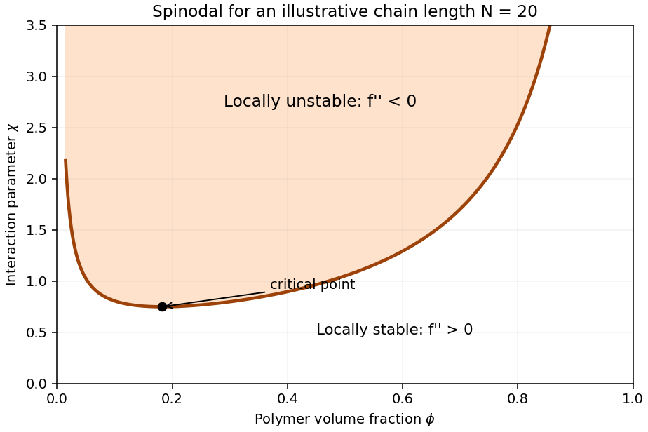
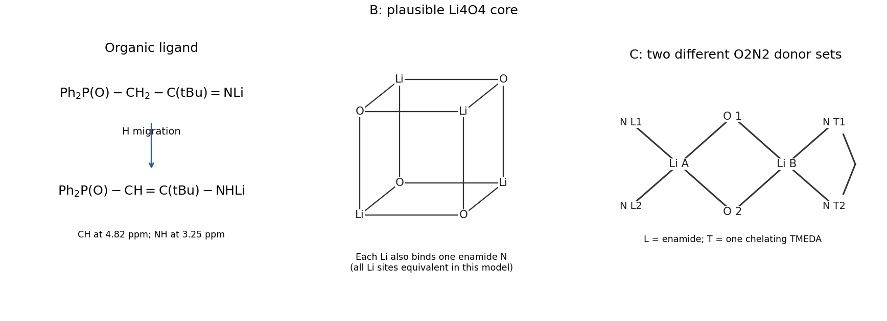

# Paper 1

↑ **Parent:** [2022](../2022.md)

[Original paper, released PDF pages 163–186](https://www.whatdotheyknow.com/request/nst_chemistry_past_papers_2022/response/2088679/attach/3/FOI%202022%20476%20Whittaker%20materials.pdf?cookie_passthrough=1#page=163)

The three cover variants share the question body below. Each printed question is included once.

**Table of contents**

- [1](#1)
  - [a](#1/a)
    - [i](#1/a/i)
      - [Solution](#1/a/i/solution)
    - [ii](#1/a/ii)
      - [Solution](#1/a/ii/solution)
    - [iii](#1/a/iii)
      - [Solution](#1/a/iii/solution)
    - [iv](#1/a/iv)
      - [Solution](#1/a/iv/solution)
  - [b](#1/b)
    - [Solution](#1/b/solution)
  - [c](#1/c)
    - [Solution](#1/c/solution)
  - [d](#1/d)
    - [Solution](#1/d/solution)
- [2](#2)
  - [a](#2/a)
    - [i](#2/a/i)
      - [Solution](#2/a/i/solution)
    - [ii](#2/a/ii)
      - [Solution](#2/a/ii/solution)
  - [b](#2/b)
    - [i](#2/b/i)
      - [Solution](#2/b/i/solution)
    - [ii](#2/b/ii)
      - [Solution](#2/b/ii/solution)
- [3](#3)
  - [a](#3/a)
    - [Solution](#3/a/solution)
  - [b](#3/b)
    - [Solution](#3/b/solution)
  - [c](#3/c)
    - [i](#3/c/i)
      - [Solution](#3/c/i/solution)
    - [ii](#3/c/ii)
      - [Solution](#3/c/ii/solution)
    - [iii](#3/c/iii)
      - [Solution](#3/c/iii/solution)
- [4](#4)
  - [a](#4/a)
    - [Solution](#4/a/solution)
  - [b](#4/b)
    - [Solution](#4/b/solution)
  - [c](#4/c)
    - [i](#4/c/i)
      - [Solution](#4/c/i/solution)
    - [ii](#4/c/ii)
      - [Solution](#4/c/ii/solution)
  - [d](#4/d)
    - [i](#4/d/i)
      - [Solution](#4/d/i/solution)
    - [ii](#4/d/ii)
      - [Solution](#4/d/ii/solution)
    - [iii](#4/d/iii)
      - [Solution](#4/d/iii/solution)
- [5](#5)
  - [a](#5/a)
    - [Solution](#5/a/solution)
  - [b](#5/b)
    - [i](#5/b/i)
      - [Solution](#5/b/i/solution)
    - [ii](#5/b/ii)
      - [Solution](#5/b/ii/solution)
  - [c](#5/c)
    - [Solution](#5/c/solution)
  - [d](#5/d)
    - [i](#5/d/i)
      - [Solution](#5/d/i/solution)
    - [ii](#5/d/ii)
      - [Solution](#5/d/ii/solution)
  - [e](#5/e)
    - [i](#5/e/i)
      - [Solution](#5/e/i/solution)
    - [ii](#5/e/ii)
      - [Solution](#5/e/ii/solution)
  - [f](#5/f)
    - [i](#5/f/i)
      - [Solution](#5/f/i/solution)
    - [ii](#5/f/ii)
      - [Solution](#5/f/ii/solution)
- [6](#6)
  - [a](#6/a)
    - [Solution](#6/a/solution)
  - [b](#6/b)
    - [Solution](#6/b/solution)
  - [c](#6/c)
    - [Solution](#6/c/solution)
- [7](#7)
  - [a](#7/a)
    - [Solution](#7/a/solution)
  - [b](#7/b)
    - [Solution](#7/b/solution)
  - [c](#7/c)
    - [Solution](#7/c/solution)
  - [d](#7/d)
    - [Solution](#7/d/solution)
  - [e](#7/e)
    - [Solution](#7/e/solution)
  - [f](#7/f)
    - [Solution](#7/f/solution)
- [8](#8)
  - [a](#8/a)
    - [i](#8/a/i)
      - [Solution](#8/a/i/solution)
    - [ii](#8/a/ii)
      - [Solution](#8/a/ii/solution)
    - [iii](#8/a/iii)
      - [Solution](#8/a/iii/solution)
  - [b](#8/b)
    - [i](#8/b/i)
      - [Solution](#8/b/i/solution)
    - [ii](#8/b/ii)
      - [Solution](#8/b/ii/solution)
    - [iii](#8/b/iii)
      - [Solution](#8/b/iii/solution)
- [9](#9)
  - [a](#9/a)
    - [i](#9/a/i)
      - [Solution](#9/a/i/solution)
    - [ii](#9/a/ii)
      - [Solution](#9/a/ii/solution)
  - [b](#9/b)
    - [i](#9/b/i)
      - [Solution](#9/b/i/solution)
    - [ii](#9/b/ii)
      - [Solution](#9/b/ii/solution)
  - [c](#9/c)
    - [Solution](#9/c/solution)
- [10](#10)
  - [a](#10/a)
    - [Solution](#10/a/solution)
  - [b](#10/b)
    - [Solution](#10/b/solution)
- [11](#11)
  - [a](#11/a)
    - [Solution](#11/a/solution)
  - [b](#11/b)
    - [Solution](#11/b/solution)
  - [c](#11/c)
    - [Solution](#11/c/solution)
  - [d](#11/d)
    - [Solution](#11/d/solution)
  - [e](#11/e)
    - [Solution](#11/e/solution)
- [12](#12)
  - [a](#12/a)
    - [i](#12/a/i)
      - [Solution](#12/a/i/solution)
    - [ii](#12/a/ii)
      - [Solution](#12/a/ii/solution)
    - [iii](#12/a/iii)
      - [Solution](#12/a/iii/solution)
  - [b](#12/b)
    - [Solution](#12/b/solution)
- [13](#13)
  - [a](#13/a)
    - [i](#13/a/i)
      - [Solution](#13/a/i/solution)
    - [ii](#13/a/ii)
      - [Solution](#13/a/ii/solution)
  - [b](#13/b)
    - [Solution](#13/b/solution)
  - [c](#13/c)
    - [Solution](#13/c/solution)
- [14](#14)
  - [a](#14/a)
    - [Solution](#14/a/solution)
  - [b](#14/b)
    - [Solution](#14/b/solution)
  - [c](#14/c)
    - [Solution](#14/c/solution)
  - [d](#14/d)
    - [Solution](#14/d/solution)
- [15](#15)
  - [a](#15/a)
    - [Solution](#15/a/solution)
  - [b](#15/b)
    - [Solution](#15/b/solution)
  - [c](#15/c)
    - [Solution](#15/c/solution)
  - [d](#15/d)
    - [Solution](#15/d/solution)
- [16](#16)
  - [a](#16/a)
    - [Solution](#16/a/solution)
  - [b](#16/b)
    - [Solution](#16/b/solution)
- [17](#17)
  - [a](#17/a)
    - [i](#17/a/i)
      - [Solution](#17/a/i/solution)
    - [ii](#17/a/ii)
      - [Solution](#17/a/ii/solution)
  - [b](#17/b)
    - [Solution](#17/b/solution)
  - [c](#17/c)
    - [Solution](#17/c/solution)

## 1

↑ **Parent:** [Paper 1](paper-1.md)

<h3 id="1/a">a</h3>

↑ **Parent:** [1](#1)

<h4 id="1/a/i">i</h4>

↑ **Parent:** [A](#1/a)

<h5 id="1/a/i/solution">Solution</h5>

↑ **Parent:** [I](#1/a/i)

**An aromatic–aliphatic [polyamide](../../polymer.md#polyamide) and methanol are formed.** Let $\mathrm{Ar}=p\text{-}\mathrm{C_6H_4-C_6H_4}\text{-}p$. The [polymer repeat unit](../../polymer.md#polymer-repeat-unit) is

$$
\boxed{[\mathrm{-NH(CH_2)_3NH-C(O)-Ar-C(O)-}]_n.}
$$

Each [amide](../../chemical-substance.md#amide) linkage comes from [nucleophilic acyl substitution](../../chemical-reaction.md#nucleophilic-acyl-substitution): an [amine](../../chemical-substance.md#amine) attacks an [ester](../../chemical-substance.md#ester) [carbonyl](../../chemical-bond.md#carbonyl-group), the [tetrahedral intermediate](../../chemical-kinetics.md#tetrahedral-intermediate) expels [methoxide](../../mathematical-biology.md#methoxide), and [proton transfer](../../acid-base-chemistry.md#proton-transfer) produces [methanol](../../chemical-substance.md#methanol). There are approximately $2n$ [molecules](../../molecule.md) of [methanol](../../chemical-substance.md#methanol) for $n$ complete repeat units in a long chain; the precise finite-chain count depends on its end groups. Removal of [methanol](../../chemical-substance.md#methanol) drives this [step-growth polymerization](../../polymer.md#step-growth-polymerization).

<h4 id="1/a/ii">ii</h4>

↑ **Parent:** [A](#1/a)

<h5 id="1/a/ii/solution">Solution</h5>

↑ **Parent:** [Ii](#1/a/ii)

**Syndiotactic [polypropylene](../../polymer.md#polypropylene)** is the expected principal product:

$$
\boxed{[\mathrm{-CH_2-CH(CH_3)-}]_n,\qquad\text{alternating configurations at successive substituted carbons}.}
$$

The bridged cyclopentadienyl–fluorenyl [metallocene](../../chemistry.md#metallocene) has approximately $C_s$ site [symmetry](../../physics.md#symmetry-physics). Activation by [methylaluminoxane](../../chemical-substance.md#methylaluminoxane) gives a cationic zirconium–alkyl [polymerization-active site](../../polymer.md#polymerization-active-site). Repeated [coordination chemistry](../../chemistry.md#coordination-chemistry) and [migratory insertion](../../chemical-reaction.md#migratory-insertion) of [propene](../../chemical-substance.md#propene) extend the chain. The two environments encountered during successive insertions favor alternating [stereochemistry](../../stereochemistry.md), giving syndiotactic [tacticity](../../polymer.md#tacticity). There is no stoichiometric small [molecule](../../molecule.md) eliminated in the propagation step; initiator fragments and chain-transfer products belong to the end groups.

<h4 id="1/a/iii">iii</h4>

↑ **Parent:** [A](#1/a)

<h5 id="1/a/iii/solution">Solution</h5>

↑ **Parent:** [Iii](#1/a/iii)

**Predominantly head-to-tail poly(3-hexylthiophene)** is formed, with thiophene rings connected through their 2 and 5 positions. The hexyl groups occupy equivalent 3 positions along the [conjugated polymer](../../polymer.md#conjugated-polymer).

Selective iodine–magnesium exchange first generates an organomagnesium [monomer](../../polymer.md#monomer) while retaining the carbon–bromine bond. Nickel-catalyzed [Kumada coupling](../../chemical-reaction.md#kumada-coupling) then joins the organomagnesium end of one ring to the brominated end of another. Transfer of the nickel center to the new chain end permits [catalyst-transfer polymerization](../../polymer.md#catalyst-transfer-polymerization) and favors head-to-tail [regioregularity](../../polymer.md#regioregularity). Organic side products of the activation include isopropyl iodide; magnesium halides accompany the coupling. The repeat unit itself contains neither iodine nor bromine.

<h4 id="1/a/iv">iv</h4>

↑ **Parent:** [A](#1/a)

<h5 id="1/a/iv/solution">Solution</h5>

↑ **Parent:** [Iv](#1/a/iv)

**An approximately alternating styrene–maleic anhydride copolymer** is produced. Its backbone alternates a $\mathrm{-CH_2-CH(Ph)-}$ segment with the two former alkene carbons of a maleic anhydride unit; those latter carbons remain connected to the intact five-membered [cyclic anhydride](../../chemical-substance.md#cyclic-anhydride) ring.

[Homolysis](../../chemical-bond.md#homolysis) of [benzoyl peroxide](../../chemical-substance.md#benzoyl-peroxide) supplies initiating [free radicals](../../chemistry.md#radical-chemistry). Cross-propagation between electron-rich [styrene](../../chemical-substance.md#styrene) and electron-poor [maleic anhydride](../../chemical-substance.md#maleic-anhydride) is favored over successive additions of the same [monomer](../../polymer.md#monomer). Both carbon–carbon [double bonds](../../covalent-bond.md#double-bond) become backbone [sigma bonds](../../covalent-bond.md#sigma-bond), without loss of a small [molecule](../../molecule.md) from each [monomer](../../polymer.md#monomer). Initiator-derived benzoyloxy or phenyl fragments can occur at chain ends, with carbon dioxide formed when benzoyloxy [free radicals](../../chemistry.md#radical-chemistry) decarboxylate.

<h3 id="1/b">b</h3>

↑ **Parent:** [1](#1)

<h4 id="1/b/solution">Solution</h4>

↑ **Parent:** [B](#1/b)

In (i), any pair of compatible functional groups can react: [monomers](../../polymer.md#monomer), oligomers and long chains all participate. For an equimolar, strictly bifunctional mixture without [cyclization in step-growth polymerization](../../polymer.md#cyclization-in-step-growth-polymerization), the [Carothers equation](../../polymer.md#carothers-equation) gives

$$
\boxed{\overline X_n=\frac{1}{1-p}.}
$$

Here $p$ is functional-group conversion and $\overline X_n$ counts the original [monomer](../../polymer.md#monomer) [molecules](../../molecule.md). Large [degree of polymerization](../../polymer.md#degree-of-polymerization) therefore requires nearly complete conversion.

In (ii), growth occurs only at the metal-bound chain end. If initiation is rapid and [chain transfer in chain polymerization](../../polymer.md#chain-transfer-in-chain-polymerization) is negligible, the number of chains is fixed and

$$
\overline X_n\simeq \frac{[M]_0}{[I]_0}p.
$$

This is the linear conversion dependence of [living polymerization](../../polymer.md#living-polymerization). Actual zirconocene systems can undergo chain transfer, so linear growth is a limiting model, not a consequence of [coordination polymerization](../../polymer.md#coordination-polymerization) alone.

In (iv), a newly initiated chain rapidly attains a large size and then undergoes [radical termination](../../chemistry.md#radical-termination). Further conversion mostly creates additional chains. Thus high [degree of polymerization](../../polymer.md#degree-of-polymerization) can occur at low conversion, without the systematic linear increase of an ideal living system. [temperature](../../temperature.md), initiator depletion and [monomer](../../polymer.md#monomer) depletion can change that size during the run.

<a id="1/b/image-contrasting-idealized-degrees-of-polymerization-during-three-growth-mechanisms"></a>


**[Figure 1](#1/b/image-contrasting-idealized-degrees-of-polymerization-during-three-growth-mechanisms). Contrasting idealized degrees of polymerization during three growth mechanisms**.

<h3 id="1/c">c</h3>

↑ **Parent:** [1](#1)

<h4 id="1/c/solution">Solution</h4>

↑ **Parent:** [C](#1/c)

For the ideal equimolar [step-growth polymerization](../../polymer.md#step-growth-polymerization), $p=0.5$ gives

$$
\boxed{\overline X_n=2.}
$$

This counts individual starting [molecules](../../molecule.md), so it is only roughly one diamine–diester pair per average chain, rather than a long [polymer](../../polymer.md). In a successful [radical polymerization](../../polymer.md#radical-polymerization), many [monomers](../../polymer.md#monomer) normally add between initiation and [radical termination](../../chemistry.md#radical-termination). **The styrene–maleic anhydride copolymer in (iv) therefore has the larger expected [degree of polymerization](../../polymer.md#degree-of-polymerization).**

Conversion alone does not specify the radical-chain length: the conclusion assumes ordinary polymer-forming conditions, rather than arbitrarily high initiator concentration or extremely strong [chain transfer in chain polymerization](../../polymer.md#chain-transfer-in-chain-polymerization).

<h3 id="1/d">d</h3>

↑ **Parent:** [1](#1)

<h4 id="1/d/solution">Solution</h4>

↑ **Parent:** [D](#1/d)

[Gel permeation chromatography](../../chromatography.md#size-exclusion-chromatography) separates by solution [hydrodynamic volume](../../polymer.md#hydrodynamic-volume), rather than [molar mass](../../chemistry.md#molar-mass) alone. At equal [molar mass](../../chemistry.md#molar-mass), a more extended chain accesses fewer pores and elutes earlier. **The relatively rigid, conjugated poly(3-hexylthiophene) is the natural first-eluting candidate**, compared with the more flexible chains, provided all samples are molecularly dissolved.

This is a structural prediction, not an unconditional ordering: [solvent quality](../../mixture.md#solvent-quality), [polymer aggregation](../../mixture.md#polymer-aggregation) and column interactions affect retention, and the hydrogen-bonding [polyamide](../../polymer.md#polyamide) may not dissolve adequately in tetrahydrofuran. An insoluble sample cannot be assigned an ordinary solution [gel permeation chromatography](../../chromatography.md#size-exclusion-chromatography) elution time.

A differential [refractive index detector](../../chromatography.md#refractive-index-detector) can detect all four [polymers](../../polymer.md) when their refractive-index contrasts are nonzero. [Light scattering](../../optics.md#scattering-of-light) with an appropriate concentration detector can additionally provide [molar mass](../../chemistry.md#molar-mass). A single ultraviolet detector is unsuitable as the universal detector because [polypropylene](../../polymer.md#polypropylene) lacks the strong chromophores present in the aromatic and conjugated products.

## 2

↑ **Parent:** [Paper 1](paper-1.md)

<h3 id="2/a">a</h3>

↑ **Parent:** [2](#2)

<h4 id="2/a/i">i</h4>

↑ **Parent:** [A](#2/a)

<h5 id="2/a/i/solution">Solution</h5>

↑ **Parent:** [I](#2/a/i)

The four shortest contacts are the three Cu–N bonds and Cu–OR bond. They define an approximately square equatorial set. The two remaining Cu–O contacts are longer and define a strongly elongated axial direction, as expected for the [Jahn-Teller effect](../../chemistry.md#jahn-teller-effect) of $d^9$ Cu(II).

Choose $z$ along the long contacts and $x,y$ towards the short equatorial donors. The singly occupied, predominantly metal [magnetic orbital](../../chemistry.md#magnetic-orbital) is then **$d_{x^2-y^2}$**, with substantial [Ligand in coordination chemistry](../../chemistry.md#ligand-in-coordination-chemistry) admixture. All three pyrazine nitrogen donors lie in this equatorial set, so both ladder directions have strong metal–[Ligand in coordination chemistry](../../chemistry.md#ligand-in-coordination-chemistry) [orbital overlap](../../chemistry.md#orbital-overlap). Neighboring copper centers communicate through comparable pyrazine [superexchange](../../electromagnetism.md#superexchange) pathways. Virtual [electron](../../physics.md#electron) transfer between half-filled orbitals stabilizes the antiparallel arrangement, giving **antiferromagnetic interactions in both directions with comparable magnitudes**. The axial oxygen donors are much less effective exchange routes.

<h4 id="2/a/ii">ii</h4>

↑ **Parent:** [A](#2/a)

<h5 id="2/a/ii/solution">Solution</h5>

↑ **Parent:** [Ii](#2/a/ii)

At high [temperature](../../temperature.md), $\chi T$ tends towards the nearly constant [Curie constant](../../statistical-physics.md#curie-constant) of weakly correlated $S=\tfrac12$ centers. On cooling, $\chi T$ falls because neighboring [spins](../../angular-momentum-operator.md#spin) increasingly correlate antiparallel. The broad maximum in $\chi$ marks the crossover from the high-temperature Curie-like regime to substantial [short-range order](../../electromagnetism.md#short-range-order).

At still lower [temperature](../../temperature.md), the [Magnetic susceptibility](../../statistical-physics.md#magnetic-susceptibility) becomes small because the antiferromagnetic ladder favors a singlet-like ground state and has few thermally accessible magnetic excitations. An even-leg [spin ladder](../../electromagnetism.md#spin-ladder) can have a [spin gap](../../electromagnetism.md#spin-gap), which reinforces this suppression. **A broad [Magnetic susceptibility](../../statistical-physics.md#magnetic-susceptibility) maximum and falling $\chi T$ support short-range antiferromagnetic correlations; they do not establish a three-dimensional Néel transition.** Such a transition would require independent evidence, rather than identifying the broad maximum itself as the ordering [temperature](../../temperature.md).

<h3 id="2/b">b</h3>

↑ **Parent:** [2](#2)

<h4 id="2/b/i">i</h4>

↑ **Parent:** [B](#2/b)

<h5 id="2/b/i/solution">Solution</h5>

↑ **Parent:** [I](#2/b/i)

An ideal cubic [perovskite structure](../../physical-chemistry.md#perovskite-structure) is obtained by putting **La at the cube corners, Re at the body center, and N at the face centers**. In [fractional crystal coordinates](../../physical-chemistry.md#fractional-crystal-coordinate) one convenient basis is

$$
\mathrm{La}:(0,0,0),\qquad
\mathrm{Re}:(\tfrac12,\tfrac12,\tfrac12),\qquad
\mathrm N:(\tfrac12,\tfrac12,0),(\tfrac12,0,\tfrac12),(0,\tfrac12,\tfrac12).
$$

The counting is $8/8=1$ La, one Re and $6/2=3$ N per cell. Corner-sharing $\mathrm{ReN_6}$ [octahedra](../../euclidean-geometry.md#octahedron) form the network, with La in the larger interstices. The ideal cell illustrates the connectivity; octahedral tilting can lower the actual [crystal symmetry](../../physical-chemistry.md#crystal-symmetry).

<a id="2/b/i/image-ideal-perovskite-connectivity-for-lanthanum-rhenium-nitride"></a>


**[Figure 2](#2/b/i/image-ideal-perovskite-connectivity-for-lanthanum-rhenium-nitride). Ideal perovskite connectivity for lanthanum rhenium nitride**.

<h4 id="2/b/ii">ii</h4>

↑ **Parent:** [B](#2/b)

<h5 id="2/b/ii/solution">Solution</h5>

↑ **Parent:** [Ii](#2/b/ii)

Formal ionic counting gives La(III), N(−III), and therefore Re(VI), with a $5d^1$ configuration. An isolated localized $d^1$ center would carry a [saturation magnetic moment](../../electromagnetism.md#saturation-magnetic-moment) of order $1\mu_{\rm B}$, much larger than the value quoted. It is not a $d^0$ ion made diamagnetic simply by an octahedral [ligand field](../../chemistry.md#ligand-field).

The spatially extended Re $5d$ orbitals overlap strongly with N $2p$ orbitals. Re–N $\sigma$ interactions raise the $e_g$-derived antibonding states, while $\pi$ interactions mix the $t_{2g}$ states with the nitrogen network. Repetition through corner-sharing [octahedra](../../euclidean-geometry.md#octahedron) turns these combinations into broad [energy bands](../../bloch-s-theorem.md#energy-band). The nominal $d$ [electron](../../physics.md#electron) occupies a delocalized, partially filled band rather than an isolated magnetic orbital.

Only [electrons](../../physics.md#electron) close to the [Fermi energy](../../quantum-ideal-gas-statistics.md#fermi-energy) change their occupations appreciably in an applied [magnetic field](../../magnetic-field.md). Consequently a [Pauli paramagnetism](../../quantum-ideal-gas-statistics.md#pauli-paramagnetism) has a small, nonzero field-induced [magnetization](../../electromagnetism.md#magnetization):

$$
M\simeq\mu_{\rm B}^2 g(E_F)B
$$

when $g$ is the density of states including both [spin](../../angular-momentum-operator.md#spin) directions, expressed per formula unit and per unit energy. This band model explains **a very small moment without requiring the absence of [electrons](../../physics.md#electron) in the Re-derived band**. The reported material has metallic transport and a Pauli-like response.[Magnetic and transport measurements, Figure 4](../../chemistry-bibliography.md#preparation-of-bulk-phase-nitride-perovskite-laren3-and-topotactic-reduction-to-lanio2-type-laren2-by-simon-d-kloss-and-others)

The description “saturated” in the question should not be interpreted as complete alignment of one localized [spin](../../angular-momentum-operator.md#spin) per Re: a nearly linear metallic response over a laboratory field range need not be a true fully spin-polarized saturation moment.

## 3

↑ **Parent:** [Paper 1](paper-1.md)

<h3 id="3/a">a</h3>

↑ **Parent:** [3](#3)

<h4 id="3/a/solution">Solution</h4>

↑ **Parent:** [A](#3/a)

**TODO: user-deferred biology.** Metal binding in a protein is deferred under the current nonbiology scope.

<h3 id="3/b">b</h3>

↑ **Parent:** [3](#3)

<h4 id="3/b/solution">Solution</h4>

↑ **Parent:** [B](#3/b)

**TODO: user-deferred biology.** Enzyme assignments and catalytic electron requirements is deferred under the current nonbiology scope.

<h3 id="3/c">c</h3>

↑ **Parent:** [3](#3)

<h4 id="3/c/i">i</h4>

↑ **Parent:** [C](#3/c)

<h5 id="3/c/i/solution">Solution</h5>

↑ **Parent:** [I](#3/c/i)

**TODO: user-deferred biology.** Wild-type metalloenzyme activity is deferred under the current nonbiology scope.

<h4 id="3/c/ii">ii</h4>

↑ **Parent:** [C](#3/c)

<h5 id="3/c/ii/solution">Solution</h5>

↑ **Parent:** [Ii](#3/c/ii)

**TODO: user-deferred biology.** Single-mutant metalloenzyme activity is deferred under the current nonbiology scope.

<h4 id="3/c/iii">iii</h4>

↑ **Parent:** [C](#3/c)

<h5 id="3/c/iii/solution">Solution</h5>

↑ **Parent:** [Iii](#3/c/iii)

**TODO: user-deferred biology.** Multiple-mutant metalloenzyme selectivity is deferred under the current nonbiology scope.

## 4

↑ **Parent:** [Paper 1](paper-1.md)

<h3 id="4/a">a</h3>

↑ **Parent:** [4](#4)

<h4 id="4/a/solution">Solution</h4>

↑ **Parent:** [A](#4/a)

For a homogeneous [polymer solution](../../mixture.md#polymer-solution), examine the curvature of the mixing [Helmholtz free energy](../../thermodynamic-potential.md#helmholtz-free-energy) with respect to composition. A composition fluctuation into equal volumes at $\phi\pm\delta\phi$ changes the average free energy by

$$
\frac{f(\phi+\delta\phi)+f(\phi-\delta\phi)}2-f(\phi)
=\frac12 f''(\phi)(\delta\phi)^2+O((\delta\phi)^4).
$$

Thus $f''>0$ locally resists fluctuations and $f''<0$ amplifies them, leading to [spinodal decomposition](../../critical-phenomenon.md#spinodal-decomposition). **The [spinodal](../../critical-phenomenon.md#spinodal) curve is the locus $f''=0$**, separating locally stable or metastable homogeneous compositions from locally unstable ones. The coexistence [binodal](../../critical-phenomenon.md#binodal) instead follows a common tangent to the free energy. Between the [binodal](../../critical-phenomenon.md#binodal) and [spinodal](../../critical-phenomenon.md#spinodal), separation needs [nucleation](../../critical-phenomenon.md#nucleation).

<a id="4/a/image-local-instability-boundary-of-a-flory-huggins-polymer-solution"></a>


**[Figure 3](#4/a/image-local-instability-boundary-of-a-flory-huggins-polymer-solution). Local instability boundary of a Flory–Huggins polymer solution**.

<h3 id="4/b">b</h3>

↑ **Parent:** [4](#4)

<h4 id="4/b/solution">Solution</h4>

↑ **Parent:** [B](#4/b)

In [Flory–Huggins solution theory](../../mixture.md#flory-huggins-solution-theory), $\phi$ is the [volume fraction](../../continuum-mechanics.md#volume-fraction), $N$ is the number of equal-sized lattice segments per chain, $T$ is [temperature](../../temperature.md), $k_{\rm B}$ is the [Boltzmann constant](../../thermodynamics.md#boltzmann-constant), and $\chi$ is the dimensionless [Flory interaction parameter](../../mixture.md#flory-interaction-parameter). The stated $f$ is the mixing [Helmholtz free energy](../../thermodynamic-potential.md#helmholtz-free-energy) per lattice site. The first two terms describe mixing [entropy](../../entropy.md); the last describes the contact-energy contribution.

At fixed $T$ and composition-independent $\chi$,

$$
\frac{f'}{k_{\rm B}T}=\frac{\ln\phi+1}{N}-\ln(1-\phi)-1+\chi(1-2\phi),
\qquad
\frac{f''}{k_{\rm B}T}=\frac1{N\phi}+\frac1{1-\phi}-2\chi.
$$

Hence the [spinodal](../../critical-phenomenon.md#spinodal) is

$$
\boxed{\chi_s(\phi)=\frac12\left[\frac1{N\phi}+\frac1{1-\phi}\right],\quad0<\phi<1.}
$$

The homogeneous state is locally unstable when $\chi>\chi_s(\phi)$. The minimum gives the [critical point of a Flory–Huggins polymer solution](../../mixture.md#critical-point-of-a-flory-huggins-polymer-solution):

$$
\boxed{\phi_c=\frac1{1+\sqrt N},\qquad\chi_c=\frac12(1+N^{-1/2})^2.}
$$

If $\chi$ depends on [temperature](../../temperature.md), the equation $\chi(T)=\chi_s(\phi)$ converts this result into a [temperature](../../temperature.md)–composition boundary.

<h3 id="4/c">c</h3>

↑ **Parent:** [4](#4)

<h4 id="4/c/i">i</h4>

↑ **Parent:** [C](#4/c)

<h5 id="4/c/i/solution">Solution</h5>

↑ **Parent:** [I](#4/c/i)

The [critical micelle concentration](../../physical-chemistry.md#critical-micelle-concentration) is the approximate total [surfactant](../../surface-tension.md#surfactant) concentration above which additional [surfactant](../../surface-tension.md#surfactant) predominantly enters [micelles](../../physical-chemistry.md#micelle). Below it, most [surfactant](../../surface-tension.md#surfactant) is present as separate [molecules](../../molecule.md); above it, the free-monomer concentration changes much more slowly while the [micelle](../../physical-chemistry.md#micelle) population increases.

The crossover occurs when aggregation balances the unfavorable exposure of hydrophobic tails to water against head-group repulsion and the loss of molecular translational [entropy](../../entropy.md). **It is an aggregation threshold, not the concentration at which every [molecule](../../molecule.md) becomes micellar.**

<h4 id="4/c/ii">ii</h4>

↑ **Parent:** [C](#4/c)

<h5 id="4/c/ii/solution">Solution</h5>

↑ **Parent:** [Ii](#4/c/ii)

A longer hydrophobic tail makes transfer from water into a [micelle](../../physical-chemistry.md#micelle) more favorable, lowering the [critical micelle concentration](../../physical-chemistry.md#critical-micelle-concentration) within this homologous series. Ranking the four quoted concentrations therefore gives

$$
\boxed{B:\mathrm C_4,\qquad D:\mathrm C_8,\qquad A:\mathrm C_{10},\qquad C:\mathrm C_{14}.}
$$

This assignment uses the chain lengths and concentration ranking printed in the question; it does not identify the compounds by substituting an external table of measured concentrations.

<h3 id="4/d">d</h3>

↑ **Parent:** [4](#4)

<h4 id="4/d/i">i</h4>

↑ **Parent:** [D](#4/d)

<h5 id="4/d/i/solution">Solution</h5>

↑ **Parent:** [I](#4/d/i)

For the same geometry, separation and intervening medium, the attractive [Van der Waals force](../../force.md#van-der-waals-force) scales with the effective [Hamaker constant](../../mathematical-biology.md#hamaker-constant). With the constants treated as applying to those same conditions,

$$
\boxed{\frac{|F_{\rm Ag}|}{|F_{\rm PS}|}=\frac{40}{6.6}\simeq6.06.}
$$

**The silver particles attract more strongly.** This comparison is conditional on a common geometry and on using the appropriate constants across the actual medium. Constants for particles in vacuum cannot automatically be applied unchanged across a solvent.

<h4 id="4/d/ii">ii</h4>

↑ **Parent:** [D](#4/d)

<h5 id="4/d/ii/solution">Solution</h5>

↑ **Parent:** [Ii](#4/d/ii)

For two equal spheres of radius $R$, the effective radius in the [Derjaguin approximation](../../mixture.md#derjaguin-approximation) is $R_{\rm eff}=R/2$. The nonretarded attractive [van der Waals potential](../../force.md#van-der-waals-potential) is

$$
U(h)=-\frac{A R_{\rm eff}}{6h}=-\frac{AR}{12h}.
$$

Differentiating with respect to the surface gap gives

$$
\boxed{F(h)=-\frac{AR}{12h^2}
=-\frac{(4.0\times10^{-19})(10^{-9})}{12(2\times10^{-9})^2}
=-8.3\times10^{-12}\ \mathrm N.}
$$

Thus the requested approximation gives **an attraction of about $8.3$ pN**. Here $h/R=2$, whereas the [Derjaguin approximation](../../mixture.md#derjaguin-approximation) requires $h\ll R$. This is the formal estimate requested by the hint, not a quantitatively reliable near-contact approximation for the printed dimensions.

<h4 id="4/d/iii">iii</h4>

↑ **Parent:** [D](#4/d)

<h5 id="4/d/iii/solution">Solution</h5>

↑ **Parent:** [Iii](#4/d/iii)

The [Stern layer](../../electrostatics.md#stern-layer) is the compact near-surface layer of specifically adsorbed or closely associated ions. The [diffuse layer](../../electrostatics.md#diffuse-layer) is the more extended, thermally distributed excess of counterions that screens the surface charge.

For water near $25^\circ\mathrm C$, the [Debye length](../../physics.md#debye-length) can be written

$$
\lambda_D\simeq\frac{0.304\ \mathrm{nm}}{\sqrt{I/(\mathrm{mol\,L^{-1}})}},\qquad
I=\frac12\sum_i c_i z_i^2.
$$

For $0.01$ M KCl, $I=0.01$ M and **$\lambda_D\simeq3.0$ nm**. For a fully dissociated 2:2 [electrolyte](../../electrochemistry.md#electrolyte) at the same formula-unit concentration, $I=4c=0.04$ M, giving **$\lambda_D\simeq1.5$ nm**, half as large. These are linear-screening estimates, not sharp boundaries of the [diffuse layer](../../electrostatics.md#diffuse-layer).

## 5

↑ **Parent:** [Paper 1](paper-1.md)

<h3 id="5/a">a</h3>

↑ **Parent:** [5](#5)

<h4 id="5/a/solution">Solution</h4>

↑ **Parent:** [A](#5/a)

In the [Asakura-Oosawa model](../../mixture.md#asakura-oosawa-model), nonadsorbing [polymers](../../polymer.md) are treated as ideal, mutually penetrable particles, but their centers cannot enter a layer around a hard [colloid](../../mixture.md#colloid). The [polymer](../../polymer.md) [osmotic pressure](../../cell-membrane.md#osmotic-pressure) is $\Pi=\rho k_{\rm B}T$ in the ideal dilute limit, with the appropriate number density in the space dimension considered.

For fixed [polymer](../../polymer.md) number, reducing the inaccessible volume increases the available volume and lowers the [polymer](../../polymer.md) [Helmholtz free energy](../../thermodynamic-potential.md#helmholtz-free-energy). Equivalently, at fixed [polymer](../../polymer.md) [chemical potential](../../chemical-potential.md), the [polymer](../../polymer.md) contribution to the effective colloid potential is

$$
\boxed{U_{\rm dep}=\Pi\,\Delta V_{\rm excluded}=-\Pi V_{\rm overlap}.}
$$

When the excluded layers overlap, their union occupies less space than two separate layers. More [polymer](../../polymer.md) configurations become available, so the resulting [depletion force](../../mixture.md#depletion-force) attracts the colloids. It is an [entropy](../../entropy.md)-driven effective interaction, even though each microscopic colloid–[polymer](../../polymer.md) interaction is purely repulsive.

<h3 id="5/b">b</h3>

↑ **Parent:** [5](#5)

<h4 id="5/b/i">i</h4>

↑ **Parent:** [B](#5/b)

<h5 id="5/b/i/solution">Solution</h5>

↑ **Parent:** [I](#5/b/i)

The unrotated squares have a gap $d>a$, so their facing exclusion layers do not overlap. Rotation can bring them into contact even though their centers remain fixed. The strongest [depletion force](../../mixture.md#depletion-force) comes from **parallel faces in contact over a long shared length**, rather than a corner-to-corner contact.

Let $r=\ell+d$. Rotate both squares through the same angle $\theta$ relative to their original orientation. Their center displacement has a face-normal component $r\cos\theta$ and a tangential component $r\sin\theta$. Face contact requires

$$
\boxed{\cos\theta_* =\frac\ell r,\qquad
\theta_*=\pm\arccos\frac\ell{\ell+d}\simeq\pm\sqrt{\frac{2d}{\ell}}.}
$$

The contacting faces overlap for length

$$
L=\ell-r|\sin\theta_*|=\ell-\sqrt{r^2-\ell^2}\simeq\ell-\sqrt{2\ell d}.
$$

These two mirror-related orientations, together with equivalent square rotations, maximize the leading overlap area when $a<d\ll\ell$. A small [polymer](../../polymer.md) gap sacrifices overlap width without a compensating leading increase in contact length.

<h4 id="5/b/ii">ii</h4>

↑ **Parent:** [B](#5/b)

<h5 id="5/b/ii/solution">Solution</h5>

↑ **Parent:** [Ii](#5/b/ii)

Each face excludes [polymer](../../polymer.md) centers out to distance $a/2$. At face contact, the combined overlap strip has width $a$ and length $L$. Ignoring end corrections of order $a^2$, the two-dimensional [Asakura-Oosawa model](../../mixture.md#asakura-oosawa-model) therefore gives

$$
\boxed{U_{\rm min}\simeq-\rho k_{\rm B}T\,a
\left[\ell-\sqrt{(\ell+d)^2-\ell^2}\right]
\simeq-\rho k_{\rm B}T\,a\ell.}
$$

The final expression retains only the leading term in $d/\ell$. Its dimensions are correct because $\rho$ is a number per area. The zero of this effective [potential energy](../../energy.md#potential-energy) is the well-separated, nonoverlapping-exclusion-layer configuration.

<h3 id="5/c">c</h3>

↑ **Parent:** [5](#5)

<h4 id="5/c/solution">Solution</h4>

↑ **Parent:** [C](#5/c)

**There is no universal ranking from the information supplied.** The [depletion force](../../mixture.md#depletion-force) scales with [polymer](../../polymer.md) [osmotic pressure](../../cell-membrane.md#osmotic-pressure), hence with $\rho$ in the ideal model. [London dispersion forces](../../force.md#london-dispersion-force) instead depend on the material-dependent [Hamaker constant](../../mathematical-biology.md#hamaker-constant), the intervening solvent, the closest approach and the contact geometry.

Close face contact can give a strong dispersion contribution; the ideal continuum expression even becomes singular without a molecular-distance cutoff. Nevertheless, refractive-index matching can greatly reduce that contribution, and increasing [polymer](../../polymer.md) concentration can strengthen [depletion force](../../mixture.md#depletion-force). A quantitative comparison requires those missing material and concentration scales. The two attractive contributions may act together.

<h3 id="5/d">d</h3>

↑ **Parent:** [5](#5)

<h4 id="5/d/i">i</h4>

↑ **Parent:** [D](#5/d)

<h5 id="5/d/i/solution">Solution</h5>

↑ **Parent:** [I](#5/d/i)

Write $q=P_{BI}$ and $p=P_{AI}=1-q$. A path with $n$ visits to $I$ makes $n-1$ unsuccessful excursions back to $B$, followed by one successful step to $A$. Every $B\to I$ step has [probability](../../probability-theory.md#probability) one, so

$$
\boxed{\Pr(N=n)=q^{n-1}p,\qquad n=1,2,\ldots.}
$$

The visit count has a [geometric distribution](../../discrete-probability-distribution.md#geometric-distribution), with success meaning the final $I\to A$ step.

<h4 id="5/d/ii">ii</h4>

↑ **Parent:** [D](#5/d)

<h5 id="5/d/ii/solution">Solution</h5>

↑ **Parent:** [Ii](#5/d/ii)

For $p>0$, equivalently $0\leq q<1$, the [geometric series](../../sequence-and-series.md#geometric-series) gives

$$
\boxed{\sum_{n=1}^{\infty}q^{n-1}p=\frac p{1-q}=1.}
$$

Thus [absorption probability](../../markov-chain.md#splitting-probability) is one. The qualification matters: if $p=0$, the process alternates between $B$ and $I$ forever and never reaches $A$.

<h3 id="5/e">e</h3>

↑ **Parent:** [5](#5)

<h4 id="5/e/i">i</h4>

↑ **Parent:** [E](#5/e)

<h5 id="5/e/i/solution">Solution</h5>

↑ **Parent:** [I](#5/e/i)

Each visit to $I$ corresponds to two steps, one out of $B$ and one out of $I$. Hence a successful path with $n$ visits contains $2n$ steps. Taking its [expectation](../../expected-value.md) over the [geometric distribution](../../discrete-probability-distribution.md#geometric-distribution) gives

$$
\boxed{S_{AB}=\sum_{n=1}^{\infty}2n\,q^{n-1}p.}
$$

The last pair is $B\to I\to A$; it contributes two steps just like each previous $B\to I\to B$ excursion.

<h4 id="5/e/ii">ii</h4>

↑ **Parent:** [E](#5/e)

<h5 id="5/e/ii/solution">Solution</h5>

↑ **Parent:** [Ii](#5/e/ii)

Using the differentiated [geometric series](../../sequence-and-series.md#geometric-series),

$$
\boxed{S_{AB}=2p\sum_{n=1}^{\infty}nq^{n-1}
=\frac{2p}{(1-q)^2}=\frac2p.}
$$

This is finite for $p>0$, equals two when every visit succeeds, and diverges as the chance of success tends to zero.

<h3 id="5/f">f</h3>

↑ **Parent:** [5](#5)

<h4 id="5/f/i">i</h4>

↑ **Parent:** [F](#5/f)

<h5 id="5/f/i/solution">Solution</h5>

↑ **Parent:** [I](#5/f/i)

A path with $n$ visits makes $n$ departures from $B$ and $n$ departures from $I$. Its conditional mean duration is therefore $n(\tau_B+\tau_I)$. Averaging over the [geometric distribution](../../discrete-probability-distribution.md#geometric-distribution),

$$
\boxed{T_{AB}=\sum_{n=1}^{\infty}n(\tau_B+\tau_I)q^{n-1}p.}
$$

Only the mean waiting times are needed here: [linearity of expectation](../../expected-value.md#linearity-of-expectation) adds their contributions without requiring each residence time to equal its mean.

<h4 id="5/f/ii">ii</h4>

↑ **Parent:** [F](#5/f)

<h5 id="5/f/ii/solution">Solution</h5>

↑ **Parent:** [Ii](#5/f/ii)

The same [geometric series](../../sequence-and-series.md#geometric-series) identity gives

$$
\boxed{T_{AB}=\frac{p(\tau_B+\tau_I)}{(1-q)^2}
=\frac{\tau_B+\tau_I}{p}.}
$$

A direct renewal check gives the identical result: $T_B=\tau_B+T_I$ and $T_I=\tau_I+qT_B$, so $pT_B=\tau_B+\tau_I$. This also checks the units: [mean first-passage time](../../markov-chain.md#mean-first-passage-time) has units of time, unlike the dimensionless step count.

## 6

↑ **Parent:** [Paper 1](paper-1.md)

<h3 id="6/a">a</h3>

↑ **Parent:** [6](#6)

<h4 id="6/a/solution">Solution</h4>

↑ **Parent:** [A](#6/a)

This is an **[Ireland–Claisen rearrangement](../../chemistry.md#ireland-claisen-rearrangement)**. Number the [ester](../../chemical-substance.md#ester) [carbonyl](../../chemical-bond.md#carbonyl-group) carbon $C_0$, its enolizable carbon $C_\alpha$, and the three allylic ring carbons $C_1-C_2=C_3$, starting at the carbon bearing the [ester](../../chemical-substance.md#ester) oxygen.

[lithium hexamethyldisilazide](../../chemical-substance.md#lithium-hexamethyldisilazide) removes an $\alpha$ [proton](../../physics.md#proton) and [trimethylsilyl chloride](../../chemical-substance.md#trimethylsilyl-chloride) traps the oxygen of the resulting [ester enolate](../../chemical-substance.md#ester-enolate), giving a [silyl ketene acetal](../../chemical-substance.md#silyl-ketene-acetal). Heating permits a six-electron, \[3,3\]-[sigmatropic rearrangement](../../chemical-reaction.md#sigmatropic-rearrangement) through the array

$$
C_\alpha=C_0-O-C_1-C_2=C_3.
$$

The electron-pair movements are $\pi(C_\alpha=C_0)\to C_0=O$, $\sigma(O-C_1)\to\pi(C_1=C_2)$, and $\pi(C_2=C_3)\to\sigma(C_3-C_\alpha)$. Acidic work-up cleaves the silyl [ester](../../chemical-substance.md#ester) to the [carboxylic acid](../../chemical-substance.md#carboxylic-acid). The benzyl ether remains a protecting group; it is not the migrating bond.

The [suprafacial reaction](../../chemical-reaction.md#suprafacial-reaction) transfers the starting allylic [stereochemistry](../../stereochemistry.md) to $C_3$, where the new side chain is delivered from the original oxygen face. In the product's printed orientation, **the new C$_3$–C$_\alpha$ bond is behind the ring and the C$_3$ methyl group is toward the viewer**. At that ring star, the [Cahn-Ingold-Prelog priority rules](../../stereochemistry.md#cahn-ingold-prelog-priority-rules) orders the groups as side chain, alkenyl ring direction, saturated ring direction, methyl, giving **$R$**.

The second star is $C_\alpha$. Its priorities are carboxyl, substituted ring carbon, $\mathrm{CH_2CH_2OBn}$, H. A chair-like transition state normally places the bulky side chain pseudoequatorial. However, **its absolute configuration also depends on the E/Z geometry of the trapped [silyl ketene acetal](../../chemical-substance.md#silyl-ketene-acetal)**: opposite geometries give opposite configurations at this star under the same suprafacial ring transfer. The printed conditions do not state solvent or the ketene-acetal geometry. Thus the secure assignment is the ring-star $R$ configuration and conditional $\alpha$-star [stereochemistry](../../stereochemistry.md), rather than an unqualified absolute assignment to both stars. Drawing the assumed ketene-acetal geometry and its chair is necessary before selecting one $\alpha$ epimer.

<h3 id="6/b">b</h3>

↑ **Parent:** [6](#6)

<h4 id="6/b/solution">Solution</h4>

↑ **Parent:** [B](#6/b)

**A is the kinetic, less-hindered-side [silyl enol ether](../../chemical-substance.md#silyl-enol-ether).** Its double bond lies away from the methyl substituent. Forming B requires removal of a [proton](../../physics.md#proton) from the more hindered $\alpha$ position adjacent to the methyl-bearing carbon.

The base strengths alone do not determine the ratios. [trimethylsilyl triflate](../../chemical-substance.md#trimethylsilyl-triflate) is strongly electrophilic: oxygen silylation activates the [ketone](../../chemical-substance.md#ketone) towards deprotonation, and irreversible trapping of the resulting [silyl enol ether](../../chemical-substance.md#silyl-enol-ether) can make the product ratio reflect competing deprotonation rates. A weak [amine](../../chemical-substance.md#amine) therefore need not first produce a substantial equilibrium concentration of the free [ketone](../../chemical-substance.md#ketone) [enolate](../../chemical-substance.md#enolate).

DBU is the strongest and comparatively accessible base, and distinguishes the two sites least strongly, giving the smallest A:B ratio. Triethylamine gives greater preference for the less-hindered site. The more sterically hindered diisopropylethylamine discriminates most strongly and gives the largest proportion of A. Its slightly higher conjugate-acid $pK_a$ than that of triethylamine does not reverse this trend, because **steric accessibility and the coupled silylation/deprotonation mechanism matter alongside basicity**. The data do not establish a simple thermodynamic [enolate](../../chemical-substance.md#enolate) distribution.

<h3 id="6/c">c</h3>

↑ **Parent:** [6](#6)

<h4 id="6/c/solution">Solution</h4>

↑ **Parent:** [C](#6/c)

The key sequence is **deprotonation, [anionic eight-pi electrocyclization](../../chemical-reaction.md#anionic-eight-pi-electrocyclization), then elimination**. Label the conjugated route from the lower cyclopentene to the right cyclopentene as

$$
C_1=C_2-C_3-C_4=C_5-C_6=C_7,
$$

where $C_3$ is the methylene joining the lower ring to the central alkene, and $C_4$ carries the $\mathrm{CH_2OC(O)NMe_2}$ substituent.

[potassium hexamethyldisilazide](../../chemical-substance.md#potassium-hexamethyldisilazide) removes a [proton](../../physics.md#proton) at $C_3$. The resulting anion is delocalized over the seven-carbon array: its six pi-bond [electrons](../../physics.md#electron) plus the lone pair make an eight-electron system. Thermal [electrocyclic reaction](../../chemical-reaction.md#electrocyclic-reaction) is disrotatory for this $4n$ [electron](../../physics.md#electron) count. Joining $C_1$ and $C_7$ forms the seven-membered central ring and puts the remaining anionic character at $C_4$, with double bonds at $C_2=C_3$ and $C_5=C_6$.

That $C_4$ anion then forms $C_4=CH_2$, expelling the O-dimethylcarbamate group from the attached methylene. This [E1cb elimination](../../chemical-reaction.md#e1cb-elimination) supplies the exocyclic methylene and explains why no oxygen remains in the depicted product. The disrotatory closure, with the cyclopentene ends folded to avoid unfavorable overlap, gives the trans relationship between the two lower fused-ring bonds shown by the wedge and dash. A simple \[3,3\] rearrangement would not create the required bond between the two remote cyclopentene termini.

## 7

↑ **Parent:** [Paper 1](paper-1.md)

<h3 id="7/a">a</h3>

↑ **Parent:** [7](#7)

<h4 id="7/a/solution">Solution</h4>

↑ **Parent:** [A](#7/a)

Both rules use a uniform partition with $\Delta x=(b-a)/n$. An original implementation in pseudocode is:

```
function trapezoid(f, a, b, n):
    dx = (b-a)/n
    total = (f(a)+f(b))/2
    for j in 1,...,n-1:
        total += f(a+j*dx)
    return dx*total

function midpoint(f, a, b, n):
    dx = (b-a)/n
    total = 0
    for j in 0,...,n-1:
        total += f(a+(j+1/2)*dx)
    return dx*total
```

The [trapezoidal rule](../../runge-kutta-method.md#trapezoidal-rule) gives each endpoint half weight; the [composite midpoint rule](../../numerical-analysis.md#composite-midpoint-quadrature-rule) uses one interior point per subinterval. Both converge for a continuous [integrand](../../integral.md#integrand) on the closed interval.

**The second equality in the printed trapezoidal hint is missing a factor $1/2$.** The average of the left and right rectangle sums is required. For $f=1$, the uncorrected equality would return $2(b-a)$ instead of $b-a$.

<h3 id="7/b">b</h3>

↑ **Parent:** [7](#7)

<h4 id="7/b/solution">Solution</h4>

↑ **Parent:** [B](#7/b)

A weighting function must first be normalized to a [probability density](../../wave-function.md#probability-density). The constant choice on $[a,b]$ means

$$
q(x)=\frac1{b-a},\qquad
I=\mathbb E_q\left[\frac{f(X)}{q(X)}\right]=(b-a)\mathbb E_q[f(X)].
$$

Equivalently, transform $x=a+(b-a)z$ and use the already normalized $g(z)=1$ on $[0,1]$. Independent samples give the unbiased [Monte Carlo integration](../../monte-carlo-method.md#monte-carlo-integration) estimator

$$
\boxed{\widehat I_N=\frac{b-a}{N}\sum_{j=1}^N f(a+(b-a)U_j),\quad U_j\sim\mathrm{Uniform}(0,1).}
$$

```
function uniform_monte_carlo(f, a, b, N):
    require N >= 2
    total = 0
    total_squared = 0
    for j in 1,...,N:
        u = independent_uniform_0_1()
        value = f(a+(b-a)*u)
        total += value
        total_squared += value*value
    average = total/N
    sample_variance = (total_squared-N*average*average)/(N-1)
    integral = (b-a)*average
    standard_error = abs(b-a)*sqrt(sample_variance/N)
    return integral, standard_error
```

For a general positive normalized importance density $q$, replace each sample contribution by $f(X_j)/q(X_j)$ with $X_j\sim q$. Here the uniform choice is the special case of [importance sampling](../../monte-carlo-method.md#importance-sampling) that assigns equal weight to every region of equal length.

<h3 id="7/c">c</h3>

↑ **Parent:** [7](#7)

<h4 id="7/c/solution">Solution</h4>

↑ **Parent:** [C](#7/c)

The constant density is reasonable when the [integrand](../../integral.md#integrand) has comparable magnitude throughout the interval. It is inefficient for a narrow peak because most samples contribute little while rare samples carry large weights.

For independent [importance sampling](../../monte-carlo-method.md#importance-sampling),

$$
\operatorname{Var}(\widehat I_N)=\frac1N\left[\int_a^b\frac{f(x)^2}{q(x)}\,dx-I^2\right].
$$

A good density has support wherever $f\ne0$, is easy to sample and evaluate, and resembles $|f|$. Subject to normalization, **$q\propto|f|$ minimizes this [variance](../../variance.md)**. For nonnegative $f$, the ideal normalized choice makes every sample contribution equal, although its normalization is generally the unknown integral itself. Uniform weighting is therefore acceptable for a flat [integrand](../../integral.md#integrand), not universally suitable.

<h3 id="7/d">d</h3>

↑ **Parent:** [7](#7)

<h4 id="7/d/solution">Solution</h4>

↑ **Parent:** [D](#7/d)

For a fixed-$N,V,T$ [canonical ensemble](../../canonical-ensemble.md), sample the normalized [Boltzmann distribution](../../thermodynamics.md#boltzmann-distribution) in [phase space](../../hamiltonian-mechanics.md#phase-space):

$$
\boxed{\pi(\mathbf r,\mathbf p)=Z^{-1}e^{-\beta H(\mathbf r,\mathbf p)},\qquad\beta=(k_{\rm B}T)^{-1}.}
$$

After integrating out the momenta for an ordinary separable [Hamiltonian mechanics](../../hamiltonian-mechanics.md), configurational sampling uses $\pi(\mathbf r)\propto e^{-\beta U(\mathbf r)}$. The correct equilibrium distribution is ensemble-dependent; the Boltzmann form is the canonical answer, rather than a universal prescription for every possible ensemble.

<h3 id="7/e">e</h3>

↑ **Parent:** [7](#7)

<h4 id="7/e/solution">Solution</h4>

↑ **Parent:** [E](#7/e)

Most high-dimensional [phase space](../../hamiltonian-mechanics.md#phase-space) has negligible equilibrium [probability](../../probability-theory.md#probability). Uniform sampling spends nearly all its work in these irrelevant regions and seldom visits the small subset that dominates the [partition function](../../canonical-ensemble.md#canonical-partition-function) or the numerator of an equilibrium average. The resulting estimator can have enormous [variance](../../variance.md).

[Importance sampling](../../monte-carlo-method.md#importance-sampling) places samples where the product of statistical weight and observable matters. Sampling the [Boltzmann distribution](../../thermodynamics.md#boltzmann-distribution), for example, converts a weighted phase-space integral into an equilibrium [expectation](../../expected-value.md). If a [Markov chain Monte Carlo](../../bayesian-statistics.md#markov-chain-monte-carlo) algorithm is used, adequate exploration of separate free-energy basins and allowance for [autocorrelation](../../time-series.md#autocorrelation) remain necessary.

<h3 id="7/f">f</h3>

↑ **Parent:** [7](#7)

<h4 id="7/f/solution">Solution</h4>

↑ **Parent:** [F](#7/f)

With independent samples and finite [variance](../../variance.md), [Monte Carlo integration](../../monte-carlo-method.md#monte-carlo-integration) has a root-mean-square stochastic error proportional to **$N^{-1/2}$**. The estimated [standard error](../../statistical-inference.md#standard-error) measures that random sampling uncertainty; it is not a deterministic bound.

For a sufficiently smooth one-dimensional [integrand](../../integral.md#integrand), the composite [trapezoidal rule](../../runge-kutta-method.md#trapezoidal-rule) has error

$$
I-T_n=-\frac{(b-a)^3}{12n^2}f''(\xi)
$$

for some $\xi\in(a,b)$, hence **$O(n^{-2})$**. It is normally much more efficient in one dimension. The stated continuity assumption alone guarantees convergence, but does not guarantee this second-order rate; bounded second derivatives are an additional assumption.

The dimensional advantage is different: a tensor grid with $N$ total points in $d$ dimensions has only about $N^{1/d}$ points per direction and typically error $O(N^{-2/d})$. The Monte Carlo exponent remains $-1/2$, although its [variance](../../variance.md) prefactor can still deteriorate with dimension. This explains why the stochastic method becomes attractive for high-dimensional integrals.

## 8

↑ **Parent:** [Paper 1](paper-1.md)

<h3 id="8/a">a</h3>

↑ **Parent:** [8](#8)

<h4 id="8/a/i">i</h4>

↑ **Parent:** [A](#8/a)

<h5 id="8/a/i/solution">Solution</h5>

↑ **Parent:** [I](#8/a/i)

The carbon–phosphorus coupling in the $^{13}$C spectrum is consistent with deprotonation of the methyl group rather than loss of that group:

$$
\boxed{\mathrm{A=Ph_2P(O)CH_2Li}.}
$$

Addition to the nitrile initially gives $\mathrm{Ph_2P(O)CH_2C(tBu)=NLi}$. An intramolecular [proton transfer](../../acid-base-chemistry.md#proton-transfer) then converts the imidoyl anion into a conjugated [lithiated enamide](../../chemical-substance.md#lithiated-enamide):

$$
\boxed{\mathrm{B=[Li\{N(H)C(tBu)=CHP(O)Ph_2\}]_4}.}
$$

The phosphorus–carbon bond is retained. **The rearrangement is a hydrogen migration, not a migration of the phosphoryl group to nitrogen.** Addition of half an equivalent of [TMEDA](../../chemical-substance.md#tmeda) per Li gives the hemisolvated dimer

$$
\boxed{\mathrm{C=[Li_2\{N(H)C(tBu)=CHP(O)Ph_2\}_2(TMEDA)]}.}
$$

The tetrameric and dimeric nuclearities are established for this reaction system; the spectra in the question are consistent with them, but spectra alone would not uniquely prove every detail of the aggregates.[Abstract and structures of the unsolvated enamide and its TMEDA hemisolvate, pages 1401–1402](../../chemistry-bibliography.md#lithiated-organophosphorus-enamines-a-new-synthetic-approach-and-the-first-crystal-structures-by-william-clegg-and-others)

<h4 id="8/a/ii">ii</h4>

↑ **Parent:** [A](#8/a)

<h5 id="8/a/ii/solution">Solution</h5>

↑ **Parent:** [Ii](#8/a/ii)

Let $L^-=\mathrm{Ph_2P(O)CH=C(tBu)NH^-}$, with its O and N donors available for [lithium](../../chemical-substance.md#lithium) coordination. A plausible symmetric tetramer has a **Li$_4$O$_4$ cubane-type core**, with alternating Li and phosphoryl O vertices and an additional enamide N donor attached to each Li. The O,N-chelating [Ligand in coordination chemistry](../../chemistry.md#ligand-in-coordination-chemistry) can be arranged equivalently around the aggregate, consistent with one $^7$Li environment. This is a connectivity model, not a uniquely reconstructed diffraction structure.

The initially formed nitrile-addition product has an acidic $\mathrm{CH_2}$ group next to the [phosphine oxide](../../chemical-substance.md#phosphine-oxide). Transfer of one of these [protons](../../physics.md#proton) to the nitrile-derived N gives a delocalized [lithiated enamide](../../chemical-substance.md#lithiated-enamide), reinforced by O,N coordination and [organolithium aggregation](../../chemical-substance.md#organolithium-aggregation). The organic framework becomes $\mathrm{P(O)-CH=C(tBu)-NHLi}$.

Assign **$\delta_H=4.82$ to the vinylic CH and $\delta_H=3.25$ to NH**. Each integrates to one [proton](../../physics.md#proton), as required after hydrogen migration. Their singlet appearance does not mean that the original carbon has become a freely rotating, equivalent-proton methylene group.

<a id="8/a/ii/image-enamide-formation-and-plausible-lithium-oxygen-aggregation-connectivities"></a>


**[Figure 4](#8/a/ii/image-enamide-formation-and-plausible-lithium-oxygen-aggregation-connectivities). Enamide formation and plausible lithium–oxygen aggregation connectivities**.

<h4 id="8/a/iii">iii</h4>

↑ **Parent:** [A](#8/a)

<h5 id="8/a/iii/solution">Solution</h5>

↑ **Parent:** [Iii](#8/a/iii)

A dimer compatible with the donor count is an asymmetric **Li$_2$O$_2$ ring**. Both phosphoryl oxygen donors bridge both Li centers. The two enamide N donors bind to one Li, whereas both nitrogen donors of a single chelating [TMEDA](../../chemical-substance.md#tmeda) bind to the other Li:

$$
\boxed{\mathrm{Li_A:(O_1,O_2,N_{L1},N_{L2}),\qquad
Li_B:(O_1,O_2,N_{T1},N_{T2}).}}
$$

Each Li consequently has exactly two O and two N neighbors, as required. The two donor sets differ chemically, giving **two $^7$Li resonances** when the solid-state connectivity is retained in solution. One TMEDA per dimer also matches the stated half equivalent per Li. The hemisolvent stoichiometry must not be drawn as one TMEDA on every Li.

<h3 id="8/b">b</h3>

↑ **Parent:** [8](#8)

<h4 id="8/b/i">i</h4>

↑ **Parent:** [B](#8/b)

<h5 id="8/b/i/solution">Solution</h5>

↑ **Parent:** [I](#8/b/i)

Trialkylaluminium compounds commonly form [dimers](../../molecule.md#dimer) with two bridging alkyl groups and four terminal alkyl groups. Each electron-deficient bridge is a [three-centre two-electron bond](../../chemical-bond.md#three-centre-two-electron-bond) spanning Al–C–Al; the carbon–metal bond [electrons](../../physics.md#electron) are shared with the second aluminium center. A localized ordinary two-center bond to each Al would overcount the [electrons](../../physics.md#electron).

For $\mathrm{[R_2AlH]_2}$, **hydride bridges are expected to be especially favorable**, giving a four-membered Al–H–Al–H core with two terminal alkyl groups on each Al. The Al–H–Al links are again [three-centre two-electron bonds](../../chemical-bond.md#three-centre-two-electron-bond). Hydride is small and can bridge without the steric cost of a bulky alkyl bridge. Aggregation still depends on substituent size, donor solvent and concentration; this is the natural dimeric model, not a statement that all dialkylaluminium hydrides are dimers under every condition.

<h4 id="8/b/ii">ii</h4>

↑ **Parent:** [B](#8/b)

<h5 id="8/b/ii/solution">Solution</h5>

↑ **Parent:** [Ii](#8/b/ii)

Write the alkyne as $\mathrm{Mes_2P-C_\alpha\equiv C_\beta-Ph}$. The product places Al at $C_\alpha$ and H at $C_\beta$:

$$
\boxed{\mathrm{Mes_2P-C_\alpha[Al(tBu)_2]=C_\beta(H)-Ph}.}
$$

A useful [Lewis acid](../../acid-base-chemistry.md#lewis-acid)-assisted model begins with a side-on or bridged alkyne–Al interaction. As in the unsymmetrical bonding of aryl-bridged aluminium aggregates, the electrophilic Al center can interact with more than one carbon while a donating group biases the contact. The phosphine can additionally associate transiently with Al, organizing the alkyne near an Al–H bond. Transfer of hydride to the distal carbon while the proximal carbon retains Al gives the observed regiochemistry.

The drawing requires **syn addition of H and Al**. In the printed alkene, $\mathrm{Mes_2P}$ and Ph are opposite; consequently Al and the newly added H are on the same side. A cyclic [hydroalumination](../../chemical-reaction.md#hydroalumination) transition state produces this relationship. Steric congestion subsequently inhibits a persistent P$\to$Al bond, leaving the two sites available as a [frustrated Lewis pair](../../acid-base-chemistry.md#frustrated-lewis-pair). A long-lived free vinyl cation or an anti hydride attack is unnecessary, and would not naturally explain the [stereochemistry](../../stereochemistry.md).

<h4 id="8/b/iii">iii</h4>

↑ **Parent:** [B](#8/b)

<h5 id="8/b/iii/solution">Solution</h5>

↑ **Parent:** [Iii](#8/b/iii)

The [frustrated Lewis pair](../../acid-base-chemistry.md#frustrated-lewis-pair) captures carbon dioxide cooperatively: the phosphine lone pair attacks its carbon while a [carbonyl](../../chemical-bond.md#carbonyl-group) oxygen coordinates to aluminium. A five-membered ring closes along

$$
\boxed{\mathrm{P-C_\alpha-Al-O-C_{CO_2}-P}.}
$$

The new $\mathrm{C_{CO_2}}$ atom is bonded to P, double-bonded to one O and single-bonded to the O bound to Al. P becomes phosphonium-like and the O–Al end completes a zwitterionic carboxylate-like adduct; the original alkene remains intact.

**A direct P–C bond to the captured CO$_2$ carbon** accounts for its large $^{13}$C–$^{31}$P coupling. The carbonyl-like chemical shift is consistent with a captured, bent CO$_2$ unit. Reversibility follows from cleavage of the new P–C and Al–O contacts to regenerate the separated donor and acceptor.

## 9

↑ **Parent:** [Paper 1](paper-1.md)

<h3 id="9/a">a</h3>

↑ **Parent:** [9](#9)

<h4 id="9/a/i">i</h4>

↑ **Parent:** [A](#9/a)

<h5 id="9/a/i/solution">Solution</h5>

↑ **Parent:** [I](#9/a/i)

**A is 1-propyl-1,2,4-triazole**, with propyl on the nitrogen that is adjacent to one N and one C in the triazole ring, rather than on the nitrogen between the two carbon atoms.

[DBU](../../acid-base-chemistry.md#dbu) removes the ring NH [proton](../../physics.md#proton), producing a resonance-stabilized [triazolide](../../molecule.md#triazolide) anion. Nitrogen attacks the primary bromide carbon by an [SN2 reaction](../../chemical-reaction.md#sn2-reaction), displacing bromide and giving the N-propyl product. Alkylation at the equivalent tautomer-related N1/N2 positions gives the same constitutional product, while N4 alkylation would give a different isomer. Charge distribution in the triazolide and the accessibility of its nitrogen lone pairs favor the N1 product under the stated conditions. This is kinetic [regioselectivity](../../chemical-reaction.md#regioselectivity), not an assertion that the unalkylated tautomer has a permanently localized negative charge.

<h4 id="9/a/ii">ii</h4>

↑ **Parent:** [A](#9/a)

<h5 id="9/a/ii/solution">Solution</h5>

↑ **Parent:** [Ii](#9/a/ii)

The nonnucleophilic magnesium [amide](../../chemical-substance.md#amide) metalates the triazole carbon **between the two ring nitrogen atoms**, conventionally C5 of 1-propyl-1,2,4-triazole. That [proton](../../physics.md#proton) is more readily removed because the resulting heteroaryl anion is stabilized by the neighboring nitrogen atoms; the reagent therefore acts as a base rather than adding a tetramethylpiperidinyl group.

The heteroaryl organomagnesium intermediate attacks the allylic bromide, forming a new C–C bond. The product is **5-(cyclohex-2-en-1-yl)-1-propyl-1,2,4-triazole**. Ordinary allylic substitution and an $S_\mathrm N2'$ description give the same unlabelled cyclohexenyl connectivity for this unsubstituted allylic ring, so the structural assignment does not distinguish those trajectories.

The [molecular formula](../../chemical-substance.md#molecular-formula) checks the assignment: N-propyltriazole is $\mathrm{C_5H_9N_3}$; replacing a ring H by $\mathrm{C_6H_9}$ gives **$\mathrm{C_{11}H_{17}N_3}$**, as printed.

<h3 id="9/b">b</h3>

↑ **Parent:** [9](#9)

<h4 id="9/b/i">i</h4>

↑ **Parent:** [B](#9/b)

<h5 id="9/b/i/solution">Solution</h5>

↑ **Parent:** [I](#9/b/i)

Label the ynone carbons $\mathrm{Ar(OH)-CO-C_\alpha\equiv C_\beta-Ph}$. The N-oxide oxygen adds to the electrophilic $C_\beta$, giving an O-vinylated quinolinium species with an enolate-like nucleophilic $C_\alpha$.

The chain $C_\alpha-C_\beta-O-N-C2_{\rm quinoline}$ is now arranged for rearrangement: form a bond between $C_\alpha$ and quinoline C2 while cleaving N–O and forming the $C_\beta=O$ bond. This can be represented through a cyclic addition/rearrangement intermediate, followed by [proton transfer](../../acid-base-chemistry.md#proton-transfer) and rearomatization. The resulting carbon skeleton is the heteroarylated 1,3-dicarbonyl system

$$
\mathrm{Ar(OH)-CO-CH(quinolin\!-\!2\!-\!yl)-CO-Ph}.
$$

Finally, the ortho phenolic oxygen attacks the distal [carbonyl](../../chemical-bond.md#carbonyl-group). [Cyclodehydration](../../chemical-reaction.md#cyclodehydration) forms the chromone ring and eliminates water. **The product is 2-phenyl-3-(quinolin-2-yl)chromen-4-one**. The original ynone [carbonyl](../../chemical-bond.md#carbonyl-group) becomes the chromone 4-one, the phenyl-bearing alkyne carbon becomes C2, and the other alkyne carbon becomes C3 carrying the heteroaryl substituent.

This atom mapping explains both the new C–C bond and the loss of the N-oxide oxygen from the heteroarene; it is not a direct substitution on the phenyl ring.

<h4 id="9/b/ii">ii</h4>

↑ **Parent:** [B](#9/b)

<h5 id="9/b/ii/solution">Solution</h5>

↑ **Parent:** [Ii](#9/b/ii)

The analogous N-oxide rearrangement uses the carbon next to nitrogen that most readily supports addition and rearomatization. In [isoquinoline](../../molecule.md#isoquinoline) this is C1. Thus replace the quinolin-2-yl group of D by isoquinolin-1-yl:

$$
\boxed{\text{2-phenyl-3-(isoquinolin-1-yl)chromen-4-one}.}
$$

The ynone-to-chromone atom mapping is unchanged. The change is **attachment at isoquinoline C1**, rather than copying quinoline numbering and assigning an isoquinolin-2-yl carbon substituent at the nitrogen position.

<h3 id="9/c">c</h3>

↑ **Parent:** [9](#9)

<h4 id="9/c/solution">Solution</h4>

↑ **Parent:** [C](#9/c)

**TODO: user-deferred biology.** Enzymatic drug metabolism and conjugation is deferred under the current nonbiology scope.

## 10

↑ **Parent:** [Paper 1](paper-1.md)

<h3 id="10/a">a</h3>

↑ **Parent:** [10](#10)

<h4 id="10/a/solution">Solution</h4>

↑ **Parent:** [A](#10/a)

A coherent mechanism is an **allene cyclization–[norbornene](../../chemical-substance.md#norbornene) insertion–cyclopropane closure cascade**. Label the propargyl chain $\mathrm{N-CH_2-C\equiv CH}$ as $D-E-F$. Base-assisted propargyl-to-allenyl isomerization gives $\mathrm{N-CH=C=CH_2}$. The hydrogen relocation is important: the terminal carbon must become a methylene before the final C–H substitution.

Reduction of the palladium precursor gives a phosphine-ligated Pd(0) [catalyst](../../chemical-kinetics.md#catalyst). [Oxidative addition](../../chemical-reaction.md#oxidative-addition) into the aryl C–I bond supplies an aryl–Pd(II) intermediate. Intramolecular [carbopalladation](../../chemical-reaction.md#carbopalladation) of the allene forms the aryl–$E$ bond and the six-membered lactam ring, retaining $D=E$ and placing Pd on the terminal carbon $F$. This allylic organopalladium connectivity may be represented by its interconverting sigma and pi forms.

[Norbornene](../../chemical-substance.md#norbornene) approaches from its less hindered exo face and inserts into the $F$–Pd bond. Carbon $F$ bonds to one former [norbornene](../../chemical-substance.md#norbornene) alkene carbon, while Pd bonds to the adjacent one. The resulting intermediate is geometrically unable to undergo an ordinary favorable [beta-hydride elimination](../../chemical-reaction.md#beta-hydride-elimination): the relevant syn arrangement is blocked, or would produce a bridgehead alkene.

Base-assisted activation of an $F$–H bond gives a cyclopropane-forming dialkylpalladium connectivity, represented as a four-membered Pd–C–C–$F$ ring. [Reductive elimination](../../chemical-reaction.md#reductive-elimination) closes the bond between $F$ and the Pd-bearing [norbornene](../../chemical-substance.md#norbornene) carbon, releases Pd(0), and gives the cyclopropane. The lactam alkene $D=E$ remains intact. Carbonate removes the acid equivalent generated in the overall arylation.

This mapping accounts for **the six-membered heterocycle, the new three-membered ring and exo addition to [norbornene](../../chemical-substance.md#norbornene)**. The [catalyst](../../chemical-kinetics.md#catalyst) and substrates are achiral, so the drawn relative [stereochemistry](../../stereochemistry.md) represents a racemic product. This is a proposed organopalladium pathway; the question's product alone does not uniquely establish the lifetime or order of every palladium intermediate.

<h3 id="10/b">b</h3>

↑ **Parent:** [10](#10)

<h4 id="10/b/solution">Solution</h4>

↑ **Parent:** [B](#10/b)

Disconnect the two new bonds of the [isoxazolidine](../../molecule.md#isoxazolidine) as a **[nitrone](../../chemical-substance.md#nitrone) \[3+2\] [cycloaddition](../../chemical-reaction.md#cycloaddition)**. Suitable achiral partners are $\mathrm{PhCH=N^+(Ph)O^-}$ and the trans enone $\mathrm{(2\!\! -\!pyridyl\ N\!\! -\!oxide)CO-CH=CHPh}$.

A practical [catalyst](../../chemical-kinetics.md#catalyst) family is **Cu(II) with an enantiopure bis(oxazoline) [Ligand in coordination chemistry](../../chemistry.md#ligand-in-coordination-chemistry)**, for example a Cu(OTf)$_2$–BOX complex. The enone can bind through its [ketone](../../chemical-substance.md#ketone) oxygen and pyridine N-oxide oxygen, giving an O,O-chelated assembly. Chelation both activates the conjugated double bond and fixes its orientation in the chiral pocket. Highly enantioselective [cycloadditions](../../chemical-reaction.md#cycloaddition) of this substrate class with Cu(II)–BOX complexes are experimentally established.[Abstract, Organic Letters 13, pages 436–439](../../chemistry-bibliography.md#highly-enantioselective-nitrone-cycloadditions-with-2-alkenoyl-pyridine-n-oxides-catalyzed-by-cu-ii-box-complexes-by-santiago-barroso-and-others)

The [nitrone](../../chemical-substance.md#nitrone) carbon bonds to the enone $\alpha$ carbon and the [nitrone](../../chemical-substance.md#nitrone) oxygen bonds to the $\beta$ carbon. Thus the carbonyl-bearing carbon lies between the two phenyl-bearing ring carbons, as in the target. The trans enone gives the required trans relationship of its original acyl and phenyl substituents. Selection between endo/exo dipole approaches gives the remaining relative [stereochemistry](../../stereochemistry.md); the sterically preferred chelated transition-state arrangement places the two ring phenyl substituents on the same face and the acyl group on the opposite face, matching the drawing.

One [enantiomer](../../stereochemistry.md#enantiomer) of the BOX [Ligand in coordination chemistry](../../chemistry.md#ligand-in-coordination-chemistry) exposes one enone face; its mirror image reverses the product's absolute [stereochemistry](../../stereochemistry.md). The exact [Ligand in coordination chemistry](../../chemistry.md#ligand-in-coordination-chemistry) substituents, metal counterion and [temperature](../../temperature.md) require optimization. The proposal identifies an experimentally supported [catalyst](../../chemical-kinetics.md#catalyst) platform and its stereochemical control elements, rather than claiming that an arbitrary BOX complex must give a specified numerical enantiomeric excess.

## 11

↑ **Parent:** [Paper 1](paper-1.md)

<h3 id="11/a">a</h3>

↑ **Parent:** [11](#11)

<h4 id="11/a/solution">Solution</h4>

↑ **Parent:** [A](#11/a)

Take the dipoles to point along $+z$, and let their surface number density be $n_s$. An annulus of radius $\rho$ and width $d\rho$ contains $n_s2\pi\rho\,d\rho$ dipoles. The [electron](../../physics.md#electron)'s electrostatic [potential energy](../../energy.md#potential-energy) is therefore

$$
U(z)=-\frac{en_sp}{4\pi\epsilon_0}\int_0^\infty
\frac{z\,2\pi\rho\,d\rho}{(\rho^2+z^2)^{3/2}}.
$$

For $z\ne0$, the integral without $2\pi$ equals $z/|z|$, giving

$$
U(z)=-\frac{en_sp}{2\epsilon_0}\operatorname{sgn}z.
$$

Thus the jump's magnitude is

$$
\boxed{|U(0^+)-U(0^-)|=\frac{en_sp}{\epsilon_0}
=\frac{e(p/A)}{\epsilon_0}.}
$$

For the chosen outward dipole orientation the electron-energy change from the negative to positive side is negative. The electrostatic voltage jump has the opposite sign. This distinguishes the requested magnitude from the sign of the [work function](../../quantum-mechanics.md#work-function) change.

<h3 id="11/b">b</h3>

↑ **Parent:** [11](#11)

<h4 id="11/b/solution">Solution</h4>

↑ **Parent:** [B](#11/b)

Let $\Gamma$ be coverage in $\mathrm{mol\,m^{-2}}$. Then $n_s=N_A\Gamma$ and the Helmholtz surface-dipole relation is

$$
\Delta\Phi_{\rm eV}=-\frac{N_A\Gamma p_\perp}{\epsilon_0},
$$

where a voltage in volts has the same numerical value as the electron-energy change in [electronvolts](../../electronegativity.md#electronvolt). Converting the slope from square centimeters to square meters gives $-5\times10^5\ \mathrm{V\,m^2\,mol^{-1}}$. Therefore

$$
\boxed{p_\perp=\frac{\epsilon_0(5\times10^5)}{N_A}
=7.35\times10^{-30}\ \mathrm{C\,m}=2.20\ \mathrm D.}
$$

**Each added [molecule](../../molecule.md) produces an effective outward surface dipole of about $2.2$ D**, lowering the [electron](../../physics.md#electron) [work function](../../quantum-mechanics.md#work-function). This is the incremental adsorbate-plus-surface dipole, not necessarily the isolated molecular [electric dipole moment](../../electrostatics.md#electric-dipole-moment).

<h3 id="11/c">c</h3>

↑ **Parent:** [11](#11)

<h4 id="11/c/solution">Solution</h4>

↑ **Parent:** [C](#11/c)

Nitrogen-down [adsorption](../../physical-chemistry.md#adsorption) places the positive hydrogen end farther from the metal, producing an outward molecular [electric dipole moment](../../electrostatics.md#electric-dipole-moment) and the observed decrease in [work function](../../quantum-mechanics.md#work-function). Its maximum normal component, however, is only $1.42$ D. Tilting alone can only reduce that component; it cannot explain an effective $2.20$ D.

The adsorbed [molecule](../../molecule.md) and metal therefore undergo appreciable [electron density](../../chemistry.md#electron-density). Lone-pair donation into the metal, polarization of the substrate, image response and distortion of the adsorbate can change the effective interface dipole. The inferred increase relative to an upright isolated [molecule](../../molecule.md) is about **$0.78$ D**. For scale, transferring about $0.16$ elementary charges over $1$ Å would produce that dipole increment:

$$
\frac{0.78(3.33564\times10^{-30})}{10^{-10}}
\simeq0.16e.
$$

This scale illustrates a plausible interfacial polarization; the work-function measurement alone does not uniquely determine a transferred charge or [adsorption](../../physical-chemistry.md#adsorption) geometry.

<h3 id="11/d">d</h3>

↑ **Parent:** [11](#11)

<h4 id="11/d/solution">Solution</h4>

↑ **Parent:** [D](#11/d)

At higher coverage, neighboring outward dipoles generate a local field opposing each other's polarization. This [dipole depolarization](../../electrostatics.md#dipole-depolarization) reduces the incremental dipole per added [molecule](../../molecule.md), so the [work function](../../quantum-mechanics.md#work-function) becomes less sensitive to additional [adsorption](../../physical-chemistry.md#adsorption).

Crowding can also tilt the [molecules](../../molecule.md), alter their coordination or make them occupy less strongly donating sites. Any of these changes can decrease the normal dipole increment. **A reduced slope is consistent with coverage-dependent depolarization and geometry changes; it is not evidence that coverage has stopped increasing.**

<h3 id="11/e">e</h3>

↑ **Parent:** [11](#11)

<h4 id="11/e/solution">Solution</h4>

↑ **Parent:** [E](#11/e)

A plausible explanation is **partial dissociation leaving a residual surface species**, such as an NH$_x$ fragment, adsorbed nitrogen or hydrogen, after molecular ammonia has finished desorbing. A small residual population can maintain a surface [electric dipole moment](../../electrostatics.md#electric-dipole-moment) and a $0.2$ eV [work function](../../quantum-mechanics.md#work-function) offset. Heating farther can remove, recombine or rearrange those species.

Test this hypothesis by recording [temperature-programmed desorption](../../physical-chemistry.md#temperature-programmed-desorption) signals for hydrogen and nitrogen as well as ammonia, and by measuring residual nitrogen with [X-ray photoelectron spectroscopy](../../physical-chemistry.md#x-ray-photoelectron-spectroscopy). A surface-sensitive vibrational spectrum could distinguish NH$_x$ groups from atomic nitrogen. Isotopically labelled ammonia would help assign desorption products. Correlating disappearance of the residual spectral signal with recovery of the clean-surface [work function](../../quantum-mechanics.md#work-function) would be more diagnostic than the absence of an ammonia signal alone. This is a proposed explanation, not a uniquely established identification.

## 12

↑ **Parent:** [Paper 1](paper-1.md)

<h3 id="12/a">a</h3>

↑ **Parent:** [12](#12)

<h4 id="12/a/i">i</h4>

↑ **Parent:** [A](#12/a)

<h5 id="12/a/i/solution">Solution</h5>

↑ **Parent:** [I](#12/a/i)

**TODO: user-deferred biology.** Biomolecule-labelling applications and their associated ligation discussion is deferred under the current nonbiology scope.

<h4 id="12/a/ii">ii</h4>

↑ **Parent:** [A](#12/a)

<h5 id="12/a/ii/solution">Solution</h5>

↑ **Parent:** [Ii](#12/a/ii)

Treat this as standalone [organophosphorus chemistry](../../chemistry.md#organophosphorus-chemistry). The phosphorus(III) lone pair attacks the terminal nitrogen of the [organic azide](../../chemical-substance.md#organic-azide). Cyclization of the initial phosphazide and loss of nitrogen give an [iminophosphorane](../../chemistry.md#iminophosphorane):

$$
\mathrm{ArN_3+PPh_2(C_6H_4CONH_2)
\longrightarrow ArN=PPh_2(C_6H_4CONH_2)+N_2}.
$$

The ortho [amide](../../chemical-substance.md#amide) provides a neighboring acidic NH [proton](../../physics.md#proton) and a [carbonyl](../../chemical-bond.md#carbonyl-group) oxygen donor. A [proton](../../physics.md#proton) relay to the imino nitrogen and intramolecular O$\to$P attack generate a five-membered, O-bound pentacoordinate phosphorus intermediate. Water can then attack phosphorus, with [proton transfer](../../acid-base-chemistry.md#proton-transfer) to nitrogen, followed by P–N cleavage and opening of the neighboring-group contact.

The overall hydrolysis products are

$$
\boxed{\mathrm{ArNH_2+Ph_2P(O)(C_6H_4CONH_2)+N_2}.}
$$

The [carbonyl](../../chemical-bond.md#carbonyl-group) group assists the hydrolysis and is regenerated; the product is **an aniline and the ortho-carboxamide [phosphine oxide](../../chemical-substance.md#phosphine-oxide)**, rather than an amide-linked ligation product. The favorable five-membered intramolecular interaction and [proton](../../physics.md#proton) delivery help hydrolyze a normally rather persistent aryl [iminophosphorane](../../chemistry.md#iminophosphorane). This explanation concerns only the printed chemical transformation.

<h4 id="12/a/iii">iii</h4>

↑ **Parent:** [A](#12/a)

<h5 id="12/a/iii/solution">Solution</h5>

↑ **Parent:** [Iii](#12/a/iii)

**TODO: user-deferred biology.** Protein-labelling applications and their associated cycloaddition discussion is deferred under the current nonbiology scope.

<h3 id="12/b">b</h3>

↑ **Parent:** [12](#12)

<h4 id="12/b/solution">Solution</h4>

↑ **Parent:** [B](#12/b)

The [sydnone](../../molecule.md#sydnone) is a mesoionic [1,3-dipole](../../chemical-reaction.md#1-3-dipole). Its two [cycloaddition](../../chemical-reaction.md#cycloaddition) termini add across the alkyne to give a bicyclic adduct. Subsequent retrocycloaddition expels the ring oxygen and [carbonyl](../../chemical-bond.md#carbonyl-group) carbon together as carbon dioxide, leaving an aromatic [pyrazole](../../molecule.md#pyrazole).

**The product is 1-$R_1$-4,5-di-$R$-pyrazole, plus CO$_2$.** The [sydnone](../../molecule.md#sydnone) nitrogen bearing $R_1$ becomes [pyrazole](../../molecule.md#pyrazole) N1; the adjacent nitrogen becomes N2; the [sydnone](../../molecule.md#sydnone) CH becomes C3; and the two alkyne carbons become C4 and C5. Since both alkyne substituents are the same, reversing its orientation gives the same constitutional product.

Formation of the aromatic [pyrazole](../../molecule.md#pyrazole) and release of CO$_2$ favor the fragmentation. The net transformation can be understood entirely as a [cycloaddition](../../chemical-reaction.md#cycloaddition)–[cycloreversion](../../chemical-reaction.md#cycloreversion) sequence; no biological application is needed.

## 13

↑ **Parent:** [Paper 1](paper-1.md)

<h3 id="13/a">a</h3>

↑ **Parent:** [13](#13)

<h4 id="13/a/i">i</h4>

↑ **Parent:** [A](#13/a)

<h5 id="13/a/i/solution">Solution</h5>

↑ **Parent:** [I](#13/a/i)

One standard description of sodium-rich NaCl is removal of lattice chloride into a NaCl reservoir, leaving a positively charged chloride vacancy and an [electron](../../physics.md#electron):

$$
\boxed{\mathrm{Na(s)+Cl_{Cl}^{\times}\longrightarrow
NaCl(s)+V_{Cl}^{\bullet}+e'.}}
$$

This [Kröger–Vink notation](../../physical-chemistry.md#kroger-vink-notation) equation conserves atoms, chloride sites and effective charge. The [electron](../../physics.md#electron) can be trapped in the vacancy, forming an electrically neutral [F center](../../physical-chemistry.md#f-center):

$$
\mathrm{V_{Cl}^{\bullet}+e'\rightleftharpoons
(V_{Cl}^{\bullet}e')^{\times}}.
$$

Thus sodium excess introduces electronic defects and can give coloration. **It does not imply that every added [electron](../../physics.md#electron) is a mobile conduction [electron](../../physics.md#electron)**: electronic transport depends on trapping and thermal release. Chloride vacancies can also assist anion transport. An alternative microscopic incorporation route is a sodium interstitial plus an [electron](../../physics.md#electron), but the vacancy–[electron](../../physics.md#electron) model describes the usual alkali-metal-colored halide.

<h4 id="13/a/ii">ii</h4>

↑ **Parent:** [A](#13/a)

<h5 id="13/a/ii/solution">Solution</h5>

↑ **Parent:** [Ii](#13/a/ii)

The trivalent dopant is comparable in radius to Na$^+$ and is naturally accommodated on a sodium site rather than a chloride site. One charge-balanced incorporation reaction is

$$
\boxed{\mathrm{YCl_3\longrightarrow
Y_{Na}^{\bullet\bullet}+2V_{Na}'+3Cl_{Cl}^{\times}}.}
$$

Three cation sites are filled by one Y ion and two vacancies; the three chloride ions occupy the corresponding anion sites. The effective $+2$ substitutional charge is balanced by two singly negative sodium vacancies.

**YCl$_3$ doping primarily increases sodium-vacancy-mediated ionic conductivity**, provided the vacancies remain mobile rather than strongly bound to the dopant. In contrast, sodium-rich doping introduces [electrons](../../physics.md#electron) and anion vacancies or interstitial-related defects. Neither mechanism requires holes as its compensating carrier, and an increase in vacancy number need not translate proportionally into conductivity if defect association reduces mobility.

<h3 id="13/b">b</h3>

↑ **Parent:** [13](#13)

<h4 id="13/b/solution">Solution</h4>

↑ **Parent:** [B](#13/b)

The [diffusion coefficient](../../brownian-motion.md#diffusion-coefficient) relates particle flux to concentration gradient through [Fick's first law](../../diffusion-equation.md#fick-s-first-law), $\mathbf j=-D\nabla c$. For unbiased isotropic motion in $d$ dimensions it can equivalently be defined by the long-time [mean squared displacement](../../brownian-motion.md#mean-squared-displacement):

$$
\boxed{D=\lim_{t\to\infty}\frac{\langle|\mathbf r(t)-\mathbf r(0)|^2\rangle}{2dt}.}
$$

An uncorrelated [random walk](../../random-walk.md) with jump length $a$ and total jump rate $\Gamma$ has $\langle r^2\rangle=\Gamma a^2t$, hence $D=\Gamma a^2/(2d)$; correlations introduce a multiplicative correlation factor. The factor $d$ counts the directions sharing the total displacement. It does not mean that the same material's single-coordinate diffusivity changes merely by choosing to observe fewer coordinates: $\langle x^2\rangle=2Dt$ in every Cartesian direction of the same isotropic system.

At $500$ K, silver iodide is in its fast-ion-conducting $\alpha$ phase. For an order-of-magnitude estimate, take a jump length $a\sim3$ Å and an effective successful jump rate $\Gamma\sim10^{11}\ \mathrm{s^{-1}}$. Then

$$
\boxed{D\sim\frac{(3\times10^{-10})^2(10^{11})}{6}
\sim1.5\times10^{-9}\ \mathrm{m^2\,s^{-1}}.}
$$

Thus **$D$ of order $10^{-9}\ \mathrm{m^2\,s^{-1}}$** is a reasonable estimate for this [superionic conductor](../../ionic-bonding.md#superionic-conductor). The length and rate are explicitly assumed material scales; the question supplies neither a measured conductivity nor jump data, so an exact numerical coefficient cannot be deduced from [temperature](../../temperature.md) alone. The estimate is not presented as an experimentally measured value.

<h3 id="13/c">c</h3>

↑ **Parent:** [13](#13)

<h4 id="13/c/solution">Solution</h4>

↑ **Parent:** [C](#13/c)

A one-dimensional [probability density](../../wave-function.md#probability-density) has units $L^{-1}$, while $D$ has units $L^2T^{-1}$. With no other length scale, [dimensional analysis](../../mathematical-physics.md#dimensional-analysis) requires

$$
\boxed{n(x,t)=\frac1{\sqrt{Dt}}F\left(\frac{x}{\sqrt{Dt}}\right).}
$$

Normalization gives $\int_{-\infty}^{\infty}F(\xi)\,d\xi=1$ and unbiased [diffusion](../../thermodynamics.md#diffusion) gives an even $F$. **Dimensional arguments alone do not specify $F$.**

For ordinary Fickian [diffusion](../../thermodynamics.md#diffusion), impose $\partial_t n=D\partial_x^2 n$ with $n(x,0)=\delta(x)$. Substitution of the similarity form yields

$$
F''+\tfrac12(\xi F)'=0.
$$

A decaying symmetric solution obeys $F'=-\xi F/2$, so $F=C e^{-\xi^2/4}$. Normalization fixes $C=1/\sqrt{4\pi}$:

$$
\boxed{n(x,t)=\frac1{\sqrt{4\pi Dt}}
\exp\left(-\frac{x^2}{4Dt}\right),\qquad t>0.}
$$

This [heat kernel](../../diffusion-equation.md#heat-kernel) integrates to one, has [variance](../../variance.md) $2Dt$, and tends to the initial [Dirac delta distribution](../../distribution-theory.md#dirac-delta-function) as $t\downarrow0$.

## 14

↑ **Parent:** [Paper 1](paper-1.md)

<h3 id="14/a">a</h3>

↑ **Parent:** [14](#14)

<h4 id="14/a/solution">Solution</h4>

↑ **Parent:** [A](#14/a)

**Product 5 is 1-methylcyclohexan-1-ol.** The tertiary ring C–H bond of methylcyclohexane is replaced by C–OH. This is a single constitutional product; the two ring paths at that carbon are equivalent, so no new [stereocenter](../../stereochemistry.md#stereocenter) is created there.

The manganese–oxo species abstracts the relatively weak tertiary hydrogen, then hydroxyl rebound converts the carbon radical into the tertiary [alcohol](../../chemical-substance.md#alcohol). The unfunctionalized [catalyst](../../chemical-kinetics.md#catalyst) has no crown-ether receptor to preassociate the ammonium substrate. Its selectivity therefore mainly follows intrinsic C–H reactivity: the tertiary site of methylcyclohexane outcompetes the secondary C–H sites of the linear chain. The cationic ammonium group also electronically deactivates nearby sites. This explains the dominant product under the idealized selectivity described in the question.

<h3 id="14/b">b</h3>

↑ **Parent:** [14](#14)

<h4 id="14/b/solution">Solution</h4>

↑ **Parent:** [B](#14/b)

**Product 6 is a remotely oxidized [ketone](../../chemical-substance.md#ketone) of the undecylammonium chain**, retaining the ammonium group and its counterion. Number from the ammonium-bearing carbon as C1. Crown-mediated recognition positions the remote C8–C9 region near the Mn–oxo center. A representative major-site product is the C8 [ketone](../../chemical-substance.md#ketone),

$$
\boxed{\mathrm{[H_3N^+-(CH_2)_7-C(O)-(CH_2)_2-CH_3]BF_4^-}.}
$$

Its adjacent possible regioisomer is the C9 [ketone](../../chemical-substance.md#ketone) $\mathrm{[H_3N^+-(CH_2)_8-C(O)-CH_2-CH_3]BF_4^-}$. The precise single-site assignment is a limitation discussed below.

The [crown ether](../../chemistry.md#crown-ether) binds the primary ammonium end through several N–H···O [hydrogen bonds](../../chemical-bond.md#hydrogen-bond). This [host–guest complex](../../chemistry.md#host-guest-complex) holds a folded portion of the chain close to the manganese oxidant, so the effective local concentration of a remote secondary C–H bond can overcome the intrinsic advantage of a free tertiary C–H bond. Such recognition-driven reversal of substrate preference is experimentally established.[Abstract and competitive substrate oxidation experiments](../../chemistry-bibliography.md#enzyme-like-substrate-selectivity-in-c-h-oxidation-enabled-by-recognition-by-giorgio-olivo-and-others)

The key intermediates are the crown-bound ammonium–Mn=O assembly, a remote carbon radical after H abstraction, and the rebound secondary [alcohol](../../chemical-substance.md#alcohol). A second oxidation removes the remaining hydrogen on the carbinol carbon to give the [ketone](../../chemical-substance.md#ketone). The overall oxygen-equivalent count is

$$
\mathrm{RCH_2R'+H_2O_2\to RCH(OH)R'+H_2O},
\qquad
\mathrm{RCH(OH)R'+H_2O_2\to RC(O)R'+2H_2O}.
$$

Thus **one [ketone](../../chemical-substance.md#ketone) requires two equivalents of peroxide**, explaining a maximum near 50% [ketone](../../chemical-substance.md#ketone) yield with one equivalent and near-complete conversion with two.

The primary remote-oxidation study reports preference for **C8 and C9**, not a universally unique carbon. The schematic [catalyst](../../chemical-kinetics.md#catalyst) drawing and the oxygen budget alone cannot distinguish those positions quantitatively. The “single product” wording is therefore treated as an idealized remote-site assignment; a uniquely verified C8:C9 ratio is not invented.[Abstract, remote C8–C9 selectivity](../../chemistry-bibliography.md#supramolecular-recognition-allows-remote-site-selective-c-h-oxidation-of-methylenic-sites-in-linear-amines-by-giorgio-olivo-and-others)

<h3 id="14/c">c</h3>

↑ **Parent:** [14](#14)

<h4 id="14/c/solution">Solution</h4>

↑ **Parent:** [C](#14/c)

Ba$^{2+}$ competes strongly for the [crown ether](../../chemistry.md#crown-ether) receptors. With the recognition sites occupied, the undecylammonium chain can no longer be effectively preorganized near manganese. **The reaction should move back towards oxidation of methylcyclohexane to 1-methylcyclohexan-1-ol**, with suppression of the selectively formed remote amino [ketone](../../chemical-substance.md#ketone).

The single available peroxide equivalent is then sufficient for tertiary C–H hydroxylation, whereas a secondary-chain [ketone](../../chemical-substance.md#ketone) would require two oxidations. Competitive binding constants and metal-induced structural changes would determine the exact conversion and residual selectivity; neither a numerical yield nor complete inhibition of all oxidation follows merely from adding two equivalents of barium salt.

<h3 id="14/d">d</h3>

↑ **Parent:** [14](#14)

<h4 id="14/d/solution">Solution</h4>

↑ **Parent:** [D](#14/d)

Without a competing hydrocarbon and without a crown receptor, [catalyst](../../chemical-kinetics.md#catalyst) 1 can still oxidize accessible secondary C–H bonds in the chain. **Expect a less site-selective mixture of secondary oxidation products, predominantly [ketones](../../chemical-substance.md#ketone) when two peroxide equivalents are effectively used**, rather than the recognition-selected remote product pattern of [catalyst](../../chemical-kinetics.md#catalyst) 2.

The strongly electron-withdrawing, protonated ammonium end makes nearby C–H bonds less reactive, so the distribution need not be statistically uniform over every methylene. More distant secondary positions are comparatively favorable, while primary terminal C–H oxidation is generally harder. [alcohol](../../chemical-substance.md#alcohol) intermediates, incomplete conversion and unproductive peroxide consumption are also possible. Exact regioisomer ratios or a guaranteed quantitative yield cannot be predicted from the supplied conditions.

## 15

↑ **Parent:** [Paper 1](paper-1.md)

<h3 id="15/a">a</h3>

↑ **Parent:** [15](#15)

<h4 id="15/a/solution">Solution</h4>

↑ **Parent:** [A](#15/a)

A [SMILES string](../../chemistry.md#smiles-string) encodes a molecular [graph](../../graph.md) as a sequence of atom and bond symbols, with parentheses for branches, matching digits for ring closures and additional symbols for charges and [stereochemistry](../../stereochemistry.md). For example, 
```
CCO
```
 specifies ethanol. A [molecule](../../molecule.md) may have several valid SMILES traversals, so the raw character sequence is not itself a unique physical descriptor.

Two numerical encodings are:

- A [molecular fingerprint](../../chemistry.md#molecular-fingerprint): a fixed-length vector indicating local substructures, for example hashed circular neighborhoods around atoms. Each coordinate is a bit or a count. The same atom–bond graph should produce the same fingerprint regardless of its SMILES traversal.
- A [molecular descriptor](../../chemistry.md#molecular-descriptor) vector: real-valued quantities such as [molar mass](../../chemistry.md#molar-mass), atom counts, formal charge, [hydrogen bond donor](../../chemical-bond.md#hydrogen-bond-donor) and [hydrogen bond acceptor](../../chemical-bond.md#hydrogen-bond-acceptor) counts, or topological indices. Standardize these coordinates using the training set before fitting a scale-sensitive model.

These are chemical-structure representations. No biological mechanism is needed to encode the [molecules](../../molecule.md) or treat the supplied target as a binary label.

<h3 id="15/b">b</h3>

↑ **Parent:** [15](#15)

<h4 id="15/b/solution">Solution</h4>

↑ **Parent:** [B](#15/b)

Include an intercept $w_0$ and let $\mathbf z$ be the chosen numerical feature vector. [Logistic regression](../../generalized-linear-model.md#logistic-regression) uses

$$
\boxed{h(\mathbf z;\mathbf w)=\sigma(w_0+\mathbf w^{\mathsf T}\mathbf z),
\qquad\sigma(u)=\frac1{1+e^{-u}}.}
$$

The [logistic function](../../statistical-learning.md#logistic-function) maps every real score into $(0,1)$, allowing a [Bernoulli distribution](../../discrete-probability-distribution.md#bernoulli-distribution) model for the label. Equivalently, the [log odds](../../generalized-linear-model.md#log-odds) are linear in the features:

$$
\log\frac h{1-h}=w_0+\mathbf w^{\mathsf T}\mathbf z.
$$

This gives a smooth differentiable [probability](../../probability-theory.md#probability) model with a linear decision boundary at any fixed [probability](../../probability-theory.md#probability) threshold. The sigmoid output is a fitted conditional [probability](../../probability-theory.md#probability), not a categorical prediction until a threshold is chosen.

<h3 id="15/c">c</h3>

↑ **Parent:** [15](#15)

<h4 id="15/c/solution">Solution</h4>

↑ **Parent:** [C](#15/c)

For conditionally independent binary labels, the [likelihood](../../maximum-likelihood-estimation.md#likelihood-function) is

$$
L(\mathbf w)=\prod_{i=1}^{m} h_i^{y_i}(1-h_i)^{1-y_i},\qquad
h_i=h(\mathbf z_i;\mathbf w).
$$

Maximizing it is equivalent to minimizing its negative [log-likelihood](../../maximum-likelihood-estimation.md#log-likelihood), the mean [binary cross-entropy](../../information-entropy.md#binary-cross-entropy):

$$
\boxed{\mathcal L(\mathbf w)=-\frac1m\sum_{i=1}^{m}
[y_i\log h_i+(1-y_i)\log(1-h_i)].}
$$

It is the loss implied by a [Bernoulli distribution](../../discrete-probability-distribution.md#bernoulli-distribution) for each target, penalizes confident errors strongly and is convex in the linear-logistic parameters. For numerical stability, each contribution can be evaluated as $\log(1+e^{u_i})-y_i u_i$ using a stable softplus implementation.

The 10:90 class imbalance does not invalidate this [likelihood](../../maximum-likelihood-estimation.md#likelihood-function). Class weighting or resampling may be useful if errors have unequal costs, but changes the training objective and potentially the interpretation of fitted [probabilities](../../probability-theory.md#probability). Optional [ridge regression](../../linear-regression.md#ridge-regression) adds $\lambda\|\mathbf w\|^2/2$, usually excluding the intercept, to control overly large weights or complete separation.

<h3 id="15/d">d</h3>

↑ **Parent:** [15](#15)

<h4 id="15/d/solution">Solution</h4>

↑ **Parent:** [D](#15/d)

Initialize the weights, evaluate the feature matrix and repeat [gradient descent](../../gradient-descent.md) updates until the loss or gradient stabilizes. If $\widetilde{\mathbf z}_i=(1,\mathbf z_i)$ includes the intercept, then

$$
\nabla\mathcal L=\frac1m\sum_i(h_i-y_i)\widetilde{\mathbf z}_i,
\qquad
\mathbf w\leftarrow\mathbf w-\eta\nabla\mathcal L.
$$

A positive step size $\eta$ chosen by a convergence rule or [line search](../../mathematical-optimization.md#line-search) gives a practical optimization algorithm. Mini-batch updates or a Newton-type method are alternatives. Fit feature scaling, choose regularization and choose any nonstandard threshold using training or validation data, then freeze the procedure before using the held-out test set.

For $M$ held-out examples, set $\widehat Y_i=\mathbf1\{h(\mathbf Z_i;\widehat{\mathbf w})\geq t\}$, with $t=0.5$ unless selected otherwise. The requested [classification accuracy](../../statistical-learning.md#classification-accuracy) is

$$
\boxed{\mathrm{accuracy}=\frac1M\sum_{i=1}^M\mathbf1\{\widehat Y_i=Y_i\}
=\frac{TP+TN}{TP+TN+FP+FN}.}
$$

**Always predicting the majority class already gives about 90% accuracy.** Report a [confusion matrix](../../statistical-learning.md#confusion-matrix), [classification recall](../../statistical-learning.md#recall-classification) and [classification precision](../../statistical-learning.md#precision-classification) as well, especially for the minority class. A [precision-recall curve](../../statistical-learning.md#precision-recall-curve) shows the threshold tradeoff without confusing high majority-class accuracy with successful minority-class detection. No numerical test accuracy can be calculated without the held-out predictions and labels.

## 16

↑ **Parent:** [Paper 1](paper-1.md)

<h3 id="16/a">a</h3>

↑ **Parent:** [16](#16)

<h4 id="16/a/solution">Solution</h4>

↑ **Parent:** [A](#16/a)

The first step is an endo-selective [Diels-Alder reaction](../../chemical-reaction.md#diels-alder-reaction) of the pyrone diene with the electron-poor acrylamide. Number the pyrone $O1-C2(=O)-C3(OH)=C4-C5=C6$, and the acrylamide carbons $C_\alpha$ and $C_\beta$, with $C_\alpha$ next to its [carbonyl](../../chemical-bond.md#carbonyl-group). The favored polar connection is **C3–C$_\alpha$ and C6–C$_\beta$**, leaving C4=C5 and the original C2–O1 lactone bridge intact.

Lithium allyloxide, generated from [n-Butyllithium](../../chemical-substance.md#n-butyllithium) and allyl [alcohol](../../chemical-substance.md#alcohol), attacks the bridging lactone [carbonyl](../../chemical-bond.md#carbonyl-group). Collapse of the [tetrahedral intermediate](../../chemical-kinetics.md#tetrahedral-intermediate) cleaves its acyl–oxygen bond. [proton transfer](../../acid-base-chemistry.md#proton-transfer) converts the former O1 bridge into an OH substituent at C6 and leaves the former pyrone [carbonyl](../../chemical-bond.md#carbonyl-group) as an allyl [ester](../../chemical-substance.md#ester) attached to C3. The morpholine [amide](../../chemical-substance.md#amide) is retained.

Thus **C is allyl 1,4-dihydroxy-2-(morpholine-4-carbonyl)cyclohex-5-ene-1-carboxylate**, with the [stereochemistry](../../stereochemistry.md) described below. In this product numbering C1 is the former pyrone C3, C2 is the acrylamide $C_\alpha$, C3 is $C_\beta$, and C4 is the former pyrone C6.

<a id="16/a/image-predicted-ring-opened-pyrone-cycloadduct-with-explicit-relative-stereochemistry"></a>


**[Figure 5](#16/a/image-predicted-ring-opened-pyrone-cycloadduct-with-explicit-relative-stereochemistry). Predicted ring-opened pyrone cycloadduct with explicit relative stereochemistry**.

The bridge fixes the former C3 carboxyl group and C6 oxygen on the same face. An endo acrylamide places its [amide](../../chemical-substance.md#amide) substituent on that face too. Accordingly **CO$_2$allyl at C1, the C2 [amide](../../chemical-substance.md#amide) and the C4 OH are cis; the C1 OH is on the opposite face**. The alternative face of attack gives the [enantiomer](../../stereochemistry.md#enantiomer), so achiral reagents give a racemate. The $1731\ \mathrm{cm^{-1}}$ band is consistent with the newly formed [ester](../../chemical-substance.md#ester), while the strong lower-frequency band is consistent with the retained, strongly polarized [amide](../../chemical-substance.md#amide) [carbonyl](../../chemical-bond.md#carbonyl-group). These bands support carbonyl-class retention; they do not independently prove the predicted regioisomer or [stereochemistry](../../stereochemistry.md).

<h3 id="16/b">b</h3>

↑ **Parent:** [16](#16)

<h4 id="16/b/solution">Solution</h4>

↑ **Parent:** [B](#16/b)

The terminal alkene of D first undergoes [Wacker oxidation](../../chemical-reaction.md#wacker-oxidation), giving the side chain $\mathrm{Ar-CH_2-CH_2-COCH_3}$. Alkene coordination to Pd(II), water attack, [proton transfers](../../acid-base-chemistry.md#proton-transfer) and [beta-hydride elimination](../../chemical-reaction.md#beta-hydride-elimination) give the [ketone](../../chemical-substance.md#ketone). Copper and oxygen regenerate the active palladium oxidation state.

Base removes a [proton](../../physics.md#proton) from the terminal methyl of that [ketone](../../chemical-substance.md#ketone). Its [enolate](../../chemical-substance.md#enolate) attacks the neighboring aromatic aldehyde intramolecularly, closing a six-membered ring. Dehydration gives a conjugated cyclohexadienone-type intermediate, and [keto-enol tautomerism](../../chemical-reaction.md#keto-enol-tautomerism) furnishes aromatic naphthol E. The retained methoxy and MOM-protected oxygen groups follow the original aromatic-carbon positions.

**F is the O-allyl ether of E.** Carbonate forms the naphthoxide and allyl bromide undergoes an [SN2 reaction](../../chemical-reaction.md#sn2-reaction) at its terminal carbon. Heating F then causes a \[3,3\]-[Claisen rearrangement](../../chemistry.md#claisen-rearrangement): the O–allyl bond breaks, the terminal allyl carbon bonds to the adjacent naphthalene C1, and the phenolic carbon temporarily becomes a [ketone](../../chemical-substance.md#ketone). Rearomatization gives G, with a free phenolic OH and a C1 allyl group. The C1 position gives the favored alpha-substituted naphthol and avoids the alternative less favorable annulation pattern.

The final step is a **dearomative [Michael addition](../../chemical-reaction.md#michael-addition)**, not a Nef conversion of the nitro group. Hydrogen bonding from the thiourea activates nitroethylene. The nucleophilic C1 resonance form of G attacks the terminal carbon of $\mathrm{CH_2=CHNO_2}$, and [proton transfer](../../acid-base-chemistry.md#proton-transfer) converts the nitronate to a 2-nitroethyl substituent. The phenolic carbon becomes a [ketone](../../chemical-substance.md#ketone).

**H is the corresponding 1-allyl-1-(2-nitroethyl)naphthalen-2-one**, retaining the methoxy and MOM substituents of G. The second ring now has a C2=O group and a C3=C4 bond, while the other ring remains aromatic. The reported $^{13}$C signal near $202$ ppm is consistent with that newly formed [ketone](../../chemical-substance.md#ketone). Related dearomative additions establish this reaction class.[Abstract, addition of nitroethylene to alpha-substituted beta-naphthols](../../chemistry-bibliography.md#asymmetric-dearomatization-of-beta-naphthols-through-a-bifunctional-thiourea-catalyzed-michael-reaction-by-shou-guo-wang-and-others)

C1 is now an all-carbon quaternary [stereocenter](../../stereochemistry.md#stereocenter) bearing both allyl and 2-nitroethyl groups. Both the drawn thiourea and the starting materials are achiral, so **H is racemic**. A chiral [catalyst](../../chemical-kinetics.md#catalyst) would be needed to select one absolute configuration.

<a id="16/b/image-o-allyl-intermediate-and-dearomative-michael-addition-product"></a>


**[Figure 6](#16/b/image-o-allyl-intermediate-and-dearomative-michael-addition-product). O-allyl intermediate and dearomative Michael-addition product**.

## 17

↑ **Parent:** [Paper 1](paper-1.md)

<h3 id="17/a">a</h3>

↑ **Parent:** [17](#17)

<h4 id="17/a/i">i</h4>

↑ **Parent:** [A](#17/a)

<h5 id="17/a/i/solution">Solution</h5>

↑ **Parent:** [I](#17/a/i)

**TODO: user-deferred biology.** Biosynthetic interpretation of isotope labelling is deferred under the current nonbiology scope.

<h4 id="17/a/ii">ii</h4>

↑ **Parent:** [A](#17/a)

<h5 id="17/a/ii/solution">Solution</h5>

↑ **Parent:** [Ii](#17/a/ii)

**TODO: user-deferred biology.** Biochemical pathway construction is deferred under the current nonbiology scope.

<h3 id="17/b">b</h3>

↑ **Parent:** [17](#17)

<h4 id="17/b/solution">Solution</h4>

↑ **Parent:** [B](#17/b)

**TODO: user-deferred biology.** Organism-dependent biosynthetic pathways is deferred under the current nonbiology scope.

<h3 id="17/c">c</h3>

↑ **Parent:** [17](#17)

<h4 id="17/c/solution">Solution</h4>

↑ **Parent:** [C](#17/c)

**TODO: user-deferred biology.** Fungal biosynthesis is deferred under the current nonbiology scope.

## ↑ Ancestors (10)

1. [2022](../2022.md)
2. [Past exam of the chemistry course of the year 4 of the natural sciences course of the University of Cambridge](../../past-exam-of-the-chemistry-course-of-the-year-4-of-the-natural-sciences-course-of-the-university-of-cambridge.md)
3. [Chemistry course of the year 4 of the natural sciences course of the University of Cambridge](../../university-of-cambridge.md#chemistry-course-of-the-year-4-of-the-natural-sciences-course-of-the-university-of-cambridge)
4. [Year 4 of the natural sciences course of the University of Cambridge](../../university-of-cambridge.md#year-4-of-the-natural-sciences-course-of-the-university-of-cambridge)
5. [Year of the natural sciences course of the University of Cambridge](../../university-of-cambridge.md#year-of-the-natural-sciences-course-of-the-university-of-cambridge)
6. [Natural sciences course of the University of Cambridge](../../university-of-cambridge.md#natural-sciences-course-of-the-university-of-cambridge)
7. [Course of the University of Cambridge](../../university-of-cambridge.md#course-of-the-university-of-cambridge)
8. [University of Cambridge](../../university-of-cambridge.md)
9. [List of universities](../../README.md#list-of-universities)
10. [Codex Wiki](../../README.md)
