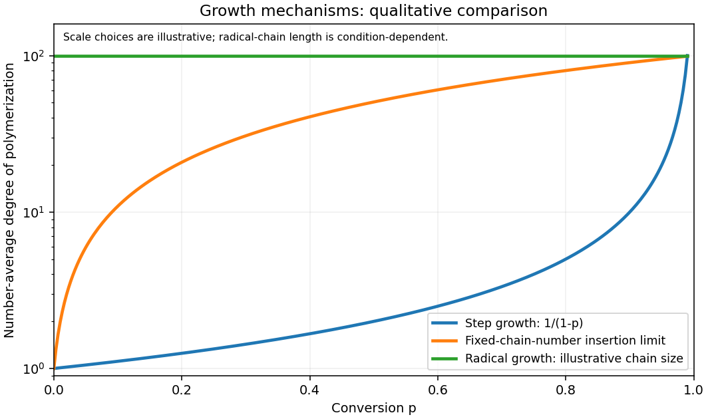

<h1 id="1/b/solution">Solution</h1>

↑ **Parent:** [B](../b.md)

In (i), any pair of compatible functional groups can react: [monomers](../../../../../monomer.md), oligomers and long chains all participate. For an equimolar, strictly bifunctional mixture without [cyclization in step-growth polymerization](../../../../../cyclization-in-step-growth-polymerization.md), the [Carothers equation](../../../../../carothers-equation.md) gives

$$
\boxed{\overline X_n=\frac{1}{1-p}.}
$$

Here $p$ is functional-group conversion and $\overline X_n$ counts the original [monomer](../../../../../monomer.md) [molecules](../../../../../molecule-split.md). Large [degree of polymerization](../../../../../degree-of-polymerization.md) therefore requires nearly complete conversion.

In (ii), growth occurs only at the metal-bound chain end. If initiation is rapid and [chain transfer in chain polymerization](../../../../../chain-transfer-in-chain-polymerization.md) is negligible, the number of chains is fixed and

$$
\overline X_n\simeq \frac{[M]_0}{[I]_0}p.
$$

This is the linear conversion dependence of [living polymerization](../../../../../living-polymerization.md). Actual zirconocene systems can undergo chain transfer, so linear growth is a limiting model, not a consequence of [coordination polymerization](../../../../../coordination-polymerization.md) alone.

In (iv), a newly initiated chain rapidly attains a large size and then undergoes [radical termination](../../../../../radical-termination.md). Further conversion mostly creates additional chains. Thus high [degree of polymerization](../../../../../degree-of-polymerization.md) can occur at low conversion, without the systematic linear increase of an ideal living system. [temperature](../../../../../temperature-split.md), initiator depletion and [monomer](../../../../../monomer.md) depletion can change that size during the run.

**[Figure 1](#1/b/image-contrasting-idealized-degrees-of-polymerization-during-three-growth-mechanisms). Contrasting idealized degrees of polymerization during three growth mechanisms**.

## ↑ Ancestors (13)

1. [B](../b.md)
2. [1](../../1.md)
3. [Paper 1](../../../paper-1-split.md)
4. [2022](../../../split.md)
5. [Past exam of the chemistry course of the year 4 of the natural sciences course of the University of Cambridge](../../../../split.md)
6. [Chemistry course of the year 4 of the natural sciences course of the University of Cambridge](../../../../../chemistry-course-of-the-year-4-of-the-natural-sciences-course-of-the-university-of-cambridge.md)
7. [Year 4 of the natural sciences course of the University of Cambridge](../../../../../year-4-of-the-natural-sciences-course-of-the-university-of-cambridge.md)
8. [Year of the natural sciences course of the University of Cambridge](../../../../../year-of-the-natural-sciences-course-of-the-university-of-cambridge.md)
9. [Natural sciences course of the University of Cambridge](../../../../../natural-sciences-course-of-the-university-of-cambridge.md)
10. [Course of the University of Cambridge](../../../../../course-of-the-university-of-cambridge.md)
11. [University of Cambridge](../../../../../university-of-cambridge-split.md)
12. [List of universities](../../../../../list-of-universities.md)
13. [Codex Wiki](../../../../../split.md)
