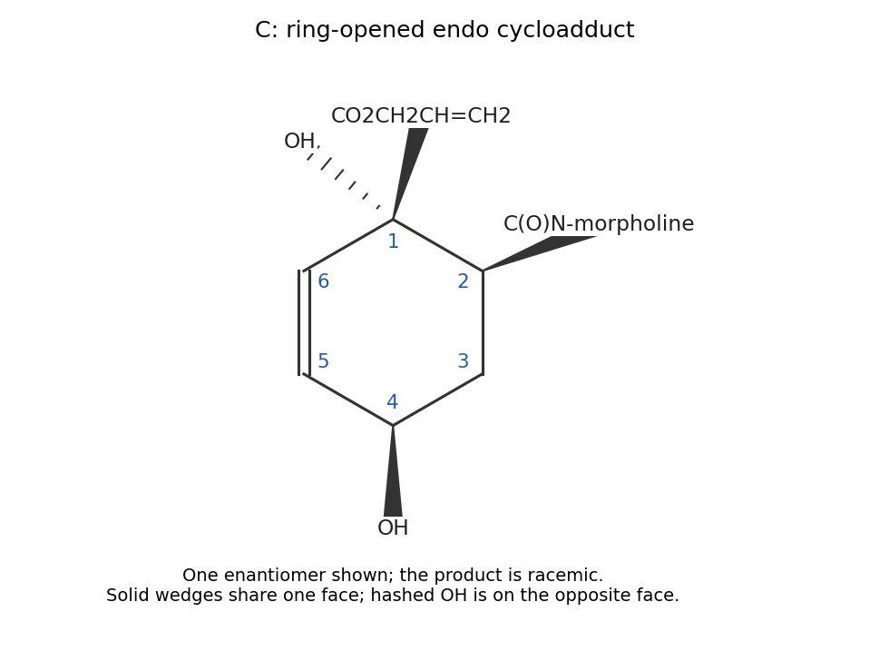

<h1 id="16/a/solution">Solution</h1>

↑ **Parent:** [A](../a.md)

The first step is an endo-selective [Diels-Alder reaction](../../../../../diels-alder-reaction.md) of the pyrone diene with the electron-poor acrylamide. Number the pyrone $O1-C2(=O)-C3(OH)=C4-C5=C6$, and the acrylamide carbons $C_\alpha$ and $C_\beta$, with $C_\alpha$ next to its [carbonyl](../../../../../carbonyl-group.md). The favored polar connection is **C3–C$_\alpha$ and C6–C$_\beta$**, leaving C4=C5 and the original C2–O1 lactone bridge intact.

Lithium allyloxide, generated from [n-Butyllithium](../../../../../n-butyllithium.md) and allyl [alcohol](../../../../../alcohol.md), attacks the bridging lactone [carbonyl](../../../../../carbonyl-group.md). Collapse of the [tetrahedral intermediate](../../../../../tetrahedral-intermediate.md) cleaves its acyl–oxygen bond. [proton transfer](../../../../../proton-transfer.md) converts the former O1 bridge into an OH substituent at C6 and leaves the former pyrone [carbonyl](../../../../../carbonyl-group.md) as an allyl [ester](../../../../../ester.md) attached to C3. The morpholine [amide](../../../../../amide.md) is retained.

Thus **C is allyl 1,4-dihydroxy-2-(morpholine-4-carbonyl)cyclohex-5-ene-1-carboxylate**, with the [stereochemistry](../../../../../stereochemistry-split.md) described below. In this product numbering C1 is the former pyrone C3, C2 is the acrylamide $C_\alpha$, C3 is $C_\beta$, and C4 is the former pyrone C6.

**[Figure 5](#16/a/image-predicted-ring-opened-pyrone-cycloadduct-with-explicit-relative-stereochemistry). Predicted ring-opened pyrone cycloadduct with explicit relative stereochemistry**.

The bridge fixes the former C3 carboxyl group and C6 oxygen on the same face. An endo acrylamide places its [amide](../../../../../amide.md) substituent on that face too. Accordingly **CO$_2$allyl at C1, the C2 [amide](../../../../../amide.md) and the C4 OH are cis; the C1 OH is on the opposite face**. The alternative face of attack gives the [enantiomer](../../../../../enantiomer.md), so achiral reagents give a racemate. The $1731\ \mathrm{cm^{-1}}$ band is consistent with the newly formed [ester](../../../../../ester.md), while the strong lower-frequency band is consistent with the retained, strongly polarized [amide](../../../../../amide.md) [carbonyl](../../../../../carbonyl-group.md). These bands support carbonyl-class retention; they do not independently prove the predicted regioisomer or [stereochemistry](../../../../../stereochemistry-split.md).

## ↑ Ancestors (13)

1. [A](../a.md)
2. [16](../../16.md)
3. [Paper 1](../../../paper-1-split.md)
4. [2022](../../../split.md)
5. [Past exam of the chemistry course of the year 4 of the natural sciences course of the University of Cambridge](../../../../split.md)
6. [Chemistry course of the year 4 of the natural sciences course of the University of Cambridge](../../../../../chemistry-course-of-the-year-4-of-the-natural-sciences-course-of-the-university-of-cambridge.md)
7. [Year 4 of the natural sciences course of the University of Cambridge](../../../../../year-4-of-the-natural-sciences-course-of-the-university-of-cambridge.md)
8. [Year of the natural sciences course of the University of Cambridge](../../../../../year-of-the-natural-sciences-course-of-the-university-of-cambridge.md)
9. [Natural sciences course of the University of Cambridge](../../../../../natural-sciences-course-of-the-university-of-cambridge.md)
10. [Course of the University of Cambridge](../../../../../course-of-the-university-of-cambridge.md)
11. [University of Cambridge](../../../../../university-of-cambridge-split.md)
12. [List of universities](../../../../../list-of-universities.md)
13. [Codex Wiki](../../../../../split.md)
