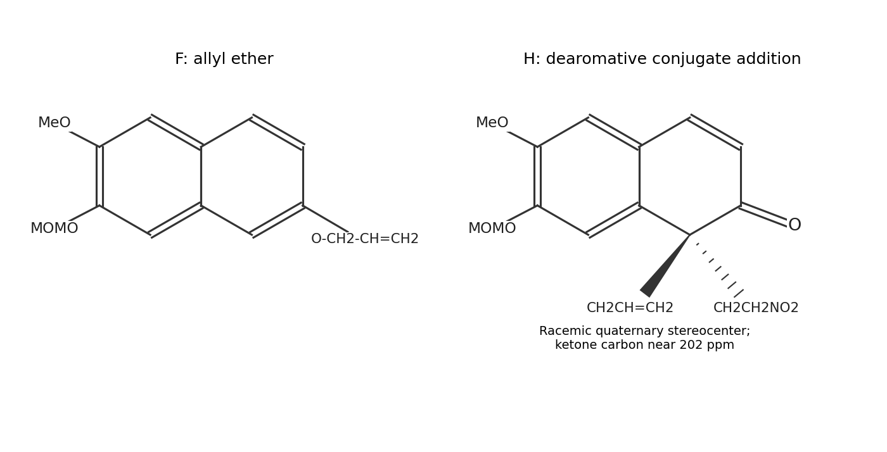

<h1 id="16/b/solution">Solution</h1>

↑ **Parent:** [B](../b.md)

The terminal alkene of D first undergoes [Wacker oxidation](../../../../../wacker-oxidation.md), giving the side chain $\mathrm{Ar-CH_2-CH_2-COCH_3}$. Alkene coordination to Pd(II), water attack, [proton transfers](../../../../../proton-transfer.md) and [beta-hydride elimination](../../../../../beta-hydride-elimination.md) give the [ketone](../../../../../ketone.md). Copper and oxygen regenerate the active palladium oxidation state.

Base removes a [proton](../../../../../proton.md) from the terminal methyl of that [ketone](../../../../../ketone.md). Its [enolate](../../../../../enolate.md) attacks the neighboring aromatic aldehyde intramolecularly, closing a six-membered ring. Dehydration gives a conjugated cyclohexadienone-type intermediate, and [keto-enol tautomerism](../../../../../keto-enol-tautomerism.md) furnishes aromatic naphthol E. The retained methoxy and MOM-protected oxygen groups follow the original aromatic-carbon positions.

**F is the O-allyl ether of E.** Carbonate forms the naphthoxide and allyl bromide undergoes an [SN2 reaction](../../../../../sn2-reaction.md) at its terminal carbon. Heating F then causes a \[3,3\]-[Claisen rearrangement](../../../../../claisen-rearrangement.md): the O–allyl bond breaks, the terminal allyl carbon bonds to the adjacent naphthalene C1, and the phenolic carbon temporarily becomes a [ketone](../../../../../ketone.md). Rearomatization gives G, with a free phenolic OH and a C1 allyl group. The C1 position gives the favored alpha-substituted naphthol and avoids the alternative less favorable annulation pattern.

The final step is a **dearomative [Michael addition](../../../../../michael-addition.md)**, not a Nef conversion of the nitro group. Hydrogen bonding from the thiourea activates nitroethylene. The nucleophilic C1 resonance form of G attacks the terminal carbon of $\mathrm{CH_2=CHNO_2}$, and [proton transfer](../../../../../proton-transfer.md) converts the nitronate to a 2-nitroethyl substituent. The phenolic carbon becomes a [ketone](../../../../../ketone.md).

**H is the corresponding 1-allyl-1-(2-nitroethyl)naphthalen-2-one**, retaining the methoxy and MOM substituents of G. The second ring now has a C2=O group and a C3=C4 bond, while the other ring remains aromatic. The reported $^{13}$C signal near $202$ ppm is consistent with that newly formed [ketone](../../../../../ketone.md). Related dearomative additions establish this reaction class.[Abstract, addition of nitroethylene to alpha-substituted beta-naphthols](../../../../../asymmetric-dearomatization-of-beta-naphthols-through-a-bifunctional-thiourea-catalyzed-michael-reaction-by-shou-guo-wang-and-others.md)

C1 is now an all-carbon quaternary [stereocenter](../../../../../stereocenter.md) bearing both allyl and 2-nitroethyl groups. Both the drawn thiourea and the starting materials are achiral, so **H is racemic**. A chiral [catalyst](../../../../../catalyst.md) would be needed to select one absolute configuration.

**[Figure 6](#16/b/image-o-allyl-intermediate-and-dearomative-michael-addition-product). O-allyl intermediate and dearomative Michael-addition product**.

## ↑ Ancestors (13)

1. [B](../b.md)
2. [16](../../16.md)
3. [Paper 1](../../../paper-1-split.md)
4. [2022](../../../split.md)
5. [Past exam of the chemistry course of the year 4 of the natural sciences course of the University of Cambridge](../../../../split.md)
6. [Chemistry course of the year 4 of the natural sciences course of the University of Cambridge](../../../../../chemistry-course-of-the-year-4-of-the-natural-sciences-course-of-the-university-of-cambridge.md)
7. [Year 4 of the natural sciences course of the University of Cambridge](../../../../../year-4-of-the-natural-sciences-course-of-the-university-of-cambridge.md)
8. [Year of the natural sciences course of the University of Cambridge](../../../../../year-of-the-natural-sciences-course-of-the-university-of-cambridge.md)
9. [Natural sciences course of the University of Cambridge](../../../../../natural-sciences-course-of-the-university-of-cambridge.md)
10. [Course of the University of Cambridge](../../../../../course-of-the-university-of-cambridge.md)
11. [University of Cambridge](../../../../../university-of-cambridge-split.md)
12. [List of universities](../../../../../list-of-universities.md)
13. [Codex Wiki](../../../../../split.md)
