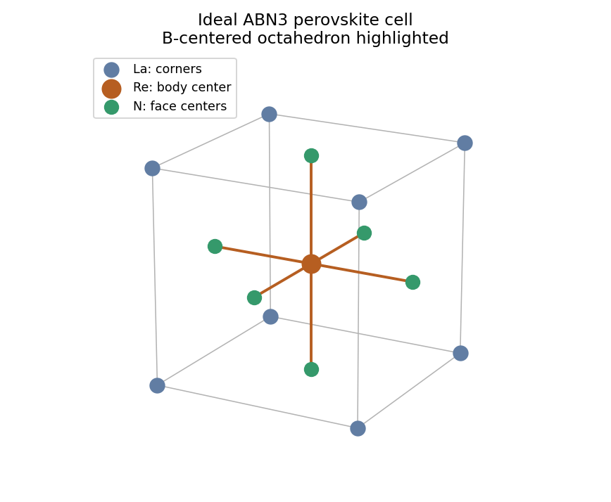

<h1 id="2/b/i/solution">Solution</h1>

↑ **Parent:** [I](../i.md)

An ideal cubic [perovskite structure](../../../../../../perovskite-structure.md) is obtained by putting **La at the cube corners, Re at the body center, and N at the face centers**. In [fractional crystal coordinates](../../../../../../fractional-crystal-coordinate.md) one convenient basis is

$$
\mathrm{La}:(0,0,0),\qquad
\mathrm{Re}:(\tfrac12,\tfrac12,\tfrac12),\qquad
\mathrm N:(\tfrac12,\tfrac12,0),(\tfrac12,0,\tfrac12),(0,\tfrac12,\tfrac12).
$$

The counting is $8/8=1$ La, one Re and $6/2=3$ N per cell. Corner-sharing $\mathrm{ReN_6}$ [octahedra](../../../../../../octahedron.md) form the network, with La in the larger interstices. The ideal cell illustrates the connectivity; octahedral tilting can lower the actual [crystal symmetry](../../../../../../crystal-symmetry.md).

**[Figure 2](#2/b/i/image-ideal-perovskite-connectivity-for-lanthanum-rhenium-nitride). Ideal perovskite connectivity for lanthanum rhenium nitride**.

## ↑ Ancestors (14)

1. [I](../i.md)
2. [B](../../b.md)
3. [2](../../../2.md)
4. [Paper 1](../../../../paper-1-split.md)
5. [2022](../../../../split.md)
6. [Past exam of the chemistry course of the year 4 of the natural sciences course of the University of Cambridge](../../../../../split.md)
7. [Chemistry course of the year 4 of the natural sciences course of the University of Cambridge](../../../../../../chemistry-course-of-the-year-4-of-the-natural-sciences-course-of-the-university-of-cambridge.md)
8. [Year 4 of the natural sciences course of the University of Cambridge](../../../../../../year-4-of-the-natural-sciences-course-of-the-university-of-cambridge.md)
9. [Year of the natural sciences course of the University of Cambridge](../../../../../../year-of-the-natural-sciences-course-of-the-university-of-cambridge.md)
10. [Natural sciences course of the University of Cambridge](../../../../../../natural-sciences-course-of-the-university-of-cambridge.md)
11. [Course of the University of Cambridge](../../../../../../course-of-the-university-of-cambridge.md)
12. [University of Cambridge](../../../../../../university-of-cambridge-split.md)
13. [List of universities](../../../../../../list-of-universities.md)
14. [Codex Wiki](../../../../../../split.md)
