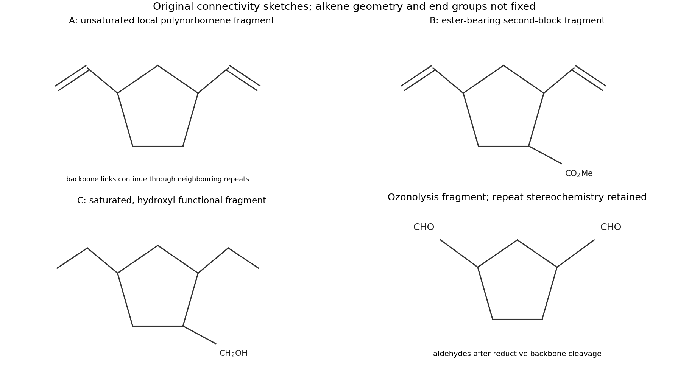
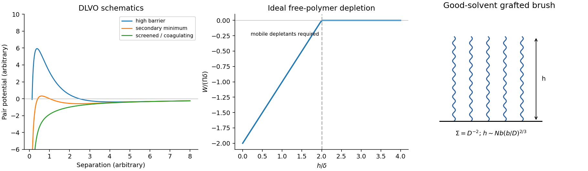
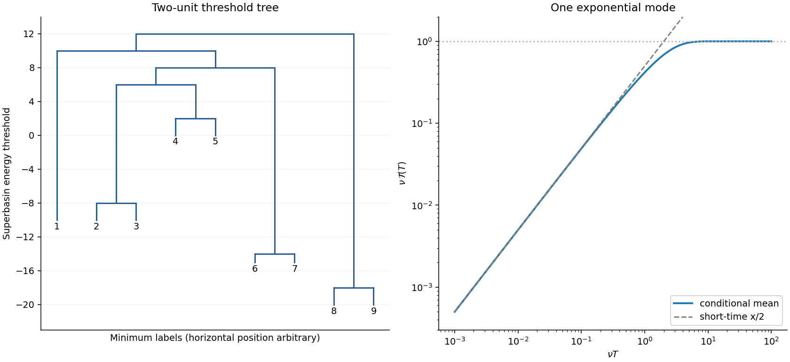
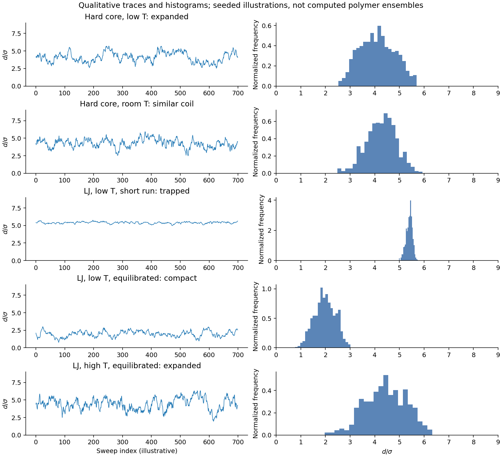
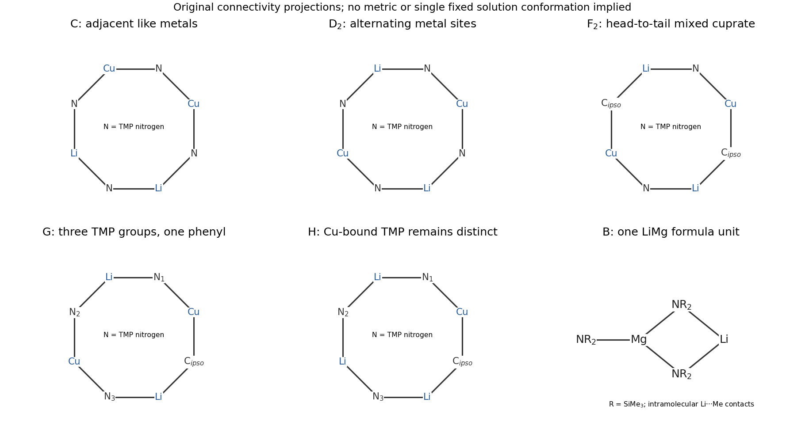
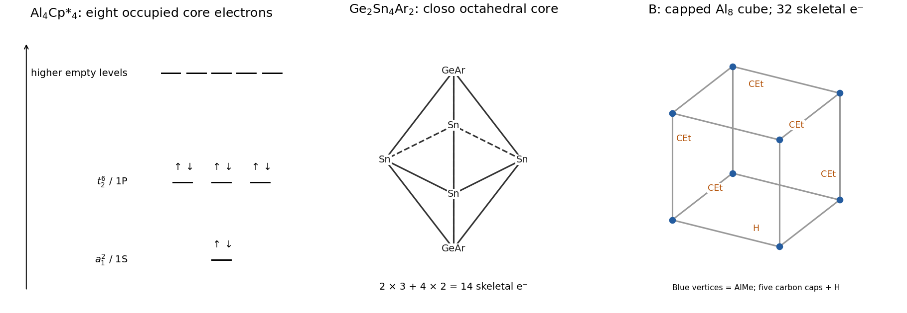
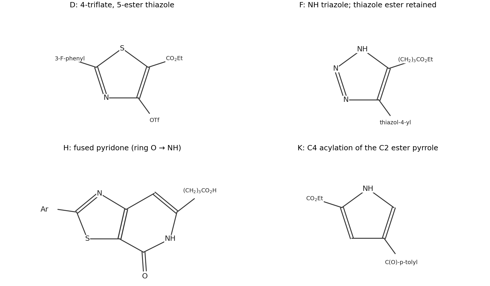

# Paper 2

↑ **Parent:** [2022](../2022.md)

[Original public PDF, physical pages 187–219](https://www.whatdotheyknow.com/request/nst_chemistry_past_papers_2022/response/2088679/attach/3/FOI%202022%20476%20Whittaker%20materials.pdf?cookie_passthrough=1#page=187)

Questions 18–35 occur once below. Q33 also has a revised source page, identified beside its affected calculations.

**Table of contents**

- [Section A](#section-a)
  - [18](#section-a/18)
    - [a](#section-a/18/a)
      - [Solution](#section-a/18/a/solution)
    - [b](#section-a/18/b)
      - [Solution](#section-a/18/b/solution)
    - [c](#section-a/18/c)
      - [Solution](#section-a/18/c/solution)
    - [d](#section-a/18/d)
      - [Solution](#section-a/18/d/solution)
    - [e](#section-a/18/e)
      - [Solution](#section-a/18/e/solution)
    - [f](#section-a/18/f)
      - [Solution](#section-a/18/f/solution)
  - [19](#section-a/19)
    - [a](#section-a/19/a)
      - [Solution](#section-a/19/a/solution)
    - [b](#section-a/19/b)
      - [Solution](#section-a/19/b/solution)
    - [c](#section-a/19/c)
      - [Solution](#section-a/19/c/solution)
    - [d](#section-a/19/d)
      - [Solution](#section-a/19/d/solution)
    - [e](#section-a/19/e)
      - [Solution](#section-a/19/e/solution)
- [Section B](#section-b)
  - [20](#section-b/20)
    - [a](#section-b/20/a)
      - [Solution](#section-b/20/a/solution)
    - [b](#section-b/20/b)
      - [i](#section-b/20/b/i)
        - [Solution](#section-b/20/b/i/solution)
      - [ii](#section-b/20/b/ii)
        - [Solution](#section-b/20/b/ii/solution)
    - [c](#section-b/20/c)
      - [i](#section-b/20/c/i)
        - [Solution](#section-b/20/c/i/solution)
      - [ii](#section-b/20/c/ii)
        - [Solution](#section-b/20/c/ii/solution)
      - [iii](#section-b/20/c/iii)
        - [Solution](#section-b/20/c/iii/solution)
    - [d](#section-b/20/d)
      - [i](#section-b/20/d/i)
        - [Solution](#section-b/20/d/i/solution)
      - [ii](#section-b/20/d/ii)
        - [Solution](#section-b/20/d/ii/solution)
  - [21](#section-b/21)
    - [a](#section-b/21/a)
      - [Solution](#section-b/21/a/solution)
    - [b](#section-b/21/b)
      - [Solution](#section-b/21/b/solution)
    - [c](#section-b/21/c)
      - [Solution](#section-b/21/c/solution)
    - [d](#section-b/21/d)
      - [Solution](#section-b/21/d/solution)
    - [e](#section-b/21/e)
      - [Solution](#section-b/21/e/solution)
    - [f](#section-b/21/f)
      - [Solution](#section-b/21/f/solution)
    - [g](#section-b/21/g)
      - [Solution](#section-b/21/g/solution)
- [Section C](#section-c)
  - [22](#section-c/22)
    - [a](#section-c/22/a)
      - [i](#section-c/22/a/i)
        - [Solution](#section-c/22/a/i/solution)
      - [ii](#section-c/22/a/ii)
        - [Solution](#section-c/22/a/ii/solution)
      - [iii](#section-c/22/a/iii)
        - [Solution](#section-c/22/a/iii/solution)
    - [b](#section-c/22/b)
      - [Solution](#section-c/22/b/solution)
  - [23](#section-c/23)
    - [a](#section-c/23/a)
      - [Solution](#section-c/23/a/solution)
    - [b](#section-c/23/b)
      - [i](#section-c/23/b/i)
        - [Solution](#section-c/23/b/i/solution)
      - [ii](#section-c/23/b/ii)
        - [Solution](#section-c/23/b/ii/solution)
      - [iii](#section-c/23/b/iii)
        - [Solution](#section-c/23/b/iii/solution)
      - [iv](#section-c/23/b/iv)
        - [Solution](#section-c/23/b/iv/solution)
- [Section D](#section-d)
  - [24](#section-d/24)
    - [a](#section-d/24/a)
      - [Solution](#section-d/24/a/solution)
    - [b](#section-d/24/b)
      - [Solution](#section-d/24/b/solution)
    - [c](#section-d/24/c)
      - [Solution](#section-d/24/c/solution)
    - [d](#section-d/24/d)
      - [Solution](#section-d/24/d/solution)
    - [e](#section-d/24/e)
      - [Solution](#section-d/24/e/solution)
    - [f](#section-d/24/f)
      - [Solution](#section-d/24/f/solution)
    - [g](#section-d/24/g)
      - [Solution](#section-d/24/g/solution)
  - [25](#section-d/25)
    - [a](#section-d/25/a)
      - [i](#section-d/25/a/i)
        - [Solution](#section-d/25/a/i/solution)
      - [ii](#section-d/25/a/ii)
        - [Solution](#section-d/25/a/ii/solution)
    - [b](#section-d/25/b)
      - [i](#section-d/25/b/i)
        - [Solution](#section-d/25/b/i/solution)
      - [ii](#section-d/25/b/ii)
        - [Solution](#section-d/25/b/ii/solution)
    - [c](#section-d/25/c)
      - [i](#section-d/25/c/i)
        - [Solution](#section-d/25/c/i/solution)
      - [ii](#section-d/25/c/ii)
        - [Solution](#section-d/25/c/ii/solution)
      - [iii](#section-d/25/c/iii)
        - [Solution](#section-d/25/c/iii/solution)
    - [d](#section-d/25/d)
      - [i](#section-d/25/d/i)
        - [A](#section-d/25/d/i/a)
          - [Solution](#section-d/25/d/i/a/solution)
        - [B](#section-d/25/d/i/b)
          - [Solution](#section-d/25/d/i/b/solution)
        - [C](#section-d/25/d/i/c)
          - [Solution](#section-d/25/d/i/c/solution)
      - [ii](#section-d/25/d/ii)
        - [Solution](#section-d/25/d/ii/solution)
      - [iii](#section-d/25/d/iii)
        - [Solution](#section-d/25/d/iii/solution)
- [Section E](#section-e)
  - [26](#section-e/26)
    - [a](#section-e/26/a)
      - [i](#section-e/26/a/i)
        - [Solution](#section-e/26/a/i/solution)
      - [ii](#section-e/26/a/ii)
        - [Solution](#section-e/26/a/ii/solution)
    - [b](#section-e/26/b)
      - [i](#section-e/26/b/i)
        - [Solution](#section-e/26/b/i/solution)
      - [ii](#section-e/26/b/ii)
        - [Solution](#section-e/26/b/ii/solution)
    - [c](#section-e/26/c)
      - [Solution](#section-e/26/c/solution)
    - [d](#section-e/26/d)
      - [i](#section-e/26/d/i)
        - [Solution](#section-e/26/d/i/solution)
      - [ii](#section-e/26/d/ii)
        - [Solution](#section-e/26/d/ii/solution)
    - [e](#section-e/26/e)
      - [Solution](#section-e/26/e/solution)
  - [27](#section-e/27)
    - [a](#section-e/27/a)
      - [i](#section-e/27/a/i)
        - [Solution](#section-e/27/a/i/solution)
      - [ii](#section-e/27/a/ii)
        - [Solution](#section-e/27/a/ii/solution)
    - [b](#section-e/27/b)
      - [Solution](#section-e/27/b/solution)
    - [c](#section-e/27/c)
      - [Solution](#section-e/27/c/solution)
    - [d](#section-e/27/d)
      - [Solution](#section-e/27/d/solution)
    - [e](#section-e/27/e)
      - [Solution](#section-e/27/e/solution)
- [Section F](#section-f)
  - [28](#section-f/28)
    - [a](#section-f/28/a)
      - [Solution](#section-f/28/a/solution)
    - [b](#section-f/28/b)
      - [Solution](#section-f/28/b/solution)
    - [c](#section-f/28/c)
      - [Solution](#section-f/28/c/solution)
    - [d](#section-f/28/d)
      - [Solution](#section-f/28/d/solution)
    - [e](#section-f/28/e)
      - [Solution](#section-f/28/e/solution)
  - [29](#section-f/29)
    - [a](#section-f/29/a)
      - [Solution](#section-f/29/a/solution)
    - [b](#section-f/29/b)
      - [Solution](#section-f/29/b/solution)
    - [c](#section-f/29/c)
      - [Solution](#section-f/29/c/solution)
- [Section G](#section-g)
  - [30](#section-g/30)
    - [a](#section-g/30/a)
      - [i](#section-g/30/a/i)
        - [Solution](#section-g/30/a/i/solution)
      - [ii](#section-g/30/a/ii)
        - [Solution](#section-g/30/a/ii/solution)
    - [b](#section-g/30/b)
      - [Solution](#section-g/30/b/solution)
    - [c](#section-g/30/c)
      - [Solution](#section-g/30/c/solution)
    - [d](#section-g/30/d)
      - [Solution](#section-g/30/d/solution)
    - [e](#section-g/30/e)
      - [i](#section-g/30/e/i)
        - [Solution](#section-g/30/e/i/solution)
      - [ii](#section-g/30/e/ii)
        - [Solution](#section-g/30/e/ii/solution)
  - [31](#section-g/31)
    - [a](#section-g/31/a)
      - [Solution](#section-g/31/a/solution)
    - [b](#section-g/31/b)
      - [Solution](#section-g/31/b/solution)
    - [c](#section-g/31/c)
      - [i](#section-g/31/c/i)
        - [Solution](#section-g/31/c/i/solution)
      - [ii](#section-g/31/c/ii)
        - [Solution](#section-g/31/c/ii/solution)
    - [d](#section-g/31/d)
      - [i](#section-g/31/d/i)
        - [Solution](#section-g/31/d/i/solution)
      - [ii](#section-g/31/d/ii)
        - [Solution](#section-g/31/d/ii/solution)
      - [iii](#section-g/31/d/iii)
        - [Solution](#section-g/31/d/iii/solution)
- [Section H](#section-h)
  - [32](#section-h/32)
    - [a](#section-h/32/a)
      - [Solution](#section-h/32/a/solution)
    - [b](#section-h/32/b)
      - [Solution](#section-h/32/b/solution)
    - [c](#section-h/32/c)
      - [i](#section-h/32/c/i)
        - [Solution](#section-h/32/c/i/solution)
      - [ii](#section-h/32/c/ii)
        - [Solution](#section-h/32/c/ii/solution)
    - [d](#section-h/32/d)
      - [Solution](#section-h/32/d/solution)
  - [33](#section-h/33)
    - [a](#section-h/33/a)
      - [Solution](#section-h/33/a/solution)
    - [b](#section-h/33/b)
      - [i](#section-h/33/b/i)
        - [Solution](#section-h/33/b/i/solution)
      - [ii](#section-h/33/b/ii)
        - [Solution](#section-h/33/b/ii/solution)
      - [iii](#section-h/33/b/iii)
        - [Solution](#section-h/33/b/iii/solution)
      - [iv](#section-h/33/b/iv)
        - [Solution](#section-h/33/b/iv/solution)
      - [v](#section-h/33/b/v)
        - [Solution](#section-h/33/b/v/solution)
    - [c](#section-h/33/c)
      - [Solution](#section-h/33/c/solution)
    - [d](#section-h/33/d)
      - [i](#section-h/33/d/i)
        - [Solution](#section-h/33/d/i/solution)
      - [ii](#section-h/33/d/ii)
        - [Solution](#section-h/33/d/ii/solution)
      - [iii](#section-h/33/d/iii)
        - [Solution](#section-h/33/d/iii/solution)
- [Section I](#section-i)
  - [34](#section-i/34)
    - [a](#section-i/34/a)
      - [Solution](#section-i/34/a/solution)
    - [b](#section-i/34/b)
      - [Solution](#section-i/34/b/solution)
    - [c](#section-i/34/c)
      - [i](#section-i/34/c/i)
        - [Solution](#section-i/34/c/i/solution)
      - [ii](#section-i/34/c/ii)
        - [Solution](#section-i/34/c/ii/solution)
      - [iii](#section-i/34/c/iii)
        - [Solution](#section-i/34/c/iii/solution)
      - [iv](#section-i/34/c/iv)
        - [Solution](#section-i/34/c/iv/solution)
  - [35](#section-i/35)
    - [a](#section-i/35/a)
      - [i](#section-i/35/a/i)
        - [Solution](#section-i/35/a/i/solution)
      - [ii](#section-i/35/a/ii)
        - [Solution](#section-i/35/a/ii/solution)
      - [iii](#section-i/35/a/iii)
        - [Solution](#section-i/35/a/iii/solution)
    - [b](#section-i/35/b)
      - [i](#section-i/35/b/i)
        - [Solution](#section-i/35/b/i/solution)
      - [ii](#section-i/35/b/ii)
        - [Solution](#section-i/35/b/ii/solution)
    - [c](#section-i/35/c)
      - [i](#section-i/35/c/i)
        - [Solution](#section-i/35/c/i/solution)
      - [ii](#section-i/35/c/ii)
        - [Solution](#section-i/35/c/ii/solution)
      - [iii](#section-i/35/c/iii)
        - [Solution](#section-i/35/c/iii/solution)

## Section A

↑ **Parent:** [Paper 2](paper-2.md)

<h3 id="section-a/18">18</h3>

↑ **Parent:** [Section A](#section-a)

<h4 id="section-a/18/a">a</h4>

↑ **Parent:** [18](#section-a/18)

<h5 id="section-a/18/a/solution">Solution</h5>

↑ **Parent:** [A](#section-a/18/a)

**A is poly(norbornene); B is the corresponding sequential [block copolymer](../../polymer.md#block-copolymer) with a methyl-ester-substituted second block.** The process is [ring-opening metathesis polymerization](../../polymer.md#ring-opening-metathesis-polymerization). Each strained bicyclic [alkene](../../chemical-substance.md#alkene) becomes a cyclopentane unit whose two backbone attachment positions are joined to neighbouring units through $\mathrm{-CH=CH-}$ links. The second block retains its $\mathrm{CO_2Me}$ substituent on the cyclopentane framework. Thus a useful connectivity representation is $\mathrm{end-[CH=CH-C_5H_8]_{n}-[CH=CH-C_5H_7(CO_2Me)]_{m}-end}$, with the cyclopentane attachment positions at 1 and 3. This representation specifies connectivity rather than a single backbone [alkene](../../chemical-substance.md#alkene) geometry.

The ruthenium [alkylidene](../../chemical-substance.md#alkylidene) reacts with a [monomer](../../polymer.md#monomer) [alkene](../../chemical-substance.md#alkene) through a [metallacyclobutane](../../chemistry.md#metallacyclobutane), then fragments with the other pair of bonds broken. A new ruthenium [alkylidene](../../chemical-substance.md#alkylidene) remains at the growing end, allowing propagation and then addition of the second [monomer](../../polymer.md#monomer). Relief of the bicyclic [monomer](../../polymer.md#monomer)'s [ring strain](../../chemistry.md#ring-strain) supplies the principal enthalpic driving force; the loss of [monomer](../../polymer.md#monomer) translational [entropy](../../entropy.md) opposes [polymerization](../../polymer.md#polymerization). Sequential addition yields blocks only if the first population of active ends survives until the second addition.<a id="section-a/18/a/image-original-polymer-connectivity-fragments-and-the-reductive-ozonolysis-product"></a>




**[Figure 1](#section-a/18/a/image-original-polymer-connectivity-fragments-and-the-reductive-ozonolysis-product). Original polymer connectivity fragments and the reductive ozonolysis product**.

<h4 id="section-a/18/b">b</h4>

↑ **Parent:** [18](#section-a/18)

<h5 id="section-a/18/b/solution">Solution</h5>

↑ **Parent:** [B](#section-a/18/b)

With one growing chain per ruthenium initiator and negligible [chain transfer](../../polymer.md#chain-transfer-in-chain-polymerization), consumption of [monomer](../../polymer.md#monomer) gives

$$
\boxed{DP_n=\frac{[M]_0}{[I]_0}x=50(0.98)=49.}
$$

The conversion factor applies to incorporated [monomer](../../polymer.md#monomer) units, not the number of active chains. Slow initiation or inactive initiator would invalidate this ideal [living polymerization](../../polymer.md#living-polymerization) estimate.

<h4 id="section-a/18/c">c</h4>

↑ **Parent:** [18](#section-a/18)

<h5 id="section-a/18/c/solution">Solution</h5>

↑ **Parent:** [C](#section-a/18/c)

A sufficiently phase-separated [block copolymer](../../polymer.md#block-copolymer) can show **two [glass transitions](../../chemical-substance.md#glass-transition), associated approximately with its two microdomains**. Simultaneous feeding instead tends to distribute the [monomers](../../polymer.md#monomer) along each chain, giving a [statistical copolymer](../../polymer.md#statistical-copolymer) and usually one composition-dependent [glass transition](../../chemical-substance.md#glass-transition). Different [monomer](../../polymer.md#monomer) reactivities could produce a gradient rather than a perfectly random sequence.

For a homogeneous mixture an approximate interpolation is the [Fox equation](../../chemical-substance.md#fox-equation), $T_g^{-1}=w_1/T_{g1}+w_2/T_{g2}$, with temperatures in kelvin. Two transitions are not guaranteed merely by block architecture: short blocks, miscibility or insufficient experimental resolution can give one broad transition. The contrast is between domain-specific segmental environments and a more uniform mixed environment.

<h4 id="section-a/18/d">d</h4>

↑ **Parent:** [18](#section-a/18)

<h5 id="section-a/18/d/solution">Solution</h5>

↑ **Parent:** [D](#section-a/18/d)

**C has a saturated backbone and pendant $\mathrm{CH_2OH}$ groups in its second block.** [Hydrogenation](../../chemical-reaction.md#hydrogenation) converts every backbone $\mathrm{CH=CH}$ to $\mathrm{CH_2CH_2}$; [lithium aluminium hydride](../../chemical-substance.md#lithium-aluminium-hydride) then reduces each $\mathrm{CO_2Me}$ to $\mathrm{CH_2OH}$. The resulting connectivity is $\mathrm{[CH_2CH_2-C_5H_8]_{50}-[CH_2CH_2-C_5H_7(CH_2OH)]_{75}}$.

[Hydrogenation](../../chemical-reaction.md#hydrogenation) removes local double-bond rigidity and commonly lowers the segmental barrier to motion, favouring a lower [glass transition temperature](../../chemical-substance.md#glass-transition-temperature). [Ester](../../chemical-substance.md#ester) reduction changes polarity and side-group volume, while the new hydroxyl groups introduce [hydrogen bonding](../../chemical-bond.md#hydrogen-bonding), which can raise the hydroxyl-rich block's [glass transition temperature](../../chemical-substance.md#glass-transition-temperature) and strengthen segregation. These competing effects preclude a numerical transition shift or an unconditional direction for both transitions from structure alone.

The repeat-unit formulae after both operations are $\mathrm{C_7H_{12}}$ and $\mathrm{C_8H_{14}O}$. Taking standard atomic masses,

$$
\boxed{M_{n,\mathrm{repeat}}=50(96.173)+75(126.199)=1.4274\times10^4\ \mathrm{g\,mol^{-1}}.}
$$

This is **approximately 14.27 kg mol$^{-1}$ plus the net end-group mass**. The termination chemistry is unspecified, so a more precise whole-chain mass is not determined; the methyl group lost during [ester](../../chemical-substance.md#ester) reduction must not remain in the second repeat's mass.

<h4 id="section-a/18/e">e</h4>

↑ **Parent:** [18](#section-a/18)

<h5 id="section-a/18/e/solution">Solution</h5>

↑ **Parent:** [E](#section-a/18/e)

Pendant [alcohols](../../chemical-substance.md#alcohol) can form **reversible [borate](../../chemical-substance.md#borate) bridges**, schematically $\mathrm{P-O-B(OH)-O-P'}$ and $\mathrm{B(O-P)_3}$, where P and P′ belong to different chains. Tetrahedral [borate](../../chemical-substance.md#borate) species are also possible depending on pH and water content. A bridge must connect different network strands to act as a [cross-link](../../polymer.md#cross-link); an intrachain loop does not contribute equivalently to elasticity.

Between [cross-links](../../polymer.md#cross-link), stretching reduces the number of accessible chain conformations. A simple incompressible [rubber elasticity](../../polymer.md#rubber-elasticity) model gives the nominal tensile stress

$$
\boxed{\sigma_{\rm nominal}=G(\lambda-\lambda^{-2}),\qquad G\simeq\nu_e k_BT,}
$$

where $\lambda$ is the extension ratio and $\nu_e$ the density of elastically active strands. The initial response is soft; stronger extension gives increasing stress and ultimately finite-chain extensibility. Reversible [borate](../../chemical-substance.md#borate) exchange permits [stress relaxation](../../rheology.md#stress-relaxation), rate dependence and a loading–unloading [hysteresis](../../critical-phenomenon.md#hysteresis) loop, rather than permanent ideal elasticity at arbitrarily long times.

<a id="section-a/18/e/image-original-schematic-rubber-stress-ester-block-cleavage-and-amphiphilic-assembly"></a>


**[Figure 2](#section-a/18/e/image-original-schematic-rubber-stress-ester-block-cleavage-and-amphiphilic-assembly). Original schematic rubber stress, ester-block cleavage and amphiphilic assembly**.

<h4 id="section-a/18/f">f</h4>

↑ **Parent:** [18](#section-a/18)

<h5 id="section-a/18/f/solution">Solution</h5>

↑ **Parent:** [F](#section-a/18/f)

**Reductive [ozonolysis](../../chemical-reaction.md#ozonolysis) cuts the unsaturated backbone into cyclopentane-1,3-dicarbaldehyde units**, apart from end fragments. Both [alkene](../../chemical-substance.md#alkene) carbons carry a hydrogen, so the carbonyl products are [aldehydes](../../chemical-substance.md#aldehyde) rather than [ketones](../../chemical-substance.md#ketone). Ring substituent [stereochemistry](../../stereochemistry.md) is inherited from the [polymer](../../polymer.md) repeat; backbone E/Z geometry does not survive cleavage.

Ozone adds across a backbone [alkene](../../chemical-substance.md#alkene) by [cycloaddition](../../chemical-reaction.md#cycloaddition), giving a primary ozonide. Its fragmentation produces a [carbonyl group](../../chemical-bond.md#carbonyl-group) and a [carbonyl oxide](../../chemical-substance.md#carbonyl-oxide), which recombine to a secondary ozonide. [Dimethyl sulfide](../../chemical-substance.md#dimethyl-sulfide) reduces the peroxide-containing intermediate, forming dimethyl sulfoxide and the two carbonyl termini. Repetition at every backbone double bond liberates the dialdehyde. An oxidizing work-up would instead risk oxidation to carboxylic acids, so the specified reductive work-up is essential.

<h3 id="section-a/19">19</h3>

↑ **Parent:** [Section A](#section-a)

<h4 id="section-a/19/a">a</h4>

↑ **Parent:** [19](#section-a/19)

<h5 id="section-a/19/a/solution">Solution</h5>

↑ **Parent:** [A](#section-a/19/a)

Let $R=\mathrm{CH_2CH(Ph)-O-TEMPO}$, so B is $\mathrm{HO-R}$. Its hydroxyl group initiates [ring-opening polymerization](../../polymer.md#ring-opening-polymerization) of lactide, giving

$$
\boxed{\mathrm{C=H-[OCH(Me)CO]_{2n}-O-CH_2CH(Ph)-O-TEMPO}.}
$$

Each lactide contributes two lactyl repeat units. Dry [monomer](../../polymer.md#monomer), exclusion of water and an alcohol-compatible catalyst such as tin(II) 2-ethylhexanoate under heating provide a practical route. [Alcohol](../../chemical-substance.md#alcohol)/metal-alkoxide exchange followed by lactide coordination and acyl–oxygen cleavage extends the [ester](../../chemical-substance.md#ester) chain while retaining a terminal hydroxyl group.

Heating C under oxygen-free conditions homolytically cleaves its benzylic C–O bond to the nitroxide, releasing a benzylic radical and TEMPO. The radical adds styrene repeatedly; reversible trapping by TEMPO controls the active radical concentration. D is therefore a **poly(lactide)–[polystyrene](../../polymer.md#polystyrene) [block copolymer](../../polymer.md#block-copolymer)** with junction $\mathrm{PLA-OCH_2CH(Ph)-[CH_2CH(Ph)]_m-O-TEMPO}$ and the hydroxyl end of PLA retained. This is [nitroxide-mediated polymerization](../../polymer.md#nitroxide-mediated-polymerization); a temperature around 120–130 °C is a representative condition for a TEMPO/styrene system, rather than an exact universal optimum.

<h4 id="section-a/19/b">b</h4>

↑ **Parent:** [19](#section-a/19)

<h5 id="section-a/19/b/solution">Solution</h5>

↑ **Parent:** [B](#section-a/19/b)

**Styrene, benzoyl peroxide and TEMPO** provide the required radical addition–trapping sequence. Heating the peroxide breaks its O–O bond into benzoyloxy radicals. Before decarboxylation, $\mathrm{PhCO_2^{\bullet}}$ can add to styrene's terminal carbon, generating the resonance-stabilized radical $\mathrm{PhCO_2CH_2\dot CHPh}$. Coupling with the oxygen-centred TEMPO radical then gives $\mathrm{PhCO_2CH_2CH(Ph)-O-TEMPO}$, the benzoate-protected alkoxyamine A.

The connectivity distinguishes this route from initiators that leave a carbon-based radical fragment at the chain end. Competition with benzoyloxy-radical decarboxylation affects yield, so this is a plausible preparation rather than a claim of exclusive product formation. Subsequent benzoate cleavage reveals B's hydroxyl group without requiring rupture of its alkoxyamine linkage.

<h4 id="section-a/19/c">c</h4>

↑ **Parent:** [19](#section-a/19)

<h5 id="section-a/19/c/solution">Solution</h5>

↑ **Parent:** [C](#section-a/19/c)

**The ideal number-average molar mass is approximately 25.11 kg mol$^{-1}$.** Quantitative uptake of 100 lactide and 100 styrene molecules per bifunctional initiator gives

$$
\boxed{M_n=M_B+100M_{\rm lactide}+100M_{\rm styrene}\simeq277.41+100(144.13)+100(104.15)=25105.4\ \mathrm{g\,mol^{-1}}.}
$$

B has formula $\mathrm{C_{17}H_{27}NO_2}$. Lactide's entire cyclic diester mass is incorporated; multiplying its molar mass by two again would double-count its two lactyl units. The estimate assumes quantitative initiation, conversion, nitroxide recapping and no chain transfer or loss of chain-end fragments.

<h4 id="section-a/19/d">d</h4>

↑ **Parent:** [19](#section-a/19)

<h5 id="section-a/19/d/solution">Solution</h5>

↑ **Parent:** [D](#section-a/19/d)

Hydroxide attacks a PLA [ester](../../chemical-substance.md#ester) carbonyl, moving the $\pi$ electrons onto oxygen. Collapse of the tetrahedral intermediate expels an alkoxide; proton transfer produces an [alcohol](../../chemical-substance.md#alcohol) and a carboxylate. The carboxylate stabilizes the hydrolysis products and makes this [saponification](../../chemical-reaction.md#saponification) effectively irreversible under the basic conditions. Repetition cleaves the PLA block, including its terminal [ester](../../chemical-substance.md#ester) linkage to the junction [alcohol](../../chemical-substance.md#alcohol), while the carbon–carbon [polystyrene](../../polymer.md#polystyrene) backbone remains intact.

**The principal surviving [polymer](../../polymer.md) is a [polystyrene](../../polymer.md#polystyrene) chain bearing the junction $\mathrm{HOCH_2CH(Ph)-}$ end and its nitroxide-derived distal end.** In [gel permeation chromatography](../../chromatography.md#size-exclusion-chromatography), the intact [block copolymer](../../polymer.md#block-copolymer) normally elutes earlier than this smaller surviving [polystyrene](../../polymer.md#polystyrene) coil. Lactate and short hydrolysis fragments elute later still, provided the column and detector resolve such small solutes. The [polymer](../../polymer.md) peak therefore shifts to larger elution volume; its height need not remain constant under a mass-sensitive detector. Elution reflects [hydrodynamic volume](../../polymer.md#hydrodynamic-volume), so calibration against [polystyrene](../../polymer.md#polystyrene) standards does not supply an exact absolute mass for the original mixed block.

<h4 id="section-a/19/e">e</h4>

↑ **Parent:** [19](#section-a/19)

<h5 id="section-a/19/e/solution">Solution</h5>

↑ **Parent:** [E](#section-a/19/e)

Replacing lactide by ethylene oxide gives

$$
\boxed{\mathrm{HO-[CH_2CH_2O]_{50}-CH_2CH(Ph)-[CH_2CH(Ph)]_{100}-O-TEMPO}.}
$$

The first chain grows by alkoxide attack on ethylene oxide, followed by protonation at work-up; the alkoxyamine subsequently controls styrene [polymerization](../../polymer.md#polymerization). The final material is an [amphiphilic block copolymer](../../polymer.md#amphiphilic-block-copolymer). In water, [polystyrene](../../polymer.md#polystyrene) avoids solvent exposure while the poly(ethylene oxide) block is hydrated. Above a concentration-dependent assembly threshold, **[micelles](../../physical-chemistry.md#micelle) with a [polystyrene](../../polymer.md#polystyrene) core and hydrated poly(ethylene oxide) corona** are a reasonable morphology. Unimers remain in equilibrium with aggregates. Core–corona assembly lowers unfavourable water contact but costs chain-stretching and translational [entropy](../../entropy.md). Block volume fractions, solvent history and concentration can instead favour cylinders or vesicles, so the chemical structure alone does not uniquely establish spherical [micelles](../../physical-chemistry.md#micelle).

## Section B

↑ **Parent:** [Paper 2](paper-2.md)

<h3 id="section-b/20">20</h3>

↑ **Parent:** [Section B](#section-b)

<h4 id="section-b/20/a">a</h4>

↑ **Parent:** [20](#section-b/20)

<h5 id="section-b/20/a/solution">Solution</h5>

↑ **Parent:** [A](#section-b/20/a)

Place the trigonal axis along $z$, the axial ligands on $\pm z$ and the equatorial ligands in the $xy$ plane. **The ordering is $e''(d_{xz},d_{yz})<e'(d_{xy},d_{x^2-y^2})<a_1'(d_{z^2})$.** The $e''$ pair has nodal behaviour along both the equatorial ligand directions and the axial axis, minimizing direct ligand repulsion. The in-plane $e'$ pair points into the equatorial region. The $d_{z^2}$ lobes point at both axial ligands and its torus also samples the equatorial ligands, giving the largest repulsion in the regular point-charge geometry.

Rotation by 120° and reflection in the equatorial plane preserve the geometry; they enforce the indicated doublet degeneracies. The ordering concerns a regular [trigonal bipyramid](../../chemistry.md#trigonal-bipyramid) with equivalent ligand-field assumptions, not every distorted five-coordinate complex.

<h4 id="section-b/20/b">b</h4>

↑ **Parent:** [20](#section-b/20)

<h5 id="section-b/20/b/i">i</h5>

↑ **Parent:** [B](#section-b/20/b)

<h6 id="section-b/20/b/i/solution">Solution</h6>

↑ **Parent:** [I](#section-b/20/b/i)

For two independent identical ions at sufficiently high temperature, [Curie's law](../../statistical-physics.md#curie-s-law) gives $\chi T=2(N_A\mu_B^2/3k_B)g^2S(S+1)$. In the cgs units used here, $N_A\mu_B^2/3k_B\simeq0.125\ \mathrm{cm^3\,K\,mol^{-1}}$.

**Fe(II), Co(II) and Ni(II) have $S=2$, $3/2$ and 1, respectively.** The corresponding high-spin occupancies, ordered as $(e'',e',a_1')$, are

$$
\boxed{\mathrm{Fe^{II}}:d^6=(3,2,1),\qquad\mathrm{Co^{II}}:d^7=(4,2,1),\qquad\mathrm{Ni^{II}}:d^8=(4,3,1).}
$$

Hund filling puts one electron in each orbital before additional pairing. Spin-only dimer values at $g=2$ would be 6.0, 3.75 and 2.0; the observed larger values anticipate orbital contributions. The [spin](../../angular-momentum-operator.md#spin) assignments require the chemically appropriate high-spin states, rather than rounding the measured $\chi T$ directly to a spin-only integer.

<h5 id="section-b/20/b/ii">ii</h5>

↑ **Parent:** [B](#section-b/20/b)

<h6 id="section-b/20/b/ii/solution">Solution</h6>

↑ **Parent:** [Ii](#section-b/20/b/ii)

Using the [spin](../../angular-momentum-operator.md#spin) values above and accounting for **two metal ions per formula unit**,

$$
\boxed{g_{\rm Fe}=\sqrt{7.4/1.5}=2.22,\quad g_{\rm Co}=\sqrt{5.2/0.9375}=2.36,\quad g_{\rm Ni}=\sqrt{3.4/0.5}=2.61.}
$$

The deviations from 2 indicate [spin-orbit coupling](../../atomic-physics.md#spin-orbit-interaction) and incomplete quenching of [orbital angular momentum](../../quantum-mechanics.md#orbital-angular-momentum). The partly filled $e''$ manifold in Fe and $e'$ manifold in Ni permit orbital degeneracy in the ideal geometry. Co's high-spin orbital occupation is more orbitally balanced, but mixing with excited ligand-field states still produces a substantial effective $g$ shift. These fitted scalar values summarize a thermally averaged response; they do not determine the individual components of an anisotropic [g tensor](../../electromagnetism.md#g-tensor).

<h4 id="section-b/20/c">c</h4>

↑ **Parent:** [20](#section-b/20)

<h5 id="section-b/20/c/i">i</h5>

↑ **Parent:** [C](#section-b/20/c)

<h6 id="section-b/20/c/i/solution">Solution</h6>

↑ **Parent:** [I](#section-b/20/c/i)

The radical's magnetic orbital has $\pi$ symmetry. Fe(II)'s partly occupied $e''$ set supplies a matching metal $\pi$ magnetic orbital, permitting electron transfer and **predominantly antiferromagnetic metal–radical exchange**. In Co(II) and Ni(II), that set is filled; their unpaired metal electrons occupy orbitals of different symmetry. Approximate orthogonality suppresses the usual antiferromagnetic kinetic-exchange pathway, favouring **ferromagnetic metal–radical coupling** through the remaining exchange contributions.

This orbital-symmetry argument assumes the intended idealized binding geometry. It predicts exchange signs, not exact magnitudes; distortion and additional orbital mixing can alter the competition.

<h5 id="section-b/20/c/ii">ii</h5>

↑ **Parent:** [C](#section-b/20/c)

<h6 id="section-b/20/c/ii/solution">Solution</h6>

↑ **Parent:** [Ii](#section-b/20/c/ii)

Adopt $\mathcal H=-2J(\mathbf S_1+\mathbf S_2)\cdot\mathbf s-2J'\mathbf S_1\cdot\mathbf S_2$, with $S_1=S_2=1$ and ligand [spin](../../angular-momentum-operator.md#spin) $s=1/2$. Let $\mathbf S_{12}=\mathbf S_1+\mathbf S_2$ and $\mathbf S=\mathbf S_{12}+\mathbf s$. The [angular momentum addition](../../momentum.md#angular-momentum-addition) identities give

$$
E=-J\{S(S+1)-S_{12}(S_{12}+1)-3/4\}-J'\{S_{12}(S_{12}+1)-4\}.
$$

The five allowed multiplets are

$$
\begin{array}{c|c|c}
S_{12}&S&E\\\hline
0&1/2&4J'\\
1&1/2&2J+2J'\\
1&3/2&-J+2J'\\
2&3/2&3J-2J'\\
2&5/2&-2J-2J'
\end{array}
$$

Their degeneracies $2,2,4,4,6$ sum to 18, matching $3\times3\times2$. **For dominant ferromagnetic $J$, the ground multiplet has $S_{12}=2$, $S=5/2$.** A weak antiferromagnetic $J'$ does not overcome the two strong metal–radical bonds.

<h5 id="section-b/20/c/iii">iii</h5>

↑ **Parent:** [C](#section-b/20/c)

<h6 id="section-b/20/c/iii/solution">Solution</h6>

↑ **Parent:** [Iii](#section-b/20/c/iii)

A frustrated triangle has two ferromagnetic metal–radical bonds and an antiferromagnetic metal–metal bond. With the Hamiltonian convention above, take $J/k_B=+800$ K and $J'/k_B=-8$ K. In the maximally aligned [ground state](../../quantum-mechanics.md#ground-state) the two metal–radical products are $1\times1/2$ and the metal–metal product is $1\times1$. Therefore

$$
\boxed{F_C=-\frac{2(800)(1/2)-8}{2(800)(1/2)+8}=-\frac{792}{808}=-0.9802.}
$$

Here $F_C=-1$ denotes complete satisfaction of all exchange interactions; the small deviation $1+F_C=0.0198$ quantifies the weak frustrated contribution in this normalization. **The numerical answer assumes antiferromagnetic metal–metal exchange.** The printed magnitudes alone do not establish that sign. If the metal–metal exchange were instead ferromagnetic, all three bonds would be satisfied and $F_C=-1$. The ground-state scalar products also follow directly from $S_{12}=2$, $S=5/2$, so a separate classical approximation is unnecessary for this fully polarized multiplet.

<h4 id="section-b/20/d">d</h4>

↑ **Parent:** [20](#section-b/20)

<h5 id="section-b/20/d/i">i</h5>

↑ **Parent:** [D](#section-b/20/d)

<h6 id="section-b/20/d/i/solution">Solution</h6>

↑ **Parent:** [I](#section-b/20/d/i)

For an axial [spin](../../angular-momentum-operator.md#spin) Hamiltonian $\mathcal H_D=D S_z^2$ with $D/k_B=-25$ K, the minima are $m_S=\pm5/2$. The highest levels along the reversal ladder are the $m_S=\pm1/2$ doublet. Hence

$$
\boxed{U/k_B=|D|\{(5/2)^2-(1/2)^2\}=25(6)=150\ \mathrm K,}
$$

about 1.25 kJ mol$^{-1}$ or 12.9 meV per molecule. Using $|D|S^2$ would incorrectly put a half-integer [spin](../../angular-momentum-operator.md#spin) at a nonexistent $m_S=0$ level. Transverse anisotropy and [quantum tunnelling of magnetization](../../ideal-magnetohydrodynamics.md#quantum-tunnelling-of-magnetization) can create faster relaxation pathways, so this axial ladder barrier need not equal an experimentally fitted effective barrier.

<h5 id="section-b/20/d/ii">ii</h5>

↑ **Parent:** [D](#section-b/20/d)

<h6 id="section-b/20/d/ii/solution">Solution</h6>

↑ **Parent:** [Ii](#section-b/20/d/ii)

**Frequency-dependent ac susceptibility** probes relaxation: a peak in the out-of-phase component occurs approximately when $\omega\tau=1$. Measuring its displacement with frequency determines $\tau(T)$; an activated region may fit $\tau=\tau_0\exp(U_{\rm eff}/k_BT)$. A low-temperature departure can reveal tunnelling or other relaxation channels.

**Low-temperature, sweep-rate-dependent [magnetization](../../electromagnetism.md#magnetization) [hysteresis](../../critical-phenomenon.md#hysteresis)** tests whether reversal is slow on the measurement timescale. A loop opening below the blocking temperature, variation with sweep rate and possible tunnelling steps provide complementary evidence. Isothermal remanent [magnetization](../../electromagnetism.md#magnetization) decay after field removal directly measures the associated relaxation time. A single open loop alone would not distinguish isolated-molecule blocking from collective ordering or impurities.

<h3 id="section-b/21">21</h3>

↑ **Parent:** [Section B](#section-b)

<h4 id="section-b/21/a">a</h4>

↑ **Parent:** [21](#section-b/21)

<h5 id="section-b/21/a/solution">Solution</h5>

↑ **Parent:** [A](#section-b/21/a)

The framework is a **three-dimensional network of corner-connected $\mathrm{MO_6}$ octahedra**, with each apparent corner connection extended through a bridging formate, $\mathrm{M-O-CH-O-M}$. Each metal is coordinated by six oxygen donors from six formates, which link it to six neighbouring metals in the perovskite-like topology. The guanidinium cation occupies the larger cavity and can hydrogen-bond to formate oxygen atoms. Charge balance is $+1+2-3=0$.

<a id="section-b/21/a/image-original-formate-network-topology-and-weak-ferromagnetic-magnetization-schematic"></a>


**[Figure 3](#section-b/21/a/image-original-formate-network-topology-and-weak-ferromagnetic-magnetization-schematic). Original formate-network topology and weak-ferromagnetic magnetization schematic**.

<h4 id="section-b/21/b">b</h4>

↑ **Parent:** [21](#section-b/21)

<h5 id="section-b/21/b/solution">Solution</h5>

↑ **Parent:** [B](#section-b/21/b)

At high temperature, approximately independent paramagnetic ions give the appropriate [Curie constant](../../statistical-physics.md#curie-constant). The negative [Weiss temperatures](../../electromagnetism.md#weiss-temperature) and the reduction of $\chi T$ on cooling initially indicate **predominantly antiferromagnetic correlations**. The sharp rise near the ordering temperature nevertheless reveals a strongly enhanced low-field magnetic response.

A net moment could arise from a [canted antiferromagnet](../../electromagnetism.md#canted-antiferromagnet), a [ferrimagnet](../../electromagnetism.md#ferrimagnetism), or a ferromagnet with competing antiferromagnetic interactions. Differences between [field-cooled magnetization](../../electromagnetism.md#field-cooled-magnetization) and [zero-field-cooled magnetization](../../electromagnetism.md#zero-field-cooled-magnetization) suggest history-dependent domain selection or slow relaxation, but are not alone proof of a particular microscopic [spin](../../angular-momentum-operator.md#spin) arrangement. An ordinary compensated antiferromagnet would not account for a large ordering-related ferromagnetic-like low-field contribution without an additional mechanism.

<h4 id="section-b/21/c">c</h4>

↑ **Parent:** [21](#section-b/21)

<h5 id="section-b/21/c/solution">Solution</h5>

↑ **Parent:** [C](#section-b/21/c)

**Weak [ferromagnetism](../../electromagnetism.md#ferromagnetism) from canted antiferromagnetic order is the consistent model.** Importantly, the plot has different [magnetization](../../electromagnetism.md#magnetization) scales: the left axis belongs to Mn and Fe; the right belongs to Co and Ni. Approximate low-temperature field-cooled readings are 40, 50, 450 and 390 G cm$^3$ mol$^{-1}$, respectively. Dividing by 5585 gives

$$
\boxed{M_{\rm FC}\simeq(0.0072,\ 0.0090,\ 0.081,\ 0.070)\ \mu_B\text{ per metal}.}
$$

These moments are tiny compared with fully aligned moments of about 5.09, 4.40, 4.25 and 2.47 $\mu_B$, calculated using the Curie-derived $g$ values below. A conventional ferromagnet of the full high-spin ions would have much larger spontaneous [magnetization](../../electromagnetism.md#magnetization); a simple bipartite array of identical metal sites also supplies no obvious unequal sublattice moments for ferrimagnetism. Opposed large sublattice moments with a small transverse uncompensated component reconcile the net response with negative $\Theta$.

If the 10 Oe field has aligned the weak-ferromagnetic domains, $M_{\rm weak}=gS\mu_B\sin\alpha$ estimates sublattice canting angles of roughly 0.08°, 0.12°, 1.1° and 1.6°. These are illustrative, not precision structure determinations: the low field may not fully align the domains, and the readings are graphical. Bulk [magnetization](../../electromagnetism.md#magnetization) strongly supports this model but does not uniquely establish every [spin](../../angular-momentum-operator.md#spin) direction; [magnetic neutron diffraction](../../electromagnetism.md#magnetic-neutron-diffraction) would test the microscopic arrangement.

<h4 id="section-b/21/d">d</h4>

↑ **Parent:** [21](#section-b/21)

<h5 id="section-b/21/d/solution">Solution</h5>

↑ **Parent:** [D](#section-b/21/d)

Use $C=0.125g^2S(S+1)$ for **one** ion per formula unit, with high-spin $S=5/2,2,3/2,1$ for Mn, Fe, Co, Ni. Then

$$
\boxed{g\simeq(2.04,\ 2.20,\ 2.83,\ 2.47).}
$$

High-spin Mn(II), with an approximately orbitally nondegenerate $d^5$ [ground state](../../quantum-mechanics.md#ground-state), stays closest to the free-electron value. Fe, Co and Ni have stronger orbital admixture, particularly Co in this effective Curie-law comparison. [Spin-orbit coupling](../../atomic-physics.md#spin-orbit-interaction) creates [magnetic anisotropy](../../electromagnetism.md#magnetic-anisotropy), which can make reversal of the weak-ferromagnetic domains slower and enhance field-cooled/zero-field-cooled separation. A field-cooled sample selects domains as it orders; a zero-field-cooled sample initially has competing domains and can remain pinned when a small measuring field is applied.

This is a qualitative rationalization, not a strict proportionality between $g-2$ and the [magnetization](../../electromagnetism.md#magnetization) separation. The anisotropy tensor, domain-wall pinning and experimental timescale also matter; scalar $g$ values alone do not quantitatively fix the divergence.

<h4 id="section-b/21/e">e</h4>

↑ **Parent:** [21](#section-b/21)

<h5 id="section-b/21/e/solution">Solution</h5>

↑ **Parent:** [E](#section-b/21/e)

Define $\mathcal H=-2J\sum_{\langle ij\rangle}\mathbf S_i\cdot\mathbf S_j$. Each site has $z=6$ exchange-connected neighbours. In [mean-field theory](../../statistical-physics.md#mean-field-theory), replacing neighbours by their mean [spin](../../angular-momentum-operator.md#spin) produces the effective field that yields

$$
\Theta=\frac{2zJS(S+1)}{3k_B},\qquad\frac{J}{k_B}=\frac{\Theta}{4S(S+1)}.
$$

Thus

$$
\boxed{J/k_B\simeq(-0.414,\ -0.704,\ -3.55,\ -8.96)\ \mathrm K}
$$

for Mn, Fe, Co and Ni. Negative $J$ means antiferromagnetic exchange in this convention; a Hamiltonian written with $-J$ instead of $-2J$ would have twice these numerical values. The increasingly negative values indicate a growing effective exchange energy, although different orbital occupancy and anisotropy mean that they are not a simple universal function of $d$-electron number.

A three-dimensional six-connected framework is more favourable to mean-field reasoning than isolated chains, but the theory neglects short-range correlations, anisotropic exchange and fluctuations. The ratios $|\Theta|/T_C\simeq1.65,1.69,3.75,2.10$ show substantial departures from the simplest unfrustrated isotropic mean-field relation. The values are therefore **effective high-temperature exchange estimates**, not a complete microscopic fit to the ordered phases.

<h4 id="section-b/21/f">f</h4>

↑ **Parent:** [21](#section-b/21)

<h5 id="section-b/21/f/solution">Solution</h5>

↑ **Parent:** [F](#section-b/21/f)

For Co, the full field-polarized ionic value is

$$
\boxed{M_{\rm sat}=N_AgS\mu_B\simeq4.25\ \mu_B\text{ per Co}\simeq2.37\times10^4\ \mathrm{G\,cm^3\,mol^{-1}}.}
$$

This is distinct from the much smaller weak-ferromagnetic domain moment, approximately 450 G cm$^3$ mol$^{-1}$ at low field. A low-temperature isothermal loop should have a **small hysteretic central component superposed on the antiferromagnetic field response**. Reversal changes the selected weak-ferromagnetic domain and produces remanence and coercivity. At larger fields the [magnetization](../../electromagnetism.md#magnetization) continues to increase as the opposed sublattice moments rotate; a spin-flop or spin-reorientation feature may occur depending on field direction and anisotropy. Only sufficiently strong fields approach the full ionic saturation value, so the small low-field loop must not be labelled as saturation at 4.25 $\mu_B$.

<h4 id="section-b/21/g">g</h4>

↑ **Parent:** [21](#section-b/21)

<h5 id="section-b/21/g/solution">Solution</h5>

↑ **Parent:** [G](#section-b/21/g)

Below the ordering temperature, coherent [spin](../../angular-momentum-operator.md#spin) correlations produce **magnetic Bragg intensity**. Depending on the magnetic propagation vector, this can appear as additional peaks or as added intensity at positions already occupied by nuclear reflections. A magnetic unit cell larger than the chemical one gives extra reciprocal-space positions; a zero-propagation-vector canted structure need not do so.

Magnetic intensity generally decreases at large scattering vector through the [magnetic form factor](../../electromagnetism.md#magnetic-form-factor) and depends on moment components perpendicular to the scattering vector. Above the transition the long-range magnetic Bragg contribution disappears, though short-range correlations can leave diffuse scattering. The nuclear pattern remains approximately unchanged unless magnetic ordering also drives a structural distortion.

## Section C

↑ **Parent:** [Paper 2](paper-2.md)

<h3 id="section-c/22">22</h3>

↑ **Parent:** [Section C](#section-c)

<h4 id="section-c/22/a">a</h4>

↑ **Parent:** [22](#section-c/22)

<h5 id="section-c/22/a/i">i</h5>

↑ **Parent:** [A](#section-c/22/a)

<h6 id="section-c/22/a/i/solution">Solution</h6>

↑ **Parent:** [I](#section-c/22/a/i)

**TODO — user-deferred biology.** This biological subquestion is intentionally left unsolved under the current scope.

<h5 id="section-c/22/a/ii">ii</h5>

↑ **Parent:** [A](#section-c/22/a)

<h6 id="section-c/22/a/ii/solution">Solution</h6>

↑ **Parent:** [Ii](#section-c/22/a/ii)

**TODO — user-deferred biology.** This biological subquestion is intentionally left unsolved under the current scope.

<h5 id="section-c/22/a/iii">iii</h5>

↑ **Parent:** [A](#section-c/22/a)

<h6 id="section-c/22/a/iii/solution">Solution</h6>

↑ **Parent:** [Iii](#section-c/22/a/iii)

**TODO — user-deferred biology.** This biological subquestion is intentionally left unsolved under the current scope.

<h4 id="section-c/22/b">b</h4>

↑ **Parent:** [22](#section-c/22)

<h5 id="section-c/22/b/solution">Solution</h5>

↑ **Parent:** [B](#section-c/22/b)

**TODO — user-deferred biology.** This biological subquestion is intentionally left unsolved under the current scope.

<h3 id="section-c/23">23</h3>

↑ **Parent:** [Section C](#section-c)

<h4 id="section-c/23/a">a</h4>

↑ **Parent:** [23](#section-c/23)

<h5 id="section-c/23/a/solution">Solution</h5>

↑ **Parent:** [A](#section-c/23/a)

**TODO — user-deferred biology.** This biological subquestion is intentionally left unsolved under the current scope.

<h4 id="section-c/23/b">b</h4>

↑ **Parent:** [23](#section-c/23)

<h5 id="section-c/23/b/i">i</h5>

↑ **Parent:** [B](#section-c/23/b)

<h6 id="section-c/23/b/i/solution">Solution</h6>

↑ **Parent:** [I](#section-c/23/b/i)

**TODO — user-deferred biology.** This biological subquestion is intentionally left unsolved under the current scope.

<h5 id="section-c/23/b/ii">ii</h5>

↑ **Parent:** [B](#section-c/23/b)

<h6 id="section-c/23/b/ii/solution">Solution</h6>

↑ **Parent:** [Ii](#section-c/23/b/ii)

**TODO — user-deferred biology.** This biological subquestion is intentionally left unsolved under the current scope.

<h5 id="section-c/23/b/iii">iii</h5>

↑ **Parent:** [B](#section-c/23/b)

<h6 id="section-c/23/b/iii/solution">Solution</h6>

↑ **Parent:** [Iii](#section-c/23/b/iii)

**TODO — user-deferred biology.** This biological subquestion is intentionally left unsolved under the current scope.

<h5 id="section-c/23/b/iv">iv</h5>

↑ **Parent:** [B](#section-c/23/b)

<h6 id="section-c/23/b/iv/solution">Solution</h6>

↑ **Parent:** [Iv](#section-c/23/b/iv)

**TODO — user-deferred biology.** This biological subquestion is intentionally left unsolved under the current scope.

## Section D

↑ **Parent:** [Paper 2](paper-2.md)

<h3 id="section-d/24">24</h3>

↑ **Parent:** [Section D](#section-d)

<h4 id="section-d/24/a">a</h4>

↑ **Parent:** [24](#section-d/24)

<h5 id="section-d/24/a/solution">Solution</h5>

↑ **Parent:** [A](#section-d/24/a)

**TODO — user-deferred biology.** This biological subquestion is intentionally left unsolved under the current scope.

<h4 id="section-d/24/b">b</h4>

↑ **Parent:** [24](#section-d/24)

<h5 id="section-d/24/b/solution">Solution</h5>

↑ **Parent:** [B](#section-d/24/b)

**TODO — user-deferred biology.** This biological subquestion is intentionally left unsolved under the current scope.

<h4 id="section-d/24/c">c</h4>

↑ **Parent:** [24](#section-d/24)

<h5 id="section-d/24/c/solution">Solution</h5>

↑ **Parent:** [C](#section-d/24/c)

**TODO — user-deferred biology.** This biological subquestion is intentionally left unsolved under the current scope.

<h4 id="section-d/24/d">d</h4>

↑ **Parent:** [24](#section-d/24)

<h5 id="section-d/24/d/solution">Solution</h5>

↑ **Parent:** [D](#section-d/24/d)

**TODO — user-deferred biology.** This biological subquestion is intentionally left unsolved under the current scope.

<h4 id="section-d/24/e">e</h4>

↑ **Parent:** [24](#section-d/24)

<h5 id="section-d/24/e/solution">Solution</h5>

↑ **Parent:** [E](#section-d/24/e)

**TODO — user-deferred biology.** This biological subquestion is intentionally left unsolved under the current scope.

<h4 id="section-d/24/f">f</h4>

↑ **Parent:** [24](#section-d/24)

<h5 id="section-d/24/f/solution">Solution</h5>

↑ **Parent:** [F](#section-d/24/f)

**TODO — user-deferred biology.** This biological subquestion is intentionally left unsolved under the current scope.

<h4 id="section-d/24/g">g</h4>

↑ **Parent:** [24](#section-d/24)

<h5 id="section-d/24/g/solution">Solution</h5>

↑ **Parent:** [G](#section-d/24/g)

**TODO — user-deferred biology.** This biological subquestion is intentionally left unsolved under the current scope.

<h3 id="section-d/25">25</h3>

↑ **Parent:** [Section D](#section-d)

<h4 id="section-d/25/a">a</h4>

↑ **Parent:** [25](#section-d/25)

<h5 id="section-d/25/a/i">i</h5>

↑ **Parent:** [A](#section-d/25/a)

<h6 id="section-d/25/a/i/solution">Solution</h6>

↑ **Parent:** [I](#section-d/25/a/i)

**TODO — user-deferred biology.** This biological subquestion is intentionally left unsolved under the current scope.

<h5 id="section-d/25/a/ii">ii</h5>

↑ **Parent:** [A](#section-d/25/a)

<h6 id="section-d/25/a/ii/solution">Solution</h6>

↑ **Parent:** [Ii](#section-d/25/a/ii)

**TODO — user-deferred biology.** This biological subquestion is intentionally left unsolved under the current scope.

<h4 id="section-d/25/b">b</h4>

↑ **Parent:** [25](#section-d/25)

<h5 id="section-d/25/b/i">i</h5>

↑ **Parent:** [B](#section-d/25/b)

<h6 id="section-d/25/b/i/solution">Solution</h6>

↑ **Parent:** [I](#section-d/25/b/i)

In [electrophoresis](../../physical-chemistry.md#electrophoresis), an applied [electric field](../../electric-field.md) drives a charged particle and its associated diffuse ionic atmosphere relative to the liquid. Electric forcing is balanced by viscous stresses, giving a steady velocity $\mathbf v=\mu_e\mathbf E$ in the linear regime. The relevant electrokinetic potential is the [zeta potential](../../electrostatics.md#zeta-potential) at the slipping plane, rather than necessarily the solid surface potential.

For a thin [electric double layer](../../electrostatics.md#electric-double-layer), the surrounding layer develops an electro-osmotic flow and the [Smoluchowski electrophoretic mobility](../../physical-chemistry.md#smoluchowski-electrophoretic-mobility) is $\mu_e=\epsilon\zeta/\eta$. The sign of $\zeta$ fixes the direction. This transport is different from [dielectrophoresis](../../electromagnetism.md#dielectrophoresis), which can move a neutral polarizable particle in a nonuniform field.

<h5 id="section-d/25/b/ii">ii</h5>

↑ **Parent:** [B](#section-d/25/b)

<h6 id="section-d/25/b/ii/solution">Solution</h6>

↑ **Parent:** [Ii](#section-d/25/b/ii)

Here $r\gg\lambda_D$, so the thin-double-layer result gives

$$
\boxed{\mu_e=\frac{(8.85\times10^{-12})(78.5)(0.045)}{10^{-3}}=3.13\times10^{-8}\ \mathrm{m^2\,V^{-1}\,s^{-1}},}
$$

and therefore **$v=3.13\times10^{-5}$ m s$^{-1}$**, along the field for the positive [zeta potential](../../electrostatics.md#zeta-potential).

In the opposite limit $r\ll\lambda_D$, the [Hückel electrophoretic mobility](../../physical-chemistry.md#huckel-electrophoretic-mobility) is $\mu_e=2\epsilon\zeta/(3\eta)$, giving **$2.08\times10^{-8}$ m$^2$ V$^{-1}$ s$^{-1}$**, two-thirds of the thin-layer value at the same $\zeta$. Both asymptotic expressions are independent of radius at fixed [zeta potential](../../electrostatics.md#zeta-potential); the crossover depends on $r/\lambda_D$. These classical approximations neglect double-layer relaxation and strong-potential corrections.

<h4 id="section-d/25/c">c</h4>

↑ **Parent:** [25](#section-d/25)

<h5 id="section-d/25/c/i">i</h5>

↑ **Parent:** [C](#section-d/25/c)

<h6 id="section-d/25/c/i/solution">Solution</h6>

↑ **Parent:** [I](#section-d/25/c/i)

The [amphiphile packing parameter](../../physical-chemistry.md#amphiphile-packing-parameter) is $p=v/(a\ell)$: hydrocarbon volume divided by the product of effective head-group area and maximal tail length. For a spherical core of radius $R$, $v/a=R/3$; requiring $R\leq\ell$ gives **spheres for $p\lesssim1/3$**. Cylindrical cores instead have $v/a=R/2$, favouring cylinders or rods for roughly $1/3<p\lesssim1/2$. Lower-curvature bilayer structures are favoured towards $p\simeq1$; intermediate ranges can include flexible or closed bilayer morphologies.

The charged sulfate head groups make the effective area sensitive to electrostatic repulsion, salt and counterion binding. Screening can reduce that area, increasing $p$ and favouring growth from spheres towards elongated [micelles](../../physical-chemistry.md#micelle). These are geometric selection rules, not exact phase boundaries or a claim that every morphology is stable at any concentration.

<h5 id="section-d/25/c/ii">ii</h5>

↑ **Parent:** [C](#section-d/25/c)

<h6 id="section-d/25/c/ii/solution">Solution</h6>

↑ **Parent:** [Ii](#section-d/25/c/ii)

For a dodecyl tail, take $n=12$. The given relations yield $v=0.3502$ nm$^3$ and $\ell=1.672$ nm. The spherical-core condition is $v/(a\ell)\leq1/3$, hence

$$
\boxed{a_{\min}=\frac{3v}{\ell}=0.628\ \mathrm{nm^2}.}
$$

Equality corresponds to a maximally extended tail reaching the core centre. A smaller head-group area would require a spherical radius larger than the available chain length. The estimate assumes all twelve tail carbons contribute to the hydrocarbon core; partial penetration or hydrated head-group geometry would modify it.

<h5 id="section-d/25/c/iii">iii</h5>

↑ **Parent:** [C](#section-d/25/c)

<h6 id="section-d/25/c/iii/solution">Solution</h6>

↑ **Parent:** [Iii](#section-d/25/c/iii)

At the limiting area, the spherical core radius is $R=\ell=1.672$ nm. Its [aggregation number](../../physical-chemistry.md#aggregation-number) is

$$
N_{\rm agg}=\frac{4\pi R^2}{a}=\frac{4\pi R^3}{3v}\simeq55.9.
$$

Above the [critical micelle concentration](../../physical-chemistry.md#critical-micelle-concentration), free [monomers](../../polymer.md#monomer) remain approximately at 8 mM, so 42 mM of surfactant units are in aggregates. Thus

$$
\boxed{c_{\rm micelle}\simeq\frac{50-8}{55.9}=0.751\ \mathrm{mM}.}
$$

The concentration is of whole aggregates, not the concentration of surfactant molecules inside them. The estimate neglects [micelle](../../physical-chemistry.md#micelle) polydispersity and concentration-dependent growth.

<h4 id="section-d/25/d">d</h4>

↑ **Parent:** [25](#section-d/25)

<h5 id="section-d/25/d/i">i</h5>

↑ **Parent:** [D](#section-d/25/d)

<h6 id="section-d/25/d/i/a">A</h6>

↑ **Parent:** [I](#section-d/25/d/i)

<h6 id="section-d/25/d/i/a/solution">Solution</h6>

↑ **Parent:** [A](#section-d/25/d/i/a)

**A stable charge-stabilized dispersion has an interaction barrier large compared with $k_BT$.** In [DLVO theory](../../mixture.md#dlvo-theory), the total pair potential combines attractive [Van der Waals forces](../../force.md#van-der-waals-force) with repulsion from overlapping [electric double layers](../../electrostatics.md#electric-double-layer). Similar surface charges raise the free energy of overlap; a sufficiently high positive barrier prevents thermally diffusing particles from reaching the deep primary minimum near contact.

Other stabilization mechanisms include [steric stabilization](../../mixture.md#steric-stabilization) by solvated surface chains and combined electrosteric protection by charged chains. Such contributions are additional to the simplest DLVO pair potential. Increasing salt shortens the [Debye length](../../physics.md#debye-length), so double-layer repulsion becomes shorter-ranged and the protective barrier can decrease.

<a id="section-d/25/d/i/a/image-original-schematic-dlvo-stability-depletion-attraction-and-brush-scaling"></a>


**[Figure 4](#section-d/25/d/i/a/image-original-schematic-dlvo-stability-depletion-attraction-and-brush-scaling). Original schematic DLVO stability, depletion attraction and brush scaling**.

<h6 id="section-d/25/d/i/b">B</h6>

↑ **Parent:** [I](#section-d/25/d/i)

<h6 id="section-d/25/d/i/b/solution">Solution</h6>

↑ **Parent:** [B](#section-d/25/d/i/b)

**Primary-minimum aggregation occurs when particles can cross the repulsive barrier and reach near contact.** Its deep attractive well usually makes escape slow on experimental timescales, giving effectively irreversible coagulation. Higher electrolyte concentration screens the repulsion and can eliminate the barrier. The [critical coagulation concentration](../../mixture.md#critical-coagulation-concentration) is the electrolyte concentration at which rapid, approximately diffusion-limited coagulation sets in under the specified conditions; in an idealized DLVO description it is associated with loss of the protective barrier. Ion valence and surface boundary conditions strongly influence this threshold.

<h6 id="section-d/25/d/i/c">C</h6>

↑ **Parent:** [I](#section-d/25/d/i)

<h6 id="section-d/25/d/i/c/solution">Solution</h6>

↑ **Parent:** [C](#section-d/25/d/i/c)

**Secondary-minimum flocculation traps particles at a larger separation in a shallow attractive well.** The primary barrier can remain intact, so particles form loose aggregates without reaching molecular contact. Such flocs are often reversible on dilution or a suitable change in ionic strength. If the secondary well is very weak compared with $k_BT$, the dispersion remains largely unassociated; if screening removes the primary barrier, the particles can proceed to the much deeper primary minimum. “Aggregation” and “flocculation” have variable usage, so the physical distinction here is explicitly shallow, separated association versus near-contact coagulation.

<h5 id="section-d/25/d/ii">ii</h5>

↑ **Parent:** [D](#section-d/25/d)

<h6 id="section-d/25/d/ii/solution">Solution</h6>

↑ **Parent:** [Ii](#section-d/25/d/ii)

The [grafting density](../../polymer.md#grafting-density) is the inverse area per chain:

$$
\boxed{\Sigma\simeq D^{-2}=0.010\ \mathrm{nm^{-2}}=10^{16}\ \mathrm{m^{-2}}.}
$$

For a neutral [polymer brush](../../polymer.md#polymer-brush) in a good solvent, stretching costs $F_{\rm el}/k_BT\sim h^2/(Nb_0^2)$ per chain while excluded-volume interactions cost $F_{\rm int}/k_BT\sim vN^2/(hD^2)$. Minimization gives $h^3\sim vN^3b_0^2/D^2$. With $v\sim b_0^3$,

$$
\boxed{h\sim Nb_0(b_0/D)^{2/3}=6.84\times10^3\ \mathrm{nm}=6.84\ \mu\mathrm m.}
$$

An isolated good-solvent coil has size $\sim b_0N^{3/5}\simeq502$ nm, much larger than $D=10$ nm, consistent with strong overlap. The brush height is below the 20 μm contour length. This estimate assumes good-solvent excluded volume and locally planar geometry; the source gives neither solvent quality nor particle radius, so a unique curved-brush thickness is not established. An ideal-solvent brush has different scaling.

<h5 id="section-d/25/d/iii">iii</h5>

↑ **Parent:** [D](#section-d/25/d)

<h6 id="section-d/25/d/iii/solution">Solution</h6>

↑ **Parent:** [Iii](#section-d/25/d/iii)

A [depletion force](../../mixture.md#depletion-force) requires **mobile nonadsorbing [polymers](../../polymer.md) excluded from the gap**, rather than grafted chains alone. If their depletion layers overlap when the plate separation is $h<2\delta$, the overlap restores accessible solution volume and increases [polymer](../../polymer.md) [entropy](../../entropy.md). For ideal, dilute depletants of bulk osmotic pressure $\Pi$, an idealized interaction free energy per plate area is

$$
\boxed{W(h)\simeq-\Pi(2\delta-h)\quad(0<h<2\delta),\qquad W(h)\simeq0\quad(h\geq2\delta).}
$$

Its attractive pressure is $-\Pi$ in the overlap interval. The layer thickness is of order the ideal-coil [radius of gyration](../../polymer.md#radius-of-gyration), $\delta\sim R_g=b_0\sqrt{N/6}$, so **the range scales as $N^{1/2}$**. For the supplied chain parameters, $R_g\simeq81.6$ nm and an order-of-magnitude two-layer range is 163 nm. Grafted brushes instead oppose compression through stretching and osmotic penalties; they can coexist with depletion attraction if free depletants are present, but the mere existence of a grafted layer does not create a reservoir of depleting chains. The source does not specify that reservoir's concentration, so its attraction magnitude cannot be calculated.

## Section E

↑ **Parent:** [Paper 2](paper-2.md)

<h3 id="section-e/26">26</h3>

↑ **Parent:** [Section E](#section-e)

<h4 id="section-e/26/a">a</h4>

↑ **Parent:** [26](#section-e/26)

<h5 id="section-e/26/a/i">i</h5>

↑ **Parent:** [A](#section-e/26/a)

<h6 id="section-e/26/a/i/solution">Solution</h6>

↑ **Parent:** [I](#section-e/26/a/i)

For a [hard disc](../../statistical-physics.md#hard-disc) configuration, the potential energy is zero if no particles overlap and infinite otherwise. All allowed configurations therefore have the same configurational Boltzmann factor. At fixed $N,A,T$, their relative free energies differ through the volume of accessible configuration space:

$$
F=U-TS,\qquad U_{\rm configurational}=0,\qquad\boxed{\text{equilibrium maximizes accessible configurational entropy}.}
$$

The kinetic contribution is common to the phases at the same temperature. “Entropy-driven crystallization” does not mean that particles develop an energetic attraction; excluded volume changes the number of possible many-particle arrangements.

<h5 id="section-e/26/a/ii">ii</h5>

↑ **Parent:** [A](#section-e/26/a)

<h6 id="section-e/26/a/ii/solution">Solution</h6>

↑ **Parent:** [Ii](#section-e/26/a/ii)

At high density, disorder can frustrate efficient local packing and leave particles with very little room to move. An ordered arrangement can give every particle a larger cage of allowed displacements. The extensive gain in vibrational/configurational freedom within these cages can outweigh the loss of distinct spatial arrangements of cages. **Visual order is therefore not a reliable measure of [entropy](../../entropy.md).** At low density the fluid's freedom to rearrange dominates, whereas sufficiently dense packing can favour a crystal through accessible free volume.

<h4 id="section-e/26/b">b</h4>

↑ **Parent:** [26](#section-e/26)

<h5 id="section-e/26/b/i">i</h5>

↑ **Parent:** [B](#section-e/26/b)

<h6 id="section-e/26/b/i/solution">Solution</h6>

↑ **Parent:** [I](#section-e/26/b/i)

Freeze neighbouring particles and approximate the mobile particle's accessible area by $a_c$. Its one-particle translational contribution to the [canonical partition function](../../canonical-ensemble.md#canonical-partition-function) is $a_c/\Lambda^2$ in two dimensions. Neglecting correlations between different cages,

$$
\boxed{Z_{\rm cell}\simeq(a_c/\Lambda^2)^N,\qquad F=-Nk_BT\ln(a_c/\Lambda^2).}
$$

There is no additional uncancelled $N!$: assigning particles to cages removes permutations, while restoring all $N!$ assignments cancels the indistinguishability factor. The result is a free-volume approximation; collective cage motion is excluded by construction.

<h5 id="section-e/26/b/ii">ii</h5>

↑ **Parent:** [B](#section-e/26/b)

<h6 id="section-e/26/b/ii/solution">Solution</h6>

↑ **Parent:** [Ii](#section-e/26/b/ii)

The particle centre can move approximately $\ell-\sigma$ from the cell centre towards each of its four nearest fixed neighbours. Approximating the actual curved boundary by a square gives

$$
\boxed{a_c\simeq[2(\ell-\sigma)]^2=4(\ell-\sigma)^2.}
$$

This is the area accessible to the **centre**, not the geometrical area enclosed by the fixed particle centres or an area computed using $\sigma/2$. Two equal particles must keep their centres at least $\sigma$ apart.

<h4 id="section-e/26/c">c</h4>

↑ **Parent:** [26](#section-e/26)

<h5 id="section-e/26/c/solution">Solution</h5>

↑ **Parent:** [C](#section-e/26/c)

For a square lattice, $A=N\ell^2$. Substituting $\ell=\sqrt{A/N}$ into the preceding result gives

$$
F=-2Nk_BT\ln\left[\frac2\Lambda\frac{\sqrt A-\sigma\sqrt N}{\sqrt N}\right].
$$

Thus

$$
\boxed{B_{\square}=N\sigma^2,\qquad C=2/\Lambda.}
$$

Although the requested parameterization emphasizes particle and thermal parameters, $B$ necessarily includes $N$ because it is a total close-packed area. At **$A=B_{\square}$**, neighbours touch, the cell free area vanishes and this classical cell model gives $F\to+\infty$. The two logarithms in the printed form are dimensionful separately but their combined argument is dimensionless. For $A<B_{\square}$ the presumed square lattice is geometrically impossible.

<h4 id="section-e/26/d">d</h4>

↑ **Parent:** [26](#section-e/26)

<h5 id="section-e/26/d/i">i</h5>

↑ **Parent:** [D](#section-e/26/d)

<h6 id="section-e/26/d/i/solution">Solution</h6>

↑ **Parent:** [I](#section-e/26/d/i)

A triangular lattice has area per particle $\sqrt3\ell_{\rm hex}^2/2$, so $\ell_{\rm hex}=\sqrt{2A/(\sqrt3N)}$. Inserting this into the supplied accessible area yields

$$
\frac{a_c^{\rm hex}}{\Lambda^2}=\left[\frac2\Lambda\frac{\sqrt A-\sigma\sqrt{\sqrt3N/2}}{\sqrt N}\right]^2.
$$

Therefore

$$
\boxed{F_{\rm hex}=-2Nk_BT\ln\left[\frac2\Lambda\frac{\sqrt A-\sqrt{B_{\rm hex}}}{\sqrt N}\right],\qquad B_{\rm hex}=\frac{\sqrt3}{2}N\sigma^2.}
$$

The prefactor $C$ remains $2/\Lambda$. The lattice is triangular in terms of particle centres; “hexagonal” here describes its sixfold coordination and cell symmetry.

<h5 id="section-e/26/d/ii">ii</h5>

↑ **Parent:** [D](#section-e/26/d)

<h6 id="section-e/26/d/ii/solution">Solution</h6>

↑ **Parent:** [Ii](#section-e/26/d/ii)

Since $B_{\rm hex}<B_{\square}$, the hexagonal lattice has larger accessible cell area at any common allowed total area $A>B_{\square}$. Hence

$$
\boxed{F_{\rm hex}<F_{\square},\qquad S_{\rm hex}-S_{\square}=Nk_B\ln(a_c^{\rm hex}/a_c^{\square})>0.}
$$

The kinetic entropies cancel at the same temperature. **The triangular lattice is favoured and has higher [entropy](../../entropy.md) within this cell model**, even though both structures look ordered. More efficient packing leaves more local displacement freedom at a fixed number density. This comparison does not by itself establish whether either crystal is stable against the fluid.

<h4 id="section-e/26/e">e</h4>

↑ **Parent:** [26](#section-e/26)

<h5 id="section-e/26/e/solution">Solution</h5>

↑ **Parent:** [E](#section-e/26/e)

Allow the total area and particles to divide between phases: $A=A_1+A_2$, $N=N_1+N_2$. Minimize $F_1(N_1,A_1,T)+F_2(N_2,A_2,T)$ subject to these constraints. Transferring area requires equal pressure and transferring particles requires equal [chemical potential](../../chemical-potential.md):

$$
\boxed{P_1=P_2,\qquad\mu_1=\mu_2.}
$$

Equivalently, take the lower convex envelope of free energy, using a [common-tangent construction for phase coexistence](../../critical-phenomenon.md#common-tangent-construction-for-phase-coexistence). The lever rule fixes phase fractions between coexistence densities. Since the hexagonal branch lies below the square branch throughout their common domain here, this particular comparison supplies no stable square–hexagonal coexistence. A separate fluid free energy is needed to predict fluid–ordered coexistence and its endpoints.

For the actual two-dimensional hard-disc system, a [hexatic phase](../../critical-phenomenon.md#hexatic-phase) can intervene between isotropic fluid and crystal; the one-particle cell model cannot describe that orientational-order physics. It is therefore safe to predict competition between fluid and ordered phases, but not a precise two-phase interval or a direct fluid–crystal transition from these two crystal branches alone.

<h3 id="section-e/27">27</h3>

↑ **Parent:** [Section E](#section-e)

<h4 id="section-e/27/a">a</h4>

↑ **Parent:** [27](#section-e/27)

<h5 id="section-e/27/a/i">i</h5>

↑ **Parent:** [A](#section-e/27/a)

<h6 id="section-e/27/a/i/solution">Solution</h6>

↑ **Parent:** [I](#section-e/27/a/i)

Assume all contributing decay rates satisfy $\nu_l>0$ and the summed expression is a nonnegative density. Then

$$
\int_0^\infty p(t)\,dt=\sum_lA_l\int_0^\infty\nu_le^{-\nu_lt}\,dt=\sum_lA_l.
$$

Thus **$\sum_lA_l=1$ normalizes the first-passage distribution**. A zero decay rate would require separate treatment of a nonabsorbing component; eventual absorption is implicit here. Individual spectral coefficients need not all be positive, but the full density must be.

<h5 id="section-e/27/a/ii">ii</h5>

↑ **Parent:** [A](#section-e/27/a)

<h6 id="section-e/27/a/ii/solution">Solution</h6>

↑ **Parent:** [Ii](#section-e/27/a/ii)

For an unnormalized representation, divide the first moment by its total mass. Integration by parts gives

$$
\int_0^\infty t\nu_le^{-\nu_lt}\,dt=\frac1{\nu_l}.
$$

Consequently

$$
\boxed{\mathcal T=\frac{\sum_lA_l/\nu_l}{\sum_lA_l}.}
$$

For normalized amplitudes the denominator is one. A mode with small weight can still dominate the mean if its lifetime $1/\nu_l$ is sufficiently large; this distinction matters when interpreting the later graph.

<h4 id="section-e/27/b">b</h4>

↑ **Parent:** [27](#section-e/27)

<h5 id="section-e/27/b/solution">Solution</h5>

↑ **Parent:** [B](#section-e/27/b)

The observed statistic is the **conditional mean among passages completed before $T=t_{\rm obs}$**, not a mean in which unfinished trajectories are assigned duration $T$. Its normalization is

$$
Z_T=\int_0^Tp(t)\,dt=\sum_lA_l(1-e^{-\nu_lT}).
$$

For each contribution,

$$
\int_0^Tt\nu_le^{-\nu_lt}dt=\left[-te^{-\nu_lt}\right]_0^T+\frac{1-e^{-\nu_lT}}{\nu_l}=\frac{1-e^{-\nu_lT}(1+\nu_lT)}{\nu_l}.
$$

Dividing the weighted sum of these first moments by $Z_T$ gives

$$
\boxed{\mathcal T(T)=\frac{\sum_l(A_l/\nu_l)[1-e^{-\nu_lT}(1+\nu_lT)]}{\sum_lA_l(1-e^{-\nu_lT})}.}
$$

The denominator records the fraction of trajectories actually observed to finish.

<h4 id="section-e/27/c">c</h4>

↑ **Parent:** [27](#section-e/27)

<h5 id="section-e/27/c/solution">Solution</h5>

↑ **Parent:** [C](#section-e/27/c)

Set $x=\nu_lT$. Expanding $e^{-x}=1-x+x^2/2-x^3/6+\cdots$ gives $1-e^{-x}=x+O(x^2)$ and $1-e^{-x}(1+x)=x^2/2+O(x^3)$. The numerator contribution is therefore $A_l\nu_lT^2/2+O(T^3)$ and the denominator contribution is $A_l\nu_lT+O(T^2)$.

For one mode, cancellation yields

$$
\boxed{\mathcal T(T)=\frac1\nu-\frac{T}{e^{\nu T}-1},\qquad\mathcal T(T)\sim T/2\ (T\to0),\qquad\mathcal T(T)\to1/\nu\ (T\to\infty).}
$$

The curve rises monotonically from zero, initially with slope $1/2$, and rounds towards a horizontal plateau. On logarithmic axes its short-time slope is one. The crossover occurs at observation times of order $1/\nu$.

<h4 id="section-e/27/d">d</h4>

↑ **Parent:** [27](#section-e/27)

<h5 id="section-e/27/d/solution">Solution</h5>

↑ **Parent:** [D](#section-e/27/d)

A [disconnectivity graph](../../statistical-physics.md#disconnectivity-graph) joins minima when an energy threshold first permits a path between their basins. Taking thresholds in steps of 2 and admitting transition states with energy **at most** the threshold gives the following merges:

- $-18$: minima 8 and 9, whose exact connecting barrier is $-19$.
- $-14$: minima 6 and 7.
- $-8$: minima 2 and 3.
- $2$: minima 4 and 5, whose exact barrier is 0.25.
- $6$: the 2–3 and 4–5 groups join through the barrier of 5.
- $8$: the 6–7 group joins the 2–3–4–5 group.
- $10$: minimum 1 joins that group.
- $12$: the 8–9 group joins the rest.

**These eight merges connect all nine minima without duplicating a basin.** Minimum endpoints lie at their stated energies; branch heights are the discretized superbasin thresholds, not necessarily the exact saddle energies. If a strictly-less-than threshold convention is used, barriers exactly on a grid line join at the next grid level; the physical connectivity is unchanged.

<a id="section-e/27/d/image-original-disconnectivity-tree-with-two-unit-superbasin-thresholds-and-single-mode-observation-time-crossover"></a>


**[Figure 5](#section-e/27/d/image-original-disconnectivity-tree-with-two-unit-superbasin-thresholds-and-single-mode-observation-time-crossover). Original disconnectivity tree with two-unit superbasin thresholds and single-mode observation-time crossover**.

<h4 id="section-e/27/e">e</h4>

↑ **Parent:** [27](#section-e/27)

<h5 id="section-e/27/e/solution">Solution</h5>

↑ **Parent:** [E](#section-e/27/e)

The initial slope near one is the short-observation regime $\mathcal T(T)\sim T/2$. Successively longer observations include trajectories that enter progressively longer-lived traps before reaching the absorbing minimum. **The four marked shoulders represent successive relaxation timescales**, not four distinct equilibrium phases. A plateau appears when the contributing faster modes have largely completed but the next slow component has not yet substantially changed the conditional mean. The ultimate plateau is the true [mean first-passage time](../../markov-chain.md#mean-first-passage-time), approximately $e^{32.3}$ in the plotted time units.

To estimate a rate, locate the rounding timescale at which that mode stops growing with the observation window, using $\nu_lT\sim1$; the final completion of a crossover requires several lifetimes. Graphical transitions lie approximately around $\ln T\sim8$, 23, 29 and 35, giving only order-of-magnitude estimates

$$
\boxed{\nu_l\sim e^{-8},\ e^{-23},\ e^{-29},\ e^{-35}\ \text{in inverse plot-time units}.}
$$

These are roughly $3\times10^{-4}$, $10^{-10}$, $3\times10^{-13}$ and $6\times10^{-16}$, with factors of several uncertainty from reading broad crossovers. Plateau heights are weighted sums $\sum A_l/\nu_l$ divided by completed probability, **not individually $1/\nu_l$**; in particular the final plateau at $\ln\mathcal T\simeq32.3$ does not require the slowest lifetime to be $e^{32.3}$. The table fixes barriers and basin connectivity, but supplies no temperature or attempt-frequency convention that would justify exact rates directly from the energies.

## Section F

↑ **Parent:** [Paper 2](paper-2.md)

<h3 id="section-f/28">28</h3>

↑ **Parent:** [Section F](#section-f)

<h4 id="section-f/28/a">a</h4>

↑ **Parent:** [28](#section-f/28)

<h5 id="section-f/28/a/solution">Solution</h5>

↑ **Parent:** [A](#section-f/28/a)

**A hydroxyl-directed [Evans–Saksena reduction](../../chemical-substance.md#evans-saksena-reduction) gives the required anti-1,3-diol.** A suitable reagent is tetramethylammonium triacetoxyborohydride in an acidic medium, for example acetic acid/acetonitrile. Ligand exchange between the pre-existing [alcohol](../../chemical-substance.md#alcohol) and an acetoxyborohydride group tethers the reducing reagent to the substrate. Intramolecular hydride delivery to the [ketone](../../chemical-substance.md#ketone) then proceeds through a six-membered arrangement, converting C=O to an alkoxide while conserving all existing [stereocentres](../../chemistry.md#stereocentre). Hydrolysis releases the second hydroxyl group.

The preferred directed transition-state conformation minimizes crowding by the larger carbon-chain substituents. It delivers the new C–H bond on the face that leaves the two hydroxyl groups **anti**, as in B: with the original hydroxyl drawn as a wedge in the printed zigzag, the new hydroxyl is dashed. The intervening methyl [stereocentre](../../chemistry.md#stereocentre) is retained. Choosing an undirected borohydride reduction would not by itself rationalize this strong substrate-controlled relationship.

<h4 id="section-f/28/b">b</h4>

↑ **Parent:** [28](#section-f/28)

<h5 id="section-f/28/b/solution">Solution</h5>

↑ **Parent:** [B](#section-f/28/b)

Dibutylboron triflate coordinates the imide carbonyl and triethylamine removes the propionyl $\alpha$ proton, giving predominantly the **Z dibutylboron [enolate](../../chemical-substance.md#enolate)**. Its connectivity is $\mathrm{Aux-N-C(O-BBu_2)=CHMe}$; the imide auxiliary remains attached, rather than being displaced during enolization. Coordination of cinnamaldehyde's oxygen to boron organizes a six-membered [Zimmerman–Traxler transition state](../../chemical-reaction.md#zimmerman-traxler-transition-state).

A chair with the [aldehyde](../../chemical-substance.md#aldehyde)'s styryl group pseudoequatorial avoids the auxiliary's bulky benzyl side. Formation of the C–C bond and transfer of the [aldehyde](../../chemical-substance.md#aldehyde) oxygen into the boron coordination sphere give the boron aldolate, which hydrolyses to D. **A Z [enolate](../../chemical-substance.md#enolate) gives the syn aldol relationship.** In the printed product zigzag, the labelled $\alpha$-methyl bond should therefore be a solid wedge, on the same stereochemical face as the neighbouring solid-wedge hydroxyl bond. With the stated connectivity, the labelled carbon is **R**: priority is imide carbonyl, then $\mathrm{CH(OH)CH=CHPh}$, then methyl, then hydrogen. The adjacent hydroxyl centre is S. These assignments refer to the actual auxiliary and product orientation, not an arbitrary choice of an otherwise equivalent chair.

<h4 id="section-f/28/c">c</h4>

↑ **Parent:** [28](#section-f/28)

<h5 id="section-f/28/c/solution">Solution</h5>

↑ **Parent:** [C](#section-f/28/c)

The free allylic hydroxyl can hydrogen-bond to the peracid and accelerate directed oxygen transfer to the nearby double bond. The remote styryl double bond lacks this directing contact. **Epoxidation of the hydroxyl-adjacent [alkene](../../chemical-substance.md#alkene) is therefore favoured**, even though both [alkenes](../../chemical-substance.md#alkene) are in principle oxidizable. [Peracid epoxidation](../../chemical-substance.md#peracid-epoxidation) is a concerted oxygen transfer: [alkene](../../chemical-substance.md#alkene) $\pi$ donation to terminal peroxide oxygen, O–O cleavage, proton transfer and carbonyl re-formation occur through a cyclic transition-state arrangement. The [alkene](../../chemical-substance.md#alkene)'s E geometry is retained as a trans relationship between its substituents in the [epoxide](../../chemical-substance.md#epoxide).

The two [alkene](../../chemical-substance.md#alkene) faces are diastereotopic because the molecule already contains [stereocentres](../../chemistry.md#stereocentre). A plausible substrate-controlled conformation minimizes allylic strain and presents the face opposite the bulky OTBS-bearing part of the chain to the oxidant. **Predict [epoxide](../../chemical-substance.md#epoxide) oxygen on the face opposite OTBS**, retaining the pre-existing methyl and OTBS configurations. Hydrogen-bond direction, steric approach and conformational population compete; one cannot deduce an exact diastereomeric ratio from the flat drawing alone. The same facial preference has been discussed for this synthetic series.[2007, synthesis section and Scheme 2, epoxidation opposite OTBS](../../chemistry-bibliography.md#recent-results-toward-the-stereoselective-synthesis-of-biologically-active-natural-products-by-luiz-c-dias-and-others)

<h4 id="section-f/28/d">d</h4>

↑ **Parent:** [28](#section-f/28)

<h5 id="section-f/28/d/solution">Solution</h5>

↑ **Parent:** [D](#section-f/28/d)

The acetylide attacks the less substituted terminal [epoxide](../../chemical-substance.md#epoxide) carbon by [SN2](../../chemical-reaction.md#sn2-reaction) ring opening. The C–O bond at that carbon breaks, leaving the oxygen attached to the original substituted [stereocentre](../../chemistry.md#stereocentre). Protonation gives $\mathrm{BnOCH_2CH(OH)CH_2C\equiv CMe}$. Dissolving-metal reduction then gives the E [alkene](../../chemical-substance.md#alkene) and also cleaves the benzyl ether.

Thus **H is $\mathrm{HOCH_2CH(OH)CH_2CH=CHMe}$ with an E double bond**, and its original epoxide-derived [stereocentre](../../chemistry.md#stereocentre) is retained geometrically. No new tetrahedral [stereocentre](../../chemistry.md#stereocentre) is formed: the attacked [epoxide](../../chemical-substance.md#epoxide) carbon becomes CH$_2$. The new stereochemical information is the **E [alkene](../../chemical-substance.md#alkene) geometry**. Calling its secondary hydroxyl carbon “newly generated” would confuse changing its functional environment with creating a new [stereocentre](../../chemistry.md#stereocentre).

<h4 id="section-f/28/e">e</h4>

↑ **Parent:** [28](#section-f/28)

<h5 id="section-f/28/e/solution">Solution</h5>

↑ **Parent:** [E](#section-f/28/e)

The secondary [alcohol](../../chemical-substance.md#alcohol) of H condenses with the [aldehyde](../../chemical-substance.md#aldehyde) under acid catalysis to form a hemiacetal, then loses water to an [oxocarbenium ion](../../chemical-substance.md#oxocarbenium-ion). Its tethered E [alkene](../../chemical-substance.md#alkene) attacks the aldehyde-derived carbon through a chair-like six-membered arrangement: the [alkene](../../chemical-substance.md#alkene) carbon farther from the [alcohol](../../chemical-substance.md#alcohol) forms the new C–C bond, placing a carbocation at the nearer [alkene](../../chemical-substance.md#alkene) carbon. Trifluoroacetate captures that cation; the basic methanolic work-up cleaves the trifluoroacetate [ester](../../chemical-substance.md#ester) to reveal the ring hydroxyl group. This is a [Prins cyclization](../../chemistry.md#prins-cyclization).

Number the product ring from oxygen through the aldehyde-derived carbon as C2, then the alkene-derived methyl-bearing carbon C3, the hydroxyl-bearing carbon C4, the intervening methylene C5 and the original [alcohol](../../chemical-substance.md#alcohol) carbon C6. A chair keeping the bulky C2 side chain and C6 hydroxymethyl group equatorial predicts **2,6-cis substitution**. Suprafacial [alkene](../../chemical-substance.md#alkene) capture preserves the E-alkene-derived relationship, giving **2,3-trans** between the C2 side chain and C3 methyl. Preferred equatorial trapping of the C4 cation gives **3,4-trans**, hence the **2,4,6-cis arrangement of the substituent-bearing bonds** in the favoured chair. In the printed flat-ring orientation, draw the C2 side chain, C4 hydroxyl and C6 hydroxymethyl behind the plane, and C3 methyl in front. Existing [stereocentres](../../chemistry.md#stereocentre) in the [aldehyde](../../chemical-substance.md#aldehyde) side chain and at C6 are retained; they anchor the absolute face of this assignment.

<a id="section-f/28/e/image-original-product-connectivity-and-stereochemical-models-for-the-directed-reductions-aldol-and-prins-steps"></a>


**[Figure 6](#section-f/28/e/image-original-product-connectivity-and-stereochemical-models-for-the-directed-reductions-aldol-and-prins-steps). Original product connectivity and stereochemical models for the directed reductions, aldol and Prins steps**.

<h3 id="section-f/29">29</h3>

↑ **Parent:** [Section F](#section-f)

<h4 id="section-f/29/a">a</h4>

↑ **Parent:** [29](#section-f/29)

<h5 id="section-f/29/a/solution">Solution</h5>

↑ **Parent:** [A](#section-f/29/a)

DBU removes the proton $\alpha$ to sulfonium, generating the propargyl-substituted [sulfur ylide](../../chemistry.md#sulfur-ylide) $\mathrm{Me_2S^+-CH^-C\equiv CMe}$. Its carbon attacks the enone $\beta$ carbon bearing indolyl, shifting the conjugated electrons into an [enolate](../../chemical-substance.md#enolate). The new intermediate has the carbon sequence $\mathrm{O^-{-}C(Ph)=C(CN)-CH(indolyl)-CH(SMe_2^+)(C\equiv CMe)}$.

Intramolecular attack by the [enolate](../../chemical-substance.md#enolate) oxygen on the sulfonium-bearing carbon displaces [dimethyl sulfide](../../chemical-substance.md#dimethyl-sulfide) and closes a five-membered ring. **This conjugate addition–O-alkylation sequence gives the dihydrofuran**, retaining the C≡CMe substituent and placing the original carbonyl oxygen in the ring. [Enolate](../../chemical-substance.md#enolate) carbon alkylation would instead give a cyclopropane; the observed oxygen-containing ring identifies the alternative closure. An approach and betaine conformation minimizing crowding between indolyl and alkynyl substituents, followed by stereoinverting displacement at the sulfonium carbon, rationalizes the depicted trans product. The result is racemic in the absence of an external chiral influence.

<h4 id="section-f/29/b">b</h4>

↑ **Parent:** [29](#section-f/29)

<h5 id="section-f/29/b/solution">Solution</h5>

↑ **Parent:** [B](#section-f/29/b)

The first two operations invert the allylic hydroxyl group. Triphenylphosphine adds to the azodicarboxylate, generating the reagent pair that converts the [alcohol](../../chemical-substance.md#alcohol) into an alkoxyphosphonium leaving group. Benzoate displaces it with inversion at carbon, giving the inverted benzoate [ester](../../chemical-substance.md#ester). Methoxide then cleaves that [ester](../../chemical-substance.md#ester) by [nucleophilic acyl substitution](../../chemical-reaction.md#nucleophilic-acyl-substitution), **retaining the newly inverted carbon–oxygen [stereochemistry](../../stereochemistry.md)** because cleavage occurs at the acyl group, not by substitution at the stereogenic carbon.

The inverted allylic [alcohol](../../chemical-substance.md#alcohol) exchanges with the orthoacetate under acid catalysis. Ethanol loss produces an allyl ketene acetal, schematically $\mathrm{CH_2=C(OEt)-O-(allyl)}$. A six-membered suprafacial [Johnson-Claisen rearrangement](../../chemistry.md#johnson-claisen-rearrangement) breaks the allylic C–O bond, shifts the ring [alkene](../../chemical-substance.md#alkene) by one position and forms the new bond from the original [alkene](../../chemical-substance.md#alkene) terminus to the ketene-acetal CH$_2$. The result is the $\mathrm{-CH_2CO_2Et}$ substituent at the carbon that was the remote end of the original double bond. A chair-like [transition state](../../chemical-kinetics.md#transition-state) placing the larger substituents away from axial crowding explains the stereochemical transfer; the inverted [alcohol](../../chemical-substance.md#alcohol) configuration selects the corresponding face.

Finally, TiCl$_4$ activates the anomeric methoxy group and methoxide departure creates an [oxocarbenium ion](../../chemical-substance.md#oxocarbenium-ion). Hydride transfer from triethylsilane replaces that methoxy substituent by hydrogen. The ring oxygen and pendant OTBS group remain intact. **The sequence is inversion, stereospecific allylic rearrangement, then reductive removal of the anomeric methoxy group**, rather than direct reduction or hydrolysis of the [ester](../../chemical-substance.md#ester) introduced by the Claisen step.

<h4 id="section-f/29/c">c</h4>

↑ **Parent:** [29](#section-f/29)

<h5 id="section-f/29/c/solution">Solution</h5>

↑ **Parent:** [C](#section-f/29/c)

**A consistent proposed sequence is desilylation, five-membered hemiketal formation, retro hetero-Diels–Alder opening, intramolecular aldol addition and hemiacetal closure.** The essential carbon rearrangement is loss of the original ketone–side-chain bond and formation of a bond between its two neighbouring carbons; it is not a simple [Michael addition](../../chemical-reaction.md#michael-addition).

For an explicit atom map, label the starting six-membered ring $A-B=C-D-E-O_r-A$, with the [ketone](../../chemical-substance.md#ketone) at $D$, methyl substituents at $A$ and $B$, the [hydroxy group](../../chemistry.md#hydroxy-group) at $A$, and the side chain $E-X-T-\mathrm{Et}$. Here $X$ is the methylene and $T$ is the carbon bearing the protected [alcohol](../../chemical-substance.md#alcohol). Let $O_D$ be the original [ketone](../../chemical-substance.md#ketone) oxygen and $O_T$ the protected [alcohol](../../chemical-substance.md#alcohol) oxygen. These labels identify atoms, not new substituents.

First, [Fluoride](../../chemistry.md#fluoride) removes the silyl protecting group from $O_T$. The resulting [alcohol](../../chemical-substance.md#alcohol) attacks the protonated [ketone](../../chemical-substance.md#ketone) at $D$, forming the five-membered [hemiketal](../../chemical-substance.md#hemiketal) $D-E-X-T-O_T-D$. The original oxygen $O_D$ is now a [hydroxy group](../../chemistry.md#hydroxy-group); the original pyran ring remains intact at this stage.

Next, The original pyran ring can undergo a [retro hetero-Diels-Alder reaction](../../chemical-reaction.md#retro-hetero-diels-alder-reaction). The three electron-pair movements are $B=C\to C=D$, $D-E\to E=O_r$ and $O_r-A\to A=B$: break $D-E$ and $O_r-A$, and form the three indicated [double bonds](../../covalent-bond.md#double-bond). The result is the tethered aldehyde/dienol ester

$$
\mathrm{Me}C_A(OH)=C_B(\mathrm{Me})-CH_C=C_D(OH)-O_T-CH_T(\mathrm{Et})-CH_{2,X}-CH_E=O_r.
$$

The temporary $D-O_T$ bond keeps both reacting ends within the same [molecule](../../molecule.md). At $D$, both oxygen substituents remain attached, and the new $D-O_T$ tether prevents separation into independent fragments.

Then The $C=D$ [enol](../../chemical-substance.md#enol) attacks the tethered aldehyde at $E$. Formation of $C-E$, restoration of $D=O_D$, and proton transfer give the six-membered [lactone](../../chemical-substance.md#lactone) ring $C-D-O_T-T-X-E-C$, with $E-O_rH$. This is an [intramolecular aldol reaction](../../chemical-reaction.md#intramolecular-aldol-reaction), and it supplies the crucial new carbon–carbon bond without losing any carbon atom.

Finally, [Keto-enol tautomerism](../../chemical-reaction.md#keto-enol-tautomerism) at $A=B$ gives the methyl [ketone](../../chemical-substance.md#ketone) at $A$ and introduces the hydrogen at $B$. The $E-O_rH$ [alcohol](../../chemical-substance.md#alcohol) then attacks that [ketone](../../chemical-substance.md#ketone), closing the five-membered [hemiacetal](../../chemical-substance.md#hemiacetal) ring $A-B-C-E-O_r-A$. The resulting fused rings have exactly the product's connectivity: $D$ is the [lactone](../../chemical-substance.md#lactone) carbonyl, $O_T$ is its ring oxygen, and $O_r$ is the five-membered-ring oxygen.

The [stereocentre](../../chemistry.md#stereocentre) at $T$ survives throughout this sequence. The configuration initially at $E$ is erased at the aldehyde stage, and those at $A$, $B$, $C$ and $E$ arise during the later cyclization and proton-transfer steps. A folded [intramolecular aldol reaction](../../chemical-reaction.md#intramolecular-aldol-reaction) followed by reversible [hemiacetal](../../chemical-substance.md#hemiacetal) formation is consistent with the drawn cis ring junction, but connectivity and orbital bookkeeping alone do not prove that it is the unique selected [diastereomer](../../stereochemistry.md#diastereomer). In particular, a claim of simple retention at $E$ would contradict this atom map.

A related pyranone-to-fused-[lactone](../../chemical-substance.md#lactone) rearrangement under aqueous [hydrogen fluoride](../../electronegativity.md#hydrogen-fluoride) is experimentally reported; that account also explicitly qualifies the relative [stereochemistry](../../stereochemistry.md) as assigned on mechanistic grounds. The sequence above is a proposed explanation of the examination structure, rather than a mechanism claimed to have been experimentally established in that paper.[Pages 5220–5221, Schemes II–III and the discussion of pyranones 10 and 13 giving lactone 12](../../chemistry-bibliography.md#total-synthesis-of-±-tirandamycin-a-by-philip-deshong-and-others)

## Section G

↑ **Parent:** [Paper 2](paper-2.md)

<h3 id="section-g/30">30</h3>

↑ **Parent:** [Section G](#section-g)

<h4 id="section-g/30/a">a</h4>

↑ **Parent:** [30](#section-g/30)

<h5 id="section-g/30/a/i">i</h5>

↑ **Parent:** [A](#section-g/30/a)

<h6 id="section-g/30/a/i/solution">Solution</h6>

↑ **Parent:** [I](#section-g/30/a/i)

**TODO — user-deferred biology.** This biological subquestion is intentionally left unsolved under the current scope.

<h5 id="section-g/30/a/ii">ii</h5>

↑ **Parent:** [A](#section-g/30/a)

<h6 id="section-g/30/a/ii/solution">Solution</h6>

↑ **Parent:** [Ii](#section-g/30/a/ii)

**TODO — user-deferred biology.** This biological subquestion is intentionally left unsolved under the current scope.

<h4 id="section-g/30/b">b</h4>

↑ **Parent:** [30](#section-g/30)

<h5 id="section-g/30/b/solution">Solution</h5>

↑ **Parent:** [B](#section-g/30/b)

**TODO — user-deferred biology.** This biological subquestion is intentionally left unsolved under the current scope.

<h4 id="section-g/30/c">c</h4>

↑ **Parent:** [30](#section-g/30)

<h5 id="section-g/30/c/solution">Solution</h5>

↑ **Parent:** [C](#section-g/30/c)

**TODO — user-deferred biology.** This biological subquestion is intentionally left unsolved under the current scope.

<h4 id="section-g/30/d">d</h4>

↑ **Parent:** [30](#section-g/30)

<h5 id="section-g/30/d/solution">Solution</h5>

↑ **Parent:** [D](#section-g/30/d)

**TODO — user-deferred biology.** This biological subquestion is intentionally left unsolved under the current scope.

<h4 id="section-g/30/e">e</h4>

↑ **Parent:** [30](#section-g/30)

<h5 id="section-g/30/e/i">i</h5>

↑ **Parent:** [E](#section-g/30/e)

<h6 id="section-g/30/e/i/solution">Solution</h6>

↑ **Parent:** [I](#section-g/30/e/i)

**TODO — user-deferred biology.** This biological subquestion is intentionally left unsolved under the current scope.

<h5 id="section-g/30/e/ii">ii</h5>

↑ **Parent:** [E](#section-g/30/e)

<h6 id="section-g/30/e/ii/solution">Solution</h6>

↑ **Parent:** [Ii](#section-g/30/e/ii)

**TODO — user-deferred biology.** This biological subquestion is intentionally left unsolved under the current scope.

<h3 id="section-g/31">31</h3>

↑ **Parent:** [Section G](#section-g)

<h4 id="section-g/31/a">a</h4>

↑ **Parent:** [31](#section-g/31)

<h5 id="section-g/31/a/solution">Solution</h5>

↑ **Parent:** [A](#section-g/31/a)

**Use symmetric single-bead displacements with the Metropolis acceptance rule, discard equilibration, and record the end-to-end distance after complete sweeps, including sweeps with rejected moves.** One sweep is $N$ attempted bead moves; it is a sampling index, not physical time.

```
INITIALIZE(N, sigma):
    for i = 1,...,N:
        r[i] = ((i-1)*sigma, 0, 0)
    return r

ENERGY(r):
    for each pair i < j:
        if norm(r[i]-r[j]) < sigma:
            return infinity
    U = 0
    for i = 1,...,N-1:
        U += k/2 * (norm(r[i+1]-r[i])-sigma)^2
    return U

TRIAL(r):
    choose i uniformly from 1,...,N
    choose delta uniformly from [-a,a]^3
    r_trial = copy(r)
    r_trial[i] += delta
    return r_trial

ACCEPT(U, U_trial, beta):
    if U_trial == infinity:
        return false
    return log(uniform(0,1)) < min(0, -beta*(U_trial-U))

MAIN:
    r = INITIALIZE(N, sigma)
    U = ENERGY(r)
    for sweep = 1,...,n_equilibrate+n_produce:
        repeat N times:
            r_trial = TRIAL(r)
            U_trial = ENERGY(r_trial)
            if ACCEPT(U, U_trial, 1/(k_B*T)):
                r = r_trial
                U = U_trial
        if sweep > n_equilibrate:
            d_ETE = norm(r[N]-r[1])
            store d_ETE and update its histogram
    estimate autocorrelation and block uncertainties
```

The straight initial chain is nonoverlapping and has zero bond-stretching energy, but is not presumed to be an equilibrium configuration. Check relaxation from contrasting initial configurations and stationarity before production. The displacement scale may be tuned during equilibration and then held fixed. Every sweep may be recorded; correlations are handled in uncertainty estimates rather than pretending adjacent records are independent. If thinning is used, choose its spacing with reference to the measured [autocorrelation time](../../bayesian-statistics.md#autocorrelation-time). Rejected states must still be sampled to retain their correct equilibrium residence weight.

<h4 id="section-g/31/b">b</h4>

↑ **Parent:** [31](#section-g/31)

<h5 id="section-g/31/b/solution">Solution</h5>

↑ **Parent:** [B](#section-g/31/b)

For a chosen bead, the uniform displacement cube is inversion symmetric, so the [proposal distribution](../../bayesian-statistics.md#proposal-distribution) satisfies $q(X\to Y)=q(Y\to X)$. The target canonical density is $\pi(X)\propto\exp[-\beta U(X)]$ for allowed configurations. With $a(X,Y)=\min[1,e^{-\beta(U(Y)-U(X))}]$,

$$
\boxed{\pi(X)q(X,Y)a(X,Y)=q(X,Y)\min[\pi(X),\pi(Y)]=\pi(Y)q(Y,X)a(Y,X).}
$$

This proves [detailed balance](../../markov-chain.md#detailed-balance). Overlapping trials have zero target weight and are rejected. The proposal must retain rejected trials as self-transitions; repeatedly proposing until a nonoverlapping move appears would generally introduce a configuration-dependent proposal normalization and need a Hastings correction. [Detailed balance](../../markov-chain.md#detailed-balance) establishes stationarity, while sufficient sampling also requires practical exploration of the accessible state space.

<h4 id="section-g/31/c">c</h4>

↑ **Parent:** [31](#section-g/31)

<h5 id="section-g/31/c/i">i</h5>

↑ **Parent:** [C](#section-g/31/c)

<h6 id="section-g/31/c/i/solution">Solution</h6>

↑ **Parent:** [I](#section-g/31/c/i)

**The hard-core chain does not undergo an energetic low-temperature collapse.** For allowed configurations the only finite energy is bond stretching. If $k\sigma^2\gg k_BT$, bond lengths remain near $\sigma$ and temperature mostly changes the small bond-length fluctuations, not the distribution of angular conformations. The end-to-end distance therefore fluctuates over an expanded self-avoiding-coil distribution even at low temperature, with an approximate scale $\sigma(N-1)^{\nu}$ and $\nu\simeq0.588$ for sufficiently long three-dimensional chains.

For $N=10$, the scaling is qualitative and finite-chain effects matter. An equilibrated distance-versus-sweep trace is stationary, with correlated excursions; a histogram of that trace is a distinct plot, not a curve of [probability density](../../wave-function.md#probability-density) against simulation step. Neither the temperature in kelvin nor the spring constant is specified, so an exact histogram cannot be calculated. The illustrative figure compares like-for-like coil traces rather than asserting a unique numerical simulation result.

<a id="section-g/31/c/i/image-original-qualitative-monte-carlo-traces-and-end-to-end-distance-distributions-for-repulsive-and-attractive-chains"></a>


**[Figure 7](#section-g/31/c/i/image-original-qualitative-monte-carlo-traces-and-end-to-end-distance-distributions-for-repulsive-and-attractive-chains). Original qualitative Monte Carlo traces and end-to-end-distance distributions for repulsive and attractive chains**.

<h5 id="section-g/31/c/ii">ii</h5>

↑ **Parent:** [C](#section-g/31/c)

<h6 id="section-g/31/c/ii/solution">Solution</h6>

↑ **Parent:** [Ii](#section-g/31/c/ii)

At room temperature, the same hard-core exclusion remains temperature independent. If the spring remains stiff, **the conformational distribution remains broadly similar to the low-temperature expanded-coil distribution**. Finite bond-length fluctuations increase with $\sqrt{k_BT/k}$ and can slightly enlarge the length scale and distribution width. The radial bond measure also favours lengths slightly above the harmonic minimum.

The comparison depends on the dimensionless stiffness $k\sigma^2/(k_BT)$, not on the word “room” alone. There is no attractive energy in this model to produce a low-temperature globule and high-temperature coil transition. Monte Carlo decorrelation speed can change with temperature and proposal scale, but the premise already stipulates adequate equilibrium sampling in both cases.

<h4 id="section-g/31/d">d</h4>

↑ **Parent:** [31](#section-g/31)

<h5 id="section-g/31/d/i">i</h5>

↑ **Parent:** [D](#section-g/31/d)

<h6 id="section-g/31/d/i/solution">Solution</h6>

↑ **Parent:** [I](#section-g/31/d/i)

With an attractive [Lennard-Jones potential](../../energy.md#lennard-jones-potential) and $k_BT\ll\epsilon$, a short run can remain **trapped in an initial conformation or a metastable compact state**. A distance trace may show a long apparently stationary segment, an initial collapse, or occasional jumps between local structures; its histogram depends on initialization and is not necessarily an equilibrium distribution. An extended start need not collapse on the available run length, and a compact start need not already be the global minimum.

Accepting only downhill moves would make this trapping worse and would not sample the specified finite-temperature canonical ensemble. The sketch should therefore label this trace as unequilibrated and avoid assigning its mean a thermodynamic interpretation.

<h5 id="section-g/31/d/ii">ii</h5>

↑ **Parent:** [D](#section-g/31/d)

<h6 id="section-g/31/d/ii/solution">Solution</h6>

↑ **Parent:** [Ii](#section-g/31/d/ii)

For a genuinely equilibrated low-temperature attractive chain, many nonbonded contacts lower the energy. **Compact conformations normally dominate**, giving a smaller characteristic end-to-end distance than the high-temperature coil. The trace can remain near particular compact basins for long periods but must, under the stated premise, sample their correct equilibrium weights. The end-to-end distribution may have structure associated with distinct compact shapes; the end beads need not be nearest neighbours, so a compact globule does not force $d_{\rm ETE}=0$.

For $N=10$ there is a rounded finite-system crossover rather than a sharply defined bulk coil–globule phase transition. The exact histogram requires the dimensionless temperature, stiffness and treatment of bonded-pair Lennard-Jones interactions, none of which is numerically specified.

<h5 id="section-g/31/d/iii">iii</h5>

↑ **Parent:** [D](#section-g/31/d)

<h6 id="section-g/31/d/iii/solution">Solution</h6>

↑ **Parent:** [Iii](#section-g/31/d/iii)

At $k_BT\gg\epsilon$, attractive contact energies are weak compared with thermal fluctuations, so **expanded coil-like conformations are favoured and the end-to-end distribution broadens towards larger distances**. Strong short-range repulsion still limits overlap over an effective, temperature-dependent diameter. The soft Lennard-Jones model is therefore not exactly identical to a temperature-independent hard-sphere chain, even when attraction is relatively unimportant.

A sufficiently stiff spring keeps the chain contour length near $(N-1)\sigma$ in all three comparisons. If temperature instead becomes comparable with $k\sigma^2/k_B$, increased bond stretching introduces an additional size change and the intended fixed-bond coil comparison breaks down. Every equilibrated trace should fluctuate around a stationary distribution; an expanding running mean caused by incomplete relaxation is not evidence for an equilibrium high-temperature state.

## Section H

↑ **Parent:** [Paper 2](paper-2.md)

<h3 id="section-h/32">32</h3>

↑ **Parent:** [Section H](#section-h)

<h4 id="section-h/32/a">a</h4>

↑ **Parent:** [32](#section-h/32)

<h5 id="section-h/32/a/solution">Solution</h5>

↑ **Parent:** [A](#section-h/32/a)

**$M^1=\mathrm{Li}$ and $M^2=\mathrm K$.** Both metals are bridged by the two diisopropylamide nitrogen atoms in a four-membered Li–N–K–N ring. The smaller lithium ion accommodates the two amides plus one THF oxygen, while the larger potassium ion has space for two THF donors and more readily adopts the higher [coordination number](../../ionic-bonding.md#coordination-number). The principal Li–N and Li–O contacts should be shorter than their potassium counterparts because of the much smaller lithium ionic radius. A larger number of donors does not imply shorter individual K–donor bonds.

<h4 id="section-h/32/b">b</h4>

↑ **Parent:** [32](#section-h/32)

<h5 id="section-h/32/b/solution">Solution</h5>

↑ **Parent:** [B](#section-h/32/b)

Protonolysis of both magnesium–butyl bonds gives

$$
\mathrm{Mg(nBu)_2+2HN(SiMe_3)_2\longrightarrow Mg[N(SiMe_3)_2]_2+2nBuH}.
$$

Thus **A is magnesium bis(hexamethyldisilazide), and the gas is butane**. Addition of the corresponding lithium amide gives **B = $\mathrm{LiMg[N(SiMe_3)_2]_3}$**, a lithium tris(amido)magnesiate.

A useful connectivity sketch is $\mathrm{(R_2N)Mg(\mu-NR_2)_2Li}$ with $R=\mathrm{SiMe_3}$: magnesium binds three approximately coplanar nitrogen atoms, two of which also bridge to lithium. The remaining nitrogen is terminal at magnesium. Lithium can gain additional intramolecular contacts to methyl groups on the silylamide substituents. These contacts and the steric envelope of the bulky ligands help satisfy coordination without intermolecular aggregation. “Monomeric” here means one LiMg formula unit, not a single metal atom or an isolated bare $\mathrm{Li^+}$ counterion.

<h4 id="section-h/32/c">c</h4>

↑ **Parent:** [32](#section-h/32)

<h5 id="section-h/32/c/i">i</h5>

↑ **Parent:** [C](#section-h/32/c)

<h6 id="section-h/32/c/i/solution">Solution</h6>

↑ **Parent:** [I](#section-h/32/c/i)

**C and the dimer of D have the same composition, $\mathrm{Cu_2Li_2(TMP)_4}$, but different metal ordering around an eight-membered metal–nitrogen ring.** C has adjacent Cu sites and adjacent Li sites; in the conventional Gilman dimer D$_2$, Cu and Li alternate around the four metal positions. D is represented by $\mathrm{Li[Cu(TMP)_2]}$ per formula unit. The salt by-product is LiCl.

A TMP anion has formula $\mathrm{C_9H_{18}N}$ and mass about 140.25. Therefore the mass per empirical unit is $2(140.25)+63.55+6.94\simeq350.99$, giving **$M_r\simeq702$ for the dimer**, consistent with $699\pm5$. A [monomer](../../polymer.md#monomer) would be near 351 and is excluded. In C, inequivalent Cu/Cu, Cu/Li and Li/Li amide surroundings, combined with the constrained TMP orientations, permit the three methyl environments in the observed 1:2:1 integral ratio. D$_2$ has the higher exchange-averaged methyl equivalence needed for one methyl signal. One signal need not imply that all instantaneous solid-state methyl environments are identical.

The remaining formulae follow from atom and charge balance:

$$
\boxed{\mathrm{E=CuTMP,\quad F=Li[Cu(Ph)(TMP)],\quad G=Li_2Cu_2(Ph)(TMP)_3}.}
$$

E can itself aggregate; its formula here specifies the copper-amide unit. F is a mixed organyl/amido [Gilman cuprate](../../chemical-substance.md#gilman-cuprate), and G combines one F unit with one D unit. The distinct metal-ordering isomers and these mixed aggregates have experimental precedent.[2019, metal-exchange isomers and mixed organyl/amido aggregates](../../chemistry-bibliography.md#a-new-route-for-the-efficient-metalation-of-unfunctionalized-aromatics-by-andrew-j-peel-and-others)

<h5 id="section-h/32/c/ii">ii</h5>

↑ **Parent:** [C](#section-h/32/c)

<h6 id="section-h/32/c/ii/solution">Solution</h6>

↑ **Parent:** [Ii](#section-h/32/c/ii)

**F$_2$ is an eight-membered ring with sequence $\mathrm{Cu-N-Li-C_{ipso}-Cu-N-Li-C_{ipso}}$**, closed back to the first Cu. Each N belongs to TMP; each ipso carbon belongs to a phenyl group. Each Cu is approximately linear between one TMP nitrogen and one phenyl ipso carbon. Each Li contacts a TMP nitrogen and the phenyl group bound to the other Cu, so the dimer is assembled head-to-tail rather than from two independent separated ion pairs.

**G has the eight-membered sequence $\mathrm{Cu_1-N_1-Li_2-N_2-Cu_3-N_3-Li_4-C_{ipso}}$**, closed to Cu$_1$. The three N atoms belong to three TMP groups and the carbon belongs to the single phenyl group. Both copper sites remain approximately two-coordinate. The Li next to phenyl can also interact with its aromatic $\pi$ surface; this secondary contact need not have the same hapticity as in F$_2$. The figure gives a connectivity projection, not idealized square bond angles or an X-ray metric reconstruction.

<a id="section-h/32/c/ii/image-original-connectivity-diagrams-for-amido-metal-aggregates-and-the-exchangeable-lithium-amide-segment"></a>


**[Figure 8](#section-h/32/c/ii/image-original-connectivity-diagrams-for-amido-metal-aggregates-and-the-exchangeable-lithium-amide-segment). Original connectivity diagrams for amido-metal aggregates and the exchangeable lithium-amide segment**.

<h4 id="section-h/32/d">d</h4>

↑ **Parent:** [32](#section-h/32)

<h5 id="section-h/32/d/solution">Solution</h5>

↑ **Parent:** [D](#section-h/32/d)

Stoichiometry gives **H = $\mathrm{Ph(TMP)_3CuLi_3}$**, formally F plus two LiTMP units. A compatible ring connectivity is $\mathrm{Ph-Cu-N_1-Li-N_2-Li-N_3-Li}$, closed through a lithium–phenyl interaction. The TMP attached to copper, N$_1$, remains chemically distinct; N$_2$ and N$_3$ belong to the more labile lithium-amide part.

Reversible detachment and reattachment of a symmetric $\mathrm{(LiTMP)_2}$ segment can exchange its two amides and reassign which Li occupies the phenyl-contacting or nitrogen-bridging positions. It can therefore **exchange all three Li sites and the two Li-associated TMP groups while retaining the Cu-bound TMP group**. Fast TMP-ring conformational inversion can further average methyl environments without exchanging entire ligands. These are different kinds of motion; simple ring inversion alone cannot explain exchange of the lithium sites. Such a dissociative interpretation is consistent with the experimentally studied lithium-rich aggregate, but the exchange pattern does not determine a unique [transition state](../../chemical-kinetics.md#transition-state) or prove that every bond breaks in one concerted event.

<h3 id="section-h/33">33</h3>

↑ **Parent:** [Section H](#section-h)

<h4 id="section-h/33/a">a</h4>

↑ **Parent:** [33](#section-h/33)

<h5 id="section-h/33/a/solution">Solution</h5>

↑ **Parent:** [A](#section-h/33/a)

Each $\mathrm{Cp^*Al}$ fragment leaves two electrons after allocating one aluminium valence electron to its monovalent cyclopentadienyl ligand. Four fragments therefore give **eight cluster electrons**. In the tetrahedral arrangement, fragment lone-pair/donor and vacant acceptor orbitals combine into delocalized cluster orbitals. The occupied low-energy set has $a_1^2t_2^6$ symmetry, analogous to a filled 1S and 1P shell; higher combinations remain empty. This is a multicentre description, not six independent two-electron Al–Al bonds, which would require twelve electrons.

A schematic molecular-orbital diagram should show the occupied nondegenerate $a_1$ level below the occupied triply degenerate $t_2$ set, separated from the empty higher levels. Detailed energies and ordering of the empty levels require an orbital calculation. On descending Group 13, stabilization of the $ns^2$ pair and reduced favourable $s$–$p$ mixing can weaken the tendency towards the same compact Al-like bonding pattern; metal–metal distances and preferred aggregation change. Ligand size, donor/acceptor properties and hapticity also tune fragment orbital energies and steric access, so neither substitution of the metal nor of Cp\* is electronically innocent.

<a id="section-h/33/a/image-original-cluster-orbital-filling-octahedral-electron-counting-and-capped-cube-connectivity"></a>


**[Figure 9](#section-h/33/a/image-original-cluster-orbital-filling-octahedral-electron-counting-and-capped-cube-connectivity). Original cluster orbital filling, octahedral electron counting and capped-cube connectivity**.

<h4 id="section-h/33/b">b</h4>

↑ **Parent:** [33](#section-h/33)

<h5 id="section-h/33/b/i">i</h5>

↑ **Parent:** [B](#section-h/33/b)

<h6 id="section-h/33/b/i/solution">Solution</h6>

↑ **Parent:** [I](#section-h/33/b/i)

A shell with angular momentum $l$ holds $2(2l+1)$ electrons. Successively filling the shells listed in the source gives the closed-shell totals

$$
\boxed{2,8,18,20,34,40,58,68,90,92,106,112,138.}
$$

For $\mathrm{Al_4Cp^*_4}$ the delocalized count is **$4(3)-4=8$**, matching $1S^21P^6$. The tetrahedral aluminium core is consequently consistent with the [jellium model](../../chemistry.md#jellium-model). Counting the same eight electrons as though the tetrahedron were an ordinary closo Wade cluster would fail: a four-vertex closo framework would require $2n+2=10$ skeletal electrons. The competing models use different physical assumptions and should not be interchanged just because both involve a polyhedron.

<h5 id="section-h/33/b/ii">ii</h5>

↑ **Parent:** [B](#section-h/33/b)

<h6 id="section-h/33/b/ii/solution">Solution</h6>

↑ **Parent:** [Ii](#section-h/33/b/ii)

In a skeletal description, each of the four naked Sn atoms retains an outward lone pair and contributes two electrons to the framework. Each aryl-substituted Ge atom contributes three electrons after assigning one to its Ge–aryl bond; it is not assigned an additional spectator lone pair in this counting. Thus

$$
\boxed{N_{\rm skeletal}=4(2)+2(3)=14=2n+2\quad(n=6).}
$$

**The PSEP prediction is a six-vertex closo octahedron**, with the two protected Ge vertices and four naked Sn vertices; distortion does not change the topological classification. The alternative gross delocalized count $6(4)-2=22$ is not a listed jellium shell closure. Subtracting a lone pair from every atom would incorrectly remove electrons from the substituted Ge framework and give the wrong classification.

<h5 id="section-h/33/b/iii">iii</h5>

↑ **Parent:** [B](#section-h/33/b)

<h6 id="section-h/33/b/iii/solution">Solution</h6>

↑ **Parent:** [Iii](#section-h/33/b/iii)

The central silicon contributes four electrons to the delocalized metal-core count. Six monovalent Cp\* ligands each withdraw one electron, giving

$$
\boxed{N_e=14(3)+4-6=40.}
$$

This is a **jellium closed shell**, through the filled 2P shell. The $\mu_8$ label identifies an encapsulated silicon with eight aluminium contacts; it should not be counted as an ordinary exterior Wade vertex with an outward lone pair. The gross electron count rationalizes shell closure but does not alone reconstruct every Al–Al bond or all ligand positions.

<h5 id="section-h/33/b/iv">iv</h5>

↑ **Parent:** [B](#section-h/33/b)

<h6 id="section-h/33/b/iv/solution">Solution</h6>

↑ **Parent:** [Iv](#section-h/33/b/iv)

The revised question page explicitly gives the cluster as **$\mathrm{\{Ga_{22}[N(SiMe_3)_2]_{10}\}^{2-}}$**. Its charge supplies two electrons, so

$$
\boxed{N_e=22(3)-10+2=58,}
$$

a **jellium shell closure**, through 1G. The reported structure has a Ga atom inside an eleven-atom Ga shell, with ten further ligand-bearing Ga units outside that core.[2002, central Ga@Ga11 core and ten external GaR units](../../chemistry-bibliography.md#a-metalloid-cluster-compound-with-a-variation-of-the-ga22-framework-by-andreas-schnepf-and-others)

The canonical exam copy omits the 2− charge. Taken literally as a neutral formula it gives 56 electrons, which is **not** a listed shell closure; assigning 58 without identifying this difference would be unjustified. The revised public source resolves the discrepancy rather than requiring an invented charge.[physical page 81, part b(iv)](../../chemistry-bibliography.md#revised-question-33-of-the-2022-cambridge-part-iii-chemistry-paper-2)

<h5 id="section-h/33/b/v">v</h5>

↑ **Parent:** [B](#section-h/33/b)

<h6 id="section-h/33/b/v/solution">Solution</h6>

↑ **Parent:** [V](#section-h/33/b/v)

For the neutral aluminium cluster,

$$
\boxed{N_e=50(3)-12=138.}
$$

This closes the listed sequence through 1I and supports the **jellium description of a large metalloid cluster**. Cp\* ligands are counted as monovalent electron-withdrawing surface groups; counting each as a five-electron donor to the entire delocalized core would mix a transition-metal local electron-counting convention with the present shell model. Electron closure is a useful stability criterion, not by itself proof of a perfectly spherical nuclear geometry.

<h4 id="section-h/33/c">c</h4>

↑ **Parent:** [33](#section-h/33)

<h5 id="section-h/33/c/solution">Solution</h5>

↑ **Parent:** [C](#section-h/33/c)

**A is the Ru$_3$ triangle capped by $\mu_3$-AlEt, with three edge-bridging hydrides and one Cp\* ligand at each Ru:** $\mathrm{[\{Cp^*Ru\}_3(\mu_2-H)_3(\mu_3-AlEt)]}$. The 45-proton singlet accounts for three equivalent Cp\* ligands, the three-proton upfield singlet for the equivalent bridging hydrides, and the two-proton quartet plus three-proton triplet for one ethyl group.

The revised source has **two** face-bridging hydrides in the precursor. Substituting the AlEt cap then balances as

$$
\boxed{\mathrm{(Cp^*Ru)_3H_5+AlEt_3\longrightarrow(Cp^*Ru)_3H_3(AlEt)+2C_2H_6}.}
$$

Thus the gas is **ethane**. Multicentre Ru–H–Ru and Ru$_3$–Al bonding stabilizes the capped cluster; describing the AlEt unit as a face-bound low-valent aluminium fragment is more informative than drawing three unrelated localized donor bonds. The canonical precursor formula lacks the second face hydride and would not balance to this product plus two ethanes. The revised formula explicitly repairs that discrepancy.[physical page 81, part c](../../chemistry-bibliography.md#revised-question-33-of-the-2022-cambridge-part-iii-chemistry-paper-2)

<h4 id="section-h/33/d">d</h4>

↑ **Parent:** [33](#section-h/33)

<h5 id="section-h/33/d/i">i</h5>

↑ **Parent:** [D](#section-h/33/d)

<h6 id="section-h/33/d/i/solution">Solution</h6>

↑ **Parent:** [I](#section-h/33/d/i)

**Eight AlMe vertices form a cube, five faces are capped by $\mu_4$-C(Et) units, and the sixth face is capped by a bridging hydride.** Choosing the hydride face as the bottom gives four equivalent side carbon caps and one distinct opposite carbon cap. Their ethyl groups give the 4:1 integrations: four methyl groups contribute 12 H and their methylenes 8 H; the remaining ethyl gives 3 H and 2 H.

The eight aluminium-bound methyl groups divide into two sets of four: the four aluminium atoms bordering the hydride face and the four on the opposite face. Each set gives a 12-proton singlet. The single bridging hydride gives the remaining one-proton signal. This matches the complete integration pattern without postulating five inequivalent ethyl caps. It specifies the symmetry-compatible connectivity; NMR alone does not measure every bond length or rule out solution averaging of small distortions.

<h5 id="section-h/33/d/ii">ii</h5>

↑ **Parent:** [D](#section-h/33/d)

<h6 id="section-h/33/d/ii/solution">Solution</h6>

↑ **Parent:** [Ii](#section-h/33/d/ii)

Use the neutral-fragment skeletal count: each AlMe supplies two electrons, each CEt supplies three and the bridging H supplies one. Hence

$$
\boxed{N_{\rm skeletal}=8(2)+5(3)+1=32=16\text{ pairs}.}
$$

There are **13 nonhydrogen skeletal vertices**, eight Al plus five C, and $16=n+3$ pairs. In the usual PSEP classification this is therefore **arachno**, corresponding to a 15-vertex closo parent with two vertices absent. The μ$_4$-H cap contributes an electron but is not counted as a carbon-like skeletal vertex. The aluminium cube is a convenient subframework; its eight corners alone are not the complete Wade skeleton. Calculations on capped cubic carbaalanes likewise identify 16 skeletal pairs for the five-carbon-cap/one-hydride-cap case.[2007, five conical carbon caps and one hydride cap](../../chemistry-bibliography.md#electron-counting-in-carbaalane-clusters-with-cubic-aluminum-core-by-benoit-creton-and-others)

<h5 id="section-h/33/d/iii">iii</h5>

↑ **Parent:** [D](#section-h/33/d)

<h6 id="section-h/33/d/iii/solution">Solution</h6>

↑ **Parent:** [Iii](#section-h/33/d/iii)

**The requested equality is $32$ electrons if each unsaturated $C=CHPh$ unit is counted as a four-electron donor to the chosen extended cluster framework.** It needs that additional convention; a count confined to the localized $\mathrm{Al}_7\mathrm C_5$ skeleton gives $28$ instead.

For $B$, an $\mathrm{AlR}$ fragment contributes two skeletal electrons, a singly substituted cap $\mathrm{CR}$ contributes three, and the bridging hydrogen contributes one:

$$
N_B=8(2)+5(3)+1=32.
$$

For the second formula, let $x$ be the contribution assigned to each unsaturated unit. The comparison is

$$
N=7(2)+3(3)+2x+1=24+2x.
$$

Thus $N=N_B$ requires $x=4$. A bookkeeping partition that includes the two alkene $\pi$ pairs in the extended cluster electron pool gives

$$
N_{\rm extended}=7(2)+3(3)+2(2+2)+1=32.
$$

In contrast, assigning the $C=C$ [double bond](../../covalent-bond.md#double-bond) entirely to the exoskeletal substituent leaves each corresponding cage carbon with two electrons for the cage:

$$
N_{\rm localized}=7(2)+3(3)+2(2)+1=28.
$$

The difference is exactly the two $\pi$ pairs, four electrons, rather than an arithmetic discrepancy. These are different electron partitions: **do not compare $28$ from one partition with $32$ from the other as though both were the same skeletal count**, and do not infer a structural classification merely by inserting the extended count into [Wade's rules](../../chemical-bond.md#polyhedral-skeletal-electron-pair-theory) for twelve localized skeletal vertices.

Both the original and revised question pages print the same neutral molecular formula; the revised copy does not supply a charge, a drawing, or an explicit instruction about these $\pi$ electrons.[Part (d)(iii), physical page 81 of the later public bundle; the formula is unchanged from the original question](../../chemistry-bibliography.md#revised-question-33-of-the-2022-cambridge-part-iii-chemistry-paper-2) The primary study identifies the open cluster with the two genuine $C=C$ groups and reports their [hydroalumination](../../chemical-reaction.md#hydroalumination) to give the capped aluminium cube. Its accessible abstract does not establish the orbital partition needed to select the four-electron convention.[Abstract: open cluster 2 and its conversion to compound 4; Organometallics 19 (2000), 4536–4543](../../chemistry-bibliography.md#new-carbaalanes-containing-clusters-of-aluminum-and-carbon-atoms-by-werner-uhl-and-others)

**Conditional conclusion:** the advertised $32$-electron equality follows under the explicit extended-framework convention above. Without evidence that those $\pi$ pairs belong in the cluster electron pool, retain the $28$-electron localized count and this qualification. The source checks do not justify asserting a typo or inventing a charge to force agreement.

**TODO:** confirm the intended orbital partition from a complete primary orbital analysis or an authoritative clarification of the question.

## Section I

↑ **Parent:** [Paper 2](paper-2.md)

<h3 id="section-i/34">34</h3>

↑ **Parent:** [Section I](#section-i)

<h4 id="section-i/34/a">a</h4>

↑ **Parent:** [34](#section-i/34)

<h5 id="section-i/34/a/solution">Solution</h5>

↑ **Parent:** [A](#section-i/34/a)

**The product is [1,3,4-Oxadiazole](../../molecule.md#1-3-4-oxadiazole).** Protonation or phosphorylation activates one formyl carbonyl of the diacylhydrazine. The oxygen of the other carbonyl attacks intramolecularly, closing a five-membered ring containing the atom sequence O–C–N–N–C. Proton transfers and loss of water produce the conjugated ring; deprotonation restores the neutral aromatic heterocycle.

The overall transformation is $\mathrm{C_2H_4N_2O_2\to C_2H_2N_2O+H_2O}$. Polyphosphoric acid provides carbonyl activation and an acidic medium. P$_4$O$_{10}$ acts as a strong dehydrating agent, consuming water and maintaining the condensation-driving environment. Neither nitrogen is expelled, and the oxygen retained in the heterocycle originates from a carbonyl rather than an inserted reagent oxygen.

<h4 id="section-i/34/b">b</h4>

↑ **Parent:** [34](#section-i/34)

<h5 id="section-i/34/b/solution">Solution</h5>

↑ **Parent:** [B](#section-i/34/b)

The cyclic amino sugar equilibrates with its **open-chain $\alpha$-amino [aldehyde](../../chemical-substance.md#aldehyde)**. Two such units condense head-to-tail: each amino group adds to the other unit's [aldehyde](../../chemical-substance.md#aldehyde), followed by dehydration to the cyclic bis-imine/dihydropyrazine system. Formula accounting identifies the observed intermediate:

$$
\boxed{2(179)-2(18)=322.}
$$

This corresponds to $\mathrm{C_{12}H_{22}N_2O_8}$, so the accumulating intermediate has lost two waters but has not yet acquired the fully aromatic [pyrazine](../../chemical-substance.md#pyrazine) oxidation state. The unchanged portions of both carbon chains become the substituents on opposite ring carbons.

**Dehydrogenative aromatization gives B**, retaining both hydroxylated side chains and releasing H$_2$: the intermediate loses two hydrogen atoms to reach $\mathrm{C_{12}H_{20}N_2O_8}$, mass 320. A competing elimination of the hydroxyl group immediately adjacent to the ring in one side chain, with loss of a ring-adjacent proton, gives an exocyclic unsaturated intermediate. Proton transfers shift that unsaturation into the ring and leave a deoxygenated side-chain methylene. This **dehydrative aromatization gives A**, formally $322-18=304$, rather than requiring a separate unexplained reducing agent. Both pathways gain aromatic stabilization, while only the dehydrogenative branch requires H$_2$ release. The acid/base proton-transfer steps can proceed through several tautomeric representations; mass balance distinguishes the two net branches.

<h4 id="section-i/34/c">c</h4>

↑ **Parent:** [34](#section-i/34)

<h5 id="section-i/34/c/i">i</h5>

↑ **Parent:** [C](#section-i/34/c)

<h6 id="section-i/34/c/i/solution">Solution</h6>

↑ **Parent:** [I](#section-i/34/c/i)

The thioamide first undergoes sulfur alkylation at the bromomalonate carbon, displacing bromide. Intramolecular attack of nitrogen on one [ester](../../chemical-substance.md#ester) carbonyl and ethanol loss produce a five-membered thiazolinone-type intermediate. Tautomerization gives **ethyl 2-(3-fluorophenyl)-4-hydroxythiazole-5-carboxylate**. For unambiguous atom assignment, write the ring in order as S1–C2(aryl)–N3–C4(OH)–C5(CO$_2$Et): the thioamide carbon becomes C2, its nitrogen becomes N3, the attacked [ester](../../chemical-substance.md#ester) carbonyl becomes C4 and the original bromomalonate methine becomes C5.

Thus the correctly numbered intermediate is **ethyl 2-(3-fluorophenyl)-4-hydroxythiazole-5-carboxylate**. Triflic anhydride activates the hydroxyl oxygen; triethylamine removes its proton to give **D = ethyl 2-(3-fluorophenyl)-4-(trifluoromethanesulfonyloxy)thiazole-5-carboxylate**. This aryl triflate undergoes the subsequent palladium-catalysed alkynyl coupling at C4. The explicit ring atom mapping prevents interchanging the 4-hydroxy and 5-ester positions.

<h5 id="section-i/34/c/ii">ii</h5>

↑ **Parent:** [C](#section-i/34/c)

<h6 id="section-i/34/c/ii/solution">Solution</h6>

↑ **Parent:** [Ii](#section-i/34/c/ii)

The acidic ethanolic step converts the terminal carboxylic acid to its ethyl [ester](../../chemical-substance.md#ester), leaving the pre-existing [thiazole](../../molecule.md#thiazole) [ester](../../chemical-substance.md#ester). Azide then adds across the alkyne by [1,3-dipolar cycloaddition](../../chemical-reaction.md#1-3-dipolar-cycloaddition), followed by protonation at work-up. **F contains an NH-1,2,3-triazole replacing the alkyne**, with the [thiazole](../../molecule.md#thiazole) and $\mathrm{(CH_2)_3CO_2Et}$ attached to its two carbon atoms. The [thiazole](../../molecule.md#thiazole)'s own CO$_2$Et group remains.

The formula check is decisive:

$$
\boxed{\mathrm{C_{18}H_{16}FNO_4S+C_2H_4+HN_3=C_{20}H_{21}FN_4O_4S}.}
$$

One can represent the [cycloaddition](../../chemical-reaction.md#cycloaddition) with cyclic movement of the azide resonance-form electrons and the alkyne $\pi$ electrons into the two new C–N bonds. Alkali azide initially gives a triazolide; aqueous work-up provides the NH. Interchanging formal 4/5 labels for the carbon substituents in an N-unsubstituted triazole does not establish a separate permanently fixed N-substituted regioisomer.

<h5 id="section-i/34/c/iii">iii</h5>

↑ **Parent:** [C](#section-i/34/c)

<h6 id="section-i/34/c/iii/solution">Solution</h6>

↑ **Parent:** [Iii](#section-i/34/c/iii)

KOH hydrolyses the [thiazole](../../molecule.md#thiazole) ethyl [ester](../../chemical-substance.md#ester) to a carboxylate; acidification gives the acid. Silver(I) then activates the neighbouring alkyne towards **intramolecular six-membered O-cyclization**. The carboxylate oxygen attacks the alkyne carbon farther from the [thiazole](../../molecule.md#thiazole), so the new ring follows carbonyl C–O–distal alkyne C–proximal alkyne C–[thiazole](../../molecule.md#thiazole) C4–[thiazole](../../molecule.md#thiazole) C5. A vinyl-silver intermediate is protonated to give the fused pyrone G.

The remote terminal carboxylic acid survives. [Ester](../../chemical-substance.md#ester) hydrolysis changes E's formula by $-\mathrm{C_2H_4}$ to $\mathrm{C_{16}H_{12}FNO_4S}$; the subsequent addition across the alkyne changes connectivity without altering that formula. This distinguishes the **lactonizing carboxyl group at [thiazole](../../molecule.md#thiazole) C5** from the side-chain acid, which is not the group closing the observed fused ring.

<h5 id="section-i/34/c/iv">iv</h5>

↑ **Parent:** [C](#section-i/34/c)

<h6 id="section-i/34/c/iv/solution">Solution</h6>

↑ **Parent:** [Iv](#section-i/34/c/iv)

**H is the fused pyridone analogue of G: replace the pyrone ring oxygen by NH, retaining its carbonyl and the remote carboxylic acid.** Ammonia adds to the electron-poor pyrone system, opening its lactone/enol-ether framework into an amino-containing unsaturated acyl intermediate. Proton transfers permit intramolecular closure through nitrogen and loss of water, giving the conjugated pyridone/lactam ring. Acid work-up restores the neutral acid and the preferred neutral lactam representation.

The net atom change is $+\mathrm{NH}-\mathrm O$, so

$$
\boxed{\mathrm{C_{16}H_{12}FNO_4S\longrightarrow C_{16}H_{13}FN_2O_3S},}
$$

exactly matching H. Merely forming a carboxamide from the terminal acid would remove a different oxygen and leave the pyrone oxygen intact; it would not explain the characteristic pyrone-to-pyridone ring transformation.<a id="section-i/34/c/iv/image-original-structures-of-the-thiazole-triflate-triazole-fused-pyridone-and-acylated-pyrrole"></a>




**[Figure 10](#section-i/34/c/iv/image-original-structures-of-the-thiazole-triflate-triazole-fused-pyridone-and-acylated-pyrrole). Original structures of the thiazole triflate, triazole, fused pyridone and acylated pyrrole**.

<h3 id="section-i/35">35</h3>

↑ **Parent:** [Section I](#section-i)

<h4 id="section-i/35/a">a</h4>

↑ **Parent:** [35](#section-i/35)

<h5 id="section-i/35/a/i">i</h5>

↑ **Parent:** [A](#section-i/35/a)

<h6 id="section-i/35/a/i/solution">Solution</h6>

↑ **Parent:** [I](#section-i/35/a/i)

**TODO — user-deferred biology.** This biological subquestion is intentionally left unsolved under the current scope.

<h5 id="section-i/35/a/ii">ii</h5>

↑ **Parent:** [A](#section-i/35/a)

<h6 id="section-i/35/a/ii/solution">Solution</h6>

↑ **Parent:** [Ii](#section-i/35/a/ii)

**TODO — user-deferred biology.** This biological subquestion is intentionally left unsolved under the current scope.

<h5 id="section-i/35/a/iii">iii</h5>

↑ **Parent:** [A](#section-i/35/a)

<h6 id="section-i/35/a/iii/solution">Solution</h6>

↑ **Parent:** [Iii](#section-i/35/a/iii)

**TODO — user-deferred biology.** This biological subquestion is intentionally left unsolved under the current scope.

<h4 id="section-i/35/b">b</h4>

↑ **Parent:** [35](#section-i/35)

<h5 id="section-i/35/b/i">i</h5>

↑ **Parent:** [B](#section-i/35/b)

<h6 id="section-i/35/b/i/solution">Solution</h6>

↑ **Parent:** [I](#section-i/35/b/i)

**TODO — user-deferred biology.** This biological subquestion is intentionally left unsolved under the current scope.

<h5 id="section-i/35/b/ii">ii</h5>

↑ **Parent:** [B](#section-i/35/b)

<h6 id="section-i/35/b/ii/solution">Solution</h6>

↑ **Parent:** [Ii](#section-i/35/b/ii)

**TODO — user-deferred biology.** This biological subquestion is intentionally left unsolved under the current scope.

<h4 id="section-i/35/c">c</h4>

↑ **Parent:** [35](#section-i/35)

<h5 id="section-i/35/c/i">i</h5>

↑ **Parent:** [C](#section-i/35/c)

<h6 id="section-i/35/c/i/solution">Solution</h6>

↑ **Parent:** [I](#section-i/35/c/i)

**K is ethyl 4-(4-methylbenzoyl)-1H-pyrrole-2-carboxylate.** AlCl$_3$ activates the aroyl chloride to an acylium-like [electrophile](../../chemical-reaction.md#electrophile). Pyrrole attacks through C4, forming a sigma complex; deprotonation restores [aromaticity](../../molecule.md#aromaticity) and work-up releases the [ketone](../../chemical-substance.md#ketone) from its Lewis-acid complex.

Unsubstituted pyrrole normally favours an $\alpha$ position, but the [ester](../../chemical-substance.md#ester) at C2 changes the regioselectivity. Attack at C5, or at C3, permits important sigma-complex contributors with positive charge at the ester-bearing C2, which is strongly destabilized by the electron-withdrawing [ester](../../chemical-substance.md#ester). C4 substitution avoids that particularly unfavourable contributor. **The C2 [ester](../../chemical-substance.md#ester) therefore directs the acylation towards C4**, overriding the simple unsubstituted-pyrrole rule. Combining the starting [ester](../../chemical-substance.md#ester) with a p-toluoyl group while replacing a ring hydrogen gives $\mathrm{C_{15}H_{15}NO_3}$, as required.

<h5 id="section-i/35/c/ii">ii</h5>

↑ **Parent:** [C](#section-i/35/c)

<h6 id="section-i/35/c/ii/solution">Solution</h6>

↑ **Parent:** [Ii](#section-i/35/c/ii)

Sulfuryl chloride converts the aryl thiol into an electrophilic sulfur reagent, conveniently represented as $\mathrm{ArSCl}$ after chlorination and dehydrogenation. Triethylamine traps the generated acid. The pyrrole's two $\alpha$ positions are already occupied; its less deactivated remaining carbon, C4, attacks electrophilic sulfur, displacing chloride. Loss of the C4 proton restores the aromatic ring and gives the **C4 arylthio-substituted pyrrole**.

The net new bond is C(pyrrole)–S(aryl). Sulfur is retained from the thiol and becomes a thioether; the transformation is not sulfonylation by transfer of sulfuryl chloride's SO$_2$ group. Possible disulfide formation during thiol chlorination does not change the electrophilic-sulfenylation logic of the final ring substitution.

<h5 id="section-i/35/c/iii">iii</h5>

↑ **Parent:** [C](#section-i/35/c)

<h6 id="section-i/35/c/iii/solution">Solution</h6>

↑ **Parent:** [Iii](#section-i/35/c/iii)

Silver carbonate promotes deprotonation of the methylene group in methyl isocyanoacetate, giving the nucleophilic carbon $\mathrm{MeO_2C-CH^- -N\equiv C}$. It adds to the alkyne carbon farther from the electron-withdrawing sulfone. This creates the new bond between the future pyrrole C2 and methyl-bearing C3 and leaves the vinyl anion at the sulfone-bearing carbon, future C4.

The vinyl anion then attacks the terminal carbon of the isocyanide intramolecularly, closing a five-membered ring with atom sequence C2–C3–C4–C5–N. Proton transfers place one of the starting methylene hydrogens on nitrogen and the other on C5, giving an aromatic pyrrole. **The product has CO$_2$Me at C2, methyl at C3 and the retained arylsulfonyl group at C4.** This is an addition–cyclization–aromatization sequence: the isocyanide contributes both ring nitrogen and the otherwise unsubstituted ring carbon, rather than acting as a cyanide leaving group.

## ↑ Ancestors (10)

1. [2022](../2022.md)
2. [Past exam of the chemistry course of the year 4 of the natural sciences course of the University of Cambridge](../../past-exam-of-the-chemistry-course-of-the-year-4-of-the-natural-sciences-course-of-the-university-of-cambridge.md)
3. [Chemistry course of the year 4 of the natural sciences course of the University of Cambridge](../../university-of-cambridge.md#chemistry-course-of-the-year-4-of-the-natural-sciences-course-of-the-university-of-cambridge)
4. [Year 4 of the natural sciences course of the University of Cambridge](../../university-of-cambridge.md#year-4-of-the-natural-sciences-course-of-the-university-of-cambridge)
5. [Year of the natural sciences course of the University of Cambridge](../../university-of-cambridge.md#year-of-the-natural-sciences-course-of-the-university-of-cambridge)
6. [Natural sciences course of the University of Cambridge](../../university-of-cambridge.md#natural-sciences-course-of-the-university-of-cambridge)
7. [Course of the University of Cambridge](../../university-of-cambridge.md#course-of-the-university-of-cambridge)
8. [University of Cambridge](../../university-of-cambridge.md)
9. [List of universities](../../README.md#list-of-universities)
10. [Codex Wiki](../../README.md)
