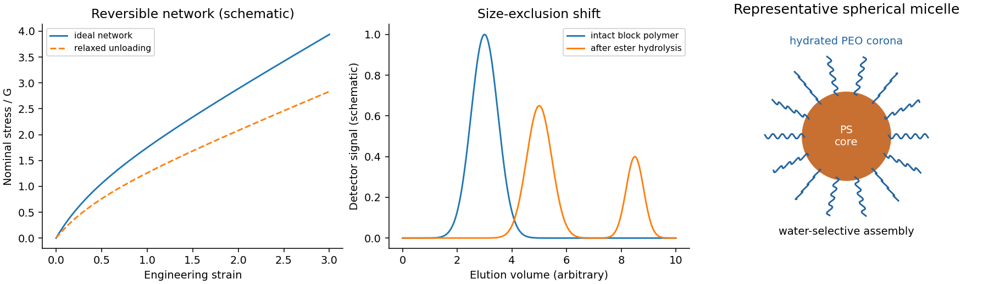

<h1 id="section-a/18/e/solution">Solution</h1>

↑ **Parent:** [E](../e.md)

Pendant [alcohols](../../../../../../alcohol.md) can form **reversible [borate](../../../../../../borate.md) bridges**, schematically $\mathrm{P-O-B(OH)-O-P'}$ and $\mathrm{B(O-P)_3}$, where P and P′ belong to different chains. Tetrahedral [borate](../../../../../../borate.md) species are also possible depending on pH and water content. A bridge must connect different network strands to act as a [cross-link](../../../../../../cross-link.md); an intrachain loop does not contribute equivalently to elasticity.

Between [cross-links](../../../../../../cross-link.md), stretching reduces the number of accessible chain conformations. A simple incompressible [rubber elasticity](../../../../../../rubber-elasticity.md) model gives the nominal tensile stress

$$
\boxed{\sigma_{\rm nominal}=G(\lambda-\lambda^{-2}),\qquad G\simeq\nu_e k_BT,}
$$

where $\lambda$ is the extension ratio and $\nu_e$ the density of elastically active strands. The initial response is soft; stronger extension gives increasing stress and ultimately finite-chain extensibility. Reversible [borate](../../../../../../borate.md) exchange permits [stress relaxation](../../../../../../stress-relaxation.md), rate dependence and a loading–unloading [hysteresis](../../../../../../hysteresis.md) loop, rather than permanent ideal elasticity at arbitrarily long times.

**[Figure 2](#section-a/18/e/image-original-schematic-rubber-stress-ester-block-cleavage-and-amphiphilic-assembly). Original schematic rubber stress, ester-block cleavage and amphiphilic assembly**.

## ↑ Ancestors (14)

1. [E](../e.md)
2. [18](../../18.md)
3. [Section A](../../../section-a.md)
4. [Paper 2](../../../../paper-2-split.md)
5. [2022](../../../../split.md)
6. [Past exam of the chemistry course of the year 4 of the natural sciences course of the University of Cambridge](../../../../../split.md)
7. [Chemistry course of the year 4 of the natural sciences course of the University of Cambridge](../../../../../../chemistry-course-of-the-year-4-of-the-natural-sciences-course-of-the-university-of-cambridge.md)
8. [Year 4 of the natural sciences course of the University of Cambridge](../../../../../../year-4-of-the-natural-sciences-course-of-the-university-of-cambridge.md)
9. [Year of the natural sciences course of the University of Cambridge](../../../../../../year-of-the-natural-sciences-course-of-the-university-of-cambridge.md)
10. [Natural sciences course of the University of Cambridge](../../../../../../natural-sciences-course-of-the-university-of-cambridge.md)
11. [Course of the University of Cambridge](../../../../../../course-of-the-university-of-cambridge.md)
12. [University of Cambridge](../../../../../../university-of-cambridge-split.md)
13. [List of universities](../../../../../../list-of-universities.md)
14. [Codex Wiki](../../../../../../split.md)
