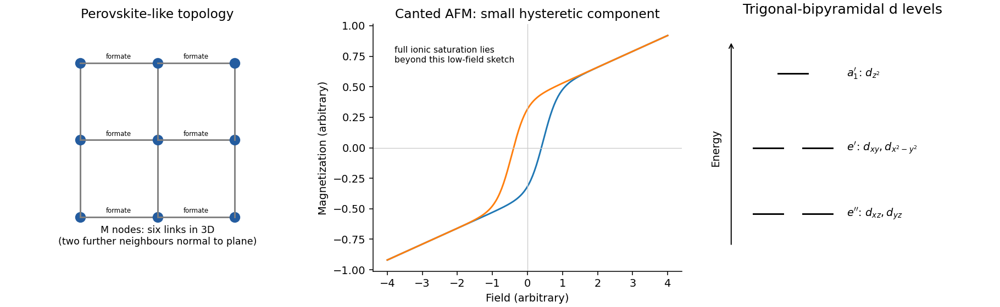

<h1 id="section-b/21/a/solution">Solution</h1>

↑ **Parent:** [A](../a.md)

The framework is a **three-dimensional network of corner-connected $\mathrm{MO_6}$ octahedra**, with each apparent corner connection extended through a bridging formate, $\mathrm{M-O-CH-O-M}$. Each metal is coordinated by six oxygen donors from six formates, which link it to six neighbouring metals in the perovskite-like topology. The guanidinium cation occupies the larger cavity and can hydrogen-bond to formate oxygen atoms. Charge balance is $+1+2-3=0$.

**[Figure 3](#section-b/21/a/image-original-formate-network-topology-and-weak-ferromagnetic-magnetization-schematic). Original formate-network topology and weak-ferromagnetic magnetization schematic**.

## ↑ Ancestors (14)

1. [A](../a.md)
2. [21](../../21.md)
3. [Section B](../../../section-b.md)
4. [Paper 2](../../../../paper-2-split.md)
5. [2022](../../../../split.md)
6. [Past exam of the chemistry course of the year 4 of the natural sciences course of the University of Cambridge](../../../../../split.md)
7. [Chemistry course of the year 4 of the natural sciences course of the University of Cambridge](../../../../../../chemistry-course-of-the-year-4-of-the-natural-sciences-course-of-the-university-of-cambridge.md)
8. [Year 4 of the natural sciences course of the University of Cambridge](../../../../../../year-4-of-the-natural-sciences-course-of-the-university-of-cambridge.md)
9. [Year of the natural sciences course of the University of Cambridge](../../../../../../year-of-the-natural-sciences-course-of-the-university-of-cambridge.md)
10. [Natural sciences course of the University of Cambridge](../../../../../../natural-sciences-course-of-the-university-of-cambridge.md)
11. [Course of the University of Cambridge](../../../../../../course-of-the-university-of-cambridge.md)
12. [University of Cambridge](../../../../../../university-of-cambridge-split.md)
13. [List of universities](../../../../../../list-of-universities.md)
14. [Codex Wiki](../../../../../../split.md)
