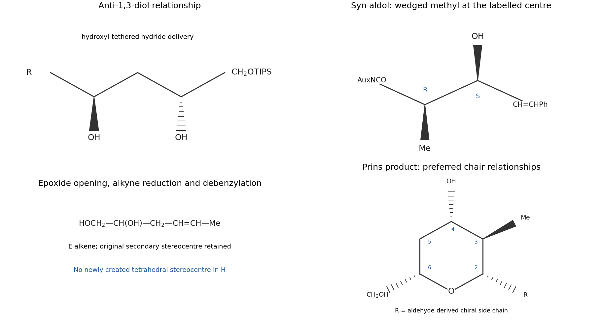

<h1 id="section-f/28/e/solution">Solution</h1>

↑ **Parent:** [E](../e.md)

The secondary [alcohol](../../../../../../alcohol.md) of H condenses with the [aldehyde](../../../../../../aldehyde.md) under acid catalysis to form a hemiacetal, then loses water to an [oxocarbenium ion](../../../../../../oxocarbenium-ion.md). Its tethered E [alkene](../../../../../../alkene.md) attacks the aldehyde-derived carbon through a chair-like six-membered arrangement: the [alkene](../../../../../../alkene.md) carbon farther from the [alcohol](../../../../../../alcohol.md) forms the new C–C bond, placing a carbocation at the nearer [alkene](../../../../../../alkene.md) carbon. Trifluoroacetate captures that cation; the basic methanolic work-up cleaves the trifluoroacetate [ester](../../../../../../ester.md) to reveal the ring hydroxyl group. This is a [Prins cyclization](../../../../../../prins-cyclization.md).

Number the product ring from oxygen through the aldehyde-derived carbon as C2, then the alkene-derived methyl-bearing carbon C3, the hydroxyl-bearing carbon C4, the intervening methylene C5 and the original [alcohol](../../../../../../alcohol.md) carbon C6. A chair keeping the bulky C2 side chain and C6 hydroxymethyl group equatorial predicts **2,6-cis substitution**. Suprafacial [alkene](../../../../../../alkene.md) capture preserves the E-alkene-derived relationship, giving **2,3-trans** between the C2 side chain and C3 methyl. Preferred equatorial trapping of the C4 cation gives **3,4-trans**, hence the **2,4,6-cis arrangement of the substituent-bearing bonds** in the favoured chair. In the printed flat-ring orientation, draw the C2 side chain, C4 hydroxyl and C6 hydroxymethyl behind the plane, and C3 methyl in front. Existing [stereocentres](../../../../../../stereocentre.md) in the [aldehyde](../../../../../../aldehyde.md) side chain and at C6 are retained; they anchor the absolute face of this assignment.

**[Figure 6](#section-f/28/e/image-original-product-connectivity-and-stereochemical-models-for-the-directed-reductions-aldol-and-prins-steps). Original product connectivity and stereochemical models for the directed reductions, aldol and Prins steps**.

## ↑ Ancestors (14)

1. [E](../e.md)
2. [28](../../28.md)
3. [Section F](../../../section-f.md)
4. [Paper 2](../../../../paper-2-split.md)
5. [2022](../../../../split.md)
6. [Past exam of the chemistry course of the year 4 of the natural sciences course of the University of Cambridge](../../../../../split.md)
7. [Chemistry course of the year 4 of the natural sciences course of the University of Cambridge](../../../../../../chemistry-course-of-the-year-4-of-the-natural-sciences-course-of-the-university-of-cambridge.md)
8. [Year 4 of the natural sciences course of the University of Cambridge](../../../../../../year-4-of-the-natural-sciences-course-of-the-university-of-cambridge.md)
9. [Year of the natural sciences course of the University of Cambridge](../../../../../../year-of-the-natural-sciences-course-of-the-university-of-cambridge.md)
10. [Natural sciences course of the University of Cambridge](../../../../../../natural-sciences-course-of-the-university-of-cambridge.md)
11. [Course of the University of Cambridge](../../../../../../course-of-the-university-of-cambridge.md)
12. [University of Cambridge](../../../../../../university-of-cambridge-split.md)
13. [List of universities](../../../../../../list-of-universities.md)
14. [Codex Wiki](../../../../../../split.md)
