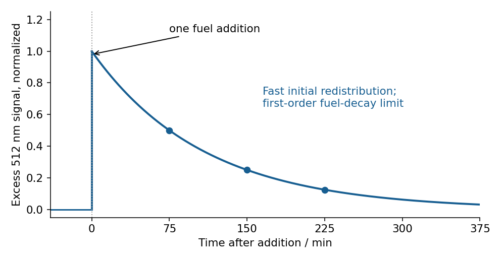
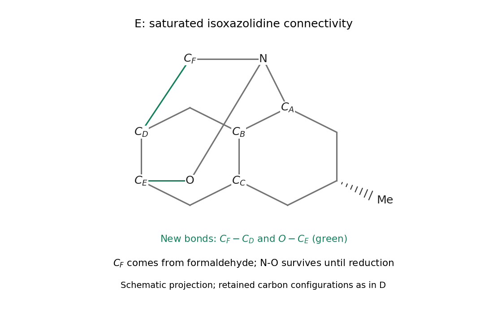

# Paper 3

↑ **Parent:** [2022](../2022.md)

Original source: [Cambridge 2022 Part III Chemistry Paper 3, release PDF physical pages 220–246](https://www.whatdotheyknow.com/request/nst_chemistry_past_papers_2022/response/2088679/attach/3/FOI%202022%20476%20Whittaker%20materials.pdf?cookie_passthrough=1#page=220). The three cover variants share the question body covered here once. Biological subquestions are explicitly deferred at the user's request.

**Table of contents**

- [Section A](#section-a)
  - [36](#section-a/36)
    - [a](#section-a/36/a)
      - [Solution](#section-a/36/a/solution)
    - [b](#section-a/36/b)
      - [Solution](#section-a/36/b/solution)
    - [c](#section-a/36/c)
      - [Solution](#section-a/36/c/solution)
    - [d](#section-a/36/d)
      - [Solution](#section-a/36/d/solution)
  - [37](#section-a/37)
    - [a](#section-a/37/a)
      - [Solution](#section-a/37/a/solution)
    - [b](#section-a/37/b)
      - [Solution](#section-a/37/b/solution)
    - [c](#section-a/37/c)
      - [Solution](#section-a/37/c/solution)
    - [d](#section-a/37/d)
      - [Solution](#section-a/37/d/solution)
- [Section B](#section-b)
  - [38](#section-b/38)
    - [a](#section-b/38/a)
      - [Solution](#section-b/38/a/solution)
    - [b](#section-b/38/b)
      - [Solution](#section-b/38/b/solution)
    - [c](#section-b/38/c)
      - [Solution](#section-b/38/c/solution)
    - [d](#section-b/38/d)
      - [Solution](#section-b/38/d/solution)
    - [e](#section-b/38/e)
      - [Solution](#section-b/38/e/solution)
    - [f](#section-b/38/f)
      - [Solution](#section-b/38/f/solution)
  - [39](#section-b/39)
    - [a](#section-b/39/a)
      - [Solution](#section-b/39/a/solution)
    - [b](#section-b/39/b)
      - [Solution](#section-b/39/b/solution)
    - [c](#section-b/39/c)
      - [Solution](#section-b/39/c/solution)
    - [d](#section-b/39/d)
      - [Solution](#section-b/39/d/solution)
    - [e](#section-b/39/e)
      - [Solution](#section-b/39/e/solution)
    - [f](#section-b/39/f)
      - [Solution](#section-b/39/f/solution)
- [Section C](#section-c)
  - [40](#section-c/40)
    - [a](#section-c/40/a)
      - [Solution](#section-c/40/a/solution)
    - [b](#section-c/40/b)
      - [i](#section-c/40/b/i)
        - [Solution](#section-c/40/b/i/solution)
      - [ii](#section-c/40/b/ii)
        - [Solution](#section-c/40/b/ii/solution)
      - [iii](#section-c/40/b/iii)
        - [Solution](#section-c/40/b/iii/solution)
      - [iv](#section-c/40/b/iv)
        - [Solution](#section-c/40/b/iv/solution)
  - [41](#section-c/41)
    - [a](#section-c/41/a)
      - [Solution](#section-c/41/a/solution)
    - [b](#section-c/41/b)
      - [i](#section-c/41/b/i)
        - [Solution](#section-c/41/b/i/solution)
      - [ii](#section-c/41/b/ii)
        - [Solution](#section-c/41/b/ii/solution)
      - [iii](#section-c/41/b/iii)
        - [Solution](#section-c/41/b/iii/solution)
    - [c](#section-c/41/c)
      - [Solution](#section-c/41/c/solution)
    - [d](#section-c/41/d)
      - [i](#section-c/41/d/i)
        - [Solution](#section-c/41/d/i/solution)
      - [ii](#section-c/41/d/ii)
        - [Solution](#section-c/41/d/ii/solution)
- [Section D](#section-d)
  - [42](#section-d/42)
    - [a](#section-d/42/a)
      - [Solution](#section-d/42/a/solution)
    - [b](#section-d/42/b)
      - [Solution](#section-d/42/b/solution)
    - [c](#section-d/42/c)
      - [Solution](#section-d/42/c/solution)
    - [d](#section-d/42/d)
      - [Solution](#section-d/42/d/solution)
    - [e](#section-d/42/e)
      - [Solution](#section-d/42/e/solution)
    - [f](#section-d/42/f)
      - [Solution](#section-d/42/f/solution)
  - [43](#section-d/43)
    - [a](#section-d/43/a)
      - [Solution](#section-d/43/a/solution)
    - [b](#section-d/43/b)
      - [i](#section-d/43/b/i)
        - [Solution](#section-d/43/b/i/solution)
      - [ii](#section-d/43/b/ii)
        - [Solution](#section-d/43/b/ii/solution)
      - [iii](#section-d/43/b/iii)
        - [1](#section-d/43/b/iii/1)
          - [Solution](#section-d/43/b/iii/1/solution)
        - [2](#section-d/43/b/iii/2)
          - [Solution](#section-d/43/b/iii/2/solution)
        - [3](#section-d/43/b/iii/3)
          - [Solution](#section-d/43/b/iii/3/solution)
      - [iv](#section-d/43/b/iv)
        - [Solution](#section-d/43/b/iv/solution)
      - [v](#section-d/43/b/v)
        - [Solution](#section-d/43/b/v/solution)
- [Section E](#section-e)
  - [44](#section-e/44)
    - [a](#section-e/44/a)
      - [Solution](#section-e/44/a/solution)
    - [b](#section-e/44/b)
      - [Solution](#section-e/44/b/solution)
    - [c](#section-e/44/c)
      - [Solution](#section-e/44/c/solution)
    - [d](#section-e/44/d)
      - [Solution](#section-e/44/d/solution)
    - [e](#section-e/44/e)
      - [Solution](#section-e/44/e/solution)
  - [45](#section-e/45)
    - [a](#section-e/45/a)
      - [Solution](#section-e/45/a/solution)
    - [b](#section-e/45/b)
      - [Solution](#section-e/45/b/solution)
    - [c](#section-e/45/c)
      - [Solution](#section-e/45/c/solution)
    - [d](#section-e/45/d)
      - [Solution](#section-e/45/d/solution)
    - [e](#section-e/45/e)
      - [Solution](#section-e/45/e/solution)
    - [f](#section-e/45/f)
      - [Solution](#section-e/45/f/solution)
- [Section F](#section-f)
  - [46](#section-f/46)
    - [a](#section-f/46/a)
      - [i](#section-f/46/a/i)
        - [Solution](#section-f/46/a/i/solution)
      - [ii](#section-f/46/a/ii)
        - [Solution](#section-f/46/a/ii/solution)
      - [iii](#section-f/46/a/iii)
        - [Solution](#section-f/46/a/iii/solution)
      - [iv](#section-f/46/a/iv)
        - [A](#section-f/46/a/iv/a)
          - [Solution](#section-f/46/a/iv/a/solution)
        - [B](#section-f/46/a/iv/b)
          - [Solution](#section-f/46/a/iv/b/solution)
        - [C](#section-f/46/a/iv/c)
          - [Solution](#section-f/46/a/iv/c/solution)
        - [D](#section-f/46/a/iv/d)
          - [Solution](#section-f/46/a/iv/d/solution)
      - [v](#section-f/46/a/v)
        - [Solution](#section-f/46/a/v/solution)
      - [vi](#section-f/46/a/vi)
        - [Solution](#section-f/46/a/vi/solution)
    - [b](#section-f/46/b)
      - [i](#section-f/46/b/i)
        - [Solution](#section-f/46/b/i/solution)
      - [ii](#section-f/46/b/ii)
        - [I](#section-f/46/b/ii/i)
          - [Solution](#section-f/46/b/ii/i/solution)
        - [II](#section-f/46/b/ii/ii)
          - [Solution](#section-f/46/b/ii/ii/solution)
  - [47](#section-f/47)
    - [a](#section-f/47/a)
      - [Solution](#section-f/47/a/solution)
    - [b](#section-f/47/b)
      - [Solution](#section-f/47/b/solution)
    - [c](#section-f/47/c)
      - [Solution](#section-f/47/c/solution)
    - [d](#section-f/47/d)
      - [Solution](#section-f/47/d/solution)
    - [e](#section-f/47/e)
      - [Solution](#section-f/47/e/solution)
- [Section G](#section-g)
  - [48](#section-g/48)
    - [a](#section-g/48/a)
      - [Solution](#section-g/48/a/solution)
    - [b](#section-g/48/b)
      - [Solution](#section-g/48/b/solution)
    - [c](#section-g/48/c)
      - [Solution](#section-g/48/c/solution)
    - [d](#section-g/48/d)
      - [Solution](#section-g/48/d/solution)
    - [e](#section-g/48/e)
      - [Solution](#section-g/48/e/solution)
    - [f](#section-g/48/f)
      - [Solution](#section-g/48/f/solution)
  - [49](#section-g/49)
    - [a](#section-g/49/a)
      - [Solution](#section-g/49/a/solution)
    - [b](#section-g/49/b)
      - [Solution](#section-g/49/b/solution)
    - [c](#section-g/49/c)
      - [Solution](#section-g/49/c/solution)
    - [d](#section-g/49/d)
      - [Solution](#section-g/49/d/solution)
    - [e](#section-g/49/e)
      - [Solution](#section-g/49/e/solution)
- [Section H](#section-h)
  - [50](#section-h/50)
    - [a](#section-h/50/a)
      - [i](#section-h/50/a/i)
        - [Solution](#section-h/50/a/i/solution)
      - [ii](#section-h/50/a/ii)
        - [Solution](#section-h/50/a/ii/solution)
      - [iii](#section-h/50/a/iii)
        - [Solution](#section-h/50/a/iii/solution)
      - [iv](#section-h/50/a/iv)
        - [Solution](#section-h/50/a/iv/solution)
    - [b](#section-h/50/b)
      - [i](#section-h/50/b/i)
        - [Solution](#section-h/50/b/i/solution)
      - [ii](#section-h/50/b/ii)
        - [Solution](#section-h/50/b/ii/solution)
  - [51](#section-h/51)
    - [a](#section-h/51/a)
      - [Solution](#section-h/51/a/solution)
    - [b](#section-h/51/b)
      - [Solution](#section-h/51/b/solution)
    - [c](#section-h/51/c)
      - [Solution](#section-h/51/c/solution)
    - [d](#section-h/51/d)
      - [Solution](#section-h/51/d/solution)
    - [e](#section-h/51/e)
      - [Solution](#section-h/51/e/solution)
    - [f](#section-h/51/f)
      - [Solution](#section-h/51/f/solution)
    - [g](#section-h/51/g)
      - [Solution](#section-h/51/g/solution)
    - [h](#section-h/51/h)
      - [Solution](#section-h/51/h/solution)

## Section A

↑ **Parent:** [Paper 3](paper-3.md)

<h3 id="section-a/36">36</h3>

↑ **Parent:** [Section A](#section-a)

<h4 id="section-a/36/a">a</h4>

↑ **Parent:** [36](#section-a/36)

<h5 id="section-a/36/a/solution">Solution</h5>

↑ **Parent:** [A](#section-a/36/a)

Only one bromine is replaced by [hydrogen](../../chemical-substance.md#hydrogen). Writing the unchanged protected chain as $R=\mathrm{THPOCH_2CH(Me)}$, the product is **$R\mathrm{CH=C(Me)CH=CHBr}$**, retaining the original internal [alkene](../../chemical-substance.md#alkene) geometry and forming predominantly the **$Z$ terminal bromoalkene**: bromine and the [carbon](../../chemical-substance.md#carbon) chain lie on the same side of that new stereodefined double bond. The formula is consequently $\mathrm{C_{13}H_{21}BrO_2}$.

Phosphine dissociation exposes Pd(0), which undergoes preferential [oxidative addition](../../chemical-reaction.md#oxidative-addition) into the less hindered C–Br bond, the bromine trans to the [carbon](../../chemical-substance.md#carbon) chain in the gem-dibromoalkene. [hydride](../../chemical-substance.md#hydride) transfer from [tributyltin hydride](../../chemical-substance.md#tributyltin-hydride) replaces the [palladium](../../chemical-substance.md#palladium) bromide ligand, producing tributyltin bromide and an alkenyl–Pd–H intermediate. [reductive elimination](../../chemical-reaction.md#reductive-elimination) joins the alkenyl [carbon](../../chemical-substance.md#carbon) and [hydride](../../chemical-substance.md#hydride), regenerating Pd(0). Retention of the alkenyl geometry through this sequence puts the surviving bromine cis to the chain. The conjugated [carbon](../../chemical-substance.md#carbon) skeleton and [protecting group](../../chemistry.md#protecting-group) remain intact; this is not addition of tin [hydride](../../chemical-substance.md#hydride) across either [alkene](../../chemical-substance.md#alkene). The stereoselective monohydrogenolysis is established for this reagent combination.[Tetrahedron Letters 37, pp. 6759–6762: palladium/tributyltin-hydride monoreduction](../../chemistry-bibliography.md#a-general-and-convenient-synthetic-method-of-geometrically-pure-z-1-bromo-1-alkenes-by-junichi-uenishi-and-others)

**[Figure 1](#section-a/36/a/image-original-product-and-metallacycle-connectivity-drawings-for-the-organometallic-transformations). Original product and metallacycle connectivity drawings for the organometallic transformations**.

<h4 id="section-a/36/b">b</h4>

↑ **Parent:** [36](#section-a/36)

<h5 id="section-a/36/b/solution">Solution</h5>

↑ **Parent:** [B](#section-a/36/b)

The first equivalent of [titanocene methylidene](../../chemical-substance.md#titanocene-methylidene) methylenates the [ester](../../chemical-substance.md#ester): the [carbonyl](../../chemical-bond.md#carbonyl-group) [oxygen](../../chemical-substance.md#oxygen) and [titanium](../../chemical-substance.md#titanium) form an [oxatitanacyclobutane](../../chemical-substance.md#oxatitanacyclobutane), whose fragmentation gives **$\mathrm{PhC(OMe)=CH_2}$** and a [titanium](../../chemical-substance.md#titanium)–[oxygen](../../chemical-substance.md#oxygen) product. The second equivalent adds across this electron-rich double bond. The initial adduct is a [titanacyclobutane](../../chemical-substance.md#titanacyclobutane) with cyclic connectivity $\mathrm{Cp_2Ti-CH_2-C(Ph)(OMe)-CH_2-}$, closing from the last methylene to [titanium](../../chemical-substance.md#titanium). The [ester](../../chemical-substance.md#ester)'s phenyl-substituted [carbon](../../chemical-substance.md#carbon) lies opposite Ti; the two new methylenes originate from the two methylidene equivalents.

Beta-methoxy elimination opens that metallacycle to **B, $\mathrm{Cp_2Ti(OMe)[CH_2C(Ph)=CH_2]}$**, the [allyltitanium reagent](../../chemical-substance.md#allyltitanium-reagent). The C–OMe bond breaks, OMe transfers to Ti, one Ti–C bond becomes the new C=C bond, and the other Ti–C bond remains as the allylic [nucleophile](../../chemical-reaction.md#nucleophile). The cyclic adduct is therefore a precursor to the opened reagent B; treating B as merely the one-equivalent [enol ether](../../chemical-substance.md#enol-ether) loses the second reagent [carbon](../../chemical-substance.md#carbon).

The [aldehyde](../../chemical-substance.md#aldehyde) [oxygen](../../chemical-substance.md#oxygen) coordinates to [titanium](../../chemical-substance.md#titanium). Allylic [carbon](../../chemical-substance.md#carbon) transfer to its [carbonyl](../../chemical-bond.md#carbonyl-group) [carbon](../../chemical-substance.md#carbon), accompanied by movement of the C=O pi [electrons](../../physics.md#electron) to [oxygen](../../chemical-substance.md#oxygen), gives the [titanium](../../chemical-substance.md#titanium) [alkoxide](../../mathematical-biology.md#alkoxide) $\mathrm{PhCH_2CH_2CH(O{-}Ti)CH_2C(Ph)=CH_2}$. Acidic aqueous workup cleaves O–Ti and protonates [oxygen](../../chemical-substance.md#oxygen), giving **$\mathrm{PhCH_2CH_2CH(OH)CH_2C(Ph)=CH_2}$**. A six-membered allyl-transfer arrangement is a convenient mechanistic model. No enantioselectivity is imposed by these achiral reagents.

<h4 id="section-a/36/c">c</h4>

↑ **Parent:** [36](#section-a/36)

<h5 id="section-a/36/c/solution">Solution</h5>

↑ **Parent:** [C](#section-a/36/c)

[Schwartz reagent](../../chemical-substance.md#schwartz-reagent) adds syn across the terminal [alkene](../../chemical-substance.md#alkene), placing [zirconium](../../chemical-substance.md#zirconium) at its terminal [carbon](../../chemical-substance.md#carbon) and [hydrogen](../../chemical-substance.md#hydrogen) at the substituted [carbon](../../chemical-substance.md#carbon). The organozirconium intermediate is **$\mathrm{PhCH(OMe)CH(Me)CH_2ZrCp_2Cl}$**. The two faces of the achiral starting [alkene](../../chemical-substance.md#alkene) give enantiomeric organometallic intermediates.

Boron trifluoride coordinates the [ether](../../chemical-substance.md#ether) [oxygen](../../chemical-substance.md#oxygen), making the benzylic C–OMe bond susceptible to cleavage. The C–Zr bond then transfers its [carbon](../../chemical-substance.md#carbon) terminus intramolecularly to the benzylic [carbon](../../chemical-substance.md#carbon) as the activated methoxy group departs, closing a cyclopropane. This can be represented as a concerted, strongly assisted displacement rather than requiring a freely equilibrating long-lived benzylic [carbocation](../../chemical-substance.md#carbocation). [hydrozirconation](../../chemical-reaction.md#hydrozirconation) fixes the relative disposition of the new C–H and C–Zr bonds, and the preferred closure conformation places the bulky phenyl and methyl groups on opposite faces. The result is **racemic trans-1-methyl-2-phenylcyclopropane**, with much less steric crowding than the cis alternative. The ring contains the original two [alkene](../../chemical-substance.md#alkene) [carbons](../../chemical-substance.md#carbon) and the original benzylic [carbon](../../chemical-substance.md#carbon); no carbene [carbon](../../chemical-substance.md#carbon) is added.

<h4 id="section-a/36/d">d</h4>

↑ **Parent:** [36](#section-a/36)

<h5 id="section-a/36/d/solution">Solution</h5>

↑ **Parent:** [D](#section-a/36/d)

Let $\mathrm{Ar}=2,6$-dimethylphenyl and $\mathrm{Ar'}=2$-methoxyphenyl. After conversion of the Pd(OAc)$_2$ precatalyst into an active phosphine–Pd(0) species, [oxidative addition](../../chemical-reaction.md#oxidative-addition) of $\mathrm{Ar'Cl}$ gives $\mathrm{L_nPd^{II}(Ar')Cl}$. Carbonate-assisted replacement of chloride by the [alcohol](../../chemical-substance.md#alcohol)'s [alkoxide](../../mathematical-biology.md#alkoxide) produces $\mathrm{L_nPd^{II}(Ar')[OC(Me)_2Ar]}$.

In the key [beta-carbon elimination](../../chemistry.md#beta-carbon-elimination), the [alkoxide](../../mathematical-biology.md#alkoxide) [oxygen](../../chemical-substance.md#oxygen) forms a C=O bond while the bond between its carbinol [carbon](../../chemical-substance.md#carbon) and $\mathrm{Ar}$ cleaves, transferring $\mathrm{Ar}$ to [palladium](../../chemical-substance.md#palladium). This gives **[acetone](../../chemical-substance.md#acetone) and a diarylpalladium(II) complex**, $\mathrm{L_nPd^{II}(Ar')(Ar)}$. [reductive elimination](../../chemical-reaction.md#reductive-elimination) creates the new biaryl bond and regenerates Pd(0). Thus the [tertiary alcohol](../../chemical-substance.md#tertiary-alcohol) functions as an aryl donor by [carbon](../../chemical-substance.md#carbon)–[carbon](../../chemical-substance.md#carbon) bond cleavage, rather than being incorporated as a carbinol substituent. The overall organic products are **the cross-coupled biaryl and [acetone](../../chemical-substance.md#acetone)**. The carbinol [carbon](../../chemical-substance.md#carbon) has no [hydrogen](../../chemical-substance.md#hydrogen), so ordinary [beta-hydride elimination](../../chemical-reaction.md#beta-hydride-elimination) from this [alkoxide](../../mathematical-biology.md#alkoxide) cannot explain the observed aryl transfer. The bulky electron-rich phosphine helps access the aryl-chloride [oxidative addition](../../chemical-reaction.md#oxidative-addition) and the sterically congested biaryl-forming elimination.

<h3 id="section-a/37">37</h3>

↑ **Parent:** [Section A](#section-a)

<h4 id="section-a/37/a">a</h4>

↑ **Parent:** [37](#section-a/37)

<h5 id="section-a/37/a/solution">Solution</h5>

↑ **Parent:** [A](#section-a/37/a)

Both free primary allylic alcohols undergo [Sharpless asymmetric epoxidation](../../chemical-reaction.md#sharpless-asymmetric-epoxidation). With slightly more than two equivalents of [hydroperoxide](../../chemical-substance.md#hydroperoxide), the expected fully oxidized product is **the diepoxide, with both original C=C bonds converted to [epoxides](../../chemical-substance.md#epoxide) and both [primary alcohols](../../chemical-substance.md#primary-alcohol) retained**. The two central pre-existing [stereocentres](../../chemistry.md#stereocentre) and their [ether](../../chemical-substance.md#ether) substituents are retained.

The stereochemical construction is unambiguous by applying the L-(+)-tartrate mnemonic separately at each end: orient that [alkene](../../chemical-substance.md#alkene) horizontally with its CH$_2$OH group at lower right, and deliver [oxygen](../../chemical-substance.md#oxygen) from the back face. In the source's original in-plane orientation this gives **the left [epoxide](../../chemical-substance.md#epoxide) [oxygen](../../chemical-substance.md#oxygen) behind the plane and the right [epoxide](../../chemical-substance.md#epoxide) [oxygen](../../chemical-substance.md#oxygen) in front**. The methyl and hydroxymethyl groups retain their original relative arrangement about each former double bond. One cannot simply draw both [oxygens](../../chemical-substance.md#oxygen) on the same face of the original extended chain: the two allylic-alcohol ends have opposite drawing orientations. [titanium](../../chemical-substance.md#titanium) binding to each free hydroxyl directs [oxygen](../../chemical-substance.md#oxygen) transfer; the pre-existing [stereocentres](../../chemistry.md#stereocentre) can create matched/mismatched rate differences, but the stated reagent control predicts the [stereochemistry](../../stereochemistry.md) of both epoxidations. Molecular sieves maintain a dry active [titanium](../../chemical-substance.md#titanium)–tartrate system.[JACS 102, pp. 5974–5976: tartrate-controlled allylic-alcohol epoxidation](../../chemistry-bibliography.md#the-first-practical-method-for-asymmetric-epoxidation-by-tsutomu-katsuki-and-k-barry-sharpless)

**[Figure 2](#section-a/37/a/image-original-facial-selectivity-and-axial-projection-solution-models). Original facial-selectivity and axial-projection solution models**.

<h4 id="section-a/37/b">b</h4>

↑ **Parent:** [37](#section-a/37)

<h5 id="section-a/37/b/solution">Solution</h5>

↑ **Parent:** [B](#section-a/37/b)

[acetone](../../chemical-substance.md#acetone) first forms a [proline](../../chemical-substance.md#proline) [enamine](../../chemical-substance.md#enamine) by reversible iminium formation and alpha-deprotonation. The [enamine](../../chemical-substance.md#enamine) attacks the aromatic [aldehyde](../../chemical-substance.md#aldehyde) in a hydrogen-bonded arrangement involving the catalyst's carboxylic acid. [hydrolysis](../../chemical-reaction.md#hydrolysis) of the resulting iminium releases the beta-hydroxyketone and regenerates [proline](../../chemical-substance.md#proline). The usual L-proline arrangement gives the **$R$ [secondary alcohol](../../chemical-substance.md#secondary-alcohol)**.

The sterically crowded aryl–[amide](../../chemical-substance.md#amide) axis is selected at the same bond-forming step: rapid rotation in the [aldehyde](../../chemical-substance.md#aldehyde) permits the catalyst to react preferentially with the conformer that puts the smaller carbonyl-oxygen side of the [amide](../../chemical-substance.md#amide) towards the approaching aldol transition structure and the bulky diisopropylamino side away. A chair-like [enamine](../../chemical-substance.md#enamine)–[aldehyde](../../chemical-substance.md#aldehyde) model minimizes the interaction of the [amide](../../chemical-substance.md#amide) with the catalyst-side axial [hydrogen](../../chemical-substance.md#hydrogen); reversing the [amide](../../chemical-substance.md#amide) orientation creates the less favourable diastereomeric [transition state](../../chemical-kinetics.md#transition-state). Replacing planar CHO by tetrahedral CH(OH)CH$_2$COMe then raises the rotation barrier and traps the axis. This is a **[dynamic kinetic resolution](../../stereochemistry.md#dynamic-kinetic-resolution)**, not resolution of two configurationally stable starting atropisomers.

To specify the predicted major axis without relying on a flat bond-line formula, look from the aromatic ipso [carbon](../../chemical-substance.md#carbon) towards the [amide](../../chemical-substance.md#amide) [carbonyl](../../chemical-bond.md#carbonyl-group) [carbon](../../chemical-substance.md#carbon). Put the higher-priority aryl path, the trimethylsilyl-bearing ortho side, at nine o'clock. The preferred model puts the [carbonyl](../../chemical-bond.md#carbonyl-group) [oxygen](../../chemical-substance.md#oxygen) at approximately six o'clock and the diisopropylamino group at twelve o'clock. This is **$S_a$** using the near-to-far high-priority convention; [oxygen](../../chemical-substance.md#oxygen) outranks [nitrogen](../../chemical-substance.md#nitrogen) at the far end. Coupled with the [alcohol](../../chemical-substance.md#alcohol) assignment, the model predicts **$(R,S_a)$**. The drawing defines the configuration even if an alternative viewing direction is used. The dynamic-resolution mechanism is established by the primary aldol study; the product-axis assignment here is a stereochemical-model prediction for the printed substrate.[Organic Letters 6, pp. 2051–2053: simultaneous alcohol and amide-axis control](../../chemistry-bibliography.md#dynamic-kinetic-resolution-of-atropisomeric-amides-by-vincent-chan-and-others)

<h4 id="section-a/37/c">c</h4>

↑ **Parent:** [37](#section-a/37)

<h5 id="section-a/37/c/solution">Solution</h5>

↑ **Parent:** [C](#section-a/37/c)

An unsaturated Rh(I)–[BINAP](../../chemistry.md#binap) complex undergoes [oxidative addition](../../chemical-reaction.md#oxidative-addition) of the aldehydic C–H bond, giving a Rh(III) **acyl [hydride](../../chemical-substance.md#hydride)**. Coordination of the tethered [alkene](../../chemical-substance.md#alkene) brings it into the [chiral](../../stereochemistry.md#chirality-chemistry) coordination sphere. [hydride](../../chemical-substance.md#hydride) migration to the internal, tert-butyl-substituted [alkene](../../chemical-substance.md#alkene) [carbon](../../chemical-substance.md#carbon) places Rh on the terminal methylene. The resulting acyl–alkyl complex has the connectivity required for a five-membered ring. [reductive elimination](../../chemical-reaction.md#reductive-elimination) between its acyl and alkyl [carbons](../../chemical-substance.md#carbon) closes the C–C bond, releases the cyclopentanone and regenerates Rh(I).

The [aldehyde](../../chemical-substance.md#aldehyde) [carbon](../../chemical-substance.md#carbon) becomes the [ketone](../../chemical-substance.md#ketone) [carbonyl](../../chemical-bond.md#carbonyl-group) [carbon](../../chemical-substance.md#carbon); its [hydrogen](../../chemical-substance.md#hydrogen) ultimately reaches the alkene-derived internal [carbon](../../chemical-substance.md#carbon). The original tert-butyl substituent remains attached to the internal [alkene](../../chemical-substance.md#alkene) [carbon](../../chemical-substance.md#carbon), which becomes the beta [stereocentre](../../chemistry.md#stereocentre) of the cyclopentanone. [alkene](../../chemical-substance.md#alkene) coordination and insertion favour the [chiral](../../stereochemistry.md#chirality-chemistry) pocket arrangement with the bulky tert-butyl group in the less crowded region of the [BINAP](../../chemistry.md#binap) complex. For the stated (S)-BINAP system the observed product is **the $R$ beta-tert-butylcyclopentanone**, equivalently the product with tert-butyl on the solid-wedge face in the supplied ring orientation. Its priorities are tert-butyl, the shorter carbonyl-side ring path, the other ring path, and [hydrogen](../../chemical-substance.md#hydrogen). The ligand's S label alone is not a general rule that every product [stereocentre](../../chemistry.md#stereocentre) must be S; the substrate orientation in the catalyst must also be specified. No decarbonylation is needed in the productive [hydroacylation](../../chemical-reaction.md#hydroacylation) cycle.

<h4 id="section-a/37/d">d</h4>

↑ **Parent:** [37](#section-a/37)

<h5 id="section-a/37/d/solution">Solution</h5>

↑ **Parent:** [D](#section-a/37/d)

One valid asymmetric route uses **N-Boc-(R)-proline as a [chiral](../../stereochemistry.md#chirality-chemistry) starting material**. Convert its acid to the [Weinreb amide](../../chemical-substance.md#weinreb-amide) with N,O-dimethylhydroxylamine and a coupling reagent such as EDC, then add phenylmagnesium bromide at low temperature. [chelation](../../chemistry.md#chelation) of the magnesium tetrahedral intermediate prevents a second addition; aqueous workup releases the phenyl [ketone](../../chemical-substance.md#ketone). Reduce it with [sodium borohydride](../../chemical-substance.md#sodium-borohydride), separate the resulting [alcohol](../../chemical-substance.md#alcohol) [diastereomers](../../stereochemistry.md#diastereomer), and retain the one with **$R$ configuration at both pyrrolidine C2 and the benzylic carbinol**. This is an asymmetric synthesis through a pre-existing enantiopure centre, even though the final [reduction](../../chemical-reaction.md#reduction-chemistry) need not be perfectly diastereoselective. If the other protected [alcohol](../../chemical-substance.md#alcohol) is isolated, Mitsunobu esterification with a carboxylic acid followed by [ester](../../chemical-substance.md#ester) [hydrolysis](../../chemical-reaction.md#hydrolysis) inverts just the carbinol centre. Keeping [nitrogen](../../chemical-substance.md#nitrogen) Boc-protected during that inversion avoids neighbouring-amine participation. Mild Boc removal followed by reductive benzylation with benzaldehyde and [sodium triacetoxyborohydride](../../chemical-substance.md#sodium-triacetoxyborohydride) gives **D, the $(R,R)$ amino [alcohol](../../chemical-substance.md#alcohol)**. Use conditions that avoid epimerizing the amino [ketone](../../chemical-substance.md#ketone).

For ring expansion, activate D's [alcohol](../../chemical-substance.md#alcohol) with methanesulfonyl chloride and a [tertiary amine](../../chemical-substance.md#tertiary-amine) base. Its own tertiary [nitrogen](../../chemical-substance.md#nitrogen) attacks the benzylic [carbon](../../chemical-substance.md#carbon) from the back, displacing mesylate with inversion and making a fused [aziridinium ion](../../chemical-substance.md#aziridinium-ion). Acetate, supplied as a soluble acetate salt, attacks the **original pyrrolidine C2** from the opposite face and breaks the old C2–N bond. The new N–benzylic-C bond is retained, incorporating that side-chain [carbon](../../chemical-substance.md#carbon) into the six-membered ring. Inversion at the two successively attacked [carbons](../../chemical-substance.md#carbon) gives **the cis acetate/phenyl piperidine E** in the displayed orientation. Attack at the benzylic [carbon](../../chemical-substance.md#carbon) instead would simply open the three-membered [ion](../../chemistry.md#ion) back to a five-membered-ring derivative; specifying the attacked [carbon](../../chemical-substance.md#carbon) is the crucial regiochemical step.

## Section B

↑ **Parent:** [Paper 3](paper-3.md)

<h3 id="section-b/38">38</h3>

↑ **Parent:** [Section B](#section-b)

<h4 id="section-b/38/a">a</h4>

↑ **Parent:** [38](#section-b/38)

<h5 id="section-b/38/a/solution">Solution</h5>

↑ **Parent:** [A](#section-b/38/a)

The [binding energies](../../energy.md#binding-energy) are referred to the common [Fermi level](../../quantum-ideal-gas-statistics.md#fermi-level). Immediately outside the [copper](../../chemical-substance.md#copper) surface, [conservation of energy](../../mathematical-physics.md#conservation-of-energy) gives

$$
K_s=h\nu-E_B-\phi_s=515.0-399.2-4.0=\boxed{111.8\ \mathrm{eV}}.
$$

This is the emitted [photoelectron](../../atomic-physics.md#photoelectron) energy at the sample. On reaching the electrically connected, unbiased analyser, its energy is instead $K_a=h\nu-E_B-\phi_a=\boxed{111.4\ \mathrm{eV}}$. The 0.4 eV difference is the contact-potential correction, not an additional binding-energy shift. Distinguishing these two reference positions is essential for the retarding-voltage calculation.

<h4 id="section-b/38/b">b</h4>

↑ **Parent:** [38](#section-b/38)

<h5 id="section-b/38/b/solution">Solution</h5>

↑ **Parent:** [B](#section-b/38/b)

The hemispherical component needs 100.0 eV [electrons](../../physics.md#electron), whereas [electrons](../../physics.md#electron) arrive at its entrance optics with 111.4 eV. The optics must therefore remove **11.4 eV**, requiring a **retarding-potential magnitude of 11.4 V**. For a negative [electron](../../physics.md#electron), moving to a more negative electrostatic potential increases potential energy, so the retarding region is 11.4 V negative relative to the analyser entrance. Equivalently the hemisphere entrance is 11.8 V negative relative to the sample vacuum reference after including the 0.4 V contact step. Reporting 11.8 V as the additional instrument retardation would count the contact correction twice.

<h4 id="section-b/38/c">c</h4>

↑ **Parent:** [38](#section-b/38)

<h5 id="section-b/38/c/solution">Solution</h5>

↑ **Parent:** [C](#section-b/38/c)

Fixed entrance retardation and fixed pass energy select the same pre-retardation [kinetic energy](../../energy.md#kinetic-energy), 111.4 eV. The required [photon](../../quantum-mechanics.md#photon) energy is therefore

$$
h\nu_C=E_{B,C}+\phi_a+K_a=284.8+4.4+111.4=\boxed{400.6\ \mathrm{eV}}.
$$

It is lower than the original excitation by exactly the difference between the two core [binding energies](../../energy.md#binding-energy), 114.4 eV.

<h4 id="section-b/38/d">d</h4>

↑ **Parent:** [38](#section-b/38)

<h5 id="section-b/38/d/solution">Solution</h5>

↑ **Parent:** [D](#section-b/38/d)

Define the retard ratio using the [kinetic energy](../../energy.md#kinetic-energy) at the analyser entrance before the deliberate retardation: $R=K_a/E_p$. Initially $R=111.4/100.0=1.114$. With the original excitation, a [carbon](../../chemical-substance.md#carbon) [photoelectron](../../atomic-physics.md#photoelectron) arrives with $K_{a,C}=515.0-284.8-4.4=225.8\ \mathrm{eV}$. Thus

$$
E_{p,C}=\frac{225.8}{1.114}=\boxed{202.69\ \mathrm{eV}}.
$$

The new deliberate retardation is $225.8-202.69=23.11\ \mathrm{eV}$. For fixed slits, angular acceptance and hemisphere radii, the geometrical fractional energy width is approximately constant, so the absolute analyser width grows in proportion to pass energy: **about 2.03 times poorer absolute energy resolution**. Counts may improve, but closely separated [chemical shifts](../../nuclear-magnetic-resonance.md#chemical-shift) become harder to resolve. An alternative definition $(K_a-E_p)/E_p$ gives 0.114 rather than 1.114 for the same physical setting and leads to the same final pass energy when used consistently.

<h4 id="section-b/38/e">e</h4>

↑ **Parent:** [38](#section-b/38)

<h5 id="section-b/38/e/solution">Solution</h5>

↑ **Parent:** [E](#section-b/38/e)

The large resonance at the smallest field-to-normal angle identifies an unoccupied orbital whose transition dipole is mainly normal to the surface. An N 1s initial state is approximately spherical; the dipole [matrix](../../vector-space.md#matrix) element for a $1s\to\pi^*$ transition is directed along the normal to the [adsorbate](../../physical-chemistry.md#adsorbate)'s aromatic plane. Consequently **the [adsorbate](../../physical-chemistry.md#adsorbate) rings lie predominantly parallel to the [copper](../../chemical-substance.md#copper) surface**. For perfectly flat molecules the resonance strength scales as $|\mathbf E\cdot\hat{\mathbf n}|^2\propto\cos^2\theta$, which decreases strongly from $17^\circ$ to $67^\circ$ as observed.

For azimuthally disordered molecular normals tilted by $\alpha$ from the surface normal, averaging gives $I(\theta)\propto\cos^2\theta\cos^2\alpha+\tfrac12\sin^2\theta\sin^2\alpha$. Strong dichroism therefore implies a large orientational order parameter, but the plotted qualitative curves alone do not determine a unique tilt angle or distribution. Background subtraction, incident [polarization](../../wave.md#polarization-waves) and intensity normalization would be needed for such a fit. This experiment identifies the orientation of the pi system; it does not by itself identify a particular [nitrogen](../../chemical-substance.md#nitrogen)–[copper](../../chemical-substance.md#copper) bonding topology.

<h4 id="section-b/38/f">f</h4>

↑ **Parent:** [38](#section-b/38)

<h5 id="section-b/38/f/solution">Solution</h5>

↑ **Parent:** [F](#section-b/38/f)

The initial [nitrogen](../../chemical-substance.md#nitrogen) environment loses intensity on heating, and a lower-binding-energy component becomes prominent near the highest temperatures. **A change of surface chemical species accompanies loss or conversion of the original [adsorbate](../../physical-chemistry.md#adsorbate).** Plausible processes include thermally activated decomposition with nitrogen-containing fragments remaining on [copper](../../chemical-substance.md#copper), [desorption](../../physical-chemistry.md#desorption) of intact material or fragments, and rearrangement of the coordination environment. The extra components at intermediate temperatures suggest coexistence rather than a rigid, uniform shift of every molecule.

The individual curves have vertical offsets, so their baseline height is not a coverage measurement. Integrated, sensitivity-corrected N and C peak areas, a clean heated substrate control, and evolved-gas [mass spectrometry](../../chemistry.md#mass-spectrometry) would help distinguish loss of material from chemical conversion. [binding energy](../../energy.md#binding-energy) alone cannot establish a unique fragment structure: local charge, metallic screening and coordination all affect it.

<h3 id="section-b/39">39</h3>

↑ **Parent:** [Section B](#section-b)

<h4 id="section-b/39/a">a</h4>

↑ **Parent:** [39](#section-b/39)

<h5 id="section-b/39/a/solution">Solution</h5>

↑ **Parent:** [A](#section-b/39/a)

A step elastically reflects a surface-state wave. Interference between $e^{ikx}$ and $re^{-ikx}$ produces a local density oscillation at $2k$, so the measured spatial period is $\lambda_{\rm osc}=\pi/k$, **not** $2\pi/k$. Thus $k_1=\pi/20=0.15708\ \mathring{\mathrm A}^{-1}$ and $k_2=\pi/15=0.20944\ \mathring{\mathrm A}^{-1}$. Write $E=E_0+A k^2$ with $A=\hbar^2/(2m^*)$. The two points give

$$
A=\frac{0.50}{(\pi/15)^2-(\pi/20)^2}=26.054\ \mathrm{eV}\,\mathring{\mathrm A}^2,\qquad
\boxed{m^*=0.1462m_e}.
$$

Here $\hbar^2/(2m_e)=3.80998\ \mathrm{eV}\,\mathring{\mathrm A}^2$. The fitted minimum is $E_0=1.00-A(\pi/20)^2=\boxed{0.35714\ \mathrm{eV}}$ above the [Fermi level](../../quantum-ideal-gas-statistics.md#fermi-level). This assumes the bias measures sample excitation energy, [parabolic dispersion](../../bloch-s-theorem.md#parabolic-band-dispersion) over the measured interval, and no wave-vector-dependent phase contribution that changes the fitted period.

<h4 id="section-b/39/b">b</h4>

↑ **Parent:** [39](#section-b/39)

<h5 id="section-b/39/b/solution">Solution</h5>

↑ **Parent:** [B](#section-b/39/b)

**[inverse photoemission spectroscopy](../../physics.md#inverse-photoemission-spectroscopy) is appropriate:** the fitted minimum lies above the [Fermi level](../../quantum-ideal-gas-statistics.md#fermi-level), so the state is unoccupied in equilibrium. Injection of [electrons](../../physics.md#electron) followed by [photon](../../quantum-mechanics.md#photon) emission probes unoccupied states. Ordinary ultraviolet photoemission removes [electrons](../../physics.md#electron) from occupied states and cannot map this empty minimum without an additional population mechanism.

<h4 id="section-b/39/c">c</h4>

↑ **Parent:** [39](#section-b/39)

<h5 id="section-b/39/c/solution">Solution</h5>

↑ **Parent:** [C](#section-b/39/c)

The same [wave vectors](../../elasticity-physics.md#wavevector) now differ in energy by only 0.070 eV, so the curvature is $A'=0.14A=3.64756\ \mathrm{eV}\,\mathring{\mathrm A}^2$. Therefore

$$
\boxed{m^{*\prime}=1.0445m_e},\qquad
E_0'=5.00-A'(\pi/20)^2=\boxed{4.910\ \mathrm{eV}}\quad\text{above }E_F.
$$

The nearly free-electron in-plane mass and high unoccupied energy suggest an **image-potential-derived state**, with an [electron](../../physics.md#electron) confined outside the film by its image attraction and surface barrier but relatively free parallel to it. Relative to the supplied clean-platinum vacuum level, its minimum is 0.84 eV below vacuum, a plausible scale for an image state. [gold](../../chemical-substance.md#gold) [adsorption](../../physical-chemistry.md#adsorption) can change the [work function](../../quantum-mechanics.md#work-function), so 0.84 eV is conditional on using the supplied clean-surface value; an [adsorbate](../../physical-chemistry.md#adsorbate) work-function measurement is needed for a quantitative assignment. The dispersion alone supports the interpretation without proving it uniquely.

<h4 id="section-b/39/d">d</h4>

↑ **Parent:** [39](#section-b/39)

<h5 id="section-b/39/d/solution">Solution</h5>

↑ **Parent:** [D](#section-b/39/d)

An Au(111) Shockley state requires the near-surface band structure and projected bulk gap of a sufficiently thick [gold](../../chemical-substance.md#gold) region. In an ultrathin film, its [wavefunction](../../wave-function.md) reaches the [platinum](../../chemical-substance.md#platinum) interface, where hybridization and leakage into [platinum](../../chemical-substance.md#platinum) states can shift, broaden or destroy the bound [surface state](../../semiconductor.md#surface-state). As the [gold](../../chemical-substance.md#gold) thickness exceeds the relevant decay length, the top surface becomes electronically decoupled from the substrate and the gold-like state emerges. **A monolayer's atomic identity is insufficient to guarantee a bulk-gold surface electronic structure.**

<h4 id="section-b/39/e">e</h4>

↑ **Parent:** [39](#section-b/39)

<h5 id="section-b/39/e/solution">Solution</h5>

↑ **Parent:** [E](#section-b/39/e)

When $|eV|$ reaches a vibrational quantum, a tunnelling [electron](../../physics.md#electron) can lose energy by exciting that vibration. Opening an inelastic channel changes $dI/dV$ at both voltage polarities. If the conductance increases in each direction, $d^2I/dV^2$ has a positive feature at positive threshold and a negative feature at the corresponding negative threshold. Approximate antisymmetry follows from approximate symmetry of the conductance; unequal tip and sample electronic structures can make amplitudes unequal.

The three energy scales are **8, 48 and 375 meV**, corresponding to about **65, 387 and 3025 cm$^{-1}$**. A plausible assignment is a low-energy frustrated lateral translation or rotation, an [adsorbate](../../physical-chemistry.md#adsorbate)–metal stretch or hindered molecular mode at 48 meV, and a C–H stretching vibration at 375 meV. The terminal [carbon](../../chemical-substance.md#carbon) of methyl isocyanide supplies a plausible [adsorption](../../physical-chemistry.md#adsorption) contact, but exact mode assignment requires calculated [normal modes](../../wave-equation.md#normal-mode) or independent vibrational measurements. In particular the 48 meV band should not be labelled a C–N stretching vibration simply because the molecule contains that bond: its [frequency](../../wave.md#frequency) is far too low for the usual internal stretching mode.

<h4 id="section-b/39/f">f</h4>

↑ **Parent:** [39](#section-b/39)

<h5 id="section-b/39/f/solution">Solution</h5>

↑ **Parent:** [F](#section-b/39/f)

**The 375 meV pair should shift most fractionally, towards zero bias**, because C–H stretching has strong [hydrogen](../../chemical-substance.md#hydrogen) displacement. A reduced-mass estimate gives

$$
\frac{\omega_{CD}}{\omega_{CH}}\simeq\sqrt{\frac{12/13}{24/14}}=\sqrt{\frac7{13}}=0.734,
$$

so the pair would move approximately from $\pm375$ to **$\pm275$ mV**. A frozen-carbon estimate gives $1/\sqrt2$, or about 265 mV; the actual [normal mode](../../wave-equation.md#normal-mode) includes coupled motion. Whole-molecule modes change much less: the [molecular mass](../../molecule.md#molecular-mass) rises only from approximately 41 to 44, giving a translational estimate $\sqrt{41/44}\simeq0.965$.

## Section C

↑ **Parent:** [Paper 3](paper-3.md)

<h3 id="section-c/40">40</h3>

↑ **Parent:** [Section C](#section-c)

<h4 id="section-c/40/a">a</h4>

↑ **Parent:** [40](#section-c/40)

<h5 id="section-c/40/a/solution">Solution</h5>

↑ **Parent:** [A](#section-c/40/a)

**TODO — user-deferred biological subquestion.** This part is outside the current nonbiology scope; no biological solution or research has been undertaken.

<h4 id="section-c/40/b">b</h4>

↑ **Parent:** [40](#section-c/40)

<h5 id="section-c/40/b/i">i</h5>

↑ **Parent:** [B](#section-c/40/b)

<h6 id="section-c/40/b/i/solution">Solution</h6>

↑ **Parent:** [I](#section-c/40/b/i)

**TODO — user-deferred biological subquestion.** This part is outside the current nonbiology scope; no biological solution or research has been undertaken.

<h5 id="section-c/40/b/ii">ii</h5>

↑ **Parent:** [B](#section-c/40/b)

<h6 id="section-c/40/b/ii/solution">Solution</h6>

↑ **Parent:** [Ii](#section-c/40/b/ii)

**TODO — user-deferred biological subquestion.** This part is outside the current nonbiology scope; no biological solution or research has been undertaken.

<h5 id="section-c/40/b/iii">iii</h5>

↑ **Parent:** [B](#section-c/40/b)

<h6 id="section-c/40/b/iii/solution">Solution</h6>

↑ **Parent:** [Iii](#section-c/40/b/iii)

**TODO — user-deferred biological subquestion.** This part is outside the current nonbiology scope; no biological solution or research has been undertaken.

<h5 id="section-c/40/b/iv">iv</h5>

↑ **Parent:** [B](#section-c/40/b)

<h6 id="section-c/40/b/iv/solution">Solution</h6>

↑ **Parent:** [Iv](#section-c/40/b/iv)

**TODO — user-deferred biological subquestion.** This part is outside the current nonbiology scope; no biological solution or research has been undertaken.

<h3 id="section-c/41">41</h3>

↑ **Parent:** [Section C](#section-c)

<h4 id="section-c/41/a">a</h4>

↑ **Parent:** [41](#section-c/41)

<h5 id="section-c/41/a/solution">Solution</h5>

↑ **Parent:** [A](#section-c/41/a)

**TODO — user-deferred biological subquestion.** This part is outside the current nonbiology scope; no biological solution or research has been undertaken.

<h4 id="section-c/41/b">b</h4>

↑ **Parent:** [41](#section-c/41)

<h5 id="section-c/41/b/i">i</h5>

↑ **Parent:** [B](#section-c/41/b)

<h6 id="section-c/41/b/i/solution">Solution</h6>

↑ **Parent:** [I](#section-c/41/b/i)

**TODO — user-deferred biological subquestion.** This part is outside the current nonbiology scope; no biological solution or research has been undertaken.

<h5 id="section-c/41/b/ii">ii</h5>

↑ **Parent:** [B](#section-c/41/b)

<h6 id="section-c/41/b/ii/solution">Solution</h6>

↑ **Parent:** [Ii](#section-c/41/b/ii)

**TODO — user-deferred biological subquestion.** This part is outside the current nonbiology scope; no biological solution or research has been undertaken.

<h5 id="section-c/41/b/iii">iii</h5>

↑ **Parent:** [B](#section-c/41/b)

<h6 id="section-c/41/b/iii/solution">Solution</h6>

↑ **Parent:** [Iii](#section-c/41/b/iii)

**TODO — user-deferred biological subquestion.** This part is outside the current nonbiology scope; no biological solution or research has been undertaken.

<h4 id="section-c/41/c">c</h4>

↑ **Parent:** [41](#section-c/41)

<h5 id="section-c/41/c/solution">Solution</h5>

↑ **Parent:** [C](#section-c/41/c)

**TODO — user-deferred biological subquestion.** This part is outside the current nonbiology scope; no biological solution or research has been undertaken.

<h4 id="section-c/41/d">d</h4>

↑ **Parent:** [41](#section-c/41)

<h5 id="section-c/41/d/i">i</h5>

↑ **Parent:** [D](#section-c/41/d)

<h6 id="section-c/41/d/i/solution">Solution</h6>

↑ **Parent:** [I](#section-c/41/d/i)

**TODO — user-deferred biological subquestion.** This part is outside the current nonbiology scope; no biological solution or research has been undertaken.

<h5 id="section-c/41/d/ii">ii</h5>

↑ **Parent:** [D](#section-c/41/d)

<h6 id="section-c/41/d/ii/solution">Solution</h6>

↑ **Parent:** [Ii](#section-c/41/d/ii)

**TODO — user-deferred biological subquestion.** This part is outside the current nonbiology scope; no biological solution or research has been undertaken.

## Section D

↑ **Parent:** [Paper 3](paper-3.md)

<h3 id="section-d/42">42</h3>

↑ **Parent:** [Section D](#section-d)

<h4 id="section-d/42/a">a</h4>

↑ **Parent:** [42](#section-d/42)

<h5 id="section-d/42/a/solution">Solution</h5>

↑ **Parent:** [A](#section-d/42/a)

The [gyromagnetic ratio](../../electromagnetism.md#gyromagnetic-ratio) is the signed proportionality coefficient $\boldsymbol\mu=\gamma\mathbf I$ between a [nuclear magnetic moment](../../electromagnetism.md#nuclear-magnetic-moment) and its [spin angular momentum](../../angular-momentum-operator.md#spin). With the angular-frequency convention, $\omega_0=|\gamma|B_0$, and $\gamma$ is expressed in rad s$^{-1}$ T$^{-1}$.

<h4 id="section-d/42/b">b</h4>

↑ **Parent:** [42](#section-d/42)

<h5 id="section-d/42/b/solution">Solution</h5>

↑ **Parent:** [B](#section-d/42/b)

For a positive [gyromagnetic ratio](../../electromagnetism.md#gyromagnetic-ratio) the [magnetic moment](../../electromagnetism.md#magnetic-dipole-moment) is parallel to the [spin angular momentum](../../angular-momentum-operator.md#spin); for a negative ratio it is antiparallel. The [Hamiltonian](../../hamiltonian-mechanics.md#hamiltonian) $\hat H_Z=-\gamma B_0\hat I_z$ gives $E_m=-\gamma\hbar B_0m$. Thus **$m=+1/2$ is lower for the proton, whereas $m=-1/2$ is lower for nitrogen-15**. Their [spin](../../angular-momentum-operator.md#spin) precession senses are opposite for a common positive field convention; measurable [absorption](../../radiometry.md#absorption-electromagnetic-radiation) [frequencies](../../wave.md#frequency) and energy separations remain positive.

<h4 id="section-d/42/c">c</h4>

↑ **Parent:** [42](#section-d/42)

<h5 id="section-d/42/c/solution">Solution</h5>

↑ **Parent:** [C](#section-d/42/c)

The energy separation is $\Delta E=\hbar|\gamma|B_0$. At 10 T this gives

$$
\boxed{\Delta E_H=2.816\times10^{-25}\ \mathrm J=1.757\times10^{-6}\ \mathrm{eV}},\qquad
\boxed{\Delta E_N=2.847\times10^{-26}\ \mathrm J=1.777\times10^{-7}\ \mathrm{eV}}.
$$

At 300 K, $k_BT=4.142\times10^{-21}\ \mathrm J=0.02585\ \mathrm{eV}$, so the splitting-to-thermal-energy ratios are $6.80\times10^{-5}$ and $6.87\times10^{-6}$. The two [spin](../../angular-momentum-operator.md#spin) levels therefore have nearly equal populations. Their equilibrium population [polarizations](../../wave.md#polarization-waves) are approximately half these ratios, **$3.40\times10^{-5}$ and $3.44\times10^{-6}$**, explaining weak thermal [NMR](../../nuclear-magnetic-resonance.md) sensitivity despite well-defined resonant transition energies.

<h4 id="section-d/42/d">d</h4>

↑ **Parent:** [42](#section-d/42)

<h5 id="section-d/42/d/solution">Solution</h5>

↑ **Parent:** [D](#section-d/42/d)

[NMR](../../nuclear-magnetic-resonance.md) probes the chosen [isotope](../../chemical-substance.md#isotope)'s local environments and motion in the bulk without electrical contacts. Line narrowing, relaxation and exchange measurements can expose hopping across a broad range of timescales, separate sites with resolved shifts, and provide microscopic [activation energies](../../chemical-kinetics.md#activation-energy). Pulsed-field-gradient measurements can sometimes measure longer-range displacement directly; local relaxation measurements usually infer it through a model.

Limitations include low sensitivity for dilute or low-abundance nuclei, overlap of inequivalent sites, quadrupolar broadening for [spins](../../angular-momentum-operator.md#spin) above one-half, and contributions from paramagnetic impurities or other relaxation mechanisms. Heating can change defect populations or phase composition. Most importantly, **local hopping need not produce long-range [ionic conductivity](../../electric-charge.md#ionic-conductivity)**: back-and-forth motion, correlated jumps and trapped [ions](../../chemistry.md#ion) can relax [spins](../../angular-momentum-operator.md#spin) without carrying charge over macroscopic distances. Connecting $T_1$ to a [diffusion coefficient](../../brownian-motion.md#diffusion-coefficient) requires an explicit jump model and comparison with a bulk transport measurement.

<h4 id="section-d/42/e">e</h4>

↑ **Parent:** [42](#section-d/42)

<h5 id="section-d/42/e/solution">Solution</h5>

↑ **Parent:** [E](#section-d/42/e)

For an exponentially correlated local field, a single-frequency illustrative relaxation rate is $T_1^{-1}=C\tau_c/(1+\omega_0^2\tau_c^2)$. Its derivative with respect to $\tau_c$ changes sign at $\omega_0\tau_c=1$. Slow motion gives $T_1\propto\tau_c$, and fast motion gives $T_1\propto1/\tau_c$; an [Arrhenius plot](../../chemical-kinetics.md#arrhenius-plot) consequently has a **minimum of $T_1$** between opposite-slope limits.

For identical spin-one-half nuclei with homonuclear dipolar relaxation, include both transition [frequencies](../../wave.md#frequency):

$$
\frac1{T_1}=C\left[\frac{\tau_c}{1+\omega_0^2\tau_c^2}+\frac{4\tau_c}{1+4\omega_0^2\tau_c^2}\right].
$$

Writing $x=\omega_0\tau_c$, the maximum of the rate satisfies

$$
\frac{1-x^2}{(1+x^2)^2}+4\frac{1-4x^2}{(1+4x^2)^2}=0,
\qquad x=x_*\simeq0.616.
$$

Let $\ell$ be jump length, $\tau_j$ the total waiting time, $\tau_c=c\tau_j$, and $f_D$ the [diffusion jump correlation factor](../../thermodynamics.md#diffusion-jump-correlation-factor). In three dimensions $D=f_D\ell^2/(6\tau_j)=f_Dc\ell^2/(6\tau_c)$. Combining this with $D=D_0\exp[-E_D/(k_BT)]$ gives

$$
\boxed{D_0\exp\!\left[-\frac{E_D}{k_BT^*}\right]=\frac{f_Dc\ell^2\omega_0}{6x_*}},\qquad \omega_0=|\gamma|B_0.
$$

The numerical constant is one for the single-frequency illustration and 0.616 for the homonuclear dipolar model. Assumptions are a single activated process, exponential field correlations, a temperature-independent prefactor and coupling amplitude, and an established relation between local correlation and translational motion. Defect creation can enter the measured [activation energy](../../chemical-kinetics.md#activation-energy); it cannot automatically be identified with a bare migration barrier. The fluctuation-spectrum approach originates in the relaxation theory of [Nicolaas Bloembergen](../../physicist.md#nicolaas-bloembergen), [Edward Mills Purcell](../../physicist.md#edward-mills-purcell) and [Robert Pound](../../physicist.md#robert-vivian-pound).[Physical Review 73, pp. 679–712: dipolar relaxation and motional correlation](../../chemistry-bibliography.md#relaxation-effects-in-nuclear-magnetic-resonance-absorption-by-nicolaas-bloembergen-and-others)

<h4 id="section-d/42/f">f</h4>

↑ **Parent:** [42](#section-d/42)

<h5 id="section-d/42/f/solution">Solution</h5>

↑ **Parent:** [F](#section-d/42/f)

The fluorine sites form a simple cubic sublattice of spacing $\ell=a/2=3.10\ \mathring{\mathrm A}$. Adopt uncorrelated nearest-neighbour hopping, identify the field-correlation time with the total jump waiting time, and use homonuclear dipolar relaxation: $f_D=c=1$ and $x_*=0.616$. Then

$$
\omega_0=(2.518\times10^8)(0.25)=6.295\times10^7\ \mathrm{s^{-1}},\quad
\tau_c^*=\frac{0.616}{\omega_0}=9.79\times10^{-9}\ \mathrm s,
$$

$$
\boxed{D(T^*)=\frac{(3.10\times10^{-10})^2}{6\tau_c^*}\simeq1.64\times10^{-12}\ \mathrm{m^2\,s^{-1}}},\qquad
\boxed{D_0=D(T^*)\exp\!\left[\frac{1.52}{(8.61733\times10^{-5})(926)}\right]\simeq3.1\times10^{-4}\ \mathrm{m^2\,s^{-1}}}.
$$

If the simplified single-frequency condition $\omega_0\tau_c=1$ is used instead, the corresponding estimates are $1.01\times10^{-12}\ \mathrm{m^2\,s^{-1}}$ and $1.9\times10^{-4}\ \mathrm{m^2\,s^{-1}}$. These are explicit model-dependent estimates, not a uniquely measured tracer diffusivity: a different correlation-time-to-jump-time conversion or defect correlation factor multiplies them by $f_Dc$. The [lattice constant](../../physical-chemistry.md#lattice-constant) supplies a jump distance, not proof that all possible neighbouring sites are vacant.

<h3 id="section-d/43">43</h3>

↑ **Parent:** [Section D](#section-d)

<h4 id="section-d/43/a">a</h4>

↑ **Parent:** [43](#section-d/43)

<h5 id="section-d/43/a/solution">Solution</h5>

↑ **Parent:** [A](#section-d/43/a)

The conventional lattice-defect description is **vacancy-mediated [diffusion](../../thermodynamics.md#diffusion)**: an [ion](../../chemistry.md#ion) moves into a neighbouring vacancy and leaves a vacancy behind. [sodium chloride](../../chemical-substance.md#sodium-chloride) is another familiar example. In a real alpha-alumina specimen the dominant species and transport path depend on [oxygen](../../chemical-substance.md#oxygen) chemical potential, dopants and grain boundaries, so this label should not be read as a universal microscopic assignment for every aluminium and [oxygen](../../chemical-substance.md#oxygen) [diffusion](../../thermodynamics.md#diffusion) experiment. A vacancy mechanism is different from an interstitial [ion](../../chemistry.md#ion) moving between otherwise empty interstitial sites.

<h4 id="section-d/43/b">b</h4>

↑ **Parent:** [43](#section-d/43)

<h5 id="section-d/43/b/i">i</h5>

↑ **Parent:** [B](#section-d/43/b)

<h6 id="section-d/43/b/i/solution">Solution</h6>

↑ **Parent:** [I](#section-d/43/b/i)

Here $\mathbf j$ is electric [current density](../../electric-charge.md#current-density), $n$ the [number density](../../statistical-physics.md#number-density) of independently mobile [ions](../../chemistry.md#ion), $Q$ their charge, $T$ absolute temperature and $k_B$ the [Boltzmann constant](../../thermodynamics.md#boltzmann-constant). The sum runs over all nearest-neighbour destinations $j$ of site $i$, and $\mathbf r_{ij}$ is the displacement from $i$ to $j$. The applied field is $\boldsymbol{\mathcal E}$, $\omega_0$ is an attempt [frequency](../../wave.md#frequency), and $\Delta E_{ij}$ is the zero-field [reaction energy barrier](../../chemical-kinetics.md#reaction-energy-barrier) for the indicated jump. With the normalization of the supplied equation,

$$
\boxed{f(\omega_0,\Delta E_{ij},T)=\omega_0\exp[-\Delta E_{ij}/(k_BT)]}.
$$

It has units s$^{-1}$; it is not an equilibrium occupation [probability](../../probability-theory.md#probability). The current formula is the linear-response result of a small field-induced asymmetry in forward and reverse rates, requiring $|Q\mathbf r_{ij}\cdot\boldsymbol{\mathcal E}|\ll k_BT$. Use its explicit factor $1/2$ consistently rather than absorbing it into a redefined jump rate.

<h5 id="section-d/43/b/ii">ii</h5>

↑ **Parent:** [B](#section-d/43/b)

<h6 id="section-d/43/b/ii/solution">Solution</h6>

↑ **Parent:** [Ii](#section-d/43/b/ii)

Expanding the [scalar product](../../inner-product.md#dot-product) gives $j_\alpha=[nQ^2/(2k_BT)]\sum_j f\,r_{ij,\alpha}\sum_\beta r_{ij,\beta}\mathcal E_\beta$. Comparing coefficients of the independently variable field components yields

$$
\boxed{\sigma_{\alpha\beta}=\frac{nQ^2}{2k_BT}\sum_{j=nn(i)}f(\omega_0,\Delta E_{ij},T)\,r_{ij,\alpha}r_{ij,\beta}}.
$$

The [tensor](../../multilinear-algebra.md#tensor) is symmetric and [positive semidefinite](../../quadratic-form.md#positive-semidefinite-matrix) because its contraction with any vector twice is a nonnegative sum of squares.

<h5 id="section-d/43/b/iii">iii</h5>

↑ **Parent:** [B](#section-d/43/b)

<h6 id="section-d/43/b/iii/1">1</h6>

↑ **Parent:** [Iii](#section-d/43/b/iii)

<h6 id="section-d/43/b/iii/1/solution">Solution</h6>

↑ **Parent:** [1](#section-d/43/b/iii/1)

Set $F=\omega_0e^{-\Delta E/(k_BT)}$ and $K=nQ^2F/(2k_BT)$. The six simple cubic neighbour vectors are $\pm a\hat x$, $\pm a\hat y$, $\pm a\hat z$. Each diagonal direction receives $2a^2$, and every off-diagonal product vanishes. Therefore

$$
\boxed{\boldsymbol\sigma_{\rm sc}=2Ka^2 I=\frac{nQ^2Fa^2}{k_BT}I}.
$$

The result uses $a$ as the nearest-neighbour distance specified here, not automatically as the conventional-cell edge for the other lattices.

<h6 id="section-d/43/b/iii/2">2</h6>

↑ **Parent:** [Iii](#section-d/43/b/iii)

<h6 id="section-d/43/b/iii/2/solution">Solution</h6>

↑ **Parent:** [2](#section-d/43/b/iii/2)

The eight body-centred cubic neighbour vectors are $(a/\sqrt3)(\pm1,\pm1,\pm1)$ with independent signs. Their diagonal sums are $8a^2/3$ and the sign-paired off-diagonal sums cancel. Hence

$$
\boxed{\boldsymbol\sigma_{\rm bcc}=\frac83Ka^2 I=\frac43\frac{nQ^2Fa^2}{k_BT}I}.
$$

The conventional cubic cell edge is $2a/\sqrt3$ in this comparison; using that edge as the hopping distance would spoil the stipulated equal-distance comparison.

<h6 id="section-d/43/b/iii/3">3</h6>

↑ **Parent:** [Iii](#section-d/43/b/iii)

<h6 id="section-d/43/b/iii/3/solution">Solution</h6>

↑ **Parent:** [3](#section-d/43/b/iii/3)

The twelve face-centred cubic neighbours are $(a/\sqrt2)(\pm1,\pm1,0)$ and permutations of the zero coordinate. Eight vectors have a nonzero given component, each contributing $a^2/2$, while off-diagonal terms cancel between signs. Thus

$$
\boxed{\boldsymbol\sigma_{\rm fcc}=4Ka^2 I=2\frac{nQ^2Fa^2}{k_BT}I}.
$$

For a cubic neighbour shell this can also be checked from $\sum_jr_{j,\alpha}r_{j,\beta}=(za^2/3)\delta_{\alpha\beta}$ with [coordination number](../../ionic-bonding.md#coordination-number) $z=12$.

<h5 id="section-d/43/b/iv">iv</h5>

↑ **Parent:** [B](#section-d/43/b)

<h6 id="section-d/43/b/iv/solution">Solution</h6>

↑ **Parent:** [Iv](#section-d/43/b/iv)

**Yes, for all three ideal lattices under the stated assumptions.** Cubic symmetry and equal rates make $\boldsymbol\sigma=\sigma I$ with $\sigma>0$, so $\mathbf j=\sigma\boldsymbol{\mathcal E}$. Positive [ions](../../chemistry.md#ion) drift along the field. The current coefficient contains $Q^2$, so negative charge carriers would also produce a conventional current along the field, although their particle drift would reverse. Anisotropic barriers or a field strong enough to invalidate [linear response](../../statistical-physics.md#linear-response-theory) would require a new calculation.

<h5 id="section-d/43/b/v">v</h5>

↑ **Parent:** [B](#section-d/43/b)

<h6 id="section-d/43/b/v/solution">Solution</h6>

↑ **Parent:** [V](#section-d/43/b/v)

At fixed [number density](../../statistical-physics.md#number-density), attempt [frequency](../../wave.md#frequency), nearest-neighbour distance and barrier, the conductivities have ratio **$\sigma_{\rm sc}:\sigma_{\rm bcc}:\sigma_{\rm fcc}=1:4/3:2$**. Thus the face-centred cubic array is largest. Numerically,

$$
F=10^{13}\exp\!\left[-\frac{0.35}{(8.61733\times10^{-5})(300)}\right]\simeq1.32\times10^7\ \mathrm{s^{-1}},
$$

$$
\boxed{\sigma_{\rm fcc}=\frac{2nQ^2Fa^2}{k_BT}\simeq1.47\times10^{-7}\ \mathrm{S\,m^{-1}}}.
$$

The small value is consistent with the low supplied carrier [number density](../../statistical-physics.md#number-density) and strongly activated hopping. This comparison holds $n$ fixed rather than comparing fully occupied [crystal structures](../../physical-chemistry.md#crystal-structure), whose site densities at the same neighbour distance differ.

## Section E

↑ **Parent:** [Paper 3](paper-3.md)

<h3 id="section-e/44">44</h3>

↑ **Parent:** [Section E](#section-e)

<h4 id="section-e/44/a">a</h4>

↑ **Parent:** [44](#section-e/44)

<h5 id="section-e/44/a/solution">Solution</h5>

↑ **Parent:** [A](#section-e/44/a)

**[zinc](../../chemical-substance.md#zinc)(II) should bind more strongly to 1.** The [macrocycle](../../chemical-substance.md#macrocycle) presents six [amine](../../chemical-substance.md#amine) donors that can chelate the dication in a roughly octahedral environment. Multiple donor contacts, the [chelate effect](../../chemistry.md#chelate-effect) and preorganization favour this binding. [lithium](../../chemical-substance.md#lithium) is small and strongly prefers an appropriately sized oxygen-rich pocket; it gains less from this large nitrogen-donor cavity. Charge density alone is insufficient to rank the complexes: donor type, geometry, solvation and the strain of wrapping the host around each [ion](../../chemistry.md#ion) also matter.

<h4 id="section-e/44/b">b</h4>

↑ **Parent:** [44](#section-e/44)

<h5 id="section-e/44/b/solution">Solution</h5>

↑ **Parent:** [B](#section-e/44/b)

The predominant self-sorted distribution is **$[\mathrm{Zn}(1)]^{2+}$, $[\mathrm{Li}(2)]^+$ and free 3**, so the reporter remains mainly in its **554 nm** state. [zinc](../../chemical-substance.md#zinc) benefits from the six [amine](../../chemical-substance.md#amine) donors of 1 without forcing 2 into its strained zinc-binding conformation. [lithium](../../chemical-substance.md#lithium) occupies 2 because its [lithium](../../chemical-substance.md#lithium) affinity exceeds that of 3. Each metal is consumed in the preferred complex, leaving the reporter unoccupied.

This is a dominant-species prediction. A tenfold affinity difference alone would not guarantee quantitative [lithium](../../chemical-substance.md#lithium) sorting if the absolute affinities were weak or if free metal and all competing complexes had appreciable populations. Concentration and [equilibrium constants](../../chemical-potential.md#equilibrium-constant) are not supplied, so an exact species fraction is not justified.

<h4 id="section-e/44/c">c</h4>

↑ **Parent:** [44](#section-e/44)

<h5 id="section-e/44/c/solution">Solution</h5>

↑ **Parent:** [C](#section-e/44/c)

[protonation](../../chemical-reaction.md#protonation) of the basic [amine](../../chemical-substance.md#amine) host weakens its [zinc](../../chemical-substance.md#zinc) binding. [zinc](../../chemical-substance.md#zinc) transfers to 2, displacing [lithium](../../chemical-substance.md#lithium), which can then bind the crown-like site of 3. The predicted switched distribution is **protonated 1, $[\mathrm{Zn}(2)]^{2+}$ and $[\mathrm{Li}(3)]^+$**, giving **512 nm emission**. The strain penalty for [zinc](../../chemical-substance.md#zinc) binding 2 is accepted when the better competing host is protonated.

Without [fluorescence](../../fluorescence.md), compare $^1$H [NMR](../../nuclear-magnetic-resonance.md) spectra of the mixture with independently prepared free and metal-bound hosts, looking for changes near the [amine](../../chemical-substance.md#amine), pyridyl and crown-ether donors. $^7$Li [NMR](../../nuclear-magnetic-resonance.md) can follow [lithium](../../chemical-substance.md#lithium) environments; chemical-shift changes and exchange-dependent line shapes should be interpreted using titrations rather than treating one peak as definitive proof of one complex. [zinc](../../chemical-substance.md#zinc)(II) is diamagnetic, so ordinary [NMR](../../nuclear-magnetic-resonance.md) observation is possible. UV–visible [absorption](../../radiometry.md#absorption-electromagnetic-radiation) can independently track changes in 2 and 3. Acid-only controls for each component test whether direct [protonation](../../chemical-reaction.md#protonation) shifts the reporter independently of [lithium](../../chemical-substance.md#lithium); metal-only and acid titrations test the proposed redistribution. The stipulated one-equivalent response is an idealized acid–base sorting cycle, not a pH measurement in aqueous buffer.

<h4 id="section-e/44/d">d</h4>

↑ **Parent:** [44](#section-e/44)

<h5 id="section-e/44/d/solution">Solution</h5>

↑ **Parent:** [D](#section-e/44/d)

[DBU](../../acid-base-chemistry.md#dbu) removes the proton from 1, restoring its zinc-binding ability. [zinc](../../chemical-substance.md#zinc) returns from 2 to 1; the regenerated free 2 captures [lithium](../../chemical-substance.md#lithium) from 3, restoring the preferred initial sorting. Thus **the reporter returns predominantly to 554 nm**, while [DBU](../../acid-base-chemistry.md#dbu) becomes its [conjugate acid](../../acid-base-chemistry.md#conjugate-acid) and trifluoroacetate remains as counterion. This assumes the added base is strong enough under the solvent conditions and does not itself compete effectively for either metal. Reversing a [fluorescence](../../fluorescence.md) shift without checking speciation would not establish all these transfers on its own.

<h4 id="section-e/44/e">e</h4>

↑ **Parent:** [44](#section-e/44)

<h5 id="section-e/44/e/solution">Solution</h5>

↑ **Parent:** [E](#section-e/44/e)

The acid initially protonates 1 and switches the system into the lithium-bound reporter state, so **512 nm intensity rises rapidly**. The resulting carboxylate then decarboxylates irreversibly. Its [carbanion](../../chemical-substance.md#carbanion) removes the proton from 1, giving neutral waste 5 and restoring the original [zinc](../../chemical-substance.md#zinc)/[lithium](../../chemical-substance.md#lithium) distribution. Thus the 512 nm signal is a **transient pulse followed by recovery to its initial low baseline**; no repeated oscillations follow from one fuel addition.

For first-order [decarboxylation](../../chemical-reaction.md#decarboxylation) the surviving fuel-derived carboxylate fraction is $e^{-kt}$ with $k=\ln2/(75\ \mathrm{min})$. If proton exchange and metal redistribution are fast, background is subtracted, and the population of the switched state is proportional to remaining protonated 1, the illustrative recovery is

$$
\boxed{I_{512}(t)=I_{\rm low}+(I_{\rm high}-I_{\rm low})2^{-t/(75\,\mathrm{min})}},\qquad t>0.
$$

Half the initial excess signal remains after 75 min and one quarter after 150 min in that limiting model. Actual binding equilibria can make the intensity nonlinear in remaining fuel; the supplied [half-life](../../analysis.md#half-life) fixes the fuel decay, not an exact reporter-intensity law. Monitor $^1$H [NMR](../../nuclear-magnetic-resonance.md) fuel consumption and waste formation alongside the optical trace to distinguish dissipation-driven recovery from [photobleaching](../../fluorescence.md#photobleaching) or simple dilution.

**[Figure 3](#section-e/44/e/image-original-limiting-model-pulse-and-recovery-after-one-acid-fuel-addition). Original limiting-model pulse and recovery after one acid-fuel addition**.

<h3 id="section-e/45">45</h3>

↑ **Parent:** [Section E](#section-e)

<h4 id="section-e/45/a">a</h4>

↑ **Parent:** [45](#section-e/45)

<h5 id="section-e/45/a/solution">Solution</h5>

↑ **Parent:** [A](#section-e/45/a)

Each primary [amine](../../chemical-substance.md#amine) arm of 2 condenses with one [aldehyde](../../chemical-substance.md#aldehyde) 1, eliminating three waters overall and forming a tripodal tris(pyridylimine) ligand $L$. The three [imine](../../chemistry.md#imine) [nitrogens](../../chemical-substance.md#nitrogen) and the three adjacent pyridine [nitrogens](../../chemical-substance.md#nitrogen) chelate one Fe(II), giving **$[\mathrm{Fe}L]^{2+}$**, with three outward-facing terminal pyridines still free. The central [tertiary amine](../../chemical-substance.md#tertiary-amine) is the tethering apex, not a seventh donor in the six-coordinate model.

The Fe coordination is approximately octahedral and is propeller-chiral: three bidentate chelates can have **$\Delta$ or $\Lambda$ configuration**. Achiral starting components and conditions give a racemic population unless a separate resolving influence is introduced. [imine](../../chemistry.md#imine) condensation and metal coordination cooperate in [subcomponent self-assembly](../../chemistry.md#subcomponent-self-assembly); the metal template selects the convergent ligand arrangement.

<h4 id="section-e/45/b">b</h4>

↑ **Parent:** [45](#section-e/45)

<h5 id="section-e/45/b/solution">Solution</h5>

↑ **Parent:** [B](#section-e/45/b)

Each Pd(dppp) unit retains its chelating phosphine and offers two adjacent pyridyl binding sites at an approximately right angle. Three such units bridge pairs of [metalloligands](../../chemistry.md#metalloligand), giving **$[\mathrm{Fe}_2\mathrm{Pd}_3L_2(\mathrm{dppp})_3]^{10+}$**, a **trigonal bipyramid** with two Fe vertices and three equatorial Pd vertices. All six outward pyridines are used: $2\times3=3\times2$. The Pd/Fe ratio is $3/2$, matching the reagent dose, and the cation charge is $2(2)+3(2)=10$ because the organic ligands are neutral.

The two donor sites left by dppp are cis, so each equatorial Pd joins one arm from each Fe cap. A mere mass-spectral maximum charge is not an independent structure determination, but its consistency with donor counting and binding geometry strongly selects this model.

**[Figure 4](#section-e/45/b/image-original-connectivity-models-for-the-iron-palladium-bipyramid-and-cube). Original connectivity models for the iron–palladium bipyramid and cube**.

<h4 id="section-e/45/c">c</h4>

↑ **Parent:** [45](#section-e/45)

<h5 id="section-e/45/c/solution">Solution</h5>

↑ **Parent:** [C](#section-e/45/c)

**An individual bipyramid is [chiral](../../stereochemistry.md#chirality-chemistry).** Matching helicities at the two [iron](../../chemical-substance.md#iron) centres give the homochiral $\Delta\Delta$ and $\Lambda\Lambda$ [enantiomers](../../stereochemistry.md#enantiomer), with the three spanning connections winding in opposite senses in the two structures. The idealized molecular framework has a threefold axis but no mirror plane, inversion centre or improper rotation that converts it into itself. Achiral synthesis can give a [racemic mixture](../../stereochemistry.md#racemic-mixture) of these [chiral](../../stereochemistry.md#chirality-chemistry) cages; racemic bulk composition does not make each cage achiral. The corresponding experimentally characterized methyl-substituted Fe–Pd bipyramid contains both homochiral [enantiomers](../../stereochemistry.md#enantiomer) in its crystal.[Figure 1 and discussion of the bipyramidal crystal structure](../../chemistry-bibliography.md#dynamic-complex-to-complex-transformations-of-heterobimetallic-systems-influence-the-cage-structure-or-spin-state-of-iron-ii-ions-by-matthias-hardy-and-others)

<h4 id="section-e/45/d">d</h4>

↑ **Parent:** [45](#section-e/45)

<h5 id="section-e/45/d/solution">Solution</h5>

↑ **Parent:** [D](#section-e/45/d)

Without a blocking diphosphine, square-planar Pd(II) can bind four terminal pyridines. If there are $N$ Fe units and $M$ Pd centres, saturation requires $3N=4M$. The given ratio $M/N=0.75$ and charge $2(N+M)=28$ yield **$N=8$, $M=6$**. Thus **$[\mathrm{Fe}_8\mathrm{Pd}_6L_8]^{28+}$** has Fe at the eight cube corners and Pd at the six face centres. Each corner Fe connects through its three arms to the three neighbouring face-centre Pd atoms; each Pd accepts four pyridines around its square face.

There are 24 Fe-unit-to-Pd connections, checked independently as $8\times3=6\times4$. It is useful to distinguish the cube of eight Fe nodes from its dual octahedron of six Pd nodes: both describe the same assembly, with different node sets.

<h4 id="section-e/45/e">e</h4>

↑ **Parent:** [45](#section-e/45)

<h5 id="section-e/45/e/solution">Solution</h5>

↑ **Parent:** [E](#section-e/45/e)

**The idealized cage is [chiral](../../stereochemistry.md#chirality-chemistry), with [point group](../../euclidean-geometry.md#point-group) $O$**, rather than $O_h$. The eight [iron](../../chemical-substance.md#iron) tris-chelate units have the same helicity within one cage; the two [enantiomers](../../stereochemistry.md#enantiomer) are all-$\Delta$ and all-$\Lambda$. The fourfold axes pass through opposite Pd face centres, and the threefold axes pass through opposite Fe corners. There are also proper twofold rotations through opposite cube-edge midpoints. These proper rotations preserve the local handedness. Mirror planes, inversion and improper rotations would reverse each Fe propeller and are absent from an individual homochiral cage. The proper cubic group has 24 operations: $E$, $8C_3$, $6C_4$, $3C_2$ along the face axes and $6C_2$ along edge axes. Real conformations and crystal packing can lower this idealized molecular symmetry.

<h4 id="section-e/45/f">f</h4>

↑ **Parent:** [45](#section-e/45)

<h5 id="section-e/45/f/solution">Solution</h5>

↑ **Parent:** [F](#section-e/45/f)

The six diphosphines bind the six Pd centres, occupying two adjacent sites on each and displacing two pyridines per Pd. Reassembly therefore favours the two-connected Pd nodes of the bipyramid instead of the cube's four-connected nodes. The balanced transformation is

$$
\boxed{[\mathrm{Fe}_8\mathrm{Pd}_6L_8]^{28+}+6\,\mathrm{dppp}\longrightarrow2[\mathrm{Fe}_2\mathrm{Pd}_3L_2(\mathrm{dppp})_3]^{10+}+4[\mathrm{Fe}L]^{2+}}.
$$

Thus **two cages of type 4 and four free [metalloligands](../../chemistry.md#metalloligand) of type 3** form per cage 5. [iron](../../chemical-substance.md#iron), [palladium](../../chemical-substance.md#palladium), ligand and charge balances all close. Strong phosphine [chelation](../../chemistry.md#chelation) drives the donor replacement, while the release of additional discrete species can favour entropy. The analogous conversion is observed experimentally in the cited heterobimetallic system.[Scheme 3 and discussion of six-equivalent dppp addition](../../chemistry-bibliography.md#dynamic-complex-to-complex-transformations-of-heterobimetallic-systems-influence-the-cage-structure-or-spin-state-of-iron-ii-ions-by-matthias-hardy-and-others)

## Section F

↑ **Parent:** [Paper 3](paper-3.md)

<h3 id="section-f/46">46</h3>

↑ **Parent:** [Section F](#section-f)

<h4 id="section-f/46/a">a</h4>

↑ **Parent:** [46](#section-f/46)

<h5 id="section-f/46/a/i">i</h5>

↑ **Parent:** [A](#section-f/46/a)

<h6 id="section-f/46/a/i/solution">Solution</h6>

↑ **Parent:** [I](#section-f/46/a/i)

Take incidence from the left and set the reactant and product potentials to zero. The asymptotic scattering boundary conditions are $\psi=Ae^{ikx}+Be^{-ikx}$ for $x<0$ and $\psi=Fe^{ikx}$ for $x>a$, with $k=\sqrt{2mE}/\hbar$. There is **no incoming wave from the product side**. At each finite potential step, $\psi$ and $d\psi/dx$ are continuous for the same mass on both sides.

<h5 id="section-f/46/a/ii">ii</h5>

↑ **Parent:** [A](#section-f/46/a)

<h6 id="section-f/46/a/ii/solution">Solution</h6>

↑ **Parent:** [Ii](#section-f/46/a/ii)

The [probability current](../../wave-function.md#probability-current) is

$$
j=\frac{\hbar}{2mi}\left(\psi^*\psi'-\psi\psi^{*\prime}\right)=\frac\hbar m\operatorname{Im}(\psi^*\psi').
$$

For the incident and transmitted travelling waves, $j_{\rm in}=\hbar k|A|^2/m$ and $j_{\rm tr}=\hbar k|F|^2/m$. Thus **$P(E)=|F/A|^2$** here. If the asymptotic wave numbers differed, the ratio of outgoing to incoming velocities would also be required. Current conservation gives $P+|B/A|^2=1$ for a real nonabsorbing barrier.

<h5 id="section-f/46/a/iii">iii</h5>

↑ **Parent:** [A](#section-f/46/a)

<h6 id="section-f/46/a/iii/solution">Solution</h6>

↑ **Parent:** [Iii](#section-f/46/a/iii)

Write $\psi=Ce^{i\alpha x}+De^{-i\alpha x}$ inside the barrier. Matching the [wavefunction](../../wave-function.md) and derivative gives the four equations

$$
\boxed{A+B=C+D,\qquad k(A-B)=\alpha(C-D),}
$$

$$
\boxed{Ce^{i\alpha a}+De^{-i\alpha a}=Fe^{ika},\qquad \alpha(Ce^{i\alpha a}-De^{-i\alpha a})=kFe^{ika}.}
$$

For sub-barrier energy the same equations hold by analytic continuation to imaginary $\alpha$. No coefficient solution is needed for these matching conditions.

<h5 id="section-f/46/a/iv">iv</h5>

↑ **Parent:** [A](#section-f/46/a)

<h6 id="section-f/46/a/iv/a">A</h6>

↑ **Parent:** [Iv](#section-f/46/a/iv)

<h6 id="section-f/46/a/iv/a/solution">Solution</h6>

↑ **Parent:** [A](#section-f/46/a/iv/a)

For $0<E<V_0$, put $\alpha=i\kappa$ with $\kappa=\sqrt{2m(V_0-E)}/\hbar$. Since $\sin(i\kappa a)=i\sinh(\kappa a)$, both signs in the quotient change and

$$
\boxed{P(E)=\left[1+\frac{V_0^2\sinh^2(\kappa a)}{4E(V_0-E)}\right]^{-1}}.
$$

It is finite and positive for nonzero incident energy and finite width: this is [quantum tunnelling](../../quantum-mechanics.md#quantum-tunnelling). In a thick barrier $P\simeq[16E(V_0-E)/V_0^2]e^{-2\kappa a}$. Inside, the scattering wave is a combination $Ce^{-\kappa x}+De^{\kappa x}$, not an isolated real decaying exponential; their complex coefficients allow a nonzero conserved current.

**[Figure 5](#section-f/46/a/iv/a/image-original-exact-matched-scattering-wavefunctions-below-and-well-above-a-square-barrier). Original exact matched scattering wavefunctions below and well above a square barrier**.

<h6 id="section-f/46/a/iv/b">B</h6>

↑ **Parent:** [Iv](#section-f/46/a/iv)

<h6 id="section-f/46/a/iv/b/solution">Solution</h6>

↑ **Parent:** [B](#section-f/46/a/iv/b)

Let $\kappa_0=\sqrt{2mV_0}/\hbar$. As $E\to0^+$, $\kappa\to\kappa_0$ while the large denominator term scales as $1/E$. Hence

$$
\boxed{P(E)\sim\frac{4E}{V_0\sinh^2(\kappa_0a)}\longrightarrow0}.
$$

The limit is linear in incident energy for fixed positive height and nonzero width. A below-barrier wave has nonzero penetration at finite energy, but that does not imply a finite zero-energy transmitted flux.

<h6 id="section-f/46/a/iv/c">C</h6>

↑ **Parent:** [Iv](#section-f/46/a/iv)

<h6 id="section-f/46/a/iv/c/solution">Solution</h6>

↑ **Parent:** [C](#section-f/46/a/iv/c)

For $E\gg V_0$, expand the reciprocal to obtain

$$
\boxed{P(E)=1-\frac{V_0^2}{4E^2}\sin^2(\alpha a)+O[(V_0/E)^3]}.
$$

Retain the exact $\alpha$ in the bounded oscillatory factor unless a further phase expansion is controlled. Reflection is small, with an oscillatory interference correction of order $(V_0/E)^2$. The [wavefunction](../../wave-function.md) is nearly a travelling wave throughout; its wave number inside is slightly smaller than outside, so its [wavelength](../../wave-equation.md#wavelength) is slightly larger there. The reflected wave adds weak standing-wave modulation on the incident side.

<h6 id="section-f/46/a/iv/d">D</h6>

↑ **Parent:** [Iv](#section-f/46/a/iv)

<h6 id="section-f/46/a/iv/d/solution">Solution</h6>

↑ **Parent:** [D](#section-f/46/a/iv/d)

For fixed $V_0$ and $a$, $0\leq\sin^2(\alpha a)\leq1$ while the multiplier of this bounded factor tends to zero as $E^{-2}$. Consequently **$\boxed{\lim_{E\to\infty}P(E)=1}$**, even though the sine factor itself does not have a limit. This is the high-energy classical transmission limit.

<h5 id="section-f/46/a/v">v</h5>

↑ **Parent:** [A](#section-f/46/a)

<h6 id="section-f/46/a/v/solution">Solution</h6>

↑ **Parent:** [V](#section-f/46/a/v)

The classical [transmission probability](../../quantum-scattering.md#transmission-probability) is **$P_{\rm cl}(E)=\Theta(E-V_0)$**; the convention exactly at the threshold does not affect a thermal integral. Below the barrier it is zero, whereas the quantum result permits tunnelling. Above the barrier it is one, whereas quantum reflection is generally nonzero except at transmission resonances. Both descriptions tend to unit transmission at arbitrarily high energy, and both have zero transmitted [probability](../../probability-theory.md#probability) in the zero-energy limit for this positive barrier.

<h5 id="section-f/46/a/vi">vi</h5>

↑ **Parent:** [A](#section-f/46/a)

<h6 id="section-f/46/a/vi/solution">Solution</h6>

↑ **Parent:** [Vi](#section-f/46/a/vi)

With $\beta=1/(k_BT)$ and a consistently normalized reactant [partition function](../../canonical-ensemble.md#canonical-partition-function) $Q_r$, the one-dimensional channel formula is

$$
k(T)Q_r=\frac1{2\pi\hbar}\int_0^\infty e^{-\beta E}P(E)\,dE.
$$

Classically the integral starts at $V_0$, giving

$$
\boxed{k_{\rm cl}(T)=\frac{e^{-\beta V_0}}{2\pi\hbar\beta Q_r}}.
$$

An infinite free reactant half-line has no finite canonical population, so define a reactant normalization length $L$, for which $Q_r=L\sqrt{m/(2\pi\beta\hbar^2)}$. Then **$k_{\rm cl}=L^{-1}\sqrt{k_BT/(2\pi m)}\,e^{-V_0/(k_BT)}$**. Equivalently $kL$ is a one-dimensional thermal flux per unit reactant density, with dimensions of velocity. A [rate constant](../../chemical-kinetics.md#rate-constant) without either this normalization or a specified reactant well is not dimensionally complete.

<h4 id="section-f/46/b">b</h4>

↑ **Parent:** [46](#section-f/46)

<h5 id="section-f/46/b/i">i</h5>

↑ **Parent:** [B](#section-f/46/b)

<h6 id="section-f/46/b/i/solution">Solution</h6>

↑ **Parent:** [I](#section-f/46/b/i)

Choose a [reaction coordinate](../../chemical-kinetics.md#reaction-coordinate) $s(q)$ that is negative in the reactant region and positive in the product region; $s=0$ defines a [dividing surface](../../chemical-kinetics.md#dividing-surface). With unnormalized canonical phase-space averaging, define

$$
C_{fs}(t)=\frac1{(2\pi\hbar)^f}\int dq\,dp\,e^{-\beta H(q,p)}\,\delta[s(q)]\dot s(q,p)\Theta[s(q_t)].
$$

The signed initial flux $\delta(s)\dot s$ counts both directions, while the later side function tests product commitment. The rate is **$k=C_{fs}(t_{\rm pl})/Q_r$** on a plateau after microscopic recrossings have died away but before reactant depletion and global equilibration become important. The $t\to0^+$ limit instead gives the transition-state-theory positive flux and can overcount trajectories that later return. A suitable [dividing surface](../../chemical-kinetics.md#dividing-surface) changes that early flux but not a correctly evaluated committed plateau rate. This correlation formulation provides the dynamical correction to a transition-state estimate.[Journal of Chemical Physics 68, pp. 2959–2970: rate correlation functions and recrossing](../../chemistry-bibliography.md#statistical-mechanics-of-isomerization-dynamics-in-liquids-and-the-transition-state-approximation-by-david-chandler)

<h5 id="section-f/46/b/ii">ii</h5>

↑ **Parent:** [B](#section-f/46/b)

<h6 id="section-f/46/b/ii/i">I</h6>

↑ **Parent:** [Ii](#section-f/46/b/ii)

<h6 id="section-f/46/b/ii/i/solution">Solution</h6>

↑ **Parent:** [I](#section-f/46/b/ii/i)

Take $s=x-x^\ddagger$ with $0<x^\ddagger<a$. A trajectory crossing to the right at the barrier top goes downhill on exit and cannot return in this model. Its initial Boltzmann weight contains $e^{-\beta V_0}$; negative-velocity trajectories are on the reactant side at the commitment time. Therefore

$$
C_{fs}^{\rm top}=\frac{e^{-\beta V_0}}{2\pi\hbar}\int_0^\infty\frac p m e^{-\beta p^2/(2m)}dp
=\boxed{\frac{e^{-\beta V_0}}{2\pi\hbar\beta}}.
$$

Dividing by the same $Q_r$ gives the result in the energy-integral calculation. No width appears in the classical rate because every classically allowed trajectory passes through the flat barrier.

<h6 id="section-f/46/b/ii/ii">II</h6>

↑ **Parent:** [Ii](#section-f/46/b/ii)

<h6 id="section-f/46/b/ii/ii/solution">Solution</h6>

↑ **Parent:** [II](#section-f/46/b/ii/ii)

Put the [dividing surface](../../chemical-kinetics.md#dividing-surface) at $x^\ddagger<0$. The immediate positive flux includes all positive momenta and gives $C_{fs}(0^+)=1/(2\pi\hbar\beta)$, an overestimate. Trajectories with $p^2/(2m)<V_0$ hit the barrier, return across this surface, and cease contributing to the later product-side indicator. After their recrossing transient, only $p>\sqrt{2mV_0}$ survives:

$$
C_{fs}^{\rm plateau}=\frac1{2\pi\hbar}\int_{\sqrt{2mV_0}}^\infty\frac p m e^{-\beta p^2/(2m)}dp
=\boxed{\frac{e^{-\beta V_0}}{2\pi\hbar\beta}}.
$$

The exact rate is again unchanged; the transmission correction to the reactant-side transition-state estimate is $e^{-\beta V_0}$. The return time depends on surface placement and velocity, so the plateau means a timescale-separated limiting flux, not the claim that every trajectory has one identical finite recrossing time.

<h3 id="section-f/47">47</h3>

↑ **Parent:** [Section F](#section-f)

<h4 id="section-f/47/a">a</h4>

↑ **Parent:** [47](#section-f/47)

<h5 id="section-f/47/a/solution">Solution</h5>

↑ **Parent:** [A](#section-f/47/a)

Let $z_{ij}$ be the input to output weight $w_j$ for datum $i$, including $z_{i0}=1$ for the bias. With identity output activation, $h_i=a_i=\sum_jw_jz_{ij}$. The [chain rule](../../calculus.md#chain-rule) gives

$$
\boxed{\frac{\partial E_i}{\partial w_j}=(h_i-y_i)z_{ij}}.
$$

The $z_{ij}$ are held fixed when differentiating an output-layer weight; they may be hidden-layer activations rather than raw descriptors. Hidden-weight derivatives require [backpropagation](../../statistical-learning.md#backpropagation) through the preceding layers.

<h4 id="section-f/47/b">b</h4>

↑ **Parent:** [47](#section-f/47)

<h5 id="section-f/47/b/solution">Solution</h5>

↑ **Parent:** [B](#section-f/47/b)

The printed PDF has a **plus sign before the second logarithm**. Differentiating that expression literally, with $h_i=\sigma(a_i)$ and $\partial h_i/\partial w_j=h_i(1-h_i)z_{ij}$, gives

$$
\frac{\partial E_i}{\partial h_i}=-\frac{y_i}{h_i}-\frac{1-y_i}{1-h_i},\qquad
\boxed{\frac{\partial E_i}{\partial w_j}=-[y_i(1-h_i)+(1-y_i)h_i]z_{ij}}.
$$

For example, at $y_i=0$ it is $-h_i z_{ij}$, so minimizing this printed objective pushes the predicted [probability](../../probability-theory.md#probability) of class one upwards rather than downwards; the objective is unbounded below as $h_i\to1$. It is therefore not the usual [binary cross-entropy](../../information-entropy.md#binary-cross-entropy).

If the second sign was intended to be negative, the standard negative log-likelihood is $-y_i\log h_i-(1-y_i)\log(1-h_i)$ and the derivative simplifies instead to **$(h_i-y_i)z_{ij}$**. Stating both cases preserves the actual question's algebra while identifying the apparent sign error. The logarithms here are natural; another base multiplies the [gradients](../../multivariable-calculus.md#gradient) by its constant conversion factor.

<h4 id="section-f/47/c">c</h4>

↑ **Parent:** [47](#section-f/47)

<h5 id="section-f/47/c/solution">Solution</h5>

↑ **Parent:** [C](#section-f/47/c)

For $K$ mutually exclusive classes, the output layer should provide $K$ nonnegative [probabilities](../../probability-theory.md#probability) summing to one, with labels aligned consistently to output coordinates. A softmax activation on [logits](../../generalized-linear-model.md#logit) $a_k$ provides

$$
\boxed{p_k=\frac{e^{a_k}}{\sum_{\ell=1}^K e^{a_\ell}}},\qquad \sum_kp_k=1.
$$

Subtracting $\max_\ell a_\ell$ from all [logits](../../generalized-linear-model.md#logit) before exponentiation preserves these [probabilities](../../probability-theory.md#probability) and prevents numerical overflow. Categorical [cross-entropy](../../information-entropy.md#cross-entropy) $-\sum_ky_k\log p_k$ is appropriate for one-hot or probabilistic class targets. Independent sigmoid outputs fit a different setting in which multiple labels can be present simultaneously and their [probabilities](../../probability-theory.md#probability) need not sum to one.

<h4 id="section-f/47/d">d</h4>

↑ **Parent:** [47](#section-f/47)

<h5 id="section-f/47/d/solution">Solution</h5>

↑ **Parent:** [D](#section-f/47/d)

Compose [affine maps](../../geometry-and-topology.md#affine-map) with nonlinear hidden [activation functions](../../statistical-learning.md#activation-function), for example $h(x)=W_2\operatorname{ReLU}(W_1x+b_1)+b_2$. Several hidden units can respond to different linear combinations of input features; later units combine their responses to represent curved or piecewise-linear decision boundaries and interactions. A product interaction can be understood from $xy=[(x+y)^2-(x-y)^2]/4$: units approximating nonlinear functions of $x+y$ and $x-y$ can represent effects that no single additive linear fit captures.

**Nonlinearity in hidden layers is essential:** with only identity activations, repeated [affine maps](../../geometry-and-topology.md#affine-map) collapse to one [affine map](../../geometry-and-topology.md#affine-map) regardless of depth. Width and depth determine available representations; [regularization](../../statistical-learning.md#regularization), validation and suitable optimization are needed to learn useful rather than overfitted interactions. A nonlinear output activation alone applied to one linear score does not give an unrestricted model of [feature interactions](../../statistical-learning.md#feature-interaction).

<h4 id="section-f/47/e">e</h4>

↑ **Parent:** [47](#section-f/47)

<h5 id="section-f/47/e/solution">Solution</h5>

↑ **Parent:** [E](#section-f/47/e)

A [multilayer perceptron](../../statistical-learning.md#multilayer-perceptron) usually connects every input unit of a layer to every output unit. For $n$ inputs and $m$ outputs its dense affine layer has **$nm+m$ parameters**, including biases. A convolutional layer instead applies small local filters with [weight sharing](../../statistical-learning.md#weight-sharing) across positions. A two-dimensional filter of size $k_h\times k_w$, with $C_{\rm in}$ input channels and $C_{\rm out}$ output channels, has **$k_hk_wC_{\rm in}C_{\rm out}+C_{\rm out}$ parameters**. The count does not increase with spatial height and width, although the activation storage and arithmetic do.

Local [receptive fields](../../neuroscience.md#receptive-field) and repeated layers capture increasingly extended patterns. [translation equivariance](../../group-action.md#translation-equivariance) follows from shared filters under compatible boundary conventions; pooling or global aggregation can help build invariance but a convolution alone is not generally translation-invariant. Flattening a large convolutional output into a dense head can reintroduce many parameters. For an unordered descriptor vector, a convolutional locality assumption must be justified rather than imposed merely because convolutional layers have fewer weights.

## Section G

↑ **Parent:** [Paper 3](paper-3.md)

<h3 id="section-g/48">48</h3>

↑ **Parent:** [Section G](#section-g)

<h4 id="section-g/48/a">a</h4>

↑ **Parent:** [48](#section-g/48)

<h5 id="section-g/48/a/solution">Solution</h5>

↑ **Parent:** [A](#section-g/48/a)

The free allylic [alcohol](../../chemical-substance.md#alcohol) directs epoxidation of the adjacent [alkene](../../chemical-substance.md#alkene) rather than the remote double bond. Applying the D-(−)-tartrate mnemonic gives **the [epoxide](../../chemical-substance.md#epoxide) [oxygen](../../chemical-substance.md#oxygen) on the back face in the source orientation**, with both new C–O bonds dashed if the original six-membered ring is kept in the plane. The CH$_2$OH substituent at the lower [epoxide](../../chemical-substance.md#epoxide) [carbon](../../chemical-substance.md#carbon) consequently projects towards the front in an explicit tetrahedral product drawing. The remote double bond is retained. The opposite tartrate would reverse both newly created [epoxide](../../chemical-substance.md#epoxide) [stereocentres](../../chemistry.md#stereocentre); it would not alter the location of the epoxidized [alkene](../../chemical-substance.md#alkene).

<h4 id="section-g/48/b">b</h4>

↑ **Parent:** [48](#section-g/48)

<h5 id="section-g/48/b/solution">Solution</h5>

↑ **Parent:** [B](#section-g/48/b)

Number the epoxide-bearing ring [carbon](../../chemical-substance.md#carbon) carrying CH$_2$OH as C1, then proceed through the other [epoxide](../../chemical-substance.md#epoxide) [carbon](../../chemical-substance.md#carbon) C2 around the ring to C6. Heating with water opens the [epoxide](../../chemical-substance.md#epoxide) at the less substituted C2 by backside attack: the incoming [oxygen](../../chemical-substance.md#oxygen) becomes C2–OH on the front face, while the original [epoxide](../../chemical-substance.md#epoxide) [oxygen](../../chemical-substance.md#oxygen) remains as C1–OH on the back face. Proton transfers complete formation of the triol. Thus the two original [epoxide](../../chemical-substance.md#epoxide) [oxygens](../../chemical-substance.md#oxygen)' roles are distinct: one is retained from B and the new hydroxyl [oxygen](../../chemical-substance.md#oxygen) comes from water.

Iodine next activates the remaining C4=C5 bond as an iodonium [ion](../../chemistry.md#ion). The pendant [primary alcohol](../../chemical-substance.md#primary-alcohol) [oxygen](../../chemical-substance.md#oxygen) attacks intramolecularly at C5 to make the five-membered cyclic [ether](../../chemical-substance.md#ether) with path **O–CH$_2$–C1–C6–C5**, opening the iodonium anti and leaving iodine at C4 on the opposite face. Bicarbonate removes the oxonium proton and neutralizes acid; it is not the source of the [ether](../../chemical-substance.md#ether) [oxygen](../../chemical-substance.md#oxygen). The folded tether selects the face of closure compatible with the bridged structure, accounting for the [ether](../../chemical-substance.md#ether)/iodine [stereochemistry](../../stereochemistry.md).

The remaining two hydroxyl groups react with acid-activated 2,2-dimethoxypropane. Successive [oxygen](../../chemical-substance.md#oxygen) attack, methanol departure and intramolecular closure form the **isopropylidene [ketal](../../chemical-substance.md#ketal)** of C, protecting that diol without changing its [carbon](../../chemical-substance.md#carbon) configurations. The terminal primary hydroxyl has already become the cyclic [ether](../../chemical-substance.md#ether) and is not one of the two acetonide [oxygens](../../chemical-substance.md#oxygen). This atom tracking distinguishes the [epoxide](../../chemical-substance.md#epoxide) [hydrolysis](../../chemical-reaction.md#hydrolysis), [iodoetherification](../../chemical-reaction.md#iodoetherification) and protection stages.

<h4 id="section-g/48/c">c</h4>

↑ **Parent:** [48](#section-g/48)

<h5 id="section-g/48/c/solution">Solution</h5>

↑ **Parent:** [C](#section-g/48/c)

Silver(I) promotes iodide departure, with precipitation of AgI. The [oxygen](../../chemical-substance.md#oxygen) of [dimethyl sulfoxide](../../chemical-substance.md#dimethyl-sulfoxide) substitutes at the iodine-bearing [carbon](../../chemical-substance.md#carbon) to form an alkoxydimethylsulfonium intermediate. Triethylamine removes the [hydrogen](../../chemical-substance.md#hydrogen) on that [carbon](../../chemical-substance.md#carbon); collapse forms C=O and breaks O–S, releasing dimethyl sulfide. The result is **[ketone](../../chemical-substance.md#ketone) D by a [Kornblum oxidation](../../chemical-reaction.md#kornblum-oxidation)**. In arrow terms, the C–H [electrons](../../physics.md#electron) form the [carbonyl](../../chemical-bond.md#carbonyl-group) [pi bond](../../covalent-bond.md#pi-bond) as the O–S bond breaks. The [carbon](../../chemical-substance.md#carbon) bearing iodine becomes the [carbonyl](../../chemical-bond.md#carbonyl-group) [carbon](../../chemical-substance.md#carbon); the existing bridged [ether](../../chemical-substance.md#ether) and acetonide are spectators. The iodine centre loses its tetrahedral [stereochemistry](../../stereochemistry.md) because it becomes trigonal planar.

<h4 id="section-g/48/d">d</h4>

↑ **Parent:** [48](#section-g/48)

<h5 id="section-g/48/d/solution">Solution</h5>

↑ **Parent:** [D](#section-g/48/d)

A suitable sequence is **selective alpha-bromination, then [enol](../../chemical-substance.md#enol) O-methylation**. Use one equivalent of Br$_2$ under controlled acidic [enolization](../../chemical-substance.md#enolization) conditions to introduce bromine at the enolizable alpha [carbon](../../chemical-substance.md#carbon) that becomes the brominated vinyl [carbon](../../chemical-substance.md#carbon). The other alpha site is a constrained bridgehead and cannot form the required ordinary [enol](../../chemical-substance.md#enol) double bond. Then O-alkylate the [ketone](../../chemical-substance.md#ketone) with [trimethyloxonium tetrafluoroborate](../../chemical-substance.md#trimethyloxonium-tetrafluoroborate) and remove the brominated alpha proton with a nonnucleophilic base such as triethylamine. Collapse of the O-methylated [carbonyl](../../chemical-bond.md#carbonyl-group) oxonium gives **the alpha-bromo methyl [enol ether](../../chemical-substance.md#enol-ether) E**.

The methyl group belongs on [oxygen](../../chemical-substance.md#oxygen), not on the alpha [carbon](../../chemical-substance.md#carbon). Simply writing methyl iodide with an unspecified [enolate](../../chemical-substance.md#enolate) would not guarantee this outcome because competitive C-alkylation is possible. Use conditions designed for [carbonyl](../../chemical-bond.md#carbonyl-group) O-alkylation followed by [deprotonation](../../acid-base-chemistry.md#deprotonation), and limit bromine to avoid overbromination or damage to the [protecting group](../../chemistry.md#protecting-group).

<h4 id="section-g/48/e">e</h4>

↑ **Parent:** [48](#section-g/48)

<h5 id="section-g/48/e/solution">Solution</h5>

↑ **Parent:** [E](#section-g/48/e)

This is an **acid-catalysed [alpha-ketol rearrangement](../../chemical-reaction.md#alpha-ketol-rearrangement)**. Label the original [ketone](../../chemical-substance.md#ketone) [carbon](../../chemical-substance.md#carbon) $C_A$ and the adjacent [tertiary alcohol](../../chemical-substance.md#tertiary-alcohol) [carbon](../../chemical-substance.md#carbon) $C_B$. Protonate the [oxygen](../../chemical-substance.md#oxygen) on $C_A$ to activate that [carbonyl](../../chemical-bond.md#carbonyl-group). The appropriately aligned cage C–C [sigma bond](../../covalent-bond.md#sigma-bond) attached to $C_B$ migrates onto $C_A$, while the hydroxyl [oxygen](../../chemical-substance.md#oxygen) at $C_B$ supplies its lone pair to form the new $C_B=O$ bond. At the same time the old $C_A=O$ [pi bond](../../covalent-bond.md#pi-bond) moves onto [oxygen](../../chemical-substance.md#oxygen), which becomes the new $C_A$–OH. [deprotonation](../../acid-base-chemistry.md#deprotonation) regenerates the acid.

The migration reroutes the bridge rather than removing water: **the original [alcohol](../../chemical-substance.md#alcohol) [carbon](../../chemical-substance.md#carbon) becomes the [ketone](../../chemical-substance.md#ketone), and the original [ketone](../../chemical-substance.md#ketone) [carbon](../../chemical-substance.md#carbon) becomes the [tertiary alcohol](../../chemical-substance.md#tertiary-alcohol)**. A productive conformation aligns the migrating sigma orbital with the accepting [carbonyl](../../chemical-bond.md#carbonyl-group) pi-star orbital; the [oxygen](../../chemical-substance.md#oxygen) lone pair simultaneously overlaps the developing [p orbital](../../chemistry.md#p-orbital) at the donor [carbon](../../chemical-substance.md#carbon). The cage's geometry controls which adjacent [sigma bond](../../covalent-bond.md#sigma-bond) has the necessary alignment and which less strained skeletal isomer results. A freely rotating isolated [carbocation](../../chemical-substance.md#carbocation) or a simple proton shift cannot account for the changed cage connectivity.

**[Figure 6](#section-g/48/e/image-original-atom-tracked-alpha-ketol-migration-and-orbital-alignment-model). Original atom-tracked alpha-ketol migration and orbital-alignment model**.

<h4 id="section-g/48/f">f</h4>

↑ **Parent:** [48](#section-g/48)

<h5 id="section-g/48/f/solution">Solution</h5>

↑ **Parent:** [F](#section-g/48/f)

Manganese(III) removes one [electron](../../physics.md#electron) from the [enol](../../chemical-substance.md#enol)/[enolate](../../chemical-substance.md#enolate) of H, and loss of its hydroxyl proton gives a **carbon-centred [radical](../../chemistry.md#radical-chemistry) at the tether-bearing alpha [carbon](../../chemical-substance.md#carbon) of the resulting 1,3-dicarbonyl system**. The enolic OH becomes the second [carbonyl](../../chemical-bond.md#carbonyl-group) [oxygen](../../chemical-substance.md#oxygen). This [radical](../../chemistry.md#radical-chemistry) attacks the terminal CH$_2$ of the tethered isopropenyl group, forming a new C–C bond and a six-membered ring. The residual [radical](../../chemistry.md#radical-chemistry) is on the substituted [carbon](../../chemical-substance.md#carbon) bearing methyl, which is more stable than the primary [radical](../../chemistry.md#radical-chemistry) from the alternative regiochemical closure.

Dioxygen traps that [radical](../../chemistry.md#radical-chemistry) as a peroxyl intermediate. [reduction](../../chemical-reaction.md#reduction-chemistry)/proton transfer and O–O cleavage in the ensuing oxygenation/workup sequence give the **new [tertiary alcohol](../../chemical-substance.md#tertiary-alcohol) on the methyl-bearing [carbon](../../chemical-substance.md#carbon)**. The drawn net transformation specifies that oxygenated product, not a persistent [hydroperoxide](../../chemical-substance.md#hydroperoxide); individual [electron](../../physics.md#electron)/proton transfers require the reaction medium and workup and cannot be fixed uniquely from the abbreviated reagent line alone. The rigid cage and folded tether select the closure face and therefore the relative configuration of the new ring junction.

Finally the new hydroxyl [oxygen](../../chemical-substance.md#oxygen) attacks silicon of [TBSCl](../../chemical-substance.md#tert-butyldimethylsilyl-chloride), with imidazole assisting [deprotonation](../../acid-base-chemistry.md#deprotonation) and chloride departure, giving the **tertiary [silyl ether](../../chemical-substance.md#silyl-ether) I**. The hindered pre-existing hydroxyls remain as shown. Track the two key atom changes: the terminal [alkene](../../chemical-substance.md#alkene) [carbon](../../chemical-substance.md#carbon) becomes a methylene in the new ring, and the former substituted [alkene](../../chemical-substance.md#alkene) [carbon](../../chemical-substance.md#carbon) acquires [oxygen](../../chemical-substance.md#oxygen) and retains its methyl group. Calling the first step a two-electron aldol reaction would miss both the single-electron oxidant and the role of dioxygen.

<h3 id="section-g/49">49</h3>

↑ **Parent:** [Section G](#section-g)

<h4 id="section-g/49/a">a</h4>

↑ **Parent:** [49](#section-g/49)

<h5 id="section-g/49/a/solution">Solution</h5>

↑ **Parent:** [A](#section-g/49/a)

A route from the supplied cyclohexenone starts with **conjugate methyl addition**. Form an [organocuprate](../../chemical-substance.md#organocuprate) from methylmagnesium bromide and Cu(I), or use catalytic Cu(I) with controlled methylmagnesium addition, to obtain 3-methylcyclohexanone after [protonation](../../chemical-reaction.md#protonation). [copper](../../chemical-substance.md#copper) directs 1,4 rather than direct 1,2 addition, so the [ketone](../../chemical-substance.md#ketone) remains intact.

Generate its less hindered [kinetic enolate](../../chemical-substance.md#kinetic-enolate) at the alpha [carbon](../../chemical-substance.md#carbon) **opposite the methyl-bearing side**, using LDA at low temperature, and trap with phenylselenyl chloride. [oxidation](../../chemical-reaction.md#oxidation) of the resulting alpha-selenyl [ketone](../../chemical-substance.md#ketone) with [hydrogen](../../chemical-substance.md#hydrogen) peroxide produces a selenoxide, whose syn elimination introduces the enone double bond on that side. Renumbering the double bond from the [carbonyl](../../chemical-bond.md#carbonyl-group) gives **5-methylcyclohex-2-en-1-one A**. The selenium-containing phenyl group is a removable reagent fragment, not a [carbon](../../chemical-substance.md#carbon) building block incorporated into A; the only new product [carbon](../../chemical-substance.md#carbon) is the allowed methyl group. Regioselective kinetic [enolization](../../chemical-substance.md#enolization) is important: enolizing the other alpha site would regenerate an enone with the methyl in the wrong position. This route produces racemic A unless a separate asymmetric step is introduced, which is sufficient for the stereochemically unspecified starting [ketone](../../chemical-substance.md#ketone).

<h4 id="section-g/49/b">b</h4>

↑ **Parent:** [49](#section-g/49)

<h5 id="section-g/49/b/solution">Solution</h5>

↑ **Parent:** [B](#section-g/49/b)

Tin tetrachloride coordinates the enone [carbonyl](../../chemical-bond.md#carbonyl-group), lowering the dienophile pi-star energy. Butadiene reacts in an endo-oriented Diels–Alder [cycloaddition](../../chemical-reaction.md#cycloaddition): its terminal [carbons](../../chemical-substance.md#carbon) bond to the enone's two [alkene](../../chemical-substance.md#alkene) [carbons](../../chemical-substance.md#carbon), its central bond becomes the new cyclohexene double bond, and the enone C=C pi [electrons](../../physics.md#electron) become a new [sigma bond](../../covalent-bond.md#sigma-bond). All three bond reorganizations occur in a [suprafacial](../../stereochemistry.md#suprafaciality) six-electron cycle.

Approach from the face **opposite the methyl substituent** avoids steric crowding and gives the indicated relationship between methyl and the non-enolizable junction [hydrogen](../../chemical-substance.md#hydrogen). The immediate stereospecific [cycloaddition](../../chemical-reaction.md#cycloaddition) gives a cis-fused junction relationship. The junction [carbon](../../chemical-substance.md#carbon) next to the [ketone](../../chemical-substance.md#ketone) can subsequently enolize; reprotonation on either face epimerizes this centre without breaking either newly formed C–C bond. This accounts for the mixture at the wavy-bond position while the other junction and methyl relationship remains fixed. The modest 1.5:1 ratio should not be mistaken for failure of [suprafaciality](../../stereochemistry.md#suprafaciality) in the [cycloaddition](../../chemical-reaction.md#cycloaddition) itself. Later oxime formation removes the [ketone](../../chemical-substance.md#ketone)'s ordinary [enolization](../../chemical-substance.md#enolization) pathway and furnishes the depicted isolated junction [diastereomer](../../stereochemistry.md#diastereomer).

<h4 id="section-g/49/c">c</h4>

↑ **Parent:** [49](#section-g/49)

<h5 id="section-g/49/c/solution">Solution</h5>

↑ **Parent:** [C](#section-g/49/c)

The oxime is reduced at its C=N bond rather than cleaving N–O: [hydride](../../chemical-substance.md#hydride) addition to the [imine](../../chemistry.md#imine) [carbon](../../chemical-substance.md#carbon) followed by [protonation](../../chemical-reaction.md#protonation) gives an **N-substituted hydroxylamine**. In a chair-like model of the cis-fused ring system, the fused framework and methyl group make the two faces inequivalent. The favoured [hydride](../../chemical-substance.md#hydride) trajectory accesses the face that places the newly installed C–H bond behind the original drawing and the retained **C–NHOH bond in front**, giving D. It avoids the more congested trajectory into the folded bicyclic framework; a flat hexagon comparison alone misses this facial distinction.

The existing methyl and junction centres are retained. The selectivity is therefore **diastereoselective substrate control**, not enantioselectivity from [sodium cyanoborohydride](../../chemical-substance.md#sodium-cyanoborohydride), which is achiral. For a racemic starting bicycle the same relative stereochemical preference gives a racemic pair of D [enantiomers](../../stereochemistry.md#enantiomer).

<h4 id="section-g/49/d">d</h4>

↑ **Parent:** [49](#section-g/49)

<h5 id="section-g/49/d/solution">Solution</h5>

↑ **Parent:** [D](#section-g/49/d)

The secondary hydroxylamine condenses with formaldehyde. [nitrogen](../../chemical-substance.md#nitrogen) attacks the [carbonyl](../../chemical-bond.md#carbonyl-group) [carbon](../../chemical-substance.md#carbon), giving a carbinolamine; proton transfer and loss of water generate the tethered [nitrone](../../chemical-substance.md#nitrone) **$\mathrm{R-N^+(O^-)=CH_2}$**, where $R$ is the entire bicyclic substituent attached to [nitrogen](../../chemical-substance.md#nitrogen) in D. Molecular sieves remove water, favouring this condensation.

The [nitrone](../../chemical-substance.md#nitrone) undergoes an intramolecular [1,3-dipolar cycloaddition](../../chemical-reaction.md#1-3-dipolar-cycloaddition) with the retained cyclohexene double bond. To define E precisely, label the former oxime [carbon](../../chemical-substance.md#carbon) $C_A$, the adjacent upper ring junction $C_B$, the other junction $C_C$, and the [alkene](../../chemical-substance.md#alkene) [carbons](../../chemical-substance.md#carbon) $C_D$ and $C_E$ such that the chain from $C_A$ to the more remote [alkene](../../chemical-substance.md#alkene) terminus is $C_A-C_B-\mathrm{CH_2}-C_D=C_E-\mathrm{CH_2}-C_C$. Let $C_F$ be the new formaldehyde-derived [nitrone](../../chemical-substance.md#nitrone) methylene. The [cycloaddition](../../chemical-reaction.md#cycloaddition) forms **$C_F-C_D$ and O–$C_E$**, retains N–O and N–$C_A$, and changes N=$C_F$ and $C_D=C_E$ into single bonds. The new five-membered heterocycle is **N–$C_F$–$C_D$–$C_E$–O**. These connections, together with the original bicycle, specify **the bridged [isoxazolidine](../../molecule.md#isoxazolidine) E**.

The inwardly tethered [cycloaddition](../../chemical-reaction.md#cycloaddition) is [suprafacial](../../stereochemistry.md#suprafaciality) at the [alkene](../../chemical-substance.md#alkene) and preserves the existing [carbon](../../chemical-substance.md#carbon) [stereocentres](../../chemistry.md#stereocentre); the C–C and C–O additions occur on the same accessible [alkene](../../chemical-substance.md#alkene) face. The pre-existing N-substituent orientation restricts which fold can bring both reacting ends together without crossing the bridge. This is a genuine two-new-bond [cycloaddition](../../chemical-reaction.md#cycloaddition), not a Mannich reaction followed by unrelated oxygenation.

**[Figure 7](#section-g/49/d/image-original-atom-labelled-connectivity-model-of-the-nitrone-cycloaddition-product-e). Original atom-labelled connectivity model of the nitrone cycloaddition product E**.

<h4 id="section-g/49/e">e</h4>

↑ **Parent:** [49](#section-g/49)

<h5 id="section-g/49/e/solution">Solution</h5>

↑ **Parent:** [E](#section-g/49/e)

[methyl fluorosulfonate](../../chemical-substance.md#methyl-fluorosulfonate) alkylates the tertiary [isoxazolidine](../../molecule.md#isoxazolidine) [nitrogen](../../chemical-substance.md#nitrogen), giving a **quaternary N-methyl ammonium salt**; the methyl remains attached to [nitrogen](../../chemical-substance.md#nitrogen) in F. [hydride](../../chemical-substance.md#hydride) from [lithium aluminium hydride](../../chemical-substance.md#lithium-aluminium-hydride) then cleaves the N–O bond, releasing the corresponding [oxygen](../../chemical-substance.md#oxygen) as an aluminium-bound [alkoxide](../../mathematical-biology.md#alkoxide) while restoring neutral [tertiary amine](../../chemical-substance.md#tertiary-amine) [nitrogen](../../chemical-substance.md#nitrogen). Aqueous workup protonates the [alkoxide](../../mathematical-biology.md#alkoxide) to give the [alcohol](../../chemical-substance.md#alcohol).

Thus the C–O bond made in the [cycloaddition](../../chemical-reaction.md#cycloaddition) survives as the alcohol-bearing C–O bond, and the formaldehyde-derived methylene survives as the extra [carbon](../../chemical-substance.md#carbon) between [nitrogen](../../chemical-substance.md#nitrogen) and the [carbon](../../chemical-substance.md#carbon) framework. The N–O bond is the one removed. **N-methylation followed by reductive N–O cleavage gives the bridged amino [alcohol](../../chemical-substance.md#alcohol) F** without requiring cleavage of its newly formed C–C bond or hydrogenation of a nonexistent residual [alkene](../../chemical-substance.md#alkene).

## Section H

↑ **Parent:** [Paper 3](paper-3.md)

<h3 id="section-h/50">50</h3>

↑ **Parent:** [Section H](#section-h)

<h4 id="section-h/50/a">a</h4>

↑ **Parent:** [50](#section-h/50)

<h5 id="section-h/50/a/i">i</h5>

↑ **Parent:** [A](#section-h/50/a)

<h6 id="section-h/50/a/i/solution">Solution</h6>

↑ **Parent:** [I](#section-h/50/a/i)

**TODO — user-deferred biological subquestion.** This part is outside the current nonbiology scope; no biological solution or research has been undertaken.

<h5 id="section-h/50/a/ii">ii</h5>

↑ **Parent:** [A](#section-h/50/a)

<h6 id="section-h/50/a/ii/solution">Solution</h6>

↑ **Parent:** [Ii](#section-h/50/a/ii)

**TODO — user-deferred biological subquestion.** This part is outside the current nonbiology scope; no biological solution or research has been undertaken.

<h5 id="section-h/50/a/iii">iii</h5>

↑ **Parent:** [A](#section-h/50/a)

<h6 id="section-h/50/a/iii/solution">Solution</h6>

↑ **Parent:** [Iii](#section-h/50/a/iii)

**TODO — user-deferred biological subquestion.** This part is outside the current nonbiology scope; no biological solution or research has been undertaken.

<h5 id="section-h/50/a/iv">iv</h5>

↑ **Parent:** [A](#section-h/50/a)

<h6 id="section-h/50/a/iv/solution">Solution</h6>

↑ **Parent:** [Iv](#section-h/50/a/iv)

**TODO — user-deferred biological subquestion.** This part is outside the current nonbiology scope; no biological solution or research has been undertaken.

<h4 id="section-h/50/b">b</h4>

↑ **Parent:** [50](#section-h/50)

<h5 id="section-h/50/b/i">i</h5>

↑ **Parent:** [B](#section-h/50/b)

<h6 id="section-h/50/b/i/solution">Solution</h6>

↑ **Parent:** [I](#section-h/50/b/i)

**TODO — user-deferred biological subquestion.** This part is outside the current nonbiology scope; no biological solution or research has been undertaken.

<h5 id="section-h/50/b/ii">ii</h5>

↑ **Parent:** [B](#section-h/50/b)

<h6 id="section-h/50/b/ii/solution">Solution</h6>

↑ **Parent:** [Ii](#section-h/50/b/ii)

**TODO — user-deferred biological subquestion.** This part is outside the current nonbiology scope; no biological solution or research has been undertaken.

<h3 id="section-h/51">51</h3>

↑ **Parent:** [Section H](#section-h)

<h4 id="section-h/51/a">a</h4>

↑ **Parent:** [51](#section-h/51)

<h5 id="section-h/51/a/solution">Solution</h5>

↑ **Parent:** [A](#section-h/51/a)

**TODO — user-deferred biological subquestion.** This part is outside the current nonbiology scope; no biological solution or research has been undertaken.

<h4 id="section-h/51/b">b</h4>

↑ **Parent:** [51](#section-h/51)

<h5 id="section-h/51/b/solution">Solution</h5>

↑ **Parent:** [B](#section-h/51/b)

**TODO — user-deferred biological subquestion.** This part is outside the current nonbiology scope; no biological solution or research has been undertaken.

<h4 id="section-h/51/c">c</h4>

↑ **Parent:** [51](#section-h/51)

<h5 id="section-h/51/c/solution">Solution</h5>

↑ **Parent:** [C](#section-h/51/c)

**TODO — user-deferred biological subquestion.** This part is outside the current nonbiology scope; no biological solution or research has been undertaken.

<h4 id="section-h/51/d">d</h4>

↑ **Parent:** [51](#section-h/51)

<h5 id="section-h/51/d/solution">Solution</h5>

↑ **Parent:** [D](#section-h/51/d)

**TODO — user-deferred biological subquestion.** This part is outside the current nonbiology scope; no biological solution or research has been undertaken.

<h4 id="section-h/51/e">e</h4>

↑ **Parent:** [51](#section-h/51)

<h5 id="section-h/51/e/solution">Solution</h5>

↑ **Parent:** [E](#section-h/51/e)

**TODO — user-deferred biological subquestion.** This part is outside the current nonbiology scope; no biological solution or research has been undertaken.

<h4 id="section-h/51/f">f</h4>

↑ **Parent:** [51](#section-h/51)

<h5 id="section-h/51/f/solution">Solution</h5>

↑ **Parent:** [F](#section-h/51/f)

**TODO — user-deferred biological subquestion.** This part is outside the current nonbiology scope; no biological solution or research has been undertaken.

<h4 id="section-h/51/g">g</h4>

↑ **Parent:** [51](#section-h/51)

<h5 id="section-h/51/g/solution">Solution</h5>

↑ **Parent:** [G](#section-h/51/g)

**TODO — user-deferred biological subquestion.** This part is outside the current nonbiology scope; no biological solution or research has been undertaken.

<h4 id="section-h/51/h">h</h4>

↑ **Parent:** [51](#section-h/51)

<h5 id="section-h/51/h/solution">Solution</h5>

↑ **Parent:** [H](#section-h/51/h)

**TODO — user-deferred biological subquestion.** This part is outside the current nonbiology scope; no biological solution or research has been undertaken.

## ↑ Ancestors (10)

1. [2022](../2022.md)
2. [Past exam of the chemistry course of the year 4 of the natural sciences course of the University of Cambridge](../../past-exam-of-the-chemistry-course-of-the-year-4-of-the-natural-sciences-course-of-the-university-of-cambridge.md)
3. [Chemistry course of the year 4 of the natural sciences course of the University of Cambridge](../../university-of-cambridge.md#chemistry-course-of-the-year-4-of-the-natural-sciences-course-of-the-university-of-cambridge)
4. [Year 4 of the natural sciences course of the University of Cambridge](../../university-of-cambridge.md#year-4-of-the-natural-sciences-course-of-the-university-of-cambridge)
5. [Year of the natural sciences course of the University of Cambridge](../../university-of-cambridge.md#year-of-the-natural-sciences-course-of-the-university-of-cambridge)
6. [Natural sciences course of the University of Cambridge](../../university-of-cambridge.md#natural-sciences-course-of-the-university-of-cambridge)
7. [Course of the University of Cambridge](../../university-of-cambridge.md#course-of-the-university-of-cambridge)
8. [University of Cambridge](../../university-of-cambridge.md)
9. [List of universities](../../README.md#list-of-universities)
10. [Codex Wiki](../../README.md)
