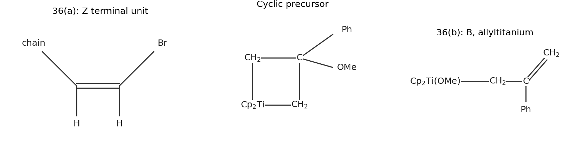

<h1 id="section-a/36/a/solution">Solution</h1>

↑ **Parent:** [A](../a.md)

Only one bromine is replaced by [hydrogen](../../../../../../hydrogen.md). Writing the unchanged protected chain as $R=\mathrm{THPOCH_2CH(Me)}$, the product is **$R\mathrm{CH=C(Me)CH=CHBr}$**, retaining the original internal [alkene](../../../../../../alkene.md) geometry and forming predominantly the **$Z$ terminal bromoalkene**: bromine and the [carbon](../../../../../../carbon.md) chain lie on the same side of that new stereodefined double bond. The formula is consequently $\mathrm{C_{13}H_{21}BrO_2}$.

Phosphine dissociation exposes Pd(0), which undergoes preferential [oxidative addition](../../../../../../oxidative-addition.md) into the less hindered C–Br bond, the bromine trans to the [carbon](../../../../../../carbon.md) chain in the gem-dibromoalkene. [hydride](../../../../../../hydride.md) transfer from [tributyltin hydride](../../../../../../tributyltin-hydride.md) replaces the [palladium](../../../../../../palladium.md) bromide ligand, producing tributyltin bromide and an alkenyl–Pd–H intermediate. [reductive elimination](../../../../../../reductive-elimination.md) joins the alkenyl [carbon](../../../../../../carbon.md) and [hydride](../../../../../../hydride.md), regenerating Pd(0). Retention of the alkenyl geometry through this sequence puts the surviving bromine cis to the chain. The conjugated [carbon](../../../../../../carbon.md) skeleton and [protecting group](../../../../../../protecting-group.md) remain intact; this is not addition of tin [hydride](../../../../../../hydride.md) across either [alkene](../../../../../../alkene.md). The stereoselective monohydrogenolysis is established for this reagent combination.[Tetrahedron Letters 37, pp. 6759–6762: palladium/tributyltin-hydride monoreduction](../../../../../../a-general-and-convenient-synthetic-method-of-geometrically-pure-z-1-bromo-1-alkenes-by-junichi-uenishi-and-others.md)

**[Figure 1](#section-a/36/a/image-original-product-and-metallacycle-connectivity-drawings-for-the-organometallic-transformations). Original product and metallacycle connectivity drawings for the organometallic transformations**.

## ↑ Ancestors (14)

1. [A](../a.md)
2. [36](../../36.md)
3. [Section A](../../../section-a.md)
4. [Paper 3](../../../../paper-3-split.md)
5. [2022](../../../../split.md)
6. [Past exam of the chemistry course of the year 4 of the natural sciences course of the University of Cambridge](../../../../../split.md)
7. [Chemistry course of the year 4 of the natural sciences course of the University of Cambridge](../../../../../../chemistry-course-of-the-year-4-of-the-natural-sciences-course-of-the-university-of-cambridge.md)
8. [Year 4 of the natural sciences course of the University of Cambridge](../../../../../../year-4-of-the-natural-sciences-course-of-the-university-of-cambridge.md)
9. [Year of the natural sciences course of the University of Cambridge](../../../../../../year-of-the-natural-sciences-course-of-the-university-of-cambridge.md)
10. [Natural sciences course of the University of Cambridge](../../../../../../natural-sciences-course-of-the-university-of-cambridge.md)
11. [Course of the University of Cambridge](../../../../../../course-of-the-university-of-cambridge.md)
12. [University of Cambridge](../../../../../../university-of-cambridge-split.md)
13. [List of universities](../../../../../../list-of-universities.md)
14. [Codex Wiki](../../../../../../split.md)
