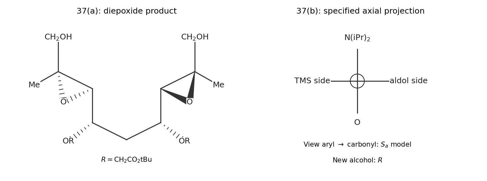

<h1 id="section-a/37/a/solution">Solution</h1>

↑ **Parent:** [A](../a.md)

Both free primary allylic alcohols undergo [Sharpless asymmetric epoxidation](../../../../../../sharpless-asymmetric-epoxidation.md). With slightly more than two equivalents of [hydroperoxide](../../../../../../hydroperoxide.md), the expected fully oxidized product is **the diepoxide, with both original C=C bonds converted to [epoxides](../../../../../../epoxide.md) and both [primary alcohols](../../../../../../primary-alcohol.md) retained**. The two central pre-existing [stereocentres](../../../../../../stereocentre.md) and their [ether](../../../../../../ether.md) substituents are retained.

The stereochemical construction is unambiguous by applying the L-(+)-tartrate mnemonic separately at each end: orient that [alkene](../../../../../../alkene.md) horizontally with its CH$_2$OH group at lower right, and deliver [oxygen](../../../../../../oxygen.md) from the back face. In the source's original in-plane orientation this gives **the left [epoxide](../../../../../../epoxide.md) [oxygen](../../../../../../oxygen.md) behind the plane and the right [epoxide](../../../../../../epoxide.md) [oxygen](../../../../../../oxygen.md) in front**. The methyl and hydroxymethyl groups retain their original relative arrangement about each former double bond. One cannot simply draw both [oxygens](../../../../../../oxygen.md) on the same face of the original extended chain: the two allylic-alcohol ends have opposite drawing orientations. [titanium](../../../../../../titanium.md) binding to each free hydroxyl directs [oxygen](../../../../../../oxygen.md) transfer; the pre-existing [stereocentres](../../../../../../stereocentre.md) can create matched/mismatched rate differences, but the stated reagent control predicts the [stereochemistry](../../../../../../stereochemistry-split.md) of both epoxidations. Molecular sieves maintain a dry active [titanium](../../../../../../titanium.md)–tartrate system.[JACS 102, pp. 5974–5976: tartrate-controlled allylic-alcohol epoxidation](../../../../../../the-first-practical-method-for-asymmetric-epoxidation-by-tsutomu-katsuki-and-k-barry-sharpless.md)

**[Figure 2](#section-a/37/a/image-original-facial-selectivity-and-axial-projection-solution-models). Original facial-selectivity and axial-projection solution models**.

## ↑ Ancestors (14)

1. [A](../a.md)
2. [37](../../37.md)
3. [Section A](../../../section-a.md)
4. [Paper 3](../../../../paper-3-split.md)
5. [2022](../../../../split.md)
6. [Past exam of the chemistry course of the year 4 of the natural sciences course of the University of Cambridge](../../../../../split.md)
7. [Chemistry course of the year 4 of the natural sciences course of the University of Cambridge](../../../../../../chemistry-course-of-the-year-4-of-the-natural-sciences-course-of-the-university-of-cambridge.md)
8. [Year 4 of the natural sciences course of the University of Cambridge](../../../../../../year-4-of-the-natural-sciences-course-of-the-university-of-cambridge.md)
9. [Year of the natural sciences course of the University of Cambridge](../../../../../../year-of-the-natural-sciences-course-of-the-university-of-cambridge.md)
10. [Natural sciences course of the University of Cambridge](../../../../../../natural-sciences-course-of-the-university-of-cambridge.md)
11. [Course of the University of Cambridge](../../../../../../course-of-the-university-of-cambridge.md)
12. [University of Cambridge](../../../../../../university-of-cambridge-split.md)
13. [List of universities](../../../../../../list-of-universities.md)
14. [Codex Wiki](../../../../../../split.md)
